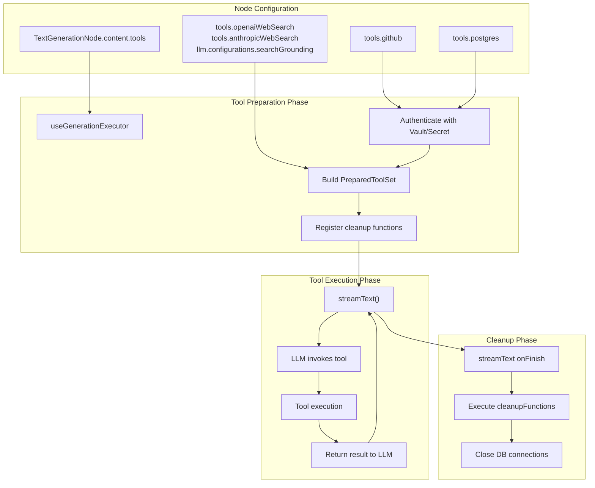
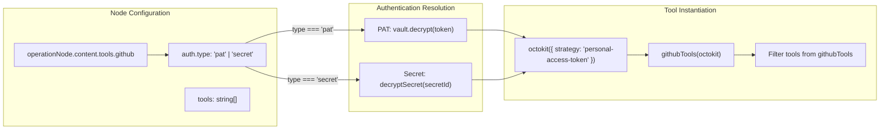
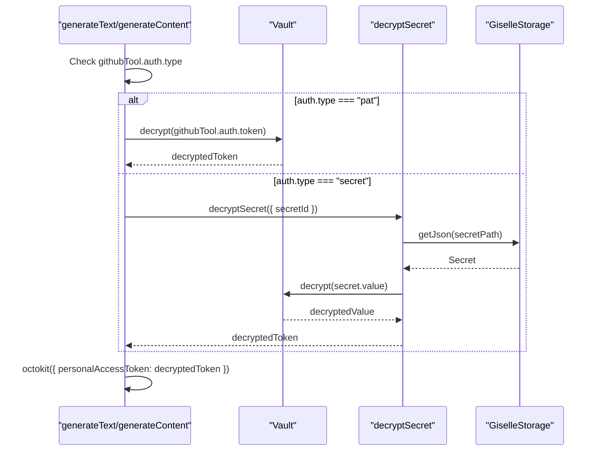
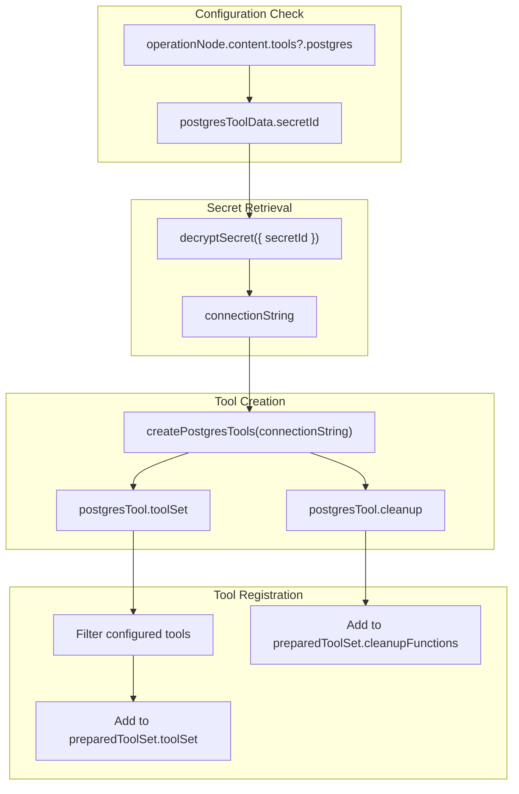
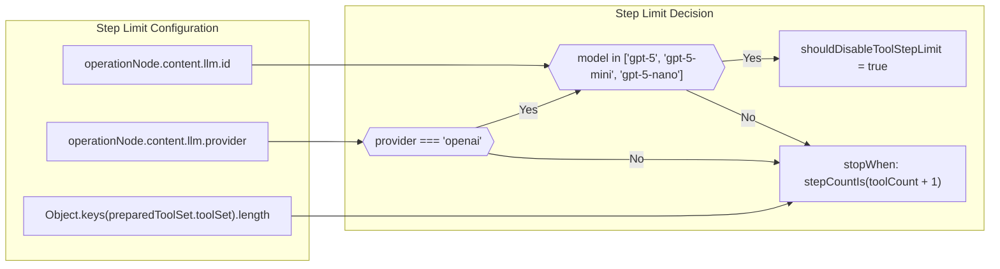
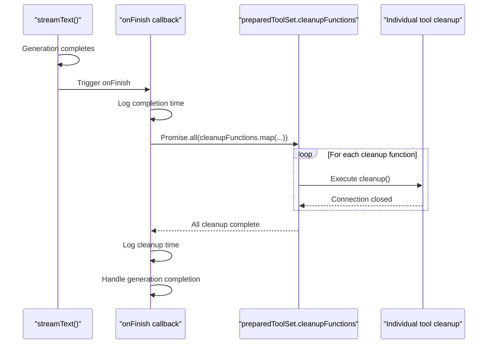
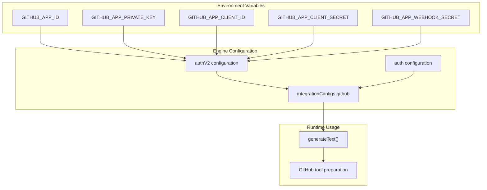
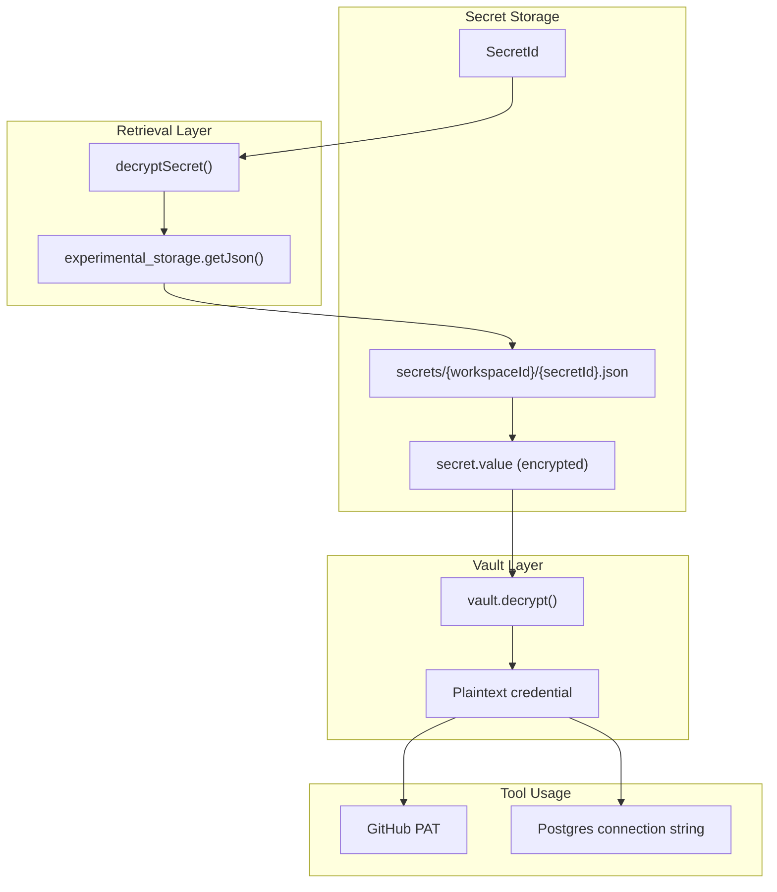

<!-- source: DeepWiki mcp.deepwiki.com · repo giselles-ai/giselle · page 2.7 Tool System and External Integrations · fetched 2026-10-27 -->

# Tool System and External Integrations

<details>
<summary>Relevant source files</summary>

The following files were used as context for generating this wiki page:

- [apps/playground/giselle-engine.ts](apps/playground/giselle-engine.ts)
- [apps/studio.giselles.ai/app/giselle-engine.ts](apps/studio.giselles.ai/app/giselle-engine.ts)
- [packages/giselle/src/engine/acts/run-act.ts](packages/giselle/src/engine/acts/run-act.ts)
- [packages/giselle/src/engine/generations/generate-content.ts](packages/giselle/src/engine/generations/generate-content.ts)
- [packages/giselle/src/engine/generations/generate-image.ts](packages/giselle/src/engine/generations/generate-image.ts)
- [packages/giselle/src/engine/generations/internal/use-generation-executor.ts](packages/giselle/src/engine/generations/internal/use-generation-executor.ts)
- [packages/giselle/src/engine/generations/types.ts](packages/giselle/src/engine/generations/types.ts)
- [packages/giselle/src/engine/generations/utils.ts](packages/giselle/src/engine/generations/utils.ts)
- [packages/giselle/src/engine/operations/execute-query.ts](packages/giselle/src/engine/operations/execute-query.ts)
- [packages/giselle/src/engine/telemetry/index.ts](packages/giselle/src/engine/telemetry/index.ts)
- [packages/giselle/src/engine/telemetry/types.ts](packages/giselle/src/engine/telemetry/types.ts)
- [packages/giselle/src/engine/triggers/resolve-trigger.ts](packages/giselle/src/engine/triggers/resolve-trigger.ts)
- [packages/giselle/src/engine/types.ts](packages/giselle/src/engine/types.ts)
- [packages/giselle/src/react/generations/generation-runner.tsx](packages/giselle/src/react/generations/generation-runner.tsx)

</details>


This document describes the tool system that enables LLM operations to interact with external services and data sources. Tools are dynamically prepared and injected into text generation calls based on node configuration, allowing AI models to access GitHub repositories, execute database queries, and perform web searches.

For information about vector stores and RAG query execution, see [RAG Implementation and Query Execution](#3.3). For LLM provider configuration and model selection, see [Language Models and AI Providers](#2.3).

## Purpose and Architecture

The tool system provides a plugin-like mechanism for extending LLM capabilities with external integrations. Tools are prepared at generation time by examining the operation node's configuration, authenticating with external services, and building a tool set that is passed to the AI SDK's `streamText()` function.

The system supports three categories of tools:
- **GitHub tools**: Repository file access, issue management, pull request operations
- **Postgres tools**: Database query execution
- **Web search tools**: Provider-specific search and grounding capabilities

### Tool Lifecycle Overview



**Sources:**
- [packages/giselle/src/engine/generations/generate-text.ts:76-153]()
- [packages/giselle/src/engine/generations/generate-content.ts:112-188]()
- [packages/giselle/src/engine/generations/internal/use-generation-executor.ts:59-411]()

## PreparedToolSet Data Structure

The `PreparedToolSet` type encapsulates both the tools themselves and their lifecycle management:

```typescript
interface PreparedToolSet {
  toolSet: Record<string, CoreTool>;
  cleanupFunctions: (() => Promise<void>)[];
}
```

This structure is built incrementally as each tool type is evaluated and conditionally added to the set.

**Sources:**
- [packages/giselle/src/engine/generations/types.ts]()

## GitHub Tools Integration

GitHub tools enable LLM operations to interact with repositories, issues, and pull requests. The integration supports two authentication strategies: Personal Access Token (PAT) and encrypted secrets.

### GitHub Tool Configuration



### Tool Preparation Logic

The GitHub tool preparation follows this pattern in both `generate-text.ts` and `generate-content.ts`:

| Step | Action | Code Location |
|------|--------|---------------|
| 1. Check configuration | Verify `operationNode.content.tools?.github` exists | Line 82 |
| 2. Resolve authentication | Decrypt PAT or retrieve secret | Lines 84-101 |
| 3. Create Octokit client | Initialize with `personal-access-token` strategy | Lines 102-106 |
| 4. Get all GitHub tools | Call `githubTools(octokit)` | Lines 102-107 |
| 5. Filter selected tools | Add only configured tools to `preparedToolSet` | Lines 108-118 |

### Authentication Flow



### Available GitHub Tools

The `@giselle-sdk/github-tool` package provides tools that are selectively enabled based on node configuration. The exact tools available depend on the package implementation, but the system allows specifying which tools to include via the `tools` array in the configuration.

**Sources:**
- [packages/giselle/src/engine/generations/generate-text.ts:82-119]()
- [packages/giselle/src/engine/generations/generate-content.ts:117-153]()
- [packages/giselle/src/engine/secrets/decrypt-secret.ts:1-36]()

## Postgres Tools Integration

Postgres tools enable SQL query execution during LLM operations. The tool requires an encrypted connection string stored as a secret.

### Postgres Tool Preparation



### Implementation Details

The Postgres tool integration differs from GitHub tools in that it requires explicit cleanup. The `createPostgresTools()` function returns both a tool set and a cleanup function:

| Property | Purpose | Registration |
|----------|---------|-------------|
| `postgresTool.toolSet` | Contains executable tools | Added to `preparedToolSet.toolSet` |
| `postgresTool.cleanup` | Closes database connections | Added to `preparedToolSet.cleanupFunctions` |

The cleanup function is invoked in the `streamText` `onFinish` callback, ensuring database connections are properly closed even if generation completes or fails.

**Sources:**
- [packages/giselle/src/engine/generations/generate-text.ts:121-153]()
- [packages/giselle/src/engine/generations/generate-content.ts:155-188]()
- [packages/giselle/src/engine/generations/tools/postgres.ts]()

## Web Search Tools Integration

Web search tools are provider-specific and enable LLMs to access real-time information. Each provider has different tool APIs and configuration requirements.

### Provider Tool Mapping

```mermaid
graph TB
    subgraph "OpenAI Provider"
        OpenAIConfig["provider === 'openai'"]
        OpenAIWebSearch["tools?.openaiWebSearch"]
        OpenAIPreview["openai.tools.webSearchPreview()"]
        OpenAIStandard["openai.tools.webSearch()"]
        OptionalGrounding1["hasCapability(model, OptionalSearchGrounding)"]
    end
    
    subgraph "Anthropic Provider"
        AnthropicConfig["provider === 'anthropic'"]
        AnthropicWebSearch["tools?.anthropicWebSearch"]
        AnthropicTool["anthropic.tools.webSearch_20250305()"]
    end
    
    subgraph "Google Provider"
        GoogleConfig["provider === 'google'"]
        SearchGrounding["llm.configurations.searchGrounding"]
        UrlContext["llm.configurations.urlContext"]
        GoogleSearch["vertex.tools.googleSearch() or google.tools.googleSearch()"]
        GoogleUrl["vertex.tools.urlContext() or google.tools.urlContext()"]
        OptionalGrounding2["hasCapability(model, OptionalSearchGrounding)"]
        UrlCapability["hasCapability(model, UrlContext)"]
    end
    
    OpenAIConfig --> OpenAIWebSearch
    OpenAIWebSearch --> OptionalGrounding1
    OptionalGrounding1 -->|"generate-text.ts"| OpenAIPreview
    OptionalGrounding1 -->|"generate-content.ts"| OpenAIStandard
    
    AnthropicConfig --> AnthropicWebSearch
    AnthropicWebSearch --> AnthropicTool
    
    GoogleConfig --> SearchGrounding
    GoogleConfig --> UrlContext
    SearchGrounding --> OptionalGrounding2
    OptionalGrounding2 --> GoogleSearch
    UrlContext --> UrlCapability
    UrlCapability --> GoogleUrl
```



### OpenAI Web Search Tools

OpenAI offers two web search tool variants:

| Tool Name | File | Usage Context | Configuration Source |
|-----------|------|---------------|---------------------|
| `web_search_preview` | `generate-text.ts` | Older streaming approach | `operationNode.content.tools.openaiWebSearch` |
| `web_search` | `generate-content.ts` | Newer content generation | `operationNode.content.tools.openaiWebSearch` |

Both require the model to have `Capability.OptionalSearchGrounding` and are configured with parameters from the node's tool configuration.

**Sources:**
- [packages/giselle/src/engine/generations/generate-text.ts:155-169]()
- [packages/giselle/src/engine/generations/generate-content.ts:190-204]()

### Google Search and URL Context Tools

Google Vertex AI provides two distinct tools:

1. **Google Search** (`google_search`): Real-time web search grounding
   - Enabled when `llm.configurations.searchGrounding === true`
   - Requires `Capability.OptionalSearchGrounding`
   - Uses `vertex.tools.googleSearch({})` in `generate-text.ts`
   - Uses `google.tools.googleSearch({})` in `generate-content.ts`

2. **URL Context** (`url_context`): Fetch and process content from URLs
   - Enabled when `llm.configurations.urlContext === true`
   - Requires `Capability.UrlContext`
   - Uses `vertex.tools.urlContext({})` in `generate-text.ts`
   - Uses `google.tools.urlContext({})` in `generate-content.ts`

**Sources:**
- [packages/giselle/src/engine/generations/generate-text.ts:170-195]()
- [packages/giselle/src/engine/generations/generate-content.ts:205-230]()

### Anthropic Web Search Tool

Anthropic's web search integration is simpler:

- Tool name: `web_search`
- API: `anthropic.tools.webSearch_20250305()`
- Configuration: `operationNode.content.tools.anthropicWebSearch`
- No capability check required

**Sources:**
- [packages/giselle/src/engine/generations/generate-text.ts:197-210]()
- [packages/giselle/src/engine/generations/generate-content.ts:232-245]()

## Tool Injection into LLM Calls

Once tools are prepared, they are injected into the `streamText()` call via the `tools` parameter. The system also manages step count limits for tool usage.

### Tool Step Limiting



The step limit logic prevents infinite tool calling loops:

- **Default behavior**: Limit tool calls to `toolCount + 1` steps using `stepCountIs()`
- **GPT-5 exception**: Models like `gpt-5`, `gpt-5-mini`, and `gpt-5-nano` have no step limit
- In `generate-content.ts`, the step limit always applies: `stopWhen: stepCountIs(Object.keys(preparedToolSet.toolSet).length + 1)`

### streamText Integration

The prepared tool set is passed to `streamText()` along with other parameters:

```typescript
const streamTextResult = streamText({
  model,
  providerOptions,
  messages,
  tools: preparedToolSet.toolSet,  // Injected here
  stopWhen: stepCountIs(preparedToolCount + 1),
  onError: ({ error }) => { /* ... */ },
  onFinish: () => { /* cleanup */ }
});
```

**Sources:**
- [packages/giselle/src/engine/generations/generate-text.ts:221-245]()
- [packages/giselle/src/engine/generations/generate-content.ts:258-292]()

## Tool Cleanup and Resource Management

Tools that manage persistent connections (like database clients) must be properly cleaned up after generation completes or fails.

### Cleanup Execution Flow



The cleanup phase occurs in the `streamText` `onFinish` callback:

1. **Tool cleanup**: Execute all registered cleanup functions in parallel
2. **Error handling**: Process any generation errors
3. **Output processing**: Extract text, reasoning, and sources
4. **Completion**: Call `finishGeneration()` to persist results

**Sources:**
- [packages/giselle/src/engine/generations/generate-text.ts:248-260]()
- [packages/giselle/src/engine/generations/generate-content.ts:296-307]()

## Integration Configuration

The Giselle Engine requires integration configuration at initialization time to enable external tool access.

### GitHub Integration Configuration



The `NextGiselleEngine()` configuration includes:

| Configuration Key | Purpose | Required Fields |
|-------------------|---------|-----------------|
| `integrationConfigs.github.authV2` | GitHub App authentication | `appId`, `privateKey`, `clientId`, `clientSecret`, `webhookSecret` |
| `integrationConfigs.github.auth` | Legacy authentication | `strategy`, `appId`, `privateKey`, `resolver` |

**Sources:**
- [apps/studio.giselles.ai/app/giselle-engine.ts:89-248]()
- [apps/playground/giselle-engine.ts:62-93]()
- [packages/giselle/src/engine/types.ts:124-141]()

## Tool Security and Secrets Management

All tool authentication credentials are handled through the vault system to ensure secure storage and transmission.

### Secret Resolution Pattern



The `decryptSecret()` function provides a unified interface for retrieving and decrypting secrets:

1. Load secret from storage using `secretPath(secretId)`
2. Parse with `Secret` schema
3. Decrypt value using `vault.decrypt(secret.value)`
4. Return plaintext credential

**Sources:**
- [packages/giselle/src/engine/secrets/decrypt-secret.ts:1-36]()
- [packages/giselle/src/engine/secrets/paths.ts]()

---

