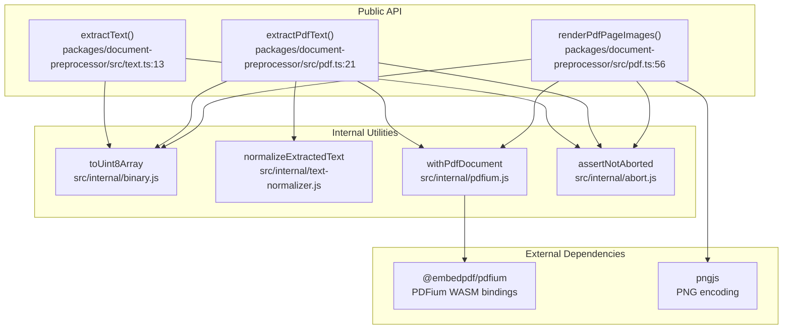
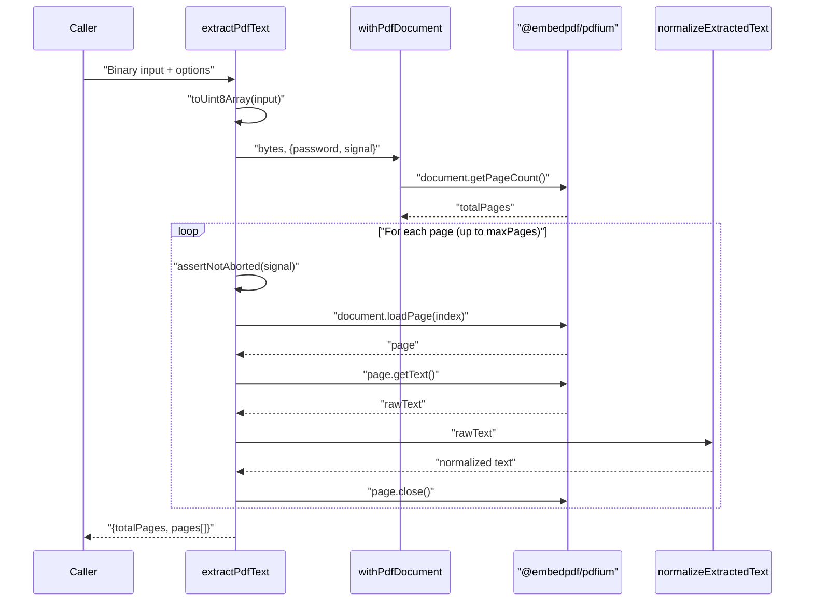
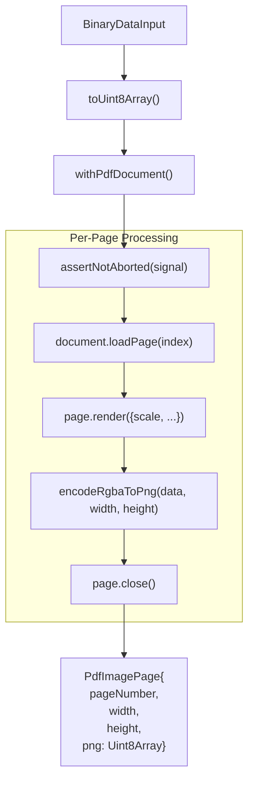
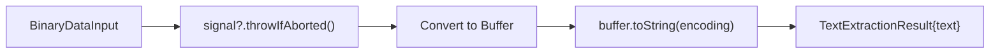
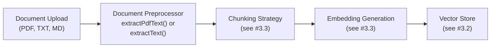

<!-- source: DeepWiki mcp.deepwiki.com · repo giselles-ai/giselle · page 3.1 Document Processing Pipeline · fetched 2026-10-27 -->

# Document Processing Pipeline

<details>
<summary>Relevant source files</summary>

The following files were used as context for generating this wiki page:

- [docs/packages-license.md](docs/packages-license.md)
- [packages/document-preprocessor/README.md](packages/document-preprocessor/README.md)
- [packages/document-preprocessor/package.json](packages/document-preprocessor/package.json)
- [packages/document-preprocessor/src/global.d.ts](packages/document-preprocessor/src/global.d.ts)
- [packages/document-preprocessor/src/index.ts](packages/document-preprocessor/src/index.ts)
- [packages/document-preprocessor/src/pdf.ts](packages/document-preprocessor/src/pdf.ts)
- [packages/document-preprocessor/src/text.test.ts](packages/document-preprocessor/src/text.test.ts)
- [packages/document-preprocessor/src/text.ts](packages/document-preprocessor/src/text.ts)
- [packages/document-preprocessor/src/types.ts](packages/document-preprocessor/src/types.ts)
- [packages/document-preprocessor/tsconfig.json](packages/document-preprocessor/tsconfig.json)
- [packages/document-preprocessor/tsup.config.ts](packages/document-preprocessor/tsup.config.ts)
- [packages/document-preprocessor/turbo.json](packages/document-preprocessor/turbo.json)
- [packages/document-preprocessor/vitest.config.mts](packages/document-preprocessor/vitest.config.mts)

</details>


## Purpose and Scope

The Document Processing Pipeline is implemented in the `@giselle-sdk/document-preprocessor` package and provides low-level utilities for converting raw document binaries into structured text and image outputs suitable for downstream RAG ingestion. This page documents the preprocessing layer that transforms PDFs, plain text, and Markdown files into normalized content with per-page metadata.

For information about how processed documents are indexed and stored in vector stores, see [Vector Store System](#3.2). For details on the RAG query execution and chunking strategies applied to preprocessed content, see [RAG Implementation and Query Execution](#3.3).

---

## Architecture Overview

The document-preprocessor package exposes three primary functions that operate on binary inputs and return structured results. All functions support abort signals for cancellation and implement consistent error handling patterns.



**Sources:** [packages/document-preprocessor/src/index.ts:1-13](), [packages/document-preprocessor/src/pdf.ts:1-138](), [packages/document-preprocessor/src/text.ts:1-37](), [packages/document-preprocessor/README.md:1-154]()

---

## Public API Surface

The package exports three main functions through [packages/document-preprocessor/src/index.ts:1-13]():

| Function | Input | Output | Purpose |
|----------|-------|--------|---------|
| `extractText` | Plain text/Markdown binary | `TextExtractionResult` | UTF-8 decoding of text files |
| `extractPdfText` | PDF binary | `PdfTextExtractionResult` | Page-by-page text extraction with normalization |
| `renderPdfPageImages` | PDF binary | `PdfImageRenderResult` | PNG rendering at configurable DPI |

All functions accept `BinaryDataInput` which can be `ArrayBuffer`, `ArrayBufferView`, `Uint8Array`, or Node.js `Buffer`. This flexibility accommodates various input sources including file system reads, HTTP responses, and in-memory buffers.

**Sources:** [packages/document-preprocessor/src/types.ts:1-53](), [packages/document-preprocessor/README.md:82-127]()

---

## PDF Text Extraction

### Processing Flow

The `extractPdfText` function implements a page-by-page extraction pipeline defined in [packages/document-preprocessor/src/pdf.ts:21-54]():



### Configuration Options

The `PdfTextExtractionOptions` interface defined in [packages/document-preprocessor/src/types.ts:14-18]() supports:

- **password**: Optional string for encrypted PDFs
- **maxPages**: Limit extraction to first N pages (useful for preview operations)
- **signal**: `AbortSignal` for cancellation

The `calculatePageLimit` helper in [packages/document-preprocessor/src/pdf.ts:132-137]() determines the actual page range by taking the minimum of `totalPages` and `maxPages`.

### Text Normalization

Raw text extracted from PDFium undergoes normalization through the `normalizeExtractedText` function (implementation in `src/internal/text-normalizer.js`). This process:

- Repairs hyphenated words split across lines
- Normalizes whitespace sequences
- Removes spurious control characters
- Preserves paragraph structure

The normalized text is stored in the `PdfTextPage` structure with `pageNumber` (1-indexed) and `text` fields.

**Sources:** [packages/document-preprocessor/src/pdf.ts:21-54](), [packages/document-preprocessor/src/types.ts:9-23](), [packages/document-preprocessor/README.md:36-50]()

---

## PDF Image Rendering

### Rendering Pipeline

The `renderPdfPageImages` function in [packages/document-preprocessor/src/pdf.ts:56-99]() converts PDF pages to PNG images using a configurable DPI setting:



### DPI Calculation

The scale factor is computed in [packages/document-preprocessor/src/pdf.ts:18-19,62-63]():

```
POINTS_PER_INCH = 72
DEFAULT_TARGET_DPI = 144
scale = max(targetDpi / POINTS_PER_INCH, 0.1)
```

A `targetDpi` of 144 produces a scale of 2.0, doubling the resolution of the base 72 DPI PDF coordinate system. The minimum scale of 0.1 prevents rendering errors from extremely small values.

### PNG Encoding

The `encodeRgbaToPng` function in [packages/document-preprocessor/src/pdf.ts:101-130]() uses the `pngjs` library to convert RGBA pixel data from PDFium into PNG format:

1. Creates a `PNG` instance with `inputHasAlpha: true` and `colorType: 6` (RGB + alpha)
2. Copies RGBA bytes into the PNG data buffer
3. Streams encoded chunks into a Buffer array via the `pack()` pipeline
4. Returns a `Uint8Array` view over the concatenated buffer without copying

The resulting PNG can be stored in blob storage or passed to image-based LLM models for multimodal RAG.

### Form Field Rendering

The `renderFormFields` option (default `true`) in [packages/document-preprocessor/src/pdf.ts:79]() controls whether interactive PDF form elements are rendered as part of the image. This is useful for capturing filled form data in document previews.

**Sources:** [packages/document-preprocessor/src/pdf.ts:56-130](), [packages/document-preprocessor/src/types.ts:25-43](), [packages/document-preprocessor/README.md:53-68]()

---

## Text and Markdown Processing

The `extractText` function in [packages/document-preprocessor/src/text.ts:13-36]() provides a simpler processing path for non-PDF documents:



### Encoding Support

The function accepts a `BufferEncoding` parameter (default `"utf-8"`) to handle various text encodings. The conversion logic in [packages/document-preprocessor/src/text.ts:21-31]() handles multiple input types:

- **Buffer**: Used directly
- **Uint8Array**: Creates Buffer view over underlying ArrayBuffer
- **ArrayBufferView**: Extracts buffer with correct offset and length
- **ArrayBuffer**: Converts to Buffer

No text normalization is applied to plain text files, preserving the exact content including whitespace and formatting.

**Sources:** [packages/document-preprocessor/src/text.ts:1-37](), [packages/document-preprocessor/src/text.test.ts:1-58](), [packages/document-preprocessor/README.md:20-32]()

---

## Internal Utilities

### Abort Signal Handling

The `assertNotAborted` utility (referenced in [packages/document-preprocessor/src/pdf.ts:4,37,74]()) checks the abort signal state at critical points in the processing pipeline. This enables responsive cancellation of long-running PDF operations, which is important for:

- User-initiated cancellation in upload flows
- Timeout enforcement for large documents
- Resource cleanup on service shutdown

All public functions accept an optional `signal` parameter in their options objects.

### Binary Data Conversion

The `toUint8Array` helper (referenced in [packages/document-preprocessor/src/pdf.ts:5,25,60]()) normalizes various binary input formats to `Uint8Array` for consistent handling by PDFium. This abstraction allows callers to pass data from different sources without pre-conversion.

### PDFium Document Lifecycle

The `withPdfDocument` wrapper (referenced in [packages/document-preprocessor/src/pdf.ts:6,28,65]()) manages PDFium document lifecycle:

1. Loads the PDF document with optional password
2. Provides the document handle to a callback function
3. Ensures proper cleanup even if the callback throws
4. Propagates abort signals to nested operations

The pattern guarantees that PDFium resources are released, preventing memory leaks in long-running processes.

**Sources:** [packages/document-preprocessor/src/pdf.ts:1-138](), [packages/document-preprocessor/README.md:70-79]()

---

## Type System

### Input Types

The `BinaryDataInput` union type in [packages/document-preprocessor/src/types.ts:3-7]() accepts:

```typescript
type BinaryDataInput =
  | ArrayBuffer
  | ArrayBufferView
  | Uint8Array
  | Buffer
```

This broad compatibility supports integration with various I/O systems including file streams, HTTP clients, and in-memory data structures.

### Result Types

The package defines three result interfaces:

| Type | Fields | Description |
|------|--------|-------------|
| `TextExtractionResult` | `text: string` | Simple text content |
| `PdfTextExtractionResult` | `totalPages: number`<br/>`pages: PdfTextPage[]` | Page-indexed text with metadata |
| `PdfImageRenderResult` | `totalPages: number`<br/>`pages: PdfImagePage[]` | Rendered images with dimensions |

The `PdfTextPage` structure in [packages/document-preprocessor/src/types.ts:9-12]() contains:
- `pageNumber`: 1-indexed page number
- `text`: Normalized text content

The `PdfImagePage` structure in [packages/document-preprocessor/src/types.ts:25-30]() contains:
- `pageNumber`: 1-indexed page number
- `width`: Image width in pixels
- `height`: Image height in pixels
- `png`: PNG-encoded image as Uint8Array

**Sources:** [packages/document-preprocessor/src/types.ts:1-53](), [packages/document-preprocessor/src/index.ts:1-13]()

---

## Security Considerations

### PDFium Sandboxing

The package uses `@embedpdf/pdfium` which runs in a sandboxed WASM environment, mitigating risks from malicious PDF files. However, as noted in [packages/document-preprocessor/README.md:150-154](), users should:

- Keep dependencies updated
- Monitor security advisories for PDFium vulnerabilities
- Enforce file size limits to prevent resource exhaustion
- Set processing timeout limits via abort signals

### Password-Protected PDFs

When processing password-protected PDFs, be aware that:

- Not all encryption schemes are supported by PDFium
- Password validation occurs during document loading
- Failed authentication throws an error that should be caught and handled gracefully
- Sensitive passwords should not be logged or stored

### Resource Limits

To prevent denial-of-service attacks, production deployments should:

- Limit maximum input file size
- Use `maxPages` option to cap processing scope
- Set abort signal timeouts for long-running operations
- Monitor memory usage during concurrent processing

**Sources:** [packages/document-preprocessor/README.md:149-154]()

---

## Integration with RAG System

### Document Upload Flow

The document-preprocessor serves as the entry point in the RAG ingestion pipeline:



### Output Format

Preprocessed documents produce structured pages that can be:

1. **Chunked** using strategies defined in the RAG implementation (semantic chunking, fixed-size windows, etc.)
2. **Embedded** via OpenAI or Google embedding models
3. **Stored** in PostgreSQL with pgvector extension

The `pageNumber` field enables provenance tracking, allowing RAG queries to cite specific page numbers in retrieved chunks.

### Image Processing for Multimodal RAG

For documents with complex visual elements:

1. Use `renderPdfPageImages` to generate PNG representations
2. Store images in Supabase Storage (see [Storage Architecture](#2.4))
3. Pass images to multimodal LLMs alongside text chunks during query time

This enables RAG over diagrams, charts, and other visual content that text extraction alone cannot capture.

**Sources:** [packages/document-preprocessor/README.md:1-154](), high-level diagrams (Diagram 5)

---

## Build Configuration

### TypeScript Configuration

The package uses `@giselles-ai/tsconfig/node-library.json` as the base configuration in [packages/document-preprocessor/tsconfig.json:2](), targeting Node.js 18+ environments.

### Build Setup

The tsup configuration in [packages/document-preprocessor/tsup.config.ts:1-11]() produces:

- **Formats**: CommonJS and ESM
- **Target**: node18
- **External dependencies**: `@embedpdf/pdfium`, `pngjs` (not bundled)
- **Outputs**: Type definitions (`.d.ts`), source maps, and compiled JavaScript

### Package Metadata

The package.json in [packages/document-preprocessor/package.json:1-32]() declares:

- **Main entry**: `dist/index.js`
- **Type definitions**: `dist/index.d.ts`
- **Keywords**: pdf, preprocessing, rag
- **License**: MIT

**Sources:** [packages/document-preprocessor/tsup.config.ts:1-11](), [packages/document-preprocessor/tsconfig.json:1-10](), [packages/document-preprocessor/package.json:1-32]()

---

