<!-- source: DeepWiki mcp.deepwiki.com · repo giselles-ai/giselle · page 3.2 Vector Store Management · fetched 2026-10-27 -->

# Vector Store Management

<details>
<summary>Relevant source files</summary>

The following files were used as context for generating this wiki page:

- [apps/studio.giselles.ai/app/(main)/settings/team/vector-stores/actions.ts](apps/studio.giselles.ai/app/(main)/settings/team/vector-stores/actions.ts)
- [apps/studio.giselles.ai/app/(main)/settings/team/vector-stores/configure-sources-dialog.tsx](apps/studio.giselles.ai/app/(main)/settings/team/vector-stores/configure-sources-dialog.tsx)
- [apps/studio.giselles.ai/app/(main)/settings/team/vector-stores/data.ts](apps/studio.giselles.ai/app/(main)/settings/team/vector-stores/data.ts)
- [apps/studio.giselles.ai/app/(main)/settings/team/vector-stores/diagnostic-modal.tsx](apps/studio.giselles.ai/app/(main)/settings/team/vector-stores/diagnostic-modal.tsx)
- [apps/studio.giselles.ai/app/(main)/settings/team/vector-stores/document-embedding-profiles.ts](apps/studio.giselles.ai/app/(main)/settings/team/vector-stores/document-embedding-profiles.ts)
- [apps/studio.giselles.ai/app/(main)/settings/team/vector-stores/document-store-create-dialog.tsx](apps/studio.giselles.ai/app/(main)/settings/team/vector-stores/document-store-create-dialog.tsx)
- [apps/studio.giselles.ai/app/(main)/settings/team/vector-stores/document-vector-store-list.tsx](apps/studio.giselles.ai/app/(main)/settings/team/vector-stores/document-vector-store-list.tsx)
- [apps/studio.giselles.ai/app/(main)/settings/team/vector-stores/document/document-vector-store-item.tsx](apps/studio.giselles.ai/app/(main)/settings/team/vector-stores/document/document-vector-store-item.tsx)
- [apps/studio.giselles.ai/app/(main)/settings/team/vector-stores/document/page.tsx](apps/studio.giselles.ai/app/(main)/settings/team/vector-stores/document/page.tsx)
- [apps/studio.giselles.ai/app/(main)/settings/team/vector-stores/layout.tsx](apps/studio.giselles.ai/app/(main)/settings/team/vector-stores/layout.tsx)
- [apps/studio.giselles.ai/app/(main)/settings/team/vector-stores/navigation-layout.tsx](apps/studio.giselles.ai/app/(main)/settings/team/vector-stores/navigation-layout.tsx)
- [apps/studio.giselles.ai/app/(main)/settings/team/vector-stores/page.tsx](apps/studio.giselles.ai/app/(main)/settings/team/vector-stores/page.tsx)
- [apps/studio.giselles.ai/app/(main)/settings/team/vector-stores/repository-item.tsx](apps/studio.giselles.ai/app/(main)/settings/team/vector-stores/repository-item.tsx)
- [apps/studio.giselles.ai/app/(main)/settings/team/vector-stores/repository-list.tsx](apps/studio.giselles.ai/app/(main)/settings/team/vector-stores/repository-list.tsx)
- [apps/studio.giselles.ai/app/(main)/settings/team/vector-stores/repository-registration-dialog.tsx](apps/studio.giselles.ai/app/(main)/settings/team/vector-stores/repository-registration-dialog.tsx)
- [apps/studio.giselles.ai/app/(main)/settings/team/vector-stores/sidebar-menu.tsx](apps/studio.giselles.ai/app/(main)/settings/team/vector-stores/sidebar-menu.tsx)
- [apps/studio.giselles.ai/app/(main)/settings/team/vector-stores/types.ts](apps/studio.giselles.ai/app/(main)/settings/team/vector-stores/types.ts)
- [internal-packages/ui/components/form-field.tsx](internal-packages/ui/components/form-field.tsx)
- [internal-packages/ui/components/section-header.tsx](internal-packages/ui/components/section-header.tsx)
- [internal-packages/ui/components/status-indicator.tsx](internal-packages/ui/components/status-indicator.tsx)

</details>


## Purpose and Scope

This document describes the Vector Store Management system, which provides user interfaces and backend operations for configuring and managing vector stores within teams. Vector stores enable Retrieval-Augmented Generation (RAG) by ingesting and indexing content from GitHub repositories or uploaded documents, making this content searchable through semantic similarity queries.

The system supports two types of vector stores:
1. **GitHub Vector Stores**: Index code, issues, and pull requests from GitHub repositories
2. **Document Vector Stores**: Index uploaded PDF and text documents

For information about how vector stores are queried during workflow execution, see [RAG System and Query Execution](#3.3). For details on document preprocessing and text extraction, see [Document Processing Pipeline](#3.1).

---

## System Architecture Overview

The Vector Store Management system consists of UI components for configuration, server actions for data operations, and background ingestion pipelines that process content and generate embeddings.

**Architecture Overview**

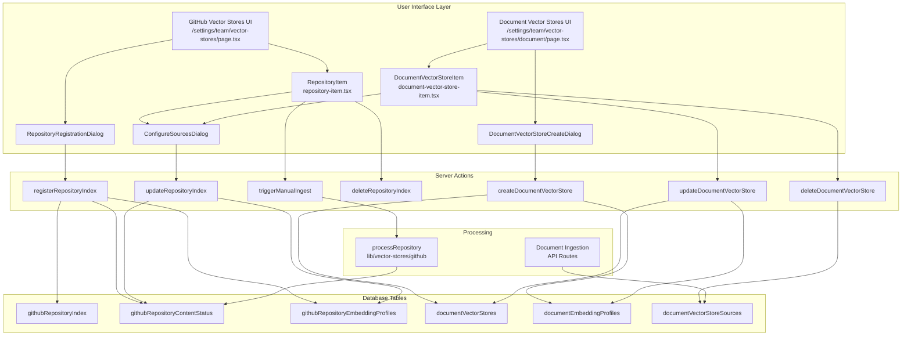

**Sources:**
- [apps/studio.giselles.ai/app/(main)/settings/team/vector-stores/page.tsx:1-80]()
- [apps/studio.giselles.ai/app/(main)/settings/team/vector-stores/document/page.tsx:1-48]()
- [apps/studio.giselles.ai/app/(main)/settings/team/vector-stores/actions.ts:1-986]()

---

## GitHub Vector Stores

### Registration and Configuration

GitHub Vector Stores are registered through the `RepositoryRegistrationDialog` component, which allows users to select repositories from their installed GitHub Apps.

**Registration Flow**

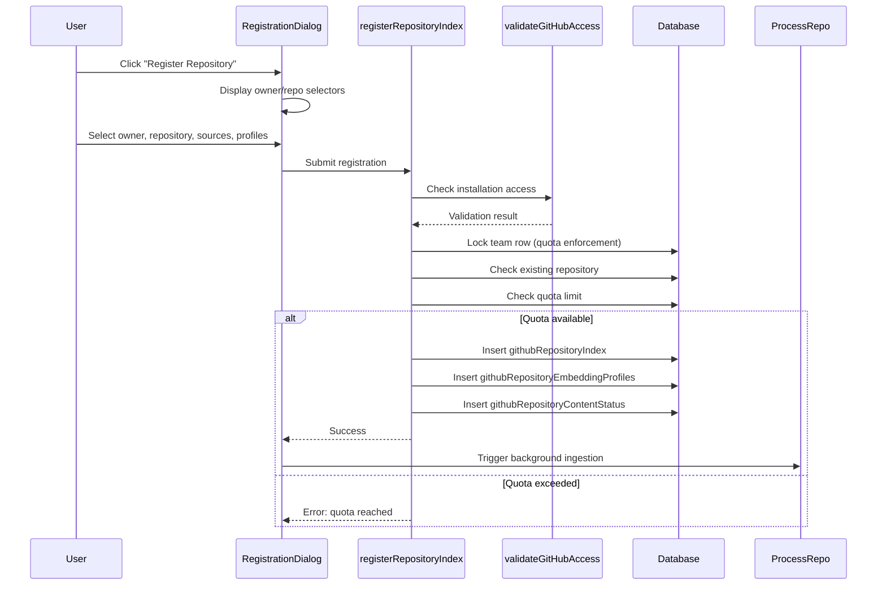

The registration process enforces team-based quotas and validates GitHub access before creating database records.

**Key Components:**

- **RepositoryRegistrationDialog** ([apps/studio.giselles.ai/app/(main)/settings/team/vector-stores/repository-registration-dialog.tsx:41-477]()): Manages the UI for selecting repositories and configuring initial settings
- **registerRepositoryIndex** ([apps/studio.giselles.ai/app/(main)/settings/team/vector-stores/actions.ts:107-251]()): Server action that validates access, checks quotas, and creates database records
- **validateGitHubAccess** ([apps/studio.giselles.ai/app/(main)/settings/team/vector-stores/actions.ts:62-105]()): Verifies the installation can access the repository

**Sources:**
- [apps/studio.giselles.ai/app/(main)/settings/team/vector-stores/repository-registration-dialog.tsx:41-477]()
- [apps/studio.giselles.ai/app/(main)/settings/team/vector-stores/actions.ts:62-251]()

### Content Type Management

Each GitHub repository can ingest three content types: code (blob), issues, and pull requests. Code ingestion is mandatory and cannot be disabled.

**Content Type Configuration**

| Content Type | Database Value | UI Label | Mandatory | Description |
|--------------|----------------|----------|-----------|-------------|
| `blob` | `"blob"` | Code | Yes | Source code files from the repository |
| `issue` | `"issue"` | Issues | No | Issue titles, descriptions, and comments |
| `pull_request` | `"pull_request"` | Pull Requests | No | Merged PR content and discussions |

Content types are managed per embedding profile, meaning each profile can have different content types enabled. The `githubRepositoryContentStatus` table tracks the status for each combination of repository, embedding profile, and content type.

**Content Status States**

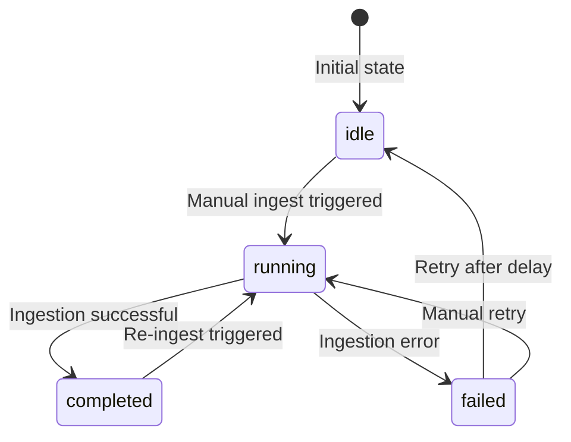

The status tracking includes:
- `status`: Current state (`idle`, `running`, `completed`, `failed`)
- `enabled`: Whether this content type is active
- `errorCode`: Error type if status is `failed` (e.g., `DOCUMENT_NOT_FOUND`)
- `retryAfter`: Timestamp when retry is allowed after failure
- `lastSyncedAt`: Last successful synchronization timestamp
- `metadata`: Content-specific metadata (e.g., `lastIngestedCommitSha`, `lastIngestedIssueNumber`)

**Sources:**
- [apps/studio.giselles.ai/app/(main)/settings/team/vector-stores/configure-sources-dialog.tsx:40-323]()
- [apps/studio.giselles.ai/app/(main)/settings/team/vector-stores/repository-item.tsx:240-564]()

### Embedding Profile Selection

Multiple embedding profiles can be selected for each repository, allowing the same content to be indexed with different embedding models. This supports use cases where different downstream applications require different embedding dimensions or providers.

**Available Embedding Profiles**

The `GITHUB_EMBEDDING_PROFILES` constant ([apps/studio.giselles.ai/app/(main)/settings/team/vector-stores/github-embedding-profiles.ts]()) defines supported profiles:

| Profile ID | Name | Provider | Dimensions |
|------------|------|----------|------------|
| `1` | OpenAI Small | OpenAI | 1536 |
| `2` | OpenAI Large | OpenAI | 3072 |
| `3` | Google Gecko | Google | 768 |

Each profile is stored in the `githubRepositoryEmbeddingProfiles` table, and content statuses are tracked separately for each profile-content type combination.

**Profile Management:**
- At least one profile must be selected
- Profiles can be added or removed via the `ConfigureSourcesDialog`
- Removing a profile deletes its content statuses and associated embeddings
- Adding a new profile triggers ingestion for all enabled content types

**Sources:**
- [apps/studio.giselles.ai/app/(main)/settings/team/vector-stores/repository-registration-dialog.tsx:378-432]()
- [apps/studio.giselles.ai/app/(main)/settings/team/vector-stores/configure-sources-dialog.tsx:186-241]()
- [apps/studio.giselles.ai/app/(main)/settings/team/vector-stores/actions.ts:257-409]()

### Repository Item Display and Status

The `RepositoryItem` component displays each registered repository with status cards for each embedding profile.

**Repository Item Structure**

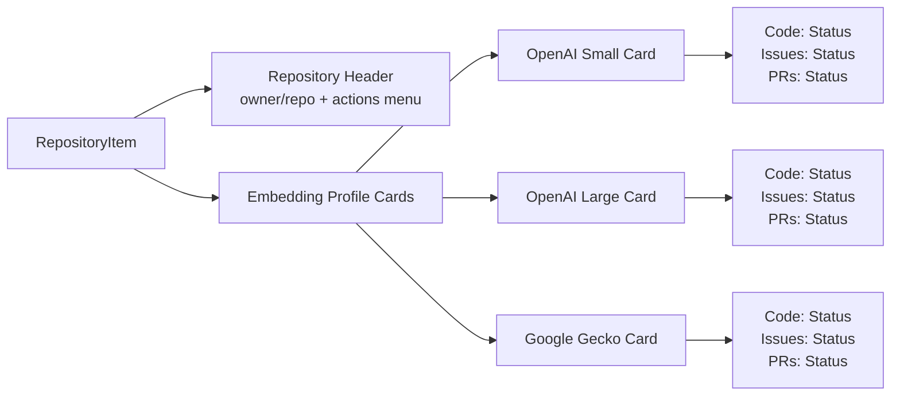

Each embedding profile card shows:
- Profile name and metadata
- Status for each content type (code, issues, PRs)
- Last sync timestamp
- Ingestion metadata (commit SHA, issue number, PR number)
- Error messages with retry information

**Status Display Logic** ([apps/studio.giselles.ai/app/(main)/settings/team/vector-stores/repository-item.tsx:283-374]()):
- `enabled=false`: Shows "Disabled" badge
- `status=completed`: Shows "Enabled" badge with success styling
- `status=running` or `isIngesting`: Shows "Running" status with indicator
- `status=idle`: Shows "Idle" status
- `status=failed`: Shows "Error" status with error message and optional "Check ↗" link

**Sources:**
- [apps/studio.giselles.ai/app/(main)/settings/team/vector-stores/repository-item.tsx:56-237]()
- [apps/studio.giselles.ai/app/(main)/settings/team/vector-stores/repository-item.tsx:240-564]()

### Manual Ingestion

Users can trigger manual ingestion through the "Ingest Now" action in the repository menu. The system checks whether ingestion is allowed before proceeding.

**Ingestability Rules** ([apps/studio.giselles.ai/app/(main)/settings/team/vector-stores/actions.ts:929-973]()):

1. At least one enabled content type must be in an ingestable state
2. A content type is ingestable if:
   - Status is `idle`, `completed`, or
   - Status is `running` but hasn't been updated in 15 minutes (stale threshold), or
   - Status is `failed` and `retryAfter` timestamp has passed
3. Repository must have a blob content status configured

**Manual Ingest Flow:**

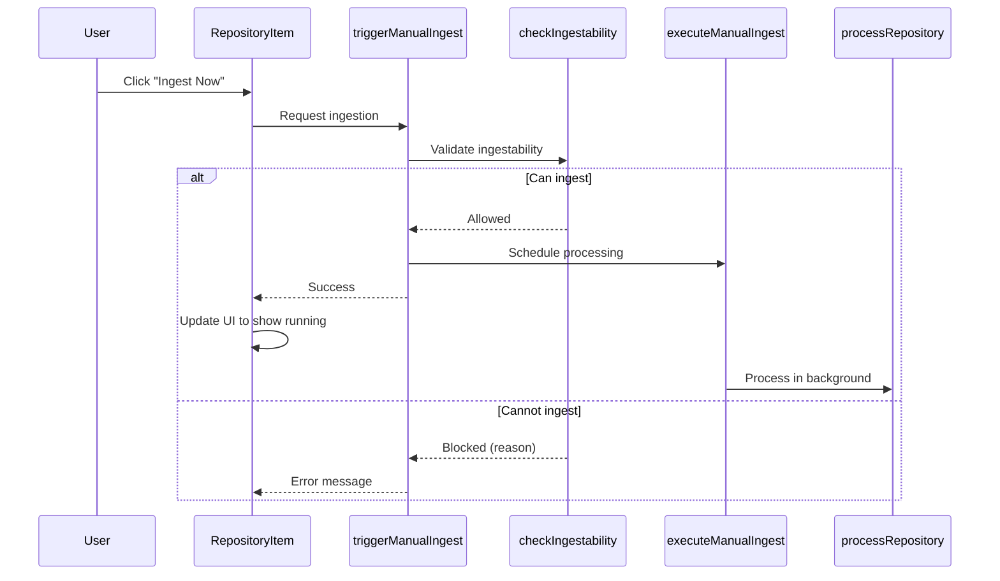

The `executeManualIngest` function uses `after()` ([apps/studio.giselles.ai/app/(main)/settings/team/vector-stores/actions.ts:978-985]()) to schedule background processing, allowing the UI to respond immediately while ingestion proceeds asynchronously.

**Sources:**
- [apps/studio.giselles.ai/app/(main)/settings/team/vector-stores/actions.ts:554-593]()
- [apps/studio.giselles.ai/app/(main)/settings/team/vector-stores/actions.ts:929-985]()
- [apps/studio.giselles.ai/app/(main)/settings/team/vector-stores/repository-item.tsx:90-101]()

### Diagnostic System

When a repository encounters a `DOCUMENT_NOT_FOUND` error, users can access the diagnostic modal to troubleshoot connection issues.

**Diagnostic Flow**

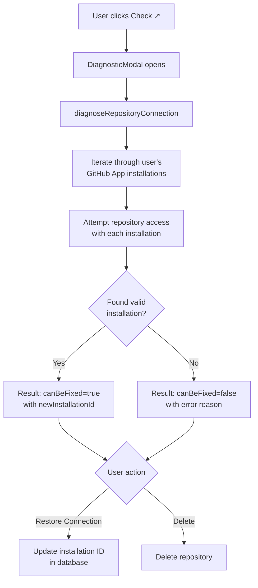

**Diagnostic Actions:**
- **diagnoseRepositoryConnection** ([apps/studio.giselles.ai/app/(main)/settings/team/vector-stores/actions.ts:424-503]()): Checks all user installations for repository access
- **updateRepositoryInstallation** ([apps/studio.giselles.ai/app/(main)/settings/team/vector-stores/actions.ts:505-549]()): Updates the installation ID and resets content statuses

**Possible Diagnostic Results:**
- `canBeFixed=true`: A valid installation was found; shows "Restore Connection" button
- `canBeFixed=false, reason="no-installation"`: No installation has access; suggests reviewing from Integrations page
- `canBeFixed=false, reason="repository-not-found"`: Repository not found in database
- `canBeFixed=false, reason="diagnosis-failed"`: Error during diagnosis

**Sources:**
- [apps/studio.giselles.ai/app/(main)/settings/team/vector-stores/diagnostic-modal.tsx:23-206]()
- [apps/studio.giselles.ai/app/(main)/settings/team/vector-stores/actions.ts:424-549]()

---

## Document Vector Stores

### Creation and Configuration

Document Vector Stores are created through the `DocumentVectorStoreCreateDialog`, which requires a name and at least one embedding profile.

**Creation Flow**

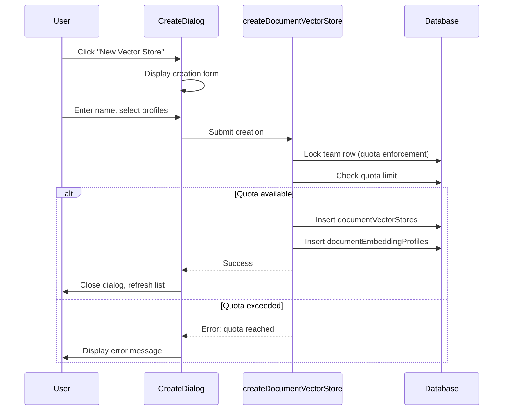

**Key Functions:**
- **createDocumentVectorStore** ([apps/studio.giselles.ai/app/(main)/settings/team/vector-stores/actions.ts:616-700]()): Creates vector store with transaction-based quota enforcement
- **validateDocumentEmbeddingProfileIds** ([apps/studio.giselles.ai/app/(main)/settings/team/vector-stores/actions.ts:595-614]()): Validates profile IDs are valid and unique

**Sources:**
- [apps/studio.giselles.ai/app/(main)/settings/team/vector-stores/document-store-create-dialog.tsx:30-241]()
- [apps/studio.giselles.ai/app/(main)/settings/team/vector-stores/actions.ts:595-700]()

### Document Upload and Management

Document uploads are handled through API routes at `/api/vector-stores/document/[storeId]/documents`.

**Upload Flow**

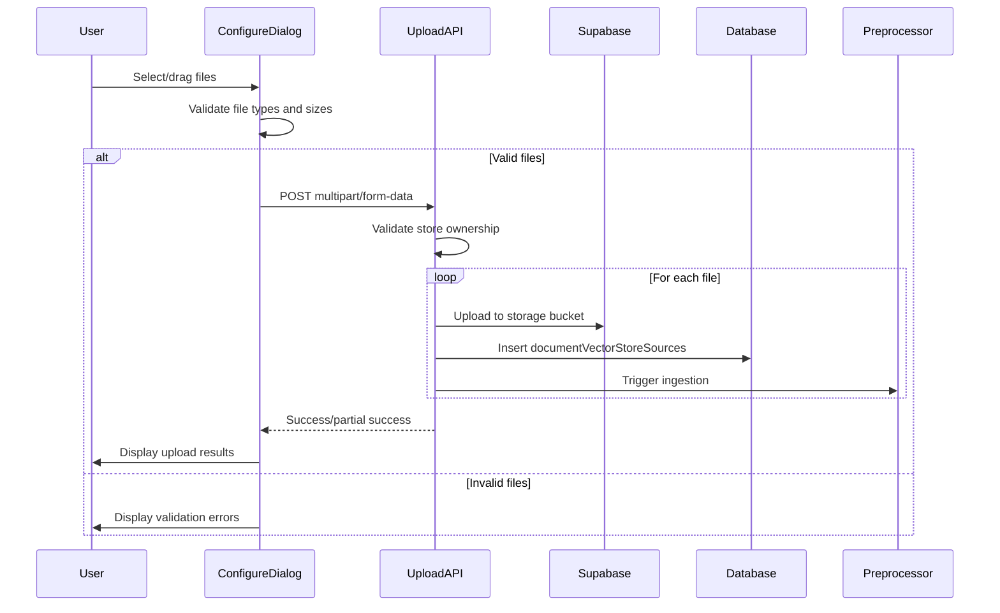

**File Validation:**
- Supported types: PDF, TXT, Markdown ([apps/studio.giselles.ai/lib/vector-stores/document/constants.ts]())
- Maximum size: 10MB per file
- Empty files are rejected
- Validation occurs client-side before upload

**Document Source Tracking:**

Each uploaded document is stored in `documentVectorStoreSources` with:
- `id`: Unique source identifier
- `documentVectorStoreDbId`: Foreign key to parent store
- `fileName`: Original filename
- `storageBucket`: Supabase bucket name
- `storageKey`: Path in storage bucket
- `ingestStatus`: Current ingestion status (`idle`, `running`, `completed`, `failed`)
- `ingestErrorCode`: Error code if ingestion failed

**Sources:**
- [apps/studio.giselles.ai/app/(main)/settings/team/vector-stores/document/document-vector-store-item.tsx:397-517]()
- [apps/studio.giselles.ai/app/(main)/settings/team/vector-stores/document/document-vector-store-item.tsx:585-635]()

### Document Vector Store Configuration

The `DocumentVectorStoreConfigureDialog` provides a comprehensive interface for managing store settings, embedding profiles, and source files.

**Configuration Dialog Features:**

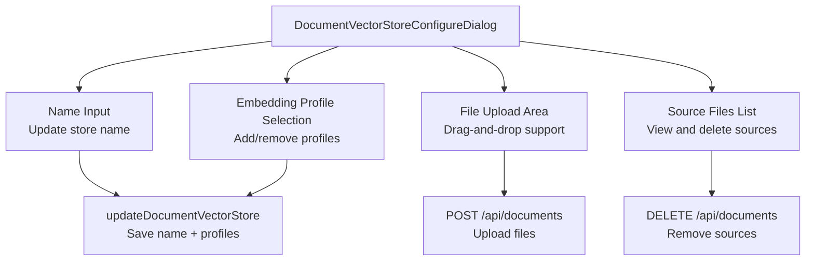

**Embedding Profile Management:**

Similar to GitHub Vector Stores, Document Vector Stores support multiple embedding profiles. However, Cohere profiles are currently excluded from the selectable options ([apps/studio.giselles.ai/app/(main)/settings/team/vector-stores/document/document-vector-store-item.tsx:340-344]()).

Available profiles from `DOCUMENT_EMBEDDING_PROFILES` ([apps/studio.giselles.ai/app/(main)/settings/team/vector-stores/document-embedding-profiles.ts:1-6]()):
- Same as `GITHUB_EMBEDDING_PROFILES`
- Filtered to exclude Cohere provider in UI
- At least one profile must remain selected

**Update Logic** ([apps/studio.giselles.ai/app/(main)/settings/team/vector-stores/actions.ts:702-776]()):
1. Validates name and profile selection
2. Acquires database lock on store row
3. Updates store name
4. Deletes all existing embedding profile associations
5. Inserts new profile associations
6. Transaction ensures consistency

**Sources:**
- [apps/studio.giselles.ai/app/(main)/settings/team/vector-stores/document/document-vector-store-item.tsx:327-867]()
- [apps/studio.giselles.ai/app/(main)/settings/team/vector-stores/actions.ts:702-776]()

### Document Deletion and Cleanup

Deleting a document vector store involves removing database records and storage files.

**Deletion Flow**

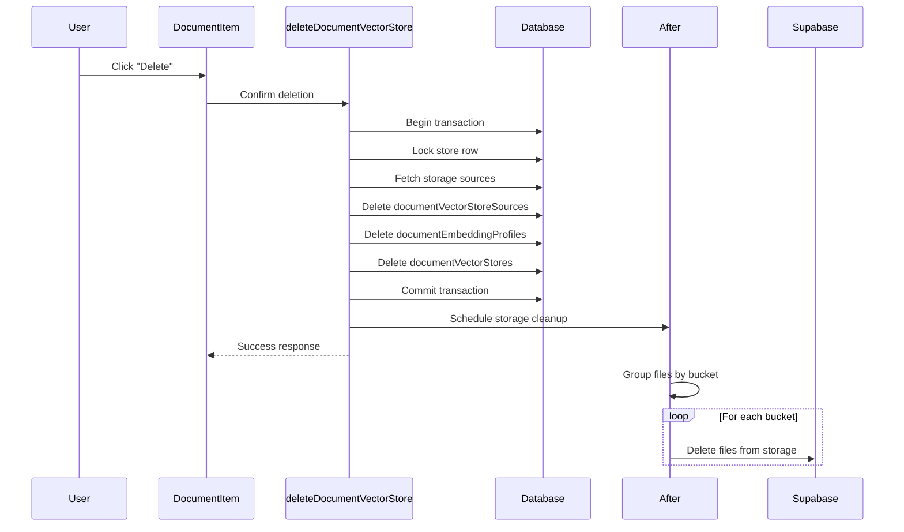

**Storage Cleanup Strategy** ([apps/studio.giselles.ai/app/(main)/settings/team/vector-stores/actions.ts:843-880]()):

1. Database deletion completes synchronously within transaction
2. Storage cleanup is deferred using `after()` to avoid blocking
3. Files are grouped by bucket to minimize API calls
4. Both individual file keys and folder paths are deleted
5. Cleanup errors are logged but don't fail the deletion operation

This approach ensures fast response times while still cleaning up storage resources, with the understanding that storage cleanup failures are non-critical.

**Sources:**
- [apps/studio.giselles.ai/app/(main)/settings/team/vector-stores/actions.ts:778-891]()

---

## Database Schema

The Vector Store Management system uses several interconnected database tables to track configuration and status.

**Database Schema Relationships**

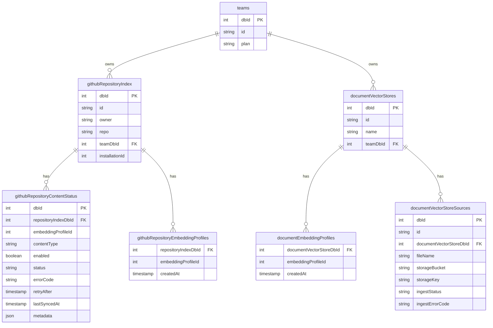

**GitHub Repository Tables:**

- **githubRepositoryIndex**: Primary repository configuration
  - `id`: External identifier (format: `gthbi_*`)
  - `owner` + `repo`: Repository coordinates
  - `installationId`: GitHub App installation for access
  - `teamDbId`: Foreign key to owning team

- **githubRepositoryContentStatus**: Per-profile, per-content-type status tracking
  - Composite uniqueness: `repositoryIndexDbId` + `embeddingProfileId` + `contentType`
  - `enabled`: Whether this combination is active
  - `status`: Current state (`idle`, `running`, `completed`, `failed`)
  - `metadata`: JSON field with content-specific data (commit SHA, issue number, PR number)

- **githubRepositoryEmbeddingProfiles**: Enabled embedding profiles
  - Links repository to embedding profile IDs
  - Deleted when profile is removed from configuration

**Document Vector Store Tables:**

- **documentVectorStores**: Store definition
  - `id`: External identifier (format: `dvs_*`)
  - `name`: User-provided name
  - `teamDbId`: Foreign key to owning team

- **documentEmbeddingProfiles**: Enabled embedding profiles
  - Links store to embedding profile IDs
  - Replaced on every configuration update

- **documentVectorStoreSources**: Individual document tracking
  - `id`: Unique source identifier
  - `storageBucket` + `storageKey`: Location in Supabase Storage
  - `ingestStatus`: Processing state
  - `ingestErrorCode`: Error details if ingestion failed

**Sources:**
- Database schema referenced throughout actions.ts
- [apps/studio.giselles.ai/app/(main)/settings/team/vector-stores/actions.ts:10-23]() (imports)

---

## Server Actions and API Routes

Vector store operations are exposed through Next.js Server Actions for mutations and API routes for file operations.

**Server Actions Overview**

| Action | Purpose | File Location |
|--------|---------|---------------|
| `registerRepositoryIndex` | Register new GitHub repository | [actions.ts:107-251]() |
| `updateRepositoryIndex` | Update content types and profiles | [actions.ts:257-409]() |
| `deleteRepositoryIndex` | Remove repository registration | [actions.ts:411-422]() |
| `triggerManualIngest` | Start manual ingestion | [actions.ts:554-593]() |
| `diagnoseRepositoryConnection` | Check repository access | [actions.ts:424-503]() |
| `updateRepositoryInstallation` | Fix installation ID | [actions.ts:505-549]() |
| `createDocumentVectorStore` | Create new document store | [actions.ts:616-700]() |
| `updateDocumentVectorStore` | Update store configuration | [actions.ts:702-776]() |
| `deleteDocumentVectorStore` | Delete store and cleanup files | [actions.ts:778-891]() |

**Transaction Patterns:**

All quota-enforcing operations use pessimistic locking:
1. Begin transaction
2. Lock team row with `FOR UPDATE`
3. Check existing records (also locked)
4. Verify quota limit
5. Perform insertions if quota allows
6. Commit or rollback

Example from `registerRepositoryIndex` ([apps/studio.giselles.ai/app/(main)/settings/team/vector-stores/actions.ts:159-235]()):
```typescript
await db.transaction(async (tx) => {
  // Lock team row
  await tx
    .select({ dbId: teams.dbId })
    .from(teams)
    .where(eq(teams.dbId, team.dbId))
    .limit(1)
    .for("update");
  
  // Check existing repositories count
  const existingRepositories = await tx
    .select({ dbId: githubRepositoryIndex.dbId })
    .from(githubRepositoryIndex)
    .where(eq(githubRepositoryIndex.teamDbId, team.dbId))
    .limit(quota.maxStores)
    .for("update");
  
  if (existingRepositories.length >= quota.maxStores) {
    return { success: false, error: "Quota reached" };
  }
  
  // Proceed with insertion...
});
```

**API Routes:**

Document upload and deletion use API routes due to multipart form data requirements:

- **POST** `/api/vector-stores/document/[storeId]/documents`: Upload files
  - Accepts multipart/form-data
  - Validates file types and sizes
  - Stores in Supabase Storage
  - Creates source records
  - Returns success/failure for each file (HTTP 207 Multi-Status)

- **DELETE** `/api/vector-stores/document/[storeId]/documents`: Delete source
  - Accepts JSON body with `sourceId`
  - Removes database record
  - Deletes from Supabase Storage
  - Returns success/error

These routes are referenced in the document vector store item component but implemented outside the provided file listing.

**Sources:**
- [apps/studio.giselles.ai/app/(main)/settings/team/vector-stores/actions.ts:1-986]()
- [apps/studio.giselles.ai/app/(main)/settings/team/vector-stores/document/document-vector-store-item.tsx:442-514]() (API usage)

---

## Plan-Based Quota Management

Vector store availability and limits are determined by team plan tier.

**Quota Enforcement Architecture**

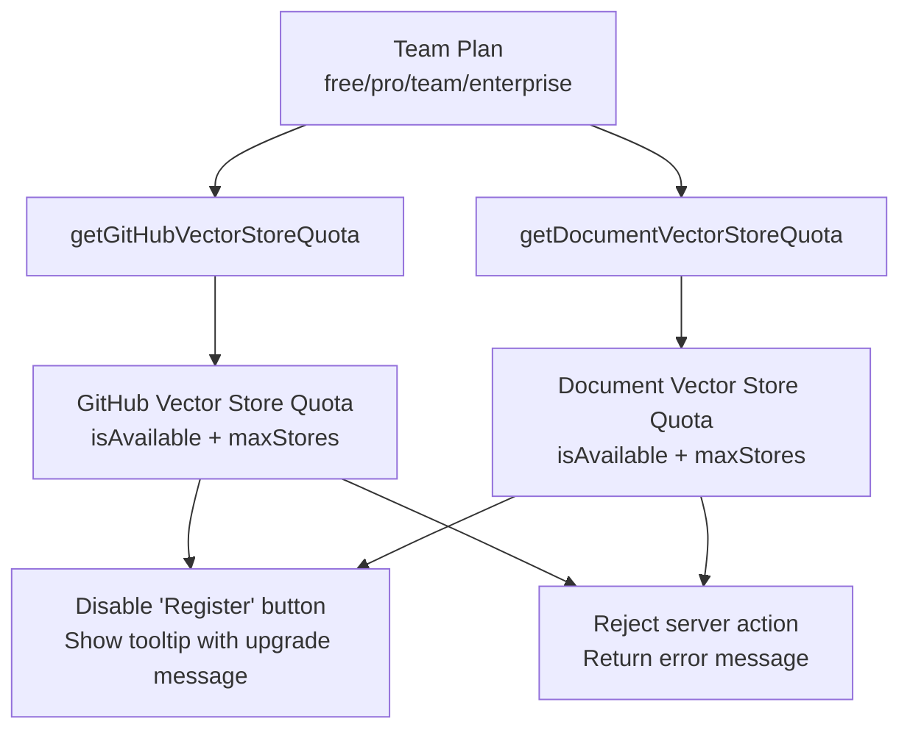

**Quota Functions:**

- **getGitHubVectorStoreQuota** ([apps/studio.giselles.ai/services/teams/plan-features/github-vector-store.ts]()): Returns `{ isAvailable, maxStores }` based on plan
- **getDocumentVectorStoreQuota** ([apps/studio.giselles.ai/services/teams/plan-features/document-vector-store.ts]()): Returns `{ isAvailable, maxStores }` based on plan

**Quota Enforcement Points:**

1. **UI Level** ([apps/studio.giselles.ai/app/(main)/settings/team/vector-stores/page.tsx:47-56]()):
   - Buttons disabled when `!hasAccess` or `hasReachedLimit`
   - Tooltip explains upgrade requirement
   - Usage counter displayed in list view

2. **Server Action Level**:
   - Quota check happens in transaction after locking team row
   - Rejects if quota exceeded even if UI bypass attempted
   - Consistent error messages returned

3. **Display Level**:
   - Empty state shows lock icon when `!hasAccess`
   - Usage notice shows count and remaining quota
   - Alert displayed when limit reached with upgrade link

**Example Quota Display** ([apps/studio.giselles.ai/app/(main)/settings/team/vector-stores/repository-list.tsx:84-151]()):
```
GitHub Vector Stores used: 3 / 5
2 GitHub Vector Stores remaining in your Pro plan.
```

When limit reached:
```
⚠ Maximum capacity reached
Delete an existing store or upgrade your plan in Team Settings to add more GitHub Vector Stores.
```

**Sources:**
- [apps/studio.giselles.ai/app/(main)/settings/team/vector-stores/page.tsx:19-78]()
- [apps/studio.giselles.ai/app/(main)/settings/team/vector-stores/repository-list.tsx:84-151]()
- [apps/studio.giselles.ai/app/(main)/settings/team/vector-stores/actions.ts:148-156]() (GitHub quota check)
- [apps/studio.giselles.ai/app/(main)/settings/team/vector-stores/actions.ts:631-639]() (Document quota check)

---

## Navigation and Layout

The Vector Store settings are organized with tab navigation and consistent layout structure.

**Layout Hierarchy**

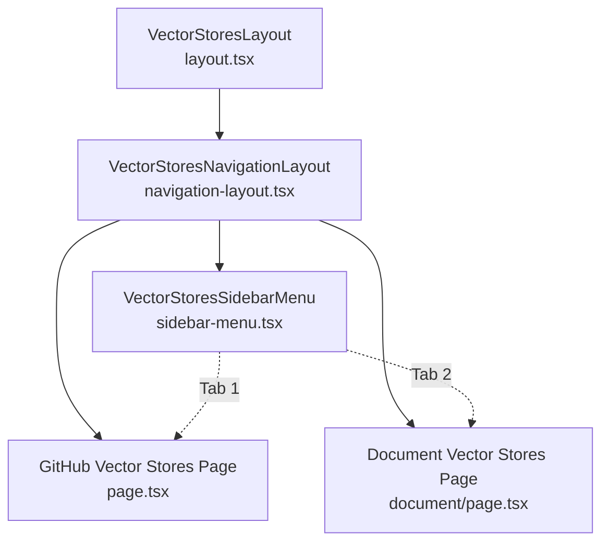

**Routes:**
- `/settings/team/vector-stores` - GitHub vector stores (default)
- `/settings/team/vector-stores/document` - Document vector stores

The `TabNavigation` component ([apps/studio.giselles.ai/app/(main)/settings/team/vector-stores/sidebar-menu.tsx:5-8]()) provides switching between these two tabs.

**Common Layout Elements:**
- Page heading: "Vector Stores" with glow effect
- Documentation link: "About Vector Stores" to external docs
- Tab navigation with "GitHub" and "Document" tabs
- Consistent spacing and background colors

**Sources:**
- [apps/studio.giselles.ai/app/(main)/settings/team/vector-stores/layout.tsx:1-32]()
- [apps/studio.giselles.ai/app/(main)/settings/team/vector-stores/navigation-layout.tsx:1-19]()
- [apps/studio.giselles.ai/app/(main)/settings/team/vector-stores/sidebar-menu.tsx:1-13]()

---

