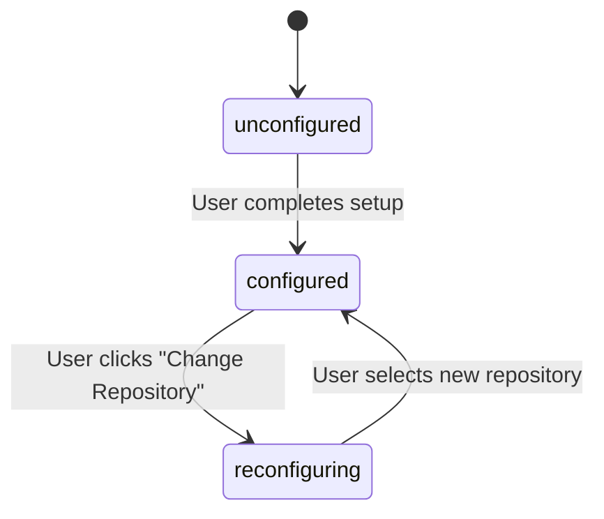
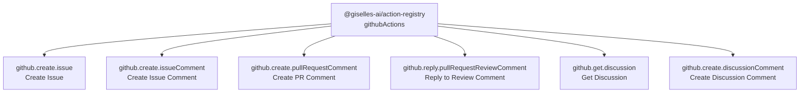
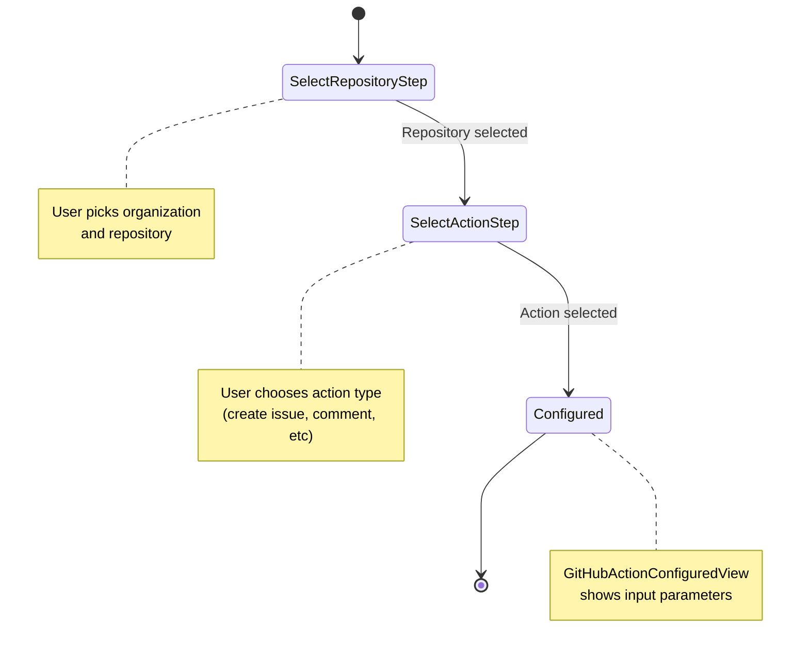
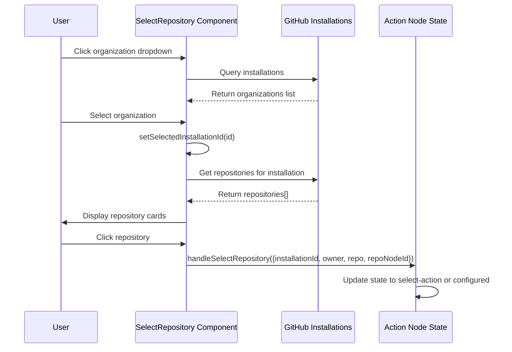
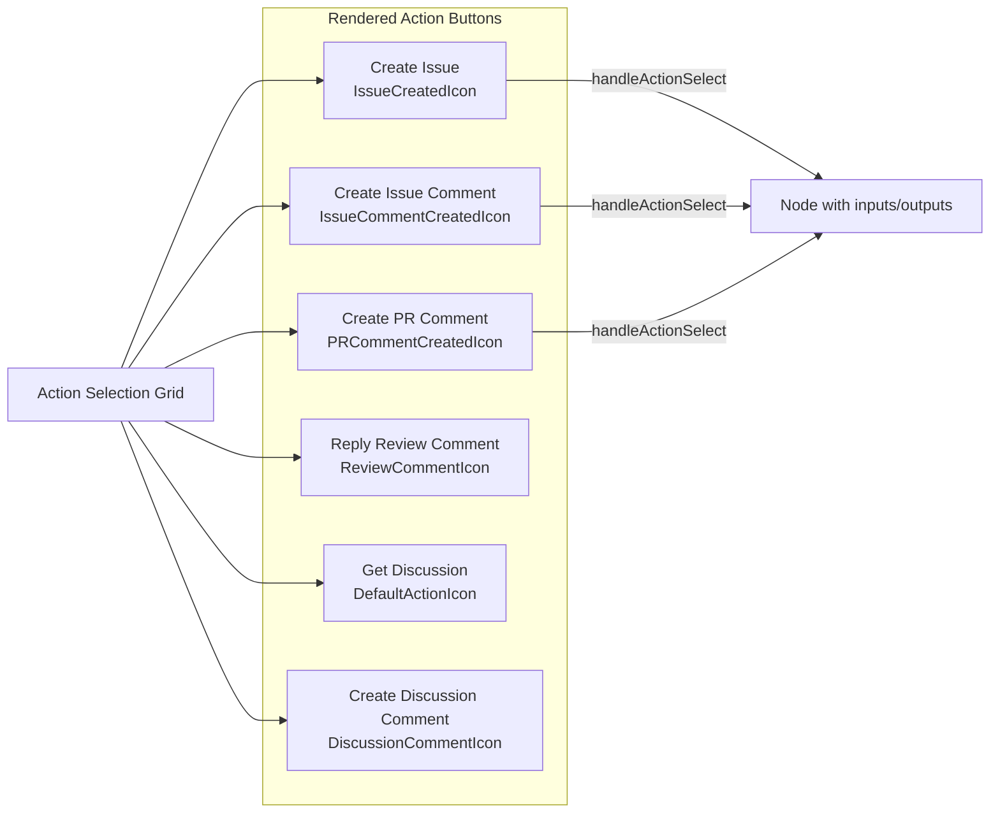
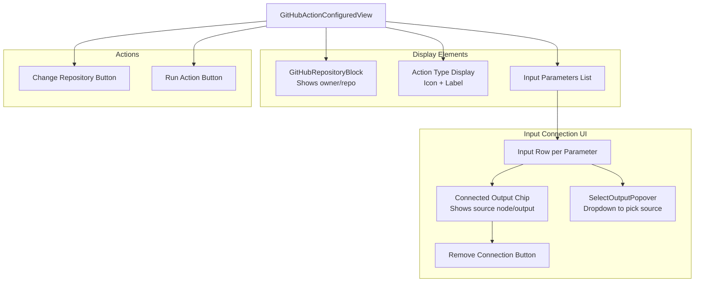
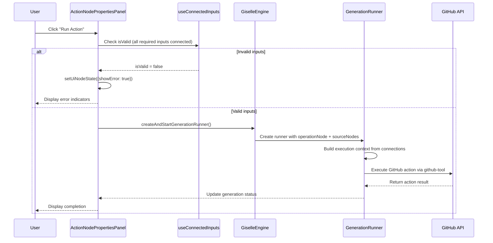
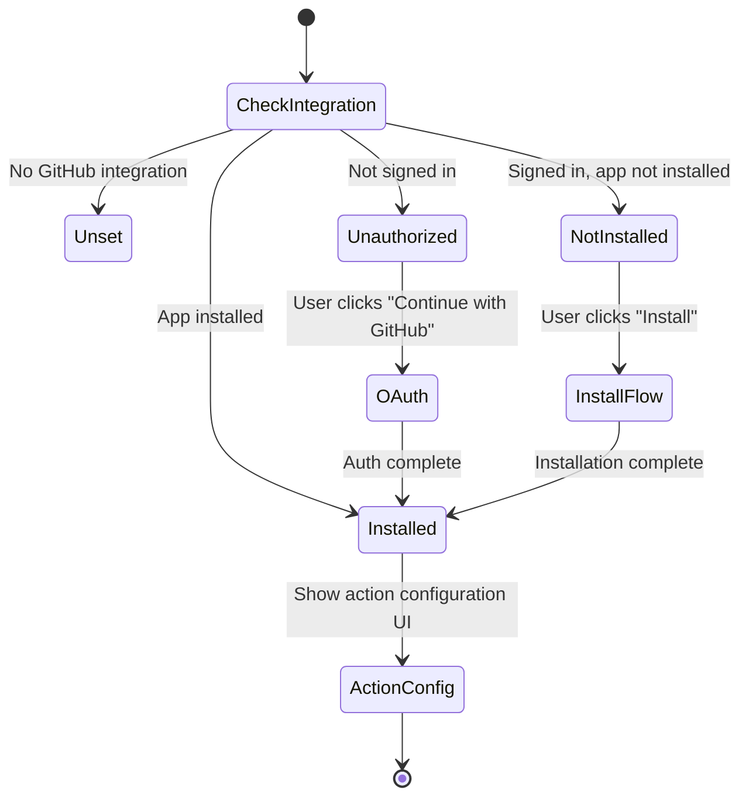
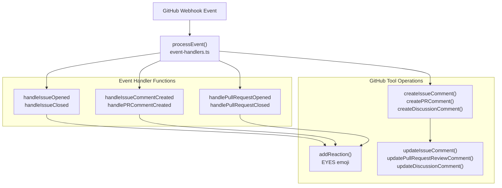

<!-- source: DeepWiki mcp.deepwiki.com · repo giselles-ai/giselle · page 4.2 GitHub Actions and Integration · fetched 2026-10-27 -->

# GitHub Actions and Integration

<details>
<summary>Relevant source files</summary>

The following files were used as context for generating this wiki page:

- [internal-packages/workflow-designer-ui/src/editor/properties-panel/action-node-properties-panel/github-action-properties-panel.tsx](internal-packages/workflow-designer-ui/src/editor/properties-panel/action-node-properties-panel/github-action-properties-panel.tsx)
- [internal-packages/workflow-designer-ui/src/editor/properties-panel/action-node-properties-panel/index.tsx](internal-packages/workflow-designer-ui/src/editor/properties-panel/action-node-properties-panel/index.tsx)
- [internal-packages/workflow-designer-ui/src/editor/properties-panel/action-node-properties-panel/ui/github-action-configured-view.tsx](internal-packages/workflow-designer-ui/src/editor/properties-panel/action-node-properties-panel/ui/github-action-configured-view.tsx)
- [internal-packages/workflow-designer-ui/src/editor/properties-panel/trigger-node-properties-panel/providers/github-trigger/components/event-type-display.tsx](internal-packages/workflow-designer-ui/src/editor/properties-panel/trigger-node-properties-panel/providers/github-trigger/components/event-type-display.tsx)
- [internal-packages/workflow-designer-ui/src/editor/properties-panel/trigger-node-properties-panel/providers/github-trigger/components/icons/index.tsx](internal-packages/workflow-designer-ui/src/editor/properties-panel/trigger-node-properties-panel/providers/github-trigger/components/icons/index.tsx)
- [internal-packages/workflow-designer-ui/src/editor/properties-panel/trigger-node-properties-panel/providers/github-trigger/components/install-application.tsx](internal-packages/workflow-designer-ui/src/editor/properties-panel/trigger-node-properties-panel/providers/github-trigger/components/install-application.tsx)
- [internal-packages/workflow-designer-ui/src/editor/properties-panel/trigger-node-properties-panel/providers/github-trigger/components/labels-input-step.tsx](internal-packages/workflow-designer-ui/src/editor/properties-panel/trigger-node-properties-panel/providers/github-trigger/components/labels-input-step.tsx)
- [internal-packages/workflow-designer-ui/src/editor/properties-panel/trigger-node-properties-panel/providers/github-trigger/components/unauthorized.tsx](internal-packages/workflow-designer-ui/src/editor/properties-panel/trigger-node-properties-panel/providers/github-trigger/components/unauthorized.tsx)
- [internal-packages/workflow-designer-ui/src/editor/properties-panel/trigger-node-properties-panel/providers/github-trigger/github-trigger-properties-panel.tsx](internal-packages/workflow-designer-ui/src/editor/properties-panel/trigger-node-properties-panel/providers/github-trigger/github-trigger-properties-panel.tsx)
- [internal-packages/workflow-designer-ui/src/editor/properties-panel/trigger-node-properties-panel/providers/github-trigger/utils/trigger-configuration.ts](internal-packages/workflow-designer-ui/src/editor/properties-panel/trigger-node-properties-panel/providers/github-trigger/utils/trigger-configuration.ts)
- [internal-packages/workflow-designer-ui/src/editor/properties-panel/trigger-node-properties-panel/providers/github-trigger/utils/use-trigger-configuration.ts](internal-packages/workflow-designer-ui/src/editor/properties-panel/trigger-node-properties-panel/providers/github-trigger/utils/use-trigger-configuration.ts)
- [internal-packages/workflow-designer-ui/src/editor/properties-panel/trigger-node-properties-panel/providers/manual-trigger/manual-trigger-properties-panel.tsx](internal-packages/workflow-designer-ui/src/editor/properties-panel/trigger-node-properties-panel/providers/manual-trigger/manual-trigger-properties-panel.tsx)
- [internal-packages/workflow-designer-ui/src/editor/properties-panel/trigger-node-properties-panel/ui/configured-views/github-trigger-configured-view.tsx](internal-packages/workflow-designer-ui/src/editor/properties-panel/trigger-node-properties-panel/ui/configured-views/github-trigger-configured-view.tsx)
- [internal-packages/workflow-designer-ui/src/editor/properties-panel/ui/select-repository.tsx](internal-packages/workflow-designer-ui/src/editor/properties-panel/ui/select-repository.tsx)
- [packages/giselle/src/engine/github/event-handlers.test.ts](packages/giselle/src/engine/github/event-handlers.test.ts)
- [packages/giselle/src/engine/github/event-handlers.ts](packages/giselle/src/engine/github/event-handlers.ts)
- [packages/protocol/src/trigger/github.ts](packages/protocol/src/trigger/github.ts)

</details>


## Purpose and Scope

This document describes the GitHub action node system, which enables workflows to perform operations on GitHub repositories such as creating issues, posting comments, and managing discussions. GitHub actions are output-oriented nodes that write data to GitHub, as opposed to GitHub triggers which respond to incoming webhook events. For information about GitHub triggers (webhooks that initiate workflow execution), see [GitHub Triggers and Event Processing](#4.1).

## Action Node Architecture

### Node Type and States

GitHub action nodes are operation nodes with a `command` property that specifies GitHub as the provider. The action configuration follows a state machine pattern:



**Configuration State Structure**

| State | Description | UI Behavior |
|-------|-------------|-------------|
| `unconfigured` | No GitHub action configured | Shows action selection flow |
| `configured` | Action fully configured with repository and inputs | Shows parameter inputs and "Run Action" button |
| `reconfiguring` | User is changing repository settings | Shows repository selection only |

The action node structure is defined by the `ActionNode` type, where `node.content.command.provider === "github"` and `node.content.command.state` contains the configuration.

Sources: [internal-packages/workflow-designer-ui/src/editor/properties-panel/action-node-properties-panel/github-action-properties-panel.tsx:115-178](), [internal-packages/workflow-designer-ui/src/editor/properties-panel/action-node-properties-panel/ui/github-action-configured-view.tsx:96-143]()

## Available GitHub Actions

### Action Registry

The system supports six GitHub action types registered in `@giselles-ai/action-registry`:



### Action Input Fields

Each action defines input fields through `githubActionToInputFields()`, which are converted to node inputs:

| Action | Required Inputs | Description |
|--------|----------------|-------------|
| `github.create.issue` | title, body | Creates a new issue in the repository |
| `github.create.issueComment` | issue_number, body | Adds a comment to an existing issue |
| `github.create.pullRequestComment` | pull_number, body | Adds a comment to a pull request |
| `github.reply.pullRequestReviewComment` | pull_number, comment_id, body | Replies to a PR review comment |
| `github.get.discussion` | discussion_number | Retrieves discussion details |
| `github.create.discussionComment` | discussion_id, body | Adds a comment to a discussion |

When an action is selected, the system generates `Input` objects with `isRequired` flags based on the action's field definitions.

Sources: [internal-packages/workflow-designer-ui/src/editor/properties-panel/action-node-properties-panel/github-action-properties-panel.tsx:1-10](), [internal-packages/workflow-designer-ui/src/editor/properties-panel/action-node-properties-panel/ui/github-action-configured-view.tsx:380-411]()

## Configuration UI Flow

### Setup State Machine



### Step 1: Repository Selection

The `Installed` component in `github-action-properties-panel.tsx` manages the repository selection flow:

1. **Organization Selection**: User selects from GitHub App installations via dropdown populated from `GitHubIntegrationInstallation[]`
2. **Repository Selection**: After organization selection, available repositories are displayed as clickable cards
3. **State Transition**: Selection triggers `handleSelectRepository()` which either:
   - For new actions: moves to action selection (`select-action` state)
   - For reconfiguration: updates the repository and returns to configured state



Sources: [internal-packages/workflow-designer-ui/src/editor/properties-panel/action-node-properties-panel/github-action-properties-panel.tsx:347-457](), [internal-packages/workflow-designer-ui/src/editor/properties-panel/ui/select-repository.tsx:19-252]()

### Step 2: Action Type Selection

After repository selection, the `select-action` step displays all available GitHub actions:



The `handleActionSelect` callback performs these operations:
1. Validates the action ID with `isGitHubActionId()`
2. Retrieves action definition from `githubActions[actionId]`
3. Generates `Input[]` array from `githubActionToInputFields()`
4. Creates a single output with accessor `"action-result"`
5. Updates node data with configured state

Sources: [internal-packages/workflow-designer-ui/src/editor/properties-panel/action-node-properties-panel/github-action-properties-panel.tsx:368-415](), [internal-packages/workflow-designer-ui/src/editor/properties-panel/action-node-properties-panel/github-action-properties-panel.tsx:544-606]()

## Configured Action View

### Input Parameter Management

Once configured, `GitHubActionConfiguredView` displays a comprehensive parameter binding interface:



### Parameter Binding

Each required input must be connected to an output from another node. The `useConnectedInputs` hook enriches inputs with connection information:

```typescript
interface InputWithConnectedOutput {
  id: string;
  label: string;
  isRequired: boolean;
  connectedOutput?: {
    node: Node;
    label: string;
    connectionId: ConnectionId;
  };
}
```

The `SelectOutputPopover` component groups available outputs by node type:
- Text Generator nodes
- Action nodes
- Trigger nodes
- Text nodes
- File nodes
- GitHub nodes

Connection validation uses `isSupportedConnection()` to ensure type compatibility between source and target nodes.

Sources: [internal-packages/workflow-designer-ui/src/editor/properties-panel/action-node-properties-panel/ui/github-action-configured-view.tsx:96-276](), [internal-packages/workflow-designer-ui/src/editor/properties-panel/action-node-properties-panel/ui/github-action-configured-view.tsx:284-412]()

### Repository Display and Reconfiguration

The repository information is fetched asynchronously using SWR:

```typescript
const { isLoading, data } = useSWR(
  { installationId, repositoryNodeId },
  ({ installationId, repositoryNodeId }) =>
    client.getGitHubRepositoryFullname({
      installationId,
      repositoryNodeId,
    })
);
```

The "Change Repository" button triggers reconfiguration by updating node state:

```typescript
updateNodeData(node, {
  content: {
    ...node.content,
    command: {
      provider: "github",
      state: {
        status: "reconfiguring",
        commandId: state.commandId,
      },
    },
  },
});
```

Sources: [internal-packages/workflow-designer-ui/src/editor/properties-panel/action-node-properties-panel/ui/github-action-configured-view.tsx:109-180]()

## Action Execution

### Execution Flow



The execution is managed by `ActionNodePropertiesPanel`:

1. **Validation**: `isValid` flag from `useConnectedInputs()` checks all required inputs are connected
2. **Error Display**: If invalid, sets `showError: true` in UI state to highlight missing connections
3. **Generation Creation**: Calls `createAndStartGenerationRunner()` with:
   - `operationNode`: The action node
   - `sourceNodes`: Connected input nodes
   - `connections`: Connection data for parameter mapping
4. **Execution**: The Giselle Engine handles the actual GitHub API calls

Sources: [internal-packages/workflow-designer-ui/src/editor/properties-panel/action-node-properties-panel/index.tsx:12-80](), [internal-packages/workflow-designer-ui/src/editor/properties-panel/action-node-properties-panel/index.tsx:21-60]()

### Error Handling

Required inputs without connections are visually indicated:

- Red badge with "required" text next to parameter label
- Red alert icon with "Please choose a source" message when `showError` is true
- Input row styled with `TriangleAlert` icon and error text

Sources: [internal-packages/workflow-designer-ui/src/editor/properties-panel/action-node-properties-panel/ui/github-action-configured-view.tsx:199-261]()

## GitHub App Integration

### Authentication and Installation Flow



### Integration States

The `useIntegration()` hook provides GitHub integration status:

| Status | Condition | UI Response |
|--------|-----------|-------------|
| `unset` | No GitHub integration configured | Display "unset" message |
| `unauthorized` | User not authenticated with GitHub | Show `Unauthorized` component with OAuth button |
| `not-installed` | Authenticated but app not installed | Show `InstallGitHubApplication` component |
| `invalid-credential` | Credentials expired or invalid | Display error message |
| `installed` | Fully configured | Show action configuration UI (`Installed` component) |
| `error` | Integration error occurred | Display error message |

### OAuth and Installation Popup

Both `Unauthorized` and `InstallGitHubApplication` components use a popup window pattern:

1. Opens GitHub OAuth/installation URL in centered popup window (800x800px)
2. Listens for `postMessage` event with `type: "github-app-installed"`
3. Triggers integration refresh via `refresh()` from `useIntegration()`
4. Popup cleanup on component unmount

The popup window is managed with:
```typescript
const width = 800;
const height = 800;
const left = window.screenX + (window.outerWidth - width) / 2;
const top = window.screenY + (window.outerHeight - height) / 2;

popupRef.current = window.open(
  authUrl,
  "Configure GitHub App",
  `width=${width},height=${height},top=${top},left=${left},popup=1`
);
```

Sources: [internal-packages/workflow-designer-ui/src/editor/properties-panel/action-node-properties-panel/github-action-properties-panel.tsx:181-248](), [internal-packages/workflow-designer-ui/src/editor/properties-panel/action-node-properties-panel/github-action-properties-panel.tsx:250-322]()

## GitHub Tool Integration with Event Handlers

While action nodes are configured in the UI, their execution during GitHub trigger workflows is coordinated by event handlers. When a GitHub webhook event triggers a workflow, event handlers can create comments and reactions to provide feedback:



### Progress Reporting

Event handlers create and update GitHub comments to report workflow execution progress:

1. **Initial Comment**: Created when Act starts, contains progress table
2. **Progress Updates**: Updated as sequences/steps complete with status changes
3. **Final Comment**: Shows completion status or error information

The progress table uses emoji indicators:
- ⚪ Pending
- ⏳ In progress  
- 🟢 Success
- ❌ Failed

Sources: [packages/giselle/src/engine/github/event-handlers.ts:462-476](), [packages/giselle/src/engine/github/event-handlers.ts:556-758]()

## Code Entity Map

### Key Components and Their Locations

| Component | File Path | Purpose |
|-----------|-----------|---------|
| `GitHubActionPropertiesPanel` | [internal-packages/workflow-designer-ui/src/editor/properties-panel/action-node-properties-panel/github-action-properties-panel.tsx:104-179]() | Main action node configuration UI |
| `GitHubActionConfiguredView` | [internal-packages/workflow-designer-ui/src/editor/properties-panel/action-node-properties-panel/ui/github-action-configured-view.tsx:96-276]() | Displays configured action with parameter inputs |
| `ActionNodePropertiesPanel` | [internal-packages/workflow-designer-ui/src/editor/properties-panel/action-node-properties-panel/index.tsx:12-80]() | Orchestrates action execution |
| `SelectRepository` | [internal-packages/workflow-designer-ui/src/editor/properties-panel/ui/select-repository.tsx:19-252]() | Repository selection component |
| `processEvent` | [packages/giselle/src/engine/github/event-handlers.ts:477-758]() | Handles GitHub webhook events and creates feedback comments |
| `githubActions` | Referenced from `@giselles-ai/action-registry` | Registry of available GitHub actions |
| `githubActionToInputFields` | Referenced from `@giselles-ai/action-registry` | Converts action definitions to input fields |

### Type Definitions

| Type | Location | Description |
|------|----------|-------------|
| `ActionNode` | `@giselles-ai/protocol` | Node type with `content.command.provider === "github"` |
| `GitHubActionConfiguredState` | `@giselles-ai/protocol` | Contains `commandId`, `repositoryNodeId`, `installationId` |
| `GitHubIntegrationInstallation` | `@giselles-ai/giselle` | Installation data with account info and repositories |
| `Input` | `@giselles-ai/protocol` | Input parameter with `id`, `accessor`, `label`, `isRequired` |
| `Output` | `@giselles-ai/protocol` | Output parameter with `id`, `label`, `accessor` |

Sources: [internal-packages/workflow-designer-ui/src/editor/properties-panel/action-node-properties-panel/github-action-properties-panel.tsx:1-22](), [internal-packages/workflow-designer-ui/src/editor/properties-panel/action-node-properties-panel/ui/github-action-configured-view.tsx:1-23]()

---

