<!-- source: DeepWiki mcp.deepwiki.com · repo giselles-ai/giselle · page 5.2 Node Rendering and Visual System · fetched 2026-10-27 -->

# Node Rendering and Visual System

<details>
<summary>Relevant source files</summary>

The following files were used as context for generating this wiki page:

- [apps/playground/app/globals.css](apps/playground/app/globals.css)
- [apps/playground/app/layout.tsx](apps/playground/app/layout.tsx)
- [apps/studio.giselles.ai/app/globals.css](apps/studio.giselles.ai/app/globals.css)
- [apps/studio.giselles.ai/app/layout.tsx](apps/studio.giselles.ai/app/layout.tsx)
- [apps/studio.giselles.ai/tailwind.config.ts](apps/studio.giselles.ai/tailwind.config.ts)
- [internal-packages/workflow-designer-ui/src/editor/node/node.tsx](internal-packages/workflow-designer-ui/src/editor/node/node.tsx)
- [internal-packages/workflow-designer-ui/src/editor/properties-panel/vector-store/index.tsx](internal-packages/workflow-designer-ui/src/editor/properties-panel/vector-store/index.tsx)
- [internal-packages/workflow-designer-ui/src/editor/tool/floating-node/component.tsx](internal-packages/workflow-designer-ui/src/editor/tool/floating-node/component.tsx)
- [internal-packages/workflow-designer-ui/src/editor/tool/toolbar/state.tsx](internal-packages/workflow-designer-ui/src/editor/tool/toolbar/state.tsx)
- [internal-packages/workflow-designer-ui/src/editor/tool/toolbar/toolbar.tsx](internal-packages/workflow-designer-ui/src/editor/tool/toolbar/toolbar.tsx)
- [internal-packages/workflow-designer-ui/src/editor/tool/types.ts](internal-packages/workflow-designer-ui/src/editor/tool/types.ts)
- [internal-packages/workflow-designer-ui/src/icons/node/file-node.tsx](internal-packages/workflow-designer-ui/src/icons/node/file-node.tsx)
- [internal-packages/workflow-designer-ui/src/icons/node/image-generation-node.tsx](internal-packages/workflow-designer-ui/src/icons/node/image-generation-node.tsx)
- [internal-packages/workflow-designer-ui/src/icons/node/index.tsx](internal-packages/workflow-designer-ui/src/icons/node/index.tsx)
- [internal-packages/workflow-designer-ui/src/new-editor/components/node/node.tsx](internal-packages/workflow-designer-ui/src/new-editor/components/node/node.tsx)
- [internal-packages/workflow-designer-ui/src/ui/node/node-handle-dot.tsx](internal-packages/workflow-designer-ui/src/ui/node/node-handle-dot.tsx)
- [internal-packages/workflow-designer-ui/src/ui/node/node-input-label.tsx](internal-packages/workflow-designer-ui/src/ui/node/node-input-label.tsx)

</details>


This document describes the node rendering and visual system in the workflow designer, including how `NodeComponent` renders nodes on the canvas, the `NodeIcon` resolution system that determines which icon to display for each node type, the `NodeHandleDot` handle system for connection points, and the dynamic styling architecture that uses data attributes and CSS variables to apply node-specific gradients and colors.

For information about the overall editor architecture and state management, see [Editor Architecture and State Management](#5.1). For node-specific configuration panels, see [Properties Panels and Node Configuration](#5.3). For generation execution and results display, see [Generation Execution and Results Display](#5.5).

## Rendering Architecture Overview

The node rendering system provides the visual representation of workflow nodes on the canvas through a layered architecture. Each node is rendered through XyFlow's custom node system, with `CustomXyFlowNode` acting as the ReactFlow integration layer and `NodeComponent` providing the core rendering logic.

The rendering system handles:
- Integration with ReactFlow's (@xyflow/react) node rendering lifecycle
- Dynamic icon resolution based on node type and LLM provider
- Connection state tracking and visual feedback for inputs/outputs
- Visual differentiation using CSS variables and data attributes
- Generation status display with animated transitions
- Editable node names and metadata display
- Node setup state indication with dashed borders

**Sources:** [internal-packages/workflow-designer-ui/src/editor/node/node.tsx:1-145]()

## Rendering Component Architecture

### ReactFlow Integration Layer

ReactFlow Integration and Node Rendering Pipeline

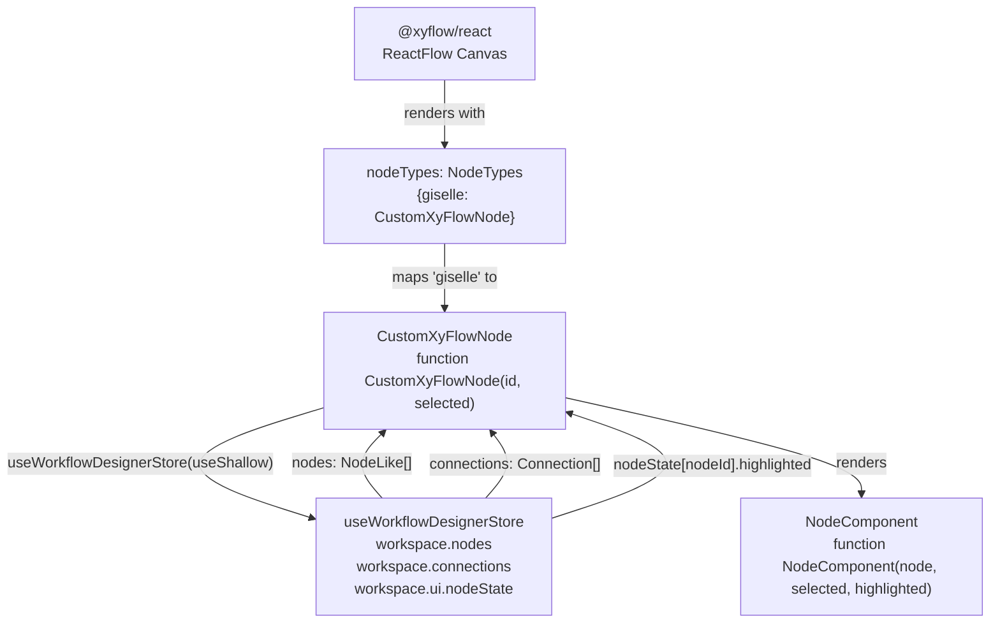

The `nodeTypes` export provides ReactFlow with the custom node component mapping:

```typescript
export const nodeTypes: NodeTypes = {
  giselle: CustomXyFlowNode,
};
```

All workflow nodes use the type `"giselle"`, which ReactFlow maps to `CustomXyFlowNode`. This component queries the Zustand store and delegates to `NodeComponent` for actual rendering.

**Sources:** [internal-packages/workflow-designer-ui/src/editor/node/node.tsx:103-105](), [internal-packages/workflow-designer-ui/src/editor/node/node.tsx:107-144]()

### CustomXyFlowNode Wrapper

The `CustomXyFlowNode` component serves as the integration layer between XyFlow and the application state:

| Responsibility | Implementation |
|---------------|----------------|
| Receive XyFlow props | `NodeProps` interface with `id` and `selected` |
| Query workspace state | `useWorkflowDesignerStore` with shallow equality |
| Compute connection state | Filter connections by node ID for inputs/outputs |
| Delegate rendering | Pass all data to `NodeComponent` |

The component uses `useShallow` from Zustand to optimize re-renders by only updating when relevant state changes.

**Sources:** [internal-packages/workflow-designer-ui/src/editor/node/node.tsx:66-104]()

### Data Flow to NodeComponent

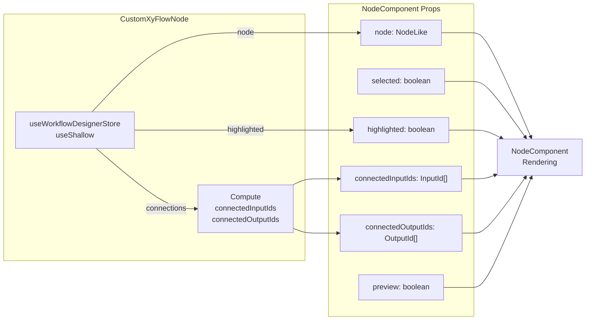

The `connectedInputIds` and `connectedOutputIds` arrays are computed by filtering the workspace connections:

```typescript
const connectedInputIds = useMemo(
  () =>
    connections
      .filter((connection) => connection.inputNode.id === id)
      .map((connection) => connection.inputId),
  [connections, id],
);
```

**Sources:** [internal-packages/workflow-designer-ui/src/editor/node/node.tsx:75-88](), [internal-packages/workflow-designer-ui/src/editor/node/node.tsx:95-103]()

## Node Type System

Nodes are classified into several categories based on their role in the workflow:

### Node Categories

| Category | Node Types | Characteristics |
|----------|-----------|----------------|
| **Source Nodes** | `text`, `file`, `webPage` | Provide input data; have outputs only |
| **Operation Nodes** | `textGeneration`, `imageGeneration`, `query`, `webSearch`, `audioGeneration`, `videoGeneration` | Transform data; have both inputs and outputs |
| **Integration Nodes** | `github`, `vectorStore` | Access external data sources; configuration-dependent I/O |
| **Flow Control** | `trigger`, `action` | Control workflow execution; special connection rules |

### Type Guards and Helpers

The system uses type guard functions from `@giselle-sdk/data-type`:

- `isTextGenerationNode(node)` - Check for text generation nodes
- `isImageGenerationNode(node)` - Check for image generation nodes
- `isTriggerNode(node, type?)` - Check for trigger nodes with optional type filter
- `isActionNode(node, type?)` - Check for action nodes with optional type filter
- `isVectorStoreNode(node)` - Check for vector store nodes

**Sources:** [internal-packages/workflow-designer-ui/src/editor/node/node.tsx:1-11]()

### Node Setup Requirements

The `nodeRequiresSetup` function determines if a node needs configuration before use:

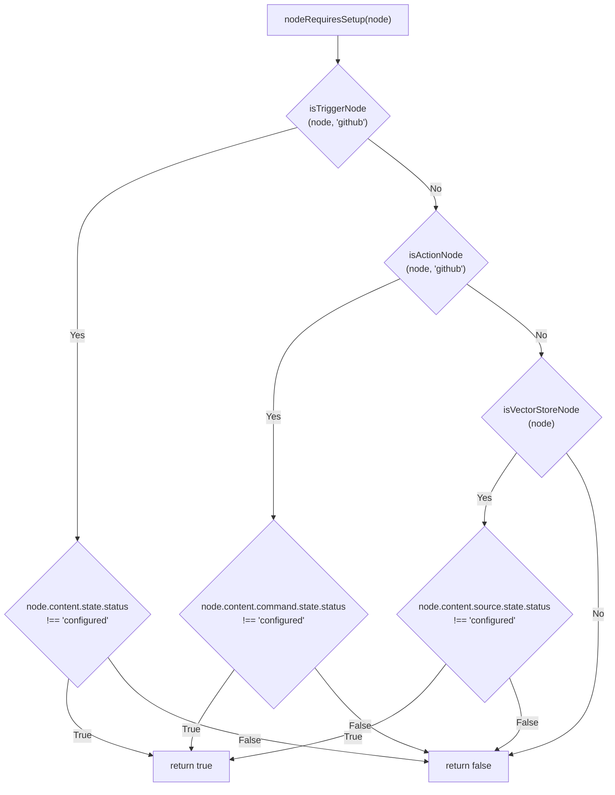

Nodes requiring setup are rendered with reduced opacity and a dashed border.

**Sources:** [internal-packages/workflow-designer-ui/src/editor/node/node.tsx:42-60](), [internal-packages/workflow-designer-ui/src/editor/node/node.tsx:193](), [internal-packages/workflow-designer-ui/src/editor/node/node.tsx:245-246]()

## Handle Connection System

Handles are the connection points on nodes where edges can be attached. The system implements XyFlow's `Handle` component with custom styling and connection logic.

### Handle Types and Positions

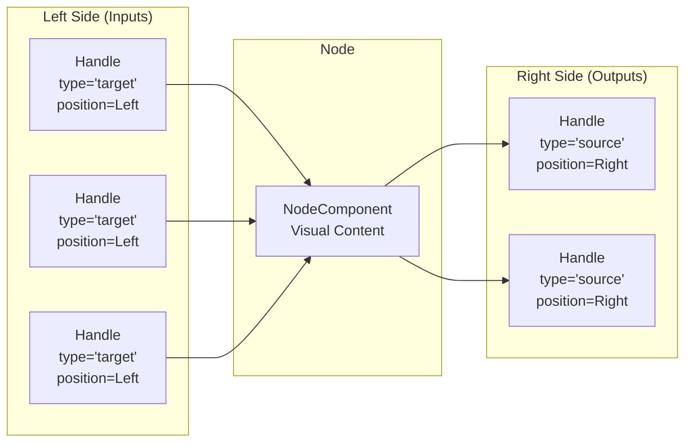

### Input Handle Rendering

Input handles are rendered on the left side with different logic based on node type:

#### Standard Operation Nodes

For text/image generation, query, and web search nodes with defined inputs:

```typescript
node.inputs?.map((input) => (
  <Handle
    type="target"
    isConnectable={false}
    position={Position.Left}
    id={input.id}
    className="!absolute !w-[11px] !h-[11px] !rounded-full..."
  />
))
```

**Sources:** [internal-packages/workflow-designer-ui/src/editor/node/node.tsx:377-402]()

#### Action Nodes

Action nodes have special connection state handling with required/optional inputs:

| Connection State | Visual Treatment |
|-----------------|------------------|
| Connected | Handle filled, label shown on right (inside node) |
| Disconnected (required) | Handle unfilled, label shown on left (outside) in red |
| Disconnected (optional) | Handle unfilled, label shown on left (outside) in gray |

The handle's `isConnectable` prop is computed based on connection state:

```typescript
isConnectable={
  !connectedInputIds?.some(
    (connectedInputId) => connectedInputId === input.id,
  )
}
```

**Sources:** [internal-packages/workflow-designer-ui/src/editor/node/node.tsx:403-444]()

#### Blank Handle for Operations

Operations without explicit inputs (but not triggers or actions) render a generic "blank handle":

```typescript
<Handle
  type="target"
  position={Position.Left}
  id="blank-handle"
  className="!absolute !w-[11px] !h-[11px] !rounded-full..."
/>
```

**Sources:** [internal-packages/workflow-designer-ui/src/editor/node/node.tsx:445-470]()

### Output Handle Rendering

Output handles are rendered on the right side for all nodes with outputs:

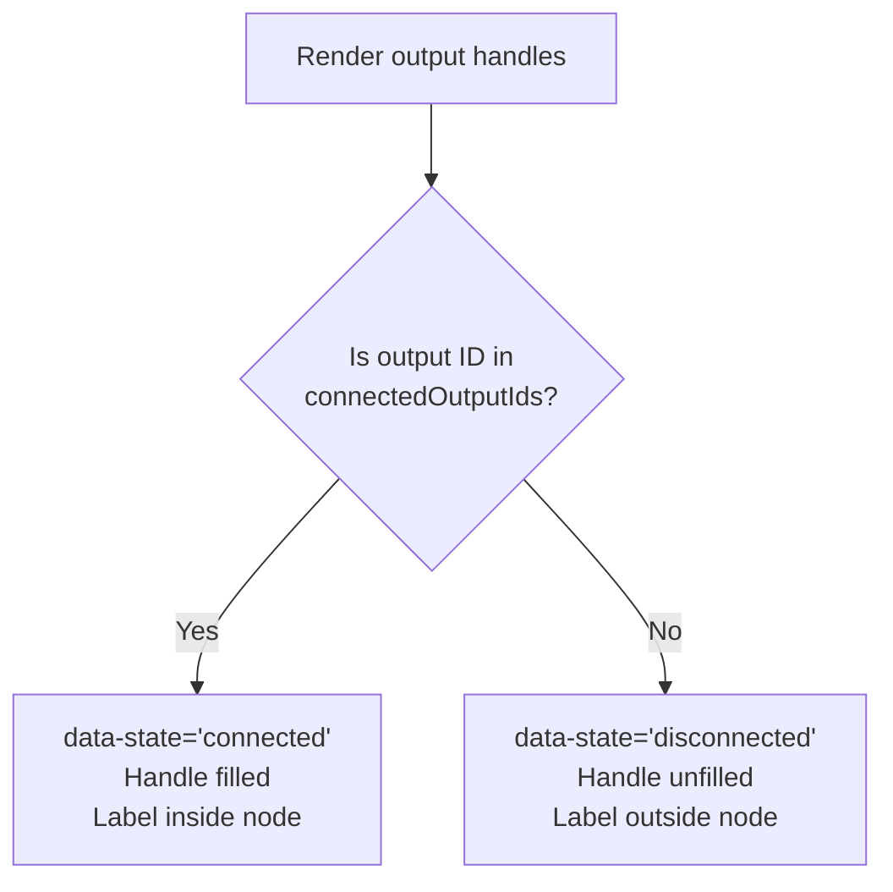

The connection state determines styling through data attributes:

```typescript
data-state={
  connectedOutputIds?.some(
    (connectedOutputId) => connectedOutputId === output.id,
  )
    ? "connected"
    : "disconnected"
}
```

**Sources:** [internal-packages/workflow-designer-ui/src/editor/node/node.tsx:473-538]()

## Visual Styling Architecture

The node component uses a CSS variable and data attribute-based styling system. All styling is computed through the variant object (`v`) and applied using `clsx` for conditional classes.

### Variant Object System

The `NodeComponent` computes a variant object that drives all visual styling decisions:

Visual Variant Computation Flow

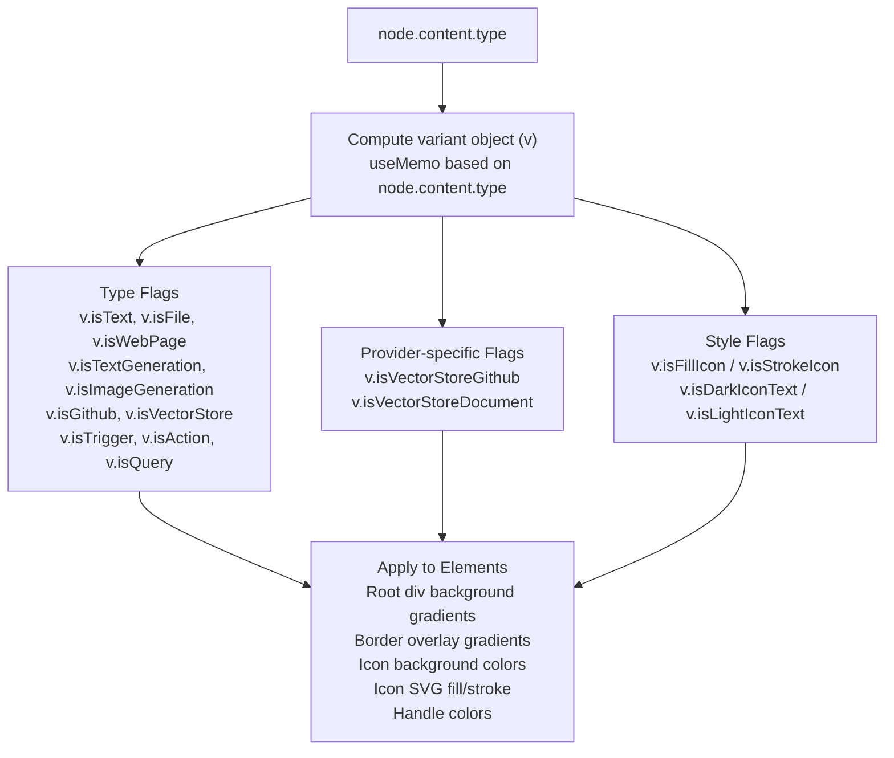

The variant object is computed once per render using `useMemo`:

```typescript
const v = useMemo(() => {
  const isText = node.content.type === "text";
  const isFile = node.content.type === "file";
  const isWebPage = node.content.type === "webPage";
  const isTextGeneration = node.content.type === "textGeneration";
  // ... more type checks
  
  const isVectorStoreGithub =
    isVectorStore &&
    isVectorStoreNode(node) &&
    node.content.source.provider === "github";
  
  const isFillIcon =
    isText || isFile || isWebPage || isGithub || isVectorStore || isAction;
  const isStrokeIcon =
    isTextGeneration || isImageGeneration || isTrigger || isQuery;
  
  const isDarkIconText = isText || isFile || isWebPage || isQuery;
  const isLightIconText =
    isTextGeneration || isImageGeneration || isGithub || isVectorStoreGithub || isTrigger || isAction;
  
  return { isText, isFile, /* ... */ isFillIcon, isStrokeIcon, isDarkIconText, isLightIconText };
}, [node]);
```

**Sources:** [internal-packages/workflow-designer-ui/src/editor/node/node.tsx:200-255]()

### Data Attribute System

The root `div` element sets multiple data attributes that cascade to child elements:

| Data Attribute | Values | Purpose |
|---------------|--------|---------|
| `data-type` | `source`, `operation` | Node category |
| `data-content-type` | `text`, `textGeneration`, `imageGeneration`, etc. | Specific node type |
| `data-selected` | `true`, `false` | Selection state |
| `data-highlighted` | `true`, `false` | Highlight state (from store) |
| `data-preview` | `true`, `false` | Preview mode |
| `data-current-generation-status` | `created`, `queued`, `running`, `completed`, `failed` | Generation lifecycle |
| `data-vector-store-source-provider` | `github`, `githubPullRequest`, `document` | Vector store provider |

**Sources:** [internal-packages/workflow-designer-ui/src/editor/node/node.tsx:261-270]()

### CSS Variable and Gradient System

Each node type has gradient colors defined as CSS variables in `globals.css`:

CSS Variable to Visual Element Mapping

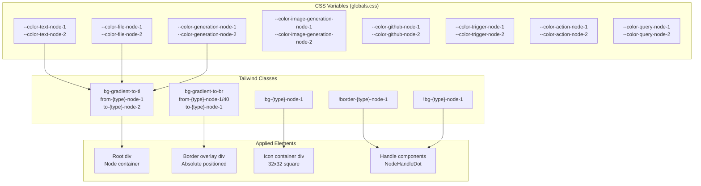

Example color variables from `apps/studio.giselles.ai/app/globals.css`:

```css
--color-text-node-1: var(--color-node-text-primary);
--color-text-node-2: var(--color-node-text-secondary);

--color-generation-node-1: var(--color-node-generation-primary);
--color-generation-node-2: var(--color-node-generation-secondary);

--color-image-generation-node-1: var(--color-node-image-generation-primary);
--color-image-generation-node-2: var(--color-node-image-generation-secondary);
```

The gradient classes are applied conditionally based on the variant object:

```typescript
className={clsx(
  "group relative flex flex-col rounded-[16px] py-[16px] gap-[16px] min-w-[180px]",
  "bg-gradient-to-tl transition-all backdrop-blur-[4px]",
  v.isText && "from-text-node-1/10 to-text-node-2 shadow-text-node-1",
  v.isFile && "from-file-node-1/10 to-file-node-2 shadow-file-node-1",
  v.isTextGeneration && "from-generation-node-1/10 to-generation-node-2 shadow-generation-node-1",
  v.isImageGeneration && "from-image-generation-node-1/20 to-image-generation-node-2 shadow-image-generation-node-1",
  // etc.
)}
```

**Sources:** [internal-packages/workflow-designer-ui/src/editor/node/node.tsx:271-306](), [apps/studio.giselles.ai/app/globals.css:70-112]()

### Border Overlay System

The node uses a dual-layer approach for visual depth:

1. **Base container**: Background gradient with `bg-gradient-to-tl` and `backdrop-blur-[4px]`
2. **Border overlay**: Absolutely positioned `div` with `bg-gradient-to-br` for the border effect

Border Overlay Dual-Layer System

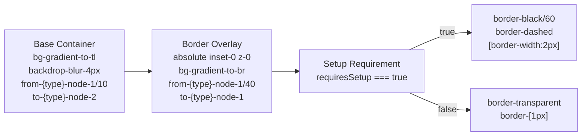

The border overlay changes based on setup requirements checked by `nodeRequiresSetup()`:

```typescript
className={clsx(
  "absolute z-0 rounded-[16px] inset-0 border-[1px] mask-fill bg-gradient-to-br bg-origin-border bg-clip-boarder",
  requiresSetup
    ? "border-black/60 border-dashed [border-width:2px]"
    : "border-transparent",
  v.isText && "from-text-node-1/40 to-text-node-1",
  v.isFile && "from-file-node-1/40 to-file-node-1",
  // gradient for each type
)}
```

**Sources:** [internal-packages/workflow-designer-ui/src/editor/node/node.tsx:354-375]()

### Handle Visual Coordination System

The `NodeHandleDot` component provides consistent handle styling coordinated with node colors:

Handle Color Coordination with NodeHandleDot

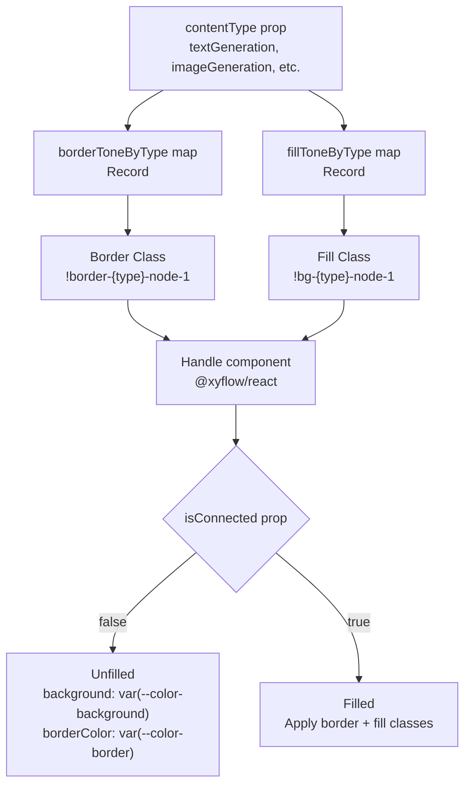

The `NodeHandleDot` component maintains lookup maps for colors:

```typescript
const borderToneByType: Record<NodeHandleDotProps["contentType"], string> = {
  textGeneration: "!border-generation-node-1",
  imageGeneration: "!border-image-generation-node-1",
  github: "!border-github-node-1",
  // etc.
};

const fillToneByType: Record<NodeHandleDotProps["contentType"], string> = {
  textGeneration: "!bg-generation-node-1",
  imageGeneration: "!bg-image-generation-node-1",
  github: "!bg-github-node-1",
  // etc.
};
```

When rendered, connected handles show the fill color, while disconnected handles use the canvas background:

```typescript
<Handle
  style={
    !isConnected
      ? {
          background: "var(--color-background)",
          borderColor: "var(--color-border)",
        }
      : undefined
  }
  className={clsx(
    borderToneByType[safeContentType],
    isConnected ? fillToneByType[safeContentType] : "",
  )}
/>
```

**Sources:** [internal-packages/workflow-designer-ui/src/ui/node/node-handle-dot.tsx:26-102]()

## Generation Status Display

The node component integrates with the generation system to display real-time status:

### Status Badge Rendering

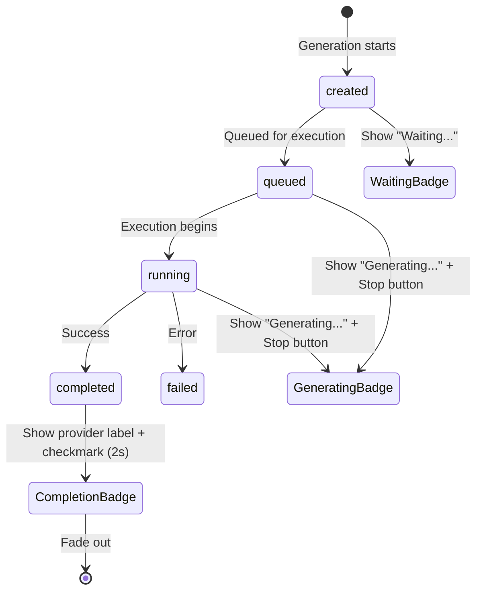

The component uses `useCurrentNodeGeneration` hook to track the current generation and `useTransition` to show the completion label for 2 seconds:

```typescript
const { currentGeneration, stopCurrentGeneration } = useCurrentNodeGeneration(node.id);

useEffect(() => {
  if (currentGeneration === undefined) return;
  
  if (
    prevGenerationStatusRef.current === "running" &&
    currentGeneration.status === "completed"
  ) {
    startTransition(
      async () =>
        new Promise((resolve) => {
          setTimeout(() => resolve(), 2000);
        }),
    );
  }
}, [currentGeneration]);
```

**Sources:** [internal-packages/workflow-designer-ui/src/editor/node/node.tsx:122-146]()

### Completion Label

The completion label shows the LLM provider for generation nodes:

```typescript
function getCompletionLabel(node: NodeLike): string {
  if (isTextGenerationNode(node) || isImageGenerationNode(node)) {
    return node.content.llm.provider;
  }
  return "Completed";
}
```

This label is displayed with a checkmark icon using Framer Motion's `AnimatePresence` for animation:

```typescript
<AnimatePresence>
  {showCompleteLabel && node.content.type !== "trigger" && (
    <motion.div
      className="absolute top-[-28px] right-0..."
      exit={{ opacity: 0 }}
    >
      <p>{getCompletionLabel(node)}</p>
      <CheckIcon className="w-4 h-4" />
    </motion.div>
  )}
</AnimatePresence>
```

**Sources:** [internal-packages/workflow-designer-ui/src/editor/node/node.tsx:34-40](), [internal-packages/workflow-designer-ui/src/editor/node/node.tsx:227-241]()

## Node Metadata and Editing

### Metadata Display

The node displays metadata in a small font at the top:

| Metadata Item | Display Logic |
|--------------|---------------|
| LLM Provider | Shown for text/image generation nodes |
| Node ID | Shown as 8-character substring (`node.id.substring(3, 11)`) |

When the node is selected, metadata items show tooltips:

```typescript
{selected ? (
  <Tooltip text={item.tooltip} variant="dark">
    <button type="button">{item.label}</button>
  </Tooltip>
) : (
  item.label
)}
```

**Sources:** [internal-packages/workflow-designer-ui/src/editor/node/node.tsx:147-154](), [internal-packages/workflow-designer-ui/src/editor/node/node.tsx:335-346]()

### Editable Node Name

The node name is rendered using the `EditableText` component with `defaultName` fallback:

```typescript
<EditableText
  className="group-data-[selected=false]:pointer-events-none..."
  text={defaultName(node)}
  onValueChange={(value) => {
    if (value === defaultName(node)) return;
    if (value.trim().length === 0) {
      updateNodeData(node.id, { name: undefined });
      return;
    }
    updateNodeData(node.id, { name: value });
  }}
  onClickToEditMode={(e) => {
    if (!selected) {
      e.preventDefault();
      return;
    }
    e.stopPropagation();
  }}
/>
```

The name is only editable when the node is selected, enforced through both pointer events and click handler logic.

**Sources:** [internal-packages/workflow-designer-ui/src/editor/node/node.tsx:348-368]()

## Special Node Information Components

### DocumentNodeInfo Component

The `DocumentNodeInfo` component displays document-specific information for document vector store nodes (implementation not shown in provided files).

**Sources:** [internal-packages/workflow-designer-ui/src/editor/node/node.tsx:372]()

### GitHubNodeInfo Component

The `GitHubNodeInfo` component displays GitHub-specific information for GitHub integration nodes (implementation not shown in provided files).

**Sources:** [internal-packages/workflow-designer-ui/src/editor/node/node.tsx:373]()

### GitHubTriggerStatusBadge

For configured GitHub trigger nodes, a status badge is displayed:

```typescript
{isTriggerNode(node, "github") &&
  node.content.state.status === "configured" && (
    <div className="-mt-[6px]">
      <GitHubTriggerStatusBadge
        flowTriggerId={node.content.state.flowTriggerId}
      />
    </div>
  )}
```

**Sources:** [internal-packages/workflow-designer-ui/src/editor/node/node.tsx:267-274]()

## Node Icon System

Each node displays an icon in a colored square at the top:

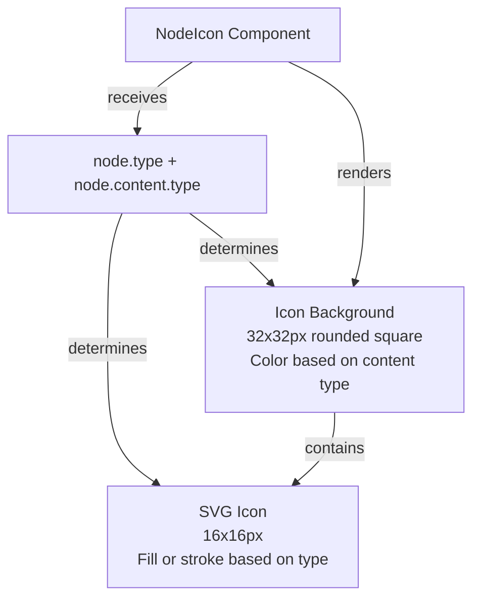

The icon background uses the node's primary color:

```typescript
className={clsx(
  "w-[32px] h-[32px] flex items-center justify-center rounded-[8px]",
  "group-data-[content-type=text]:bg-text-node-1",
  "group-data-[content-type=textGeneration]:bg-generation-node-1",
  // etc.
)}
```

The icon itself has content-specific fill/stroke styling:

```typescript
className={clsx(
  "w-[16px] h-[16px]",
  "group-data-[content-type=text]:fill-current",
  "group-data-[content-type=vectorStore]:stroke-current fill-none",
  // etc.
)}
```

**Sources:** [internal-packages/workflow-designer-ui/src/editor/node/node.tsx:276-333]()

---

