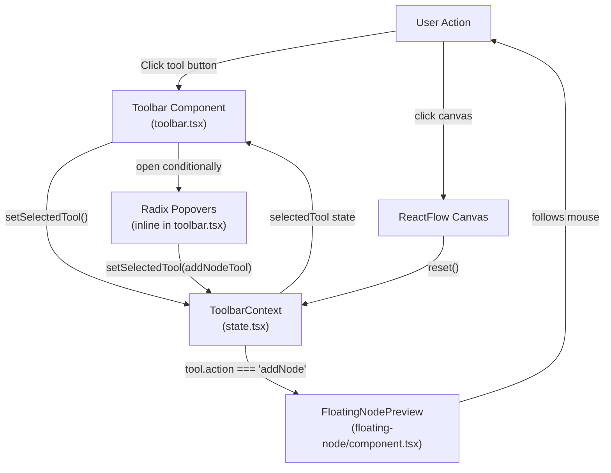
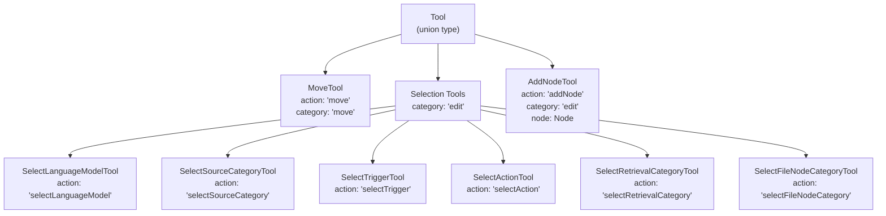
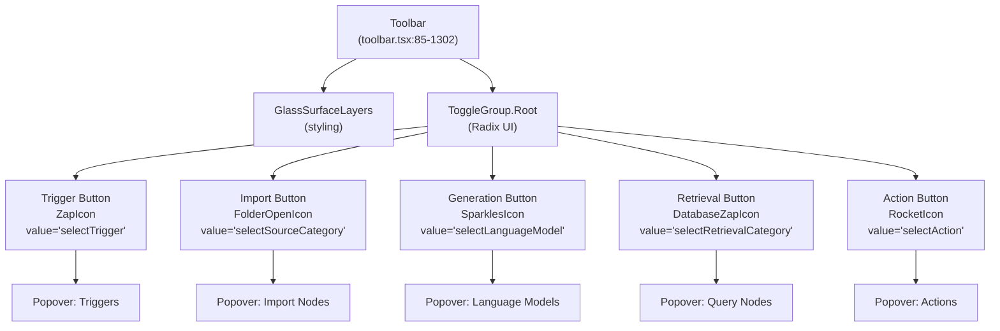
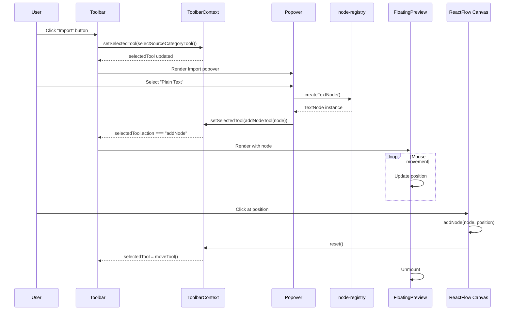
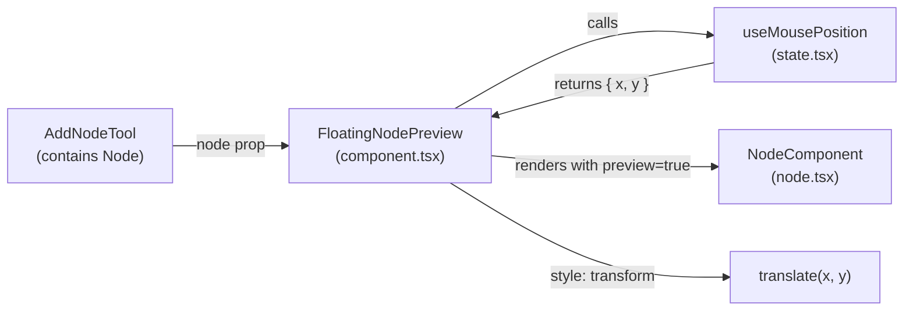
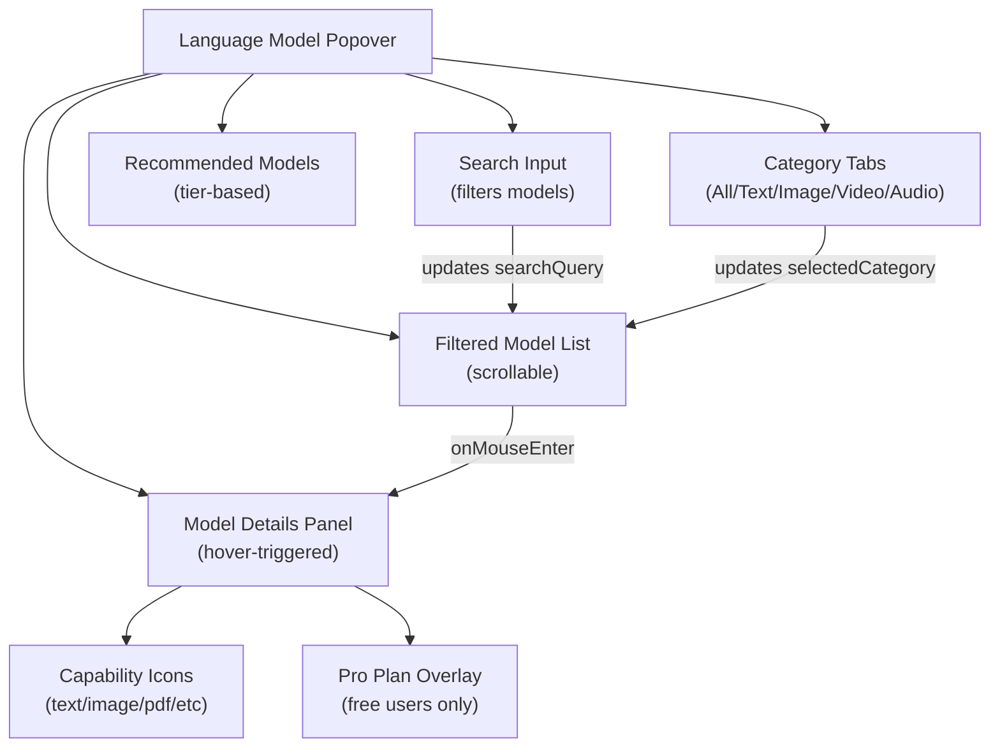

<!-- source: DeepWiki mcp.deepwiki.com · repo giselles-ai/giselle · page 5.4 Toolbar and Node Creation Flow · fetched 2026-10-27 -->

# Toolbar and Node Creation Flow

<details>
<summary>Relevant source files</summary>

The following files were used as context for generating this wiki page:

- [apps/playground/app/globals.css](apps/playground/app/globals.css)
- [apps/playground/app/layout.tsx](apps/playground/app/layout.tsx)
- [apps/studio.giselles.ai/app/globals.css](apps/studio.giselles.ai/app/globals.css)
- [apps/studio.giselles.ai/app/layout.tsx](apps/studio.giselles.ai/app/layout.tsx)
- [apps/studio.giselles.ai/tailwind.config.ts](apps/studio.giselles.ai/tailwind.config.ts)
- [internal-packages/workflow-designer-ui/src/editor/node/node.tsx](internal-packages/workflow-designer-ui/src/editor/node/node.tsx)
- [internal-packages/workflow-designer-ui/src/editor/properties-panel/vector-store/index.tsx](internal-packages/workflow-designer-ui/src/editor/properties-panel/vector-store/index.tsx)
- [internal-packages/workflow-designer-ui/src/editor/tool/floating-node/component.tsx](internal-packages/workflow-designer-ui/src/editor/tool/floating-node/component.tsx)
- [internal-packages/workflow-designer-ui/src/editor/tool/toolbar/state.tsx](internal-packages/workflow-designer-ui/src/editor/tool/toolbar/state.tsx)
- [internal-packages/workflow-designer-ui/src/editor/tool/toolbar/toolbar.tsx](internal-packages/workflow-designer-ui/src/editor/tool/toolbar/toolbar.tsx)
- [internal-packages/workflow-designer-ui/src/editor/tool/types.ts](internal-packages/workflow-designer-ui/src/editor/tool/types.ts)
- [internal-packages/workflow-designer-ui/src/icons/node/file-node.tsx](internal-packages/workflow-designer-ui/src/icons/node/file-node.tsx)
- [internal-packages/workflow-designer-ui/src/icons/node/image-generation-node.tsx](internal-packages/workflow-designer-ui/src/icons/node/image-generation-node.tsx)
- [internal-packages/workflow-designer-ui/src/icons/node/index.tsx](internal-packages/workflow-designer-ui/src/icons/node/index.tsx)
- [internal-packages/workflow-designer-ui/src/new-editor/components/node/node.tsx](internal-packages/workflow-designer-ui/src/new-editor/components/node/node.tsx)
- [internal-packages/workflow-designer-ui/src/ui/node/node-handle-dot.tsx](internal-packages/workflow-designer-ui/src/ui/node/node-handle-dot.tsx)
- [internal-packages/workflow-designer-ui/src/ui/node/node-input-label.tsx](internal-packages/workflow-designer-ui/src/ui/node/node-input-label.tsx)

</details>


## Purpose and Scope

This document describes the toolbar component and the node creation workflow in the Workflow Designer UI. The toolbar provides the primary interface for users to add nodes to the workflow canvas through a multi-step selection process. It manages tool state, displays contextual popovers for node type selection, and handles the floating preview system that follows the mouse cursor during node placement.

For information about how nodes are rendered on the canvas after creation, see [Node Rendering and Visual System](#5.2). For details on node configuration after placement, see [Properties Panels and Node Configuration](#5.3).

## Architecture Overview

The toolbar system consists of three main components:

| Component | Purpose | Location |
|-----------|---------|----------|
| `Toolbar` | Main UI component with tool buttons and popovers | [internal-packages/workflow-designer-ui/src/editor/tool/toolbar/toolbar.tsx]() |
| `ToolbarContext` | State management for selected tool | [internal-packages/workflow-designer-ui/src/editor/tool/toolbar/state.tsx]() |
| `FloatingNodePreview` | Preview that follows mouse during placement | [internal-packages/workflow-designer-ui/src/editor/tool/floating-node/component.tsx]() |

The toolbar is positioned at the top of the editor and provides access to all node creation tools through a state-machine-based selection flow.

**Architecture Diagram**



Sources: [internal-packages/workflow-designer-ui/src/editor/tool/toolbar/toolbar.tsx:1-1302](), [internal-packages/workflow-designer-ui/src/editor/tool/toolbar/state.tsx:1-122](), [internal-packages/workflow-designer-ui/src/editor/tool/floating-node/component.tsx:1-21]()

## Tool State Machine

The toolbar operates as a state machine where the selected tool determines both UI state and available actions. The tool state is managed by `ToolbarContext` and stored as a `Tool` union type.

**Tool Type Hierarchy**



Sources: [internal-packages/workflow-designer-ui/src/editor/tool/types.ts:1-71]()

### Tool State Transitions

The state machine transitions follow this pattern:

1. **Initial State**: `MoveTool` (default)
2. **Selection State**: User clicks a toolbar button → one of the `Select*Tool` types
3. **Preview State**: User selects from popover → `AddNodeTool` with node data
4. **Placement**: User clicks canvas → back to `MoveTool` (via `reset()`)

**State Transition Functions**

| Function | Returns | Purpose |
|----------|---------|---------|
| `moveTool()` | `MoveTool` | Default state for canvas interaction |
| `selectLanguageModelTool()` | `SelectLanguageModelTool` | Opens model selection popover |
| `selectSourceCategoryTool()` | `SelectSourceCategoryTool` | Opens import node popover |
| `selectTriggerTool()` | `SelectTriggerTool` | Opens trigger selection popover |
| `selectActionTool()` | `SelectActionTool` | Opens action selection popover |
| `addNodeTool(node)` | `AddNodeTool` | Enters placement mode with node |

Sources: [internal-packages/workflow-designer-ui/src/editor/tool/toolbar/state.tsx:58-113]()

## Toolbar Component Structure

The `Toolbar` component renders a horizontal bar with five main tool groups, each implemented as a `ToggleGroup.Item` from Radix UI.

**Toolbar Component Hierarchy**



Sources: [internal-packages/workflow-designer-ui/src/editor/tool/toolbar/toolbar.tsx:85-246](), [internal-packages/workflow-designer-ui/src/editor/tool/toolbar/toolbar.tsx:327-431](), [internal-packages/workflow-designer-ui/src/editor/tool/toolbar/toolbar.tsx:433-846]()

### Toolbar Button Configuration

The toolbar uses CSS variables for consistent sizing and positioning:

- `--language-model-toggle-group-popover-width`: Width of the model selection popover
- `--language-model-detail-panel-width`: Width of the model details panel

Each button in the `ToggleGroup` has:
- A `value` attribute matching the tool action name
- A `data-tool` attribute for styling
- A tooltip with keyboard shortcut (via `TooltipAndHotkey`)
- Conditional popover rendering based on `selectedTool.action`

Sources: [internal-packages/workflow-designer-ui/src/editor/tool/toolbar/toolbar.tsx:207-325]()

## Node Creation Flow

The node creation process involves multiple steps from initial button click to final placement on the canvas.

**Node Creation Sequence Diagram**



Sources: [internal-packages/workflow-designer-ui/src/editor/tool/toolbar/toolbar.tsx:327-431](), [internal-packages/workflow-designer-ui/src/editor/tool/floating-node/component.tsx:5-20]()

### Step-by-Step Flow

1. **Tool Selection**: User clicks a toolbar button (e.g., "Import")
   - `onValueChange` handler receives the tool action string
   - Calls `setSelectedTool()` with appropriate `Select*Tool` type
   - Location: [internal-packages/workflow-designer-ui/src/editor/tool/toolbar/toolbar.tsx:217-240]()

2. **Popover Display**: Toolbar conditionally renders popover
   - Checks `selectedTool?.action === "selectSourceCategory"`
   - Renders `Popover.Root` with `open={true}`
   - Location: [internal-packages/workflow-designer-ui/src/editor/tool/toolbar/toolbar.tsx:335-430]()

3. **Node Type Selection**: User selects specific node type
   - Popover's `ToggleGroup.onValueChange` handler fires
   - Calls node creation function from `@giselles-ai/node-registry`
   - Example: `createTextNode()`, `createFileNode(category)`
   - Wraps result in `addNodeTool(node)`
   - Location: [internal-packages/workflow-designer-ui/src/editor/tool/toolbar/toolbar.tsx:369-399]()

4. **Preview Mode**: Floating preview appears
   - Component conditionally renders when `tool.action === "addNode"`
   - Tracks mouse position via `useMousePosition` hook
   - Renders `NodeComponent` with `preview={true}` prop
   - Location: [internal-packages/workflow-designer-ui/src/editor/tool/floating-node/component.tsx:5-20]()

5. **Node Placement**: User clicks canvas
   - Canvas click handler receives position and current tool
   - If tool is `AddNodeTool`, adds node at clicked position
   - Calls `reset()` to return to `MoveTool` state
   - Location: [internal-packages/workflow-designer-ui/src/editor/tool/toolbar/state.tsx:33-35]()

Sources: [internal-packages/workflow-designer-ui/src/editor/tool/toolbar/toolbar.tsx:85-431](), [internal-packages/workflow-designer-ui/src/editor/tool/toolbar/state.tsx:26-56]()

## Floating Node Preview System

The floating preview provides visual feedback during node placement by rendering a semi-transparent node that follows the mouse cursor.

**FloatingNodePreview Implementation**



Sources: [internal-packages/workflow-designer-ui/src/editor/tool/floating-node/component.tsx:1-21]()

### Preview Component Details

The `FloatingNodePreview` component:
- Accepts a `node: Node` prop
- Uses `useMousePosition()` hook to track cursor position
- Renders in a fixed-position container with `pointer-events-none`
- Applies CSS transform for positioning: `translate(${x}px, ${y}px)`
- Sets node width to `180px` (matches minimum node width)
- Passes `preview={true}` to `NodeComponent` for styling

The `preview` prop on `NodeComponent` triggers visual changes:
- Sets `opacity-50` class
- Disables rendering of input/output handles
- Location: [internal-packages/workflow-designer-ui/src/editor/node/node.tsx:260-307]()

Sources: [internal-packages/workflow-designer-ui/src/editor/tool/floating-node/component.tsx:5-20](), [internal-packages/workflow-designer-ui/src/editor/node/node.tsx:147-638]()

## Tool Selection Popovers

Each toolbar button opens a specialized popover for selecting node subtypes. The popovers use Radix UI's `Popover` component with custom styling.

### Popover Common Structure

All popovers follow this pattern:

```tsx
{selectedTool?.action === "selectTrigger" && (
  <Popover.Root open={true}>
    <Popover.Anchor />
    <Popover.Portal>
      <Popover.Content
        className="relative rounded-[8px] px-[8px] py-[8px]"
        sideOffset={42}
      >
        <GlassSurfaceLayers />
        <ToggleGroup.Root onValueChange={...}>
          {/* Options */}
        </ToggleGroup.Root>
      </Popover.Content>
    </Popover.Portal>
  </Popover.Root>
)}
```

Sources: [internal-packages/workflow-designer-ui/src/editor/tool/toolbar/toolbar.tsx:250-324]()

### Trigger Selection Popover

The trigger popover renders available trigger types from `triggerRegistry`:

**Trigger Options**

| Value | Display Name | Icon | Function Call |
|-------|--------------|------|---------------|
| `"appEntry"` | App Entry Node | `TriggerIcon` | `createAppEntryNode()` |
| `"manual"` | Manual Trigger | `TriggerIcon` | `createTriggerNode("manual")` |
| `"github"` | GitHub Trigger | `GitHubIcon` | `createTriggerNode("github")` |

The popover iterates over `triggerRegistry.map()` to render available triggers dynamically. The "App Entry Node" option is only shown when the `stage` feature flag is enabled.

Sources: [internal-packages/workflow-designer-ui/src/editor/tool/toolbar/toolbar.tsx:250-324]()

### Import (Source Category) Popover

The import popover provides options for creating input nodes:

**Import Node Options**

| Value | Display Name | Icon | Node Type | Function Call |
|-------|--------------|------|-----------|---------------|
| `"text"` | Plain Text | `PromptIcon` | Text | `createTextNode()` |
| `"pdf"` | PDF Upload | `PdfFileIcon` | File | `createFileNode("pdf")` |
| `"image"` | Image Upload | `PictureIcon` | File | `createFileNode("image")` |
| `"textFile"` | Text Upload | `TextFileIcon` | File | `createFileNode("text")` |
| `"documentVectorStore"` | Document Vector Store | `DocumentVectorStoreIcon` | VectorStore | `createDocumentVectorStoreNode()` |
| `"githubVectorStore"` | GitHub Vector Store | `GitHubIcon` | VectorStore | `createGitHubVectorStoreNode()` |

Sources: [internal-packages/workflow-designer-ui/src/editor/tool/toolbar/toolbar.tsx:335-430]()

### Generation (Language Model) Popover

The generation popover is the most complex, featuring:
- Search functionality
- Category tabs (All, Text, Image, Video, Audio)
- Recommended models section
- Model details panel (separate popover)
- Pro plan overlay for restricted models

**Language Model Popover Features**



Sources: [internal-packages/workflow-designer-ui/src/editor/tool/toolbar/toolbar.tsx:441-845]()

#### Model Search and Filtering

The generation popover implements multi-stage filtering:

1. **Provider Filtering**: Only models from enabled LLM providers
   - Checks `llmProviders.includes(model.provider)`
   - Location: [internal-packages/workflow-designer-ui/src/editor/tool/toolbar/toolbar.tsx:99-111]()

2. **Search Filtering**: Text search by model ID or provider
   - Function: `filterModelsBySearch(model, searchQuery)`
   - Location: [internal-packages/workflow-designer-ui/src/editor/tool/toolbar/toolbar.tsx:113-115]()

3. **Category Filtering**: Filter by capability (text/image)
   - Function: `filterModelsByCategory(model, selectedCategory)`
   - Uses `hasCapability(model, Capability.TextGeneration)` checks
   - Location: [internal-packages/workflow-designer-ui/src/editor/tool/toolbar/toolbar.tsx:143-145]()

4. **Auto-Category Selection**: Automatically adjusts category based on search results
   - If only text models found → select "Text" category
   - If only image models found → select "Image" category
   - Location: [internal-packages/workflow-designer-ui/src/editor/tool/toolbar/toolbar.tsx:118-138]()

#### Recommended Models Section

The toolbar displays tier-appropriate recommended models:

```typescript
const isFreeUser = userTier === Tier.enum.free;
const openaiModels = getAvailableModels(
  isFreeUser ? ["gpt-5-nano"] : ["gpt-5"],
  "openai",
  llmProviders,
  availableLanguageModels,
);
// Similar for anthropic and google
```

Free tier users see: `gpt-5-nano`, `claude-haiku-4-5`, `gemini-2.5-flash-lite`
Pro tier users see: `gpt-5`, `claude-sonnet-4-5`, `gemini-2.5-pro-exp`

Sources: [internal-packages/workflow-designer-ui/src/editor/tool/toolbar/toolbar.tsx:148-182]()

#### Model Details Panel

A secondary popover displays detailed information when hovering over a model:
- Model ID and provider icon
- Capability badges (Generate Text, Generate Image, Input PDF, etc.)
- Pro plan overlay for restricted models (free users only)

The panel uses separate hover state management:
- `handleModelHover`: Sets `languageModelMouseHovered`
- `handleCapabilityPanelEnter/Leave`: Prevents unwanted hiding
- Location: [internal-packages/workflow-designer-ui/src/editor/tool/toolbar/toolbar.tsx:585-844]()

Sources: [internal-packages/workflow-designer-ui/src/editor/tool/toolbar/toolbar.tsx:585-845]()

### Action Selection Popover

The action popover renders available actions from `actionRegistry`:

```typescript
{actionRegistry.map((actionEntry) => (
  <ToggleGroup.Item
    key={actionEntry.provider}
    value={actionEntry.provider}
    data-tool
  >
    {/* Icon based on provider */}
    <p>{actionNodeDefaultName(actionEntry.provider)}</p>
  </ToggleGroup.Item>
))}
```

When a provider is selected, calls `createActionNode(provider)` and wraps in `addNodeTool()`.

Sources: [internal-packages/workflow-designer-ui/src/editor/tool/toolbar/toolbar.tsx:847-1126]()

### Query (Retrieval Category) Popover

The query popover provides options for database query nodes:

```typescript
<ToggleGroup.Item value="query" data-tool>
  <DatabaseZapIcon />
  <p>Query</p>
</ToggleGroup.Item>
```

Calls `createQueryNode()` when selected.

Sources: [internal-packages/workflow-designer-ui/src/editor/tool/toolbar/toolbar.tsx:1128-1234]()

## Keyboard Shortcuts

The toolbar supports keyboard shortcuts for quick tool access. Shortcuts are displayed in tooltips using the `TooltipAndHotkey` component:

| Shortcut | Tool | Action |
|----------|------|--------|
| `t` | Trigger | Opens trigger selection popover |
| `i` | Import | Opens source category popover |
| `g` | Generation | Opens language model popover |

The shortcuts are implemented at the application level and call `setSelectedTool()` directly with the appropriate tool state.

Sources: [internal-packages/workflow-designer-ui/src/editor/tool/toolbar/toolbar.tsx:247-249](), [internal-packages/workflow-designer-ui/src/editor/tool/toolbar/toolbar.tsx:332-334](), [internal-packages/workflow-designer-ui/src/editor/tool/toolbar/toolbar.tsx:438-440]()

## Integration with Canvas

The toolbar integrates with the ReactFlow canvas through the tool state. When `selectedTool.action === "addNode"`, the canvas click handler:

1. Retrieves the `node` from the `AddNodeTool` state
2. Calculates the canvas position from the click event
3. Calls the appropriate node addition function (via Zustand store)
4. Calls `reset()` on the toolbar context to return to `MoveTool`

The canvas also handles:
- Escape key to cancel placement (calls `reset()`)
- Right-click to cancel placement
- Cursor style changes based on tool state

This integration is typically implemented in the canvas component that consumes `useToolbar()`.

Sources: [internal-packages/workflow-designer-ui/src/editor/tool/toolbar/state.tsx:18-56]()

## Styling and Theming

The toolbar uses a consistent glass-morphism design pattern through `GlassSurfaceLayers`:

**Styling Layers**

| Layer | Purpose | CSS Variables |
|-------|---------|---------------|
| Base Fill | Semi-transparent background | `color-mix(in srgb, var(--color-background) 50%, transparent)` |
| Border | Subtle outline | `borderStyle="solid"` |
| Blur | Backdrop blur effect | `backdrop-blur-[4px]` or `backdrop-blur-lg` |

Tool buttons use consistent spacing:
- Padding: `px-[4px]` on toolbar, `px-[8px] py-[4px]` on popover items
- Gap: `gap-[12px]` between toolbar buttons, `gap-[8px]` in popovers
- Border radius: `rounded-[12px]` for toolbar, `rounded-[8px]` for popovers

Icon sizing:
- Toolbar icons: `w-[24px] h-[24px]`
- Popover icons: `w-[20px] h-[20px]` or `size-[20px]`

Sources: [internal-packages/workflow-designer-ui/src/editor/tool/toolbar/toolbar.tsx:199-206](), [internal-packages/workflow-designer-ui/src/editor/tool/toolbar/toolbar.tsx:258-274]()

## Node Registry Integration

The toolbar relies heavily on the `@giselles-ai/node-registry` package for node creation:

**Node Creation Functions**

| Function | Package | Returns | Purpose |
|----------|---------|---------|---------|
| `createTextNode()` | `@giselles-ai/node-registry` | `TextNode` | Plain text input |
| `createFileNode(category)` | `@giselles-ai/node-registry` | `FileNode` | PDF, image, or text file |
| `createGitHubVectorStoreNode()` | `@giselles-ai/node-registry` | `VectorStoreNode` | GitHub repository index |
| `createDocumentVectorStoreNode()` | `@giselles-ai/node-registry` | `VectorStoreNode` | Document vector store |
| `createTriggerNode(provider)` | `@giselles-ai/node-registry` | `TriggerNode` | Manual or GitHub trigger |
| `createAppEntryNode()` | `@giselles-ai/node-registry` | `AppEntryNode` | Stage application entry |
| `createActionNode(provider)` | `@giselles-ai/node-registry` | `ActionNode` | Environment action |
| `createQueryNode()` | `@giselles-ai/node-registry` | `QueryNode` | Database query |
| `createWebPageNode()` | `@giselles-ai/node-registry` | `WebPageNode` | Web page import |

For generation nodes, the toolbar creates nodes using language model configuration:
- Text generation: Uses `languageModels` array from `@giselles-ai/language-model`
- Image generation: Uses model IDs like `"flux-1.1-pro"`, `"recraft-v3"`

Sources: [internal-packages/workflow-designer-ui/src/editor/tool/toolbar/toolbar.tsx:1-83]()

---

