<!-- source: DeepWiki mcp.deepwiki.com · repo giselles-ai/giselle · page 5.6 Model Configuration Panels · fetched 2026-10-27 -->

# Model Configuration Panels

<details>
<summary>Relevant source files</summary>

The following files were used as context for generating this wiki page:

- [apps/playground/app/ui/page.tsx](apps/playground/app/ui/page.tsx)
- [apps/studio.giselles.ai/app/(auth)/components/auth-container.tsx](apps/studio.giselles.ai/app/(auth)/components/auth-container.tsx)
- [internal-packages/ui/components/button.tsx](internal-packages/ui/components/button.tsx)
- [internal-packages/ui/components/dialog.tsx](internal-packages/ui/components/dialog.tsx)
- [internal-packages/ui/components/glass-dialog.tsx](internal-packages/ui/components/glass-dialog.tsx)
- [internal-packages/ui/components/prompt-editor.tsx](internal-packages/ui/components/prompt-editor.tsx)
- [internal-packages/ui/style.css](internal-packages/ui/style.css)
- [internal-packages/ui/styles/semantic.css](internal-packages/ui/styles/semantic.css)
- [internal-packages/workflow-designer-ui/src/editor/chat/chat-panel.tsx](internal-packages/workflow-designer-ui/src/editor/chat/chat-panel.tsx)
- [internal-packages/workflow-designer-ui/src/editor/index.tsx](internal-packages/workflow-designer-ui/src/editor/index.tsx)
- [internal-packages/workflow-designer-ui/src/editor/properties-panel/app-entry-node-properties-panel/index.ts](internal-packages/workflow-designer-ui/src/editor/properties-panel/app-entry-node-properties-panel/index.ts)
- [internal-packages/workflow-designer-ui/src/editor/properties-panel/file-node-properties-panel/file-panel.tsx](internal-packages/workflow-designer-ui/src/editor/properties-panel/file-node-properties-panel/file-panel.tsx)
- [internal-packages/workflow-designer-ui/src/editor/properties-panel/file-node-properties-panel/index.tsx](internal-packages/workflow-designer-ui/src/editor/properties-panel/file-node-properties-panel/index.tsx)
- [internal-packages/workflow-designer-ui/src/editor/properties-panel/image-generation-node-properties-panel/generation-panel.tsx](internal-packages/workflow-designer-ui/src/editor/properties-panel/image-generation-node-properties-panel/generation-panel.tsx)
- [internal-packages/workflow-designer-ui/src/editor/properties-panel/image-generation-node-properties-panel/index.tsx](internal-packages/workflow-designer-ui/src/editor/properties-panel/image-generation-node-properties-panel/index.tsx)
- [internal-packages/workflow-designer-ui/src/editor/properties-panel/image-generation-node-properties-panel/prompt-panel.tsx](internal-packages/workflow-designer-ui/src/editor/properties-panel/image-generation-node-properties-panel/prompt-panel.tsx)
- [internal-packages/workflow-designer-ui/src/editor/properties-panel/index.tsx](internal-packages/workflow-designer-ui/src/editor/properties-panel/index.tsx)
- [internal-packages/workflow-designer-ui/src/editor/properties-panel/query-node-properties-panel/generation-panel.tsx](internal-packages/workflow-designer-ui/src/editor/properties-panel/query-node-properties-panel/generation-panel.tsx)
- [internal-packages/workflow-designer-ui/src/editor/properties-panel/query-node-properties-panel/index.tsx](internal-packages/workflow-designer-ui/src/editor/properties-panel/query-node-properties-panel/index.tsx)
- [internal-packages/workflow-designer-ui/src/editor/properties-panel/query-node-properties-panel/query-panel.tsx](internal-packages/workflow-designer-ui/src/editor/properties-panel/query-node-properties-panel/query-panel.tsx)
- [internal-packages/workflow-designer-ui/src/editor/properties-panel/text-generation-node-properties-panel/generation-panel.tsx](internal-packages/workflow-designer-ui/src/editor/properties-panel/text-generation-node-properties-panel/generation-panel.tsx)
- [internal-packages/workflow-designer-ui/src/editor/properties-panel/text-generation-node-properties-panel/index.tsx](internal-packages/workflow-designer-ui/src/editor/properties-panel/text-generation-node-properties-panel/index.tsx)
- [internal-packages/workflow-designer-ui/src/editor/properties-panel/text-generation-node-properties-panel/model/anthropic.tsx](internal-packages/workflow-designer-ui/src/editor/properties-panel/text-generation-node-properties-panel/model/anthropic.tsx)
- [internal-packages/workflow-designer-ui/src/editor/properties-panel/text-generation-node-properties-panel/model/google.tsx](internal-packages/workflow-designer-ui/src/editor/properties-panel/text-generation-node-properties-panel/model/google.tsx)
- [internal-packages/workflow-designer-ui/src/editor/properties-panel/text-generation-node-properties-panel/model/openai.tsx](internal-packages/workflow-designer-ui/src/editor/properties-panel/text-generation-node-properties-panel/model/openai.tsx)
- [internal-packages/workflow-designer-ui/src/editor/properties-panel/text-generation-node-properties-panel/prompt-panel.tsx](internal-packages/workflow-designer-ui/src/editor/properties-panel/text-generation-node-properties-panel/prompt-panel.tsx)
- [internal-packages/workflow-designer-ui/src/editor/properties-panel/text-generation-node-properties-panel/tab-content.tsx](internal-packages/workflow-designer-ui/src/editor/properties-panel/text-generation-node-properties-panel/tab-content.tsx)
- [internal-packages/workflow-designer-ui/src/editor/properties-panel/text-generation-node-properties-panel/tools/tool-provider/anthropic-web-search/anthropic-web-search.tsx](internal-packages/workflow-designer-ui/src/editor/properties-panel/text-generation-node-properties-panel/tools/tool-provider/anthropic-web-search/anthropic-web-search.tsx)
- [internal-packages/workflow-designer-ui/src/editor/properties-panel/text-node-properties-panel/index.tsx](internal-packages/workflow-designer-ui/src/editor/properties-panel/text-node-properties-panel/index.tsx)
- [internal-packages/workflow-designer-ui/src/editor/properties-panel/ui/index.ts](internal-packages/workflow-designer-ui/src/editor/properties-panel/ui/index.ts)
- [internal-packages/workflow-designer-ui/src/editor/properties-panel/ui/panel-spacing.ts](internal-packages/workflow-designer-ui/src/editor/properties-panel/ui/panel-spacing.ts)
- [internal-packages/workflow-designer-ui/src/editor/properties-panel/ui/properties-panel.tsx](internal-packages/workflow-designer-ui/src/editor/properties-panel/ui/properties-panel.tsx)
- [internal-packages/workflow-designer-ui/src/editor/properties-panel/ui/resizable-section.tsx](internal-packages/workflow-designer-ui/src/editor/properties-panel/ui/resizable-section.tsx)
- [internal-packages/workflow-designer-ui/src/ui/generation-view.tsx](internal-packages/workflow-designer-ui/src/ui/generation-view.tsx)
- [internal-packages/workflow-designer-ui/src/ui/image-generation-loading.tsx](internal-packages/workflow-designer-ui/src/ui/image-generation-loading.tsx)
- [internal-packages/workflow-designer-ui/src/ui/query-result-view.tsx](internal-packages/workflow-designer-ui/src/ui/query-result-view.tsx)
- [packages/text-editor/src/react/component.tsx](packages/text-editor/src/react/component.tsx)

</details>


## Purpose and Scope

Model Configuration Panels provide UI components for configuring AI language model parameters within text generation and image generation nodes. These panels allow users to select AI models from different providers (OpenAI, Anthropic, Google, Fal) and adjust provider-specific parameters such as temperature, top-p, reasoning settings, and tool integrations.

For information about the parent properties panel system, see [Properties Panels and Node Configuration](#5.3). For generation execution triggered by these configurations, see [Generation Execution and Results Display](#5.5).

## Architecture Overview

Model configuration panels are organized by node type and AI provider. Each provider has a dedicated panel component that renders appropriate controls for that provider's model parameters.

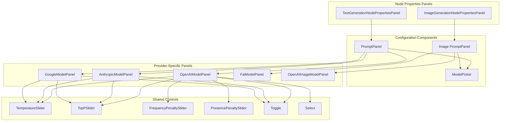

**Sources:**
- [internal-packages/workflow-designer-ui/src/editor/properties-panel/text-generation-node-properties-panel/index.tsx:1-290]()
- [internal-packages/workflow-designer-ui/src/editor/properties-panel/text-generation-node-properties-panel/prompt-panel.tsx:1-397]()
- [internal-packages/workflow-designer-ui/src/editor/properties-panel/image-generation-node-properties-panel/prompt-panel.tsx:1-205]()

## Model Picker Component

The `ModelPicker` component provides a unified interface for selecting AI models across different providers. It organizes models into provider groups and handles tier-based access control.

### Model Groups Structure

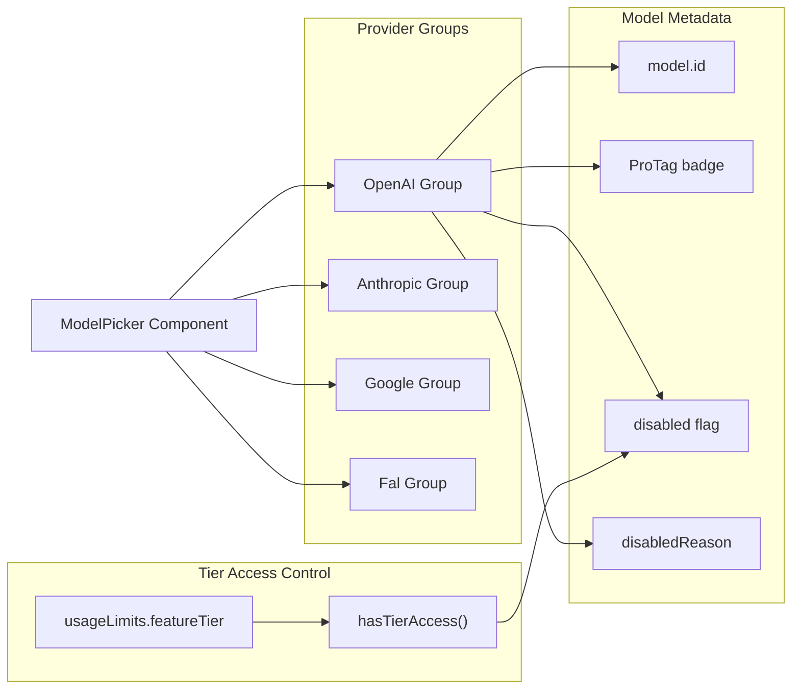

The model picker uses the following data structure from [internal-packages/workflow-designer-ui/src/editor/properties-panel/text-generation-node-properties-panel/prompt-panel.tsx:53-86]():

| Field | Type | Description |
|-------|------|-------------|
| `provider` | `string` | Provider identifier (openai, anthropic, google, fal) |
| `label` | `string` | Display name for provider group |
| `models` | `Array` | Array of model objects |
| `models[].id` | `string` | Model identifier |
| `models[].badge` | `ReactNode` | Optional Pro badge for premium models |
| `models[].disabled` | `boolean` | Whether model is unavailable to user |
| `models[].disabledReason` | `string` | Explanation if disabled |

**Sources:**
- [internal-packages/workflow-designer-ui/src/editor/properties-panel/text-generation-node-properties-panel/prompt-panel.tsx:53-86]()
- [internal-packages/workflow-designer-ui/src/editor/properties-panel/image-generation-node-properties-panel/prompt-panel.tsx:63-100]()

## OpenAI Model Panel

The `OpenAIModelPanel` component handles configuration for OpenAI language models, including both standard and reasoning models.

### Configuration Flow

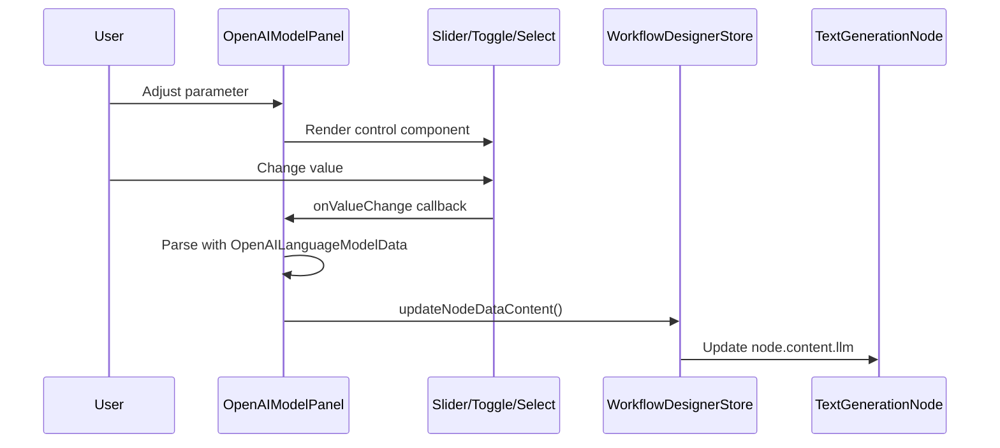

### Parameter Controls by Model Type

**Standard OpenAI Models** ([internal-packages/workflow-designer-ui/src/editor/properties-panel/text-generation-node-properties-panel/model/openai.tsx:108-136]()):

| Parameter | Control | Range | Description |
|-----------|---------|-------|-------------|
| `temperature` | `TemperatureSlider` | 0.0 - 2.0 | Randomness in responses |
| `topP` | `TopPSlider` | 0.0 - 1.0 | Nucleus sampling threshold |
| `frequencyPenalty` | `FrequencyPenaltySlider` | -2.0 - 2.0 | Penalty for repeated tokens |
| `presencePenalty` | `PresencePenaltySlider` | -2.0 - 2.0 | Penalty for topic repetition |
| `webSearch` | `Toggle` | boolean | Enable OpenAI web search tool |

**Reasoning Models** (e.g., o1, o3) ([internal-packages/workflow-designer-ui/src/editor/properties-panel/text-generation-node-properties-panel/model/openai.tsx:44-106]()):

| Parameter | Control | Options | Description |
|-----------|---------|---------|-------------|
| `reasoningEffort` | `Select` | minimal, low, medium, high | Computational effort for reasoning |
| `textVerbosity` | `Select` | low, medium, high | Output verbosity level |

### Web Search Tool Integration

When web search is enabled ([internal-packages/workflow-designer-ui/src/editor/properties-panel/text-generation-node-properties-panel/model/openai.tsx:137-178]()), the panel:

1. Adds `openaiWebSearch` configuration to `node.content.tools`
2. Creates a new output with `accessor: "source"` on the node
3. Manages connection cleanup when disabled

**Sources:**
- [internal-packages/workflow-designer-ui/src/editor/properties-panel/text-generation-node-properties-panel/model/openai.tsx:1-181]()
- [internal-packages/workflow-designer-ui/src/editor/properties-panel/text-generation-node-properties-panel/prompt-panel.tsx:119-165]()

## Anthropic Model Panel

The `AnthropicModelPanel` configures Anthropic Claude models with reasoning capabilities.

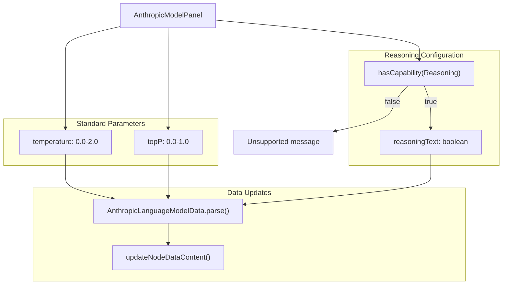

The reasoning capability check ([internal-packages/workflow-designer-ui/src/editor/properties-panel/text-generation-node-properties-panel/model/anthropic.tsx:21-28]()) determines whether to show the reasoning toggle:

```typescript
const hasReasoningCapability = useMemo(() => {
    const languageModel = anthropicLanguageModels.find(
        (lm) => lm.id === anthropicLanguageModel.id,
    );
    return (
        !!languageModel && hasCapability(languageModel, Capability.Reasoning)
    );
}, [anthropicLanguageModel.id]);
```

**Sources:**
- [internal-packages/workflow-designer-ui/src/editor/properties-panel/text-generation-node-properties-panel/model/anthropic.tsx:1-79]()

## Google Model Panel

The `GoogleModelPanel` configures Google Gemini models with search grounding and URL context features.

### Mutually Exclusive Features

Search Grounding and URL Context cannot be enabled simultaneously ([internal-packages/workflow-designer-ui/src/editor/properties-panel/text-generation-node-properties-panel/model/google.tsx:21-64]()):

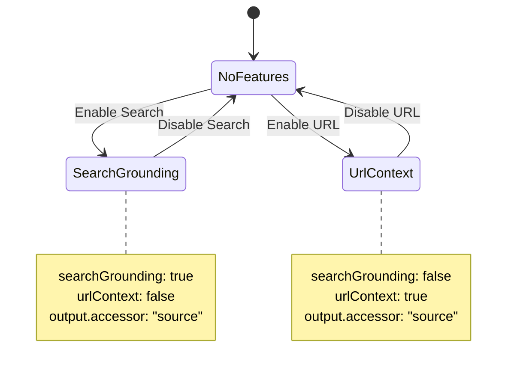

### Output Management

Both features require a "source" output ([internal-packages/workflow-designer-ui/src/editor/properties-panel/text-generation-node-properties-panel/prompt-panel.tsx:167-209]()):

| Feature | Output Required | Cleanup on Disable |
|---------|----------------|-------------------|
| Search Grounding | Yes | Deletes connections and removes output |
| URL Context | Yes | Deletes connections and removes output |
| Both Disabled | No | Removes source output |

**Sources:**
- [internal-packages/workflow-designer-ui/src/editor/properties-panel/text-generation-node-properties-panel/model/google.tsx:1-101]()
- [internal-packages/workflow-designer-ui/src/editor/properties-panel/text-generation-node-properties-panel/prompt-panel.tsx:167-255]()

## Image Generation Model Panels

Image generation panels configure models for visual content creation from Fal and OpenAI providers.

### Fal Model Panel

Configures Flux models with size and guidance parameters:

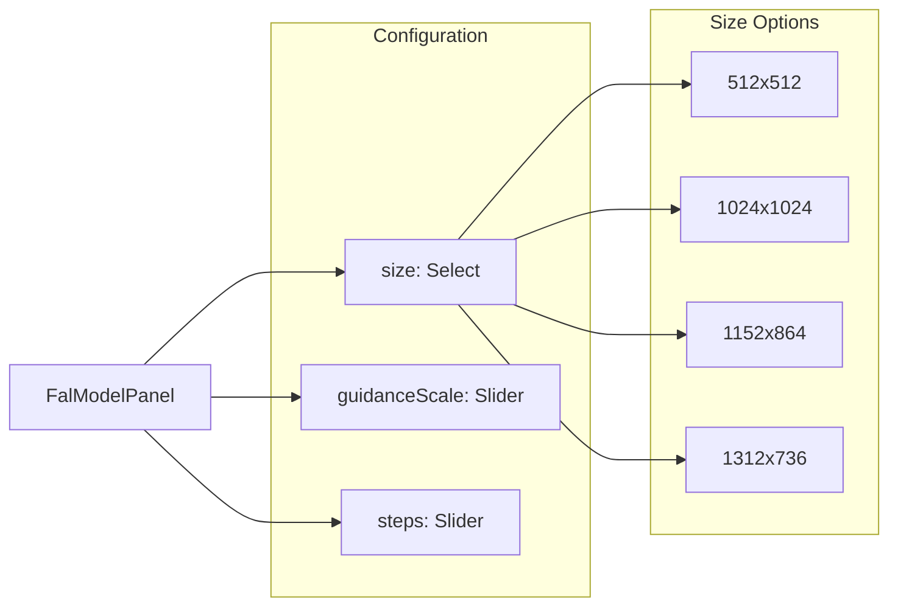

**Sources:**
- [internal-packages/workflow-designer-ui/src/editor/properties-panel/image-generation-node-properties-panel/models/index.tsx:1-50]()

### OpenAI Image Model Panel

Configures DALL-E models with size, quality, and style parameters. The panel also handles reference image connections ([internal-packages/workflow-designer-ui/src/editor/properties-panel/image-generation-node-properties-panel/prompt-panel.tsx:102-123]()):

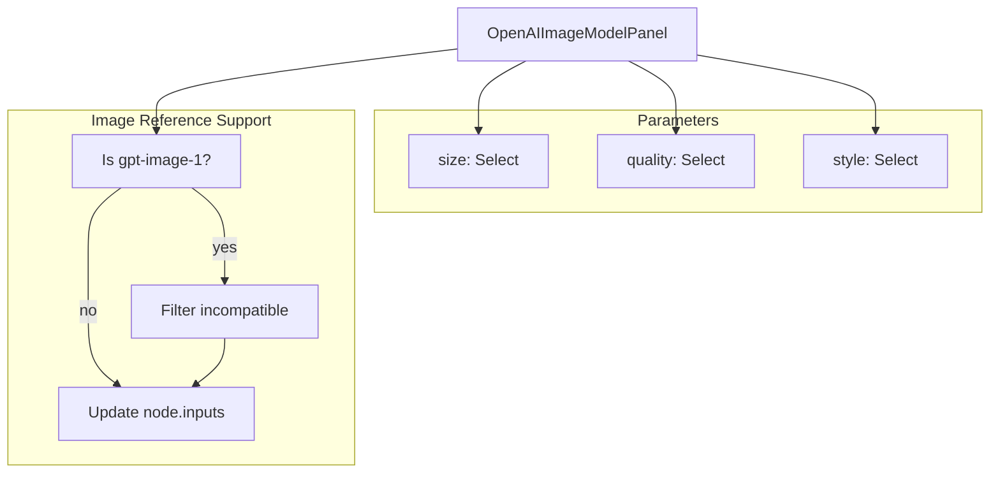

**Sources:**
- [internal-packages/workflow-designer-ui/src/editor/properties-panel/image-generation-node-properties-panel/models/index.tsx:1-200]()
- [internal-packages/workflow-designer-ui/src/editor/properties-panel/image-generation-node-properties-panel/prompt-panel.tsx:102-123]()

## Shared Model Control Components

Reusable slider components provide consistent parameter adjustment across providers.

### Control Component Interface

Each slider component follows this pattern from [internal-packages/workflow-designer-ui/src/editor/properties-panel/text-generation-node-properties-panel/model/shared-model-controls.tsx]():

| Component | Parameter | Range | Step | Default |
|-----------|-----------|-------|------|---------|
| `TemperatureSlider` | `temperature` | 0.0 - 2.0 | 0.01 | 1.0 |
| `TopPSlider` | `topP` | 0.0 - 1.0 | 0.01 | 1.0 |
| `FrequencyPenaltySlider` | `frequencyPenalty` | -2.0 - 2.0 | 0.01 | 0.0 |
| `PresencePenaltySlider` | `presencePenalty` | -2.0 - 2.0 | 0.01 | 0.0 |

### Update Pattern

All sliders use a generic update pattern:

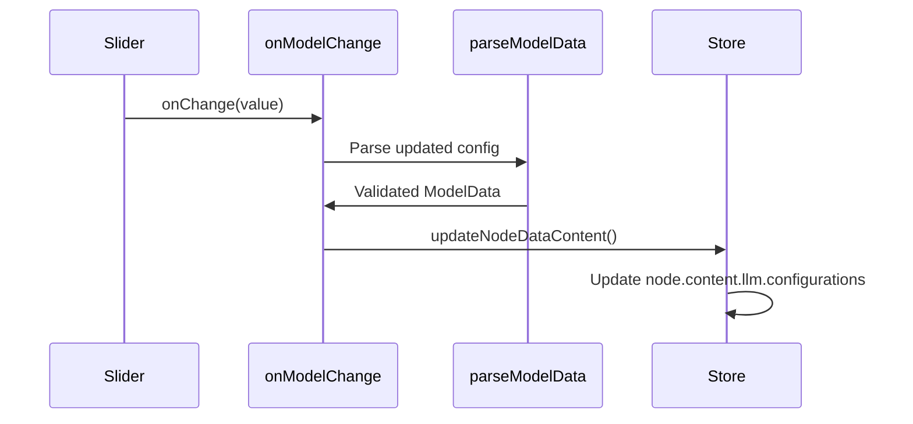

**Sources:**
- [internal-packages/workflow-designer-ui/src/editor/properties-panel/text-generation-node-properties-panel/model/shared-model-controls.tsx:1-150]()

## Tool Configuration Dialogs

Advanced tool configurations are managed through dedicated dialog components.

### Anthropic Web Search Configuration

The `AnthropicWebSearchToolConfigurationDialog` ([internal-packages/workflow-designer-ui/src/editor/properties-panel/text-generation-node-properties-panel/tools/tool-provider/anthropic-web-search/anthropic-web-search.tsx:30-472]()) provides:

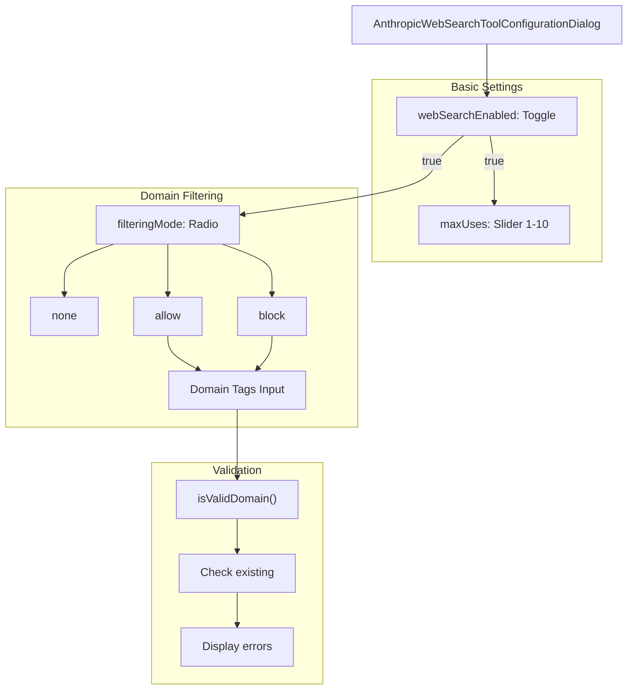

**Domain Filtering Modes:**

| Mode | Config Field | Behavior |
|------|-------------|----------|
| `none` | `allowedDomains: undefined`<br>`blockedDomains: undefined` | Search all domains |
| `allow` | `allowedDomains: string[]` | Only search listed domains |
| `block` | `blockedDomains: string[]` | Exclude listed domains |

**Sources:**
- [internal-packages/workflow-designer-ui/src/editor/properties-panel/text-generation-node-properties-panel/tools/tool-provider/anthropic-web-search/anthropic-web-search.tsx:1-472]()

## Integration with Properties Panels

Model configuration panels are embedded within node-specific properties panels through the `PromptPanel` component.

### Text Generation Integration

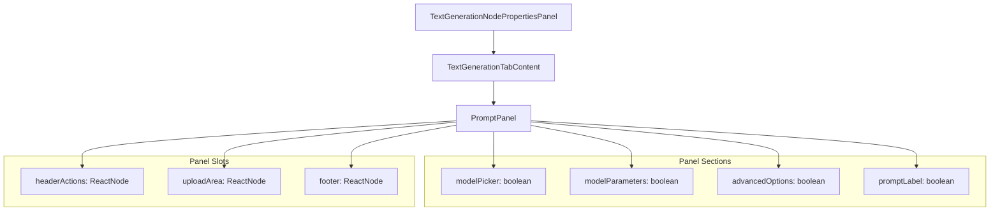

The `PromptPanel` component ([internal-packages/workflow-designer-ui/src/editor/properties-panel/text-generation-node-properties-panel/prompt-panel.tsx:89-397]()) accepts configuration through `sections` and `slots` props:

**Sections Configuration:**
```typescript
type PromptPanelSections = {
    modelPicker?: boolean;          // Show ModelPicker
    modelParameters?: boolean;      // Show provider panels
    advancedOptions?: boolean;      // Show tools section
    promptLabel?: boolean;          // Show "Prompt" label
};
```

**Slots Configuration:**
```typescript
type PromptPanelSlots = {
    headerActions?: React.ReactNode;  // Custom header actions
    uploadArea?: React.ReactNode;     // File upload controls
    footer?: React.ReactNode;         // Custom footer content
};
```

**Sources:**
- [internal-packages/workflow-designer-ui/src/editor/properties-panel/text-generation-node-properties-panel/index.tsx:28-289]()
- [internal-packages/workflow-designer-ui/src/editor/properties-panel/text-generation-node-properties-panel/tab-content.tsx:1-32]()
- [internal-packages/workflow-designer-ui/src/editor/properties-panel/text-generation-node-properties-panel/prompt-panel.tsx:40-51]()

## State Management and Data Flow

Model configuration changes flow through the workflow designer store to update node data.

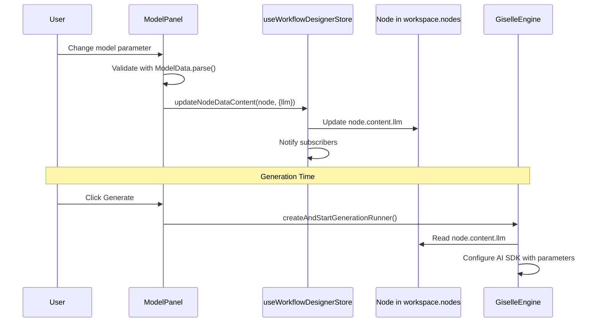

### Update Functions

The store provides two primary update functions ([internal-packages/workflow-designer-ui/src/editor/properties-panel/text-generation-node-properties-panel/prompt-panel.tsx:102-106]()):

| Function | Purpose | Usage |
|----------|---------|-------|
| `updateNodeDataContent(node, content)` | Update `node.content` fields | Model parameters, prompt, tools |
| `updateNodeData(node, data)` | Update top-level node fields | Name, inputs, outputs |

**Sources:**
- [internal-packages/workflow-designer-ui/src/editor/properties-panel/text-generation-node-properties-panel/prompt-panel.tsx:102-106]()
- [internal-packages/workflow-designer-ui/src/editor/properties-panel/text-generation-node-properties-panel/model/openai.tsx:61-68]()
- [internal-packages/workflow-designer-ui/src/editor/properties-panel/text-generation-node-properties-panel/model/anthropic.tsx:52-59]()

## Model Defaults and Initialization

Default model configurations are created through factory functions.

### Default Model Data Creation

The `createDefaultModelData` function ([internal-packages/workflow-designer-ui/src/editor/properties-panel/text-generation-node-properties-panel/model-defaults.tsx]()) initializes provider-specific configurations:

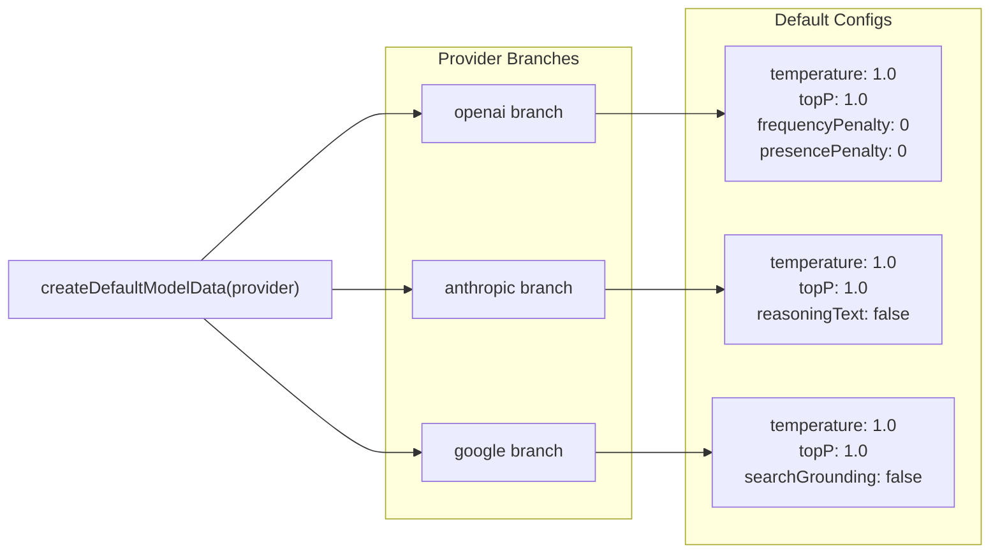

### Model Switching

When a user switches models via `ModelPicker`, the system:

1. Creates default configuration for new provider
2. Updates model ID via `updateModelId()`
3. Resets incompatible parameters
4. Clears tool configurations

From [internal-packages/workflow-designer-ui/src/editor/properties-panel/text-generation-node-properties-panel/prompt-panel.tsx:281-287]():

```typescript
onSelect={(provider, modelId) => {
    const next = createDefaultModelData(
        provider as "openai" | "anthropic" | "google",
    );
    const updated = updateModelId(next, modelId);
    updateNodeDataContent(node, { llm: updated, tools: {} });
}}
```

**Sources:**
- [internal-packages/workflow-designer-ui/src/editor/properties-panel/text-generation-node-properties-panel/model-defaults.tsx:1-100]()
- [internal-packages/workflow-designer-ui/src/editor/properties-panel/image-generation-node-properties-panel/model-defaults.tsx:1-80]()

---

