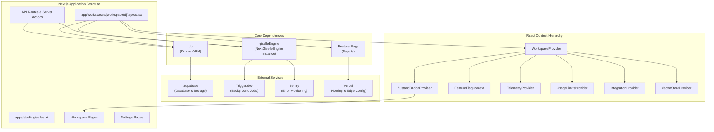
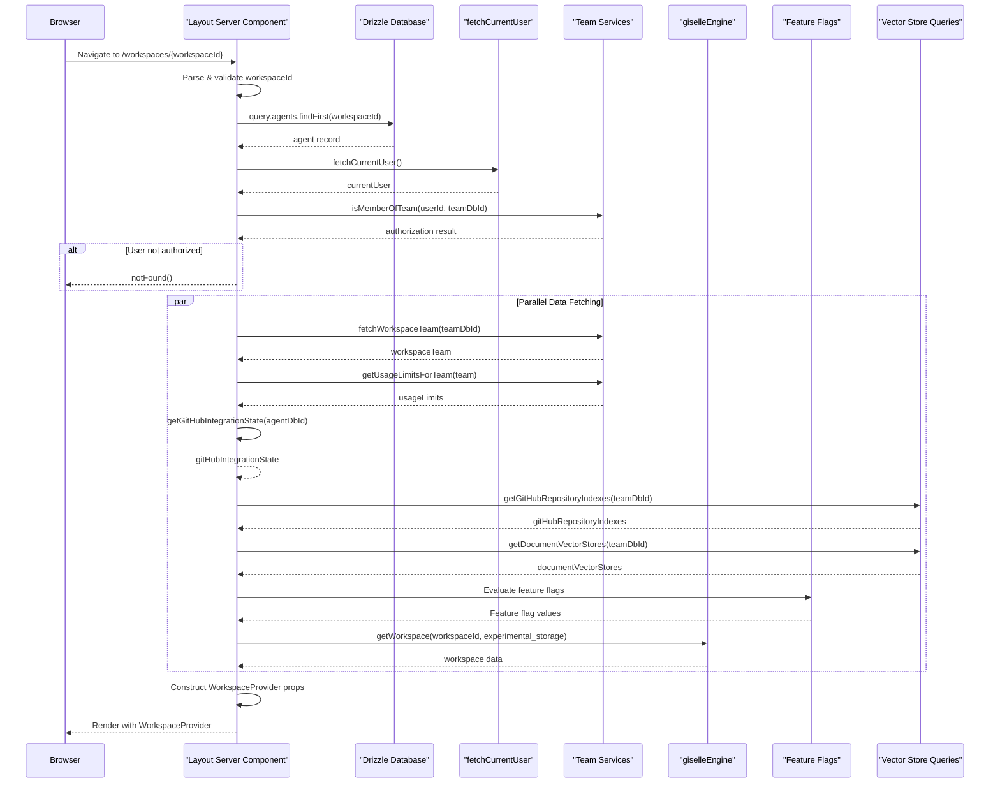
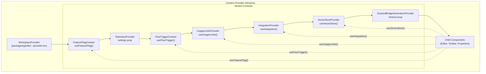
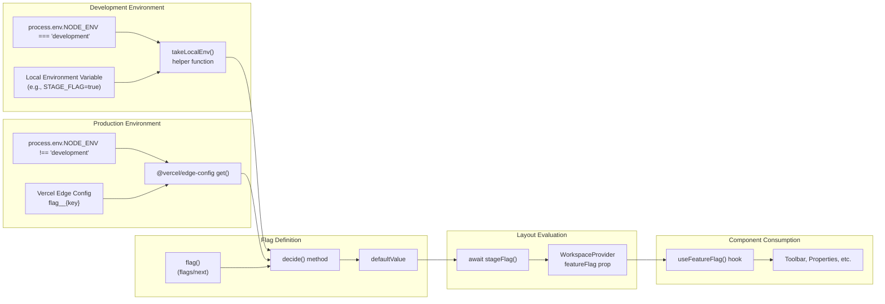
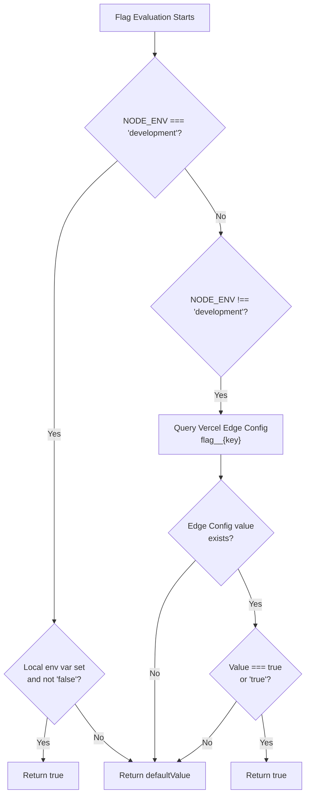
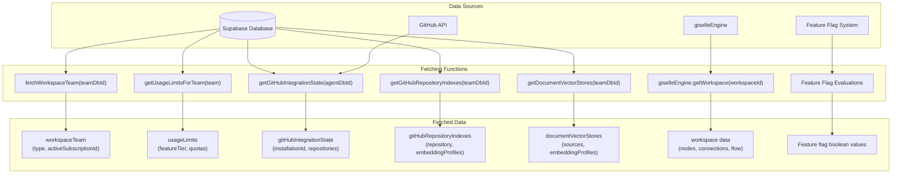

<!-- source: DeepWiki mcp.deepwiki.com · repo giselles-ai/giselle · page 6.1 Studio Application · fetched 2026-10-27 -->

# Studio Application

<details>
<summary>Relevant source files</summary>

The following files were used as context for generating this wiki page:

- [apps/playground/app/workspaces/[workspaceId]/layout.tsx](apps/playground/app/workspaces/[workspaceId]/layout.tsx)
- [apps/playground/package.json](apps/playground/package.json)
- [apps/studio.giselles.ai/app/deprecated/workspaces/[workspaceId]/layout.tsx](apps/studio.giselles.ai/app/deprecated/workspaces/[workspaceId]/layout.tsx)
- [apps/studio.giselles.ai/app/workspaces/[workspaceId]/data-loader.ts](apps/studio.giselles.ai/app/workspaces/[workspaceId]/data-loader.ts)
- [apps/studio.giselles.ai/flags.ts](apps/studio.giselles.ai/flags.ts)
- [apps/studio.giselles.ai/package.json](apps/studio.giselles.ai/package.json)
- [internal-packages/workflow-designer-ui/package.json](internal-packages/workflow-designer-ui/package.json)
- [package.json](package.json)
- [packages/giselle/package.json](packages/giselle/package.json)
- [packages/giselle/src/react/feature-flags/context.ts](packages/giselle/src/react/feature-flags/context.ts)
- [packages/giselle/src/react/workspace/provider.tsx](packages/giselle/src/react/workspace/provider.tsx)
- [pnpm-lock.yaml](pnpm-lock.yaml)
- [pnpm-workspace.yaml](pnpm-workspace.yaml)

</details>


The Studio Application is the production Next.js application hosted at `studio.giselles.ai` that provides the primary user interface for creating and managing AI workflows. It serves as the main entry point for end users to interact with the Giselle platform, orchestrating workspace management, workflow design, generation execution, and integration with external services.

This page covers the Studio Application's architecture, workspace initialization, context provisioning, and feature flag integration. For details about the workflow designer UI components used within Studio, see [Workflow Designer UI](#4). For the simplified development version of this application, see [Playground Application](#5.2). For information about workspace configuration details and specific features, see [Workspace Configuration and Context](#5.1.1).

## Application Architecture

The Studio Application is a Next.js 15 application organized as a workspace-centric system. Each workspace is identified by a `workspaceId` route parameter and corresponds to an agent in the database.



**Sources:** [apps/studio.giselles.ai/app/workspaces/[workspaceId]/layout.tsx:1-167]()

The application follows a layered architecture where:
- The workspace layout performs server-side data fetching and authorization
- Multiple React contexts provide scoped data and functionality
- Child pages consume context via hooks
- Server actions handle mutations and integration with background jobs

## Workspace Layout and Initialization

The workspace layout at [apps/studio.giselles.ai/app/workspaces/[workspaceId]/layout.tsx]() serves as the initialization layer for each workspace. It performs authentication, authorization, data fetching, and context setup before rendering child components.



**Sources:** [apps/studio.giselles.ai/app/workspaces/[workspaceId]/layout.tsx:31-167]()

### Initialization Steps

The layout performs the following initialization sequence:

1. **Workspace ID Validation** [apps/studio.giselles.ai/app/workspaces/[workspaceId]/layout.tsx:38-43]()
   - Parses the `workspaceId` parameter using the `WorkspaceId` schema
   - Returns 404 if validation fails

2. **Agent Lookup** [apps/studio.giselles.ai/app/workspaces/[workspaceId]/layout.tsx:45-50]()
   - Queries the `agents` table for a record matching the workspace ID
   - Returns 404 if no agent exists

3. **Authorization Check** [apps/studio.giselles.ai/app/workspaces/[workspaceId]/layout.tsx:51-60]()
   - Fetches the current user via `fetchCurrentUser()`
   - Verifies the user is a member of the agent's team
   - Returns 404 if authorization fails

4. **Parallel Data Fetching** [apps/studio.giselles.ai/app/workspaces/[workspaceId]/layout.tsx:62-87]()
   - GitHub integration state
   - Workspace team information
   - Usage limits for the team
   - GitHub repository indexes
   - Document vector stores (if feature flag enabled)
   - Feature flag evaluations
   - Workspace data from the engine

5. **Context Provider Setup** [apps/studio.giselles.ai/app/workspaces/[workspaceId]/layout.tsx:90-166]()
   - Constructs props for `WorkspaceProvider`
   - Wraps children with `ZustandBridgeProvider`

## Context Provider Hierarchy

The Studio Application uses a nested context provider hierarchy to make workspace data and functionality available throughout the component tree. This hierarchy is established in the workspace layout and consumed via React hooks.



**Sources:** [packages/giselle/src/react/workspace/provider.tsx:25-72]()

### Context Providers

| Provider | Hook | Purpose | Props Source |
|----------|------|---------|--------------|
| `FeatureFlagContext` | `useFeatureFlag()` | Feature flag access | [apps/studio.giselles.ai/app/workspaces/[workspaceId]/layout.tsx:73-84]() |
| `TelemetryProvider` | N/A | Analytics metadata injection | [apps/studio.giselles.ai/app/workspaces/[workspaceId]/layout.tsx:120-127]() |
| `FlowTriggerContext` | `useFlowTrigger()` | Flow trigger update callbacks | [apps/studio.giselles.ai/app/workspaces/[workspaceId]/layout.tsx:138-162]() |
| `UsageLimitsProvider` | `useUsageLimits()` | Usage quotas and tier info | [apps/studio.giselles.ai/app/workspaces/[workspaceId]/layout.tsx:69]() |
| `IntegrationProvider` | `useIntegration()` | External integration state | [apps/studio.giselles.ai/app/workspaces/[workspaceId]/layout.tsx:94-101]() |
| `VectorStoreProvider` | `useVectorStore()` | Vector store configuration | [apps/studio.giselles.ai/app/workspaces/[workspaceId]/layout.tsx:103-118]() |
| `ZustandBridgeProvider` | N/A | Bridges workspace data to Zustand | [apps/studio.giselles.ai/app/workspaces/[workspaceId]/layout.tsx:164]() |

**Sources:** [packages/giselle/src/react/workspace/provider.tsx:25-72](), [apps/studio.giselles.ai/app/workspaces/[workspaceId]/layout.tsx:90-166]()

### Context Consumption Example

Components throughout the application consume these contexts using dedicated hooks:

```typescript
// Example from Toolbar component
const { webSearchAction, documentVectorStore } = useFeatureFlag();
const usageLimits = useUsageLimits();
const userTier = usageLimits?.featureTier ?? Tier.enum.free;
```

**Sources:** [internal-packages/workflow-designer-ui/src/editor/tool/toolbar/toolbar.tsx:95-133]()

## Feature Flag System

The Studio Application implements an environment-aware feature flag system that supports both local development and production deployments. Feature flags control the availability of experimental features, integrations, and UI components.



**Sources:** [apps/studio.giselles.ai/flags.ts:1-197](), [apps/studio.giselles.ai/app/workspaces/[workspaceId]/layout.tsx:11-19]()

### Feature Flag Definitions

The flag system defines the following feature flags:

| Flag | Environment Variable | Description | Default |
|------|---------------------|-------------|---------|
| `developerFlag` | `DEVELOPER_FLAG` | Enable developer mode | `false` |
| `webSearchActionFlag` | `WEB_SEARCH_ACTION_FLAG` | Enable web search action nodes | `false` |
| `layoutV3Flag` | `LAYOUT_V3_FLAG` | Enable Layout V3 | `undefined` |
| `experimental_storageFlag` | `EXPERIMENTAL_STORAGE_FLAG` | Enable experimental storage backend | `undefined` |
| `stageFlag` | `STAGE_FLAG` | Enable stage system for flow triggering | `undefined` |
| `aiGatewayFlag` | `AI_GATEWAY_FLAG` | Enable AI Gateway routing | `undefined` |
| `resumableGenerationFlag` | `RESUMABLE_GENERATION_FLAG` | Enable resumable generation | `undefined` |
| `googleUrlContextFlag` | `GOOGLE_URL_CONTEXT_FLAG` | Enable Google URL Context tool | `false` |
| `docVectorStoreFlag` | `DOC_VECTOR_STORE_FLAG` | Enable document vector store ingest | `undefined` |

**Sources:** [apps/studio.giselles.ai/flags.ts:17-196]()

### Flag Evaluation Logic

Each flag follows this evaluation pattern:



**Sources:** [apps/studio.giselles.ai/flags.ts:4-15](), [apps/studio.giselles.ai/flags.ts:43-79]()

The `takeLocalEnv()` helper function checks if the environment is development and if the specified environment variable is set and not `"false"` [apps/studio.giselles.ai/flags.ts:4-15](). Production environments query Vercel Edge Config using the pattern `flag__{key}` [apps/studio.giselles.ai/flags.ts:49-53]().

### Flag Consumption in Components

Components access feature flags through the `useFeatureFlag()` hook:

```typescript
// From Toolbar component
const { webSearchAction, documentVectorStore } = useFeatureFlag();

// Conditionally render Document Vector Store option
{documentVectorStore && (
  <ToggleGroup.Item value="documentVectorStore" data-tool>
    <DocumentVectorStoreIcon className="w-[20px] h-[20px]" />
    <p className="text-[14px]">Document Vector Store</p>
  </ToggleGroup.Item>
)}
```

**Sources:** [internal-packages/workflow-designer-ui/src/editor/tool/toolbar/toolbar.tsx:95](), [internal-packages/workflow-designer-ui/src/editor/tool/toolbar/toolbar.tsx:370-378]()

The hook throws an error if used outside of a `FeatureFlagContext` provider [packages/giselle/src/react/feature-flags/context.ts:17-25]().

## Data Fetching Pipeline

The workspace layout orchestrates a parallel data fetching pipeline to minimize initialization latency. This pipeline fetches data from multiple sources concurrently.



**Sources:** [apps/studio.giselles.ai/app/workspaces/[workspaceId]/layout.tsx:62-87]()

### Data Fetching Sequence

The layout performs the following data fetches in parallel:

1. **GitHub Integration State** [apps/studio.giselles.ai/app/workspaces/[workspaceId]/layout.tsx:62]()
   - `getGitHubIntegrationState(agent.dbId)`
   - Returns installation ID and repository list

2. **Workspace Team** [apps/studio.giselles.ai/app/workspaces/[workspaceId]/layout.tsx:64-67]()
   - `fetchWorkspaceTeam(agent.teamDbId)`
   - Returns team type, subscription info, and tier

3. **Usage Limits** [apps/studio.giselles.ai/app/workspaces/[workspaceId]/layout.tsx:69]()
   - `getUsageLimitsForTeam(workspaceTeam)`
   - Calculates quotas based on team tier

4. **GitHub Repository Indexes** [apps/studio.giselles.ai/app/workspaces/[workspaceId]/layout.tsx:70-72]()
   - `getGitHubRepositoryIndexes(workspaceTeam.dbId)`
   - Returns vector store indexes for GitHub repositories

5. **Feature Flags** [apps/studio.giselles.ai/app/workspaces/[workspaceId]/layout.tsx:73-79]()
   - Evaluates each flag (e.g., `await webSearchActionFlag()`)
   - Returns boolean values

6. **Workspace Data** [apps/studio.giselles.ai/app/workspaces/[workspaceId]/layout.tsx:80-83]()
   - `giselleEngine.getWorkspace(workspaceId, experimental_storage)`
   - Returns nodes, connections, and flow configuration

7. **Document Vector Stores** [apps/studio.giselles.ai/app/workspaces/[workspaceId]/layout.tsx:84-87]()
   - `getDocumentVectorStores(workspaceTeam.dbId)` (conditional)
   - Only fetched if `docVectorStoreFlag` is enabled

## Integration Points

The Studio Application integrates with multiple external services and internal packages:

| Integration | Purpose | Configuration |
|-------------|---------|---------------|
| **Giselle Engine** | AI workflow orchestration | [apps/studio.giselles.ai/app/giselle-engine.ts]() |
| **Drizzle ORM** | Database access | [apps/studio.giselles.ai/drizzle/index.ts]() |
| **Trigger.dev** | Background job execution | Configured via `generationTimeout` [apps/studio.giselles.ai/app/workspaces/[workspaceId]/layout.tsx:93]() |
| **Sentry** | Error monitoring | Integrated in engine configuration |
| **Vercel Edge Config** | Production feature flags | Queried via `@vercel/edge-config` [apps/studio.giselles.ai/flags.ts:1]() |
| **Workflow Designer UI** | Visual workflow editor | Consumed via `ZustandBridgeProvider` |

**Sources:** [apps/studio.giselles.ai/app/workspaces/[workspaceId]/layout.tsx:8-29]()

### Flow Trigger Callbacks

The layout provides flow trigger update callbacks that synchronize flow trigger state with the database:

```typescript
flowTrigger={{
  callbacks: {
    flowTriggerUpdate: async (flowTrigger) => {
      "use server";
      await db
        .insert(flowTriggers)
        .values({
          teamDbId: workspaceTeam.dbId,
          sdkFlowTriggerId: flowTrigger.id,
          sdkWorkspaceId: flowTrigger.workspaceId,
          staged:
            flowTrigger.configuration.provider === "manual" &&
            flowTrigger.configuration.staged,
        })
        .onConflictDoUpdate({
          target: flowTriggers.dbId,
          set: {
            staged:
              flowTrigger.configuration.provider === "manual" &&
              flowTrigger.configuration.staged,
          },
        });
    },
  },
}}
```

**Sources:** [apps/studio.giselles.ai/app/workspaces/[workspaceId]/layout.tsx:138-162]()

This callback is invoked when flow triggers are created or updated, ensuring database state remains synchronized with the SDK's flow trigger configuration.

## Comparison with Playground Application

The Playground Application [apps/playground/app/workspaces/[workspaceId]/layout.tsx]() serves as a simplified development environment compared to Studio. The key differences highlight Studio's production-focused architecture:

| Aspect | Studio | Playground |
|--------|--------|-----------|
| **Feature Flags** | Dynamic evaluation via environment variables or Edge Config | Hardcoded static values |
| **Data Fetching** | Extensive parallel fetching (team, usage, integrations, vector stores) | None (no server-side data) |
| **Authorization** | Full team membership verification | None |
| **Integration State** | GitHub integration state with refresh capability | None |
| **Vector Stores** | Full support with GitHub and document stores | None |
| **Usage Limits** | Team-based quota enforcement | None |
| **Telemetry** | Pro plan status and user metadata | None |
| **Flow Triggers** | Database synchronization callbacks | None |

**Sources:** [apps/playground/app/workspaces/[workspaceId]/layout.tsx:4-21](), [apps/studio.giselles.ai/app/workspaces/[workspaceId]/layout.tsx:31-167]()

The Playground's layout is minimal:

```typescript
export default function Layout({ children }: { children: ReactNode }) {
  return (
    <WorkspaceProvider
      featureFlag={{
        webSearchAction: false,
        layoutV3: true,
        experimental_storage: true,
        stage: true,
        aiGateway: false,
        resumableGeneration: false,
        googleUrlContext: false,
        documentVectorStore: false,
      }}
    >
      {children}
    </WorkspaceProvider>
  );
}
```

This simplified architecture makes Playground suitable for rapid development and testing without the overhead of production features like authentication, authorization, and external service integration.

**Sources:** [apps/playground/app/workspaces/[workspaceId]/layout.tsx:4-21]()

---

