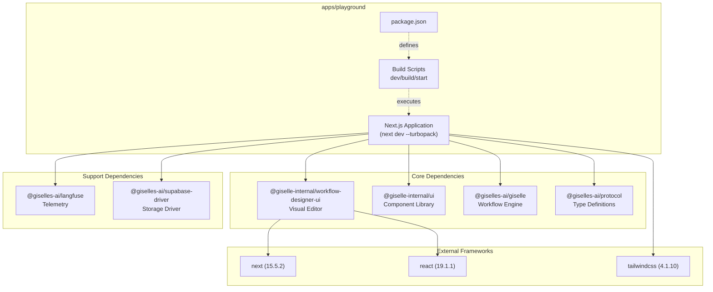
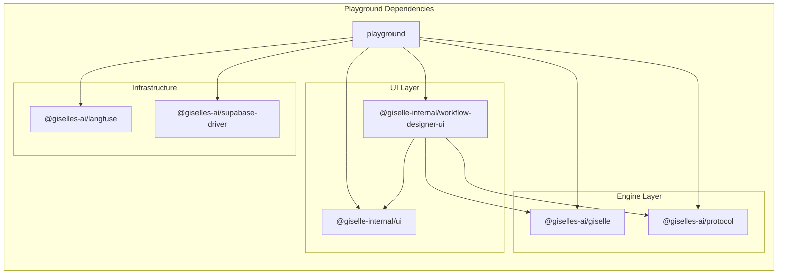
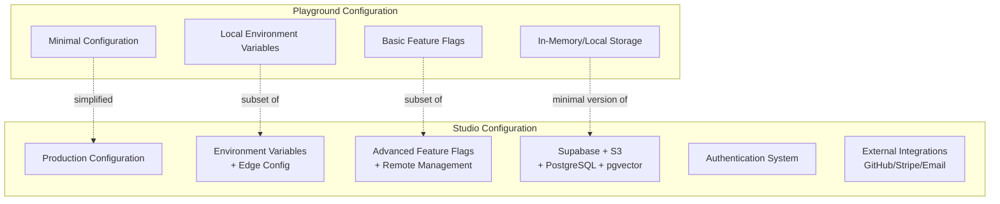
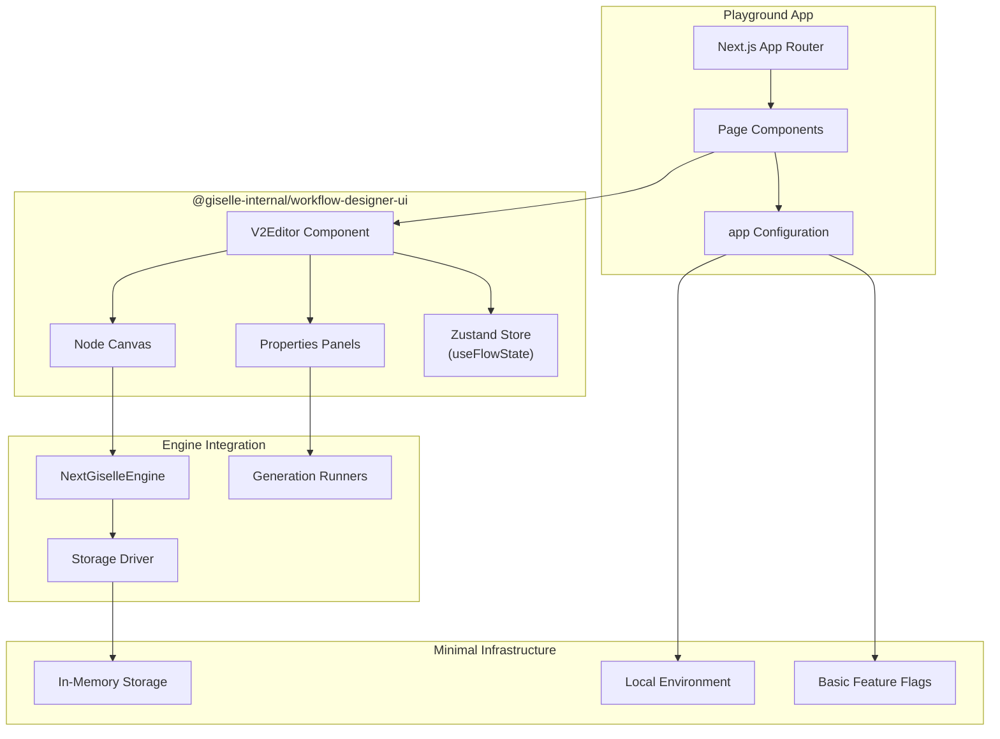

<!-- source: DeepWiki mcp.deepwiki.com · repo giselles-ai/giselle · page 6.2 Playground Application · fetched 2026-10-27 -->

# Playground Application

<details>
<summary>Relevant source files</summary>

The following files were used as context for generating this wiki page:

- [apps/playground/package.json](apps/playground/package.json)
- [apps/studio.giselles.ai/package.json](apps/studio.giselles.ai/package.json)
- [internal-packages/workflow-designer-ui/package.json](internal-packages/workflow-designer-ui/package.json)
- [package.json](package.json)
- [packages/giselle/package.json](packages/giselle/package.json)
- [pnpm-lock.yaml](pnpm-lock.yaml)
- [pnpm-workspace.yaml](pnpm-workspace.yaml)

</details>


## Purpose and Scope

The Playground application is a minimal development and testing environment for the Giselle workflow designer and execution engine. It provides a simplified interface for developing and testing workflow features without the complexity of production infrastructure, authentication, database persistence, or external integrations. For the full production application with all features enabled, see [Studio Application](#6.1).

The Playground serves as:
- A rapid prototyping environment for workflow designer UI development
- A testing ground for Giselle engine behavior without production dependencies
- A reference implementation demonstrating minimal viable configuration
- A development tool accessible via `pnpm dev` at the repository root

**Sources:** [package.json:12](), [apps/playground/package.json:1-42]()

---

## Application Structure

### Next.js Application Configuration

The Playground is a Next.js 15 application located at [apps/playground]() with Turbopack enabled for fast development iteration. The application requires Node.js 22.x and uses pnpm as its package manager.



**Sources:** [apps/playground/package.json:1-42](), [pnpm-lock.yaml:265-324]()

### Available Scripts

| Script | Command | Purpose |
|--------|---------|---------|
| `dev` | `next dev --turbopack` | Start development server with hot reload |
| `build` | `next build --turbopack` | Create production build |
| `start` | `next start` | Run production server |
| `clean` | `rm -rf .next .turbo node_modules` | Clean build artifacts |
| `check-types` | `tsc --noEmit` | Validate TypeScript types |
| `format` | `biome check --write .` | Format code with Biome |

**Sources:** [apps/playground/package.json:9-17]()

---

## Package Dependencies

### Dependency Footprint

The Playground maintains a minimal dependency set focused on workflow design and execution, excluding production-specific features like authentication, external integrations, and observability services.



**Sources:** [apps/playground/package.json:19-30](), [pnpm-lock.yaml:265-299]()

### Core Dependencies

| Package | Version | Purpose |
|---------|---------|---------|
| `@giselle-internal/ui` | workspace:^ | Shared UI component library with theme system |
| `@giselle-internal/workflow-designer-ui` | workspace:* | Complete workflow visual editor implementation |
| `@giselles-ai/protocol` | workspace:* | Type definitions for workflow structures and API contracts |
| `@giselles-ai/giselle` | workspace:* | Main orchestration engine for workflow execution |
| `@giselles-ai/langfuse` | workspace:^ | LLM observability and tracing integration |
| `@giselles-ai/supabase-driver` | workspace:^ | Storage abstraction for generation data persistence |

**Sources:** [apps/playground/package.json:19-30]()

---

## Comparison with Studio

### Dependency Differences

The key architectural difference between Playground and Studio is feature scope. The Playground includes only essential workflow design and execution capabilities, while Studio includes the full production stack.

| Feature Category | Playground | Studio |
|------------------|------------|--------|
| **Workflow Designer** | ✓ | ✓ |
| **Engine Execution** | ✓ | ✓ |
| **UI Components** | ✓ | ✓ |
| **Document Processing** | ✗ | ✓ (@giselles-ai/document-preprocessor) |
| **GitHub Integration** | ✗ | ✓ (@giselles-ai/github-tool) |
| **RAG System** | ✗ | ✓ (@giselles-ai/rag) |
| **Authentication** | ✗ | ✓ (@supabase/auth-js, @supabase/ssr) |
| **Database ORM** | ✗ | ✓ (drizzle-orm) |
| **Observability** | Basic (Langfuse) | Full (@sentry/nextjs, @vercel/otel) |
| **External Services** | ✗ | ✓ (Stripe, Trigger.dev, Email) |
| **Production Storage** | ✗ | ✓ (AWS S3, PostgreSQL) |

**Sources:** [apps/playground/package.json:19-30](), [apps/studio.giselles.ai/package.json:25-106]()

### Configuration Simplification



**Sources:** [apps/playground/package.json:1-42](), [apps/studio.giselles.ai/package.json:1-132]()

---

## Development Workflow

### Running the Playground

The Playground is the default development target when running `pnpm dev` from the repository root.

```bash
# From repository root - runs Playground by default
pnpm dev

# Explicit Playground target
turbo dev --filter playground

# From Playground directory
cd apps/playground
pnpm dev
```

The development server starts on the default Next.js port (typically 3000) with Turbopack hot module replacement enabled for fast iteration.

**Sources:** [package.json:12](), [apps/playground/package.json:10]()

### Development Use Cases

**Workflow Designer Development:**
- Test visual node editing without database persistence
- Validate ReactFlow canvas interactions and rendering
- Develop properties panel components in isolation
- Debug Zustand state management without production side effects

**Engine Testing:**
- Execute workflow generations with local storage
- Test AI provider integrations without production credentials
- Validate generation pipeline behavior
- Debug Act orchestration logic

**Component Development:**
- Test UI components from `@giselle-internal/ui` in context
- Validate theme system and styling
- Develop new node types and visualization

**Sources:** [apps/playground/package.json:19-30]()

---

## Architecture Integration

### Relationship to Workflow Designer UI

The Playground's primary function is hosting the Workflow Designer UI package for development and testing. It provides the Next.js runtime environment and minimal infrastructure required by the designer.



**Sources:** [apps/playground/package.json:19-30](), [internal-packages/workflow-designer-ui/package.json:12-41]()

### Engine Configuration

Unlike Studio, which configures the `NextGiselleEngine` with production storage drivers, database connections, and external service credentials, the Playground uses simplified configuration suitable for local development.

**Playground Engine Configuration:**
- **Storage:** Local filesystem or in-memory storage via `@giselles-ai/supabase-driver`
- **Vault:** Node-based vault with `VAULT_SECRET` environment variable (no Supabase pgsodium)
- **AI Providers:** Direct provider configuration without API gateway
- **Callbacks:** Basic logging via `@giselles-ai/langfuse` (no production telemetry)
- **Runtime Environment:** Detected as `local` rather than `vercel` or `trigger.dev`

**Sources:** [apps/playground/package.json:19-30](), [packages/giselle/package.json:55-75]()

---

## Build and Deployment

### Build Process

The Playground uses Next.js with Turbopack for both development and production builds:

```bash
# Development build (auto-rebuilding)
pnpm dev

# Production build
pnpm build

# Production server
pnpm start
```

Build configuration is managed through [next.config.js]() (if present) with Turbopack enabled for faster compilation than Webpack.

**Sources:** [apps/playground/package.json:10-13]()

### Type Generation

The Playground supports Next.js type generation for route types and configuration:

```bash
# Generate TypeScript types for Next.js routes
pnpm typegen

# Type checking without emitting files
pnpm check-types
```

**Sources:** [apps/playground/package.json:15-16]()

---

## Purpose-Built Constraints

### What Playground Excludes

The Playground intentionally omits production features to maintain simplicity and fast iteration:

**Authentication & Authorization:**
- No Supabase authentication (`@supabase/auth-js`, `@supabase/ssr`)
- No user management or team workspaces
- No access control or permissions

**Data Persistence:**
- No PostgreSQL database (`drizzle-orm`)
- No vector storage (`pgvector`)
- No persistent workflow storage

**External Integrations:**
- No GitHub integration (`@giselles-ai/github-tool`)
- No document processing (`@giselles-ai/document-preprocessor`)
- No RAG system (`@giselles-ai/rag`)
- No payment processing (Stripe)
- No email services
- No async job processing (Trigger.dev)

**Production Infrastructure:**
- No Sentry error tracking
- No Vercel-specific features (`@vercel/otel`, `@vercel/edge-config`)
- No comprehensive observability stack
- No production secret management

**Sources:** [apps/playground/package.json:19-30](), [apps/studio.giselles.ai/package.json:25-106]()

---

## Entry Point Reference

The Playground application entry point follows Next.js App Router conventions. Key files include:

- **[apps/playground/app]()**: Next.js App Router root directory
- **[apps/playground/app/layout.tsx]()**: Root layout defining global providers and styles
- **[apps/playground/app/page.tsx]()**: Default page component hosting the workflow designer
- **[apps/playground/tailwind.config.ts]()**: Tailwind CSS configuration extending theme system
- **[apps/playground/next.config.js]()**: Next.js configuration with Turbopack settings

**Sources:** [apps/playground/package.json:1-42](), [pnpm-lock.yaml:265-324]()

---

