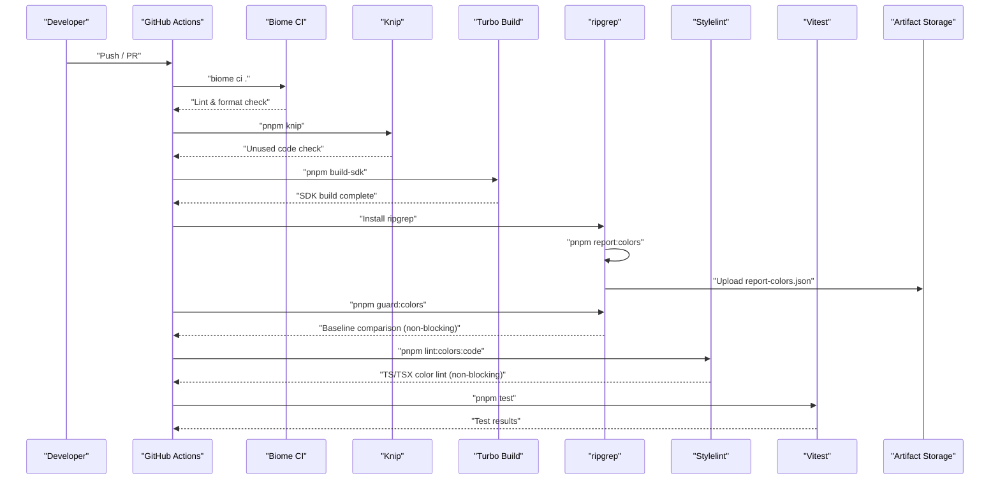
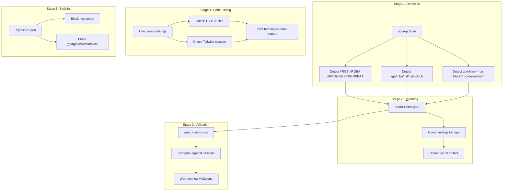
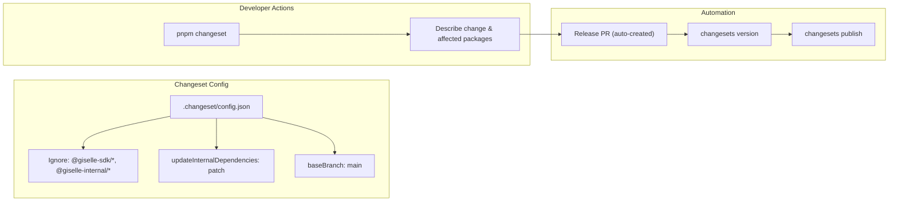
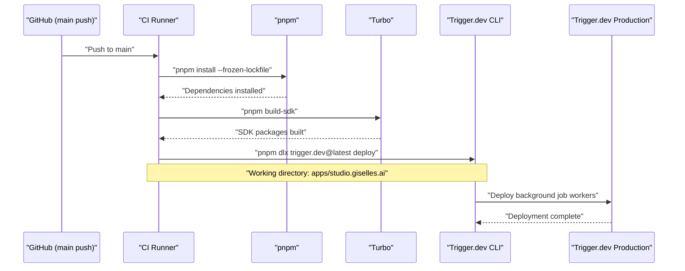
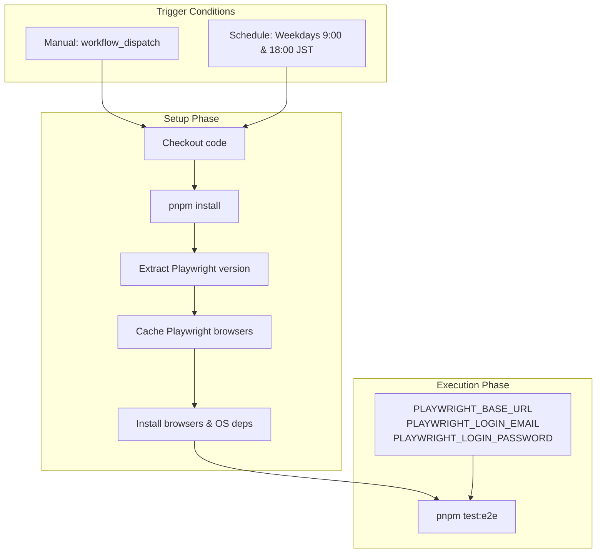
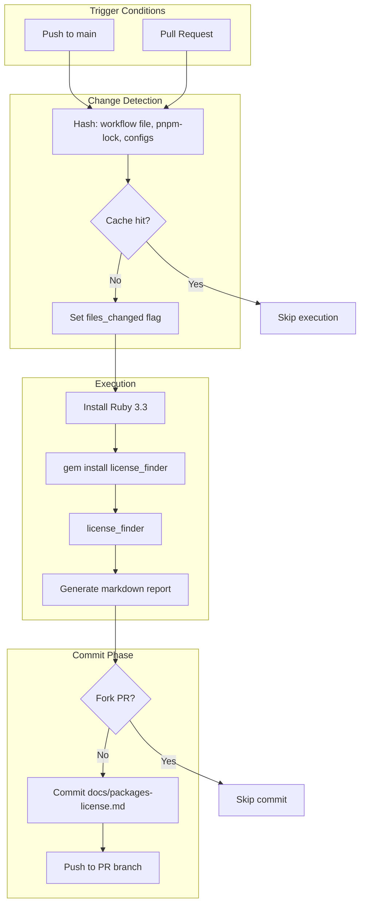

<!-- source: DeepWiki mcp.deepwiki.com · repo giselles-ai/giselle · page 7 Infrastructure and Cross-Cutting Concerns · fetched 2026-10-27 -->

# Infrastructure and Operations

<details>
<summary>Relevant source files</summary>

The following files were used as context for generating this wiki page:

- [apps/playground/package.json](apps/playground/package.json)
- [apps/studio.giselles.ai/package.json](apps/studio.giselles.ai/package.json)
- [internal-packages/workflow-designer-ui/package.json](internal-packages/workflow-designer-ui/package.json)
- [package.json](package.json)
- [packages/giselle/package.json](packages/giselle/package.json)
- [pnpm-lock.yaml](pnpm-lock.yaml)
- [pnpm-workspace.yaml](pnpm-workspace.yaml)

</details>


This document covers the cross-cutting infrastructure and operational systems that support the Giselle platform. These include the build system, CI/CD pipelines, color token validation system, feature flag architecture, and deployment workflows. For specific details on feature flag implementation, see [Feature Flag System](#6.1). For theming and styling architecture, see [Theming and Styling System](#6.2). For release processes, see [Build and Release Process](#6.3). For monitoring and tracing, see [Observability and Telemetry](#6.4).

## Build System Architecture

The project uses a monorepo structure managed by pnpm workspaces with Turbo for build orchestration.

### Package Management

The root [package.json:1-53]() defines the build system configuration:

| Component | Version | Purpose |
|-----------|---------|---------|
| pnpm | 10.16.0 | Workspace and dependency management |
| Turbo | 2.4.2 | Monorepo build orchestration |
| Node.js | >=22 | Runtime requirement |
| Biome | catalog | Linting and formatting |
| Knip | ^5.61.3 | Dead code detection |
| TypeScript | catalog | Type checking |

The package manager is locked to pnpm 10.16.0 via the `packageManager` field, ensuring consistent dependency resolution across all environments.

### Build Scripts

```mermaid
graph TB
    subgraph "Build Commands"
        BUILD["pnpm build"]
        BUILD_SDK["pnpm build-sdk"]
        BUILD_DATA_TYPE["pnpm build-data-type"]
    end
    
    subgraph "Quality Commands"
        FORMAT["pnpm format"]
        CHECK_TYPES["pnpm check-types"]
        TEST["pnpm test"]
        TIDY["pnpm tidy"]
    end
    
    subgraph "Color Validation"
        REPORT_COLORS["pnpm report:colors"]
        GUARD_COLORS["pnpm guard:colors"]
        LINT_COLORS["pnpm lint:colors:code"]
        COMPAT_TOKENS["pnpm report:compat-tokens"]
    end
    
    subgraph "Development"
        DEV["pnpm dev"]
        DEV_STUDIO["pnpm dev:studio.giselles.ai"]
    end
    
    subgraph "Release"
        CHANGESET["pnpm changeset"]
        VERSION["pnpm version"]
    end
    
    BUILD --> TURBO_BUILD["turbo build"]
    BUILD_SDK --> TURBO_BUILD_SDK["turbo build --filter '@giselle-sdk/*'"]
    
    FORMAT --> BIOME["biome check --write"]
    CHECK_TYPES --> TURBO_TYPES["turbo check-types"]
    TIDY --> KNIP["knip --no-config-hints"]
    
    REPORT_COLORS --> RG_SCAN["ripgrep color scan"]
    GUARD_COLORS --> VALIDATE["validate against baseline"]
    LINT_COLORS --> TS_TSX_LINT["TS/TSX color linting"]
    COMPAT_TOKENS --> COMPAT_SCAN["compat token inventory"]
    
    DEV --> TURBO_DEV["turbo dev --filter playground"]
    DEV_STUDIO --> TURBO_DEV_STUDIO["turbo dev --filter studio.giselles.ai"]
    
    CHANGESET --> CHANGESETS_CLI["@changesets/cli"]
    VERSION --> CHANGESETS_VERSION["changesets version"]
```



**Sources:** [package.json:5-33]()

The build system provides granular filtering through Turbo, enabling selective builds of SDK packages without rebuilding the entire monorepo. The `build-sdk` command is frequently used in CI and deployment workflows.

## Continuous Integration Pipeline

The CI pipeline implements multiple quality gates that run on every push and pull request.

### CI Workflow Architecture



**Sources:** [.github/workflows/ci.yml:1-50]()

### Color Validation System

The color validation system is a sophisticated multi-stage pipeline designed to enforce color token consistency during the migration from legacy color usage to Tailwind v4's token system.



**Sources:** [scripts/lint-colors-code.mjs:1-134](), [.github/workflows/ci.yml:30-47](), [.stylelintrc.json:1-17]()

#### Color Detection Patterns

The `lint-colors-code.mjs` script implements three detection strategies:

1. **Hex Color Detection** [scripts/lint-colors-code.mjs:95-98]()
   - Pattern: `#(?:[0-9a-fA-F]{3}|[0-9a-fA-F]{4}|[0-9a-fA-F]{6}|[0-9a-fA-F]{8})(?![0-9a-fA-F])`
   - Matches #RGB, #RGBA, #RRGGBB, #RRGGBBAA formats
   - Negative lookahead prevents partial matches

2. **Functional Color Detection** [scripts/lint-colors-code.mjs:101]()
   - Pattern: `\b(?:rgba?|hsla?|oklch)\s*\(`
   - Matches rgb(), rgba(), hsl(), hsla(), oklch() functions

3. **Tailwind Direct Scale Detection** [scripts/lint-colors-code.mjs:107-109]()
   - Pattern: `(?:text|bg|border)-(?:black|white)\b(?:-[0-9]{1,3})?(?:\/[0-9]{1,3})?`
   - Matches direct black/white scale usage in Tailwind classes
   - Supports opacity variants (e.g., `text-black-600/20`)

#### Stylelint Configuration

The [.stylelintrc.json:1-17]() enforces CSS-level restrictions:

```json
{
  "rules": {
    "color-no-hex": [true, { "severity": "warning" }],
    "function-disallowed-list": [["rgb", "rgba", "hsl", "hsla", "oklch"], { "severity": "warning" }]
  }
}
```

This blocks hex and functional colors in CSS files, with exceptions for the token definition file [.stylelintrc.json:10]().

#### Compatibility Token Tracking

The [scripts/compat-tokens-inventory.mjs:1-57]() script tracks usage of legacy color tokens during migration:

| Token | Purpose |
|-------|---------|
| `--color-white-900` | Legacy white scale |
| `--color-black-600` | Legacy black scale |
| `--color-black-850` | Dark theme base |
| `--color-white-850` | Light theme base |

These tokens are tracked separately from the token definition file [scripts/compat-tokens-inventory.mjs:34](), enabling staged removal after semantic token migration.

**Sources:** [scripts/compat-tokens-inventory.mjs:4-56](), [docs/compat-tokens-inventory.md:1-37]()

## Release Management

The release process uses Changesets for version management and automated PR creation.

### Changeset Configuration



**Sources:** [.changeset/config.json:1-12]()

The configuration [.changeset/config.json:10]() excludes SDK and internal packages from automatic version management, as they follow independent versioning schemes.

### Release Workflow

The [.github/workflows/release.yml:1-39]() implements the Changeset Check workflow:

1. Triggered on pull requests to `main`
2. Executes `pnpm version` via Changesets action
3. Creates release PRs with bundled changes
4. Generates GitHub releases automatically

**Sources:** [.github/workflows/release.yml:9-38]()

## Deployment Pipelines

The system has separate deployment workflows for different components.

### Trigger.dev Deployment



**Sources:** [.github/workflows/release-trigger-prod.yml:1-25]()

The Trigger.dev deployment [.github/workflows/release-trigger-prod.yml:20-24]() runs on every push to `main`, deploying background job workers defined in the studio application. The `TRIGGER_ACCESS_TOKEN` secret [.github/workflows/release-trigger-prod.yml:22]() authenticates the deployment.

### Vercel Deployment

Vercel deployments are configured separately and handle:
- Studio application deployment (`studio.giselles.ai`)
- Preview deployments for pull requests
- Edge function deployments

The studio build uses Turbopack via the `--turbopack` flag for faster builds.

## End-to-End Testing

The E2E testing workflow runs on a schedule and supports manual triggering.

### E2E Workflow Configuration



**Sources:** [.github/workflows/e2e.yml:1-46]()

The workflow [.github/workflows/e2e.yml:9-10]() runs twice daily on weekdays and supports manual execution with custom base URLs [.github/workflows/e2e.yml:4-8](). Playwright browser caching [.github/workflows/e2e.yml:30-35]() optimizes execution time by keying on the Playwright version.

### Test Execution Environment

The E2E tests run in the studio application directory [.github/workflows/e2e.yml:41]() and require three secrets:

| Secret | Purpose |
|--------|---------|
| `PLAYWRIGHT_BASE_URL` | Target environment URL |
| `PLAYWRIGHT_LOGIN_EMAIL` | Authentication email |
| `PLAYWRIGHT_LOGIN_PASSWORD` | Authentication password |

## License Compliance

The license compliance workflow tracks third-party dependencies and their licenses.

### License Finder Integration



**Sources:** [.github/workflows/license.yml:1-113]()

The workflow [.github/workflows/license.yml:50-68]() uses caching to skip execution when dependency files haven't changed. For non-fork PRs, it generates and commits a license report to [.github/workflows/license.yml:25](), using a GitHub App token [.github/workflows/license.yml:32-38]() for authentication.

## Development Environment Configuration

The project provides development environment configuration for Zed editor.

### Zed Tasks Configuration

The [.zed/tasks.json:1-9]() defines a test task that integrates with Zed's symbol navigation:

```json
{
  "label": "test with symbol",
  "command": "pnpm vitest watch",
  "cwd": "$ZED_DIRNAME",
  "args": ["$ZED_FILENAME", "--testNamePattern", "$ZED_SYMBOL"],
  "tags": ["js-test", "ts-test", "tsx-test"]
}
```

This enables running specific tests by symbol name directly from the editor, with watch mode for rapid iteration.

**Sources:** [.zed/tasks.json:1-9]()

## Semantic Token Migration Strategy

The color system is undergoing a migration to semantic tokens aligned with Tailwind v4.

### Current State

The [internal-packages/ui/styles/semantic.css:1-17]() file defines the semantic token scaffold:

```css
:root {
  --color-text: var(--color-gray-50);
  --color-text-inverse: var(--color-white);
  --color-surface: var(--color-gray-950);
  --color-border: var(--color-gray-900);
  --color-border-muted: var(--color-gray-700);
  --color-focused: var(--color-info-500);
  --color-text-secondary: #505d7b;
  --color-link-muted: var(--color-text-secondary);
}
```

Note [internal-packages/ui/styles/semantic.css:1]() indicates this is not applied globally yet, representing Phase 1.5 of the migration.

### Migration Goals

Per [docs/tailwind-v4-verification.md:1-18]():

1. Confirm `@theme` primitives in token definitions
2. Ensure v3 bridge provides semantic utilities
3. Validate CI color report generation
4. Prepare isolated playground for v4 bump

The strategy involves staged removal of compatibility tokens after semantic migration, tracked through the compatibility token inventory system.

**Sources:** [internal-packages/ui/styles/semantic.css:1-17](), [docs/tailwind-v4-verification.md:1-18](), [docs/compat-tokens-inventory.md:1-37]()

## Summary

The infrastructure and operations layer provides:

- **Build orchestration** via Turbo with selective filtering
- **Multi-stage CI/CD** with Biome, Knip, and color validation
- **Color token enforcement** through ripgrep, stylelint, and compatibility tracking
- **Automated releases** via Changesets with PR automation
- **Dual deployment** to Trigger.dev (background jobs) and Vercel (web app)
- **E2E testing** with Playwright and browser caching
- **License compliance** with automated report generation
- **Semantic token migration** strategy for Tailwind v4 readiness

These systems enable safe, consistent development and deployment while maintaining code quality and visual token consistency across the monorepo.

---

