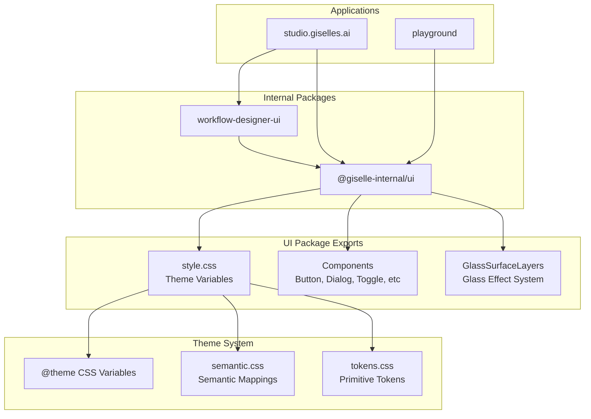
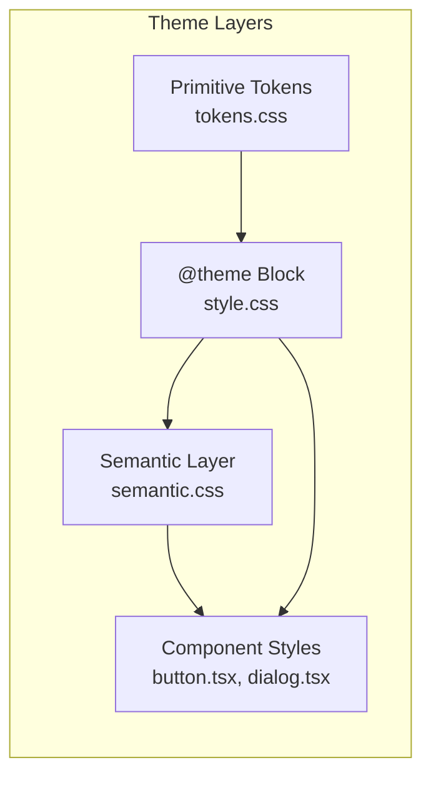
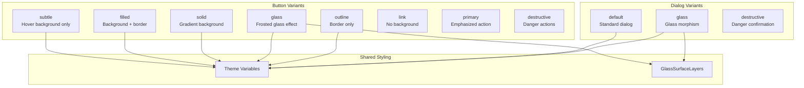
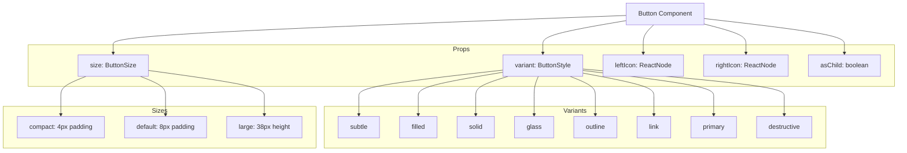
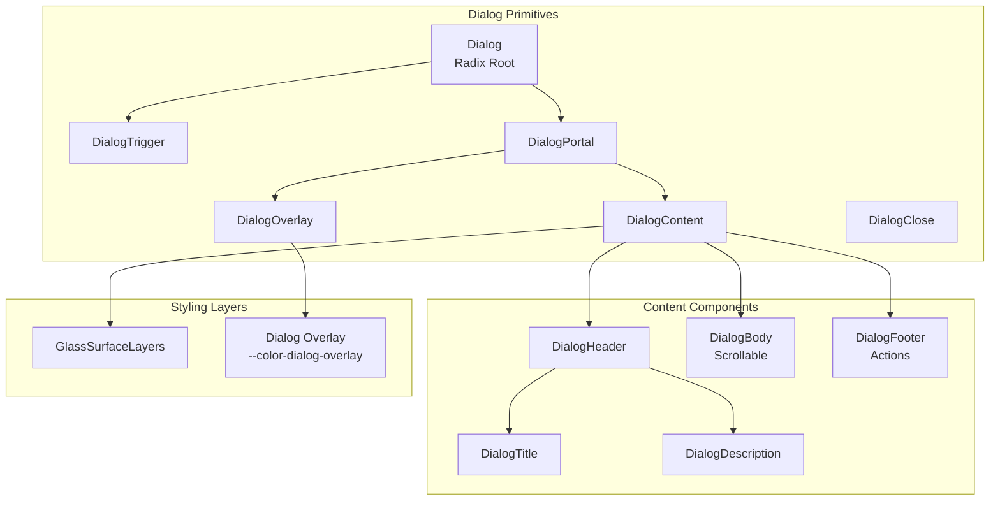
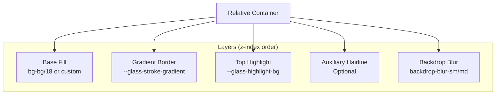
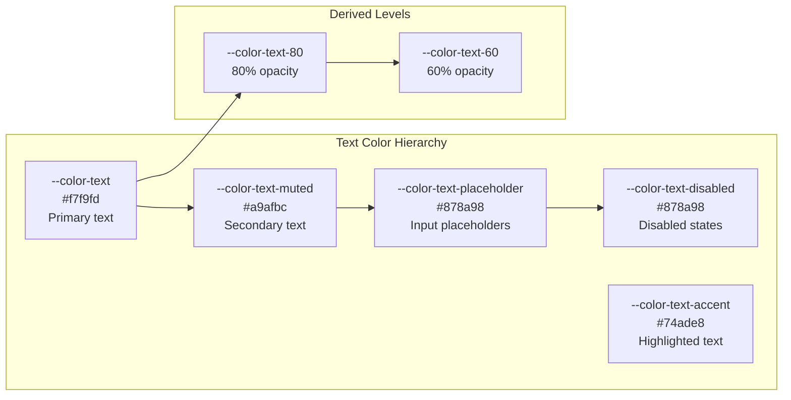

<!-- source: DeepWiki mcp.deepwiki.com · repo giselles-ai/giselle · page 7.2 UI Component Library and Theming · fetched 2026-10-27 -->

# UI Component Library and Theming

<details>
<summary>Relevant source files</summary>

The following files were used as context for generating this wiki page:

- [apps/playground/app/ui/page.tsx](apps/playground/app/ui/page.tsx)
- [apps/studio.giselles.ai/app/(auth)/components/auth-container.tsx](apps/studio.giselles.ai/app/(auth)/components/auth-container.tsx)
- [internal-packages/ui/components/button.tsx](internal-packages/ui/components/button.tsx)
- [internal-packages/ui/components/dialog.tsx](internal-packages/ui/components/dialog.tsx)
- [internal-packages/ui/components/glass-dialog.tsx](internal-packages/ui/components/glass-dialog.tsx)
- [internal-packages/ui/style.css](internal-packages/ui/style.css)
- [internal-packages/ui/styles/semantic.css](internal-packages/ui/styles/semantic.css)
- [internal-packages/workflow-designer-ui/src/editor/chat/chat-panel.tsx](internal-packages/workflow-designer-ui/src/editor/chat/chat-panel.tsx)
- [internal-packages/workflow-designer-ui/src/editor/properties-panel/text-generation-node-properties-panel/model/anthropic.tsx](internal-packages/workflow-designer-ui/src/editor/properties-panel/text-generation-node-properties-panel/model/anthropic.tsx)
- [internal-packages/workflow-designer-ui/src/editor/properties-panel/text-generation-node-properties-panel/model/google.tsx](internal-packages/workflow-designer-ui/src/editor/properties-panel/text-generation-node-properties-panel/model/google.tsx)
- [internal-packages/workflow-designer-ui/src/editor/properties-panel/text-generation-node-properties-panel/model/openai.tsx](internal-packages/workflow-designer-ui/src/editor/properties-panel/text-generation-node-properties-panel/model/openai.tsx)
- [internal-packages/workflow-designer-ui/src/editor/properties-panel/text-generation-node-properties-panel/tab-content.tsx](internal-packages/workflow-designer-ui/src/editor/properties-panel/text-generation-node-properties-panel/tab-content.tsx)
- [internal-packages/workflow-designer-ui/src/editor/properties-panel/text-generation-node-properties-panel/tools/tool-provider/anthropic-web-search/anthropic-web-search.tsx](internal-packages/workflow-designer-ui/src/editor/properties-panel/text-generation-node-properties-panel/tools/tool-provider/anthropic-web-search/anthropic-web-search.tsx)

</details>


This document covers the `@giselle-internal/ui` package, which provides a shared component library and theming system used across all applications in the Giselle platform. The package includes reusable UI components (buttons, dialogs, inputs, etc.), a CSS variable-based theming system, and support for multiple visual variants (glass, solid, outline).

For information about workspace-level context and feature flags, see [Workspace Context and Feature Flags](#6.1.1). For the workflow designer's specific UI components, see [Workflow Designer UI](#5).

## Package Structure

The UI package is located at `internal-packages/ui/` and serves as the foundational design system for the platform. It is consumed by both the Studio application and the Workflow Designer UI.



**Sources:** [internal-packages/ui/style.css:1-5]()

## Theme System Architecture

The theming system is built on CSS custom properties defined in the `@theme` directive, providing a centralized color palette and styling tokens that cascade throughout the application.

### CSS Variable Organization

The theme is organized into several categories of variables:

| Category | Purpose | Example Variables |
|----------|---------|-------------------|
| Border | Border colors and variants | `--color-border`, `--color-border-focused`, `--color-border-selected` |
| Surface | Background colors for panels | `--color-surface-background`, `--color-elevated-surface-background` |
| Element | Interactive element states | `--color-element-hover`, `--color-element-active`, `--color-element-selected` |
| Text | Text colors and hierarchy | `--color-text`, `--color-text-muted`, `--color-text-accent` |
| Status | Semantic status colors | `--color-error`, `--color-success`, `--color-warning`, `--color-info` |
| Glass | Glass morphism effects | `--glass-button-bg`, `--shadow-glass`, `--glass-stroke-gradient` |
| Solid | Solid button styling | `--solid-button-bg`, `--solid-button-shadow` |
| Outline | Outline button styling | `--shadow-outline-button`, `--color-outline-button-bg` |

**Sources:** [internal-packages/ui/style.css:5-225]()

### Theme Variable Hierarchy



The theme system follows a layered approach where primitive tokens are defined first, then mapped to theme variables in the `@theme` block, with an optional semantic layer for higher-level abstractions.

**Sources:** [internal-packages/ui/style.css:1-3](), [internal-packages/ui/styles/semantic.css:1-21]()

## Component Variants

The UI library supports multiple visual variants that provide different visual treatments for components. These variants are implemented consistently across components using data attributes and CSS.

### Variant System



**Sources:** [internal-packages/ui/components/button.tsx:4-12](), [internal-packages/ui/components/dialog.tsx:11-19]()

### Glass Variant Implementation

The glass variant creates a frosted glass effect using multiple layers: backdrop blur, gradient backgrounds, border highlights, and shadow effects. This variant is extensively used in auth pages and dialogs.

**Glass Styling Components:**
- Background gradient: `--glass-button-bg` and `--auth-glass-bg`
- Border gradient: `--glass-stroke-gradient` 
- Top highlight: `--glass-highlight-bg`
- Shadow: `--shadow-glass`
- Overlay: `--color-dialog-overlay` for modal backgrounds

**Sources:** [internal-packages/ui/style.css:165-225](), [internal-packages/ui/components/dialog.tsx:28-89]()

### Solid Variant Implementation

The solid variant provides a more traditional button appearance with a gradient background and stronger shadows:

```css
--solid-button-bg: linear-gradient(180deg, #202530 0%, #12151f 100%)
--color-button-solid-border: rgba(0, 0, 0, 0.7)
--solid-button-shadow: inset 0 1px 1px rgba(255, 255, 255, 0.05),
                       0 2px 8px rgba(5, 10, 20, 0.4),
                       0 1px 2px rgba(0, 0, 0, 0.3)
```

**Sources:** [internal-packages/ui/style.css:213-218]()

### Outline Variant Implementation

The outline variant creates a subtle bordered appearance with no background fill:

```css
--shadow-outline-button: 0 1px 0 rgba(255, 255, 255, 0.05) inset,
                         0 -1px 0 rgba(0, 0, 0, 0.2) inset,
                         0 0 0 1px rgba(255, 255, 255, 0.08)
--color-outline-button-bg: var(--color-black)
```

**Sources:** [internal-packages/ui/style.css:220-224]()

## Key Components

### Button Component

The `Button` component is the primary interactive element, supporting all variants and multiple sizes.

**Component Structure:**



**Implementation Details:**
- Uses `data-style` and `data-size` attributes for variant styling
- Supports icon composition with `leftIcon` and `rightIcon` props
- `asChild` prop enables Radix UI Slot composition pattern
- Glass variant includes layered background effects with hover transitions

**Sources:** [internal-packages/ui/components/button.tsx:1-100]()

### Dialog Component

The `Dialog` component system provides modal overlays with multiple variants and a composable API.

**Dialog Composition Pattern:**



**Variant Behavior:**
- `default`: Standard dialog with solid background and blur
- `glass`: Full glass morphism treatment using `GlassSurfaceLayers`
- `destructive`: Glass variant with red-tinted background for danger actions

**Sources:** [internal-packages/ui/components/dialog.tsx:1-144](), [internal-packages/ui/components/glass-dialog.tsx:1-36]()

### GlassSurfaceLayers Component

The `GlassSurfaceLayers` component provides a reusable system for creating layered glass effects. It's used by dialogs and auth containers.

**Layer Structure:**



**Customization Props:**
- `variant`: default or destructive tone
- `borderStyle`: solid, gradient, or none
- `borderTone`: muted or destructive color
- `withTopHighlight`: enable top edge highlight
- `withBaseFill`: enable background tint
- `baseFillClass`: custom background class
- `blurClass`: blur intensity (sm/md)
- `withAuxHairline`: additional border detail
- `radiusClass`: border radius
- `zIndexClass`: layer z-index

**Sources:** [internal-packages/ui/components/dialog.tsx:4](), [apps/studio.giselles.ai/app/(auth)/components/auth-container.tsx:30-50]()

## Usage Patterns

### Button Usage Examples

**Subtle Button (Default):**
```tsx
<Button variant="subtle" leftIcon={<Settings2Icon />}>
  Configure
</Button>
```

**Glass Button (Auth Pages):**
```tsx
<Button variant="glass" size="large">
  Sign In
</Button>
```

**Destructive Action:**
```tsx
<Button variant="destructive" rightIcon={<TrashIcon />}>
  Delete
</Button>
```

**Sources:** [internal-packages/workflow-designer-ui/src/editor/properties-panel/text-generation-node-properties-panel/tools/tool-provider/anthropic-web-search/anthropic-web-search.tsx:215-221]()

### Dialog Usage Examples

**Standard Dialog:**
```tsx
<Dialog>
  <DialogTrigger asChild>
    <Button>Open Dialog</Button>
  </DialogTrigger>
  <DialogContent>
    <DialogHeader>
      <DialogTitle>Title</DialogTitle>
      <DialogDescription>Description</DialogDescription>
    </DialogHeader>
    <DialogBody>
      {/* Scrollable content */}
    </DialogBody>
    <DialogFooter>
      <Button>Action</Button>
    </DialogFooter>
  </DialogContent>
</Dialog>
```

**Glass Dialog (Auth & Special Modals):**
```tsx
<Dialog>
  <DialogContent variant="glass">
    {/* Content with glass morphism effect */}
  </DialogContent>
</Dialog>
```

**Destructive Confirmation:**
```tsx
<Dialog>
  <DialogContent variant="destructive">
    <DialogTitle>Confirm Deletion</DialogTitle>
    {/* Danger action content */}
  </DialogContent>
</Dialog>
```

**Sources:** [internal-packages/ui/components/dialog.tsx:21-89](), [internal-packages/ui/components/glass-dialog.tsx:20-22]()

## Context-Specific Styling

### Auth Page Theming

Auth pages use specialized variables and utility classes for a distinct visual treatment:

**Auth-Specific Variables:**
```css
--color-auth-background: hsl(234, 91%, 5%)
--color-auth-ambient-light: hsl(218, 58%, 21%)
--color-auth-logo-watermark: hsl(207, 19%, 77%)
--shadow-stage-form: /* Complex shadow with blue glow */
```

**Auth Utility Classes:**
- `.auth-title-glow`: Text glow effect for titles
- `.auth-gradient-border`: Gradient stroke border for containers
- `.auth-corner-dot--*`: Corner accent decorations

**Sources:** [internal-packages/ui/style.css:92-108](), [internal-packages/ui/style.css:242-264](), [apps/studio.giselles.ai/app/(auth)/components/auth-container.tsx:17-61]()

### Stage System Theming

The Stage system (production execution environment) has its own color palette:

**Stage Variables:**
```css
--color-stage-background: #030610
--color-stage-form-background: #101520
--color-stage-sidebar-text: #7084ac
--color-stage-sidebar-text-hover: #f7f9fd
--color-stage-accent: #6b8ff0
--stage-radial-overlay: /* Radial gradient for canvas background */
```

**Sources:** [internal-packages/ui/style.css:79-90]()

### Editor Theming

The code editor and text editor components use specialized color tokens:

**Editor Variables:**
```css
--color-editor-foreground: #acb2be
--color-editor-background: #00020b
--color-editor-gutter-background: #282c33
--color-editor-active-line-background: #2f343e
--color-editor-line-number: #4e5a5f
```

**Sources:** [internal-packages/ui/style.css:110-124]()

### Chat Panel Theming

Chat UI components use bubble-specific styling:

**Chat Variables:**
```css
--color-chat-bubble-accent-bg: rgba(107, 143, 240, 0.2)
--color-chat-bubble-accent-border: rgba(107, 143, 240, 0.8)
--color-chat-bubble-user-bg: #4a6fd8
```

These variables create distinct visual treatments for assistant vs. user messages with appropriate contrast and readability.

**Sources:** [internal-packages/ui/style.css:153-156](), [internal-packages/workflow-designer-ui/src/editor/chat/chat-panel.tsx:170-181]()

## Color System and Accessibility

### Text Hierarchy

The theme provides multiple text color levels for establishing visual hierarchy:



**Color Mix Usage:**
The theme uses CSS `color-mix()` for creating opacity variants:
```css
--color-text-80: color-mix(in srgb, var(--color-text), transparent 20%)
--color-text-60: color-mix(in srgb, var(--color-text), transparent 40%)
```

**Sources:** [internal-packages/ui/style.css:37-63]()

### Status Colors with RGB Variants

Status colors are provided in both standard and RGB formats to enable alpha transparency:

```css
--color-error: #ff3d71
--color-error-rgb: 255, 61, 113

--color-success: #39ff7f
--color-success-rgb: 57, 255, 127
```

This allows usage like `bg-[rgba(var(--color-success-rgb),0.05)]` for subtle backgrounds.

**Sources:** [internal-packages/ui/style.css:133-163](), [internal-packages/workflow-designer-ui/src/editor/properties-panel/text-generation-node-properties-panel/tools/tool-provider/anthropic-web-search/anthropic-web-search.tsx:402-406]()

## Base Layer Normalization

The theme includes base layer normalization for consistent rendering across browsers and environments:

**Autofill Styling:**
```css
input:-webkit-autofill,
input:-webkit-autofill:hover,
input:-webkit-autofill:focus {
  -webkit-text-fill-color: var(--color-text);
  box-shadow: 0 0 0px 1000px var(--color-editor-background) inset;
  transition: background-color 9999s ease-out 0s;
}
```

This prevents browser autofill from breaking the dark theme by applying a persistent dark background.

**Sources:** [internal-packages/ui/style.css:227-240]()

## Integration with Tailwind CSS

The UI package imports Tailwind CSS and extends it with custom theme variables through the `@theme` directive:

```css
@import "tailwindcss";
@import "./styles/tokens.css";
@import "./styles/semantic.css";

@theme {
  /* Custom CSS variables that extend Tailwind */
}
```

This approach allows:
- Standard Tailwind utility classes (e.g., `flex`, `gap-4`, `rounded-lg`)
- Custom color utilities (e.g., `text-text`, `bg-surface`, `border-border`)
- Theme variable access via `var(--color-*)` in CSS
- Arbitrary value utilities (e.g., `bg-[rgba(var(--color-success-rgb),0.05)]`)

**Sources:** [internal-packages/ui/style.css:1-5]()

---

