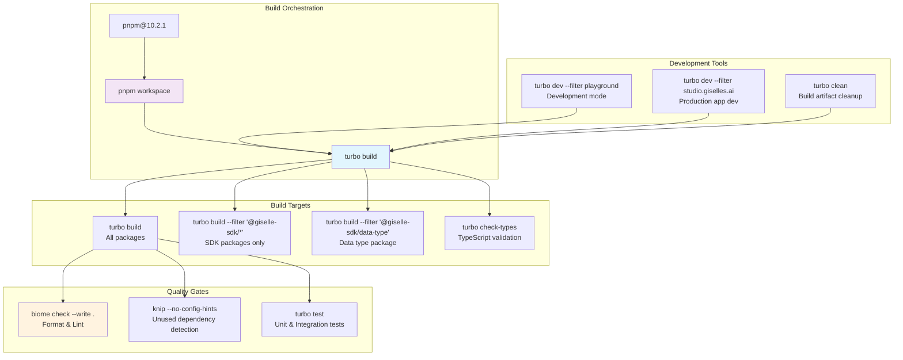
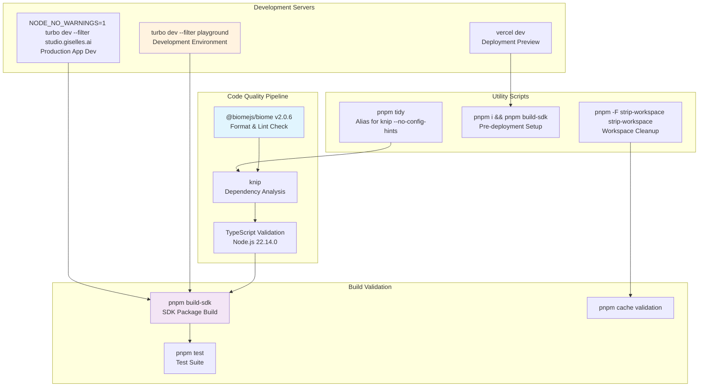
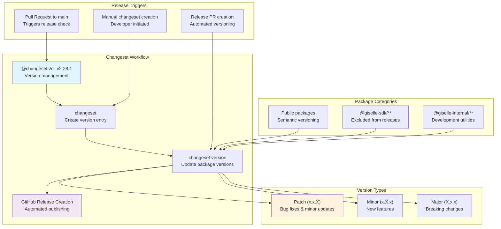
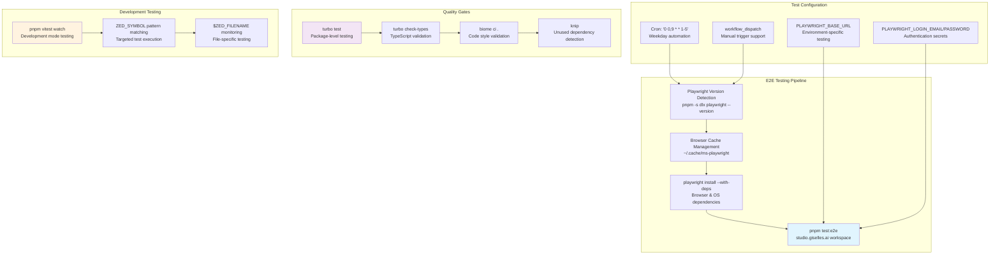

<!-- source: DeepWiki mcp.deepwiki.com · repo giselles-ai/giselle · page 7.4 Build and Deployment · fetched 2026-10-27 -->

# Build and Release Process

Relevant source files

The following files were used as context for generating this wiki page:

- [apps/playground/package.json](apps/playground/package.json)
- [apps/studio.giselles.ai/package.json](apps/studio.giselles.ai/package.json)
- [docs/packages-license.md](docs/packages-license.md)
- [internal-packages/workflow-designer-ui/package.json](internal-packages/workflow-designer-ui/package.json)
- [package.json](package.json)
- [packages/document-preprocessor/README.md](packages/document-preprocessor/README.md)
- [packages/document-preprocessor/package.json](packages/document-preprocessor/package.json)
- [packages/document-preprocessor/src/global.d.ts](packages/document-preprocessor/src/global.d.ts)
- [packages/document-preprocessor/src/index.ts](packages/document-preprocessor/src/index.ts)
- [packages/document-preprocessor/src/pdf.ts](packages/document-preprocessor/src/pdf.ts)
- [packages/document-preprocessor/src/text.test.ts](packages/document-preprocessor/src/text.test.ts)
- [packages/document-preprocessor/src/text.ts](packages/document-preprocessor/src/text.ts)
- [packages/document-preprocessor/src/types.ts](packages/document-preprocessor/src/types.ts)
- [packages/document-preprocessor/tsconfig.json](packages/document-preprocessor/tsconfig.json)
- [packages/document-preprocessor/tsup.config.ts](packages/document-preprocessor/tsup.config.ts)
- [packages/document-preprocessor/turbo.json](packages/document-preprocessor/turbo.json)
- [packages/document-preprocessor/vitest.config.mts](packages/document-preprocessor/vitest.config.mts)
- [packages/giselle/package.json](packages/giselle/package.json)
- [pnpm-lock.yaml](pnpm-lock.yaml)
- [pnpm-workspace.yaml](pnpm-workspace.yaml)

This document covers the complete build pipeline, CI/CD workflows, testing processes, versioning, and deployment strategies for the Giselle platform. It includes the monorepo build orchestration, automated quality checks, release management, and license compliance processes.

For information about feature flag management and gradual rollouts, see [Feature Flag System](#4.1). For details about the overall project structure and package organization, see [Project Structure and Organization](#1.1).

## Build System Architecture

The Giselle project uses a sophisticated build system built around Turborepo for monorepo orchestration, pnpm for package management, and Node.js 22+ as the runtime requirement.

The build system supports incremental builds, parallel execution, and smart caching through Turborepo. The [`package.json:6-20`]() file defines the primary build scripts, with `turbo build` orchestrating the entire monorepo build process and specialized scripts for SDK-only builds.

Sources: [`package.json`](), [`knip.ts`]()

## Development Workflow and Quality Checks

The development workflow integrates multiple quality assurance tools and processes to maintain code quality and consistency across the monorepo.

The [`knip.ts:85-117`]() configuration file defines workspace-specific rules for dependency analysis, including server external packages and framework-specific dependencies that should be ignored during unused dependency detection.

Sources: [`package.json`](), [`knip.ts`](), [`.zed/tasks.json`]()

## CI/CD Pipeline Architecture

The continuous integration and deployment pipeline consists of multiple specialized workflows that handle different aspects of the development lifecycle.

```mermaid
graph TD
    subgraph "Main CI Pipeline (.github/workflows/ci.yml)"
        Checkout["actions/checkout@v5<br/>Source code retrieval"]
        BiomeSetup["biomejs/setup-biome@v2.6.0<br/>Code formatter setup"]
        PnpmSetup["pnpm/action-setup@v4.1.0<br/>Package manager setup"]
        NodeSetup["actions/setup-node@v4.2.0<br/>Node.js 22.14.0"]
        BiomeRun["biome ci .<br/>Format & lint check"]
        KnipRun["pnpm knip<br/>Unused dependencies"]
        BuildSDK["pnpm build-sdk<br/>SDK build validation"]
        TestRun["pnpm test<br/>Test suite execution"]
    end
    
    subgraph "License Compliance (.github/workflows/license.yml)"
        LicenseCache["actions/cache@v4<br/>Dependency file caching"]
        RubySetup["ruby/setup-ruby@v1.257.0<br/>Ruby 3.3 setup"]
        LicenseFinder["gem install -N license_finder<br/>License analysis tool"]
        LicenseCheck["license_finder<br/>Compliance validation"]
        LicenseReport["license_finder report --format=markdown<br/>Generate docs/packages-license.md"]
    end
    
    subgraph "Release Management (.github/workflows/release.yml)"
        ChangesetAction["changesets/action@v1.5.3<br/>Version management"]
        ReleaseCreation["createGithubReleases: true<br/>Automated GitHub releases"]
        VersionCommand["pnpm version<br/>Package versioning"]
    end
    
    subgraph "E2E Testing (.github/workflows/e2e.yml)"
        PlaywrightCache["actions/cache@v4.2.3<br/>Browser cache management"]
        PlaywrightInstall["playwright install --with-deps<br/>Browser setup"]
        E2EExecution["pnpm test:e2e<br/>End-to-end test suite"]
    end
    
    Checkout --> BiomeSetup
    BiomeSetup --> PnpmSetup
    PnpmSetup --> NodeSetup
    NodeSetup --> BiomeRun
    BiomeRun --> KnipRun
    KnipRun --> BuildSDK
    BuildSDK --> TestRun
    
    LicenseCache --> RubySetup
    RubySetup --> LicenseFinder
    LicenseFinder --> LicenseCheck
    LicenseCheck --> LicenseReport
    
    ChangesetAction --> ReleaseCreation
    VersionCommand --> ReleaseCreation
    
    PlaywrightCache --> PlaywrightInstall
    PlaywrightInstall --> E2EExecution
    
    style Checkout fill:#e1f5fe
    style LicenseCheck fill:#f3e5f5
    style ChangesetAction fill:#fff3e0
    style E2EExecution fill:#f1f8e9
```

The CI pipeline runs on every push to main and pull request, ensuring code quality through automated checks. The [`license.yml:20-23`]() workflow uses concurrency controls to prevent overlapping executions and includes fork detection logic for secure token handling.

Sources: [`.github/workflows/ci.yml`](), [`.github/workflows/license.yml`](), [`.github/workflows/release.yml`](), [`.github/workflows/e2e.yml`]()

## Release and Versioning Process

The project implements a sophisticated release management system using Changesets for semantic versioning and automated package publishing.

### Changeset Configuration

The release process is configured through [`.changeset/config.json:1-11`](), which defines the versioning strategy, changelog generation, and package inclusion rules. The configuration excludes internal SDK packages and utilities from public releases while maintaining dependency tracking.

| Configuration Key | Value | Purpose |
|------------------|--------|---------|
| `changelog` | `@changesets/cli/changelog` | Automated changelog generation |
| `commit` | `false` | Manual commit control |
| `access` | `restricted` | Private package access |
| `baseBranch` | `main` | Primary development branch |
| `updateInternalDependencies` | `patch` | Internal dependency versioning |
| `ignore` | `["giselle-sdk", "@giselle-sdk/**", "@giselle-internal/**"]` | Excluded packages |

Sources: [`.changeset/config.json`](), [`.changeset/README.md`](), [`package.json`](), [`.github/workflows/release.yml`]()

## License Compliance System

The project maintains comprehensive license compliance through automated scanning and reporting of all dependencies.

### License Analysis Pipeline

The [`license.yml:18-112`]() workflow implements a sophisticated license compliance system that tracks dependency changes and generates compliance reports. The system uses caching to optimize performance and only runs when dependency-related files change.

```mermaid
graph TD
    subgraph "License Compliance Workflow"
        CacheCheck["Cache Check<br/>pnpm-lock.yaml & dependency files"]
        FileChangeDetection["File Change Detection<br/>license.yml, package.json, configs"]
        RubyEnvironment["Ruby 3.3 Setup<br/>License Finder runtime"]
        LicenseFinderInstall["gem install -N license_finder<br/>Analysis tool installation"]
        ComplianceCheck["license_finder<br/>Dependency license validation"]
        ReportGeneration["license_finder report --format=markdown<br/>Generate compliance report"]
    end
    
    subgraph "Compliance Tracking"
        PackageLicenseDoc["docs/packages-license.md<br/>1,107 tracked packages"]
        LicenseBreakdown["License Distribution<br/>815 MIT, 184 Apache 2.0, etc."]
        UnknownLicenses["Unknown License Tracking<br/>1 package flagged"]
        TimestampRemoval["sed -e '/^As of /d'<br/>Consistent report format"]
    end
    
    subgraph "Automated Updates"
        GitCommit["git commit -m 'Update docs/packages-license.md'<br/>Automated documentation"]
        PRUpdate["GitHub PR Update<br/>Non-fork repository only"]
        BranchPush["git push origin<br/>Updated compliance report"]
    end
    
    CacheCheck --> FileChangeDetection
    FileChangeDetection --> RubyEnvironment
    RubyEnvironment --> LicenseFinderInstall
    LicenseFinderInstall --> ComplianceCheck
    ComplianceCheck --> ReportGeneration
    ReportGeneration --> PackageLicenseDoc
    
    PackageLicenseDoc --> LicenseBreakdown
    LicenseBreakdown --> UnknownLicenses
    UnknownLicenses --> TimestampRemoval
    
    TimestampRemoval --> GitCommit
    GitCommit --> PRUpdate
    PRUpdate --> BranchPush
    
    style ComplianceCheck fill:#e1f5fe
    style PackageLicenseDoc fill:#f3e5f5
    style GitCommit fill:#fff3e0
```

The license compliance system tracks 1,107 packages across 22 different license types, with the majority being MIT (815 packages) and Apache 2.0 (184 packages) licensed. The [`docs/packages-license.md:4-23`]() file provides a comprehensive breakdown of license distribution and flagged packages requiring attention.

Sources: [`.github/workflows/license.yml`](), [`docs/packages-license.md`]()

## Testing and Quality Assurance

The testing strategy encompasses multiple layers of validation, from unit tests to end-to-end testing with Playwright.

### Testing Architecture

The E2E testing system runs on a schedule (weekdays at 9:00 and 18:00 JST) and supports manual triggers through `workflow_dispatch`. The [`e2e.yml:42-45`]() configuration shows environment variable handling for different testing environments and authentication.

Sources: [`.github/workflows/e2e.yml`](), [`.zed/tasks.json`](), [`package.json`]()

## Build Performance and Optimization

The build system leverages several optimization strategies to improve performance and maintainability across the monorepo.

### Caching and Performance Strategy

| Component | Caching Strategy | Performance Impact |
|-----------|------------------|-------------------|
| Playwright Browsers | `~/.cache/ms-playwright` with version-based keys | Reduces setup time from minutes to seconds |
| License Dependencies | Hash-based cache of dependency files | Skips analysis when no changes detected |
| pnpm Dependencies | Node.js cache integration | Faster package installation |
| Turbo Build Cache | Incremental build artifacts | Only rebuilds changed packages |

The [`knip.ts:10-83`]() configuration includes Next.js predefined external packages to optimize bundle analysis and prevent false positives in dependency detection. This comprehensive list covers common server-side packages that should be excluded from client-side bundling.

### Build Target Optimization

The build system provides granular control over build targets through specialized scripts:

- `build-sdk`: Targets only SDK packages for library development
- `build-data-type`: Builds only the data type package for rapid iteration
- `dev:studio.giselles.ai`: Runs the production application with Node.js warning suppression
- `strip-workspace`: Cleans workspace artifacts for deployment optimization

Sources: [`knip.ts`](), [`package.json`](), [`.github/workflows/ci.yml`](), [`.github/workflows/e2e.yml`]()