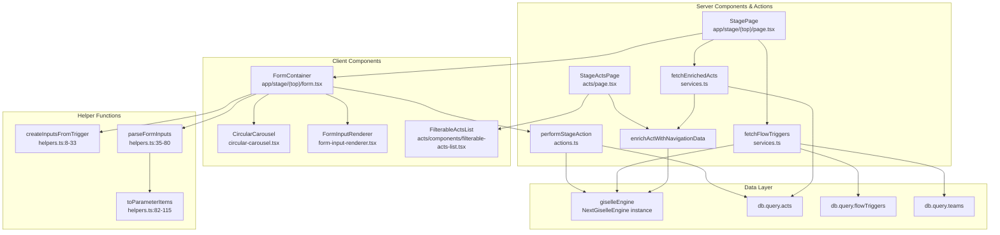
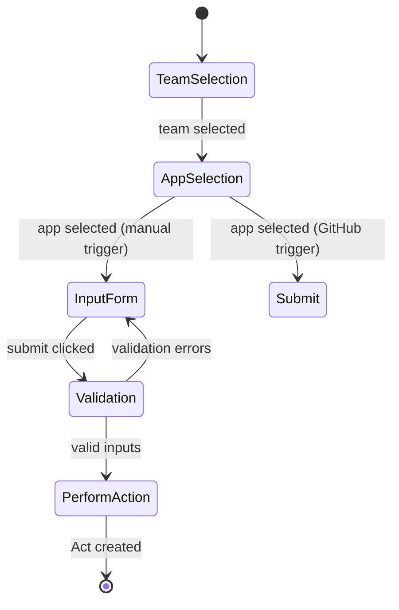
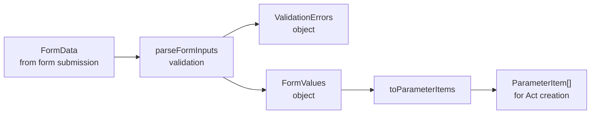
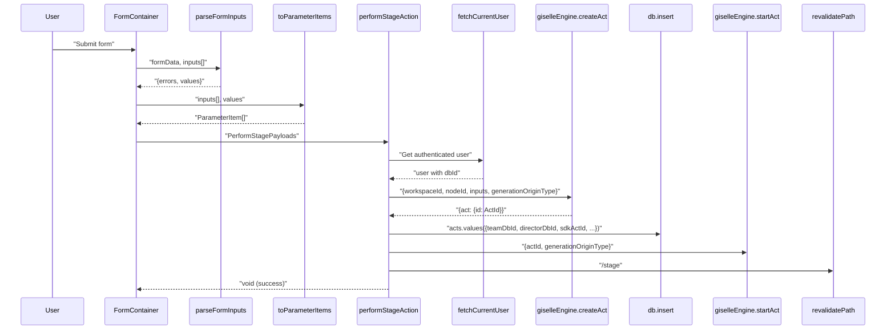
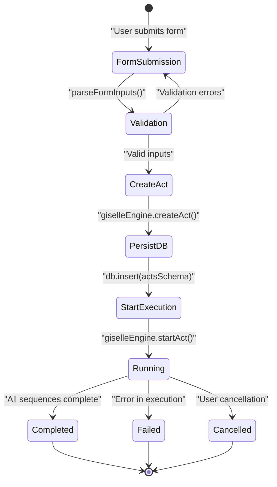
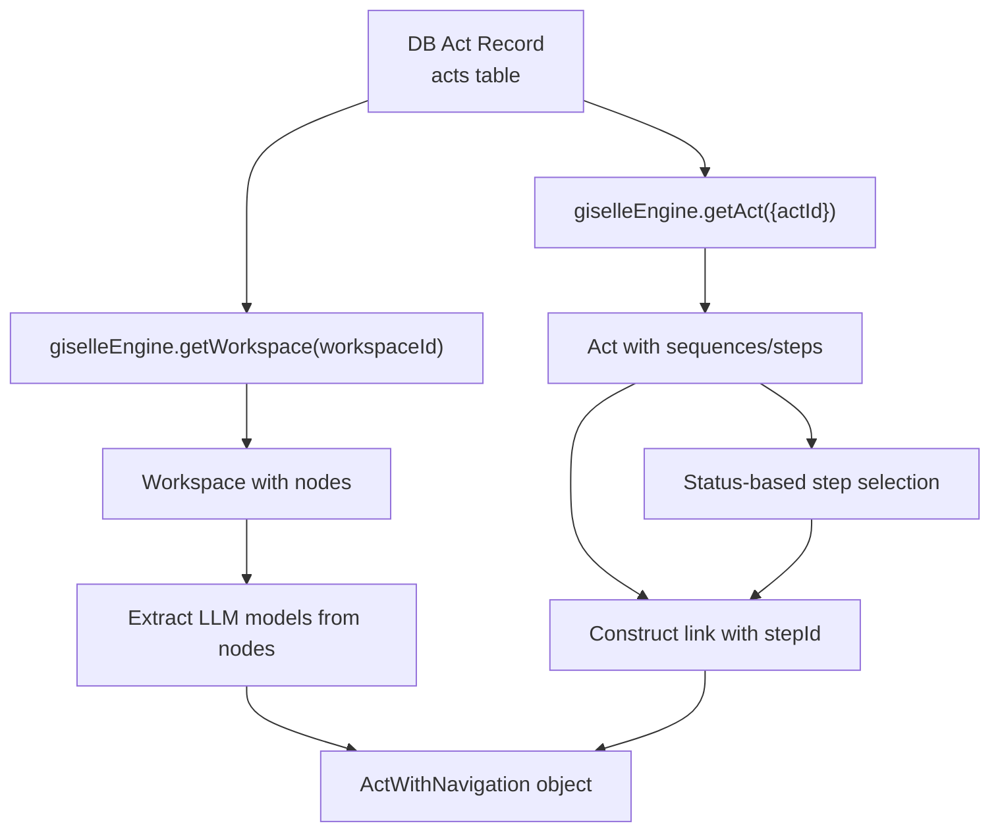
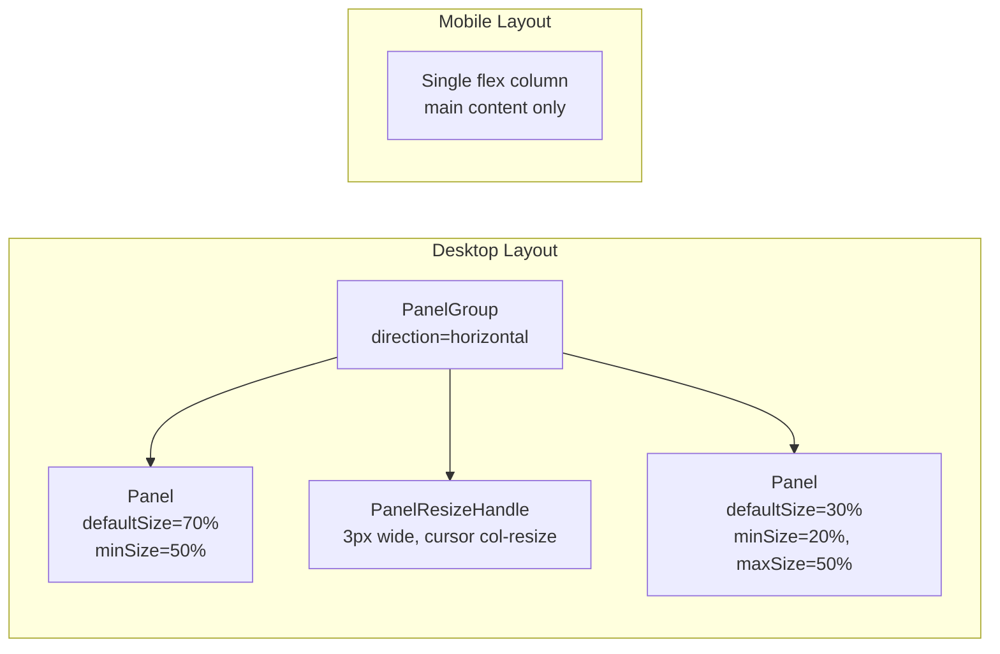

<!-- source: DeepWiki mcp.deepwiki.com · repo giselles-ai/giselle · extra page Stage System and Act Execution · fetched 2026-10-27 -->

# Stage System and Act Execution

<details>
<summary>Relevant source files</summary>

The following files were used as context for generating this wiki page:

- [apps/playground/.gitignore](apps/playground/.gitignore)
- [apps/studio.giselles.ai/app/(main)/workspaces/actions.ts](apps/studio.giselles.ai/app/(main)/workspaces/actions.ts)
- [apps/studio.giselles.ai/app/api/workspaces/route.ts](apps/studio.giselles.ai/app/api/workspaces/route.ts)
- [apps/studio.giselles.ai/app/stage/(top)/actions.ts](apps/studio.giselles.ai/app/stage/(top)/actions.ts)
- [apps/studio.giselles.ai/app/stage/(top)/circular-carousel.module.css](apps/studio.giselles.ai/app/stage/(top)/circular-carousel.module.css)
- [apps/studio.giselles.ai/app/stage/(top)/circular-carousel.tsx](apps/studio.giselles.ai/app/stage/(top)/circular-carousel.tsx)
- [apps/studio.giselles.ai/app/stage/(top)/form-input-renderer.tsx](apps/studio.giselles.ai/app/stage/(top)/form-input-renderer.tsx)
- [apps/studio.giselles.ai/app/stage/(top)/form.tsx](apps/studio.giselles.ai/app/stage/(top)/form.tsx)
- [apps/studio.giselles.ai/app/stage/(top)/helpers.ts](apps/studio.giselles.ai/app/stage/(top)/helpers.ts)
- [apps/studio.giselles.ai/app/stage/(top)/page.tsx](apps/studio.giselles.ai/app/stage/(top)/page.tsx)
- [apps/studio.giselles.ai/app/stage/(top)/resizable-layout.tsx](apps/studio.giselles.ai/app/stage/(top)/resizable-layout.tsx)
- [apps/studio.giselles.ai/app/stage/(top)/services.ts](apps/studio.giselles.ai/app/stage/(top)/services.ts)
- [apps/studio.giselles.ai/app/stage/(top)/settings-dialog.tsx](apps/studio.giselles.ai/app/stage/(top)/settings-dialog.tsx)
- [apps/studio.giselles.ai/app/stage/(top)/team-card.tsx](apps/studio.giselles.ai/app/stage/(top)/team-card.tsx)
- [apps/studio.giselles.ai/app/stage/(top)/types.ts](apps/studio.giselles.ai/app/stage/(top)/types.ts)
- [apps/studio.giselles.ai/app/stage/acts/[actId]/actions.ts](apps/studio.giselles.ai/app/stage/acts/[actId]/actions.ts)
- [apps/studio.giselles.ai/app/stage/acts/[actId]/lib/data.ts](apps/studio.giselles.ai/app/stage/acts/[actId]/lib/data.ts)
- [apps/studio.giselles.ai/app/stage/acts/[actId]/lib/utils.ts](apps/studio.giselles.ai/app/stage/acts/[actId]/lib/utils.ts)
- [apps/studio.giselles.ai/app/stage/acts/components/filterable-acts-list.tsx](apps/studio.giselles.ai/app/stage/acts/components/filterable-acts-list.tsx)
- [apps/studio.giselles.ai/app/stage/acts/page.tsx](apps/studio.giselles.ai/app/stage/acts/page.tsx)
- [apps/studio.giselles.ai/app/stage/acts/types/index.ts](apps/studio.giselles.ai/app/stage/acts/types/index.ts)
- [apps/studio.giselles.ai/app/stage/layout.tsx](apps/studio.giselles.ai/app/stage/layout.tsx)
- [apps/studio.giselles.ai/app/stage/showcase/[appId]/actions.ts](apps/studio.giselles.ai/app/stage/showcase/[appId]/actions.ts)
- [apps/studio.giselles.ai/app/stage/showcase/[appId]/page.tsx](apps/studio.giselles.ai/app/stage/showcase/[appId]/page.tsx)

</details>


## Purpose and Scope

The Stage system provides a production execution environment for published workflows in the Studio application. It allows end-users to execute workflows without accessing the workflow designer interface. Users select published flow triggers (applications), provide input parameters through dynamically generated forms, and initiate Act executions. The system maintains comprehensive execution history with filtering and search capabilities.

This document covers the Stage UI (`/stage` route), Act creation via `performStageAction`, and the Acts list interface (`/stage/acts`). For the underlying Act execution engine and sequence orchestration, see section 2.4. For workflow designer integration, see section 5.

**Key Routes:**
- `/stage` - Main application selection and execution interface
- `/stage/acts` - Task list with search and filtering
- `/stage/acts/[actId]` - Individual Act execution details
- `/stage/acts/[actId]/[stepId]` - Specific step view within an Act

**Sources:** [apps/studio.giselles.ai/app/stage/(top)/page.tsx:1-169](), [apps/studio.giselles.ai/app/stage/(top)/actions.ts:1-51](), [apps/studio.giselles.ai/app/stage/acts/page.tsx:1-147]()

## System Architecture

The Stage system implements a three-layer architecture separating presentation, server actions, and data access. Components communicate through Next.js server actions with database persistence and Giselle Engine integration.

**System Component Diagram**



**Sources:** [apps/studio.giselles.ai/app/stage/(top)/page.tsx:1-169](), [apps/studio.giselles.ai/app/stage/(top)/form.tsx:1-391](), [apps/studio.giselles.ai/app/stage/(top)/actions.ts:1-51](), [apps/studio.giselles.ai/app/stage/(top)/services.ts:1-234](), [apps/studio.giselles.ai/app/stage/acts/page.tsx:1-147]()

## Flow Trigger System

Flow triggers define executable entry points for workflows. The Stage page fetches available triggers for the user's teams and displays them as selectable apps.

### FlowTrigger Data Structure

Flow triggers are fetched from the database and enriched with workspace information:

| Property | Type | Description |
|----------|------|-------------|
| `id` | `FlowTriggerId` | Unique trigger identifier |
| `workspaceId` | `string` | Associated workspace ID |
| `nodeId` | `string` | Node ID in the workflow graph |
| `workspaceName` | `string` | Display name for the app |
| `teamId` | `TeamId` | Owning team identifier |
| `configuration` | `object` | Provider-specific configuration (manual or GitHub) |

### Trigger Configuration Types

The system supports two trigger provider types:

**Manual Triggers** - User-initiated with configurable parameters:
```typescript
{
  provider: "manual",
  event: {
    parameters: [
      { id: string, name: string, type: "text" | "number" | "multiline-text", required: boolean }
    ]
  }
}
```

**GitHub Triggers** - Webhook-based with no user-configurable parameters:
```typescript
{
  provider: "github",
  event: { /* webhook configuration */ }
}
```

**Sources:** [apps/studio.giselles.ai/app/stage/(top)/page.tsx:41-41](), [apps/studio.giselles.ai/app/stage/(top)/helpers.ts:9-34](), [apps/studio.giselles.ai/app/stage/(top)/types.ts:1-38]()

## Form Container and Input Rendering

The `FormContainer` component manages team selection, app (flow trigger) selection, and parameter input through a multi-step form flow.



### Form State Management

The form maintains local state for:
- `teamId`: Currently selected team
- `appId`: Currently selected flow trigger ID
- `displayCategory`: Filter category (all/history/latest/favorites - UI only)
- `validationErrors`: Field-level validation error messages
- `isPending`: Submission in progress flag

**Sources:** [apps/studio.giselles.ai/app/stage/(top)/form.tsx:49-121]()

### Dynamic Input Generation

Inputs are dynamically created from the flow trigger configuration using `createInputsFromTrigger`:

**Input Creation Logic:**
1. Check trigger provider type
2. For manual triggers, map each parameter to a `FormInput` object
3. For GitHub triggers, return empty array (no user inputs)

**FormInput Structure:**
```typescript
type FormInput = {
  name: string;           // Parameter ID
  label: string;          // Display name
  type: "text" | "number" | "multiline-text";
  required: boolean;
}
```

**Sources:** [apps/studio.giselles.ai/app/stage/(top)/helpers.ts:9-34](), [apps/studio.giselles.ai/app/stage/(top)/form.tsx:176-176]()

### Input Rendering Component

The `FormInputRenderer` component renders form fields based on the input type:

| Input Type | HTML Element | Attributes |
|------------|--------------|------------|
| `text` | `<input type="text">` | Standard text input |
| `number` | `<input type="number">` | Numeric input with validation |
| `multiline-text` | `<textarea rows={4}>` | Multi-line text area |

Each field includes:
- Label with required indicator (`*`)
- ARIA attributes for accessibility (`aria-required`, `aria-invalid`, `aria-describedby`)
- Validation error display with role="alert"
- Disabled state during form submission

**Sources:** [apps/studio.giselles.ai/app/stage/(top)/form-input-renderer.tsx:1-117]()

### Form Validation and Parsing

Form validation occurs in `parseFormInputs`:

**Validation Rules:**
1. Required fields must have non-empty values
2. Number fields must parse to valid numbers (not NaN)
3. Empty optional fields are preserved as empty strings

**Parsing Flow:**


**Sources:** [apps/studio.giselles.ai/app/stage/(top)/helpers.ts:36-81](), [apps/studio.giselles.ai/app/stage/(top)/helpers.ts:83-116](), [apps/studio.giselles.ai/app/stage/(top)/form.tsx:178-200]()

## App Selection UI

The system provides two UI modes for app selection: carousel view and list view.

### Circular Carousel View

The `CircularCarousel` component displays apps in a semi-circular arrangement with advanced interaction:

**Key Features:**
- Semicircular layout with configurable visible cards (3-7 based on screen width)
- Drag-to-navigate (horizontal swipe) and drag-to-select (vertical swipe)
- Keyboard navigation (arrow keys, Enter/Space)
- Animation states: normal → selected → animating-down → inserted
- Responsive card positioning with tilt rotation

**Card Position Calculation:**
```
x = centerX + radius * cos(angle + dragOffset * 0.008)
y = centerY - radius * sin(angle) - cardHeight
rotation = -(angle - π/2) * (180/π)
```

**Sources:** [apps/studio.giselles.ai/app/stage/(top)/circular-carousel.tsx:34-665]()

### List View

The list view displays apps in a 2-column grid with selection highlighting:
- App icon + workspace name + trigger label
- Selected app highlighted with blue border (`border-blue-500/50`)
- Click to select, displays input form in slide-up modal

**Sources:** [apps/studio.giselles.ai/app/stage/(top)/form.tsx:280-338]()

## Act Creation and Execution

The `performStageAction` server action in [app/stage/(top)/actions.ts:9-51]() orchestrates Act creation through the Giselle Engine. This function bridges the Stage UI with the core execution engine.

### Act Creation Flow with Code Entities



### Server Action Implementation Details

**Function Signature:**
```typescript
async function performStageAction(
  payloads: PerformStagePayloads
): Promise<void>
```

**PerformStagePayloads Type:**
```typescript
interface PerformStagePayloads {
  teamId: TeamId;
  trigger: Trigger;  // Contains workspaceId, nodeId, configuration
  parameterItems: ParameterItem[];
}
```

**Execution Steps:**

1. **User Authentication** - `fetchCurrentUser()` returns authenticated user with `dbId`
2. **Act Creation** - `giselleEngine.createAct()` receives:
   ```typescript
   {
     workspaceId: payloads.trigger.workspaceId,
     nodeId: payloads.trigger.nodeId,
     inputs: [{
       type: "parameters",
       items: payloads.parameterItems
     }],
     generationOriginType: "stage"
   }
   ```
3. **Database Persistence** - `db.insert(actsSchema).values()` creates record:
   ```typescript
   {
     teamDbId: team.dbId,
     directorDbId: user.dbId,
     sdkActId: act.id,
     sdkFlowTriggerId: payloads.trigger.id,
     sdkWorkspaceId: payloads.trigger.workspaceId
   }
   ```
4. **Execution Initiation** - `giselleEngine.startAct({actId: act.id, generationOriginType: "stage"})`
5. **Cache Invalidation** - `revalidatePath("/stage")` refreshes UI

**Error Handling:**
- Try-catch wraps entire operation
- Console error logging
- Throws user-friendly error: `"Failed to start the flow. Please try again."`

**Sources:** [apps/studio.giselles.ai/app/stage/(top)/actions.ts:9-51](), [apps/studio.giselles.ai/app/stage/(top)/types.ts:35-43]()

### Database Schema Integration

The `acts` table links Stage UI records to Giselle Engine Act instances:

| Column | Type | Source | Purpose |
|--------|------|--------|---------|
| `teamDbId` | `integer` | `db.query.teams` | Team ownership reference |
| `directorDbId` | `integer` | `fetchCurrentUser().dbId` | User who initiated execution |
| `sdkActId` | `string` | `giselleEngine.createAct().act.id` | Giselle Engine Act ID |
| `sdkFlowTriggerId` | `TriggerId` | `payloads.trigger.id` | Originating flow trigger |
| `sdkWorkspaceId` | `WorkspaceId` | `payloads.trigger.workspaceId` | Associated workspace |
| `createdAt` | `timestamp` | Auto-generated | Act creation time |

**Key Relationships:**
- `teamDbId` → `teams.dbId` (foreign key)
- `directorDbId` → `users.dbId` (foreign key)
- `sdkActId` → Used to query `giselleEngine.getAct({actId})`
- `sdkFlowTriggerId` → Used to query `giselleEngine.getTrigger({triggerId})`

**Sources:** [apps/studio.giselles.ai/app/stage/(top)/actions.ts:33-39](), [apps/studio.giselles.ai/db/schema.ts]()

### Act Lifecycle in Stage System



**Sources:** [apps/studio.giselles.ai/app/stage/(top)/actions.ts:9-51](), [apps/studio.giselles.ai/app/stage/acts/page.tsx:66-84]()

## Task List and Management

The `/stage/acts` route provides a filterable, searchable list of all Acts (tasks) created by the user.

### FilterableActsList Component

The `FilterableActsList` component implements GitHub-style search with custom filters:

**Search Query Syntax:**
- `is:open` - Show non-archived tasks (default)
- `is:archived` - Show archived tasks (not yet implemented)
- Free text - Search by workspace name or team name

**Filter Controls:**
| Filter | Type | Options |
|--------|------|---------|
| Status | Multi-select dropdown | Created, Running, Completed, Failed, Cancelled |
| Tab | Single-select | Open (default), Archived |
| Search | Text input with tags | GitHub-style query parser |

### Search Query Parsing

The `parseSearchQuery` function splits queries into structured filters:

```typescript
// Example: "is:open workspace-name" 
// → {isOpen: true, freeText: "workspace-name"}
```

**Parsing Logic:**
1. Split query by whitespace
2. Check each part for `is:open` or `is:archived`
3. Remaining parts become `freeText`
4. Apply filters with AND logic

**Sources:** [apps/studio.giselles.ai/app/stage/acts/components/filterable-acts-list.tsx:37-78]()

### Act Enrichment Process

The `enrichActWithNavigationData` function in [apps/studio.giselles.ai/app/stage/acts/page.tsx:18-116]() transforms database Act records into UI-ready objects with navigation links and display metadata.

**Function Signature:**
```typescript
async function enrichActWithNavigationData(
  act: typeof actsSchema.$inferSelect,
  teams: { dbId: number; name: string }[]
): Promise<ActWithNavigation | null>
```

**Enrichment Pipeline:**



**Step Selection Logic:**

| Act Status | Target Step Selection | Function |
|------------|----------------------|----------|
| `created` / `inProgress` | First step with `status: "running"`, fallback to first step | `findStepByStatus("running") ?? getFirstStep()` |
| `completed` | Last step of last sequence | `getLastStep()` |
| `failed` | First step with `status: "failed"` | `findStepByStatus("failed")` |
| `cancelled` | First step with `status: "cancelled"` | `findStepByStatus("cancelled")` |

**Helper Functions:**

```typescript
// Find step matching specific status
const findStepByStatus = (status: string) => {
  for (const sequence of tmpAct.sequences) {
    for (const step of sequence.steps) {
      if (step.status === status) return step;
    }
  }
  return null;
};

// Get first available step
const getFirstStep = () => {
  if (tmpAct.sequences.length === 0) return null;
  const firstSequence = tmpAct.sequences[0];
  return firstSequence.steps.length > 0 ? firstSequence.steps[0] : null;
};

// Get last available step
const getLastStep = () => {
  if (tmpAct.sequences.length === 0) return null;
  const lastSequence = tmpAct.sequences[tmpAct.sequences.length - 1];
  return lastSequence.steps.length > 0 
    ? lastSequence.steps[lastSequence.steps.length - 1] 
    : null;
};
```

**LLM Model Extraction:**

Parses workspace nodes to extract text generation models:
```typescript
// Extract from workspace.nodes
for (const node of tmpWorkspace.nodes) {
  if (node.content?.type === "textGeneration" && node.content.llm) {
    const model = node.content.llm.id;
    if (typeof model === "string" && !llmModels.includes(model)) {
      llmModels.push(model);
    }
  }
}
```

**Output Structure:**
```typescript
{
  id: string;                    // Act ID
  status: StatusFilter;          // created | inProgress | completed | failed | cancelled
  createdAt: string;             // ISO timestamp
  link: string;                  // "/stage/acts/{actId}/{stepId}"
  teamName: string;              // From teams lookup
  workspaceName: string;         // From workspace.name
  llmModels?: string[];          // Array of model IDs
  inputValues?: string;          // Not implemented yet
}
```

**Error Handling:**
- Wraps entire function in try-catch
- Returns `null` for any enrichment failure (unparseable legacy data)
- Caller filters out `null` results: `tmp.filter((actOrNull): actOrNull is ActWithNavigation => actOrNull !== null)`

**Sources:** [apps/studio.giselles.ai/app/stage/acts/page.tsx:18-116](), [apps/studio.giselles.ai/app/stage/(top)/services.ts:15-104](), [apps/studio.giselles.ai/app/stage/acts/types/index.ts:8-17]()

### Task Table Display

The table presents enriched Acts with the following columns:

| Column | Content | Visibility |
|--------|---------|-----------|
| Name | Workspace name + creation timestamp + team name | Always |
| LLM Models | Badge list of models used (max 2 shown) | Desktop only |
| Input Values | Truncated input parameter display | Desktop only |
| Status | Status badge with dot variant | Always |
| Actions | Archive button or reload (for failed tasks) | Desktop only |

**Status Badge Mapping:**
```typescript
inProgress → StatusBadge status="info" (blue, animated)
completed → StatusBadge status="success" (green)
failed → StatusBadge status="error" (red)
cancelled → StatusBadge status="ignored" (gray)
```

**Sources:** [apps/studio.giselles.ai/app/stage/acts/components/filterable-acts-list.tsx:526-698](), [internal-packages/ui/components/status-badge.tsx:39-87]()

### Empty States

The component handles three empty states:

1. **No Acts Created** - Shows create button linking to `/stage`
2. **No Matching Filters** - Shows clear filters button
3. **Filtered Empty Result** - Displays search icon and suggestion to adjust filters

**Sources:** [apps/studio.giselles.ai/app/stage/acts/components/filterable-acts-list.tsx:485-524]()

## ResizableLayout Pattern

The Stage page uses a two-panel resizable layout to display the form and recent tasks simultaneously on desktop.

### Layout Implementation



**Responsive Behavior:**
- **Desktop (≥768px)**: Two-panel layout with resize handle
- **Mobile (<768px)**: Single column, acts panel hidden

**Panel Configuration:**
- Main content: 70% default, 50% minimum
- Acts content: 30% default, 20-50% range
- Resize handle: 3px width, hover highlight

**Sources:** [apps/studio.giselles.ai/app/stage/(top)/resizable-layout.tsx:1-49](), [apps/studio.giselles.ai/app/stage/(top)/page.tsx:61-167]()

## Extended Duration Configuration

Both the main Stage page and Acts list page are configured with extended server action duration:

```typescript
export const maxDuration = 800; // 800 seconds
```

This configuration enables:
- Long-running Act execution without timeout
- Support for complex workflow processing
- Fluid compute capability on Vercel

The extended duration is necessary because Acts may trigger sequences of LLM operations, file processing, and tool executions that exceed standard serverless function timeouts.

**Sources:** [apps/studio.giselles.ai/app/stage/(top)/page.tsx:23-23](), [apps/studio.giselles.ai/app/stage/acts/page.tsx:13-13]()

---

