<!-- source: DeepWiki mcp.deepwiki.com · repo giselles-ai/giselle · extra page Vector Store Management Interface · fetched 2026-10-27 -->

# Vector Store Management Interface

<details>
<summary>Relevant source files</summary>

The following files were used as context for generating this wiki page:

- [apps/studio.giselles.ai/app/(main)/settings/team/vector-stores/actions.ts](apps/studio.giselles.ai/app/(main)/settings/team/vector-stores/actions.ts)
- [apps/studio.giselles.ai/app/(main)/settings/team/vector-stores/configure-sources-dialog.tsx](apps/studio.giselles.ai/app/(main)/settings/team/vector-stores/configure-sources-dialog.tsx)
- [apps/studio.giselles.ai/app/(main)/settings/team/vector-stores/data.ts](apps/studio.giselles.ai/app/(main)/settings/team/vector-stores/data.ts)
- [apps/studio.giselles.ai/app/(main)/settings/team/vector-stores/diagnostic-modal.tsx](apps/studio.giselles.ai/app/(main)/settings/team/vector-stores/diagnostic-modal.tsx)
- [apps/studio.giselles.ai/app/(main)/settings/team/vector-stores/document-embedding-profiles.ts](apps/studio.giselles.ai/app/(main)/settings/team/vector-stores/document-embedding-profiles.ts)
- [apps/studio.giselles.ai/app/(main)/settings/team/vector-stores/document-store-create-dialog.tsx](apps/studio.giselles.ai/app/(main)/settings/team/vector-stores/document-store-create-dialog.tsx)
- [apps/studio.giselles.ai/app/(main)/settings/team/vector-stores/document-vector-store-list.tsx](apps/studio.giselles.ai/app/(main)/settings/team/vector-stores/document-vector-store-list.tsx)
- [apps/studio.giselles.ai/app/(main)/settings/team/vector-stores/document/document-vector-store-item.tsx](apps/studio.giselles.ai/app/(main)/settings/team/vector-stores/document/document-vector-store-item.tsx)
- [apps/studio.giselles.ai/app/(main)/settings/team/vector-stores/document/page.tsx](apps/studio.giselles.ai/app/(main)/settings/team/vector-stores/document/page.tsx)
- [apps/studio.giselles.ai/app/(main)/settings/team/vector-stores/layout.tsx](apps/studio.giselles.ai/app/(main)/settings/team/vector-stores/layout.tsx)
- [apps/studio.giselles.ai/app/(main)/settings/team/vector-stores/navigation-layout.tsx](apps/studio.giselles.ai/app/(main)/settings/team/vector-stores/navigation-layout.tsx)
- [apps/studio.giselles.ai/app/(main)/settings/team/vector-stores/page.tsx](apps/studio.giselles.ai/app/(main)/settings/team/vector-stores/page.tsx)
- [apps/studio.giselles.ai/app/(main)/settings/team/vector-stores/repository-item.tsx](apps/studio.giselles.ai/app/(main)/settings/team/vector-stores/repository-item.tsx)
- [apps/studio.giselles.ai/app/(main)/settings/team/vector-stores/repository-list.tsx](apps/studio.giselles.ai/app/(main)/settings/team/vector-stores/repository-list.tsx)
- [apps/studio.giselles.ai/app/(main)/settings/team/vector-stores/repository-registration-dialog.tsx](apps/studio.giselles.ai/app/(main)/settings/team/vector-stores/repository-registration-dialog.tsx)
- [apps/studio.giselles.ai/app/(main)/settings/team/vector-stores/sidebar-menu.tsx](apps/studio.giselles.ai/app/(main)/settings/team/vector-stores/sidebar-menu.tsx)
- [apps/studio.giselles.ai/app/(main)/settings/team/vector-stores/types.ts](apps/studio.giselles.ai/app/(main)/settings/team/vector-stores/types.ts)
- [internal-packages/ui/components/form-field.tsx](internal-packages/ui/components/form-field.tsx)
- [internal-packages/ui/components/section-header.tsx](internal-packages/ui/components/section-header.tsx)
- [internal-packages/ui/components/status-indicator.tsx](internal-packages/ui/components/status-indicator.tsx)

</details>


The Vector Store Management Interface provides the user-facing settings pages and dialogs for managing GitHub repository and document vector stores in the Studio application. This includes UI components for registering, configuring, and monitoring vector store ingestion status, as well as server actions for CRUD operations and diagnostic tools for troubleshooting connection issues.

For information about the underlying vector store system and RAG implementation, see [3.2](#3.2) and [3.3](#3.3). For the Stage System that uses vector stores, see [5.1.2](#5.1.2).

## Architecture Overview

The vector store management interface consists of two parallel systems: GitHub repository vector stores and document vector stores. Both share common UI patterns but manage different types of content sources.

```mermaid
graph TB
    subgraph "Page Routes"
        GitHubPage["page.tsx<br/>/settings/team/vector-stores"]
        DocumentPage["document/page.tsx<br/>/settings/team/vector-stores/document"]
    end
    
    subgraph "GitHub Repository UI Components"
        RepositoryList["RepositoryList"]
        RepositoryItem["RepositoryItem<br/>Main display card"]
        RegistrationDialog["RepositoryRegistrationDialog<br/>Add new repo"]
        ConfigureDialog["ConfigureSourcesDialog<br/>Edit settings"]
        DiagnosticModal["DiagnosticModal<br/>Fix connection issues"]
        EmbeddingModelCard["EmbeddingModelCard<br/>Status per profile"]
    end
    
    subgraph "Document Vector Store UI Components"
        DocumentList["DocumentVectorStoreList"]
        DocumentItem["DocumentVectorStoreItem<br/>Main display card"]
        CreateDialog["DocumentVectorStoreCreateDialog<br/>Add new store"]
        DocumentConfigureDialog["DocumentVectorStoreConfigureDialog<br/>Edit & upload files"]
    end
    
    subgraph "Server Actions (actions.ts)"
        RegisterRepo["registerRepositoryIndex"]
        UpdateRepo["updateRepositoryIndex"]
        DeleteRepo["deleteRepositoryIndex"]
        TriggerIngest["triggerManualIngest"]
        Diagnose["diagnoseRepositoryConnection"]
        UpdateInstallation["updateRepositoryInstallation"]
        CreateDoc["createDocumentVectorStore"]
        UpdateDoc["updateDocumentVectorStore"]
        DeleteDoc["deleteDocumentVectorStore"]
    end
    
    subgraph "Data Layer"
        DataQueries["data.ts<br/>getGitHubRepositoryIndexes<br/>getInstallationsWithRepos<br/>getDocumentVectorStores"]
        Database[("Database<br/>githubRepositoryIndex<br/>githubRepositoryContentStatus<br/>documentVectorStores<br/>documentVectorStoreSources")]
        SupabaseStorage[("Supabase Storage<br/>Document files")]
    end
    
    GitHubPage --> RepositoryList
    RepositoryList --> RepositoryItem
    RepositoryItem --> EmbeddingModelCard
    RepositoryItem --> ConfigureDialog
    RepositoryItem --> DiagnosticModal
    GitHubPage --> RegistrationDialog
    
    DocumentPage --> DocumentList
    DocumentList --> DocumentItem
    DocumentItem --> DocumentConfigureDialog
    DocumentPage --> CreateDialog
    
    RegistrationDialog --> RegisterRepo
    RepositoryItem --> DeleteRepo
    RepositoryItem --> TriggerIngest
    RepositoryItem --> UpdateRepo
    ConfigureDialog --> UpdateRepo
    DiagnosticModal --> Diagnose
    DiagnosticModal --> UpdateInstallation
    
    CreateDialog --> CreateDoc
    DocumentItem --> DeleteDoc
    DocumentItem --> UpdateDoc
    DocumentConfigureDialog --> UpdateDoc
    
    RegisterRepo --> Database
    UpdateRepo --> Database
    DeleteRepo --> Database
    TriggerIngest --> Database
    CreateDoc --> Database
    UpdateDoc --> Database
    DeleteDoc --> Database
    DeleteDoc --> SupabaseStorage
    
    DataQueries --> Database
    GitHubPage --> DataQueries
    DocumentPage --> DataQueries
```

Sources: [apps/studio.giselles.ai/app/(main)/settings/team/vector-stores/page.tsx:1-74](), [apps/studio.giselles.ai/app/(main)/settings/team/vector-stores/document/page.tsx:1-46](), [apps/studio.giselles.ai/app/(main)/settings/team/vector-stores/repository-item.tsx:1-440](), [apps/studio.giselles.ai/app/(main)/settings/team/vector-stores/document-vector-store-item.tsx:1-806](), [apps/studio.giselles.ai/app/(main)/settings/team/vector-stores/actions.ts:1-919]()

## GitHub Repository Vector Store Interface

### Main Page Component

The main entry point for GitHub repository vector stores is `page.tsx`, which handles authentication state and delegates to specialized components based on the GitHub identity status.

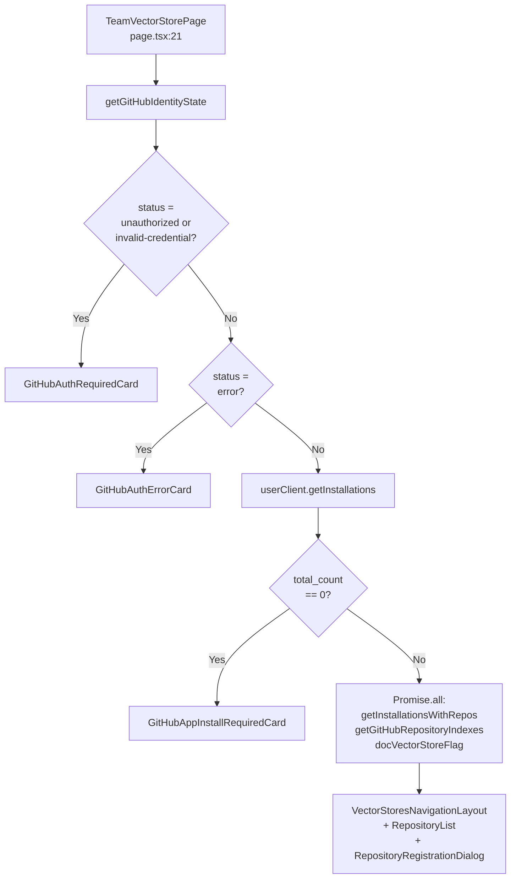

Sources: [apps/studio.giselles.ai/app/(main)/settings/team/vector-stores/page.tsx:21-74]()

The page component performs three authentication and access checks before rendering the main interface:

| Check | Condition | Component Rendered |
|-------|-----------|-------------------|
| GitHub Auth | `status === "unauthorized"` or `status === "invalid-credential"` | `GitHubAuthRequiredCard` |
| GitHub Error | `status === "error"` | `GitHubAuthErrorCard` |
| GitHub App Installation | `installationData.total_count === 0` | `GitHubAppInstallRequiredCard` |
| Success | All checks pass | `RepositoryList` + `RepositoryRegistrationDialog` |

Sources: [apps/studio.giselles.ai/app/(main)/settings/team/vector-stores/page.tsx:24-42]()

### Repository Item Display

The `RepositoryItem` component renders each registered repository as a `GlassCard` with embedded `EmbeddingModelCard` components showing status per embedding profile.

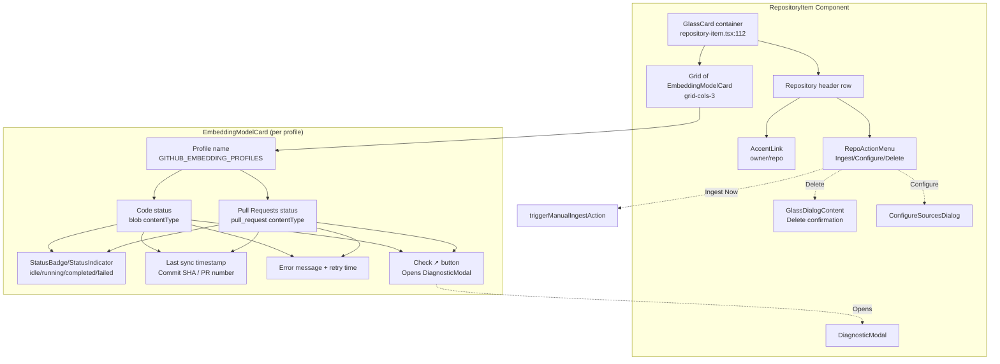

Sources: [apps/studio.giselles.ai/app/(main)/settings/team/vector-stores/repository-item.tsx:48-207](), [apps/studio.giselles.ai/app/(main)/settings/team/vector-stores/repository-item.tsx:210-439]()

The `RepositoryItem` component manages three dialogs via React state:

```typescript
const [showDeleteDialog, setShowDeleteDialog] = useState(false);
const [showConfigureDialog, setShowConfigureDialog] = useState(false);
const [showDiagnosticModal, setShowDiagnosticModal] = useState(false);
```

Sources: [apps/studio.giselles.ai/app/(main)/settings/team/vector-stores/repository-item.tsx:65-67]()

#### Content Status Display Logic

Each `EmbeddingModelCard` displays two content types (Code and Pull Requests) with conditional rendering based on status:

| Status | Enabled | Display |
|--------|---------|---------|
| `completed` | `true` | `StatusBadge` with "Enabled" label (success variant) |
| `idle` / `running` / `failed` | `true` | `StatusIndicator` with status-specific styling |
| Any | `false` | `StatusBadge` with "Disabled" label (ignored variant) |

Sources: [apps/studio.giselles.ai/app/(main)/settings/team/vector-stores/repository-item.tsx:250-305](), [apps/studio.giselles.ai/app/(main)/settings/team/vector-stores/repository-item.tsx:346-397]()

When a content status has `status === "failed"` and `errorCode === "DOCUMENT_NOT_FOUND"`, a "Check ↗" button is displayed that opens the `DiagnosticModal` to troubleshoot the connection issue.

Sources: [apps/studio.giselles.ai/app/(main)/settings/team/vector-stores/repository-item.tsx:288-297](), [apps/studio.giselles.ai/app/(main)/settings/team/vector-stores/repository-item.tsx:381-390]()

#### Manual Ingest Eligibility

The "Ingest Now" action is conditionally enabled based on content status eligibility checks:

```typescript
const canManuallyIngest = contentStatuses.some((cs) => {
  if (!cs.enabled) return false;
  return (
    cs.status === "idle" ||
    cs.status === "completed" ||
    (cs.status === "failed" &&
      cs.retryAfter &&
      new Date(cs.retryAfter) <= now)
  );
});
```

Sources: [apps/studio.giselles.ai/app/(main)/settings/team/vector-stores/repository-item.tsx:96-107]()

### Repository Registration Dialog

The `RepositoryRegistrationDialog` allows users to register new GitHub repositories for vector store ingestion.

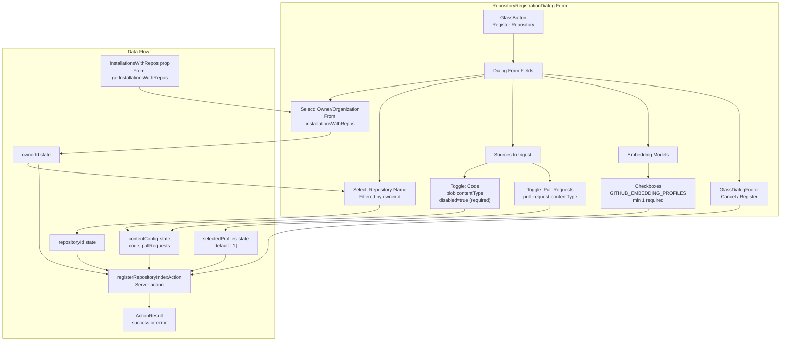

Sources: [apps/studio.giselles.ai/app/(main)/settings/team/vector-stores/repository-registration-dialog.tsx:1-346]()

The registration dialog enforces several validation rules:

| Validation | Implementation |
|------------|----------------|
| Owner required | `!ownerId` → `setError("Owner is required")` |
| Repository required | `!repositoryId` → `setError("Repository is required")` |
| Code always enabled | `contentConfig.code.enabled` is set to `true` and toggle is `disabled={true}` |
| At least one profile | Default `[1]` (OpenAI Small), cannot uncheck last profile |

Sources: [apps/studio.giselles.ai/app/(main)/settings/team/vector-stores/repository-registration-dialog.tsx:67-94](), [apps/studio.giselles.ai/app/(main)/settings/team/vector-stores/repository-registration-dialog.tsx:213-235](), [apps/studio.giselles.ai/app/(main)/settings/team/vector-stores/repository-registration-dialog.tsx:273-318]()

### Configure Sources Dialog

The `ConfigureSourcesDialog` allows users to modify content types and embedding profiles for an existing repository.

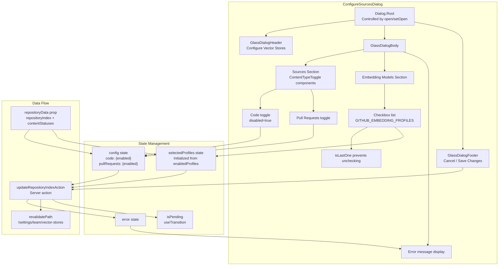

Sources: [apps/studio.giselles.ai/app/(main)/settings/team/vector-stores/configure-sources-dialog.tsx:1-271]()

The dialog initializes state from the current repository data on open:

```typescript
const blobStatus = contentStatuses.find((cs) => cs.contentType === "blob");
const pullRequestStatus = contentStatuses.find(
  (cs) => cs.contentType === "pull_request",
);

const [config, setConfig] = useState({
  code: { enabled: blobStatus?.enabled ?? true },
  pullRequests: { enabled: pullRequestStatus?.enabled ?? false },
});
```

Sources: [apps/studio.giselles.ai/app/(main)/settings/team/vector-stores/configure-sources-dialog.tsx:47-55]()

### Diagnostic Modal

The `DiagnosticModal` diagnoses and fixes repository connection issues when the `DOCUMENT_NOT_FOUND` error occurs.

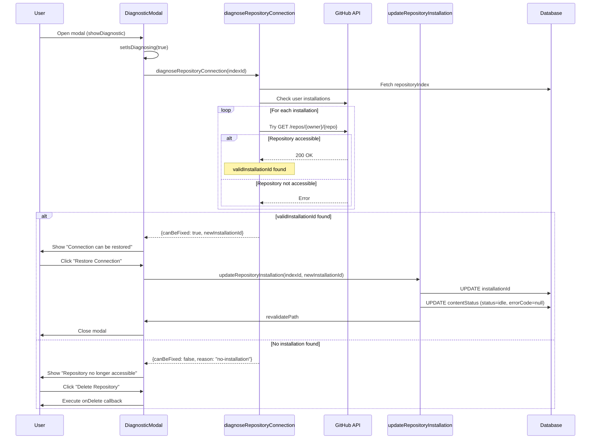

Sources: [apps/studio.giselles.ai/app/(main)/settings/team/vector-stores/diagnostic-modal.tsx:1-171](), [apps/studio.giselles.ai/app/(main)/settings/team/vector-stores/actions.ts:384-508]()

The diagnostic process follows this decision tree:

| Condition | Result | Action |
|-----------|--------|--------|
| Repository not found in DB | `{canBeFixed: false, reason: "repository-not-found"}` | Cannot proceed |
| GitHub auth failed | `{canBeFixed: false, reason: "diagnosis-failed"}` | Cannot proceed |
| Valid installation found | `{canBeFixed: true, newInstallationId}` | Show "Restore Connection" button |
| No installation found | `{canBeFixed: false, reason: "no-installation"}` | Show "Delete Repository" button |

Sources: [apps/studio.giselles.ai/app/(main)/settings/team/vector-stores/actions.ts:400-448]()

## Document Vector Store Interface

### Document Vector Store Item

The `DocumentVectorStoreItem` component displays a document vector store with configuration and file management capabilities.

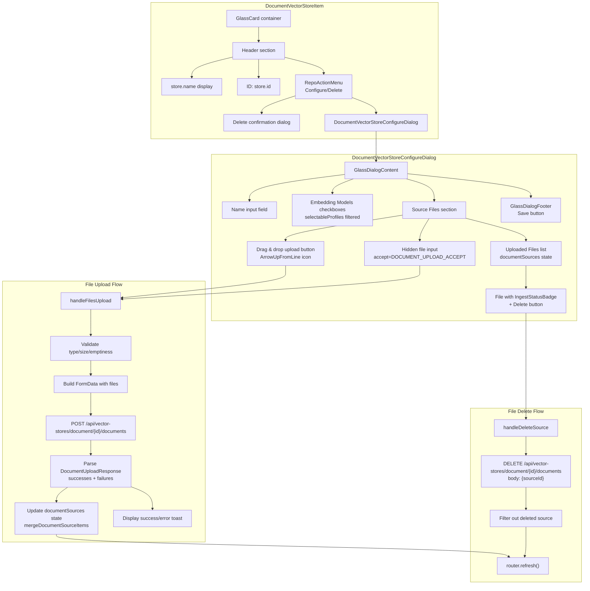

Sources: [apps/studio.giselles.ai/app/(main)/settings/team/vector-stores/document-vector-store-item.tsx:123-226](), [apps/studio.giselles.ai/app/(main)/settings/team/vector-stores/document-vector-store-item.tsx:302-805]()

#### File Upload Validation

The file upload handler validates files before uploading:

| Validation | Implementation | Constant |
|------------|----------------|----------|
| Supported types | `isSupportedDocumentFile(file)` | `DOCUMENT_VECTOR_STORE_SUPPORTED_MIME_TYPES` + `DOCUMENT_VECTOR_STORE_SUPPORTED_FILE_EXTENSIONS` |
| Non-empty | `file.size === 0` | N/A |
| Size limit | `file.size > DOCUMENT_VECTOR_STORE_MAX_FILE_SIZE_BYTES` | `DOCUMENT_VECTOR_STORE_MAX_FILE_SIZE_BYTES` |

Sources: [apps/studio.giselles.ai/app/(main)/settings/team/vector-stores/document-vector-store-item.tsx:381-398]()

#### Document Upload Response Handling

The upload response (`DocumentUploadResponse`) contains both successes and failures:

```typescript
type DocumentUploadResponse = {
  successes: Array<{
    fileName: string;
    sourceId: string;
    storageKey: string;
  }>;
  failures: Array<{
    fileName: string;
    error: string;
    code?: string;
  }>;
};
```

Sources: [apps/studio.giselles.ai/app/(main)/settings/team/vector-stores/document-vector-store-item.tsx:241-252]()

The dialog displays appropriate messages based on the response:

- All successes: Show success message with file count
- Partial failures (207 Multi-Status): Show success message for uploaded files + error toast for first failure with count
- All failures: Show error toast only

Sources: [apps/studio.giselles.ai/app/(main)/settings/team/vector-stores/document-vector-store-item.tsx:428-462]()

#### Ingest Status Display

Each uploaded file displays an `IngestStatusBadge` with the following status types:

| Status | Icon | Label | Color |
|--------|------|-------|-------|
| `idle` | `Clock` | "Pending" | Yellow |
| `running` | `Loader2` (animated) | "Processing" | Blue |
| `completed` | `CheckCircle2` | "Ready" | Green |
| `failed` | `AlertCircle` | "Failed" | Red (with error tooltip) |

Sources: [apps/studio.giselles.ai/app/(main)/settings/team/vector-stores/document-vector-store-item.tsx:55-121]()

### Document Vector Store Creation Dialog

The `DocumentVectorStoreCreateDialog` allows users to create new document vector stores.

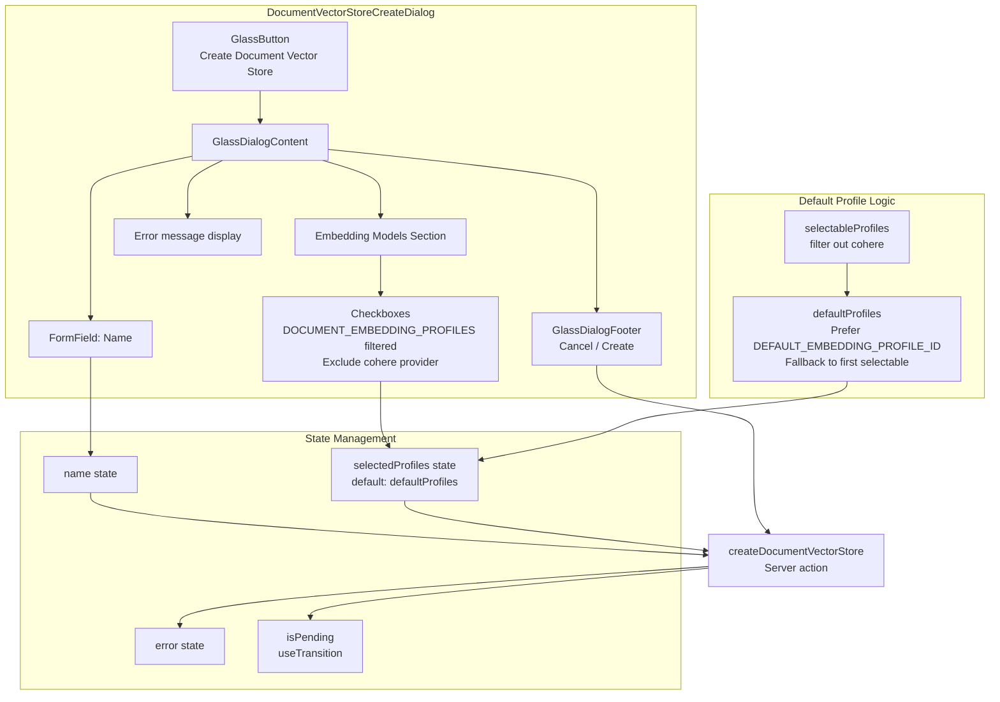

Sources: [apps/studio.giselles.ai/app/(main)/settings/team/vector-stores/document-store-create-dialog.tsx]() (not shown in full but structure is similar to registration dialog)

The dialog uses `DOCUMENT_EMBEDDING_PROFILES` which excludes Cohere provider, unlike GitHub vector stores:

```typescript
const selectableProfiles = useMemo(
  () =>
    availableProfiles.filter(([, profile]) => profile.provider !== "cohere"),
  [availableProfiles],
);
```

Sources: [apps/studio.giselles.ai/app/(main)/settings/team/vector-stores/document-vector-store-item.tsx:315-318]()

## Server Actions

The `actions.ts` file implements all server-side operations for vector store management.

### GitHub Repository Actions

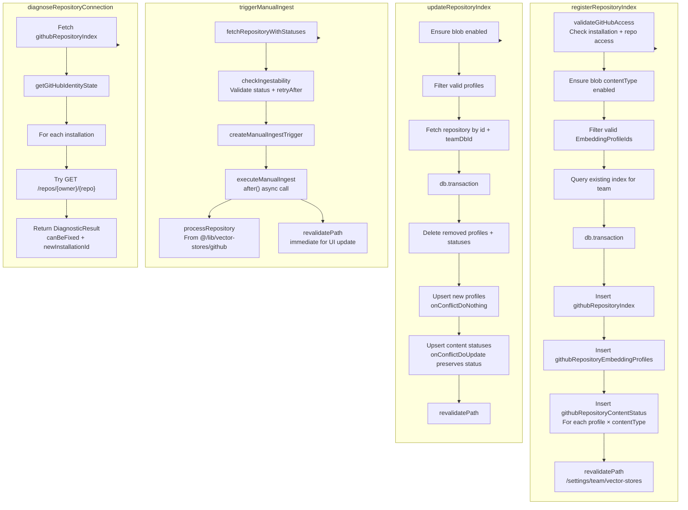

Sources: [apps/studio.giselles.ai/app/(main)/settings/team/vector-stores/actions.ts:105-210](), [apps/studio.giselles.ai/app/(main)/settings/team/vector-stores/actions.ts:216-368](), [apps/studio.giselles.ai/app/(main)/settings/team/vector-stores/actions.ts:513-552](), [apps/studio.giselles.ai/app/(main)/settings/team/vector-stores/actions.ts:384-462]()

#### Ingestability Check Logic

The `checkIngestability` function validates whether a repository can be manually ingested:

```typescript
function checkIngestability(
  contentStatuses: (typeof githubRepositoryContentStatus.$inferSelect)[],
  now: Date = new Date(),
): IngestabilityCheck {
  for (const contentStatus of contentStatuses) {
    if (!contentStatus.enabled) {
      continue;
    }

    const canIngestThis =
      contentStatus.status === "idle" ||
      contentStatus.status === "completed" ||
      (contentStatus.status === "failed" &&
        contentStatus.retryAfter &&
        contentStatus.retryAfter <= now);

    if (!canIngestThis) {
      return {
        canIngest: false,
        reason: `Repository cannot be ingested at this time (${contentStatus.contentType} is blocking)`,
      };
    }
  }

  const hasBlobStatus = contentStatuses.some((cs) => cs.contentType === "blob");
  if (!hasBlobStatus) {
    return {
      canIngest: false,
      reason: "Repository does not have a blob content status",
    };
  }

  return { canIngest: true };
}
```

Sources: [apps/studio.giselles.ai/app/(main)/settings/team/vector-stores/actions.ts:870-906]()

### Document Vector Store Actions

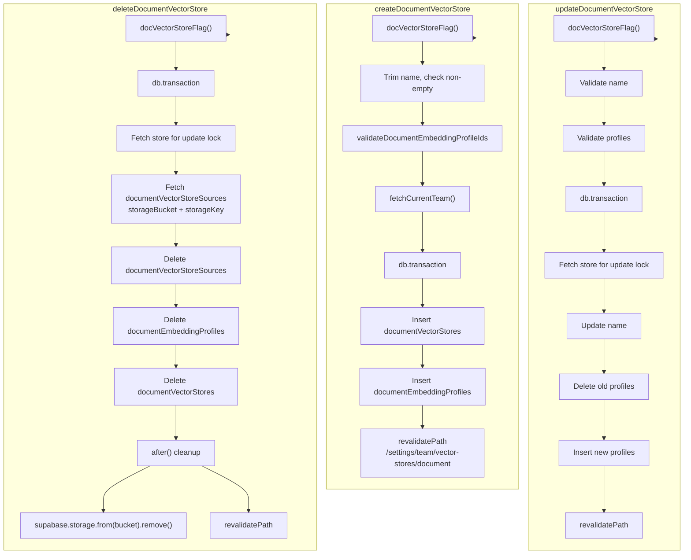

Sources: [apps/studio.giselles.ai/app/(main)/settings/team/vector-stores/actions.ts:575-634](), [apps/studio.giselles.ai/app/(main)/settings/team/vector-stores/actions.ts:636-715](), [apps/studio.giselles.ai/app/(main)/settings/team/vector-stores/actions.ts:717-835]()

#### Storage Cleanup with `after()`

The `deleteDocumentVectorStore` action uses Next.js 15's `after()` API to perform potentially slow Supabase storage cleanup after the database transaction commits:

```typescript
if (storageSources.length > 0) {
  // Perform potentially slow storage cleanup after the database transaction commits.
  after(async () => {
    const storeFolder = `${DOCUMENT_VECTOR_STORE_STORAGE_PREFIX}/${documentVectorStoreId}`;
    const cleanupTargetsByBucket = new Map<string, Set<string>>();
    // ... build cleanup targets ...
    
    for (const [bucket, targets] of cleanupTargetsByBucket) {
      const { error: storageError } = await supabase.storage
        .from(bucket)
        .remove(Array.from(targets));
      // ... handle errors ...
    }
  });
}
```

Sources: [apps/studio.giselles.ai/app/(main)/settings/team/vector-stores/actions.ts:785-823]()

This ensures the API response is not delayed by storage operations while still cleaning up files.

## Embedding Profile Configuration

Both GitHub and document vector stores use embedding profiles defined in `@giselle-sdk/data-type`, but with different filtering rules for the UI.

### GitHub Embedding Profiles

The GitHub vector store UI excludes Cohere profiles:

```typescript
// github-embedding-profiles.ts
export const GITHUB_EMBEDDING_PROFILES = Object.fromEntries(
  Object.entries(EMBEDDING_PROFILES).filter(
    ([, profile]) => profile.provider !== "cohere",
  ),
) as typeof EMBEDDING_PROFILES;
```

Sources: [apps/studio.giselles.ai/app/(main)/settings/team/vector-stores/github-embedding-profiles.ts:1-13]()

Available GitHub profiles:

| Profile ID | Name | Provider | Dimensions |
|------------|------|----------|------------|
| 1 | OpenAI Small | openai | 1536 |
| 2 | OpenAI Large | openai | 3072 |
| 3 | Google Multilingual | google | 768 |

Sources: Inferred from `EMBEDDING_PROFILES` in `@giselle-sdk/data-type` with Cohere filtered out

### Document Embedding Profiles

The document vector store UI also excludes Cohere but uses the same filter logic inline:

```typescript
const selectableProfiles = useMemo(
  () =>
    availableProfiles.filter(([, profile]) => profile.provider !== "cohere"),
  [availableProfiles],
);
```

Sources: [apps/studio.giselles.ai/app/(main)/settings/team/vector-stores/document-vector-store-item.tsx:315-318]()

The default profile selection logic prefers `DEFAULT_EMBEDDING_PROFILE_ID` (value 1) if available:

```typescript
const defaultProfiles = useMemo(() => {
  const primaryIds = selectableProfiles.map(([id]) => Number(id));
  const fallbackIds =
    primaryIds.length > 0
      ? primaryIds
      : availableProfiles.map(([id]) => Number(id));
  if (fallbackIds.includes(DEFAULT_EMBEDDING_PROFILE_ID)) {
    return [DEFAULT_EMBEDDING_PROFILE_ID];
  }
  return fallbackIds.length > 0 ? [fallbackIds[0]] : [];
}, [selectableProfiles, availableProfiles]);
```

Sources: [apps/studio.giselles.ai/app/(main)/settings/team/vector-stores/document-vector-store-item.tsx:320-330]()

## Navigation Layout

Both GitHub and document vector store pages are wrapped in `VectorStoresNavigationLayout`, which provides tab navigation when the document vector store feature flag is enabled.

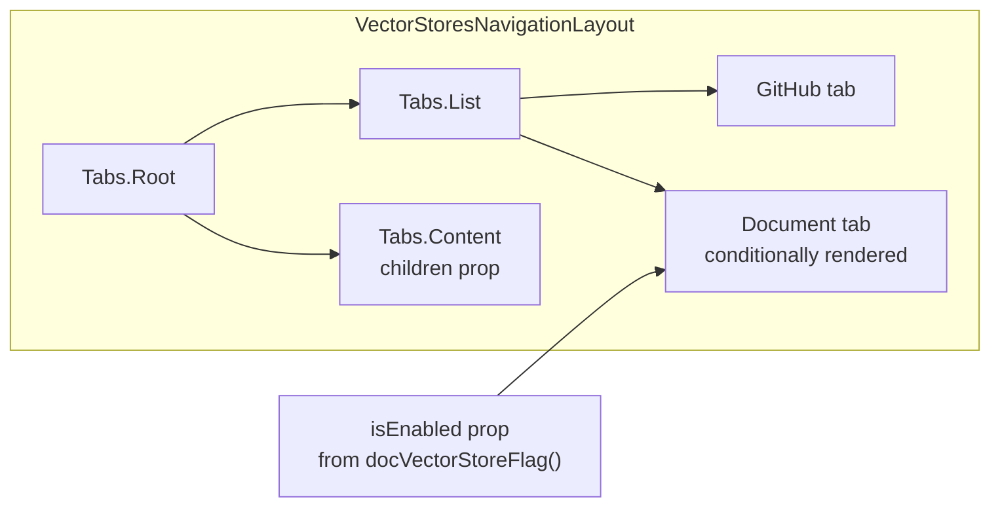

Sources: Inferred from [apps/studio.giselles.ai/app/(main)/settings/team/vector-stores/page.tsx:64-71](), [apps/studio.giselles.ai/app/(main)/settings/team/vector-stores/document/page.tsx:36-42]()

The document tab is only visible when `docVectorStoreFlag()` returns `true`, providing a gradual rollout mechanism for the document vector store feature.

## Data Fetching

The `data.ts` file provides query functions for fetching vector store data:

### GitHub Repository Indexes Query

```typescript
export async function getGitHubRepositoryIndexes(): Promise<
  RepositoryWithStatuses[]
> {
  const team = await fetchCurrentTeam();

  const records = await db
    .select({
      repositoryIndex: githubRepositoryIndex,
      contentStatus: githubRepositoryContentStatus,
    })
    .from(githubRepositoryIndex)
    .leftJoin(
      githubRepositoryContentStatus,
      eq(
        githubRepositoryContentStatus.repositoryIndexDbId,
        githubRepositoryIndex.dbId,
      ),
    )
    .where(eq(githubRepositoryIndex.teamDbId, team.dbId))
    .orderBy(desc(githubRepositoryIndex.dbId));

  // Group by repository
  const repositoryMap = new Map<number, RepositoryWithStatuses>();
  // ... grouping logic ...
  return Array.from(repositoryMap.values());
}
```

Sources: [apps/studio.giselles.ai/app/(main)/settings/team/vector-stores/data.ts:17-60]()

This query returns `RepositoryWithStatuses[]` where each item contains:
- `repositoryIndex`: The `githubRepositoryIndex` record
- `contentStatuses`: Array of `githubRepositoryContentStatus` records for all embedding profiles

### Installations and Repositories Query

```typescript
export async function getInstallationsWithRepos(): Promise<
  InstallationWithRepos[]
> {
  const githubIdentityState = await getGitHubIdentityState();
  const userClient = githubIdentityState.gitHubUserClient;
  const installationData = await userClient.getInstallations();
  const installations = installationData.installations;

  const installationsWithRepos = await Promise.all(
    installations.map(async (installation) => {
      const repos = await userClient.getRepositories(installation.id);
      // ... transform to InstallationWithRepos format ...
      return { installation, repositories };
    }),
  );

  return installationsWithRepos;
}
```

Sources: [apps/studio.giselles.ai/app/(main)/settings/team/vector-stores/data.ts:62-108]()

This fetches all GitHub App installations accessible to the authenticated user and their repositories, used to populate the registration dialog dropdowns.

### Document Vector Stores Query

The `getDocumentVectorStores()` function is defined in `@/lib/vector-stores/document/queries` and returns `DocumentVectorStoreWithProfiles[]` with:
- Document vector store metadata (id, name, teamDbId)
- Associated embedding profile IDs
- Source files with ingestion status

Sources: [apps/studio.giselles.ai/app/(main)/settings/team/vector-stores/data.ts:10-11]()

## Error Handling

The interface displays user-friendly error messages for common failure scenarios:

### Document Loader Error Codes

```typescript
export type DocumentLoaderErrorCode =
  | "DOCUMENT_NOT_FOUND"
  | "DOCUMENT_FETCH_ERROR"
  | "DOCUMENT_RATE_LIMITED"
  | "DOCUMENT_TOO_LARGE";
```

Sources: [apps/studio.giselles.ai/app/(main)/settings/team/vector-stores/types.ts:1-5]()

The `getErrorMessage()` helper function (referenced but not shown in provided files) maps these codes to user-friendly messages displayed in the `EmbeddingModelCard` components.

Sources: [apps/studio.giselles.ai/app/(main)/settings/team/vector-stores/repository-item.tsx:26](), [apps/studio.giselles.ai/app/(main)/settings/team/vector-stores/repository-item.tsx:335-341]()

### Action Result Type

All server actions return a standardized result type:

```typescript
export type ActionResult =
  | { success: true }
  | { success: false; error: string };
```

Sources: [apps/studio.giselles.ai/app/(main)/settings/team/vector-stores/types.ts:23-25]()

This allows UI components to display error messages in a consistent way using error state variables.

## UI Component Library Usage

The vector store management interface extensively uses components from the `@giselle-internal/ui` package:

| Component | Usage | File Path |
|-----------|-------|-----------|
| `GlassCard` | Container for repository/document items | `internal-packages/ui/components/glass-card.tsx` |
| `Select` | Dropdowns for owner/repository selection | `internal-packages/ui/components/select.tsx` |
| `Toggle` | Content type enable/disable switches | `internal-packages/ui/components/toggle.tsx` |
| `StatusBadge` | Enabled/Disabled/Success status indicators | `internal-packages/ui/components/status-badge.tsx` |
| `StatusIndicator` | Running/Idle/Error state visualization | `internal-packages/ui/components/status-indicator.tsx` |
| `RepoActionMenu` | Ellipsis menu with actions | `internal-packages/ui/components/repo-action-menu.tsx` |
| `AccentLink` | Repository links to GitHub | `internal-packages/ui/components/accent-link.tsx` |
| `SectionHeader` | Section titles with descriptions | `internal-packages/ui/components/section-header.tsx` |
| `FormField` | Labeled input fields | `internal-packages/ui/components/form-field.tsx` |
| `PageHeading` | Page-level heading with glow effect | `internal-packages/ui/components/page-heading.tsx` |
| `DocsLink` | Links to documentation | `internal-packages/ui/components/docs-link.tsx` |

Sources: [internal-packages/ui/package.json:10-42]()

The `GlassDialogContent`, `GlassDialogHeader`, `GlassDialogBody`, and `GlassDialogFooter` components are custom wrappers defined in the settings app:

Sources: [apps/studio.giselles.ai/app/(main)/settings/team/vector-stores/repository-item.tsx:20-23](), [apps/studio.giselles.ai/app/(main)/settings/team/vector-stores/document-vector-store-item.tsx:38-42]()

---

