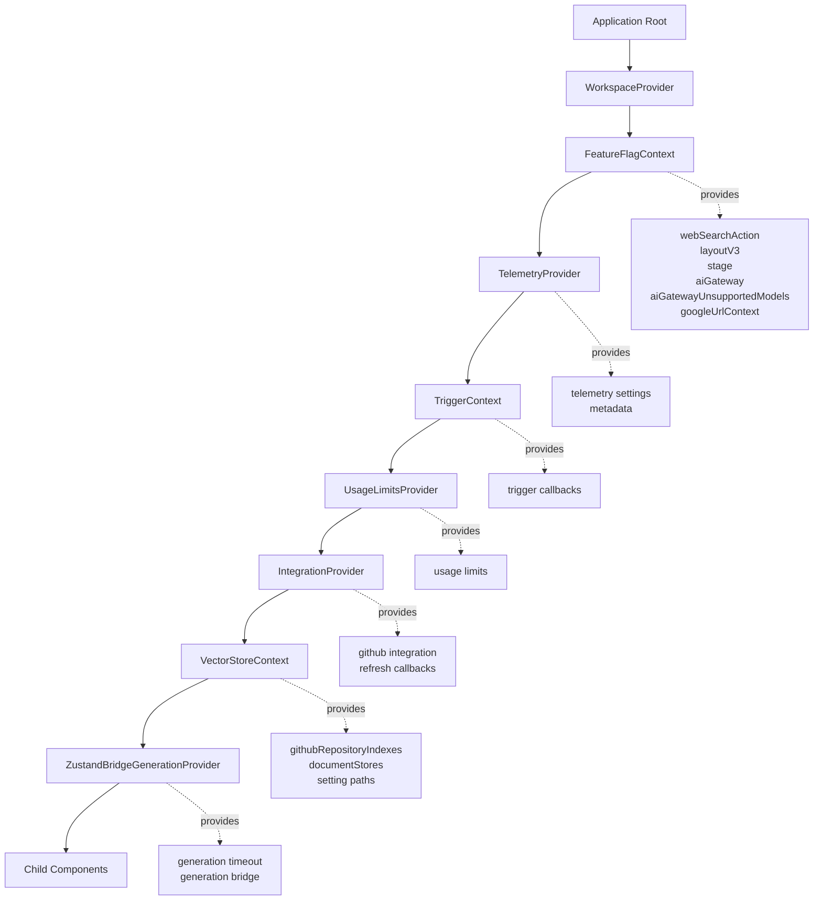
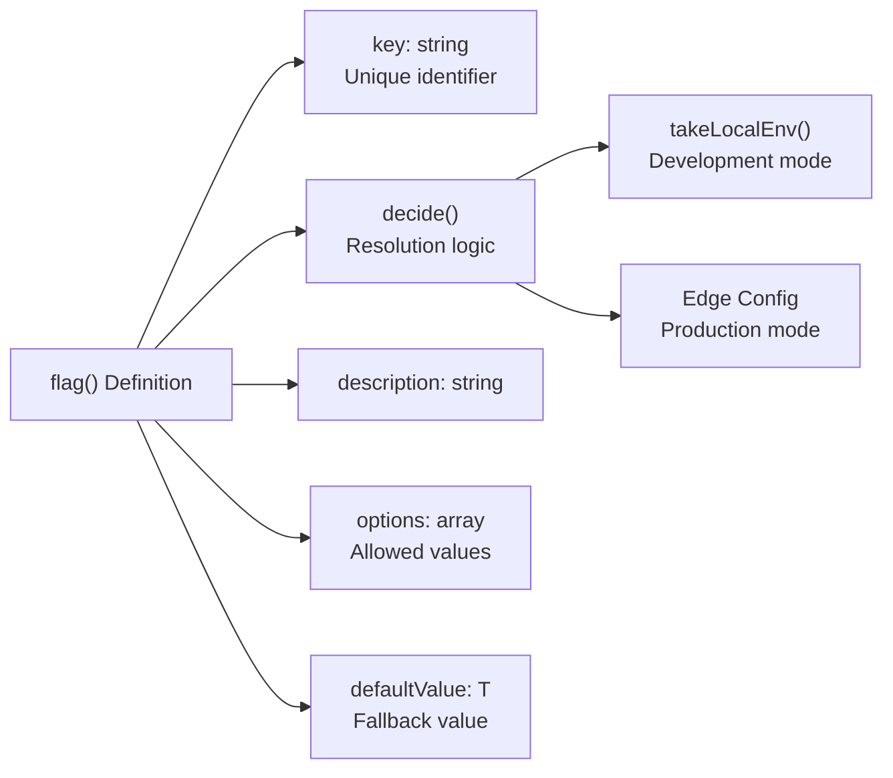
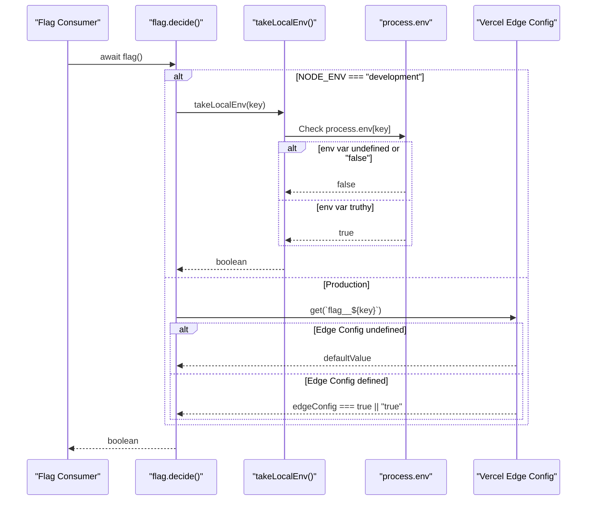
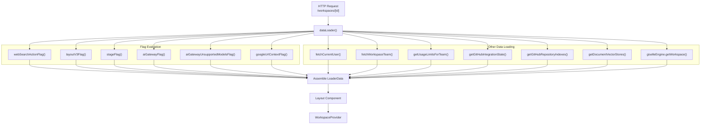
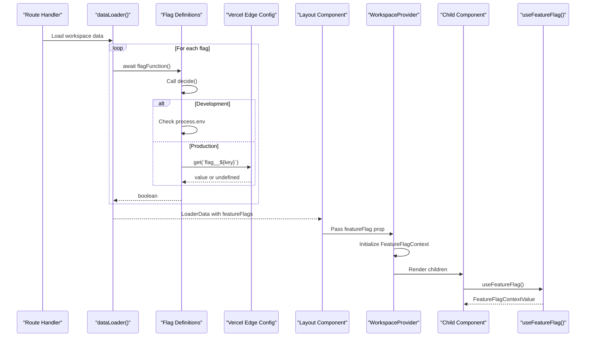
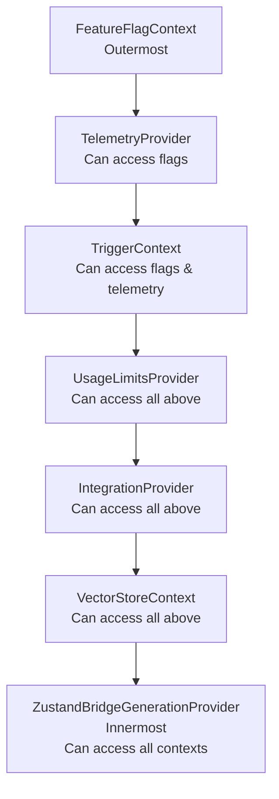

<!-- source: DeepWiki mcp.deepwiki.com · repo giselles-ai/giselle · extra page Workspace Context and Feature Flags · fetched 2026-10-27 -->

# Workspace Context and Feature Flags

<details>
<summary>Relevant source files</summary>

The following files were used as context for generating this wiki page:

- [apps/playground/app/workspaces/[workspaceId]/layout.tsx](apps/playground/app/workspaces/[workspaceId]/layout.tsx)
- [apps/studio.giselles.ai/app/deprecated/workspaces/[workspaceId]/layout.tsx](apps/studio.giselles.ai/app/deprecated/workspaces/[workspaceId]/layout.tsx)
- [apps/studio.giselles.ai/app/workspaces/[workspaceId]/data-loader.ts](apps/studio.giselles.ai/app/workspaces/[workspaceId]/data-loader.ts)
- [apps/studio.giselles.ai/flags.ts](apps/studio.giselles.ai/flags.ts)
- [packages/giselle/src/react/feature-flags/context.ts](packages/giselle/src/react/feature-flags/context.ts)
- [packages/giselle/src/react/workspace/provider.tsx](packages/giselle/src/react/workspace/provider.tsx)

</details>


## Purpose and Scope

This document explains the workspace-level context system and feature flag architecture in the Studio application. The `WorkspaceProvider` component serves as the central configuration provider, wrapping multiple React contexts that supply workspace-specific settings, integration states, usage limits, and feature flags to the entire application tree. The feature flag system provides a two-tier resolution strategy: local environment variables for development and Vercel Edge Config for production deployments.

For information about Stage-specific execution contexts, see [6.1.2](#6.1.2). For vector store configuration loaded by the workspace context, see [6.1.3](#6.1.3).

## WorkspaceProvider Architecture

### Context Hierarchy

The `WorkspaceProvider` component at [packages/giselle/src/react/workspace/provider.tsx:22-68]() acts as a composite provider that nests multiple specialized context providers in a specific hierarchy:



**Sources:** [packages/giselle/src/react/workspace/provider.tsx:22-68]()

### Provider Props and Configuration

The `WorkspaceProvider` accepts configuration for each nested context:

| Prop | Type | Purpose |
|------|------|---------|
| `featureFlag` | `FeatureFlagContextValue` | Feature flag states |
| `integration` | `IntegrationProviderProps` | GitHub integration state and refresh callback |
| `usageLimits` | `UsageLimits` | Plan-based quota information |
| `telemetry` | `TelemetrySettings` | Observability configuration and metadata |
| `vectorStore` | `VectorStoreContextValue` | Vector store indexes and settings paths |
| `trigger` | `TriggerContextValue` | Trigger update callbacks |
| `generationTimeout` | `number` | Generation execution timeout in milliseconds |

**Sources:** [packages/giselle/src/react/workspace/provider.tsx:22-40]()

## Feature Flag System

### Flag Definition Structure

Feature flags are defined in [apps/studio.giselles.ai/flags.ts:1-177]() using the `flag()` function from the `flags/next` package. Each flag follows a consistent structure:



**Sources:** [apps/studio.giselles.ai/flags.ts:17-177]()

### Two-Tier Resolution Strategy

The flag resolution strategy differs between development and production environments:



**Sources:** [apps/studio.giselles.ai/flags.ts:4-177]()

### takeLocalEnv Helper Function

The `takeLocalEnv()` helper at [apps/studio.giselles.ai/flags.ts:4-15]() implements the local environment variable resolution logic:

```typescript
function takeLocalEnv(localEnvironmentKey: string) {
	if (process.env.NODE_ENV !== "development") {
		return false;
	}
	if (
		process.env[localEnvironmentKey] === undefined ||
		process.env[localEnvironmentKey] === "false"
	) {
		return false;
	}
	return true;
}
```

This function ensures flags are only read from local environment variables in development mode. In non-development environments, it always returns `false`, forcing the flag's `decide()` method to fall back to Edge Config or default values.

**Sources:** [apps/studio.giselles.ai/flags.ts:4-15]()

### Available Feature Flags

The Studio application defines the following feature flags:

| Flag Key | Environment Variable | Default | Description |
|----------|---------------------|---------|-------------|
| `developer` | `DEVELOPER_FLAG` | `false` | Enable developer features |
| `web-search-action` | `WEB_SEARCH_ACTION_FLAG` | `false` | Enable web search action nodes |
| `layout-v3` | `LAYOUT_V3_FLAG` | `false` | Enable Layout V3 interface |
| `experimental-storage` | `EXPERIMENTAL_STORAGE_FLAG` | `true` | Enable experimental storage backend |
| `stage` | `STAGE_FLAG` | `false` | Enable Stage production execution interface |
| `ai-gateway` | `AI_GATEWAY_FLAG` | `false` | Enable AI Gateway for request routing |
| `ai-gateway-unsupported-models` | `AI_GATEWAY_UNSUPPORTED_MODELS_FLAG` | `false` | Allow unsupported models through AI Gateway |
| `google-url-context` | `GOOGLE_URL_CONTEXT_FLAG` | `false` | Enable Google URL context tool |
| `new-editor` | `NEW_EDITOR_FLAG` | `false` | Enable new editor interface |

**Sources:** [apps/studio.giselles.ai/flags.ts:17-177]()

### Flag Resolution Examples

The `layoutV3Flag` at [apps/studio.giselles.ai/flags.ts:43-60]() demonstrates the typical resolution pattern:

```typescript
export const layoutV3Flag = flag<boolean>({
	key: "layout-v3",
	async decide() {
		if (process.env.NODE_ENV === "development") {
			return takeLocalEnv("LAYOUT_V3_FLAG");
		}
		const edgeConfig = await get(`flag__${this.key}`);
		if (edgeConfig === undefined) {
			return false;
		}
		return edgeConfig === true || edgeConfig === "true";
	},
	description: "Enable Layout V3",
	options: [
		{ value: false, label: "disable" },
		{ value: true, label: "Enable" },
	],
});
```

**Sources:** [apps/studio.giselles.ai/flags.ts:43-60]()

## Feature Flag Context

### FeatureFlagContext Definition

The `FeatureFlagContext` at [packages/giselle/src/react/feature-flags/context.ts:1-24]() defines the interface for accessing feature flags in React components:

```typescript
export interface FeatureFlagContextValue {
	webSearchAction: boolean;
	layoutV3: boolean;
	stage: boolean;
	aiGateway: boolean;
	aiGatewayUnsupportedModels: boolean;
	googleUrlContext: boolean;
}
```

Components consume these flags using the `useFeatureFlag()` hook at [packages/giselle/src/react/feature-flags/context.ts:15-23]().

**Sources:** [packages/giselle/src/react/feature-flags/context.ts:1-24]()

### Context Initialization

The `WorkspaceProvider` initializes the `FeatureFlagContext` with default values at [packages/giselle/src/react/workspace/provider.tsx:42-52]():

```typescript
<FeatureFlagContext
	value={{
		webSearchAction: featureFlag?.webSearchAction ?? false,
		layoutV3: featureFlag?.layoutV3 ?? false,
		stage: featureFlag?.stage ?? false,
		aiGateway: featureFlag?.aiGateway ?? false,
		aiGatewayUnsupportedModels:
			featureFlag?.aiGatewayUnsupportedModels ?? false,
		googleUrlContext: featureFlag?.googleUrlContext ?? false,
	}}
>
```

All flags default to `false` if not provided, ensuring safe fallback behavior.

**Sources:** [packages/giselle/src/react/workspace/provider.tsx:42-52]()

## Server-Side Flag Loading

### Data Loading Pattern

The `dataLoader` function at [apps/studio.giselles.ai/app/workspaces/[workspaceId]/data-loader.ts:21-86]() evaluates all feature flags server-side before rendering:



**Sources:** [apps/studio.giselles.ai/app/workspaces/[workspaceId]/data-loader.ts:21-86]()

### Feature Flag Evaluation

The data loader evaluates each flag using `await`:

```typescript
const webSearchAction = await webSearchActionFlag();
const layoutV3 = await layoutV3Flag();
const stage = await stageFlag();
const aiGateway = await aiGatewayFlag();
const aiGatewayUnsupportedModels = await aiGatewayUnsupportedModelsFlag();
const googleUrlContext = await googleUrlContextFlag();
```

These evaluated values are then packaged into the `featureFlags` object at [apps/studio.giselles.ai/app/workspaces/[workspaceId]/data-loader.ts:77-84]() and returned from the loader.

**Sources:** [apps/studio.giselles.ai/app/workspaces/[workspaceId]/data-loader.ts:51-84]()

## Configuration Cascading Flow

### Complete Data Flow

The configuration flows from server-side loading through the provider hierarchy to client components:



**Sources:** [apps/studio.giselles.ai/app/workspaces/[workspaceId]/data-loader.ts:21-86](), [packages/giselle/src/react/workspace/provider.tsx:22-68](), [apps/studio.giselles.ai/flags.ts:1-177]()

### Deprecated Layout Example

The deprecated layout at [apps/studio.giselles.ai/app/deprecated/workspaces/[workspaceId]/layout.tsx:25-153]() demonstrates the complete integration pattern:

```typescript
export default async function Layout({ params, children }) {
	// ... authentication and data loading ...
	
	const webSearchAction = await webSearchActionFlag();
	const layoutV3 = await layoutV3Flag();
	const stage = await stageFlag();
	const aiGateway = await aiGatewayFlag();
	const aiGatewayUnsupportedModels = await aiGatewayUnsupportedModelsFlag();
	const googleUrlContext = await googleUrlContextFlag();
	
	return (
		<WorkspaceProvider
			generationTimeout={3600 * 1000}
			integration={{ /* ... */ }}
			vectorStore={{ /* ... */ }}
			usageLimits={usageLimits}
			telemetry={{ /* ... */ }}
			featureFlag={{
				webSearchAction,
				layoutV3,
				stage,
				aiGateway,
				aiGatewayUnsupportedModels,
				googleUrlContext,
			}}
			trigger={{ /* ... */ }}
		>
			<ZustandBridgeProvider data={data}>
				{children}
			</ZustandBridgeProvider>
		</WorkspaceProvider>
	);
}
```

**Sources:** [apps/studio.giselles.ai/app/deprecated/workspaces/[workspaceId]/layout.tsx:25-153]()

## Application-Specific Configuration

### Playground Configuration

The Playground application at [apps/playground/app/workspaces/[workspaceId]/layout.tsx:4-19]() uses a simplified, hardcoded configuration:

```typescript
export default function Layout({ children }: { children: ReactNode }) {
	return (
		<WorkspaceProvider
			featureFlag={{
				webSearchAction: false,
				layoutV3: true,
				stage: true,
				aiGateway: false,
				aiGatewayUnsupportedModels: false,
				googleUrlContext: false,
			}}
		>
			{children}
		</WorkspaceProvider>
	);
}
```

This approach bypasses the flag evaluation system entirely, providing static configuration suitable for development and testing environments.

**Sources:** [apps/playground/app/workspaces/[workspaceId]/layout.tsx:4-19]()

### Studio vs Playground Differences

| Aspect | Studio | Playground |
|--------|--------|-----------|
| Flag resolution | Dynamic (env vars + Edge Config) | Static hardcoded values |
| Additional contexts | Integration, UsageLimits, Telemetry, VectorStore, Trigger | FeatureFlag only |
| Generation timeout | 3600 seconds (1 hour) | Default |
| Authentication | Full user/team verification | Simplified |
| Database integration | Full workspace/team data loading | Minimal |

**Sources:** [apps/studio.giselles.ai/app/deprecated/workspaces/[workspaceId]/layout.tsx:25-153](), [apps/playground/app/workspaces/[workspaceId]/layout.tsx:4-19]()

## Context Access Patterns

### Nested Context Dependencies

The `WorkspaceProvider` nesting order ensures that contexts can access outer contexts if needed:



This hierarchical structure enables inner contexts to conditionally adjust behavior based on feature flags or other outer context values.

**Sources:** [packages/giselle/src/react/workspace/provider.tsx:42-66]()

---

