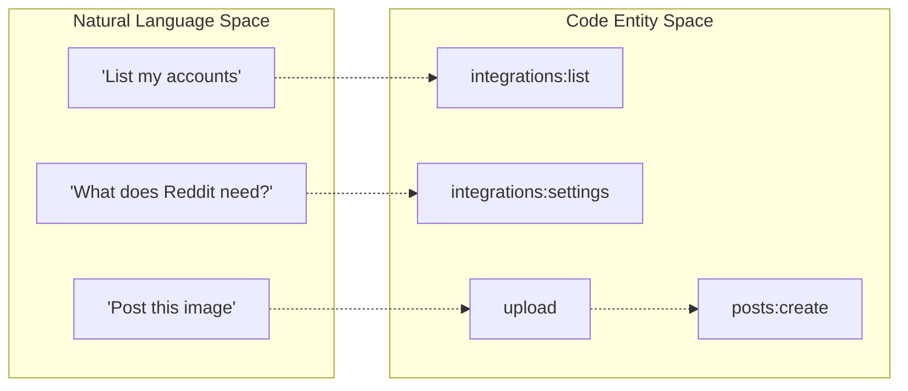

<!-- source: DeepWiki mcp.deepwiki.com · repo gitroomhq/postiz-agent · page 1 Overview · fetched 2026-10-27 -->

# Overview

<details>
<summary>Relevant source files</summary>

The following files were used as context for generating this wiki page:

- [FEATURES.md](FEATURES.md)
- [PROJECT_STRUCTURE.md](PROJECT_STRUCTURE.md)
- [README.md](README.md)
- [SKILL.md](SKILL.md)
- [SUMMARY.md](SUMMARY.md)
- [package.json](package.json)

</details>


The **postiz CLI** is a command-line interface and agent-centric ecosystem designed to automate social media management across 28+ platforms [SKILL.md:3-3](). It serves as a bridge between developers (or AI agents) and the Postiz API, facilitating post scheduling, media management, and performance analytics [README.md:9-12]().

The ecosystem is comprised of a TypeScript-based CLI tool, an optional OAuth2 device-flow authentication server, and a "Skill" contract optimized for LLM integration [SKILL.md:23-27]().

### Core Capabilities

The system is architected to support complex social media workflows:
*   **Multi-Platform Scheduling:** Unified interface for platforms including X (Twitter), LinkedIn, Reddit, YouTube, TikTok, and Instagram [package.json:31-37]().
*   **Advanced Post Composition:** Support for threaded comments, platform-specific settings (e.g., Reddit flairs), and multi-media attachments [FEATURES.md:9-25]().
*   **AI Agent Optimization:** Provides machine-readable JSON outputs and a discovery-based workflow for agents to navigate platform requirements dynamically [SKILL.md:48-59]().
*   **Media Pipeline:** Integrated multipart upload for preparing local files for social media providers [SUMMARY.md:70-73]().

### System Architecture

The following diagram illustrates how the CLI components relate to the Postiz API and external social providers.

**High-Level System Context**
```mermaid
graph TD
  subgraph "Local Environment"
    ["CLI Entrypoint (index.ts)"] -- "calls" --> ["Command Handlers (src/commands/*)"]
    ["Command Handlers (src/commands/*)"] -- "uses" --> ["PostizAPI Client (src/api.ts)"]
    ["PostizAPI Client (src/api.ts)"] -- "reads" --> ["Config Module (src/config.ts)"]
  end

  subgraph "Postiz Infrastructure"
    ["PostizAPI Client (src/api.ts)"] -- "HTTPS/JSON" --> ["Postiz Public API"]
    ["Auth Command"] -- "Device Flow" --> ["Auth Server (server/src/index.ts)"]
    ["Auth Server (server/src/index.ts)"] -- "OIDC" --> ["Postiz OAuth Provider"]
  end

  subgraph "Social Platforms"
    ["Postiz Public API"] -- "Provider API" --> ["X / Twitter"]
    ["Postiz Public API"] -- "Provider API" --> ["LinkedIn"]
    ["Postiz Public API"] -- "Provider API" --> ["TikTok/Instagram"]
  end
```
**Sources:** [PROJECT_STRUCTURE.md:172-188](), [SKILL.md:60-85](), [README.md:11-12]()

---

### Component Overview

#### 1. The CLI Tool
The primary interface for users and agents. It is built using `yargs` for argument parsing and `tsup` for compilation [package.json:55-60](). It handles the translation of CLI flags or JSON files into the `CreatePostDto` format required by the backend [FEATURES.md:209-240]().
*   For setup and installation, see **[Getting Started](#1.1)**.
*   For build details and monorepo structure, see **[Project Structure and Build Pipeline](#1.2)**.

#### 2. Authentication Flow
The system supports two primary authentication methods:
*   **OAuth2 Device Flow:** A browser-based authorization that stores credentials in `~/.postiz/credentials.json` [README.md:29-41]().
*   **API Key:** Simple environment variable-based auth via `POSTIZ_API_KEY` [README.md:54-58]().

#### 3. AI Agent Integration (Skills)
The CLI includes a `SKILL.md` file that acts as a contract for AI agents (like Claude). It defines a **Discovery Workflow** where agents first query platform settings to understand what data (like Reddit flairs or LinkedIn companies) is required before attempting a post [SKILL.md:48-59]().

**Agent Workflow to Code Mapping**

**Sources:** [SKILL.md:60-85](), [SUMMARY.md:47-73]()

---

### Key Data Structures

The CLI operates primarily on the `CreatePostDto`, which encapsulates the entire state of a social media campaign across multiple integrations.

| Entity | Code Reference | Description |
| :--- | :--- | :--- |
| **PostizAPI** | [src/api.ts:51-60]() | The central class handling HTTP communication and header injection. |
| **CreatePostDto** | [FEATURES.md:209-240]() | The JSON schema for multi-platform, multi-comment posts. |
| **Integration** | [src/commands/integrations.ts:74-77]() | Metadata representing a connected social media account. |
| **MediaDto** | [FEATURES.md:226-231]() | Object containing the ID and path of uploaded media. |

**Sources:** [PROJECT_STRUCTURE.md:51-60](), [FEATURES.md:207-240]()

---

### Child Pages
*   **[Getting Started](#1.1)**: Installation, initial setup, and authentication methods.
*   **[Project Structure and Build Pipeline](#1.2)**: Technical details on the codebase layout, TypeScript configuration, and the publishing workflow.

---

