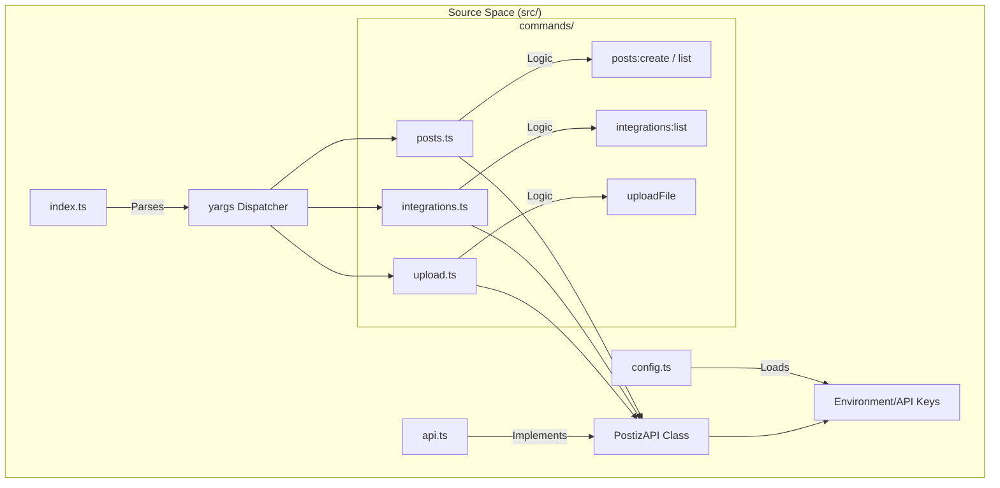
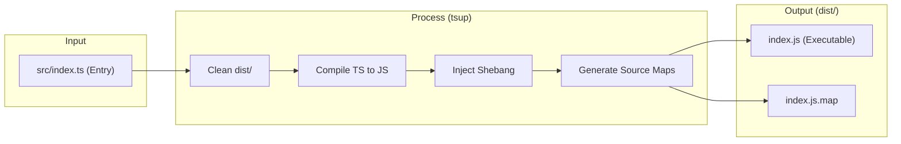

<!-- source: DeepWiki mcp.deepwiki.com · repo gitroomhq/postiz-agent · page 1.2 Project Structure and Build Pipeline · fetched 2026-10-27 -->

# Project Structure and Build Pipeline

Relevant source files

The following files were used as context for generating this wiki page:

- [CHANGELOG.md](CHANGELOG.md)
- [PROJECT_STRUCTURE.md](PROJECT_STRUCTURE.md)
- [PUBLISHING.md](PUBLISHING.md)
- [SUMMARY.md](SUMMARY.md)
- [package.json](package.json)
- [tsconfig.json](tsconfig.json)
- [tsup.config.ts](tsup.config.ts)

This page details the physical organization of the Postiz CLI codebase, the automated build pipeline using `tsup`, and the lifecycle of the package from TypeScript source to a published npm executable.

## Directory Layout

The Postiz CLI is structured as a standalone package within a monorepo, located at `apps/cli/`. It follows a standard TypeScript project structure where logic is separated into an entry point, an API client, and specific command handlers.

| Directory/File | Description |
| :--- | :--- |
| `src/index.ts` | Main entry point; handles CLI argument parsing via `yargs`. [PROJECT_STRUCTURE.md:45-49]() |
| `src/api.ts` | The `PostizAPI` client class responsible for HTTP communication. [PROJECT_STRUCTURE.md:51-60]() |
| `src/config.ts` | Manages environment variables and configuration state. [PROJECT_STRUCTURE.md:62-66]() |
| `src/commands/` | Directory containing the business logic for CLI command groups. [PROJECT_STRUCTURE.md:15-18]() |
| `dist/` | Generated build output containing the executable JavaScript. [PROJECT_STRUCTURE.md:23-26]() |
| `examples/` | Contains reference scripts like `basic-usage.sh`. [PROJECT_STRUCTURE.md:20-21]() |

### Code Entity Mapping: Directory to Logic

The following diagram maps the filesystem structure to the primary functional responsibilities defined in the code.

**Filesystem to Logic Mapping**

**Sources:** [PROJECT_STRUCTURE.md:9-19](), [PROJECT_STRUCTURE.md:43-81]()

---

## TypeScript Compilation via tsup

The project uses `tsup` as its primary build tool. `tsup` is a zero-config bundler powered by `esbuild` that handles the conversion of TypeScript into a single, executable CommonJS file.

### Build Configuration (`tsup.config.ts`)
The build process is governed by the configuration in `tsup.config.ts` [tsup.config.ts:1-14](). Key implementation details include:
*   **Target Format**: The output is forced to `cjs` (CommonJS) to ensure compatibility with standard Node.js environments [tsup.config.ts:5-5]().
*   **Shebang Injection**: A `banner` is added to the top of the generated file (`#!/usr/bin/env node`) to allow the file to be executed directly as a binary [tsup.config.ts:11-13]().
*   **Cleaning**: The `dist` directory is purged before every build to ensure no stale artifacts remain [tsup.config.ts:9-9]().
*   **Source Maps**: Enabled to allow debugging of the original TypeScript source from the compiled JavaScript [tsup.config.ts:8-8]().

### Build Data Flow
The data flow from source to the `dist/` output is as follows:

**Build Pipeline Flow**

**Sources:** [tsup.config.ts:3-14](), [PROJECT_STRUCTURE.md:152-169]()

---

## The dist/ Output and Binaries

The final output of the build process is a standalone executable located at `./dist/index.js`. 

*   **Binary Mapping**: The `package.json` defines the `postiz` command and points it to this file [package.json:6-8]().
*   **Dependencies**: While `tsup` bundles most logic, the package still relies on `node-fetch` and `yargs` as runtime dependencies [package.json:52-56]().
*   **Size**: The compressed build size is approximately 491KB [SUMMARY.md:13-13]().

**Sources:** [package.json:1-8](), [SUMMARY.md:13-13]()

---

## npm Publishing Workflow

The publishing workflow is designed to be executed either from the monorepo root or within the `apps/cli` directory.

### Lifecycle Scripts
The `package.json` includes specific hooks for publishing:
*   **`prepublishOnly`**: Automatically runs `pnpm run build` before any publish attempt to ensure the `dist/` folder is up to date [package.json:13-13]().
*   **`publish`**: Executes `tsup` and then runs `pnpm publish` with public access [package.json:14-14]().

### Included Files
To keep the npm package lightweight, only essential files are included in the distribution [package.json:16-22]():
1.  `dist/` (The compiled code)
2.  `README.md` (Documentation)
3.  `SKILL.md` (AI Agent instructions)
4.  `CHANGELOG.md`
5.  `LICENSE`

### Publishing Command Sequence
1.  **Version Update**: Use `npm version <patch|minor|major>` to update the version in `package.json` [PUBLISHING.md:187-209]().
2.  **Build**: Run `pnpm run build` to generate artifacts [PUBLISHING.md:7-7]().
3.  **Publish**: Run `pnpm publish --access public` [PUBLISHING.md:8-8]().

**Sources:** [package.json:9-22](), [PUBLISHING.md:1-20](), [PUBLISHING.md:187-209]()

---

## Monorepo Integration

The CLI is integrated into the larger Postiz ecosystem through shared configuration and root-level scripts.

*   **Shared Scripts**: The monorepo root contains scripts like `build:cli` which uses `pnpm --filter` to target the CLI package specifically [SUMMARY.md:119-126]().
*   **TypeScript Inheritance**: The `tsconfig.json` in the CLI directory is configured to handle local paths while remaining compatible with the monorepo's module resolution [tsconfig.json:1-22]().
*   **AI Agent Contract**: The project includes `SKILL.md`, which serves as the technical contract for integrating the CLI as a "skill" for LLM-based agents [SUMMARY.md:94-100]().

**Sources:** [SUMMARY.md:117-126](), [tsconfig.json:1-22](), [PROJECT_STRUCTURE.md:233-247]()

---

