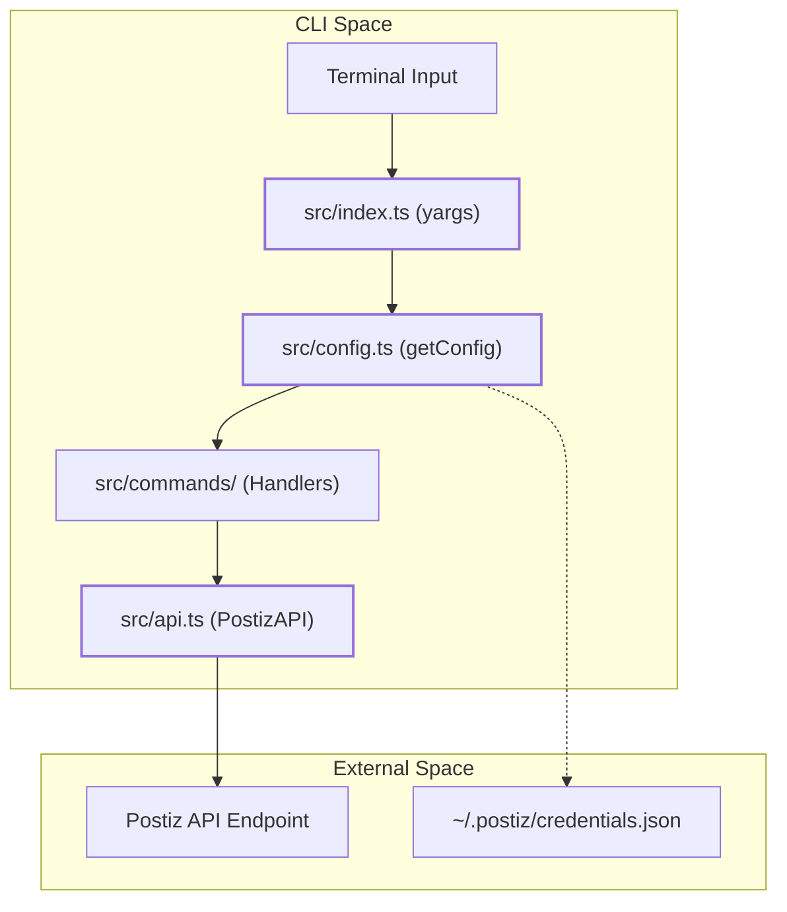
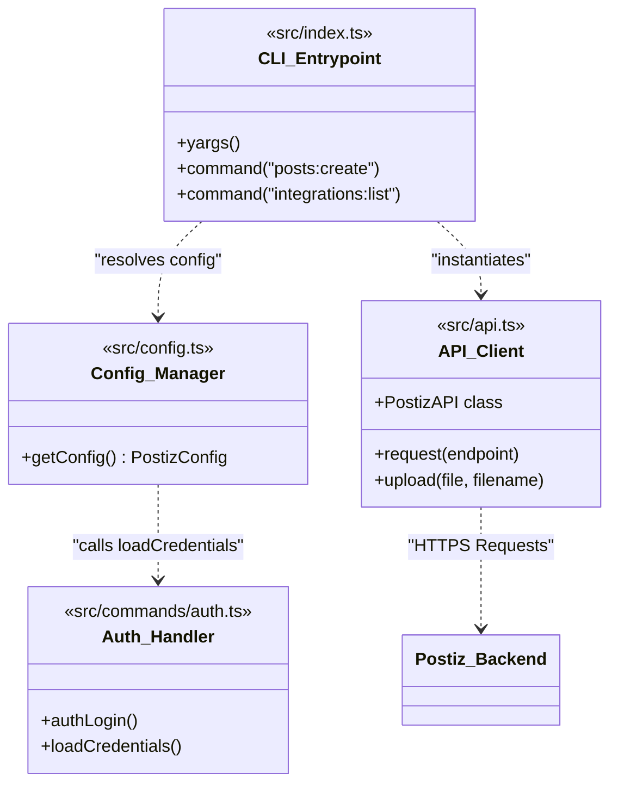

<!-- source: DeepWiki mcp.deepwiki.com · repo gitroomhq/postiz-agent · page 2 CLI Architecture · fetched 2026-10-27 -->

# CLI Architecture

Relevant source files

The following files were used as context for generating this wiki page:

- [src/api.ts](src/api.ts)
- [src/commands/analytics.ts](src/commands/analytics.ts)
- [src/config.ts](src/config.ts)
- [src/index.ts](src/index.ts)

The Postiz CLI is a TypeScript-based command-line tool designed to interface with the Postiz API. It provides a structured way for users and AI agents to manage social media posts, integrations, and analytics through a consistent command-dispatch pattern.

## System Overview

The CLI's internal architecture is built around three core pillars:
1.  **Command Orchestration**: A `yargs`-driven entrypoint that parses CLI arguments and routes them to specific command handlers.
2.  **State Management**: A configuration module that resolves authentication credentials from local storage or environment variables.
3.  **API Abstraction**: A central `PostizAPI` class that encapsulates the logic for HTTP requests, multipart uploads, and error handling.

### High-Level Component Interaction

The following diagram illustrates how a command flows from the terminal through the internal modules to the Postiz API.

**Command Execution Flow**

Sources: [src/index.ts:1-12](), [src/config.ts:4-30](), [src/api.ts:8-15]()

---

## Core Components

### Entrypoint and Command Dispatch
The CLI entrypoint in `src/index.ts` uses `yargs` to define a hierarchical command structure (e.g., `posts:create`, `integrations:list`). Each command definition includes flag validation, help text, and examples before delegating execution to a specific handler function in the `src/commands/` directory.

For details, see [Entrypoint and Command Dispatch](#2.1).

### PostizAPI Client
The `PostizAPI` class serves as the single point of egress for all network communication. It handles the injection of the `Authorization` header, manages base URL configuration, and provides specialized methods for JSON-based CRUD operations and multipart/form-data media uploads.

For details, see [PostizAPI Client](#2.2).

### Configuration and Authentication
The CLI supports two authentication modes: OAuth2 Device Flow and API Key-based authentication. The `getConfig()` function implements a priority-based resolution logic, checking local credential storage before falling back to environment variables like `POSTIZ_API_KEY`.

For details, see [Configuration and Authentication Modules](#2.3).

---

## Code Entity Mapping

This diagram bridges the natural language concepts of the CLI to the specific classes and functions in the codebase.

**CLI Entity Mapping**

Sources: [src/index.ts:10-13](), [src/config.ts:4-6](), [src/api.ts:8-15](), [src/commands/auth.ts:1-7]()

## Command Summary

The CLI groups functionality into namespaces to maintain a clean interface for both humans and agents.

| Namespace | Responsibility | Primary File |
| :--- | :--- | :--- |
| `posts:` | Creation, deletion, listing, and status management of social posts. | `src/commands/posts.ts` |
| `integrations:` | Discovering connected platforms and triggering platform-specific tools. | `src/commands/integrations.ts` |
| `analytics:` | Retrieving performance data for specific posts or integrations. | `src/commands/analytics.ts` |
| `auth:` | Managing OAuth2 sessions and credential storage. | `src/commands/auth.ts` |
| `upload` | Standalone utility for uploading media to Postiz storage. | `src/commands/upload.ts` |

Sources: [src/index.ts:13-200]()

---

