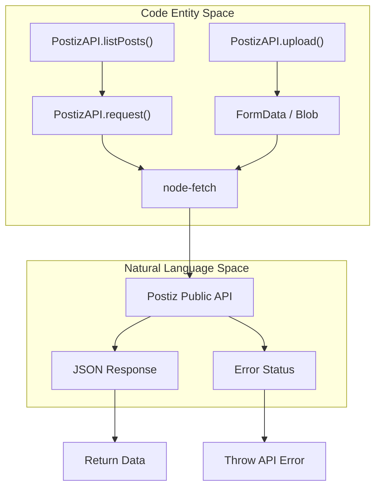
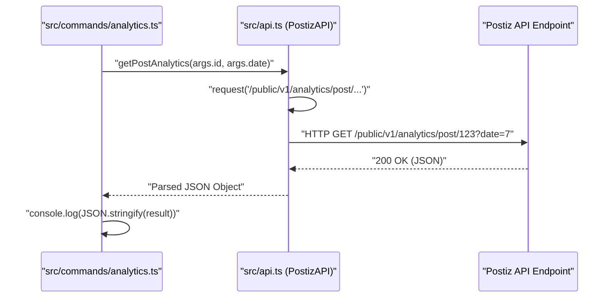

<!-- source: DeepWiki mcp.deepwiki.com · repo gitroomhq/postiz-agent · page 2.2 PostizAPI Client · fetched 2026-10-27 -->

# PostizAPI Client

Relevant source files

The following files were used as context for generating this wiki page:

- [src/api.ts](src/api.ts)
- [src/commands/analytics.ts](src/commands/analytics.ts)

The `PostizAPI` class is the central communication layer of the Postiz agent, responsible for interfacing with the Postiz Public API. It encapsulates the request lifecycle, authentication, and specialized handling for binary media uploads.

## PostizAPI Architecture

The client is implemented as a standalone class in `src/api.ts` and is instantiated by command handlers using configuration retrieved from the local environment or credentials file.

### Initialization and Configuration

The class constructor accepts a `PostizConfig` object containing the `apiKey` and an optional `apiUrl`. If no URL is provided, it defaults to the production Postiz API endpoint.

| Field | Type | Description |
| :--- | :--- | :--- |
| `apiKey` | `string` | The Authorization token passed in every request. |
| `apiUrl` | `string` | The base URL for the API (Defaults to `https://api.postiz.com`). |

**Request Lifecycle Diagram**
This diagram illustrates how a call to a high-level method (e.g., `listPosts`) flows through the internal `request` method to the network.

Sources: [src/api.ts:8-15](), [src/api.ts:17-40](), [src/api.ts:49-66]()

---

## Core Request Lifecycle

The private `request` method handles the boilerplate for every HTTP call, ensuring consistent headers and error reporting.

### Header Injection
Every request automatically includes:
- `Content-Type: application/json` (unless overridden) [src/api.ts:20]().
- `Authorization`: The API key provided during instantiation [src/api.ts:21]().

### Error Handling
The client differentiates between network failures and API-level errors:
1.  **Response Validation**: If `response.ok` is false, the client reads the response body as text and throws an error including the status code [src/api.ts:31-34]().
2.  **Network Catch**: Any fetch-level failures are caught and re-thrown with a "Request failed" prefix [src/api.ts:37-39]().

### Query String Serialization
For GET requests like `listPosts`, the client implements a manual serialization of filters into a `URLSearchParams` string. It filters out `null` or `undefined` values before appending the string to the endpoint [src/api.ts:50-61]().

Sources: [src/api.ts:17-40](), [src/api.ts:49-61]()

---

## Multipart Media Uploads

The `upload` method handles binary data transfer, which is required for social media attachments. Unlike standard JSON requests, this method uses `multipart/form-data`.

### MIME Type Detection
The client contains an internal mapping of file extensions to MIME types to ensure the API correctly identifies the media [src/api.ts:79-115](). It supports:
- **Images**: png, jpg, gif, webp, svg, etc.
- **Videos**: mp4, mov, avi, mkv, webm, etc.
- **Audio**: mp3, wav, ogg, etc.
- **Documents**: pdf, doc, docx.

If an extension is unknown, it defaults to `application/octet-stream` [src/api.ts:117]().

### Implementation Details
The file buffer is wrapped in a `Blob` with the detected MIME type and appended to a `FormData` object under the key `file` [src/api.ts:119-120](). This request bypasses the standard `request` method to handle the `FormData` body and specific header requirements [src/api.ts:122-130]().

Sources: [src/api.ts:74-138]()

---

## Method Mapping

The `PostizAPI` class maps internal logic to specific Public API endpoints.

| Method | HTTP Verb | Endpoint | Purpose |
| :--- | :--- | :--- | :--- |
| `createPost` | POST | `/public/v1/posts` | Submits a new post or thread. |
| `listPosts` | GET | `/public/v1/posts` | Retrieves posts with optional filters. |
| `deletePost` | DELETE | `/public/v1/posts/{id}` | Removes a post. |
| `upload` | POST | `/public/v1/upload` | Uploads media to Postiz storage. |
| `getAnalytics` | GET | `/public/v1/analytics/{id}` | Platform-level metrics. |
| `getPostAnalytics`| GET | `/public/v1/analytics/post/{id}` | Post-specific metrics. |
| `listIntegrations` | GET | `/public/v1/integrations` | Lists connected social accounts. |
| `triggerIntegrationTool` | POST | `/public/v1/integration-trigger/{id}` | Executes platform-specific RPC calls. |

**Data Flow: Analytics Command Example**
This diagram shows how a CLI command interacts with the `PostizAPI` class.

Sources: [src/commands/analytics.ts:26-46](), [src/api.ts:166-170]()

---

