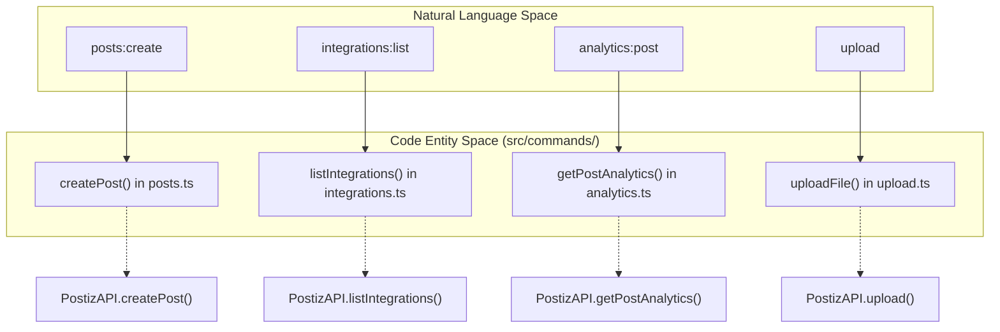
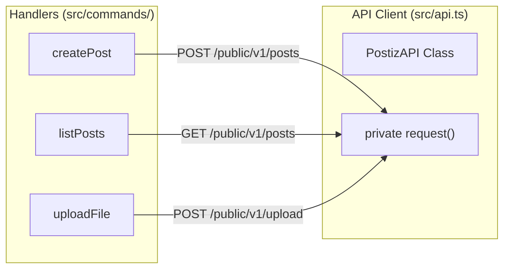

<!-- source: DeepWiki mcp.deepwiki.com · repo gitroomhq/postiz-agent · page 3 Command Reference · fetched 2026-10-27 -->

# Command Reference

Relevant source files

The following files were used as context for generating this wiki page:

- [src/api.ts](src/api.ts)
- [src/commands/analytics.ts](src/commands/analytics.ts)
- [src/commands/integrations.ts](src/commands/integrations.ts)
- [src/commands/posts.ts](src/commands/posts.ts)
- [src/commands/upload.ts](src/commands/upload.ts)
- [src/index.ts](src/index.ts)

The `postiz` CLI provides a structured set of command namespaces to manage social media workflows, ranging from content creation and media handling to discovery of platform-specific settings and performance analytics. This page serves as a high-level map of these namespaces and their primary roles within the ecosystem.

### Command Structure Overview

The CLI is built using `yargs` [src/index.ts:1-12](), dispatching user input to specialized handler functions. Commands are grouped into four primary functional areas:

| Namespace | Primary Functions | Target Entities |
| :--- | :--- | :--- |
| `posts:*` | Create, List, Delete, Status Change | Posts, Threads, Drafts |
| `integrations:*` | List, Settings Discovery, Tool Execution | Social Media Accounts |
| `analytics:*` | Platform & Post metrics | Reach, Engagement, Stats |
| `upload` | Media processing | Images, Videos, Documents |

### Command Dispatch Architecture

The following diagram illustrates how the `yargs` entrypoint maps natural language CLI commands to specific code entities in the `src/commands/` directory.

**CLI Command Mapping**

Sources: [src/index.ts:10-220](), [src/api.ts:42-194]()

---

### 3.1 Post Management Commands
The `posts` namespace handles the lifecycle of social media content. It supports simple one-off posts via CLI flags and complex multi-platform threads via JSON input [src/commands/posts.ts:56-135](). Key capabilities include:
* **Creation**: `posts:create` handles normalization of content, media pairings, and platform settings [src/commands/posts.ts:93-107]().
* **State Control**: `posts:status` allows moving posts between `draft` and `schedule` states, effectively starting or stopping backend workflows [src/index.ts:179-198]().
* **Synchronization**: `posts:missing` and `posts:connect` facilitate linking local post records with external platform release IDs [src/commands/posts.ts:5-47]().

For details, see [Post Management Commands](#3.1).

### 3.2 Integration Commands
The `integrations` namespace is the "Discovery" hub for AI agents and automation. It allows the CLI to query what platforms are connected and what specific requirements (schemas) those platforms have [src/commands/integrations.ts:19-37]().
* **Discovery**: `integrations:settings` returns the JSON schema for platform-specific fields (e.g., subreddits for Reddit, flairs, or X reply settings) [src/api.ts:178-182]().
* **RPC Tools**: `integrations:trigger` allows executing remote tools on the platform, such as fetching a list of YouTube playlists or LinkedIn companies [src/commands/integrations.ts:39-73]().

For details, see [Integration Commands](#3.2).

### 3.3 Analytics Commands
The `analytics` namespace provides access to performance data. It supports both broad platform-level views and granular per-post metrics [src/commands/analytics.ts:4-46]().
* **Time-Series Data**: Both `analytics:platform` and `analytics:post` accept a `date` lookback parameter (defaulting to 7 days) [src/commands/analytics.ts:13-35]().
* **Agent Feedback**: This namespace is critical for AI agents to close the loop by evaluating the success of previously published content [src/api.ts:160-170]().

For details, see [Analytics Commands](#3.3).

### 3.4 Media Upload Command
The `upload` command is a standalone utility to prepare local assets for social media posts. It handles the transition from local files to "Verified URLs" required by the Postiz API [src/commands/upload.ts:5-26]().
* **MIME Detection**: Automatically detects file types for images, videos, and documents based on extensions [src/api.ts:78-115]().
* **Multipart Construction**: Wraps the file in a `FormData` object for secure transmission to the `/public/v1/upload` endpoint [src/api.ts:120-130]().

For details, see [Media Upload Command](#3.4).

---

### Data Flow: Command to API
The following diagram bridges the command handlers to the underlying `PostizAPI` client methods.

**Internal Data Flow**

Sources: [src/api.ts:8-40](), [src/commands/posts.ts:139-142](), [src/commands/upload.ts:18-21]()

---

