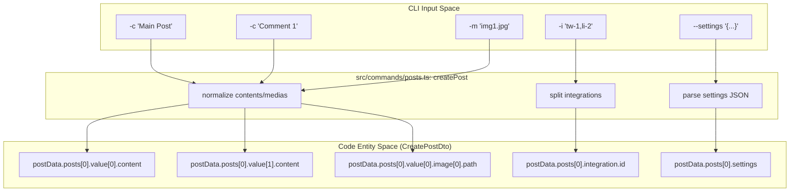
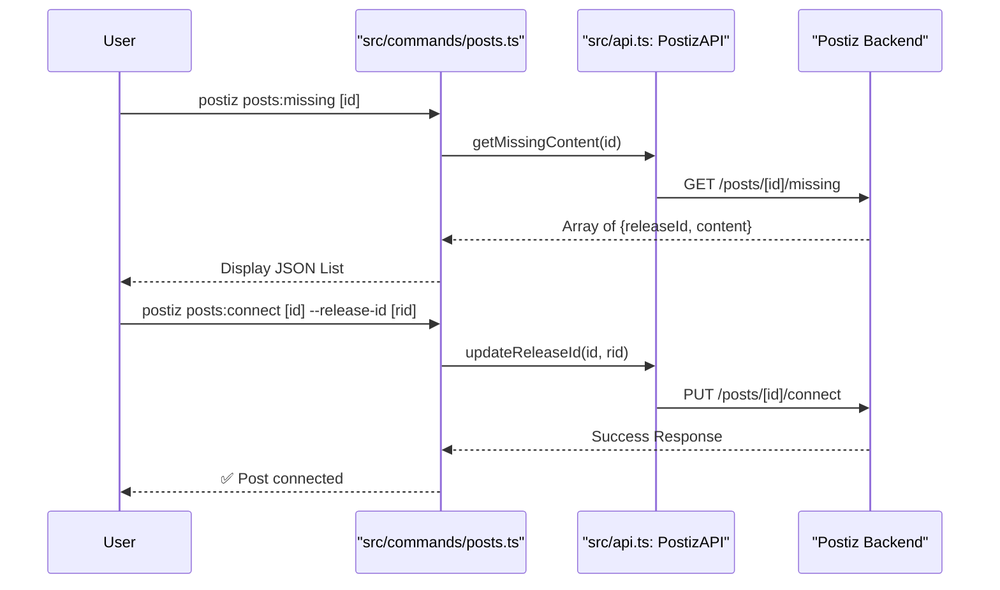

<!-- source: DeepWiki mcp.deepwiki.com · repo gitroomhq/postiz-agent · page 3.1 Post Management Commands · fetched 2026-10-27 -->

# Post Management Commands

Relevant source files

The following files were used as context for generating this wiki page:

- [examples/COMMAND_LINE_GUIDE.md](examples/COMMAND_LINE_GUIDE.md)
- [examples/EXAMPLES.md](examples/EXAMPLES.md)
- [src/commands/posts.ts](src/commands/posts.ts)
- [src/index.ts](src/index.ts)

This section provides a technical deep dive into the post management capabilities of the `postiz-agent`. It covers the lifecycle of a post from creation (via CLI flags or JSON) through listing, status transitions, and resolution of missing content.

## Post Creation Logic

The `posts:create` command in `src/index.ts` [src/index.ts:14-119]() supports two primary modes: **Flag Mode** for simple/scripted posts and **JSON Mode** for complex, multi-platform campaigns.

### Data Normalization Flow
When using flags, the `createPost` function in `src/commands/posts.ts` [src/commands/posts.ts:49-147]() performs a normalization process to transform flat CLI arguments into the nested `CreatePostDto` structure required by the Postiz API.

1.  **Integration Parsing**: Splits the comma-separated `-i` string into an array of IDs [src/commands/posts.ts:71-73]().
2.  **Content/Media Pairing**: Normalizes `-c` (content) and `-m` (media) into arrays. It then maps through `contents` to pair each piece of text with its corresponding media string [src/commands/posts.ts:84-107]().
3.  **Media Object Generation**: Media strings (comma-separated URLs) are split and assigned random IDs [src/commands/posts.ts:95-100]().
4.  **Settings Injection**: If `--settings` is provided as a JSON string, it is parsed and applied to every integration in the post [src/commands/posts.ts:113-122]().

### Diagram: CLI Flag to API DTO Mapping
This diagram illustrates how `createPost` maps natural language CLI flags into the structured entities used by the `PostizAPI` class.

**Sources:** [src/commands/posts.ts:49-147](), [src/index.ts:14-119]()

---

## Post Lifecycle and State Machine

Posts exist in two primary states within the CLI: `draft` and `schedule`. The `posts:status` command allows users to move posts between these states.

### Status Transitions
The `changePostStatus` function [src/commands/posts.ts:182-205]() calls `api.changePostStatus` [src/api.ts:85-88]() (hypothetical based on usage). Moving a post to `draft` effectively pauses any running background workflows or scheduled triggers in the Postiz backend [src/index.ts:195-197]().

| Command | Action | Implementation |
| :--- | :--- | :--- |
| `posts:list` | Fetches posts within a date range (default +/- 30 days) | `listPosts` [src/commands/posts.ts:149-180]() |
| `posts:status --status draft` | Moves post to draft state | `changePostStatus` [src/commands/posts.ts:182-205]() |
| `posts:status --status schedule` | Schedules post for the defined date | `changePostStatus` [src/commands/posts.ts:182-205]() |
| `posts:delete <id>` | Removes post from the system | `deletePost` [src/commands/posts.ts:207-223]() |

**Sources:** [src/commands/posts.ts:149-223](), [src/index.ts:121-161](), [src/index.ts:179-205]()

---

## Resolution of Missing Content

In scenarios where a post is created but lacks a "Release ID" (often due to manual intervention on the platform or synchronization errors), the CLI provides a workflow to re-connect the Postiz entity with the actual platform content.

### The Connect Workflow
1.  **`posts:missing <id>`**: Calls `api.getMissingContent(id)` [src/commands/posts.ts:15]() to fetch a list of content available on the provider's side that hasn't been linked yet.
2.  **`posts:connect <id> --release-id <rid>`**: Calls `api.updateReleaseId(id, releaseId)` [src/commands/posts.ts:39]() to manually bind the local post ID to the remote release ID.

### Diagram: Missing Content Resolution

**Sources:** [src/commands/posts.ts:5-47](), [src/index.ts:162-177](), [src/index.ts:206-224]()

---

## Complex Composition (JSON Mode)

For advanced users and AI agents, the `--json` flag [src/index.ts:51-55]() allows bypassing the pairing logic of the CLI and providing a raw `CreatePostDto`.

### JSON Structure Highlights
The JSON format supports features not easily accessible via flags, such as different content for different platforms within the same campaign [examples/EXAMPLES.md:86-98]().

-   **`posts` Array**: Allows defining an array of integration-specific objects [examples/EXAMPLES.md:15-28]().
-   **`value` Array**: A list of objects containing `content`, `image` (array of `{id, path}`), and `delay` (in minutes) [examples/EXAMPLES.md:131-142]().
-   **`settings`**: Platform-specific metadata (e.g., Subreddit names, YouTube titles) [src/index.ts:106-115]().

**Sources:** [examples/EXAMPLES.md:9-30](), [examples/EXAMPLES.md:110-146](), [src/commands/posts.ts:56-69]()

---

