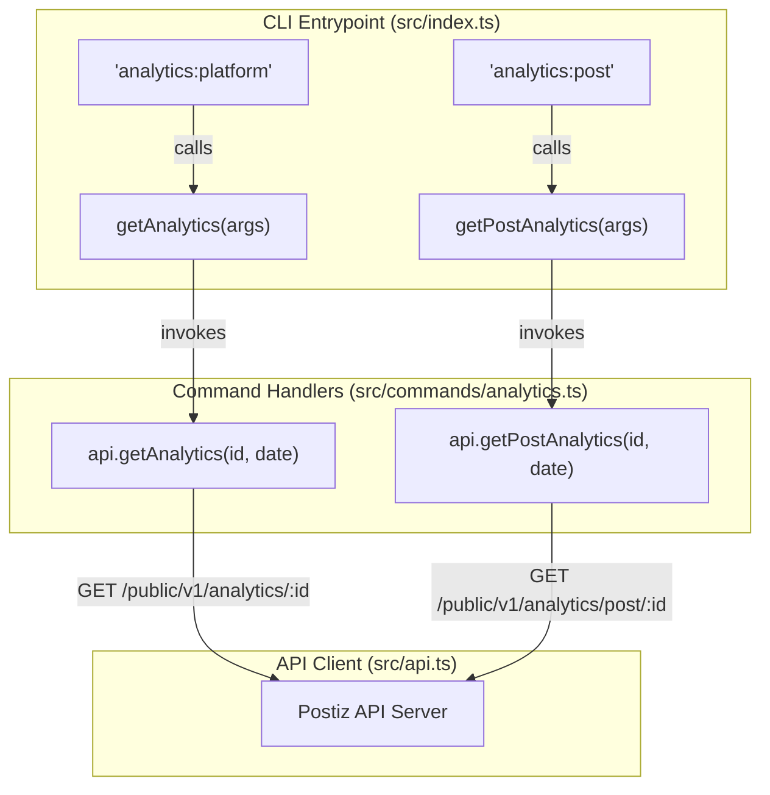
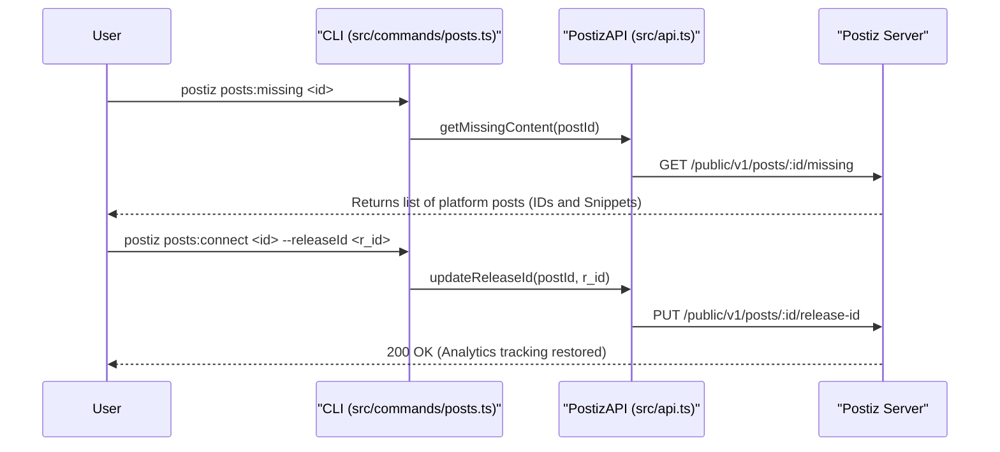

<!-- source: DeepWiki mcp.deepwiki.com · repo gitroomhq/postiz-agent · page 3.3 Analytics Commands · fetched 2026-10-27 -->

# Analytics Commands

Relevant source files

The following files were used as context for generating this wiki page:

- [src/api.ts](src/api.ts)
- [src/commands/analytics.ts](src/commands/analytics.ts)
- [src/index.ts](src/index.ts)

The Postiz CLI provides specialized commands for retrieving performance metrics at both the integration (platform-wide) and individual post levels. These commands interface with the `PostizAPI` to fetch time-series data and engagement metrics.

## Analytics Retrieval Flow

Analytics commands follow a standard pattern: they authenticate using local credentials via `getConfig`, instantiate the `PostizAPI` client, and execute a GET request with a lookback parameter.

### Command Structure and Implementation
The logic for these commands is encapsulated in `src/commands/analytics.ts` [src/commands/analytics.ts:1-47]().

| Command | Function | API Endpoint | Description |
| :--- | :--- | :--- | :--- |
| `analytics:platform` | `getAnalytics` | `/public/v1/analytics/:id` | Fetches aggregate metrics for a specific integration (e.g., X/Twitter account). |
| `analytics:post` | `getPostAnalytics` | `/public/v1/analytics/post/:id` | Fetches performance data for a specific post across its lifecycle. |

### The Date Lookback Parameter
Both commands accept a `--date` (or `-d`) parameter [src/index.ts:219-250]().
- **Default Value**: If omitted, the system defaults to `'7'` (representing the last 7 days) [src/commands/analytics.ts:13-13](), [src/commands/analytics.ts:35-35]().
- **Data Type**: The parameter is passed as a string to the API, which typically interprets it as a day-count or a specific ISO date string [src/api.ts:161-169]().

### Code Entity Mapping: Analytics Flow

The following diagram maps the CLI command definitions to their underlying handler functions and API client methods.

**Analytics Logic Mapping**

Sources: [src/index.ts:219-250](), [src/commands/analytics.ts:4-46](), [src/api.ts:160-170]()

---

## Handling Missing Content and Post Connection

A critical aspect of the analytics workflow is ensuring that the `Postiz` system can track posts that were successfully published but whose "Release ID" (the platform-specific ID, like a Tweet ID) was not captured during the initial automated flow.

### The `{ missing: true }` Response
When querying `analytics:post`, the API may return a response containing `{ "missing": true }`. This indicates that while the post record exists in Postiz, the system lacks the remote platform's ID to fetch the latest metrics.

### Resolution Workflow: posts:missing and posts:connect
To resolve missing IDs and restore analytics tracking, the CLI provides a two-step discovery and connection workflow.

1.  **Discovery**: Run `posts:missing <id>` [src/index.ts:163-177](). This calls `api.getMissingContent(postId)` [src/api.ts:140-144](), which queries the provider (e.g., LinkedIn, X) for recent content published by the user that has not yet been linked to a Postiz record.
2.  **Resolution**: Once the user identifies the correct remote content, they run `posts:connect <id> --releaseId <remote_id>` [src/index.ts:201-217](). This calls `api.updateReleaseId(postId, releaseId)` [src/api.ts:146-151](), performing a `PUT` request to update the record.

**Data Flow: Missing Content Resolution**

Sources: [src/index.ts:163-217](), [src/api.ts:140-151](), [src/commands/posts.ts:101-131]()

---

## Technical Reference

### PostizAPI Methods
The `PostizAPI` class implements the following methods to support analytics and connection workflows:

- **`getAnalytics(integrationId: string, date: string)`**: [src/api.ts:160-164]()
  - Endpoint: `/public/v1/analytics/${integrationId}`
  - Method: `GET`
- **`getPostAnalytics(postId: string, date: string)`**: [src/api.ts:166-170]()
  - Endpoint: `/public/v1/analytics/post/${postId}`
  - Method: `GET`
- **`getMissingContent(postId: string)`**: [src/api.ts:140-144]()
  - Endpoint: `/public/v1/posts/${postId}/missing`
  - Method: `GET`
- **`updateReleaseId(postId: string, releaseId: string)`**: [src/api.ts:146-151]()
  - Endpoint: `/public/v1/posts/${postId}/release-id`
  - Method: `PUT`

### Error Handling
Analytics commands use a standard `try-catch` block. If the API returns a non-200 status, the `PostizAPI.request` method throws an error including the status code and response body [src/api.ts:31-34](). The command handlers then catch this, log the error to `stderr`, and exit with code `1` [src/commands/analytics.ts:20-23](), [src/commands/analytics.ts:42-45]().

Sources: [src/api.ts:17-40](), [src/commands/analytics.ts:1-47]()

---

