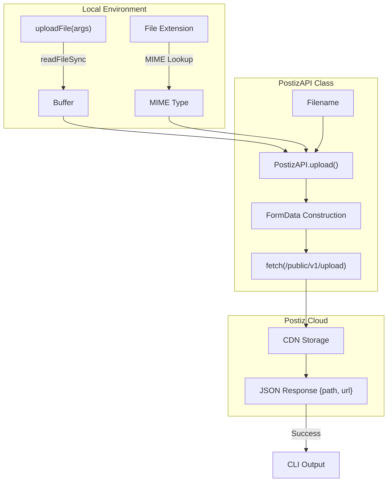
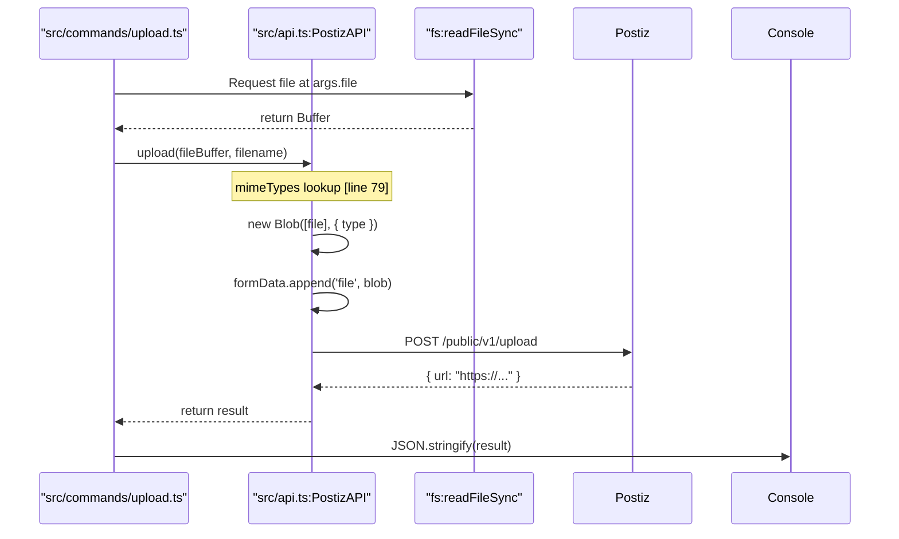

<!-- source: DeepWiki mcp.deepwiki.com · repo gitroomhq/postiz-agent · page 3.4 Media Upload Command · fetched 2026-10-27 -->

# Media Upload Command

<details>
<summary>Relevant source files</summary>

The following files were used as context for generating this wiki page:

- [SUPPORTED_FILE_TYPES.md](SUPPORTED_FILE_TYPES.md)
- [src/api.ts](src/api.ts)
- [src/commands/analytics.ts](src/commands/analytics.ts)
- [src/commands/upload.ts](src/commands/upload.ts)

</details>


The `upload` command is a critical utility within the Postiz CLI that enables users and AI agents to stage local media files to the Postiz CDN. This process is a prerequisite for creating posts on visual-heavy platforms like TikTok, Instagram, and YouTube, which require media to be hosted at a **Verified URL** before the post can be scheduled or published.

## Implementation Overview

The upload workflow involves reading a local file into a buffer, automatically determining the correct MIME type based on the file extension, and transmitting the data via a `multipart/form-data` request to the Postiz API.

### Media Upload Data Flow

The following diagram illustrates the transition from a local file path provided in the CLI to a hosted URL returned by the API.

**Diagram: Local File to Verified URL Flow**

Sources: [src/commands/upload.ts:5-21](), [src/api.ts:74-138]()

## Technical Implementation

### 1. Local File Handling
The command entry point `uploadFile` uses the Node.js `fs` module to read the file into memory [src/commands/upload.ts:15-15](). It extracts the filename from the provided path to preserve the original name during the upload process [src/commands/upload.ts:16-16]().

### 2. MIME Type Detection
To ensure compatibility with social media platform requirements (e.g., TikTok requiring `video/mp4`), the `PostizAPI` contains a comprehensive lookup table [src/api.ts:79-115](). It extracts the extension [src/api.ts:76-76]() and maps it to a standard MIME type. If the extension is unrecognized, it defaults to `application/octet-stream` [src/api.ts:117-117]().

| Category | Extensions | MIME Type Example |
| :--- | :--- | :--- |
| **Images** | .png, .jpg, .gif, .webp | `image/png` |
| **Videos** | .mp4, .mov, .webm, .mkv | `video/mp4` |
| **Audio** | .mp3, .wav, .aac, .m4a | `audio/mpeg` |
| **Documents** | .pdf, .doc, .docx | `application/pdf` |

Sources: [src/api.ts:79-117](), [SUPPORTED_FILE_TYPES.md:20-83]()

### 3. Multipart Construction
The `PostizAPI.upload` method utilizes the `node-fetch` `FormData` implementation to wrap the file buffer [src/api.ts:75-75](). A `Blob` is created from the buffer and assigned the detected MIME type [src/api.ts:119-119](), then appended to the form data under the key `file` [src/api.ts:120-120]().

### 4. API Interaction
The request is sent to `${this.apiUrl}/public/v1/upload` [src/api.ts:122-122](). Unlike standard API requests in the class, the `Content-Type` header is **not** set to `application/json`; instead, the `fetch` call automatically handles the `multipart/form-data` boundary [src/api.ts:123-130]().

Sources: [src/api.ts:119-130]()

## The Verified URL Concept

Platforms like TikTok, Instagram, and YouTube do not accept raw binary data during the post creation RPC. Instead, they require a publicly accessible URL.

1.  **Upload First**: The user executes `postiz upload my-video.mp4`.
2.  **Capture URL**: The API returns a JSON object containing the `path` or `url` [SUPPORTED_FILE_TYPES.md:113-120]().
3.  **Reference in Post**: This URL is then passed into the `-m` (media) flag of the `posts:create` command [SUPPORTED_FILE_TYPES.md:133-137]().

**Diagram: Command Entity Association**

Sources: [src/commands/upload.ts:15-20](), [src/api.ts:74-138]()

## Usage and Platform Limits

The CLI output provides the hosted URL which must be used for subsequent post creation.

```bash
# Example Upload
postiz upload ./promo.mp4
```

### Platform-Specific Constraints
While the CLI supports over 30 file types [SUPPORTED_FILE_TYPES.md:286-288](), individual platforms impose their own limits that the user must respect:

*   **Twitter/X**: Max 512MB for videos [SUPPORTED_FILE_TYPES.md:194-194]().
*   **Instagram**: Max 100MB for videos [SUPPORTED_FILE_TYPES.md:222-222]().
*   **TikTok**: Max 287.6MB for videos [SUPPORTED_FILE_TYPES.md:223-223]().
*   **YouTube**: Max 128GB for standard accounts [SUPPORTED_FILE_TYPES.md:224-224]().

Sources: [SUPPORTED_FILE_TYPES.md:217-225]()

---

