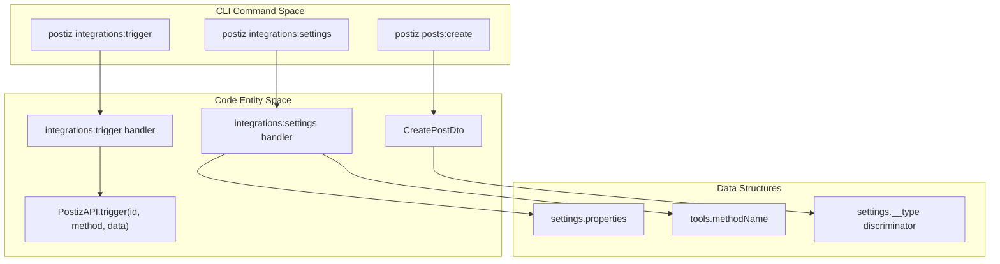
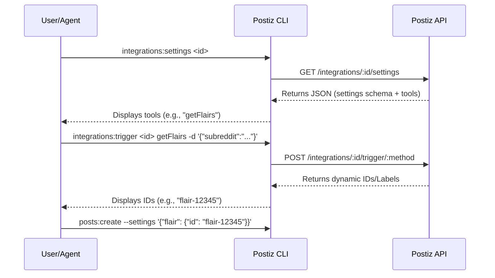

<!-- source: DeepWiki mcp.deepwiki.com · repo gitroomhq/postiz-agent · page 4 Platform Integration Guide · fetched 2026-10-27 -->

# Platform Integration Guide

Relevant source files

The following files were used as context for generating this wiki page:

- [INTEGRATION_TOOLS_WORKFLOW.md](INTEGRATION_TOOLS_WORKFLOW.md)
- [PROVIDER_SETTINGS.md](PROVIDER_SETTINGS.md)
- [PROVIDER_SETTINGS_SUMMARY.md](PROVIDER_SETTINGS_SUMMARY.md)
- [SKILL.md](SKILL.md)

The Postiz CLI is designed to interface with 28+ social media and communication platforms. Because each platform has unique requirements—such as Reddit's subreddits, YouTube's playlists, or TikTok's privacy levels—the system uses a dynamic discovery and configuration pattern. This guide provides a high-level overview of how the CLI handles platform-specific schemas and the tools used to fetch the dynamic data required to populate them.

### Platform Integration Architecture

The integration layer bridges the gap between a generic post (content and media) and the specific requirements of a social network. This is achieved through two primary mechanisms: **Provider Settings** (static configuration schemas) and **Integration Tools** (dynamic data fetching).

#### System Mapping: Discovery to Code
The following diagram illustrates how the CLI's natural language commands map to specific code entities and data structures within the Postiz ecosystem.

"Discovery and Execution Flow"

Sources: [SKILL.md:65-71](), [INTEGRATION_TOOLS_WORKFLOW.md:15-24](), [PROVIDER_SETTINGS.md:23-48]()

---

### Provider Settings Schemas

Every platform supported by Postiz (e.g., X, LinkedIn, Reddit, YouTube) has a unique settings schema. When creating a post, these settings are passed via the `--settings` flag or within a JSON file.

Key concepts include:
*   **The `__type` Discriminator**: In JSON mode, this field identifies which platform schema to validate against (e.g., `"__type": "reddit"`) [PROVIDER_SETTINGS.md:34-36]().
*   **Required vs. Optional Fields**: Some platforms require specific metadata. For example, YouTube requires a `title` (2-100 characters) and a `type` (`public`, `private`, or `unlisted`) [PROVIDER_SETTINGS.md:83-88]().
*   **EmptySettings**: Platforms like Threads, Mastodon, and Bluesky do not require additional configuration and use the `EmptySettings` pattern [PROVIDER_SETTINGS.md:263-276]().

For detailed schemas and JSON examples for all 28+ providers, see **[Provider Settings Schemas](#4.1)**.

Sources: [PROVIDER_SETTINGS.md:1-60](), [PROVIDER_SETTINGS_SUMMARY.md:9-33]()

---

### Integration Tools Workflow

Many platform settings require IDs that cannot be guessed, such as a Reddit Flair ID, a YouTube Playlist ID, or a LinkedIn Company ID. The CLI provides a "Discovery Workflow" to fetch this data dynamically.

#### The Tool Discovery Loop
This diagram shows how an agent or user discovers what data is needed and uses tools to retrieve it before posting.

"Dynamic Data Fetching Workflow"

Sources: [INTEGRATION_TOOLS_WORKFLOW.md:5-37](), [SKILL.md:48-59]()

The workflow typically follows these steps:
1.  **Discover**: Call `integrations:settings` to see the available `tools` for an integration [INTEGRATION_TOOLS_WORKFLOW.md:15-24]().
2.  **Trigger**: Execute a specific tool (e.g., `getPlaylists`) using `integrations:trigger` to get the necessary IDs [INTEGRATION_TOOLS_WORKFLOW.md:26-32]().
3.  **Post**: Use the retrieved IDs in the `posts:create` command [INTEGRATION_TOOLS_WORKFLOW.md:34-36]().

For a full list of common tool methods (like `getCompanies` for LinkedIn or `getBoards` for Pinterest), see **[Integration Tools Workflow](#4.2)**.

Sources: [INTEGRATION_TOOLS_WORKFLOW.md:292-315](), [SKILL.md:117-129]()

---

