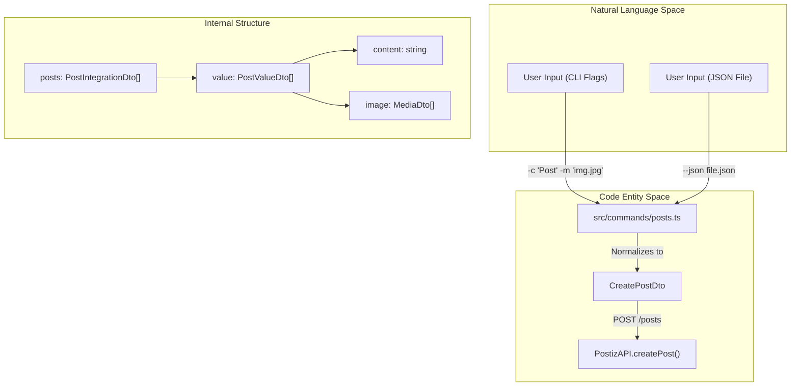
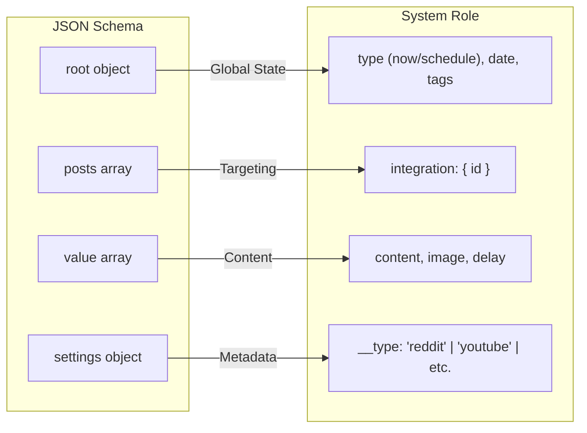

<!-- source: DeepWiki mcp.deepwiki.com · repo gitroomhq/postiz-agent · page 5 Post Composition and Examples · fetched 2026-10-27 -->

# Post Composition and Examples

<details>
<summary>Relevant source files</summary>

The following files were used as context for generating this wiki page:

- [SYNTAX_UPGRADE.md](SYNTAX_UPGRADE.md)
- [examples/COMMAND_LINE_GUIDE.md](examples/COMMAND_LINE_GUIDE.md)
- [examples/EXAMPLES.md](examples/EXAMPLES.md)
- [examples/basic-usage.sh](examples/basic-usage.sh)
- [examples/command-line-examples.sh](examples/command-line-examples.sh)
- [examples/multi-platform-post.json](examples/multi-platform-post.json)
- [examples/multi-platform-with-settings.json](examples/multi-platform-with-settings.json)
- [examples/post-with-comments.json](examples/post-with-comments.json)
- [examples/reddit-post.json](examples/reddit-post.json)
- [examples/thread-post.json](examples/thread-post.json)
- [examples/tiktok-video.json](examples/tiktok-video.json)
- [examples/youtube-video.json](examples/youtube-video.json)

</details>


The Postiz CLI provides two primary methods for composing and publishing social media content: a streamlined **CLI Flag Mode** for quick, multi-part posts and a comprehensive **JSON File Mode** for complex, multi-platform campaigns with granular settings. Both modes support advanced features like media attachments for every part of a thread and scheduled delivery.

### Overview of Composition Methods

The CLI is designed to bridge the gap between simple manual posting and programmatic automation. While CLI flags are ideal for rapid execution and AI agent scripts, the JSON mode allows for platform-specific overrides and reusable templates.

| Feature | CLI Flag Mode (`-c`, `-m`) | JSON File Mode (`--json`) |
| :--- | :--- | :--- |
| **Complexity** | Low to Medium | High |
| **Multi-Platform** | Same content for all platforms | Different content per platform |
| **Media Support** | Multiple images per part | Full `MediaDto` support |
| **Platform Settings** | Uses defaults | Granular (e.g., Subreddits, YouTube visibility) |
| **Use Case** | Quick threads, scripted updates | Product launches, video uploads |

**Sources:** [SYNTAX_UPGRADE.md:183-196](), [examples/COMMAND_LINE_GUIDE.md:233-246]()

---

### Composition Logic Flow

The following diagram illustrates how user input is transformed from high-level CLI arguments or JSON files into the internal `CreatePostDto` structure required by the Postiz API.

**Data Normalization Workflow**



**Sources:** [examples/EXAMPLES.md:9-30](), [examples/EXAMPLES.md:110-147]()

---

### CLI Flag Mode

CLI Flag Mode uses a pairing logic to handle multi-part posts (threads). Every `-c` (content) flag represents a new part of the post (the main post followed by comments), and every `-m` (media) flag provides the attachments for the corresponding content flag in the order they appear.

For a deep dive into flag pairing, delay settings, and special character handling, see [CLI Flag Mode](#5.1).

#### Quick Example: Twitter Thread
```bash
postiz posts:create \
  -c "🧵 Thread: Part 1" -m "intro.jpg" \
  -c "Step 2: Details" -m "step2.jpg" \
  -d 2000 \
  -i "twitter-123"
```
**Sources:** [SYNTAX_UPGRADE.md:53-70](), [examples/COMMAND_LINE_GUIDE.md:76-95]()

---

### JSON File Mode

JSON File Mode provides access to the full `CreatePostDto` structure. This is required for campaigns where you want to post different text or media to different platforms simultaneously, or when you need to provide platform-specific settings like a Subreddit name or a YouTube video title.

For detailed schema explanations and annotated examples for platforms like TikTok and Reddit, see [JSON File Mode](#5.2).

#### Data Entity Mapping



**Sources:** [examples/EXAMPLES.md:110-147](), [examples/multi-platform-with-settings.json:1-95]()

---

### Advanced Examples

The codebase includes several templates for common social media workflows:

*   **Multi-Platform Campaign:** Scheduling a holiday post across Twitter, LinkedIn, and Facebook with unique assets for each. [examples/multi-platform-post.json:1-89]()
*   **Video Uploads:** Specialized settings for YouTube (visibility, kids-safe) and TikTok (privacy, duet/stitch permissions). [examples/youtube-video.json:1-35](), [examples/tiktok-video.json:1-32]()
*   **Reddit Automation:** Posting to specific subreddits with required titles and flair logic. [examples/reddit-post.json:1-27]()
*   **Product Launch:** A complex LinkedIn post configured as an image carousel. [examples/multi-platform-with-settings.json:64-79]()

**Sources:** [examples/EXAMPLES.md:149-228]()

---

