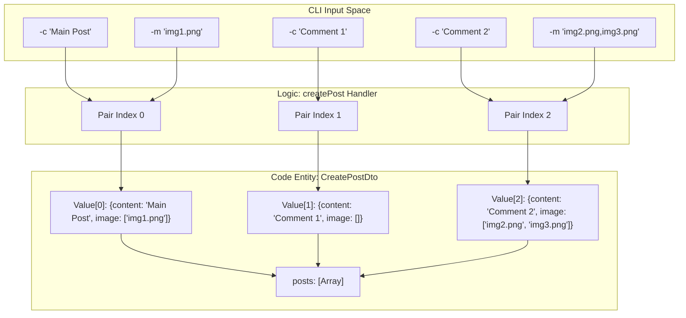
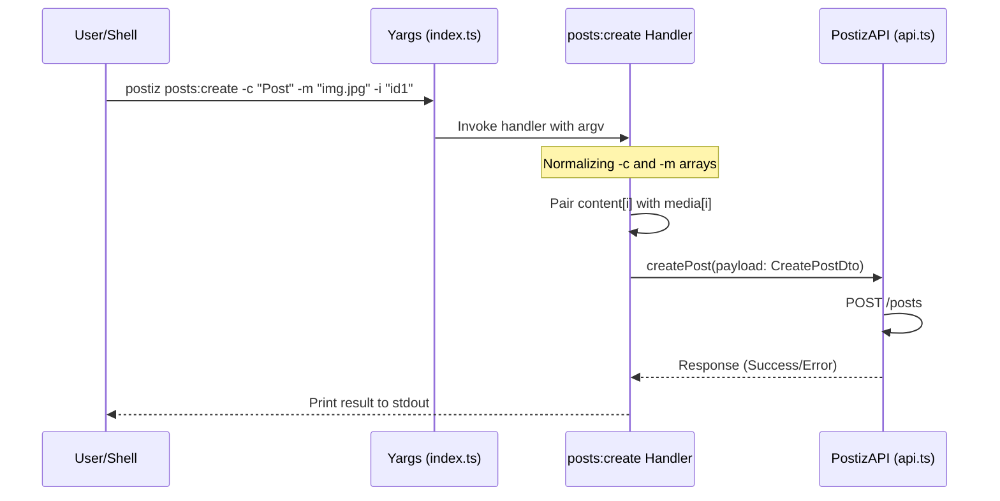

<!-- source: DeepWiki mcp.deepwiki.com · repo gitroomhq/postiz-agent · page 5.1 CLI Flag Mode · fetched 2026-10-27 -->

# CLI Flag Mode

<details>
<summary>Relevant source files</summary>

The following files were used as context for generating this wiki page:

- [SYNTAX_UPGRADE.md](SYNTAX_UPGRADE.md)
- [examples/COMMAND_LINE_GUIDE.md](examples/COMMAND_LINE_GUIDE.md)
- [examples/basic-usage.sh](examples/basic-usage.sh)
- [examples/command-line-examples.sh](examples/command-line-examples.sh)

</details>


The Postiz CLI provides a powerful "Flag Mode" for rapid post creation directly from the terminal. This mode is designed for speed, scripting, and AI agent integration, allowing users to define complex post threads with associated media using standard CLI flags like `-c` and `-m`.

## Flag Definitions and Schema

The `posts:create` command uses `yargs` to parse several key flags. When not using the `--json` (or `-j`) flag, the CLI requires at least one content flag and one or more integration IDs.

| Flag | Alias | Type | Multiple? | Description |
| :--- | :--- | :--- | :--- | :--- |
| `--content` | `-c` | String | ✅ Yes | The text content for the post or comment. |
| `--media` | `-m` | String | ✅ Yes | Comma-separated URLs/paths for media associated with the content. |
| `--integrations` | `-i` | String | ❌ No | Comma-separated list of Integration IDs to target. |
| `--schedule` | `-s` | String | ❌ No | ISO 8601 date string for scheduling the post. |
| `--delay` | `-d` | Number | ❌ No | Delay between comments (in minutes, default: 0). |
| `--shortLink` | - | Boolean | ❌ No | Whether to use the URL shortener (default: true). |

Sources: [SYNTAX_UPGRADE.md:158-166](), [examples/COMMAND_LINE_GUIDE.md:158-166]()

## Pairing Logic and Threading

The core of Flag Mode is the **Pairing Logic**. The CLI processes multiple instances of `-c` and `-m` by their index in the command execution [SYNTAX_UPGRADE.md:55-70]().

1.  **Main Post**: The first `-c` flag encountered is designated as the "Main Post" [SYNTAX_UPGRADE.md:67-67]().
2.  **Comments**: Every subsequent `-c` flag is treated as a threaded comment or reply [SYNTAX_UPGRADE.md:68-69]().
3.  **Media Association**: The $N^{th}$ `-m` flag is paired with the $N^{th}$ `-c` flag [examples/COMMAND_LINE_GUIDE.md:178-182]().
4.  **Optionality**: If a `-c` flag does not have a corresponding `-m` flag at the same index, that post/comment is treated as text-only [SYNTAX_UPGRADE.md:72-80]().

### Threading Logic Flow
The following diagram illustrates how the CLI parser transforms flat flags into the structured `CreatePostDto` used by the API.

**Diagram: Flag to Thread Transformation**

Sources: [SYNTAX_UPGRADE.md:53-70](), [examples/COMMAND_LINE_GUIDE.md:168-182]()

## Multi-Platform Targeting

The `-i` (or `--integrations`) flag accepts a comma-separated string of integration identifiers (e.g., `twitter-123,linkedin-456`). When multiple IDs are provided, the CLI creates a single campaign that targets all specified platforms simultaneously with the same content and comment structure [examples/COMMAND_LINE_GUIDE.md:112-122]().

If you require different content for different platforms (e.g., different hashtags for Instagram vs LinkedIn), you must use **JSON File Mode** instead of Flag Mode [SYNTAX_UPGRADE.md:191-196]().

## Comparison with Legacy Syntax

The current flag implementation replaces a legacy semicolon-separated syntax that was found to be brittle and limited.

| Feature | Old Syntax (`--comments`) | New Syntax (Multiple `-c`) |
| :--- | :--- | :--- |
| **Semicolons** | ❌ Broke parsing (used as delimiter) | ✅ Supported natively in strings |
| **Media** | ❌ Main post only | ✅ Per-comment media support |
| **Readability** | ❌ Low (long escaped strings) | ✅ High (standard CLI patterns) |
| **Flexibility** | ❌ Fixed structure | ✅ Dynamic thread length |

Sources: [SYNTAX_UPGRADE.md:19-51](), [examples/COMMAND_LINE_GUIDE.md:199-232]()

## Technical Implementation and Data Flow

When `postiz posts:create` is executed in flag mode, the following internal sequence occurs:

1.  **Validation**: The CLI checks if `-i` is present. If missing and `--json` is also absent, it throws an error [examples/COMMAND_LINE_GUIDE.md:283-285]().
2.  **Normalization**: The handler iterates through the `content` array (from multiple `-c` flags).
3.  **Media Splitting**: For each `-m` flag, the string is split by commas to form an array of media strings [SYNTAX_UPGRADE.md:87-98]().
4.  **Delay Calculation**: The `-d` value (in minutes) is applied as a cumulative delay for each subsequent comment in the thread [SYNTAX_UPGRADE.md:168-181]().
5.  **API Dispatch**: The resulting `CreatePostDto` is sent to the `PostizAPI` client.

**Diagram: CLI Command Lifecycle**

Sources: [SYNTAX_UPGRADE.md:53-70](), [examples/command-line-examples.sh:142-148]()

## Usage Examples

### Product Launch Thread
A common use case is a thread with a 10-minute delay between follow-up comments to maximize engagement.
```bash
postiz posts:create \
  -c "🚀 Launching ProductX today!" -m "hero.jpg" \
  -c "💰 Special offer: 50% off!" -m "discount.jpg" \
  -d 10 \
  -i "twitter-123,linkedin-456"
```
Sources: [SYNTAX_UPGRADE.md:102-113](), [examples/COMMAND_LINE_GUIDE.md:184-197]()

### Handling Special Characters
Because each `-c` is a distinct shell argument, you can use semicolons and quotes without complex escaping (provided you wrap the content in quotes).
```bash
postiz posts:create \
  -c "Programming Tip" \
  -c "Use const; avoid var; stay safe!" \
  -i "twitter-123"
```
Sources: [SYNTAX_UPGRADE.md:143-154](), [examples/COMMAND_LINE_GUIDE.md:64-74]()

---

