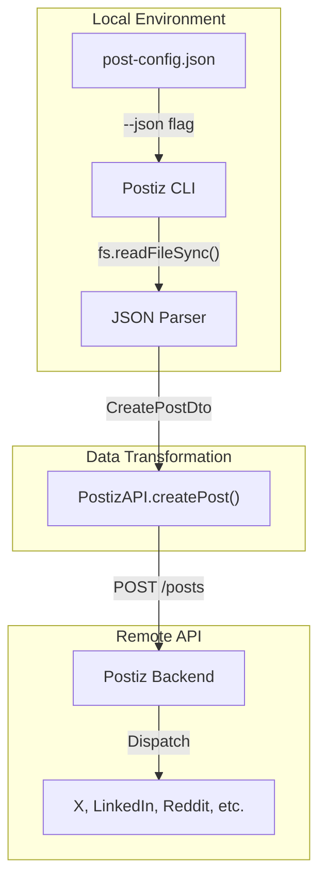
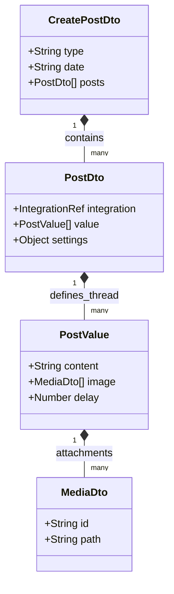

<!-- source: DeepWiki mcp.deepwiki.com · repo gitroomhq/postiz-agent · page 5.2 JSON File Mode · fetched 2026-10-27 -->

# JSON File Mode

<details>
<summary>Relevant source files</summary>

The following files were used as context for generating this wiki page:

- [examples/EXAMPLES.md](examples/EXAMPLES.md)
- [examples/multi-platform-post.json](examples/multi-platform-post.json)
- [examples/multi-platform-with-settings.json](examples/multi-platform-with-settings.json)
- [examples/post-with-comments.json](examples/post-with-comments.json)
- [examples/reddit-post.json](examples/reddit-post.json)
- [examples/thread-post.json](examples/thread-post.json)
- [examples/tiktok-video.json](examples/tiktok-video.json)
- [examples/youtube-video.json](examples/youtube-video.json)

</details>


The JSON File Mode is the most powerful method for creating posts in the Postiz ecosystem. While standard CLI flags are suitable for simple updates, the `--json` flag allows developers and AI agents to define complex, multi-platform campaigns, threaded content, and platform-specific settings (like subreddits or YouTube visibility) within a single structured file [examples/EXAMPLES.md:71-72]().

### Data Flow: JSON to API

When the `--json` flag is used with `posts:create`, the CLI reads the local file, parses the content into a `CreatePostDto` structure, and transmits it to the Postiz backend.

**Post Creation Logic Flow**



Sources: [examples/EXAMPLES.md:77-79](), [examples/EXAMPLES.md:110-112]()

---

### The CreatePostDto Structure

The root object of a JSON post file follows a specific schema that defines the global behavior of the campaign [examples/EXAMPLES.md:9-30]().

| Field | Type | Description |
| :--- | :--- | :--- |
| `type` | `string` | Post state: `now`, `schedule`, `draft`, or `update` [examples/EXAMPLES.md:116](). |
| `date` | `string` | ISO 8601 timestamp for scheduling [examples/EXAMPLES.md:117](). |
| `shortLink` | `boolean` | Whether to use the internal URL shortener [examples/EXAMPLES.md:118](). |
| `tags` | `Array` | Internal categorization tags [examples/EXAMPLES.md:119](). |
| `posts` | `Array` | Collection of platform-specific post objects [examples/EXAMPLES.md:120](). |

#### The Post Object
Each entry in the `posts` array represents a single integration target [examples/EXAMPLES.md:124-147]().

*   **`integration`**: Contains the `id` of the connected social account [examples/EXAMPLES.md:129]().
*   **`value`**: An array of content objects. For platforms like X (Twitter), this array represents a thread [examples/EXAMPLES.md:131]().
*   **`settings`**: Platform-specific configuration (e.g., `subreddit` for Reddit, `privacy_level` for TikTok) [examples/EXAMPLES.md:143-145]().

Sources: [examples/EXAMPLES.md:9-30](), [examples/EXAMPLES.md:114-147]()

---

### Threading and Media Arrays

The `value` array within a post object allows for granular control over threads and comments. Each element in the array contains its own content, media, and timing delay [examples/EXAMPLES.md:18-23]().

**Entity Association Diagram**



**Key Fields in PostValue:**
*   **`content`**: The text body of the post or comment [examples/EXAMPLES.md:20]().
*   **`image`**: An array of `MediaDto` objects. Each requires a unique `id` (for tracking) and a `path` (public URL or local path) [examples/EXAMPLES.md:134-139]().
*   **`delay`**: The time in milliseconds to wait after the previous item in the `value` array is posted. Essential for natural-looking threads [examples/EXAMPLES.md:22]().

Sources: [examples/EXAMPLES.md:18-23](), [examples/EXAMPLES.md:131-142]()

---

### Annotated Examples

#### 1. Multi-Platform Campaign
This example targets Twitter, LinkedIn, and Facebook simultaneously with different content for each [examples/multi-platform-post.json:1-89]().

```json
{
  "type": "schedule",
  "date": "2024-12-25T12:00:00Z",
  "posts": [
    {
      "integration": { "id": "twitter-id" },
      "value": [{ "content": "Happy Holidays! 🎄", "image": [{"id": "h1", "path": "..."}] }],
      "settings": { "__type": "EmptySettings" }
    },
    {
      "integration": { "id": "linkedin-id" },
      "value": [{ "content": "Season's greetings from the team!", "image": [] }],
      "settings": { "__type": "EmptySettings" }
    }
  ]
}
```
Sources: [examples/multi-platform-post.json:1-89]()

#### 2. Platform-Specific Settings (Reddit)
For platforms requiring extra metadata, the `settings` block uses a `__type` discriminator [examples/reddit-post.json:14-25]().

```json
{
  "integration": { "id": "reddit-id" },
  "value": [{ "content": "Check out this CLI tool!", "image": [] }],
  "settings": {
    "__type": "reddit",
    "subreddit": [{
      "value": {
        "subreddit": "programming",
        "title": "Built a CLI tool with TypeScript",
        "type": "text"
      }
    }]
  }
}
```
Sources: [examples/reddit-post.json:1-27](), [examples/multi-platform-with-settings.json:17-29]()

#### 3. High-Fidelity Twitter Thread
A 5-part thread with 2-second delays between tweets to ensure correct ordering [examples/thread-post.json:11-61]().

```json
{
  "integration": { "id": "twitter-id" },
  "value": [
    { "content": "Thread Start (1/5)", "image": [...], "delay": 0 },
    { "content": "Step 1 (2/5)", "image": [...], "delay": 2000 },
    { "content": "Step 2 (3/5)", "image": [...], "delay": 2000 }
  ]
}
```
Sources: [examples/thread-post.json:1-67](), [examples/EXAMPLES.md:100-108]()

---

### Implementation Details for AI Agents

For AI agents using the CLI as a tool, JSON mode is the recommended interface for the following reasons:
1.  **Complexity**: It is the only way to attach media to specific comments in a thread [examples/EXAMPLES.md:250-251]().
2.  **Safety**: Using `"type": "draft"` allows the agent to verify the post structure in the Postiz UI before final publication [examples/EXAMPLES.md:254-255]().
3.  **Idempotency**: Agents can generate unique `MediaDto` IDs to prevent duplicate uploads [examples/EXAMPLES.md:252-253]().

Sources: [examples/EXAMPLES.md:248-255]()

---

