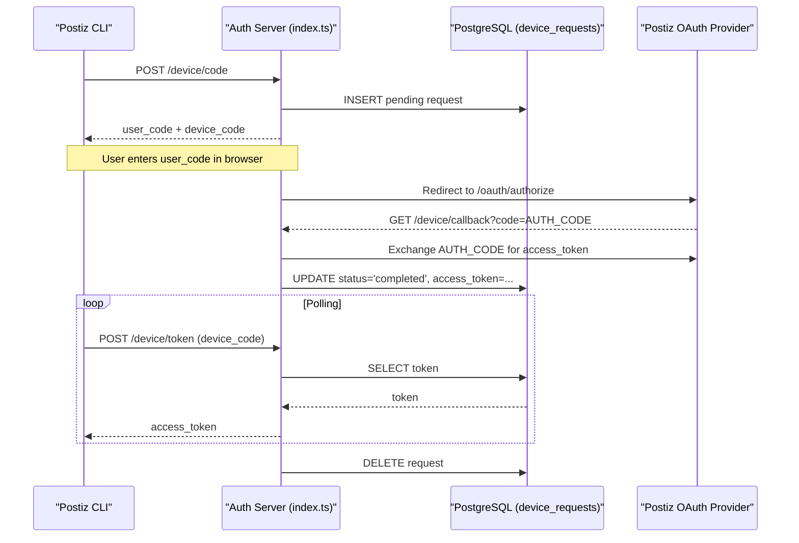

<!-- source: DeepWiki mcp.deepwiki.com · repo gitroomhq/postiz-agent · page 6 OAuth2 Auth Server · fetched 2026-10-27 -->

# OAuth2 Auth Server

Relevant source files

The following files were used as context for generating this wiki page:

- [server/SERVER.md](server/SERVER.md)
- [server/index.ts](server/index.ts)
- [server/package.json](server/package.json)
- [server/pnpm-lock.yaml](server/pnpm-lock.yaml)
- [server/tsconfig.json](server/tsconfig.json)

The **OAuth2 Auth Server** is a standalone Node.js component designed to facilitate the **OAuth2 Device Authorization Grant (RFC 8628)** for the Postiz CLI. Its primary purpose is to allow CLI users to authenticate securely without requiring the distribution of sensitive OAuth client secrets within the CLI binary itself.

The server acts as a trusted mediator between the CLI, the user's browser, and the Postiz OAuth provider. It manages short-lived verification codes, handles the OAuth2 redirect lifecycle, and stores temporary access tokens in a PostgreSQL database until the CLI retrieves them.

### System Overview

The auth server is a stateless HTTP service (with a database dependency) that exposes a set of endpoints for both the CLI and the web browser.

**Auth Server Interaction Flow**

| Component | Role |
| :--- | :--- |
| **CLI** | Initiates the flow by requesting a `device_code` and polls for the final token. |
| **Auth Server** | Generates codes, hosts the verification UI, and exchanges the OAuth code for a token. |
| **Postiz API/Web** | Authenticates the user and authorizes the request via standard OAuth2 redirects. |
| **PostgreSQL** | Stores the state of active authorization requests in the `device_requests` table. |

**Sequence Diagram**

**Sources:** [server/SERVER.md:5-23](), [server/index.ts:105-122](), [server/index.ts:176-180]()

---

### Core Components

#### 1. Device Flow Architecture
The server implements a 6-step sequence to bridge the CLI to the Postiz OAuth provider. It generates a human-readable `user_code` (e.g., `ABCD-1234`) via the `generateUserCode` function and a high-entropy `device_code` for machine identification. The lifecycle of a request is managed through the `device_requests` table, which tracks the status from `pending` to `completed`.

For details on the protocol steps and database schema, see [Device Flow Architecture](#6.1).

**Sources:** [server/index.ts:64-72](), [server/index.ts:34-44](), [server/index.ts:106-122]()

#### 2. Auth Server Deployment
The server is built with TypeScript and runs on Node.js (>=18). It requires a PostgreSQL instance to maintain state. Configuration is handled entirely through environment variables, including the `POSTIZ_OAUTH_CLIENT_ID` and `POSTIZ_OAUTH_CLIENT_SECRET` obtained from the Postiz Developer settings. It can be deployed to any platform supporting Node.js, such as Railway, Fly.io, or standard VPS environments.

For details on environment variables and setup scripts, see [Auth Server Deployment](#6.2).

**Sources:** [server/package.json:12-21](), [server/SERVER.md:30-41](), [server/index.ts:8-15]()

---

### Endpoint Summary

The server exposes the following routes to handle the authorization lifecycle:

| Method | Path | Entity/Function | Description |
| :--- | :--- | :--- | :--- |
| `POST` | `/device/code` | `handleDeviceCode` | Generates codes and initializes the DB record. |
| `GET` | `/device/verify` | `handleVerifyPage` | Renders the HTML form for the user to enter their code. |
| `POST` | `/device/verify` | `handleVerifySubmit` | Validates the code and redirects the user to Postiz. |
| `GET` | `/device/callback` | `handleOAuthCallback` | Receives the OAuth code from Postiz and fetches the token. |
| `POST` | `/device/token` | `handleDeviceToken` | Allows the CLI to poll for the completed access token. |
| `GET` | `/health` | `(inline)` | Basic health check returning status 200. |

**Sources:** [server/SERVER.md:80-88](), [server/index.ts:106-210]()

---

