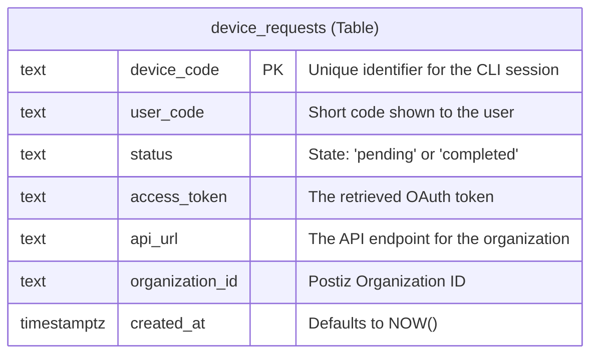

<!-- source: DeepWiki mcp.deepwiki.com · repo gitroomhq/postiz-agent · page 6.2 Auth Server Deployment · fetched 2026-10-27 -->

# Auth Server Deployment

<details>
<summary>Relevant source files</summary>

The following files were used as context for generating this wiki page:

- [server/SERVER.md](server/SERVER.md)
- [server/package.json](server/package.json)
- [server/pnpm-lock.yaml](server/pnpm-lock.yaml)
- [server/tsconfig.json](server/tsconfig.json)

</details>


The Postiz CLI Auth Server is a standalone Node.js service designed to implement the OAuth2 Device Authorization Grant (RFC 8628). It serves as a secure mediator between the Postiz CLI and the Postiz OAuth provider, ensuring that sensitive client secrets are never exposed on the user's local machine.

## Environment Variables

The server's behavior is governed by several environment variables. These must be configured prior to deployment to ensure successful communication with the Postiz API and the underlying database.

| Variable | Required | Default | Description |
| :--- | :--- | :--- | :--- |
| `DATABASE_URL` | Yes | - | PostgreSQL connection string. |
| `POSTIZ_OAUTH_CLIENT_ID` | Yes | - | The Client ID obtained from Postiz Developer Settings. |
| `POSTIZ_OAUTH_CLIENT_SECRET` | Yes | - | The Client Secret obtained from Postiz Developer Settings. |
| `SERVER_URL` | No | `http://localhost:{PORT}` | The public-facing URL of this server, used to generate `verification_uri`. |
| `POSTIZ_API_URL` | No | `https://api.postiz.com` | The base URL for the Postiz API used during token exchange. |
| `POSTIZ_FRONTEND_URL` | No | `https://platform.postiz.com` | The Postiz frontend URL for OAuth redirects. |
| `PORT` | No | `3111` | The port on which the HTTP server listens. |

**Sources:** [server/SERVER.md:30-40](), [server/package.json:12-21]()

---

## Infrastructure and Dependencies

The Auth Server is a lightweight TypeScript application with a minimal dependency stack focused on database connectivity and HTTP communication.

### PostgreSQL Dependency
The server requires a PostgreSQL instance. On startup, it automatically ensures the existence of the `device_requests` table.

**Entity Mapping: Database Schema**

**Sources:** [server/SERVER.md:92-104](), [server/pnpm-lock.yaml:14-16]()

### Node.js Stack
*   **Runtime**: Node.js >= 18.
*   **Database Driver**: `pg` (node-postgres).
*   **HTTP Client**: `node-fetch` (used for server-to-server token exchange with Postiz).
*   **Execution**: `tsx` for development/direct execution and `tsc` for production builds.

**Sources:** [server/package.json:12-21](), [server/pnpm-lock.yaml:10-30]()

---

## HTTP Endpoints

The server exposes a set of REST endpoints to facilitate the 6-step Device Flow sequence.

| Method | Path | Entity/Function Role |
| :--- | :--- | :--- |
| `POST` | `/device/code` | **Initiator**: Generates `device_code` and `user_code`; creates a record in `device_requests`. |
| `GET` | `/device/verify` | **UI**: Serves the browser page where users enter the `user_code`. |
| `POST` | `/device/verify` | **Validator**: Validates the code and initiates the redirect to Postiz OAuth. |
| `GET` | `/device/callback` | **Collector**: Receives the `code` from Postiz, exchanges it for an `access_token`, and updates the DB. |
| `POST` | `/device/token` | **Poller**: CLI polls this to check if `status` is `completed`. Returns the token once available. |
| `GET` | `/health` | **Monitor**: Simple health check returning `{"status": "ok"}`. |

**Sources:** [server/SERVER.md:79-88]()

---

## Deployment and Lifecycle Scripts

The server supports two primary modes of operation: a development mode with hot-reloading and a compiled production mode.

### Build and Run Workflow
The project uses `typescript` for compilation and `tsx` for modern ESM execution.

```mermaid
graph TD
    subgraph "Development Space"
        "index.ts" -- "tsx watch" --> "Runtime Process"
    end

    subgraph "Production Space"
        "index.ts" -- "tsc (Compiler)" --> "dist/index.js"
        "dist/index.js" -- "node" --> "Production Process"
    end

    "Production Process" --> "PostgreSQL (DATABASE_URL)"
    "Production Process" --> "Postiz API (POSTIZ_API_URL)"
```

### Script Reference
| Command | Script | Purpose |
| :--- | :--- | :--- |
| `pnpm dev` | `tsx watch index.ts` | Runs the server with automatic restarts on file changes. |
| `pnpm start` | `tsx index.ts` | Runs the TypeScript source directly using `tsx`. |
| `pnpm build` | `tsc` | Compiles the project into the `dist/` directory using `tsconfig.json` settings. |
| `pnpm start:prod` | `node dist/index.js` | Executes the compiled JavaScript in a production-ready environment. |

**Sources:** [server/package.json:6-11](), [server/tsconfig.json:1-12]()

### Cleanup Logic
To maintain a stateless feel and manage database size, rows in `device_requests` are deleted:
1.  Immediately after the CLI successfully retrieves the token via `/device/token`.
2.  On next access if the record is older than 15 minutes (expiry).

**Sources:** [server/SERVER.md:106-107]()

---

