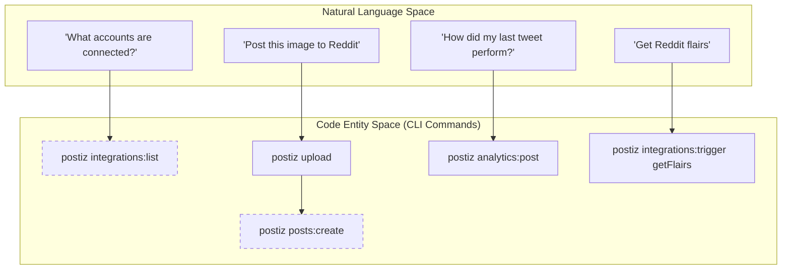
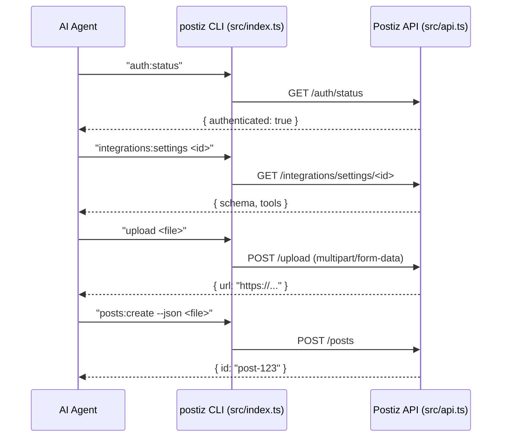

<!-- source: DeepWiki mcp.deepwiki.com · repo gitroomhq/postiz-agent · page 7 AI Agent Integration · fetched 2026-10-27 -->

# AI Agent Integration

Relevant source files

The following files were used as context for generating this wiki page:

- [.claude-plugin/marketplace.json](.claude-plugin/marketplace.json)
- [.claude-plugin/plugin.json](.claude-plugin/plugin.json)
- [README.md](README.md)
- [SKILL.md](SKILL.md)
- [skills/postiz/SKILL.md](skills/postiz/SKILL.md)

The Postiz CLI is designed specifically as a "skill" for AI agents, enabling automated social media management across 28+ platforms [README.md:9-11](). By providing a structured interface for discovery, content preparation, and analytics, agents can autonomously handle the entire lifecycle of a social media campaign.

## The SKILL.md Contract

The integration is governed by a `SKILL.md` contract which defines the tool's capabilities, installation requirements, and the "Discovery Workflow" pattern [SKILL.md:2-27](). This file serves as the manifest that LLM agents (such as those using OpenClaw) use to understand how to interact with the Postiz ecosystem.

For details on the specification and exit code conventions, see [SKILL.md Contract and Discovery Workflow](#7.1).

### Natural Language to CLI Command Mapping

The following diagram bridges the agent's natural language intent to the specific CLI commands defined in the codebase.

**Agent Intent Mapping**

Sources: [SKILL.md:65-85](), [README.md:72-106]()

## Core Workflow Pattern

Agents follow a standardized 7-step execution pattern to ensure reliability across different social media providers [SKILL.md:48-58]().

1.  **Authenticate**: Verify credentials using `postiz auth:status` [SKILL.md:62]().
2.  **Discover**: Identify target platforms via `postiz integrations:list` [SKILL.md:66]().
3.  **Fetch**: Retrieve dynamic metadata (e.g., Subreddits, Playlists) using `postiz integrations:trigger` [SKILL.md:70]().
4.  **Prepare**: Convert local assets to remote URLs via `postiz upload` [SKILL.md:73]().
5.  **Post**: Execute the publication via `postiz posts:create` [SKILL.md:76]().
6.  **Analyze**: Retrieve performance metrics with `postiz analytics:post` [SKILL.md:80]().
7.  **Resolve**: Handle edge cases where platforms don't return IDs immediately using `posts:missing` and `posts:connect` [SKILL.md:83-84]().

**Agent Execution Lifecycle**

Sources: [SKILL.md:48-85](), [README.md:213-224]()

## Claude Plugin Configuration

For environments like Claude Desktop or OpenClaw, the Postiz agent is configured via the `.claude-plugin/` directory. This includes the `plugin.json` manifest and `marketplace.json` which define the tool's scope, specifically allowing the agent to execute `Bash(postiz:*)` commands [.claude-plugin/plugin.json:1-27](), [.claude-plugin/marketplace.json:1-22]().

For details on tool scoping and registration, see [Claude Plugin Configuration](#7.2).

## Common Automation Patterns

Agents typically implement the following patterns to handle platform-specific complexities:

| Pattern | CLI Commands Used | Purpose |
| :--- | :--- | :--- |
| **Media Pre-flight** | `upload` | Ensuring files are converted to "Verified URLs" before posting [README.md:253-255](). |
| **Dynamic Discovery** | `integrations:settings` | Determining if a platform requires a "title" or "subreddit" before composing [README.md:81-86](). |
| **Async Resolution** | `posts:missing` → `posts:connect` | Linking TikTok or Instagram posts that don't return an ID immediately [SKILL.md:200-217](). |
| **Draft Promotion** | `posts:status --status schedule` | Moving a generated draft into the live publishing queue [SKILL.md:177-179](). |

Sources: [SKILL.md:48-58](), [README.md:191-192](), [README.md:213-224]()

---

