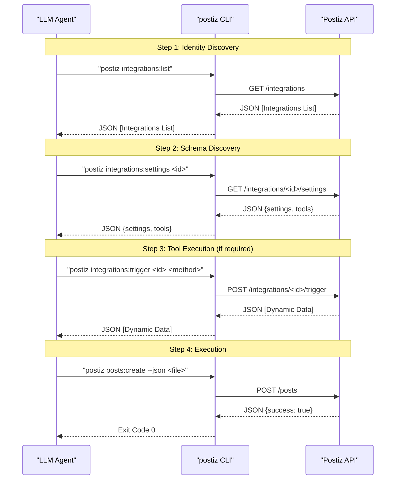
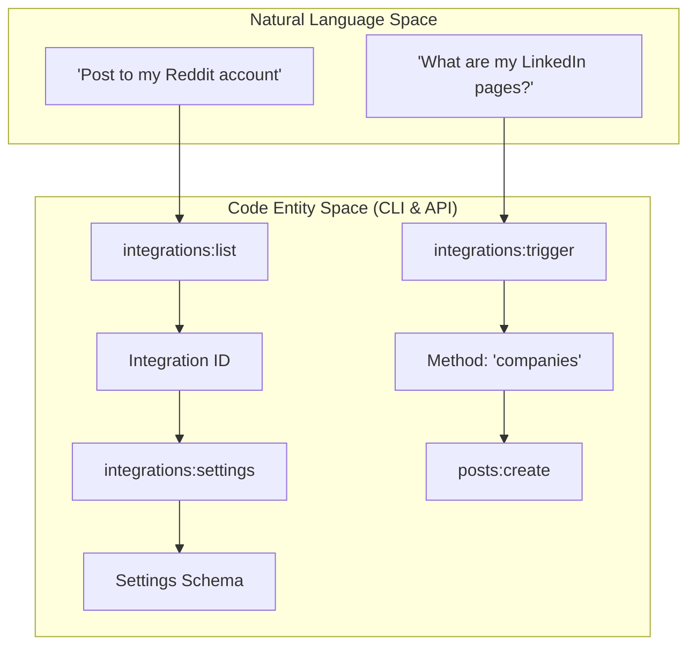
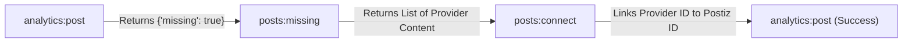

<!-- source: DeepWiki mcp.deepwiki.com · repo gitroomhq/postiz-agent · page 7.1 SKILL.md Contract and Discovery Workflow · fetched 2026-10-27 -->

# SKILL.md Contract and Discovery Workflow

Relevant source files

The following files were used as context for generating this wiki page:

- [.claude-plugin/plugin.json](.claude-plugin/plugin.json)
- [SKILL.md](SKILL.md)
- [skills/postiz/SKILL.md](skills/postiz/SKILL.md)

The `SKILL.md` specification defines the interface between Large Language Model (LLM) agents and the Postiz CLI. It serves as a machine-readable and human-readable contract that outlines the capabilities, authentication requirements, and the specific operational workflow an agent must follow to successfully manage social media across 28+ platforms.

## The Discovery Workflow Pattern

The Discovery Workflow is a multi-step execution pattern designed to handle the heterogeneity of social media platforms. Because each platform (e.g., Reddit vs. TikTok) requires different metadata, the agent cannot assume a static schema. Instead, it must dynamically discover requirements through the CLI.

### Data Flow and Discovery Sequence

The agent follows a strict sequence to move from a natural language request (e.g., "Post this to Reddit") to a valid API execution.

1.  **Identity Discovery**: The agent lists active integrations to find the correct `integration-id`.
2.  **Schema Discovery**: The agent queries the specific settings schema for that integration.
3.  **Dynamic Data Fetching (Optional)**: If the schema requires specific IDs (like a subreddit name or a YouTube playlist), the agent triggers "tools" to fetch live data from the provider.
4.  **Payload Preparation**: The agent constructs the final JSON payload based on the discovered schema.

#### Discovery Workflow Sequence
Title: Discovery and Execution Sequence

**Sources:**
*   [SKILL.md:48-59]()
*   [SKILL.md:117-129]()

---

## The SKILL.md Contract

The `SKILL.md` file defines the "rules of engagement" for the agent. It specifies the environment variables required, the binary scope, and the core workflow.

### Metadata and Tool Scope
The CLI defines its scope within the `allowed-tools` property, restricting the agent to the `postiz:*` namespace via Bash.

| Property | Value |
| :--- | :--- |
| **Name** | `postiz` |
| **Description** | Social media automation CLI for 28+ platforms |
| **Allowed Tools** | `Bash(postiz:*)` |
| **Env Required** | `POSTIZ_API_URL` |

**Sources:**
*   [SKILL.md:2-5]()
*   [SKILL.md:23-27]()
*   [skills/postiz/SKILL.md:2-5]()

### Authentication Contract
Agents are instructed to verify authentication before any state-changing operation. The contract specifies two paths:
1.  **OAuth2**: Running `postiz auth:login` to initiate the device flow.
2.  **API Key**: Exporting `POSTIZ_API_KEY`.

The agent is trained to check `postiz auth:status` as the first step in any session.

**Sources:**
*   [SKILL.md:31-44]()
*   [SKILL.md:91-110]()

---

## JSON Output and Piping

For LLM agents, the CLI is configured to prioritize JSON output. This allows agents to pipe the output of one command (like `integrations:list`) directly into their internal reasoning engine to extract IDs for the next command.

### Key Discovery Commands

| Command | Purpose | Agent Utility |
| :--- | :--- | :--- |
| `integrations:list` | Lists all connected accounts. | Extracts `id` and `type` (e.g., `reddit`). |
| `integrations:settings <id>` | Returns the JSON Schema for the platform. | Identifies required fields like `subreddit` or `title`. |
| `integrations:trigger <id> <method>` | Calls a provider-specific RPC tool. | Fetches live options (e.g., a list of LinkedIn Companies). |

### Postiz CLI Entity Mapping
Title: Mapping Natural Language to Code Entities

**Sources:**
*   [SKILL.md:117-129]()
*   [SKILL.md:154-163]()

---

## Exit Codes and Error Handling

The CLI follows standard POSIX exit code conventions to signal success or failure to the agent's execution environment.

*   **Exit Code `0`**: Success. The agent proceeds to the next step in the `Core Workflow`.
*   **Non-Zero Exit Code**: Failure. The agent must read `stderr` to determine if the error is due to authentication, invalid settings, or network issues.

### The "Missing" Analytics Loop
A unique part of the contract is the "Resolve" workflow. Some platforms (like TikTok) do not return a Post ID immediately.

1.  Agent runs `analytics:post <id>`.
2.  CLI returns `{"missing": true}`.
3.  Agent is contracted to run `posts:missing <id>` to fetch candidate posts from the provider.
4.  Agent runs `posts:connect <id> --release-id <provider-id>` to bridge the gap.

Title: The Missing Analytics Resolution Loop

**Sources:**
*   [SKILL.md:57-58]()
*   [SKILL.md:200-217]()
*   [skills/postiz/SKILL.md:200-217]()

---

