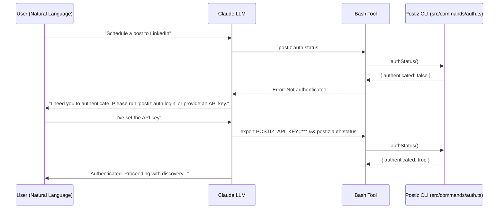
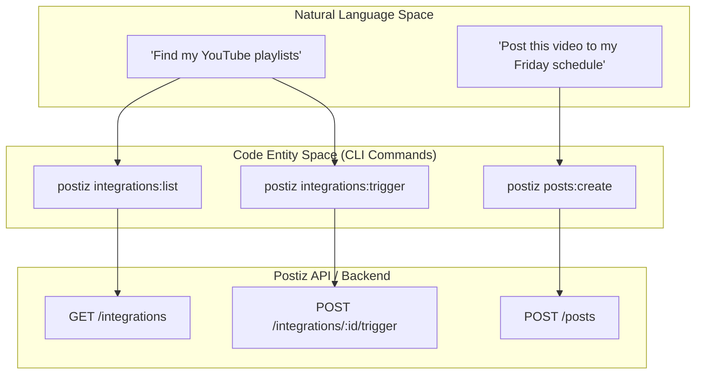

<!-- source: DeepWiki mcp.deepwiki.com · repo gitroomhq/postiz-agent · page 7.2 Claude Plugin Configuration · fetched 2026-10-27 -->

# Claude Plugin Configuration

Relevant source files

The following files were used as context for generating this wiki page:

- [.claude-plugin/marketplace.json](.claude-plugin/marketplace.json)
- [.claude-plugin/plugin.json](.claude-plugin/plugin.json)
- [skills/postiz/SKILL.md](skills/postiz/SKILL.md)

The Postiz agent is designed to function as a native skill within Claude (Anthropic) and OpenClaw environments. This integration is defined by the configuration files located in the `.claude-plugin/` directory, which establish the identity, capabilities, and security boundaries of the CLI when invoked by an LLM.

## Plugin Structure and Metadata

The configuration is split into two primary files that define how the agent appears in marketplaces and how it operates within the Claude interface.

### plugin.json
The `plugin.json` file defines the core package identity for the Claude environment. It includes versioning, authorship, and repository links used by the agent runtime to resolve the skill's origin.

| Field | Value | Description |
| :--- | :--- | :--- |
| `name` | `postiz` | The unique identifier for the plugin. |
| `version` | `2.0.12` | Current version of the plugin definition. |
| `license` | `AGPL-3.0` | The legal framework for the agent's use. |
| `homepage` | `https://docs.postiz.com/public-api/introduction` | Documentation link for the underlying API. |

**Sources:** [ .claude-plugin/plugin.json:1-27 ]()

### marketplace.json
The `marketplace.json` file facilitates the registration of the skill within the OpenClaw ecosystem. It specifies the source directory for the skills and metadata for the skill owner.

**Sources:** [ .claude-plugin/marketplace.json:1-22 ]()

## Skill Contract (SKILL.md)

The `SKILL.md` file serves as the technical contract between the Postiz CLI and the LLM. It explicitly defines the **allowed-tools** scope and the required environment variables.

### Allowed Tools Scope
For security and functional precision, the agent is restricted to a specific command scope:
- **Scope:** `Bash(postiz:*)` [ skills/postiz/SKILL.md:27-27 ]()
- **Meaning:** The LLM is authorized to execute any command starting with the `postiz` binary name via a Bash shell.

### Environment Requirements
The agent runtime must provide the `POSTIZ_API_URL` environment variable to ensure the CLI knows which backend instance to target [ skills/postiz/SKILL.md:5-5 ]().

## Authentication Flow in Claude

Claude cannot automatically guess credentials; therefore, the configuration mandates a strict authentication check before any operational commands are issued.

### Authentication Logic Flow
The following diagram illustrates the "Natural Language to Code" transition during the authentication phase.

**Claude Authentication Sequence**

**Sources:** [ skills/postiz/SKILL.md:31-44 ](), [ skills/postiz/SKILL.md:91-115 ]()

## Tool Execution and Data Flow

The Claude plugin utilizes the **Discovery Workflow** pattern. Instead of hardcoding platform features, the agent queries the CLI to understand what tools are available for a specific integration.

### Discovery and Trigger Pattern
1. **Discover:** The agent calls `postiz integrations:list` to find connected accounts [ skills/postiz/SKILL.md:121-121 ]().
2. **Inspect:** It calls `postiz integrations:settings <id>` to retrieve the JSON schema for that platform [ skills/postiz/SKILL.md:124-124 ]().
3. **Execute:** It uses `postiz integrations:trigger <id> <method>` to fetch dynamic data like Reddit subreddits or YouTube playlists [ skills/postiz/SKILL.md:127-128 ]().

**Agent Command Execution Mapping**

**Sources:** [ skills/postiz/SKILL.md:60-85 ](), [ skills/postiz/SKILL.md:117-129 ]()

## Registration and Deployment

To register the Postiz skill in a Claude/OpenClaw environment:

1. **Install the CLI:** The environment must have the `postiz` package installed globally via `npm install -g postiz` [ skills/postiz/SKILL.md:10-14 ]().
2. **Point to Skill Directory:** In the OpenClaw or Claude Desktop configuration, add the path to the directory containing `.claude-plugin/` and `SKILL.md`.
3. **Set Environment Variables:** Ensure `POSTIZ_API_URL` is defined if using a self-hosted instance [ skills/postiz/SKILL.md:5-5 ]().
4. **Credential Persistence:** The CLI stores credentials in `~/.postiz/credentials.json`. The agent runtime must have read/write access to this home directory path to maintain the session [ skills/postiz/SKILL.md:105-105 ]().

**Sources:** [ skills/postiz/SKILL.md:8-19 ](), [ .claude-plugin/marketplace.json:11-21 ]()

---

