# Page: Overview

# Overview

<details>
<summary>Relevant source files</summary>

The following files were used as context for generating this wiki page:

- [FEATURES.md](FEATURES.md)
- [PROJECT_STRUCTURE.md](PROJECT_STRUCTURE.md)
- [README.md](README.md)
- [SKILL.md](SKILL.md)
- [SUMMARY.md](SUMMARY.md)
- [package.json](package.json)

</details>


The **postiz CLI** is a command-line interface and agent-centric ecosystem designed to automate social media management across 28+ platforms [SKILL.md:3-3](). It serves as a bridge between developers (or AI agents) and the Postiz API, facilitating post scheduling, media management, and performance analytics [README.md:9-12]().

The ecosystem is comprised of a TypeScript-based CLI tool, an optional OAuth2 device-flow authentication server, and a "Skill" contract optimized for LLM integration [SKILL.md:23-27]().

### Core Capabilities

The system is architected to support complex social media workflows:
*   **Multi-Platform Scheduling:** Unified interface for platforms including X (Twitter), LinkedIn, Reddit, YouTube, TikTok, and Instagram [package.json:31-37]().
*   **Advanced Post Composition:** Support for threaded comments, platform-specific settings (e.g., Reddit flairs), and multi-media attachments [FEATURES.md:9-25]().
*   **AI Agent Optimization:** Provides machine-readable JSON outputs and a discovery-based workflow for agents to navigate platform requirements dynamically [SKILL.md:48-59]().
*   **Media Pipeline:** Integrated multipart upload for preparing local files for social media providers [SUMMARY.md:70-73]().

### System Architecture

The following diagram illustrates how the CLI components relate to the Postiz API and external social providers.

**High-Level System Context**
```mermaid
graph TD
  subgraph "Local Environment"
    ["CLI Entrypoint (index.ts)"] -- "calls" --> ["Command Handlers (src/commands/*)"]
    ["Command Handlers (src/commands/*)"] -- "uses" --> ["PostizAPI Client (src/api.ts)"]
    ["PostizAPI Client (src/api.ts)"] -- "reads" --> ["Config Module (src/config.ts)"]
  end

  subgraph "Postiz Infrastructure"
    ["PostizAPI Client (src/api.ts)"] -- "HTTPS/JSON" --> ["Postiz Public API"]
    ["Auth Command"] -- "Device Flow" --> ["Auth Server (server/src/index.ts)"]
    ["Auth Server (server/src/index.ts)"] -- "OIDC" --> ["Postiz OAuth Provider"]
  end

  subgraph "Social Platforms"
    ["Postiz Public API"] -- "Provider API" --> ["X / Twitter"]
    ["Postiz Public API"] -- "Provider API" --> ["LinkedIn"]
    ["Postiz Public API"] -- "Provider API" --> ["TikTok/Instagram"]
  end
```
**Sources:** [PROJECT_STRUCTURE.md:172-188](), [SKILL.md:60-85](), [README.md:11-12]()

---

### Component Overview

#### 1. The CLI Tool
The primary interface for users and agents. It is built using `yargs` for argument parsing and `tsup` for compilation [package.json:55-60](). It handles the translation of CLI flags or JSON files into the `CreatePostDto` format required by the backend [FEATURES.md:209-240]().
*   For setup and installation, see **[Getting Started](#1.1)**.
*   For build details and monorepo structure, see **[Project Structure and Build Pipeline](#1.2)**.

#### 2. Authentication Flow
The system supports two primary authentication methods:
*   **OAuth2 Device Flow:** A browser-based authorization that stores credentials in `~/.postiz/credentials.json` [README.md:29-41]().
*   **API Key:** Simple environment variable-based auth via `POSTIZ_API_KEY` [README.md:54-58]().

#### 3. AI Agent Integration (Skills)
The CLI includes a `SKILL.md` file that acts as a contract for AI agents (like Claude). It defines a **Discovery Workflow** where agents first query platform settings to understand what data (like Reddit flairs or LinkedIn companies) is required before attempting a post [SKILL.md:48-59]().

**Agent Workflow to Code Mapping**
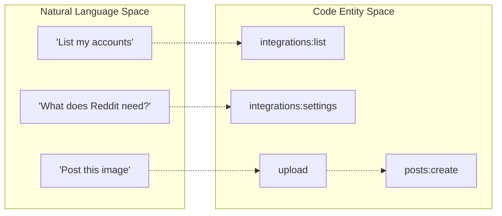
**Sources:** [SKILL.md:60-85](), [SUMMARY.md:47-73]()

---

### Key Data Structures

The CLI operates primarily on the `CreatePostDto`, which encapsulates the entire state of a social media campaign across multiple integrations.

| Entity | Code Reference | Description |
| :--- | :--- | :--- |
| **PostizAPI** | [src/api.ts:51-60]() | The central class handling HTTP communication and header injection. |
| **CreatePostDto** | [FEATURES.md:209-240]() | The JSON schema for multi-platform, multi-comment posts. |
| **Integration** | [src/commands/integrations.ts:74-77]() | Metadata representing a connected social media account. |
| **MediaDto** | [FEATURES.md:226-231]() | Object containing the ID and path of uploaded media. |

**Sources:** [PROJECT_STRUCTURE.md:51-60](), [FEATURES.md:207-240]()

---

### Child Pages
*   **[Getting Started](#1.1)**: Installation, initial setup, and authentication methods.
*   **[Project Structure and Build Pipeline](#1.2)**: Technical details on the codebase layout, TypeScript configuration, and the publishing workflow.

---

# Page: Getting Started

# Getting Started

<details>
<summary>Relevant source files</summary>

The following files were used as context for generating this wiki page:

- [HOW_TO_RUN.md](HOW_TO_RUN.md)
- [QUICK_START.md](QUICK_START.md)
- [src/commands/auth.ts](src/commands/auth.ts)
- [src/config.ts](src/config.ts)

</details>


This page provides a technical guide for installing, configuring, and verifying the Postiz CLI agent. It covers the two primary authentication methods (OAuth2 Device Flow and API Keys) and the internal configuration resolution logic.

## Installation and Build

The Postiz CLI is a TypeScript-based application located within the `apps/cli` directory of the monorepo. It must be compiled before execution.

### From Source (Development)
1. **Install Dependencies**: Run `pnpm install` from the monorepo root [QUICK_START.md:12-12]().
2. **Build**: Execute `pnpm run build:cli` [QUICK_START.md:15-15](). This triggers the build pipeline (typically `tsup`) to generate the executable bundle in `apps/cli/dist/index.js` [HOW_TO_RUN.md:7-7]().
3. **Execution Options**:
    * **Direct Node**: `node apps/cli/dist/index.js --help` [HOW_TO_RUN.md:11-11]().
    * **Global Link**: Run `pnpm link --global` inside `apps/cli` to make the `postiz` command available system-wide [HOW_TO_RUN.md:28-31]().
    * **Monorepo Filter**: `pnpm --filter postiz start -- --help` [HOW_TO_RUN.md:45-45]().

### Build and Link Workflow

The following diagram illustrates the relationship between the source code and the executable environment.

**CLI Build and Link Data Flow**
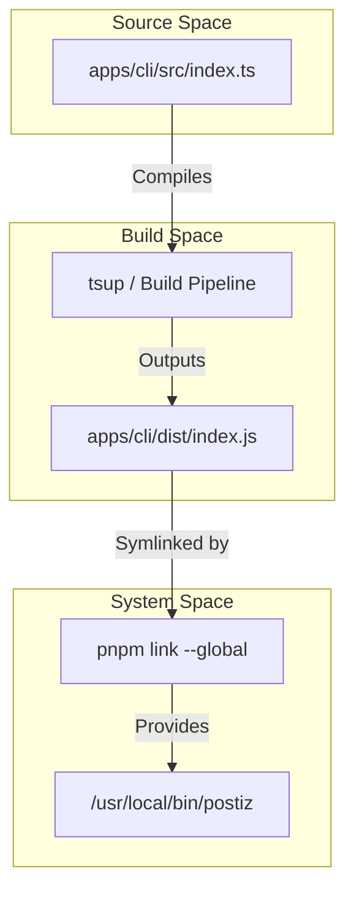
Sources: [QUICK_START.md:5-32](), [HOW_TO_RUN.md:5-39]()

---

## Authentication Options

The CLI supports two distinct authentication strategies. The `getConfig()` function in `src/config.ts` prioritizes stored OAuth2 credentials over environment variables [src/config.ts:4-30]().

### 1. OAuth2 Device Authorization Grant
This is the recommended flow for interactive users. It implements RFC 8628 to authenticate the CLI without requiring the user to manually handle API keys.

*   **Command**: `postiz auth:login` [src/commands/auth.ts:60-60]().
*   **Implementation**: 
    1.  The CLI requests a device code from the `authServer` (default: `https://cli-auth.postiz.com`) [src/commands/auth.ts:9-9](), [src/commands/auth.ts:73-76]().
    2.  The user is presented with a `userCode` and the CLI attempts to open the `verificationUri` in a browser [src/commands/auth.ts:98-103]().
    3.  The CLI enters a polling loop, calling `/device/token` every `interval` seconds until the user authorizes the request or the `deadline` is reached [src/commands/auth.ts:110-153]().
    4.  Upon success, credentials are saved to `~/.postiz/credentials.json` with `0o600` permissions [src/commands/auth.ts:7-7](), [src/commands/auth.ts:32-34]().

### 2. API Key (Environment Variables)
Ideal for CI/CD, headless servers, or AI agents.
*   **POSTIZ_API_KEY**: The primary secret used for `Authorization` headers [src/config.ts:15-15]().
*   **POSTIZ_API_URL**: (Optional) Overrides the default `https://api.postiz.com` [src/config.ts:16-16]().

**Authentication Logic Flow**
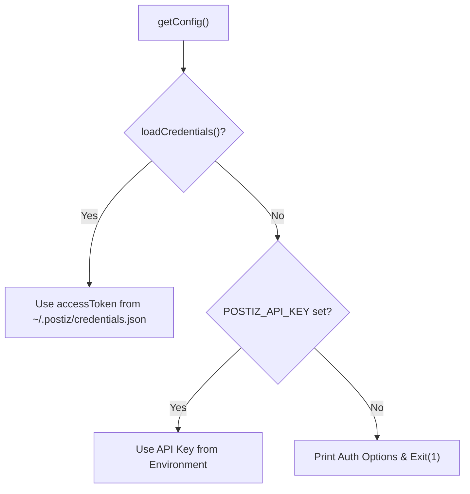
Sources: [src/config.ts:4-30](), [src/commands/auth.ts:17-26]()

---

## Configuration Module

The `src/config.ts` file acts as the central authority for the CLI's operational context.

### The `getConfig()` Function
This function resolves the `PostizConfig` object required by the `PostizAPI` client [src/config.ts:4-4]().

| Priority | Source | Key Logic |
| :--- | :--- | :--- |
| 1 | `~/.postiz/credentials.json` | Parsed via `loadCredentials()` [src/config.ts:6-7](). |
| 2 | `process.env.POSTIZ_API_KEY` | Read directly from environment [src/config.ts:15-15](). |

If no authentication is found, the CLI prints setup instructions and exits [src/config.ts:18-24]().

### Credential Storage Schema
Stored in `CREDENTIALS_FILE` (`~/.postiz/credentials.json`) [src/commands/auth.ts:7-7]():
```typescript
interface StoredCredentials {
  accessToken: string;    // Used as the Bearer/API Key
  apiUrl: string;         // The target Postiz instance
  organizationId?: string; // Optional context for enterprise users
}
```
Sources: [src/commands/auth.ts:11-15](), [src/config.ts:1-30]()

---

## First-Run Verification

To ensure the environment is correctly configured, users should run the `auth:status` command.

### `authStatus` Logic
The `authStatus` function in `src/commands/auth.ts` performs a live check:
1.  **Identity Resolution**: Identifies if the session is using OAuth2 or an Environment Variable [src/commands/auth.ts:177-192]().
2.  **API Verification**: Calls the `/public/v1/integrations` endpoint using the resolved credentials [src/commands/auth.ts:203-209]().
3.  **Result Reporting**:
    *   **Success (200 OK)**: Displays the number of connected social media integrations [src/commands/auth.ts:212-213]().
    *   **Failure (401/403)**: Informs the user that credentials have expired and suggests re-authentication via `auth:login` [src/commands/auth.ts:214-220]().

**Code Entity Mapping: Verification Sequence**
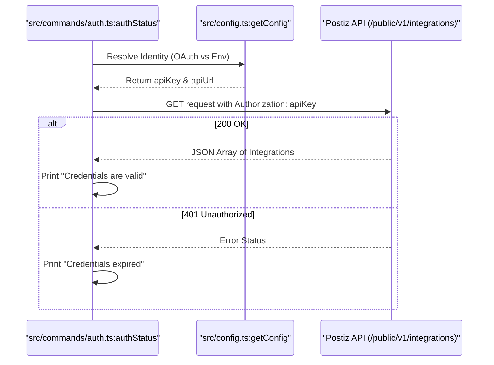
Sources: [src/commands/auth.ts:170-224](), [src/config.ts:4-30]()

---

# Page: Project Structure and Build Pipeline

# Project Structure and Build Pipeline

<details>
<summary>Relevant source files</summary>

The following files were used as context for generating this wiki page:

- [CHANGELOG.md](CHANGELOG.md)
- [PROJECT_STRUCTURE.md](PROJECT_STRUCTURE.md)
- [PUBLISHING.md](PUBLISHING.md)
- [SUMMARY.md](SUMMARY.md)
- [package.json](package.json)
- [tsconfig.json](tsconfig.json)
- [tsup.config.ts](tsup.config.ts)

</details>


This page details the physical organization of the Postiz CLI codebase, the automated build pipeline using `tsup`, and the lifecycle of the package from TypeScript source to a published npm executable.

## Directory Layout

The Postiz CLI is structured as a standalone package within a monorepo, located at `apps/cli/`. It follows a standard TypeScript project structure where logic is separated into an entry point, an API client, and specific command handlers.

| Directory/File | Description |
| :--- | :--- |
| `src/index.ts` | Main entry point; handles CLI argument parsing via `yargs`. [PROJECT_STRUCTURE.md:45-49]() |
| `src/api.ts` | The `PostizAPI` client class responsible for HTTP communication. [PROJECT_STRUCTURE.md:51-60]() |
| `src/config.ts` | Manages environment variables and configuration state. [PROJECT_STRUCTURE.md:62-66]() |
| `src/commands/` | Directory containing the business logic for CLI command groups. [PROJECT_STRUCTURE.md:15-18]() |
| `dist/` | Generated build output containing the executable JavaScript. [PROJECT_STRUCTURE.md:23-26]() |
| `examples/` | Contains reference scripts like `basic-usage.sh`. [PROJECT_STRUCTURE.md:20-21]() |

### Code Entity Mapping: Directory to Logic

The following diagram maps the filesystem structure to the primary functional responsibilities defined in the code.

**Filesystem to Logic Mapping**
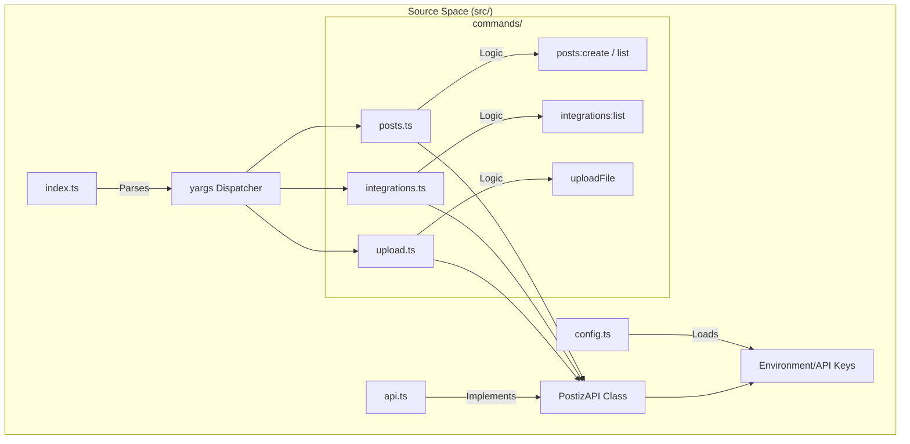
**Sources:** [PROJECT_STRUCTURE.md:9-19](), [PROJECT_STRUCTURE.md:43-81]()

---

## TypeScript Compilation via tsup

The project uses `tsup` as its primary build tool. `tsup` is a zero-config bundler powered by `esbuild` that handles the conversion of TypeScript into a single, executable CommonJS file.

### Build Configuration (`tsup.config.ts`)
The build process is governed by the configuration in `tsup.config.ts` [tsup.config.ts:1-14](). Key implementation details include:
*   **Target Format**: The output is forced to `cjs` (CommonJS) to ensure compatibility with standard Node.js environments [tsup.config.ts:5-5]().
*   **Shebang Injection**: A `banner` is added to the top of the generated file (`#!/usr/bin/env node`) to allow the file to be executed directly as a binary [tsup.config.ts:11-13]().
*   **Cleaning**: The `dist` directory is purged before every build to ensure no stale artifacts remain [tsup.config.ts:9-9]().
*   **Source Maps**: Enabled to allow debugging of the original TypeScript source from the compiled JavaScript [tsup.config.ts:8-8]().

### Build Data Flow
The data flow from source to the `dist/` output is as follows:

**Build Pipeline Flow**
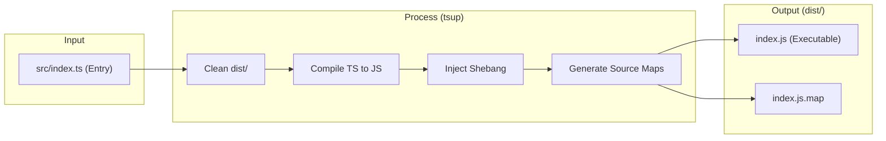
**Sources:** [tsup.config.ts:3-14](), [PROJECT_STRUCTURE.md:152-169]()

---

## The dist/ Output and Binaries

The final output of the build process is a standalone executable located at `./dist/index.js`. 

*   **Binary Mapping**: The `package.json` defines the `postiz` command and points it to this file [package.json:6-8]().
*   **Dependencies**: While `tsup` bundles most logic, the package still relies on `node-fetch` and `yargs` as runtime dependencies [package.json:52-56]().
*   **Size**: The compressed build size is approximately 491KB [SUMMARY.md:13-13]().

**Sources:** [package.json:1-8](), [SUMMARY.md:13-13]()

---

## npm Publishing Workflow

The publishing workflow is designed to be executed either from the monorepo root or within the `apps/cli` directory.

### Lifecycle Scripts
The `package.json` includes specific hooks for publishing:
*   **`prepublishOnly`**: Automatically runs `pnpm run build` before any publish attempt to ensure the `dist/` folder is up to date [package.json:13-13]().
*   **`publish`**: Executes `tsup` and then runs `pnpm publish` with public access [package.json:14-14]().

### Included Files
To keep the npm package lightweight, only essential files are included in the distribution [package.json:16-22]():
1.  `dist/` (The compiled code)
2.  `README.md` (Documentation)
3.  `SKILL.md` (AI Agent instructions)
4.  `CHANGELOG.md`
5.  `LICENSE`

### Publishing Command Sequence
1.  **Version Update**: Use `npm version <patch|minor|major>` to update the version in `package.json` [PUBLISHING.md:187-209]().
2.  **Build**: Run `pnpm run build` to generate artifacts [PUBLISHING.md:7-7]().
3.  **Publish**: Run `pnpm publish --access public` [PUBLISHING.md:8-8]().

**Sources:** [package.json:9-22](), [PUBLISHING.md:1-20](), [PUBLISHING.md:187-209]()

---

## Monorepo Integration

The CLI is integrated into the larger Postiz ecosystem through shared configuration and root-level scripts.

*   **Shared Scripts**: The monorepo root contains scripts like `build:cli` which uses `pnpm --filter` to target the CLI package specifically [SUMMARY.md:119-126]().
*   **TypeScript Inheritance**: The `tsconfig.json` in the CLI directory is configured to handle local paths while remaining compatible with the monorepo's module resolution [tsconfig.json:1-22]().
*   **AI Agent Contract**: The project includes `SKILL.md`, which serves as the technical contract for integrating the CLI as a "skill" for LLM-based agents [SUMMARY.md:94-100]().

**Sources:** [SUMMARY.md:117-126](), [tsconfig.json:1-22](), [PROJECT_STRUCTURE.md:233-247]()

---

# Page: CLI Architecture

# CLI Architecture

<details>
<summary>Relevant source files</summary>

The following files were used as context for generating this wiki page:

- [src/api.ts](src/api.ts)
- [src/commands/analytics.ts](src/commands/analytics.ts)
- [src/config.ts](src/config.ts)
- [src/index.ts](src/index.ts)

</details>


The Postiz CLI is a TypeScript-based command-line tool designed to interface with the Postiz API. It provides a structured way for users and AI agents to manage social media posts, integrations, and analytics through a consistent command-dispatch pattern.

## System Overview

The CLI's internal architecture is built around three core pillars:
1.  **Command Orchestration**: A `yargs`-driven entrypoint that parses CLI arguments and routes them to specific command handlers.
2.  **State Management**: A configuration module that resolves authentication credentials from local storage or environment variables.
3.  **API Abstraction**: A central `PostizAPI` class that encapsulates the logic for HTTP requests, multipart uploads, and error handling.

### High-Level Component Interaction

The following diagram illustrates how a command flows from the terminal through the internal modules to the Postiz API.

**Command Execution Flow**
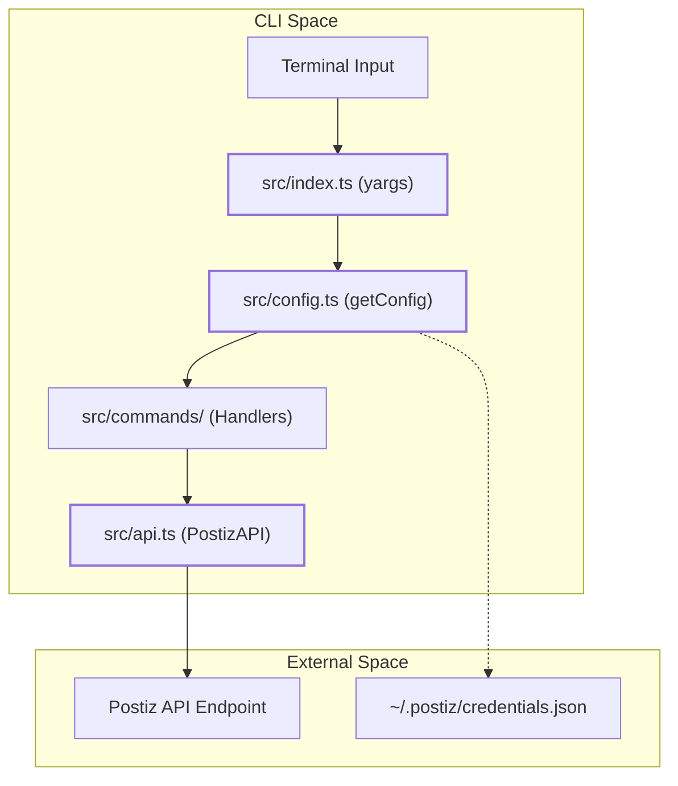
Sources: [src/index.ts:1-12](), [src/config.ts:4-30](), [src/api.ts:8-15]()

---

## Core Components

### Entrypoint and Command Dispatch
The CLI entrypoint in `src/index.ts` uses `yargs` to define a hierarchical command structure (e.g., `posts:create`, `integrations:list`). Each command definition includes flag validation, help text, and examples before delegating execution to a specific handler function in the `src/commands/` directory.

For details, see [Entrypoint and Command Dispatch](#2.1).

### PostizAPI Client
The `PostizAPI` class serves as the single point of egress for all network communication. It handles the injection of the `Authorization` header, manages base URL configuration, and provides specialized methods for JSON-based CRUD operations and multipart/form-data media uploads.

For details, see [PostizAPI Client](#2.2).

### Configuration and Authentication
The CLI supports two authentication modes: OAuth2 Device Flow and API Key-based authentication. The `getConfig()` function implements a priority-based resolution logic, checking local credential storage before falling back to environment variables like `POSTIZ_API_KEY`.

For details, see [Configuration and Authentication Modules](#2.3).

---

## Code Entity Mapping

This diagram bridges the natural language concepts of the CLI to the specific classes and functions in the codebase.

**CLI Entity Mapping**
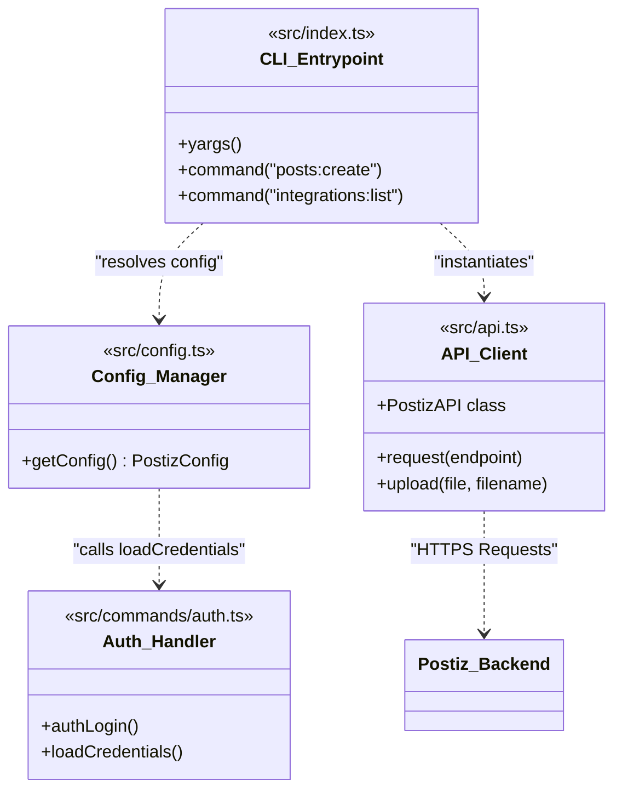
Sources: [src/index.ts:10-13](), [src/config.ts:4-6](), [src/api.ts:8-15](), [src/commands/auth.ts:1-7]()

## Command Summary

The CLI groups functionality into namespaces to maintain a clean interface for both humans and agents.

| Namespace | Responsibility | Primary File |
| :--- | :--- | :--- |
| `posts:` | Creation, deletion, listing, and status management of social posts. | `src/commands/posts.ts` |
| `integrations:` | Discovering connected platforms and triggering platform-specific tools. | `src/commands/integrations.ts` |
| `analytics:` | Retrieving performance data for specific posts or integrations. | `src/commands/analytics.ts` |
| `auth:` | Managing OAuth2 sessions and credential storage. | `src/commands/auth.ts` |
| `upload` | Standalone utility for uploading media to Postiz storage. | `src/commands/upload.ts` |

Sources: [src/index.ts:13-200]()

---

# Page: Entrypoint and Command Dispatch

# Entrypoint and Command Dispatch

<details>
<summary>Relevant source files</summary>

The following files were used as context for generating this wiki page:

- [SYNTAX_UPGRADE.md](SYNTAX_UPGRADE.md)
- [src/index.ts](src/index.ts)

</details>


The `postiz-agent` CLI is built on the `yargs` library, which handles command-line argument parsing, validation, and execution routing. The central hub for this logic is located in `src/index.ts`.

## Command Execution Flow

The CLI follows a standard dispatch pattern where `yargs` parses the process arguments and matches them against defined command namespaces. Once a command is matched, the execution is delegated to specific handler functions imported from the `src/commands/` directory.

### CLI Dispatch Architecture
The following diagram illustrates how a raw shell command is transformed into a call to a specific handler function.

**Diagram: Shell to Handler Mapping**
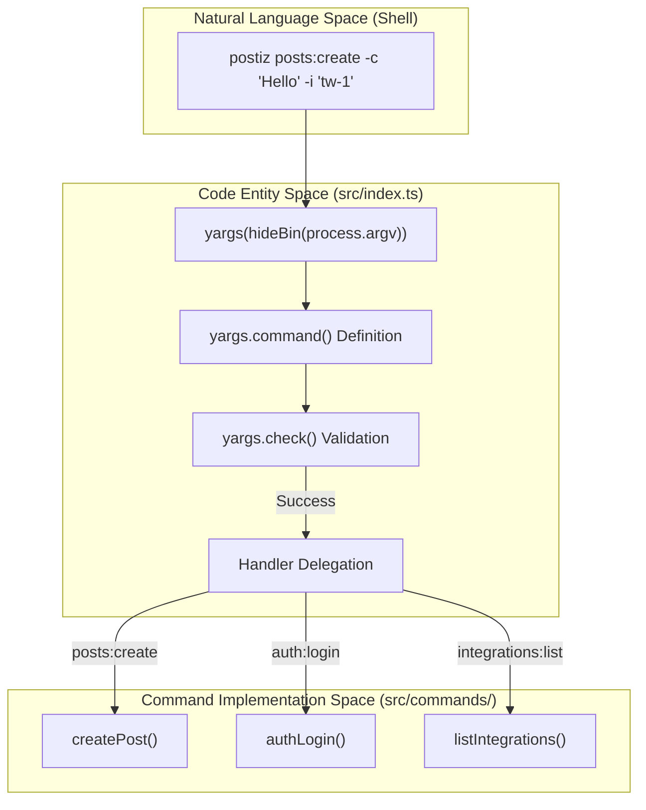
Sources: [src/index.ts:1-7](), [src/index.ts:10-13]()

## Command Namespaces and Flags

The CLI organizes functionality into distinct namespaces: `posts`, `integrations`, `analytics`, `auth`, and a standalone `upload` command.

### 1. Post Management (`posts:*`)
The `posts` namespace manages the lifecycle of social media content.

| Command | Flags | Purpose |
| :--- | :--- | :--- |
| `posts:create` | `-c`, `-m`, `-i`, `-s`, `-t`, `-d`, `-j`, `--settings` | Creates a new post or thread. Supports multiple `-c` (content) and `-m` (media) flags for threading. |
| `posts:list` | `--startDate`, `--endDate`, `--customer` | Retrieves a list of posts within a date range. |
| `posts:delete <id>` | N/A | Deletes a post by its unique ID. |
| `posts:status <id>` | `--status` | Switches a post between `draft` and `schedule` states. |
| `posts:missing <id>` | N/A | Finds provider-side content to reconnect to a missing post. |
| `posts:connect <id>` | `--releaseId` | Connects a post to a specific provider release ID. |

Sources: [src/index.ts:14-230](), [SYNTAX_UPGRADE.md:55-70]()

### 2. Integration Discovery (`integrations:*`)
These commands allow users and AI agents to discover available platforms and their requirements.

| Command | Flags | Purpose |
| :--- | :--- | :--- |
| `integrations:list` | N/A | Lists all connected social media accounts and their IDs. |
| `integrations:settings <id>` | N/A | Returns the JSON schema for platform-specific settings (e.g., Reddit flairs). |
| `integrations:trigger <id>` | `--tool`, `--data` | Executes a specific tool for an integration (e.g., fetching YouTube playlists). |

Sources: [src/index.ts:231-279]()

### 3. Authentication and Media
| Command | Namespace | Purpose |
| :--- | :--- | :--- |
| `auth:login` | `auth` | Initiates the OAuth2 device flow. |
| `auth:logout` | `auth` | Clears local credentials. |
| `auth:status` | `auth` | Checks current authentication state. |
| `upload <file>` | N/A | Uploads a local file to Postiz and returns a verified URL. |

Sources: [src/index.ts:312-355]()

## Argument Validation and Pairing Logic

### Strict Validation
The `posts:create` command implements a custom validation block using `yargs.check()`. It ensures that users provide either a `--json` file path or the minimum required flags (`--content`, `--integrations`, and `--date`).

```typescript
// Example of validation logic in src/index.ts
.check((argv) => {
  if (!argv.json && !argv.content) {
    throw new Error('Either --content or --json is required');
  }
  // ... further checks for integrations and date
  return true;
})
```
Sources: [src/index.ts:65-76]()

### The Multi-Flag Pairing Pattern
The CLI supports a sophisticated pairing logic for threads. When multiple `-c` (content) and `-m` (media) flags are provided, they are processed as ordered pairs.

**Diagram: Content and Media Pairing**
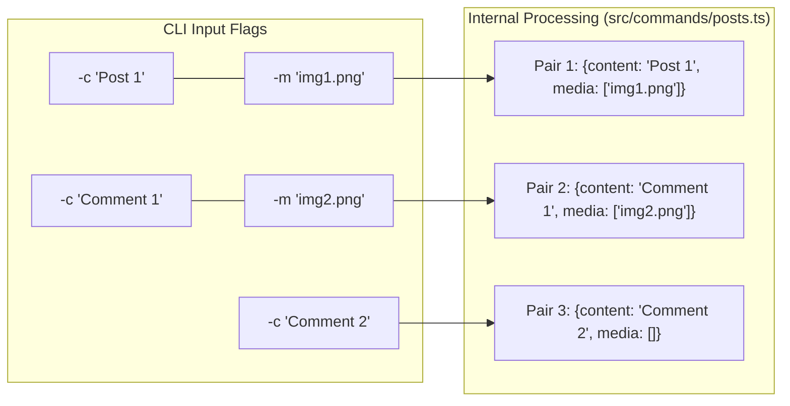
Sources: [SYNTAX_UPGRADE.md:55-70](), [src/index.ts:18-27]()

## Implementation Details in `src/index.ts`

The entrypoint utilizes `hideBin(process.argv)` to strip the node binary and script path before passing the remaining arguments to `yargs`. 

### Key Functions
- **`yargs.scriptName('postiz')`**: Sets the binary name used in help menus. [src/index.ts:11]()
- **`yargs.command()`**: Defines the command string, description, builder (for flags), and the handler function. [src/index.ts:13-119]()
- **`yargs.example()`**: Provides contextual usage examples that appear in the `--help` output. [src/index.ts:77-116]()

The handlers (e.g., `createPost`, `listPosts`) are cast as `any` during the `yargs.command` registration to bypass strict type mismatches between yargs' internal `Arguments` type and the custom DTOs used in the command implementations. [src/index.ts:118](), [src/index.ts:147]()

Sources: [src/index.ts:10-118]()

---

# Page: PostizAPI Client

# PostizAPI Client

<details>
<summary>Relevant source files</summary>

The following files were used as context for generating this wiki page:

- [src/api.ts](src/api.ts)
- [src/commands/analytics.ts](src/commands/analytics.ts)

</details>


The `PostizAPI` class is the central communication layer of the Postiz agent, responsible for interfacing with the Postiz Public API. It encapsulates the request lifecycle, authentication, and specialized handling for binary media uploads.

## PostizAPI Architecture

The client is implemented as a standalone class in `src/api.ts` and is instantiated by command handlers using configuration retrieved from the local environment or credentials file.

### Initialization and Configuration

The class constructor accepts a `PostizConfig` object containing the `apiKey` and an optional `apiUrl`. If no URL is provided, it defaults to the production Postiz API endpoint.

| Field | Type | Description |
| :--- | :--- | :--- |
| `apiKey` | `string` | The Authorization token passed in every request. |
| `apiUrl` | `string` | The base URL for the API (Defaults to `https://api.postiz.com`). |

**Request Lifecycle Diagram**
This diagram illustrates how a call to a high-level method (e.g., `listPosts`) flows through the internal `request` method to the network.

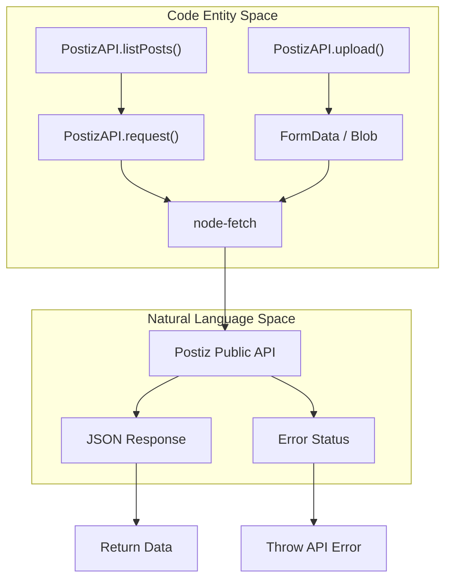
Sources: [src/api.ts:8-15](), [src/api.ts:17-40](), [src/api.ts:49-66]()

---

## Core Request Lifecycle

The private `request` method handles the boilerplate for every HTTP call, ensuring consistent headers and error reporting.

### Header Injection
Every request automatically includes:
- `Content-Type: application/json` (unless overridden) [src/api.ts:20]().
- `Authorization`: The API key provided during instantiation [src/api.ts:21]().

### Error Handling
The client differentiates between network failures and API-level errors:
1.  **Response Validation**: If `response.ok` is false, the client reads the response body as text and throws an error including the status code [src/api.ts:31-34]().
2.  **Network Catch**: Any fetch-level failures are caught and re-thrown with a "Request failed" prefix [src/api.ts:37-39]().

### Query String Serialization
For GET requests like `listPosts`, the client implements a manual serialization of filters into a `URLSearchParams` string. It filters out `null` or `undefined` values before appending the string to the endpoint [src/api.ts:50-61]().

Sources: [src/api.ts:17-40](), [src/api.ts:49-61]()

---

## Multipart Media Uploads

The `upload` method handles binary data transfer, which is required for social media attachments. Unlike standard JSON requests, this method uses `multipart/form-data`.

### MIME Type Detection
The client contains an internal mapping of file extensions to MIME types to ensure the API correctly identifies the media [src/api.ts:79-115](). It supports:
- **Images**: png, jpg, gif, webp, svg, etc.
- **Videos**: mp4, mov, avi, mkv, webm, etc.
- **Audio**: mp3, wav, ogg, etc.
- **Documents**: pdf, doc, docx.

If an extension is unknown, it defaults to `application/octet-stream` [src/api.ts:117]().

### Implementation Details
The file buffer is wrapped in a `Blob` with the detected MIME type and appended to a `FormData` object under the key `file` [src/api.ts:119-120](). This request bypasses the standard `request` method to handle the `FormData` body and specific header requirements [src/api.ts:122-130]().

Sources: [src/api.ts:74-138]()

---

## Method Mapping

The `PostizAPI` class maps internal logic to specific Public API endpoints.

| Method | HTTP Verb | Endpoint | Purpose |
| :--- | :--- | :--- | :--- |
| `createPost` | POST | `/public/v1/posts` | Submits a new post or thread. |
| `listPosts` | GET | `/public/v1/posts` | Retrieves posts with optional filters. |
| `deletePost` | DELETE | `/public/v1/posts/{id}` | Removes a post. |
| `upload` | POST | `/public/v1/upload` | Uploads media to Postiz storage. |
| `getAnalytics` | GET | `/public/v1/analytics/{id}` | Platform-level metrics. |
| `getPostAnalytics`| GET | `/public/v1/analytics/post/{id}` | Post-specific metrics. |
| `listIntegrations` | GET | `/public/v1/integrations` | Lists connected social accounts. |
| `triggerIntegrationTool` | POST | `/public/v1/integration-trigger/{id}` | Executes platform-specific RPC calls. |

**Data Flow: Analytics Command Example**
This diagram shows how a CLI command interacts with the `PostizAPI` class.

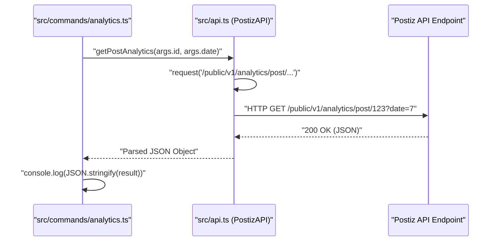
Sources: [src/commands/analytics.ts:26-46](), [src/api.ts:166-170]()

---

# Page: Configuration and Authentication Modules

# Configuration and Authentication Modules

<details>
<summary>Relevant source files</summary>

The following files were used as context for generating this wiki page:

- [src/commands/auth.ts](src/commands/auth.ts)
- [src/config.ts](src/config.ts)

</details>


The Postiz Agent supports two primary methods of authentication: **OAuth2 Device Authorization Grant** (recommended for interactive use) and **Static API Keys** (recommended for CI/CD or headless environments). This page details the configuration resolution logic, the credential storage mechanism, and the implementation of the device flow polling loop.

## Configuration Resolution

The `getConfig()` function serves as the central authority for retrieving authentication details. It follows a strict priority hierarchy where local stored credentials override environment variables.

### Credential Priority
1.  **Stored OAuth2 Credentials**: The system first attempts to load `accessToken` and `apiUrl` from the local filesystem via `loadCredentials()` [src/config.ts:6-12]().
2.  **Environment Variables**: If no local credentials exist, it falls back to `POSTIZ_API_KEY` and `POSTIZ_API_URL` [src/config.ts:15-16]().
3.  **Default/Failure**: If no key is found, the process logs an error and exits [src/config.ts:18-24]().

### Configuration Data Flow
The following diagram illustrates how `getConfig()` resolves the `PostizConfig` object used by the API client.

**Title: Configuration Resolution Logic**
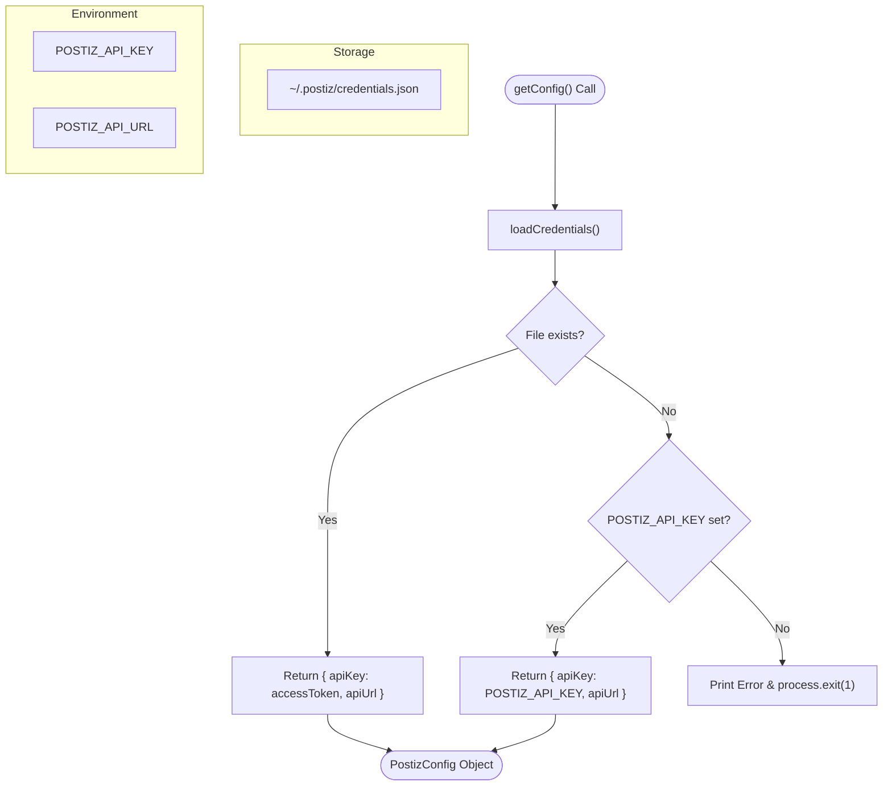
**Sources:** [src/config.ts:4-30](), [src/commands/auth.ts:17-26]()

---

## Credential Storage

Local credentials are stored in the user's home directory. The system ensures strict file permissions to protect sensitive tokens.

*   **Directory**: `~/.postiz` (defined as `CREDENTIALS_DIR`) [src/commands/auth.ts:6]().
*   **File**: `credentials.json` (defined as `CREDENTIALS_FILE`) [src/commands/auth.ts:7]().
*   **Permissions**: 
    *   The directory is created with mode `0o700` (read/write/execute for owner only) [src/commands/auth.ts:30]().
    *   The file is saved and updated with mode `0o600` (read/write for owner only) [src/commands/auth.ts:32-34]().

### StoredCredentials Interface
The `StoredCredentials` interface defines the schema for the JSON file:
| Property | Type | Description |
| :--- | :--- | :--- |
| `accessToken` | `string` | The OAuth2 bearer token or API key. |
| `apiUrl` | `string` | The base URL for the Postiz API (defaults to `https://api.postiz.com`). |
| `organizationId` | `string` | (Optional) The specific organization context for the token. |

**Sources:** [src/commands/auth.ts:6-15](), [src/commands/auth.ts:28-35]()

---

## Authentication Flow (auth:login)

The `authLogin` function implements the OAuth2 Device Authorization Grant (RFC 8628). This allows the CLI to authenticate without requiring the user to type their password into the terminal.

### Step 1: Device Code Request
The CLI contacts the `authServer` (defaulting to `https://cli-auth.postiz.com`) to initiate the flow [src/commands/auth.ts:61-73](). It receives:
*   `device_code`: Used by the CLI to poll for the token.
*   `user_code`: A short code displayed to the user.
*   `verification_uri`: The URL where the user enters the code.

### Step 2: User Interaction
The CLI displays the `user_code` in a formatted box and automatically attempts to open the `verification_uri` in the system's default browser using `openBrowser()` [src/commands/auth.ts:96-103]().

### Step 3: Polling Loop
The CLI enters a `while` loop, polling the `/device/token` endpoint until the user completes the flow or the `expires_in` deadline is reached [src/commands/auth.ts:108-111]().

**Title: Device Flow Implementation**
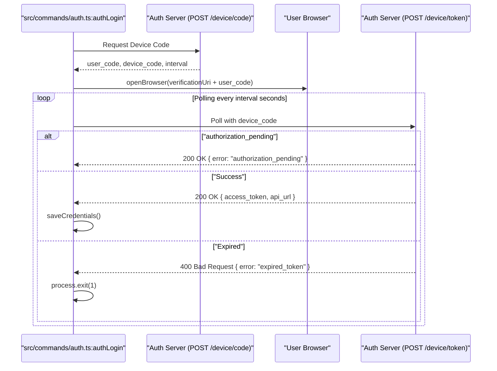
**Sources:** [src/commands/auth.ts:60-157]()

---

## Authentication Status and Verification

The `authStatus()` function provides a diagnostic view of the current authentication state and actively verifies the validity of the credentials [src/commands/auth.ts:170]().

### Verification Logic
1.  **Identity Identification**: It checks both `loadCredentials()` and `process.env.POSTIZ_API_KEY` to determine which method is active [src/commands/auth.ts:171-192]().
2.  **API Verification**: It performs a `GET` request to the `${apiUrl}/public/v1/integrations` endpoint using the identified `apiKey` [src/commands/auth.ts:203-209]().
3.  **Response Handling**:
    *   **200 OK**: Reports success and the number of connected integrations [src/commands/auth.ts:211-213]().
    *   **401/403**: Reports that credentials have expired and suggests re-authentication [src/commands/auth.ts:214-220]().
    *   **Other Errors**: Displays the HTTP status and error message [src/commands/auth.ts:221-224]().

**Sources:** [src/commands/auth.ts:170-224]()

---

# Page: Command Reference

# Command Reference

<details>
<summary>Relevant source files</summary>

The following files were used as context for generating this wiki page:

- [src/api.ts](src/api.ts)
- [src/commands/analytics.ts](src/commands/analytics.ts)
- [src/commands/integrations.ts](src/commands/integrations.ts)
- [src/commands/posts.ts](src/commands/posts.ts)
- [src/commands/upload.ts](src/commands/upload.ts)
- [src/index.ts](src/index.ts)

</details>


The `postiz` CLI provides a structured set of command namespaces to manage social media workflows, ranging from content creation and media handling to discovery of platform-specific settings and performance analytics. This page serves as a high-level map of these namespaces and their primary roles within the ecosystem.

### Command Structure Overview

The CLI is built using `yargs` [src/index.ts:1-12](), dispatching user input to specialized handler functions. Commands are grouped into four primary functional areas:

| Namespace | Primary Functions | Target Entities |
| :--- | :--- | :--- |
| `posts:*` | Create, List, Delete, Status Change | Posts, Threads, Drafts |
| `integrations:*` | List, Settings Discovery, Tool Execution | Social Media Accounts |
| `analytics:*` | Platform & Post metrics | Reach, Engagement, Stats |
| `upload` | Media processing | Images, Videos, Documents |

### Command Dispatch Architecture

The following diagram illustrates how the `yargs` entrypoint maps natural language CLI commands to specific code entities in the `src/commands/` directory.

**CLI Command Mapping**
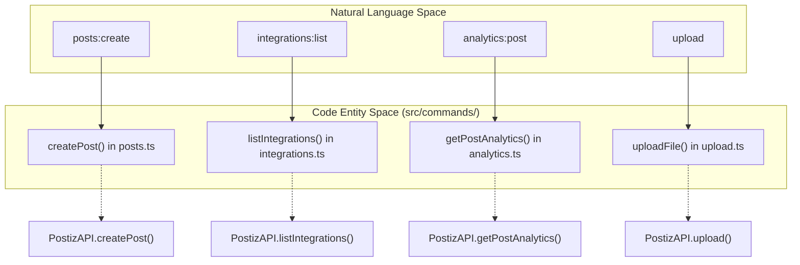
Sources: [src/index.ts:10-220](), [src/api.ts:42-194]()

---

### 3.1 Post Management Commands
The `posts` namespace handles the lifecycle of social media content. It supports simple one-off posts via CLI flags and complex multi-platform threads via JSON input [src/commands/posts.ts:56-135](). Key capabilities include:
* **Creation**: `posts:create` handles normalization of content, media pairings, and platform settings [src/commands/posts.ts:93-107]().
* **State Control**: `posts:status` allows moving posts between `draft` and `schedule` states, effectively starting or stopping backend workflows [src/index.ts:179-198]().
* **Synchronization**: `posts:missing` and `posts:connect` facilitate linking local post records with external platform release IDs [src/commands/posts.ts:5-47]().

For details, see [Post Management Commands](#3.1).

### 3.2 Integration Commands
The `integrations` namespace is the "Discovery" hub for AI agents and automation. It allows the CLI to query what platforms are connected and what specific requirements (schemas) those platforms have [src/commands/integrations.ts:19-37]().
* **Discovery**: `integrations:settings` returns the JSON schema for platform-specific fields (e.g., subreddits for Reddit, flairs, or X reply settings) [src/api.ts:178-182]().
* **RPC Tools**: `integrations:trigger` allows executing remote tools on the platform, such as fetching a list of YouTube playlists or LinkedIn companies [src/commands/integrations.ts:39-73]().

For details, see [Integration Commands](#3.2).

### 3.3 Analytics Commands
The `analytics` namespace provides access to performance data. It supports both broad platform-level views and granular per-post metrics [src/commands/analytics.ts:4-46]().
* **Time-Series Data**: Both `analytics:platform` and `analytics:post` accept a `date` lookback parameter (defaulting to 7 days) [src/commands/analytics.ts:13-35]().
* **Agent Feedback**: This namespace is critical for AI agents to close the loop by evaluating the success of previously published content [src/api.ts:160-170]().

For details, see [Analytics Commands](#3.3).

### 3.4 Media Upload Command
The `upload` command is a standalone utility to prepare local assets for social media posts. It handles the transition from local files to "Verified URLs" required by the Postiz API [src/commands/upload.ts:5-26]().
* **MIME Detection**: Automatically detects file types for images, videos, and documents based on extensions [src/api.ts:78-115]().
* **Multipart Construction**: Wraps the file in a `FormData` object for secure transmission to the `/public/v1/upload` endpoint [src/api.ts:120-130]().

For details, see [Media Upload Command](#3.4).

---

### Data Flow: Command to API
The following diagram bridges the command handlers to the underlying `PostizAPI` client methods.

**Internal Data Flow**
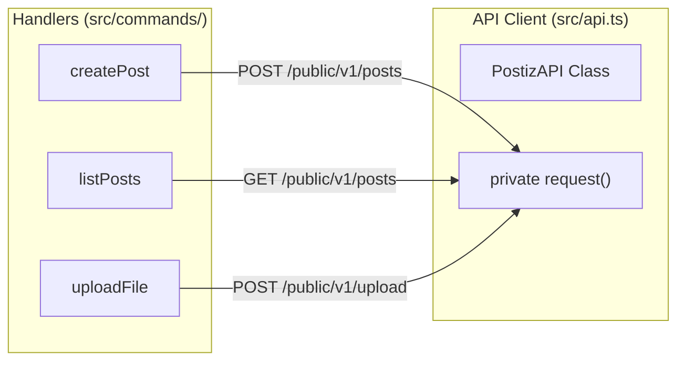
Sources: [src/api.ts:8-40](), [src/commands/posts.ts:139-142](), [src/commands/upload.ts:18-21]()

---

# Page: Post Management Commands

# Post Management Commands

<details>
<summary>Relevant source files</summary>

The following files were used as context for generating this wiki page:

- [examples/COMMAND_LINE_GUIDE.md](examples/COMMAND_LINE_GUIDE.md)
- [examples/EXAMPLES.md](examples/EXAMPLES.md)
- [src/commands/posts.ts](src/commands/posts.ts)
- [src/index.ts](src/index.ts)

</details>


This section provides a technical deep dive into the post management capabilities of the `postiz-agent`. It covers the lifecycle of a post from creation (via CLI flags or JSON) through listing, status transitions, and resolution of missing content.

## Post Creation Logic

The `posts:create` command in `src/index.ts` [src/index.ts:14-119]() supports two primary modes: **Flag Mode** for simple/scripted posts and **JSON Mode** for complex, multi-platform campaigns.

### Data Normalization Flow
When using flags, the `createPost` function in `src/commands/posts.ts` [src/commands/posts.ts:49-147]() performs a normalization process to transform flat CLI arguments into the nested `CreatePostDto` structure required by the Postiz API.

1.  **Integration Parsing**: Splits the comma-separated `-i` string into an array of IDs [src/commands/posts.ts:71-73]().
2.  **Content/Media Pairing**: Normalizes `-c` (content) and `-m` (media) into arrays. It then maps through `contents` to pair each piece of text with its corresponding media string [src/commands/posts.ts:84-107]().
3.  **Media Object Generation**: Media strings (comma-separated URLs) are split and assigned random IDs [src/commands/posts.ts:95-100]().
4.  **Settings Injection**: If `--settings` is provided as a JSON string, it is parsed and applied to every integration in the post [src/commands/posts.ts:113-122]().

### Diagram: CLI Flag to API DTO Mapping
This diagram illustrates how `createPost` maps natural language CLI flags into the structured entities used by the `PostizAPI` class.

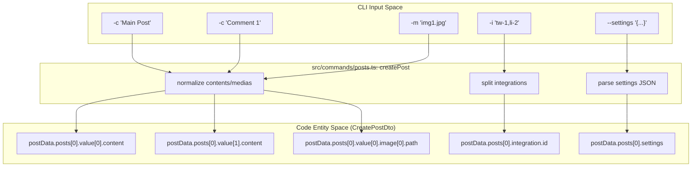
**Sources:** [src/commands/posts.ts:49-147](), [src/index.ts:14-119]()

---

## Post Lifecycle and State Machine

Posts exist in two primary states within the CLI: `draft` and `schedule`. The `posts:status` command allows users to move posts between these states.

### Status Transitions
The `changePostStatus` function [src/commands/posts.ts:182-205]() calls `api.changePostStatus` [src/api.ts:85-88]() (hypothetical based on usage). Moving a post to `draft` effectively pauses any running background workflows or scheduled triggers in the Postiz backend [src/index.ts:195-197]().

| Command | Action | Implementation |
| :--- | :--- | :--- |
| `posts:list` | Fetches posts within a date range (default +/- 30 days) | `listPosts` [src/commands/posts.ts:149-180]() |
| `posts:status --status draft` | Moves post to draft state | `changePostStatus` [src/commands/posts.ts:182-205]() |
| `posts:status --status schedule` | Schedules post for the defined date | `changePostStatus` [src/commands/posts.ts:182-205]() |
| `posts:delete <id>` | Removes post from the system | `deletePost` [src/commands/posts.ts:207-223]() |

**Sources:** [src/commands/posts.ts:149-223](), [src/index.ts:121-161](), [src/index.ts:179-205]()

---

## Resolution of Missing Content

In scenarios where a post is created but lacks a "Release ID" (often due to manual intervention on the platform or synchronization errors), the CLI provides a workflow to re-connect the Postiz entity with the actual platform content.

### The Connect Workflow
1.  **`posts:missing <id>`**: Calls `api.getMissingContent(id)` [src/commands/posts.ts:15]() to fetch a list of content available on the provider's side that hasn't been linked yet.
2.  **`posts:connect <id> --release-id <rid>`**: Calls `api.updateReleaseId(id, releaseId)` [src/commands/posts.ts:39]() to manually bind the local post ID to the remote release ID.

### Diagram: Missing Content Resolution
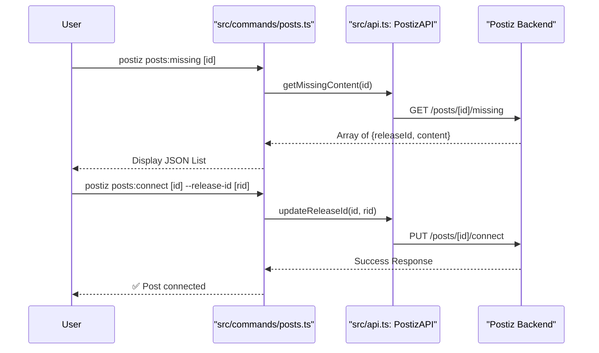
**Sources:** [src/commands/posts.ts:5-47](), [src/index.ts:162-177](), [src/index.ts:206-224]()

---

## Complex Composition (JSON Mode)

For advanced users and AI agents, the `--json` flag [src/index.ts:51-55]() allows bypassing the pairing logic of the CLI and providing a raw `CreatePostDto`.

### JSON Structure Highlights
The JSON format supports features not easily accessible via flags, such as different content for different platforms within the same campaign [examples/EXAMPLES.md:86-98]().

-   **`posts` Array**: Allows defining an array of integration-specific objects [examples/EXAMPLES.md:15-28]().
-   **`value` Array**: A list of objects containing `content`, `image` (array of `{id, path}`), and `delay` (in minutes) [examples/EXAMPLES.md:131-142]().
-   **`settings`**: Platform-specific metadata (e.g., Subreddit names, YouTube titles) [src/index.ts:106-115]().

**Sources:** [examples/EXAMPLES.md:9-30](), [examples/EXAMPLES.md:110-146](), [src/commands/posts.ts:56-69]()

---

# Page: Integration Commands

# Integration Commands

<details>
<summary>Relevant source files</summary>

The following files were used as context for generating this wiki page:

- [INTEGRATION_SETTINGS_DISCOVERY.md](INTEGRATION_SETTINGS_DISCOVERY.md)
- [INTEGRATION_TOOLS_WORKFLOW.md](INTEGRATION_TOOLS_WORKFLOW.md)
- [src/commands/integrations.ts](src/commands/integrations.ts)

</details>


The `integrations` namespace provides the core mechanisms for the **Discovery Workflow**. This pattern allows AI agents and CLI users to dynamically inspect platform capabilities, validate content against provider-specific constraints (like character limits), and execute RPC-style tools to fetch required metadata (like Reddit flairs or YouTube playlists).

## Overview of the Discovery Workflow

The Discovery Workflow bridges the gap between a generic post and platform-specific requirements. Instead of hardcoding rules for 28+ providers, the CLI queries the Postiz API to retrieve JSON schemas and available methods.

### Data Flow Diagram: Discovery to Execution

This diagram illustrates how an agent moves from identifying an integration to executing a tool via `src/commands/integrations.ts`.

"Discovery Workflow Data Flow"
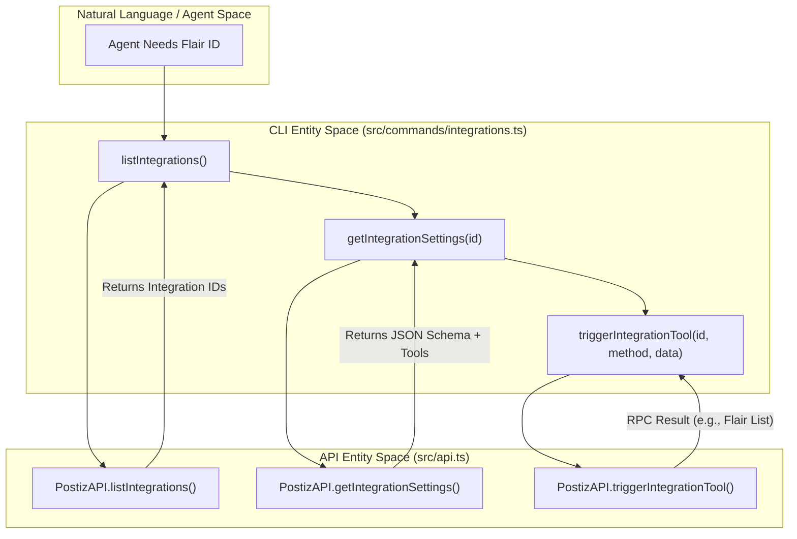
Sources: [src/commands/integrations.ts:4-73](), [src/api.ts:1-100]() (inferred from imports)

---

## Command Reference

### integrations:list
Lists all connected social media accounts associated with the current credentials. This is the entry point for finding the `id` required by all other integration commands.

*   **Function**: `listIntegrations()` [src/commands/integrations.ts:4-17]()
*   **API Endpoint**: `GET /integrations` [src/api.ts]()
*   **Output**: An array of objects containing `id`, `name`, `identifier`, and `provider`.

### integrations:settings
Retrieves the technical constraints and configuration schema for a specific integration. This is critical for AI agents to understand what fields are mandatory for a specific platform.

*   **Function**: `getIntegrationSettings(args)` [src/commands/integrations.ts:19-37]()
*   **Key Parameters**: `id` (Integration UUID).
*   **Returned Data Structure**:
    *   `maxLength`: Integer representing the platform's character limit (e.g., 280 for X, 40000 for Reddit). [INTEGRATION_SETTINGS_DISCOVERY.md:20]()
    *   `settings`: A JSON Schema object defining `properties` and `required` fields for the `--settings` flag in `posts:create`. [INTEGRATION_SETTINGS_DISCOVERY.md:21-33]()
    *   `tools`: An array of callable methods for dynamic data fetching. [INTEGRATION_TOOLS_WORKFLOW.md:24]()

### integrations:trigger
Executes a "tool" (RPC method) against a specific integration. This is used to fetch live data from the social platform that is required to populate settings.

*   **Function**: `triggerIntegrationTool(args)` [src/commands/integrations.ts:39-73]()
*   **Arguments**:
    *   `id`: The integration ID.
    *   `method`: The `methodName` discovered via `integrations:settings`.
    *   `-d, --data`: A JSON string containing parameters defined in the tool's `dataSchema`. [INTEGRATION_TOOLS_WORKFLOW.md:288-290]()

---

## Tool Execution Pattern

Tools are platform-specific functions. For example, Reddit requires a `subreddit` name to fetch available `flairs`. The `integrations:trigger` command facilitates this exchange.

### Interaction: Fetching Reddit Flairs

"Tool Execution Sequence"
```mermaid
sequenceDiagram
    participant User as "Agent/CLI User"
    participant CMD as "triggerIntegrationTool (src/commands/integrations.ts)"
    participant API as "PostizAPI (src/api.ts)"
    participant Remote as "Postiz Server / Provider API"

    User->>CMD: integrations:trigger <id> getFlairs -d '{"subreddit":"programming"}'
    CMD->>CMD: JSON.parse(args.data)
    Note over CMD: [src/commands/integrations.ts:57]
    CMD->>API: triggerIntegrationTool(id, "getFlairs", data)
    API->>Remote: POST /integrations/<id>/trigger/<method>
    Remote-->>API: { "output": [{ "id": "f1", "name": "News" }] }
    API-->>CMD: Result Object
    CMD->>User: JSON String Output
```
Sources: [src/commands/integrations.ts:39-73](), [INTEGRATION_TOOLS_WORKFLOW.md:97-117]()

### Common Tools by Platform

| Platform | Method Name | Purpose |
| :--- | :--- | :--- |
| **Reddit** | `getFlairs` | Returns ID/Name pairs for subreddit flairs |
| **YouTube** | `getPlaylists` | Returns available playlists for the channel |
| **LinkedIn** | `getCompanies` | Lists companies the user has permission to post as |
| **Pinterest** | `getBoards` | Returns user boards for pin placement |
| **X (Twitter)** | `getCommunities` | Lists communities the user can post into |

Sources: [INTEGRATION_TOOLS_WORKFLOW.md:292-315]()

---

## Implementation Details

### JSON Schema Discovery
The `integrations:settings` command returns a standard JSON Schema. For platforms like Reddit, this schema is deeply nested, defining requirements for `subreddit`, `title`, and `type`. For simpler platforms (Threads, Mastodon), it returns a simplified message: `"No additional settings required"`.

Sources: [INTEGRATION_SETTINGS_DISCOVERY.md:81-127](), [INTEGRATION_SETTINGS_DISCOVERY.md:228-235]()

### Error Handling in Commands
All integration commands follow a strict error pattern:
1.  **Config Loading**: Calls `getConfig()` to retrieve API keys or tokens. [src/commands/integrations.ts:5]()
2.  **Validation**: Checks for mandatory arguments (e.g., `id` or `method`). [src/commands/integrations.ts:23-26]()
3.  **Try/Catch**: Wraps the API call. On failure, it logs the error and exits with `process.exit(1)` to signal failure to calling scripts or agents. [src/commands/integrations.ts:13-16]()

Sources: [src/commands/integrations.ts:1-74]()

---

# Page: Analytics Commands

# Analytics Commands

<details>
<summary>Relevant source files</summary>

The following files were used as context for generating this wiki page:

- [src/api.ts](src/api.ts)
- [src/commands/analytics.ts](src/commands/analytics.ts)
- [src/index.ts](src/index.ts)

</details>


The Postiz CLI provides specialized commands for retrieving performance metrics at both the integration (platform-wide) and individual post levels. These commands interface with the `PostizAPI` to fetch time-series data and engagement metrics.

## Analytics Retrieval Flow

Analytics commands follow a standard pattern: they authenticate using local credentials via `getConfig`, instantiate the `PostizAPI` client, and execute a GET request with a lookback parameter.

### Command Structure and Implementation
The logic for these commands is encapsulated in `src/commands/analytics.ts` [src/commands/analytics.ts:1-47]().

| Command | Function | API Endpoint | Description |
| :--- | :--- | :--- | :--- |
| `analytics:platform` | `getAnalytics` | `/public/v1/analytics/:id` | Fetches aggregate metrics for a specific integration (e.g., X/Twitter account). |
| `analytics:post` | `getPostAnalytics` | `/public/v1/analytics/post/:id` | Fetches performance data for a specific post across its lifecycle. |

### The Date Lookback Parameter
Both commands accept a `--date` (or `-d`) parameter [src/index.ts:219-250]().
- **Default Value**: If omitted, the system defaults to `'7'` (representing the last 7 days) [src/commands/analytics.ts:13-13](), [src/commands/analytics.ts:35-35]().
- **Data Type**: The parameter is passed as a string to the API, which typically interprets it as a day-count or a specific ISO date string [src/api.ts:161-169]().

### Code Entity Mapping: Analytics Flow

The following diagram maps the CLI command definitions to their underlying handler functions and API client methods.

**Analytics Logic Mapping**
```mermaid
graph TD
  subgraph "CLI Entrypoint (src/index.ts)"
    A["'analytics:platform'"] -- calls --> B["getAnalytics(args)"]
    C["'analytics:post'"] -- calls --> D["getPostAnalytics(args)"]
  end

  subgraph "Command Handlers (src/commands/analytics.ts)"
    B -- invokes --> E["api.getAnalytics(id, date)"]
    D -- invokes --> F["api.getPostAnalytics(id, date)"]
  end

  subgraph "API Client (src/api.ts)"
    E -- "GET /public/v1/analytics/:id" --> G["Postiz API Server"]
    F -- "GET /public/v1/analytics/post/:id" --> G
  end
```
Sources: [src/index.ts:219-250](), [src/commands/analytics.ts:4-46](), [src/api.ts:160-170]()

---

## Handling Missing Content and Post Connection

A critical aspect of the analytics workflow is ensuring that the `Postiz` system can track posts that were successfully published but whose "Release ID" (the platform-specific ID, like a Tweet ID) was not captured during the initial automated flow.

### The `{ missing: true }` Response
When querying `analytics:post`, the API may return a response containing `{ "missing": true }`. This indicates that while the post record exists in Postiz, the system lacks the remote platform's ID to fetch the latest metrics.

### Resolution Workflow: posts:missing and posts:connect
To resolve missing IDs and restore analytics tracking, the CLI provides a two-step discovery and connection workflow.

1.  **Discovery**: Run `posts:missing <id>` [src/index.ts:163-177](). This calls `api.getMissingContent(postId)` [src/api.ts:140-144](), which queries the provider (e.g., LinkedIn, X) for recent content published by the user that has not yet been linked to a Postiz record.
2.  **Resolution**: Once the user identifies the correct remote content, they run `posts:connect <id> --releaseId <remote_id>` [src/index.ts:201-217](). This calls `api.updateReleaseId(postId, releaseId)` [src/api.ts:146-151](), performing a `PUT` request to update the record.

**Data Flow: Missing Content Resolution**
```mermaid
sequenceDiagram
    participant User
    participant CLI as "CLI (src/commands/posts.ts)"
    participant API as "PostizAPI (src/api.ts)"
    participant Srv as "Postiz Server"

    User->>CLI: postiz posts:missing <id>
    CLI->>API: getMissingContent(postId)
    API->>Srv: GET /public/v1/posts/:id/missing
    Srv-->>User: Returns list of platform posts (IDs and Snippets)
    
    User->>CLI: postiz posts:connect <id> --releaseId <r_id>
    CLI->>API: updateReleaseId(postId, r_id)
    API->>Srv: PUT /public/v1/posts/:id/release-id
    Srv-->>User: 200 OK (Analytics tracking restored)
```
Sources: [src/index.ts:163-217](), [src/api.ts:140-151](), [src/commands/posts.ts:101-131]()

---

## Technical Reference

### PostizAPI Methods
The `PostizAPI` class implements the following methods to support analytics and connection workflows:

- **`getAnalytics(integrationId: string, date: string)`**: [src/api.ts:160-164]()
  - Endpoint: `/public/v1/analytics/${integrationId}`
  - Method: `GET`
- **`getPostAnalytics(postId: string, date: string)`**: [src/api.ts:166-170]()
  - Endpoint: `/public/v1/analytics/post/${postId}`
  - Method: `GET`
- **`getMissingContent(postId: string)`**: [src/api.ts:140-144]()
  - Endpoint: `/public/v1/posts/${postId}/missing`
  - Method: `GET`
- **`updateReleaseId(postId: string, releaseId: string)`**: [src/api.ts:146-151]()
  - Endpoint: `/public/v1/posts/${postId}/release-id`
  - Method: `PUT`

### Error Handling
Analytics commands use a standard `try-catch` block. If the API returns a non-200 status, the `PostizAPI.request` method throws an error including the status code and response body [src/api.ts:31-34](). The command handlers then catch this, log the error to `stderr`, and exit with code `1` [src/commands/analytics.ts:20-23](), [src/commands/analytics.ts:42-45]().

Sources: [src/api.ts:17-40](), [src/commands/analytics.ts:1-47]()

---

# Page: Media Upload Command

# Media Upload Command

<details>
<summary>Relevant source files</summary>

The following files were used as context for generating this wiki page:

- [SUPPORTED_FILE_TYPES.md](SUPPORTED_FILE_TYPES.md)
- [src/api.ts](src/api.ts)
- [src/commands/analytics.ts](src/commands/analytics.ts)
- [src/commands/upload.ts](src/commands/upload.ts)

</details>


The `upload` command is a critical utility within the Postiz CLI that enables users and AI agents to stage local media files to the Postiz CDN. This process is a prerequisite for creating posts on visual-heavy platforms like TikTok, Instagram, and YouTube, which require media to be hosted at a **Verified URL** before the post can be scheduled or published.

## Implementation Overview

The upload workflow involves reading a local file into a buffer, automatically determining the correct MIME type based on the file extension, and transmitting the data via a `multipart/form-data` request to the Postiz API.

### Media Upload Data Flow

The following diagram illustrates the transition from a local file path provided in the CLI to a hosted URL returned by the API.

**Diagram: Local File to Verified URL Flow**
```mermaid
graph TD
  subgraph "Local Environment"
    A["uploadFile(args)"] -- "readFileSync" --> B["Buffer"]
    C["File Extension"] -- "MIME Lookup" --> D["MIME Type"]
  end

  subgraph "PostizAPI Class"
    B & D & E["Filename"] --> F["PostizAPI.upload()"]
    F --> G["FormData Construction"]
    G --> H["fetch(/public/v1/upload)"]
  end

  subgraph "Postiz Cloud"
    H --> I["CDN Storage"]
    I --> J["JSON Response {path, url}"]
  end

  J -- "Success" --> K["CLI Output"]
```
Sources: [src/commands/upload.ts:5-21](), [src/api.ts:74-138]()

## Technical Implementation

### 1. Local File Handling
The command entry point `uploadFile` uses the Node.js `fs` module to read the file into memory [src/commands/upload.ts:15-15](). It extracts the filename from the provided path to preserve the original name during the upload process [src/commands/upload.ts:16-16]().

### 2. MIME Type Detection
To ensure compatibility with social media platform requirements (e.g., TikTok requiring `video/mp4`), the `PostizAPI` contains a comprehensive lookup table [src/api.ts:79-115](). It extracts the extension [src/api.ts:76-76]() and maps it to a standard MIME type. If the extension is unrecognized, it defaults to `application/octet-stream` [src/api.ts:117-117]().

| Category | Extensions | MIME Type Example |
| :--- | :--- | :--- |
| **Images** | .png, .jpg, .gif, .webp | `image/png` |
| **Videos** | .mp4, .mov, .webm, .mkv | `video/mp4` |
| **Audio** | .mp3, .wav, .aac, .m4a | `audio/mpeg` |
| **Documents** | .pdf, .doc, .docx | `application/pdf` |

Sources: [src/api.ts:79-117](), [SUPPORTED_FILE_TYPES.md:20-83]()

### 3. Multipart Construction
The `PostizAPI.upload` method utilizes the `node-fetch` `FormData` implementation to wrap the file buffer [src/api.ts:75-75](). A `Blob` is created from the buffer and assigned the detected MIME type [src/api.ts:119-119](), then appended to the form data under the key `file` [src/api.ts:120-120]().

### 4. API Interaction
The request is sent to `${this.apiUrl}/public/v1/upload` [src/api.ts:122-122](). Unlike standard API requests in the class, the `Content-Type` header is **not** set to `application/json`; instead, the `fetch` call automatically handles the `multipart/form-data` boundary [src/api.ts:123-130]().

Sources: [src/api.ts:119-130]()

## The Verified URL Concept

Platforms like TikTok, Instagram, and YouTube do not accept raw binary data during the post creation RPC. Instead, they require a publicly accessible URL.

1.  **Upload First**: The user executes `postiz upload my-video.mp4`.
2.  **Capture URL**: The API returns a JSON object containing the `path` or `url` [SUPPORTED_FILE_TYPES.md:113-120]().
3.  **Reference in Post**: This URL is then passed into the `-m` (media) flag of the `posts:create` command [SUPPORTED_FILE_TYPES.md:133-137]().

**Diagram: Command Entity Association**
```mermaid
sequenceDiagram
    participant CLI as "src/commands/upload.ts"
    participant API as "src/api.ts:PostizAPI"
    participant FS as "fs:readFileSync"
    
    CLI->>FS: Request file at args.file
    FS-->>CLI: return Buffer
    CLI->>API: upload(fileBuffer, filename)
    Note over API: mimeTypes lookup [line 79]
    API->>API: new Blob([file], { type })
    API->>API: formData.append('file', blob)
    API->>Postiz: POST /public/v1/upload
    Postiz-->>API: { url: "https://..." }
    API-->>CLI: return result
    CLI->>Console: JSON.stringify(result)
```
Sources: [src/commands/upload.ts:15-20](), [src/api.ts:74-138]()

## Usage and Platform Limits

The CLI output provides the hosted URL which must be used for subsequent post creation.

```bash
# Example Upload
postiz upload ./promo.mp4
```

### Platform-Specific Constraints
While the CLI supports over 30 file types [SUPPORTED_FILE_TYPES.md:286-288](), individual platforms impose their own limits that the user must respect:

*   **Twitter/X**: Max 512MB for videos [SUPPORTED_FILE_TYPES.md:194-194]().
*   **Instagram**: Max 100MB for videos [SUPPORTED_FILE_TYPES.md:222-222]().
*   **TikTok**: Max 287.6MB for videos [SUPPORTED_FILE_TYPES.md:223-223]().
*   **YouTube**: Max 128GB for standard accounts [SUPPORTED_FILE_TYPES.md:224-224]().

Sources: [SUPPORTED_FILE_TYPES.md:217-225]()

---

# Page: Platform Integration Guide

# Platform Integration Guide

<details>
<summary>Relevant source files</summary>

The following files were used as context for generating this wiki page:

- [INTEGRATION_TOOLS_WORKFLOW.md](INTEGRATION_TOOLS_WORKFLOW.md)
- [PROVIDER_SETTINGS.md](PROVIDER_SETTINGS.md)
- [PROVIDER_SETTINGS_SUMMARY.md](PROVIDER_SETTINGS_SUMMARY.md)
- [SKILL.md](SKILL.md)

</details>


The Postiz CLI is designed to interface with 28+ social media and communication platforms. Because each platform has unique requirements—such as Reddit's subreddits, YouTube's playlists, or TikTok's privacy levels—the system uses a dynamic discovery and configuration pattern. This guide provides a high-level overview of how the CLI handles platform-specific schemas and the tools used to fetch the dynamic data required to populate them.

### Platform Integration Architecture

The integration layer bridges the gap between a generic post (content and media) and the specific requirements of a social network. This is achieved through two primary mechanisms: **Provider Settings** (static configuration schemas) and **Integration Tools** (dynamic data fetching).

#### System Mapping: Discovery to Code
The following diagram illustrates how the CLI's natural language commands map to specific code entities and data structures within the Postiz ecosystem.

"Discovery and Execution Flow"
```mermaid
graph TD
    subgraph "CLI Command Space"
        C1["postiz integrations:settings"]
        C2["postiz integrations:trigger"]
        C3["postiz posts:create"]
    end

    subgraph "Code Entity Space"
        E1["integrations:settings handler"]
        E2["integrations:trigger handler"]
        E3["PostizAPI.trigger(id, method, data)"]
        E4["CreatePostDto"]
    end

    subgraph "Data Structures"
        D1["settings.properties"]
        D2["tools.methodName"]
        D3["settings.__type discriminator"]
    end

    C1 --> E1
    E1 --> D1
    E1 --> D2
    C2 --> E2
    E2 --> E3
    C3 --> E4
    E4 --> D3
```
Sources: [SKILL.md:65-71](), [INTEGRATION_TOOLS_WORKFLOW.md:15-24](), [PROVIDER_SETTINGS.md:23-48]()

---

### Provider Settings Schemas

Every platform supported by Postiz (e.g., X, LinkedIn, Reddit, YouTube) has a unique settings schema. When creating a post, these settings are passed via the `--settings` flag or within a JSON file.

Key concepts include:
*   **The `__type` Discriminator**: In JSON mode, this field identifies which platform schema to validate against (e.g., `"__type": "reddit"`) [PROVIDER_SETTINGS.md:34-36]().
*   **Required vs. Optional Fields**: Some platforms require specific metadata. For example, YouTube requires a `title` (2-100 characters) and a `type` (`public`, `private`, or `unlisted`) [PROVIDER_SETTINGS.md:83-88]().
*   **EmptySettings**: Platforms like Threads, Mastodon, and Bluesky do not require additional configuration and use the `EmptySettings` pattern [PROVIDER_SETTINGS.md:263-276]().

For detailed schemas and JSON examples for all 28+ providers, see **[Provider Settings Schemas](#4.1)**.

Sources: [PROVIDER_SETTINGS.md:1-60](), [PROVIDER_SETTINGS_SUMMARY.md:9-33]()

---

### Integration Tools Workflow

Many platform settings require IDs that cannot be guessed, such as a Reddit Flair ID, a YouTube Playlist ID, or a LinkedIn Company ID. The CLI provides a "Discovery Workflow" to fetch this data dynamically.

#### The Tool Discovery Loop
This diagram shows how an agent or user discovers what data is needed and uses tools to retrieve it before posting.

"Dynamic Data Fetching Workflow"
```mermaid
sequenceDiagram
    participant U as User/Agent
    participant CLI as Postiz CLI
    participant API as Postiz API
    
    U->>CLI: integrations:settings <id>
    CLI->>API: GET /integrations/:id/settings
    API-->>CLI: Returns JSON (settings schema + tools)
    CLI-->>U: Displays tools (e.g., "getFlairs")
    
    U->>CLI: integrations:trigger <id> getFlairs -d '{"subreddit":"..."}'
    CLI->>API: POST /integrations/:id/trigger/:method
    API-->>CLI: Returns dynamic IDs/Labels
    CLI-->>U: Displays IDs (e.g., "flair-12345")
    
    U->>CLI: posts:create --settings '{"flair": {"id": "flair-12345"}}'
```
Sources: [INTEGRATION_TOOLS_WORKFLOW.md:5-37](), [SKILL.md:48-59]()

The workflow typically follows these steps:
1.  **Discover**: Call `integrations:settings` to see the available `tools` for an integration [INTEGRATION_TOOLS_WORKFLOW.md:15-24]().
2.  **Trigger**: Execute a specific tool (e.g., `getPlaylists`) using `integrations:trigger` to get the necessary IDs [INTEGRATION_TOOLS_WORKFLOW.md:26-32]().
3.  **Post**: Use the retrieved IDs in the `posts:create` command [INTEGRATION_TOOLS_WORKFLOW.md:34-36]().

For a full list of common tool methods (like `getCompanies` for LinkedIn or `getBoards` for Pinterest), see **[Integration Tools Workflow](#4.2)**.

Sources: [INTEGRATION_TOOLS_WORKFLOW.md:292-315](), [SKILL.md:117-129]()

---

# Page: Provider Settings Schemas

# Provider Settings Schemas

<details>
<summary>Relevant source files</summary>

The following files were used as context for generating this wiki page:

- [INTEGRATION_SETTINGS_DISCOVERY.md](INTEGRATION_SETTINGS_DISCOVERY.md)
- [PROVIDER_SETTINGS.md](PROVIDER_SETTINGS.md)
- [PROVIDER_SETTINGS_SUMMARY.md](PROVIDER_SETTINGS_SUMMARY.md)

</details>


The Postiz CLI supports platform-specific configurations for over 28 social media providers [PROVIDER_SETTINGS_SUMMARY.md:5-5](). These settings allow users to control granular details like Reddit subreddits, YouTube visibility, and X (Twitter) reply permissions. This page details the schema structure, the `__type` discriminator pattern, and the discovery mechanism used to fetch these schemas dynamically.

## The Discriminator Pattern

When creating posts, especially via JSON files, the system uses a `__type` discriminator within the `settings` object to route data to the correct platform validator [PROVIDER_SETTINGS.md:34-45]().

### Data Flow for Settings
The following diagram illustrates how settings move from the CLI/JSON input through the `PostizAPI` to the backend.

**Settings Resolution Diagram**
```mermaid
graph TD
    subgraph "Input Layer"
        "CLI_Flags"["--settings 'JSON'"]
        "JSON_File"["post.json"]
    end

    subgraph "Code Entity Space: src/commands/posts.ts"
        "createPostHandler"["createPostHandler()"]
        "normalizeSettings"["normalizeSettings()"]
    end

    subgraph "Code Entity Space: src/api.ts"
        "PostizAPI"["PostizAPI.createPost()"]
    end

    "CLI_Flags" --> "createPostHandler"
    "JSON_File" --> "createPostHandler"
    "createPostHandler" --> "normalizeSettings"
    "normalizeSettings" -- "Injects __type" --> "PostizAPI"
    "PostizAPI" -- "POST /posts" --> "Postiz_Backend"
```
Sources: [PROVIDER_SETTINGS.md:17-48](), [INTEGRATION_SETTINGS_DISCOVERY.md:130-150]()

## Dynamic Schema Discovery

Instead of hardcoding every platform's requirements in the CLI, the agent uses the `integrations:settings` command to discover capabilities at runtime [INTEGRATION_SETTINGS_DISCOVERY.md:5-7](). This is critical for AI agents to understand character limits and required fields before attempting a post [INTEGRATION_SETTINGS_DISCOVERY.md:268-273]().

### Discovery Workflow
1. **Identify Integration**: Run `postiz integrations:list` to get the `id` and `provider` [INTEGRATION_SETTINGS_DISCOVERY.md:40-44]().
2. **Fetch Schema**: Run `postiz integrations:settings <id>` to retrieve the JSON Schema [INTEGRATION_SETTINGS_DISCOVERY.md:12-13]().
3. **Validate Content**: Check `maxLength` and `required` fields against the returned schema [INTEGRATION_SETTINGS_DISCOVERY.md:18-35]().

Sources: [INTEGRATION_SETTINGS_DISCOVERY.md:5-36](), [INTEGRATION_SETTINGS_DISCOVERY.md:40-68]()

## Platform-Specific Schemas

### 1. Reddit (`reddit`)
Reddit requires a nested structure because a single post can target specific subreddit configurations.

| Field | Type | Required | Description |
| :--- | :--- | :--- | :--- |
| `subreddit` | `string` | Yes | Name of the subreddit [PROVIDER_SETTINGS.md:55-55]() |
| `title` | `string` | Yes | Post title (distinct from content) [PROVIDER_SETTINGS.md:56-56]() |
| `type` | `enum` | Yes | `"text"` or `"link"` [PROVIDER_SETTINGS.md:57-57]() |
| `url` | `string` | Conditional | Required if `type` is `"link"` [PROVIDER_SETTINGS.md:58-58]() |
| `flair` | `object` | No | Contains `id` and `name` [PROVIDER_SETTINGS.md:60-60]() |

**Example JSON:**
```json
{
  "__type": "reddit",
  "subreddit": [{
    "value": {
      "subreddit": "programming",
      "title": "Technical Post",
      "type": "text",
      "is_flair_required": false
    }
  }]
}
```
Sources: [PROVIDER_SETTINGS.md:52-79](), [INTEGRATION_SETTINGS_DISCOVERY.md:73-128]()

### 2. YouTube (`youtube`)
YouTube settings focus on video metadata and visibility [PROVIDER_SETTINGS.md:81-89]().

| Field | Type | Required | Limits/Values |
| :--- | :--- | :--- | :--- |
| `title` | `string` | Yes | 2-100 characters [PROVIDER_SETTINGS.md:84-84]() |
| `type` | `enum` | Yes | `public`, `private`, `unlisted` [PROVIDER_SETTINGS.md:85-85]() |
| `selfDeclaredMadeForKids` | `enum` | No | `yes`, `no` [PROVIDER_SETTINGS.md:86-86]() |
| `tags` | `array` | No | Array of `{value, label}` [PROVIDER_SETTINGS.md:88-88]() |

Sources: [PROVIDER_SETTINGS.md:81-105](), [INTEGRATION_SETTINGS_DISCOVERY.md:165-175]()

### 3. X / Twitter (`x`)
X settings handle audience controls and community targeting [PROVIDER_SETTINGS.md:107-117]().

| Field | Type | Required | Values |
| :--- | :--- | :--- | :--- |
| `who_can_reply_post` | `enum` | Yes | `everyone`, `following`, `mentionedUsers`, `subscribers`, `verified` [PROVIDER_SETTINGS.md:111-116]() |
| `community` | `string` | No | URL format: `https://x.com/i/communities/...` [PROVIDER_SETTINGS.md:110-110]() |

Sources: [PROVIDER_SETTINGS.md:107-139](), [INTEGRATION_SETTINGS_DISCOVERY.md:176-186]()

### 4. TikTok (`tiktok`)
TikTok has the most extensive set of required boolean toggles for content safety and interaction [PROVIDER_SETTINGS.md:193-209]().

| Field | Type | Required | Default/Values |
| :--- | :--- | :--- | :--- |
| `privacy_level` | `enum` | Yes | `PUBLIC_TO_EVERYONE`, `SELF_ONLY`, etc. [PROVIDER_SETTINGS.md:197-201]() |
| `content_posting_method`| `enum` | Yes | `DIRECT_POST`, `UPLOAD` [PROVIDER_SETTINGS.md:209-209]() |
| `duet` / `stitch` | `boolean`| Yes | Permission toggles [PROVIDER_SETTINGS.md:202-203]() |
| `autoAddMusic` | `enum` | Yes | `yes`, `no` [PROVIDER_SETTINGS.md:205-205]() |

Sources: [PROVIDER_SETTINGS.md:193-229](), [INTEGRATION_SETTINGS_DISCOVERY.md:197-207]()

### 5. Instagram (`instagram`)
Instagram requires defining the media container type [PROVIDER_SETTINGS.md:160-167]().

| Field | Type | Required | Values |
| :--- | :--- | :--- | :--- |
| `post_type` | `enum` | Yes | `post`, `story` [PROVIDER_SETTINGS.md:163-163]() |
| `is_trial_reel` | `boolean`| No | [PROVIDER_SETTINGS.md:164-164]() |
| `collaborators` | `array` | No | Array of collaborator labels [PROVIDER_SETTINGS.md:166-166]() |

Sources: [PROVIDER_SETTINGS.md:160-191](), [INTEGRATION_SETTINGS_DISCOVERY.md:208-218]()

## EmptySettings Platforms

Several platforms do not require additional metadata beyond the post content and media. These use the `EmptySettings` schema [PROVIDER_SETTINGS.md:265-272](). When querying `integrations:settings` for these, the `output.settings` field will return "No additional settings required" [INTEGRATION_SETTINGS_DISCOVERY.md:228-235]().

**Supported EmptySettings Platforms:**
- Threads [PROVIDER_SETTINGS.md:266-266]()
- Mastodon [PROVIDER_SETTINGS.md:267-267]()
- Bluesky [PROVIDER_SETTINGS.md:268-268]()
- Telegram [PROVIDER_SETTINGS.md:269-269]()
- Nostr [PROVIDER_SETTINGS.md:270-270]()
- VK [PROVIDER_SETTINGS.md:271-271]()

Sources: [PROVIDER_SETTINGS.md:263-277](), [INTEGRATION_SETTINGS_DISCOVERY.md:219-244]()

## Summary of Constraints

The CLI enforces character limits discovered via the API to prevent submission errors [INTEGRATION_SETTINGS_DISCOVERY.md:259-266]().

| Provider | Max Content Length | Key Constraint |
| :--- | :--- | :--- |
| **Reddit** | 40,000 | Title is mandatory [INTEGRATION_SETTINGS_DISCOVERY.md:80-98]() |
| **YouTube** | 5,000 | Description length [INTEGRATION_SETTINGS_DISCOVERY.md:172-172]() |
| **X (Twitter)** | 280 / 4,000 | Higher limit for verified [INTEGRATION_SETTINGS_DISCOVERY.md:183-183]() |
| **LinkedIn** | 3,000 | [INTEGRATION_SETTINGS_DISCOVERY.md:194-194]() |
| **Instagram** | 2,200 | [INTEGRATION_SETTINGS_DISCOVERY.md:215-215]() |
| **TikTok** | 150 | Caption limit [INTEGRATION_SETTINGS_DISCOVERY.md:204-204]() |
| **Threads** | 500 | [INTEGRATION_SETTINGS_DISCOVERY.md:231-231]() |

Sources: [INTEGRATION_SETTINGS_DISCOVERY.md:79-235](), [PROVIDER_SETTINGS_SUMMARY.md:11-32]()

---

# Page: Integration Tools Workflow

# Integration Tools Workflow

<details>
<summary>Relevant source files</summary>

The following files were used as context for generating this wiki page:

- [INTEGRATION_TOOLS_WORKFLOW.md](INTEGRATION_TOOLS_WORKFLOW.md)
- [SKILL.md](SKILL.md)

</details>


The **Integration Tools Workflow** is a dynamic discovery pattern used to retrieve platform-specific metadata required for posting. While some platforms only require text and media, others (like Reddit, YouTube, or Pinterest) require specific IDs for subreddits, flairs, playlists, or boards. The Postiz CLI facilitates this through an RPC-style "trigger" mechanism.

## Overview of the Discovery Pattern

The workflow follows a four-step sequence that allows a technical user or an AI agent to determine what data is needed and how to fetch it without hardcoded platform logic [SKILL.md:50-58]().

1.  **List**: Identify the connected `integration-id` [INTEGRATION_TOOLS_WORKFLOW.md:7-13]().
2.  **Settings Discovery**: Inspect the `tools` and `settings` schema for that integration [INTEGRATION_TOOLS_WORKFLOW.md:15-24]().
3.  **Data Fetching**: Call specific `methodName` tools via `integrations:trigger` to get dynamic IDs [INTEGRATION_TOOLS_WORKFLOW.md:26-32]().
4.  **Composition**: Inject the retrieved IDs into the `settings` object during post creation [INTEGRATION_TOOLS_WORKFLOW.md:34-36]().

### Workflow Data Flow

The following diagram illustrates the interaction between the CLI commands and the Postiz API to resolve dynamic data.

**Discovery to Execution Sequence**
```mermaid
sequenceDiagram
    participant CLI as "Postiz CLI"
    participant API as "Postiz API"
    participant Prov as "Platform Provider (e.g. Reddit)"

    CLI->>API: integrations:settings <id>
    API-->>CLI: { settings: Schema, tools: Tool[] }
    Note over CLI: CLI parses tools[].methodName<br/>and tools[].dataSchema
    CLI->>API: integrations:trigger <id> <method> -d {params}
    API->>Prov: Fetch dynamic data (e.g. getFlairs)
    Prov-->>API: [ {id: "f1", name: "News"} ]
    API-->>CLI: { output: [ {id: "f1", name: "News"} ] }
    Note over CLI: User/Agent selects "f1"
    CLI->>API: posts:create --settings '{"flair": {"id": "f1"}}'
```
Sources: [INTEGRATION_TOOLS_WORKFLOW.md:5-36](), [SKILL.md:65-76]()

---

## Technical Implementation

### Discovery via `integrations:settings`
The `integrations:settings` command returns a JSON object containing a `tools` array. Each tool defines an executable method on the backend [INTEGRATION_TOOLS_WORKFLOW.md:262-280]().

| Property | Description |
| :--- | :--- |
| `methodName` | The string identifier passed to the trigger command. |
| `description` | Human/AI readable explanation of the tool's purpose. |
| `dataSchema` | An array of parameter objects (key, description, type) required by the tool. |

**Example Tool Schema (Reddit)**
```json
{
  "methodName": "getFlairs",
  "description": "Get available flairs for a subreddit",
  "dataSchema": [
    { "key": "subreddit", "type": "string" }
  ]
}
```
Sources: [INTEGRATION_TOOLS_WORKFLOW.md:47-94](), [INTEGRATION_TOOLS_WORKFLOW.md:264-275]()

### Execution via `integrations:trigger`
The `integrations:trigger` command acts as a proxy for provider-specific API calls. It takes an integration ID, a method name, and optional JSON data [SKILL.md:126-128]().

**Command Syntax:**
`postiz integrations:trigger <integration-id> <method-name> [-d '{"key":"value"}']` [INTEGRATION_TOOLS_WORKFLOW.md:31-31]()

**Internal Logic Mapping**
```mermaid
graph TD
    subgraph "CLI Space"
        A["integrations:trigger command"] --> B["PostizAPI.post()"]
    end

    subgraph "API Entity Space"
        B --> C["/integrations/:id/trigger endpoint"]
        C --> D["Provider.methodName()"]
    end

    subgraph "Data Resolution"
        D --> E["Reddit: getFlairs"]
        D --> F["YouTube: getPlaylists"]
        D --> G["LinkedIn: getCompanies"]
    end
```
Sources: [SKILL.md:70-70](), [INTEGRATION_TOOLS_WORKFLOW.md:292-315]()

---

## Common Tool Methods by Platform

Different platforms expose different tools to satisfy their specific `settings` requirements [INTEGRATION_TOOLS_WORKFLOW.md:292-315]().

| Platform | Common Methods | Purpose |
| :--- | :--- | :--- |
| **Reddit** | `getFlairs`, `searchSubreddits` | Resolve flair IDs and find subreddit names. |
| **YouTube** | `getPlaylists`, `getCategories` | Assign video to playlist; set mandatory category ID. |
| **LinkedIn** | `getCompanies` | Retrieve URNs for organizations the user manages. |
| **Pinterest** | `getBoards`, `getBoardSections` | Find target board for a Pin. |
| **Twitter/X** | `getCommunities` | Post to a specific X Community. |

Sources: [INTEGRATION_TOOLS_WORKFLOW.md:292-315]()

---

## Practical Examples

### YouTube Playlist Workflow
YouTube requires a `playlistId` if you want the video to appear in a specific collection.

1.  **Trigger Tool**: `postiz integrations:trigger youtube-id getPlaylists` [INTEGRATION_TOOLS_WORKFLOW.md:172-172]()
2.  **Receive Result**: Returns `[{"id": "PL123", "title": "Tutorials"}]` [INTEGRATION_TOOLS_WORKFLOW.md:178-188]()
3.  **Create Post**:
    ```bash
    postiz posts:create -c "Desc" -i "youtube-id" --settings '{"playlistId": "PL123"}'
    ```
    Sources: [INTEGRATION_TOOLS_WORKFLOW.md:193-202]()

### Reddit Flair Workflow
Reddit often requires a flair ID for specific subreddits.

1.  **Trigger Tool**: `postiz integrations:trigger reddit-id getFlairs -d '{"subreddit":"programming"}'` [INTEGRATION_TOOLS_WORKFLOW.md:100-100]()
2.  **Receive Result**: Returns `[{"id": "flair-abc", "name": "Discussion"}]` [INTEGRATION_TOOLS_WORKFLOW.md:105-116]()
3.  **Create Post**:
    ```bash
    postiz posts:create -c "Content" -i "reddit-id" --settings '{"subreddit": [{"value": {"subreddit": "programming", "flair": {"id": "flair-abc"}}}]}'
    ```
    Sources: [INTEGRATION_TOOLS_WORKFLOW.md:121-140]()

## AI Agent Integration Pattern
For AI agents, the workflow is entirely automated by parsing the `dataSchema`. If a tool requires a parameter (like `subreddit`), the agent must prompt the user or search for the value before calling the tool [INTEGRATION_TOOLS_WORKFLOW.md:316-339]().

**Agent Automation Logic:**
1.  Call `integrations:settings`.
2.  Identify if any `settings` fields require IDs.
3.  Match `settings` requirements to available `tools`.
4.  Execute tools and map the `output` to the `posts:create --settings` payload.

Sources: [INTEGRATION_TOOLS_WORKFLOW.md:316-339](), [SKILL.md:50-58]()

---

# Page: Post Composition and Examples

# Post Composition and Examples

<details>
<summary>Relevant source files</summary>

The following files were used as context for generating this wiki page:

- [SYNTAX_UPGRADE.md](SYNTAX_UPGRADE.md)
- [examples/COMMAND_LINE_GUIDE.md](examples/COMMAND_LINE_GUIDE.md)
- [examples/EXAMPLES.md](examples/EXAMPLES.md)
- [examples/basic-usage.sh](examples/basic-usage.sh)
- [examples/command-line-examples.sh](examples/command-line-examples.sh)
- [examples/multi-platform-post.json](examples/multi-platform-post.json)
- [examples/multi-platform-with-settings.json](examples/multi-platform-with-settings.json)
- [examples/post-with-comments.json](examples/post-with-comments.json)
- [examples/reddit-post.json](examples/reddit-post.json)
- [examples/thread-post.json](examples/thread-post.json)
- [examples/tiktok-video.json](examples/tiktok-video.json)
- [examples/youtube-video.json](examples/youtube-video.json)

</details>


The Postiz CLI provides two primary methods for composing and publishing social media content: a streamlined **CLI Flag Mode** for quick, multi-part posts and a comprehensive **JSON File Mode** for complex, multi-platform campaigns with granular settings. Both modes support advanced features like media attachments for every part of a thread and scheduled delivery.

### Overview of Composition Methods

The CLI is designed to bridge the gap between simple manual posting and programmatic automation. While CLI flags are ideal for rapid execution and AI agent scripts, the JSON mode allows for platform-specific overrides and reusable templates.

| Feature | CLI Flag Mode (`-c`, `-m`) | JSON File Mode (`--json`) |
| :--- | :--- | :--- |
| **Complexity** | Low to Medium | High |
| **Multi-Platform** | Same content for all platforms | Different content per platform |
| **Media Support** | Multiple images per part | Full `MediaDto` support |
| **Platform Settings** | Uses defaults | Granular (e.g., Subreddits, YouTube visibility) |
| **Use Case** | Quick threads, scripted updates | Product launches, video uploads |

**Sources:** [SYNTAX_UPGRADE.md:183-196](), [examples/COMMAND_LINE_GUIDE.md:233-246]()

---

### Composition Logic Flow

The following diagram illustrates how user input is transformed from high-level CLI arguments or JSON files into the internal `CreatePostDto` structure required by the Postiz API.

**Data Normalization Workflow**

```mermaid
graph TD
    subgraph "Natural Language Space"
        A["User Input (CLI Flags)"]
        B["User Input (JSON File)"]
    end

    subgraph "Code Entity Space"
        C["src/commands/posts.ts"]
        D["CreatePostDto"]
        E["PostizAPI.createPost()"]
    end

    A -- "-c 'Post' -m 'img.jpg'" --> C
    B -- "--json file.json" --> C
    C -- "Normalizes to" --> D
    D -- "POST /posts" --> E
    
    subgraph "Internal Structure"
        D1["posts: PostIntegrationDto[]"]
        D2["value: PostValueDto[]"]
        D1 --> D2
        D2 --> D2A["content: string"]
        D2 --> D2B["image: MediaDto[]"]
    end
```

**Sources:** [examples/EXAMPLES.md:9-30](), [examples/EXAMPLES.md:110-147]()

---

### CLI Flag Mode

CLI Flag Mode uses a pairing logic to handle multi-part posts (threads). Every `-c` (content) flag represents a new part of the post (the main post followed by comments), and every `-m` (media) flag provides the attachments for the corresponding content flag in the order they appear.

For a deep dive into flag pairing, delay settings, and special character handling, see [CLI Flag Mode](#5.1).

#### Quick Example: Twitter Thread
```bash
postiz posts:create \
  -c "🧵 Thread: Part 1" -m "intro.jpg" \
  -c "Step 2: Details" -m "step2.jpg" \
  -d 2000 \
  -i "twitter-123"
```
**Sources:** [SYNTAX_UPGRADE.md:53-70](), [examples/COMMAND_LINE_GUIDE.md:76-95]()

---

### JSON File Mode

JSON File Mode provides access to the full `CreatePostDto` structure. This is required for campaigns where you want to post different text or media to different platforms simultaneously, or when you need to provide platform-specific settings like a Subreddit name or a YouTube video title.

For detailed schema explanations and annotated examples for platforms like TikTok and Reddit, see [JSON File Mode](#5.2).

#### Data Entity Mapping

```mermaid
graph LR
    subgraph "JSON Schema"
        JSON["root object"]
        P["posts array"]
        V["value array"]
        S["settings object"]
    end

    subgraph "System Role"
        JSON -- "Global State" --> GS["type (now/schedule), date, tags"]
        P -- "Targeting" --> T["integration: { id }"]
        V -- "Content" --> C["content, image, delay"]
        S -- "Metadata" --> M["__type: 'reddit' | 'youtube' | etc."]
    end
```

**Sources:** [examples/EXAMPLES.md:110-147](), [examples/multi-platform-with-settings.json:1-95]()

---

### Advanced Examples

The codebase includes several templates for common social media workflows:

*   **Multi-Platform Campaign:** Scheduling a holiday post across Twitter, LinkedIn, and Facebook with unique assets for each. [examples/multi-platform-post.json:1-89]()
*   **Video Uploads:** Specialized settings for YouTube (visibility, kids-safe) and TikTok (privacy, duet/stitch permissions). [examples/youtube-video.json:1-35](), [examples/tiktok-video.json:1-32]()
*   **Reddit Automation:** Posting to specific subreddits with required titles and flair logic. [examples/reddit-post.json:1-27]()
*   **Product Launch:** A complex LinkedIn post configured as an image carousel. [examples/multi-platform-with-settings.json:64-79]()

**Sources:** [examples/EXAMPLES.md:149-228]()

---

# Page: CLI Flag Mode

# CLI Flag Mode

<details>
<summary>Relevant source files</summary>

The following files were used as context for generating this wiki page:

- [SYNTAX_UPGRADE.md](SYNTAX_UPGRADE.md)
- [examples/COMMAND_LINE_GUIDE.md](examples/COMMAND_LINE_GUIDE.md)
- [examples/basic-usage.sh](examples/basic-usage.sh)
- [examples/command-line-examples.sh](examples/command-line-examples.sh)

</details>


The Postiz CLI provides a powerful "Flag Mode" for rapid post creation directly from the terminal. This mode is designed for speed, scripting, and AI agent integration, allowing users to define complex post threads with associated media using standard CLI flags like `-c` and `-m`.

## Flag Definitions and Schema

The `posts:create` command uses `yargs` to parse several key flags. When not using the `--json` (or `-j`) flag, the CLI requires at least one content flag and one or more integration IDs.

| Flag | Alias | Type | Multiple? | Description |
| :--- | :--- | :--- | :--- | :--- |
| `--content` | `-c` | String | ✅ Yes | The text content for the post or comment. |
| `--media` | `-m` | String | ✅ Yes | Comma-separated URLs/paths for media associated with the content. |
| `--integrations` | `-i` | String | ❌ No | Comma-separated list of Integration IDs to target. |
| `--schedule` | `-s` | String | ❌ No | ISO 8601 date string for scheduling the post. |
| `--delay` | `-d` | Number | ❌ No | Delay between comments (in minutes, default: 0). |
| `--shortLink` | - | Boolean | ❌ No | Whether to use the URL shortener (default: true). |

Sources: [SYNTAX_UPGRADE.md:158-166](), [examples/COMMAND_LINE_GUIDE.md:158-166]()

## Pairing Logic and Threading

The core of Flag Mode is the **Pairing Logic**. The CLI processes multiple instances of `-c` and `-m` by their index in the command execution [SYNTAX_UPGRADE.md:55-70]().

1.  **Main Post**: The first `-c` flag encountered is designated as the "Main Post" [SYNTAX_UPGRADE.md:67-67]().
2.  **Comments**: Every subsequent `-c` flag is treated as a threaded comment or reply [SYNTAX_UPGRADE.md:68-69]().
3.  **Media Association**: The $N^{th}$ `-m` flag is paired with the $N^{th}$ `-c` flag [examples/COMMAND_LINE_GUIDE.md:178-182]().
4.  **Optionality**: If a `-c` flag does not have a corresponding `-m` flag at the same index, that post/comment is treated as text-only [SYNTAX_UPGRADE.md:72-80]().

### Threading Logic Flow
The following diagram illustrates how the CLI parser transforms flat flags into the structured `CreatePostDto` used by the API.

**Diagram: Flag to Thread Transformation**
```mermaid
graph TD
    subgraph "CLI Input Space"
        C1["-c 'Main Post'"]
        M1["-m 'img1.png'"]
        C2["-c 'Comment 1'"]
        C3["-c 'Comment 2'"]
        M3["-m 'img2.png,img3.png'"]
    end

    subgraph "Logic: createPost Handler"
        P1["Pair Index 0"]
        P2["Pair Index 1"]
        P3["Pair Index 2"]
    end

    subgraph "Code Entity: CreatePostDto"
        POST["posts: [Array]"]
        V1["Value[0]: {content: 'Main Post', image: ['img1.png']}"]
        V2["Value[1]: {content: 'Comment 1', image: []}"]
        V3["Value[2]: {content: 'Comment 2', image: ['img2.png', 'img3.png']}"]
    end

    C1 --> P1
    M1 --> P1
    C2 --> P2
    C3 --> P3
    M3 --> P3

    P1 --> V1
    P2 --> V2
    P3 --> V3
    V1 --> POST
    V2 --> POST
    V3 --> POST
```
Sources: [SYNTAX_UPGRADE.md:53-70](), [examples/COMMAND_LINE_GUIDE.md:168-182]()

## Multi-Platform Targeting

The `-i` (or `--integrations`) flag accepts a comma-separated string of integration identifiers (e.g., `twitter-123,linkedin-456`). When multiple IDs are provided, the CLI creates a single campaign that targets all specified platforms simultaneously with the same content and comment structure [examples/COMMAND_LINE_GUIDE.md:112-122]().

If you require different content for different platforms (e.g., different hashtags for Instagram vs LinkedIn), you must use **JSON File Mode** instead of Flag Mode [SYNTAX_UPGRADE.md:191-196]().

## Comparison with Legacy Syntax

The current flag implementation replaces a legacy semicolon-separated syntax that was found to be brittle and limited.

| Feature | Old Syntax (`--comments`) | New Syntax (Multiple `-c`) |
| :--- | :--- | :--- |
| **Semicolons** | ❌ Broke parsing (used as delimiter) | ✅ Supported natively in strings |
| **Media** | ❌ Main post only | ✅ Per-comment media support |
| **Readability** | ❌ Low (long escaped strings) | ✅ High (standard CLI patterns) |
| **Flexibility** | ❌ Fixed structure | ✅ Dynamic thread length |

Sources: [SYNTAX_UPGRADE.md:19-51](), [examples/COMMAND_LINE_GUIDE.md:199-232]()

## Technical Implementation and Data Flow

When `postiz posts:create` is executed in flag mode, the following internal sequence occurs:

1.  **Validation**: The CLI checks if `-i` is present. If missing and `--json` is also absent, it throws an error [examples/COMMAND_LINE_GUIDE.md:283-285]().
2.  **Normalization**: The handler iterates through the `content` array (from multiple `-c` flags).
3.  **Media Splitting**: For each `-m` flag, the string is split by commas to form an array of media strings [SYNTAX_UPGRADE.md:87-98]().
4.  **Delay Calculation**: The `-d` value (in minutes) is applied as a cumulative delay for each subsequent comment in the thread [SYNTAX_UPGRADE.md:168-181]().
5.  **API Dispatch**: The resulting `CreatePostDto` is sent to the `PostizAPI` client.

**Diagram: CLI Command Lifecycle**
```mermaid
sequenceDiagram
    participant U as User/Shell
    participant Y as Yargs (index.ts)
    participant H as posts:create Handler
    participant A as PostizAPI (api.ts)

    U->>Y: postiz posts:create -c "Post" -m "img.jpg" -i "id1"
    Y->>H: Invoke handler with argv
    Note over H: Normalizing -c and -m arrays
    H->>H: Pair content[i] with media[i]
    H->>A: createPost(payload: CreatePostDto)
    A->>A: POST /posts
    A-->>H: Response (Success/Error)
    H-->>U: Print result to stdout
```
Sources: [SYNTAX_UPGRADE.md:53-70](), [examples/command-line-examples.sh:142-148]()

## Usage Examples

### Product Launch Thread
A common use case is a thread with a 10-minute delay between follow-up comments to maximize engagement.
```bash
postiz posts:create \
  -c "🚀 Launching ProductX today!" -m "hero.jpg" \
  -c "💰 Special offer: 50% off!" -m "discount.jpg" \
  -d 10 \
  -i "twitter-123,linkedin-456"
```
Sources: [SYNTAX_UPGRADE.md:102-113](), [examples/COMMAND_LINE_GUIDE.md:184-197]()

### Handling Special Characters
Because each `-c` is a distinct shell argument, you can use semicolons and quotes without complex escaping (provided you wrap the content in quotes).
```bash
postiz posts:create \
  -c "Programming Tip" \
  -c "Use const; avoid var; stay safe!" \
  -i "twitter-123"
```
Sources: [SYNTAX_UPGRADE.md:143-154](), [examples/COMMAND_LINE_GUIDE.md:64-74]()

---

# Page: JSON File Mode

# JSON File Mode

<details>
<summary>Relevant source files</summary>

The following files were used as context for generating this wiki page:

- [examples/EXAMPLES.md](examples/EXAMPLES.md)
- [examples/multi-platform-post.json](examples/multi-platform-post.json)
- [examples/multi-platform-with-settings.json](examples/multi-platform-with-settings.json)
- [examples/post-with-comments.json](examples/post-with-comments.json)
- [examples/reddit-post.json](examples/reddit-post.json)
- [examples/thread-post.json](examples/thread-post.json)
- [examples/tiktok-video.json](examples/tiktok-video.json)
- [examples/youtube-video.json](examples/youtube-video.json)

</details>


The JSON File Mode is the most powerful method for creating posts in the Postiz ecosystem. While standard CLI flags are suitable for simple updates, the `--json` flag allows developers and AI agents to define complex, multi-platform campaigns, threaded content, and platform-specific settings (like subreddits or YouTube visibility) within a single structured file [examples/EXAMPLES.md:71-72]().

### Data Flow: JSON to API

When the `--json` flag is used with `posts:create`, the CLI reads the local file, parses the content into a `CreatePostDto` structure, and transmits it to the Postiz backend.

**Post Creation Logic Flow**

```mermaid
graph TD
    subgraph "Local Environment"
        JSON["post-config.json"] -- "--json flag" --> CLI["Postiz CLI"]
        CLI -- "fs.readFileSync()" --> PARSER["JSON Parser"]
    end

    subgraph "Data Transformation"
        PARSER -- "CreatePostDto" --> API_CLIENT["PostizAPI.createPost()"]
    end

    subgraph "Remote API"
        API_CLIENT -- "POST /posts" --> BACKEND["Postiz Backend"]
        BACKEND -- "Dispatch" --> PLATFORMS["X, LinkedIn, Reddit, etc."]
    end
```

Sources: [examples/EXAMPLES.md:77-79](), [examples/EXAMPLES.md:110-112]()

---

### The CreatePostDto Structure

The root object of a JSON post file follows a specific schema that defines the global behavior of the campaign [examples/EXAMPLES.md:9-30]().

| Field | Type | Description |
| :--- | :--- | :--- |
| `type` | `string` | Post state: `now`, `schedule`, `draft`, or `update` [examples/EXAMPLES.md:116](). |
| `date` | `string` | ISO 8601 timestamp for scheduling [examples/EXAMPLES.md:117](). |
| `shortLink` | `boolean` | Whether to use the internal URL shortener [examples/EXAMPLES.md:118](). |
| `tags` | `Array` | Internal categorization tags [examples/EXAMPLES.md:119](). |
| `posts` | `Array` | Collection of platform-specific post objects [examples/EXAMPLES.md:120](). |

#### The Post Object
Each entry in the `posts` array represents a single integration target [examples/EXAMPLES.md:124-147]().

*   **`integration`**: Contains the `id` of the connected social account [examples/EXAMPLES.md:129]().
*   **`value`**: An array of content objects. For platforms like X (Twitter), this array represents a thread [examples/EXAMPLES.md:131]().
*   **`settings`**: Platform-specific configuration (e.g., `subreddit` for Reddit, `privacy_level` for TikTok) [examples/EXAMPLES.md:143-145]().

Sources: [examples/EXAMPLES.md:9-30](), [examples/EXAMPLES.md:114-147]()

---

### Threading and Media Arrays

The `value` array within a post object allows for granular control over threads and comments. Each element in the array contains its own content, media, and timing delay [examples/EXAMPLES.md:18-23]().

**Entity Association Diagram**

```mermaid
classDiagram
    class CreatePostDto {
        +String type
        +String date
        +PostDto[] posts
    }
    class PostDto {
        +IntegrationRef integration
        +PostValue[] value
        +Object settings
    }
    class PostValue {
        +String content
        +MediaDto[] image
        +Number delay
    }
    class MediaDto {
        +String id
        +String path
    }

    CreatePostDto "1" *-- "many" PostDto : contains
    PostDto "1" *-- "many" PostValue : defines_thread
    PostValue "1" *-- "many" MediaDto : attachments
```

**Key Fields in PostValue:**
*   **`content`**: The text body of the post or comment [examples/EXAMPLES.md:20]().
*   **`image`**: An array of `MediaDto` objects. Each requires a unique `id` (for tracking) and a `path` (public URL or local path) [examples/EXAMPLES.md:134-139]().
*   **`delay`**: The time in milliseconds to wait after the previous item in the `value` array is posted. Essential for natural-looking threads [examples/EXAMPLES.md:22]().

Sources: [examples/EXAMPLES.md:18-23](), [examples/EXAMPLES.md:131-142]()

---

### Annotated Examples

#### 1. Multi-Platform Campaign
This example targets Twitter, LinkedIn, and Facebook simultaneously with different content for each [examples/multi-platform-post.json:1-89]().

```json
{
  "type": "schedule",
  "date": "2024-12-25T12:00:00Z",
  "posts": [
    {
      "integration": { "id": "twitter-id" },
      "value": [{ "content": "Happy Holidays! 🎄", "image": [{"id": "h1", "path": "..."}] }],
      "settings": { "__type": "EmptySettings" }
    },
    {
      "integration": { "id": "linkedin-id" },
      "value": [{ "content": "Season's greetings from the team!", "image": [] }],
      "settings": { "__type": "EmptySettings" }
    }
  ]
}
```
Sources: [examples/multi-platform-post.json:1-89]()

#### 2. Platform-Specific Settings (Reddit)
For platforms requiring extra metadata, the `settings` block uses a `__type` discriminator [examples/reddit-post.json:14-25]().

```json
{
  "integration": { "id": "reddit-id" },
  "value": [{ "content": "Check out this CLI tool!", "image": [] }],
  "settings": {
    "__type": "reddit",
    "subreddit": [{
      "value": {
        "subreddit": "programming",
        "title": "Built a CLI tool with TypeScript",
        "type": "text"
      }
    }]
  }
}
```
Sources: [examples/reddit-post.json:1-27](), [examples/multi-platform-with-settings.json:17-29]()

#### 3. High-Fidelity Twitter Thread
A 5-part thread with 2-second delays between tweets to ensure correct ordering [examples/thread-post.json:11-61]().

```json
{
  "integration": { "id": "twitter-id" },
  "value": [
    { "content": "Thread Start (1/5)", "image": [...], "delay": 0 },
    { "content": "Step 1 (2/5)", "image": [...], "delay": 2000 },
    { "content": "Step 2 (3/5)", "image": [...], "delay": 2000 }
  ]
}
```
Sources: [examples/thread-post.json:1-67](), [examples/EXAMPLES.md:100-108]()

---

### Implementation Details for AI Agents

For AI agents using the CLI as a tool, JSON mode is the recommended interface for the following reasons:
1.  **Complexity**: It is the only way to attach media to specific comments in a thread [examples/EXAMPLES.md:250-251]().
2.  **Safety**: Using `"type": "draft"` allows the agent to verify the post structure in the Postiz UI before final publication [examples/EXAMPLES.md:254-255]().
3.  **Idempotency**: Agents can generate unique `MediaDto` IDs to prevent duplicate uploads [examples/EXAMPLES.md:252-253]().

Sources: [examples/EXAMPLES.md:248-255]()

---

# Page: OAuth2 Auth Server

# OAuth2 Auth Server

<details>
<summary>Relevant source files</summary>

The following files were used as context for generating this wiki page:

- [server/SERVER.md](server/SERVER.md)
- [server/index.ts](server/index.ts)
- [server/package.json](server/package.json)
- [server/pnpm-lock.yaml](server/pnpm-lock.yaml)
- [server/tsconfig.json](server/tsconfig.json)

</details>


The **OAuth2 Auth Server** is a standalone Node.js component designed to facilitate the **OAuth2 Device Authorization Grant (RFC 8628)** for the Postiz CLI. Its primary purpose is to allow CLI users to authenticate securely without requiring the distribution of sensitive OAuth client secrets within the CLI binary itself.

The server acts as a trusted mediator between the CLI, the user's browser, and the Postiz OAuth provider. It manages short-lived verification codes, handles the OAuth2 redirect lifecycle, and stores temporary access tokens in a PostgreSQL database until the CLI retrieves them.

### System Overview

The auth server is a stateless HTTP service (with a database dependency) that exposes a set of endpoints for both the CLI and the web browser.

**Auth Server Interaction Flow**

| Component | Role |
| :--- | :--- |
| **CLI** | Initiates the flow by requesting a `device_code` and polls for the final token. |
| **Auth Server** | Generates codes, hosts the verification UI, and exchanges the OAuth code for a token. |
| **Postiz API/Web** | Authenticates the user and authorizes the request via standard OAuth2 redirects. |
| **PostgreSQL** | Stores the state of active authorization requests in the `device_requests` table. |

**Sequence Diagram**

```mermaid
sequenceDiagram
    participant CLI as "Postiz CLI"
    participant Srv as "Auth Server (index.ts)"
    participant DB as "PostgreSQL (device_requests)"
    participant Pz as "Postiz OAuth Provider"

    CLI->>Srv: POST /device/code
    Srv->>DB: INSERT pending request
    Srv-->>CLI: user_code + device_code
    
    Note over CLI, Srv: User enters user_code in browser
    
    Srv->>Pz: Redirect to /oauth/authorize
    Pz-->>Srv: GET /device/callback?code=AUTH_CODE
    
    Srv->>Pz: Exchange AUTH_CODE for access_token
    Srv->>DB: UPDATE status='completed', access_token=...
    
    loop Polling
        CLI->>Srv: POST /device/token (device_code)
        Srv->>DB: SELECT token
        DB-->>Srv: token
        Srv-->>CLI: access_token
    end
    
    Srv->>DB: DELETE request
```
**Sources:** [server/SERVER.md:5-23](), [server/index.ts:105-122](), [server/index.ts:176-180]()

---

### Core Components

#### 1. Device Flow Architecture
The server implements a 6-step sequence to bridge the CLI to the Postiz OAuth provider. It generates a human-readable `user_code` (e.g., `ABCD-1234`) via the `generateUserCode` function and a high-entropy `device_code` for machine identification. The lifecycle of a request is managed through the `device_requests` table, which tracks the status from `pending` to `completed`.

For details on the protocol steps and database schema, see [Device Flow Architecture](#6.1).

**Sources:** [server/index.ts:64-72](), [server/index.ts:34-44](), [server/index.ts:106-122]()

#### 2. Auth Server Deployment
The server is built with TypeScript and runs on Node.js (>=18). It requires a PostgreSQL instance to maintain state. Configuration is handled entirely through environment variables, including the `POSTIZ_OAUTH_CLIENT_ID` and `POSTIZ_OAUTH_CLIENT_SECRET` obtained from the Postiz Developer settings. It can be deployed to any platform supporting Node.js, such as Railway, Fly.io, or standard VPS environments.

For details on environment variables and setup scripts, see [Auth Server Deployment](#6.2).

**Sources:** [server/package.json:12-21](), [server/SERVER.md:30-41](), [server/index.ts:8-15]()

---

### Endpoint Summary

The server exposes the following routes to handle the authorization lifecycle:

| Method | Path | Entity/Function | Description |
| :--- | :--- | :--- | :--- |
| `POST` | `/device/code` | `handleDeviceCode` | Generates codes and initializes the DB record. |
| `GET` | `/device/verify` | `handleVerifyPage` | Renders the HTML form for the user to enter their code. |
| `POST` | `/device/verify` | `handleVerifySubmit` | Validates the code and redirects the user to Postiz. |
| `GET` | `/device/callback` | `handleOAuthCallback` | Receives the OAuth code from Postiz and fetches the token. |
| `POST` | `/device/token` | `handleDeviceToken` | Allows the CLI to poll for the completed access token. |
| `GET` | `/health` | `(inline)` | Basic health check returning status 200. |

**Sources:** [server/SERVER.md:80-88](), [server/index.ts:106-210]()

---

# Page: Device Flow Architecture

# Device Flow Architecture

<details>
<summary>Relevant source files</summary>

The following files were used as context for generating this wiki page:

- [server/SERVER.md](server/SERVER.md)
- [server/index.ts](server/index.ts)

</details>


The Postiz CLI utilizes the **OAuth2 Device Authorization Grant (RFC 8628)** to authenticate users without requiring them to handle client secrets or manual API key entry. The standalone Auth Server acts as a mediator between the CLI and the Postiz OAuth provider, managing the lifecycle of authorization requests and securely storing temporary tokens.

## Sequence of Operations

The authentication process follows a 6-step sequence that bridges the local CLI environment and the web-based OAuth flow.

### 1. Code Generation
The CLI initiates the flow by calling `POST /device/code`. The server generates a high-entropy `device_code` (for CLI polling) and a human-readable `user_code` (for display).
- **Function**: `handleDeviceCode` [server/index.ts:106-122]()
- **Data**: A new record is inserted into `device_requests` with status `pending`.

### 2. User Verification
The user is directed to the `/device/verify` URL. The server renders an HTML form where the user enters the `user_code` shown in their terminal.
- **Function**: `handleVerifyPage` [server/index.ts:125-140]()
- **Function**: `handleVerifySubmit` [server/index.ts:143-173]()

### 3. OAuth Redirect
Upon validating the `user_code`, the server redirects the user's browser to the Postiz Frontend OAuth authorize endpoint. The `device_code` is passed in the `state` parameter to maintain session continuity.
- **Implementation**: [server/index.ts:168-172]()

### 4. Token Exchange
After the user approves the request, Postiz redirects back to `/device/callback`. The server extracts the authorization `code` and exchanges it for an `access_token` by calling the Postiz API with its internal `CLIENT_SECRET`.
- **Function**: `handleOAuthCallback` [server/index.ts:176-180]()

### 5. Completion
The server updates the `device_requests` table, setting the status to `completed` and storing the retrieved `access_token`.
- **Logic**: [server/SERVER.md:15-19]()

### 6. CLI Retrieval
Throughout this process, the CLI polls `POST /device/token`. While the flow is active, the server returns `authorization_pending`. Once the status is `completed`, the server returns the token and immediately deletes the database record.
- **Logic**: [server/SERVER.md:87-87](), [server/SERVER.md:106-106]()

---

## Technical Data Flow

The following diagram illustrates the interaction between code entities across the CLI, Auth Server, and Postiz Platform.

### Entity Interaction Diagram
```mermaid
sequenceDiagram
    participant CLI as "CLI (src/commands/auth.ts)"
    participant SVR as "Auth Server (server/index.ts)"
    participant DB as "PostgreSQL (device_requests)"
    participant PZ as "Postiz Platform"

    CLI->>SVR: POST /device/code (handleDeviceCode)
    SVR->>DB: INSERT (device_code, user_code, status='pending')
    SVR-->>CLI: 200 OK (user_code, device_code)

    Note over CLI, PZ: User enters user_code in browser
    
    SVR->>DB: SELECT WHERE user_code (handleVerifySubmit)
    SVR->>PZ: Redirect to /oauth/authorize?state=device_code
    PZ-->>SVR: GET /device/callback?code=auth_code&state=device_code
    
    SVR->>PZ: POST /oauth/token (Exchange auth_code)
    PZ-->>SVR: 200 OK (access_token)
    
    SVR->>DB: UPDATE status='completed', access_token=token
    
    loop Polling every 5s
        CLI->>SVR: POST /device/token (device_code)
        SVR->>DB: SELECT status
        DB-->>SVR: status='completed'
        SVR-->>CLI: 200 OK (access_token)
    end
    
    SVR->>DB: DELETE FROM device_requests WHERE device_code
```
**Sources**: [server/SERVER.md:7-23](), [server/index.ts:106-180]()

---

## Database Schema and Lifecycle

The server relies on a single PostgreSQL table, `device_requests`, to track the state of active authentication attempts.

### Schema Definition
| Column | Type | Description |
| :--- | :--- | :--- |
| `device_code` | `TEXT` | Primary Key. High-entropy identifier used by CLI for polling. |
| `user_code` | `TEXT` | 8-character human-friendly code (e.g., `ABCD-EFGH`). |
| `status` | `TEXT` | Current state: `pending` or `completed`. |
| `access_token` | `TEXT` | The Postiz API token (populated after callback). |
| `api_url` | `TEXT` | The base URL for the Postiz API instance. |
| `organization_id` | `TEXT` | Associated Postiz organization ID. |
| `created_at` | `TIMESTAMPTZ` | Record creation timestamp for expiry logic. |

**Sources**: [server/index.ts:35-43](), [server/SERVER.md:95-104]()

### Expiry and Cleanup Logic
To maintain security and database performance, the server implements strict cleanup rules:
1.  **TTL Expiry**: Records are considered valid for 15 minutes (`EXPIRY_MINUTES`). [server/index.ts:29-29]()
2.  **Startup Cleanup**: Stale rows are deleted when the server starts. [server/index.ts:50-52]()
3.  **Consumption Cleanup**: Rows are deleted immediately after the CLI successfully retrieves the token via the `/device/token` endpoint. [server/SERVER.md:106-106]()
4.  **Verification Check**: During `handleVerifySubmit`, the server ensures the record is not older than 15 minutes. [server/index.ts:156-156]()

---

## Code Entity Mapping

This diagram maps the logical components of the Device Flow to specific functions and variables in the codebase.

### System to Code Mapping
```mermaid
graph TD
    subgraph "Auth Server (server/index.ts)"
        INIT["initDb()"]
        GEN_CODE["generateUserCode()"]
        H_CODE["handleDeviceCode()"]
        H_SUBMIT["handleVerifySubmit()"]
        H_CALLBACK["handleOAuthCallback()"]
    end

    subgraph "Environment Configuration"
        E_CID["POSTIZ_OAUTH_CLIENT_ID"]
        E_CS["POSTIZ_OAUTH_CLIENT_SECRET"]
        E_DB["DATABASE_URL"]
    end

    subgraph "Database Entities"
        T_DR["device_requests table"]
        I_UC["idx_device_requests_user_code"]
    end

    INIT --> T_DR
    INIT --> I_UC
    H_CODE --> GEN_CODE
    H_CODE --> T_DR
    H_SUBMIT --> T_DR
    H_SUBMIT --> E_CID
    H_CALLBACK --> E_CS
    H_CALLBACK --> T_DR
```
**Sources**: [server/index.ts:8-14](), [server/index.ts:33-53](), [server/index.ts:64-72](), [server/index.ts:106-113]()

---

# Page: Auth Server Deployment

# Auth Server Deployment

<details>
<summary>Relevant source files</summary>

The following files were used as context for generating this wiki page:

- [server/SERVER.md](server/SERVER.md)
- [server/package.json](server/package.json)
- [server/pnpm-lock.yaml](server/pnpm-lock.yaml)
- [server/tsconfig.json](server/tsconfig.json)

</details>


The Postiz CLI Auth Server is a standalone Node.js service designed to implement the OAuth2 Device Authorization Grant (RFC 8628). It serves as a secure mediator between the Postiz CLI and the Postiz OAuth provider, ensuring that sensitive client secrets are never exposed on the user's local machine.

## Environment Variables

The server's behavior is governed by several environment variables. These must be configured prior to deployment to ensure successful communication with the Postiz API and the underlying database.

| Variable | Required | Default | Description |
| :--- | :--- | :--- | :--- |
| `DATABASE_URL` | Yes | - | PostgreSQL connection string. |
| `POSTIZ_OAUTH_CLIENT_ID` | Yes | - | The Client ID obtained from Postiz Developer Settings. |
| `POSTIZ_OAUTH_CLIENT_SECRET` | Yes | - | The Client Secret obtained from Postiz Developer Settings. |
| `SERVER_URL` | No | `http://localhost:{PORT}` | The public-facing URL of this server, used to generate `verification_uri`. |
| `POSTIZ_API_URL` | No | `https://api.postiz.com` | The base URL for the Postiz API used during token exchange. |
| `POSTIZ_FRONTEND_URL` | No | `https://platform.postiz.com` | The Postiz frontend URL for OAuth redirects. |
| `PORT` | No | `3111` | The port on which the HTTP server listens. |

**Sources:** [server/SERVER.md:30-40](), [server/package.json:12-21]()

---

## Infrastructure and Dependencies

The Auth Server is a lightweight TypeScript application with a minimal dependency stack focused on database connectivity and HTTP communication.

### PostgreSQL Dependency
The server requires a PostgreSQL instance. On startup, it automatically ensures the existence of the `device_requests` table.

**Entity Mapping: Database Schema**
```mermaid
erDiagram
    "device_requests (Table)" {
        text device_code PK "Unique identifier for the CLI session"
        text user_code "Short code shown to the user"
        text status "State: 'pending' or 'completed'"
        text access_token "The retrieved OAuth token"
        text api_url "The API endpoint for the organization"
        text organization_id "Postiz Organization ID"
        timestamptz created_at "Defaults to NOW()"
    }
```
**Sources:** [server/SERVER.md:92-104](), [server/pnpm-lock.yaml:14-16]()

### Node.js Stack
*   **Runtime**: Node.js >= 18.
*   **Database Driver**: `pg` (node-postgres).
*   **HTTP Client**: `node-fetch` (used for server-to-server token exchange with Postiz).
*   **Execution**: `tsx` for development/direct execution and `tsc` for production builds.

**Sources:** [server/package.json:12-21](), [server/pnpm-lock.yaml:10-30]()

---

## HTTP Endpoints

The server exposes a set of REST endpoints to facilitate the 6-step Device Flow sequence.

| Method | Path | Entity/Function Role |
| :--- | :--- | :--- |
| `POST` | `/device/code` | **Initiator**: Generates `device_code` and `user_code`; creates a record in `device_requests`. |
| `GET` | `/device/verify` | **UI**: Serves the browser page where users enter the `user_code`. |
| `POST` | `/device/verify` | **Validator**: Validates the code and initiates the redirect to Postiz OAuth. |
| `GET` | `/device/callback` | **Collector**: Receives the `code` from Postiz, exchanges it for an `access_token`, and updates the DB. |
| `POST` | `/device/token` | **Poller**: CLI polls this to check if `status` is `completed`. Returns the token once available. |
| `GET` | `/health` | **Monitor**: Simple health check returning `{"status": "ok"}`. |

**Sources:** [server/SERVER.md:79-88]()

---

## Deployment and Lifecycle Scripts

The server supports two primary modes of operation: a development mode with hot-reloading and a compiled production mode.

### Build and Run Workflow
The project uses `typescript` for compilation and `tsx` for modern ESM execution.

```mermaid
graph TD
    subgraph "Development Space"
        "index.ts" -- "tsx watch" --> "Runtime Process"
    end

    subgraph "Production Space"
        "index.ts" -- "tsc (Compiler)" --> "dist/index.js"
        "dist/index.js" -- "node" --> "Production Process"
    end

    "Production Process" --> "PostgreSQL (DATABASE_URL)"
    "Production Process" --> "Postiz API (POSTIZ_API_URL)"
```

### Script Reference
| Command | Script | Purpose |
| :--- | :--- | :--- |
| `pnpm dev` | `tsx watch index.ts` | Runs the server with automatic restarts on file changes. |
| `pnpm start` | `tsx index.ts` | Runs the TypeScript source directly using `tsx`. |
| `pnpm build` | `tsc` | Compiles the project into the `dist/` directory using `tsconfig.json` settings. |
| `pnpm start:prod` | `node dist/index.js` | Executes the compiled JavaScript in a production-ready environment. |

**Sources:** [server/package.json:6-11](), [server/tsconfig.json:1-12]()

### Cleanup Logic
To maintain a stateless feel and manage database size, rows in `device_requests` are deleted:
1.  Immediately after the CLI successfully retrieves the token via `/device/token`.
2.  On next access if the record is older than 15 minutes (expiry).

**Sources:** [server/SERVER.md:106-107]()

---

# Page: AI Agent Integration

# AI Agent Integration

<details>
<summary>Relevant source files</summary>

The following files were used as context for generating this wiki page:

- [.claude-plugin/marketplace.json](.claude-plugin/marketplace.json)
- [.claude-plugin/plugin.json](.claude-plugin/plugin.json)
- [README.md](README.md)
- [SKILL.md](SKILL.md)
- [skills/postiz/SKILL.md](skills/postiz/SKILL.md)

</details>


The Postiz CLI is designed specifically as a "skill" for AI agents, enabling automated social media management across 28+ platforms [README.md:9-11](). By providing a structured interface for discovery, content preparation, and analytics, agents can autonomously handle the entire lifecycle of a social media campaign.

## The SKILL.md Contract

The integration is governed by a `SKILL.md` contract which defines the tool's capabilities, installation requirements, and the "Discovery Workflow" pattern [SKILL.md:2-27](). This file serves as the manifest that LLM agents (such as those using OpenClaw) use to understand how to interact with the Postiz ecosystem.

For details on the specification and exit code conventions, see [SKILL.md Contract and Discovery Workflow](#7.1).

### Natural Language to CLI Command Mapping

The following diagram bridges the agent's natural language intent to the specific CLI commands defined in the codebase.

**Agent Intent Mapping**
```mermaid
graph TD
    subgraph "Natural Language Space"
        A["'What accounts are connected?'"]
        B["'Post this image to Reddit'"]
        C["'How did my last tweet perform?'"]
        D["'Get Reddit flairs'"]
    end

    subgraph "Code Entity Space (CLI Commands)"
        A --> CMD1["postiz integrations:list"]
        B --> CMD2["postiz upload <path>"]
        CMD2 --> CMD3["postiz posts:create"]
        C --> CMD4["postiz analytics:post <id>"]
        D --> CMD5["postiz integrations:trigger <id> getFlairs"]
    end

    style CMD1 stroke-dasharray: 5 5
    style CMD3 stroke-dasharray: 5 5
```
Sources: [SKILL.md:65-85](), [README.md:72-106]()

## Core Workflow Pattern

Agents follow a standardized 7-step execution pattern to ensure reliability across different social media providers [SKILL.md:48-58]().

1.  **Authenticate**: Verify credentials using `postiz auth:status` [SKILL.md:62]().
2.  **Discover**: Identify target platforms via `postiz integrations:list` [SKILL.md:66]().
3.  **Fetch**: Retrieve dynamic metadata (e.g., Subreddits, Playlists) using `postiz integrations:trigger` [SKILL.md:70]().
4.  **Prepare**: Convert local assets to remote URLs via `postiz upload` [SKILL.md:73]().
5.  **Post**: Execute the publication via `postiz posts:create` [SKILL.md:76]().
6.  **Analyze**: Retrieve performance metrics with `postiz analytics:post` [SKILL.md:80]().
7.  **Resolve**: Handle edge cases where platforms don't return IDs immediately using `posts:missing` and `posts:connect` [SKILL.md:83-84]().

**Agent Execution Lifecycle**
```mermaid
sequenceDiagram
    participant Agent as AI Agent
    participant CLI as postiz CLI (src/index.ts)
    participant API as Postiz API (src/api.ts)

    Agent->>CLI: "auth:status"
    CLI->>API: GET /auth/status
    API-->>Agent: { authenticated: true }

    Agent->>CLI: "integrations:settings <id>"
    CLI->>API: GET /integrations/settings/<id>
    API-->>Agent: { schema, tools }

    Agent->>CLI: "upload <file>"
    CLI->>API: POST /upload (multipart/form-data)
    API-->>Agent: { url: "https://..." }

    Agent->>CLI: "posts:create --json <file>"
    CLI->>API: POST /posts
    API-->>Agent: { id: "post-123" }
```
Sources: [SKILL.md:48-85](), [README.md:213-224]()

## Claude Plugin Configuration

For environments like Claude Desktop or OpenClaw, the Postiz agent is configured via the `.claude-plugin/` directory. This includes the `plugin.json` manifest and `marketplace.json` which define the tool's scope, specifically allowing the agent to execute `Bash(postiz:*)` commands [.claude-plugin/plugin.json:1-27](), [.claude-plugin/marketplace.json:1-22]().

For details on tool scoping and registration, see [Claude Plugin Configuration](#7.2).

## Common Automation Patterns

Agents typically implement the following patterns to handle platform-specific complexities:

| Pattern | CLI Commands Used | Purpose |
| :--- | :--- | :--- |
| **Media Pre-flight** | `upload` | Ensuring files are converted to "Verified URLs" before posting [README.md:253-255](). |
| **Dynamic Discovery** | `integrations:settings` | Determining if a platform requires a "title" or "subreddit" before composing [README.md:81-86](). |
| **Async Resolution** | `posts:missing` → `posts:connect` | Linking TikTok or Instagram posts that don't return an ID immediately [SKILL.md:200-217](). |
| **Draft Promotion** | `posts:status --status schedule` | Moving a generated draft into the live publishing queue [SKILL.md:177-179](). |

Sources: [SKILL.md:48-58](), [README.md:191-192](), [README.md:213-224]()

---

# Page: SKILL.md Contract and Discovery Workflow

# SKILL.md Contract and Discovery Workflow

<details>
<summary>Relevant source files</summary>

The following files were used as context for generating this wiki page:

- [.claude-plugin/plugin.json](.claude-plugin/plugin.json)
- [SKILL.md](SKILL.md)
- [skills/postiz/SKILL.md](skills/postiz/SKILL.md)

</details>


The `SKILL.md` specification defines the interface between Large Language Model (LLM) agents and the Postiz CLI. It serves as a machine-readable and human-readable contract that outlines the capabilities, authentication requirements, and the specific operational workflow an agent must follow to successfully manage social media across 28+ platforms.

## The Discovery Workflow Pattern

The Discovery Workflow is a multi-step execution pattern designed to handle the heterogeneity of social media platforms. Because each platform (e.g., Reddit vs. TikTok) requires different metadata, the agent cannot assume a static schema. Instead, it must dynamically discover requirements through the CLI.

### Data Flow and Discovery Sequence

The agent follows a strict sequence to move from a natural language request (e.g., "Post this to Reddit") to a valid API execution.

1.  **Identity Discovery**: The agent lists active integrations to find the correct `integration-id`.
2.  **Schema Discovery**: The agent queries the specific settings schema for that integration.
3.  **Dynamic Data Fetching (Optional)**: If the schema requires specific IDs (like a subreddit name or a YouTube playlist), the agent triggers "tools" to fetch live data from the provider.
4.  **Payload Preparation**: The agent constructs the final JSON payload based on the discovered schema.

#### Discovery Workflow Sequence
Title: Discovery and Execution Sequence
```mermaid
sequenceDiagram
    participant A as "LLM Agent"
    participant C as "postiz CLI"
    participant P as "Postiz API"

    Note over A, P: Step 1: Identity Discovery
    A->>C: "postiz integrations:list"
    C->>P: GET /integrations
    P-->>C: JSON [Integrations List]
    C-->>A: JSON [Integrations List]

    Note over A, P: Step 2: Schema Discovery
    A->>C: "postiz integrations:settings <id>"
    C->>P: GET /integrations/<id>/settings
    P-->>C: JSON {settings, tools}
    C-->>A: JSON {settings, tools}

    Note over A, P: Step 3: Tool Execution (if required)
    A->>C: "postiz integrations:trigger <id> <method>"
    C->>P: POST /integrations/<id>/trigger
    P-->>C: JSON [Dynamic Data]
    C-->>A: JSON [Dynamic Data]

    Note over A, P: Step 4: Execution
    A->>C: "postiz posts:create --json <file>"
    C->>P: POST /posts
    P-->>C: JSON {success: true}
    C-->>A: Exit Code 0
```

**Sources:**
*   [SKILL.md:48-59]()
*   [SKILL.md:117-129]()

---

## The SKILL.md Contract

The `SKILL.md` file defines the "rules of engagement" for the agent. It specifies the environment variables required, the binary scope, and the core workflow.

### Metadata and Tool Scope
The CLI defines its scope within the `allowed-tools` property, restricting the agent to the `postiz:*` namespace via Bash.

| Property | Value |
| :--- | :--- |
| **Name** | `postiz` |
| **Description** | Social media automation CLI for 28+ platforms |
| **Allowed Tools** | `Bash(postiz:*)` |
| **Env Required** | `POSTIZ_API_URL` |

**Sources:**
*   [SKILL.md:2-5]()
*   [SKILL.md:23-27]()
*   [skills/postiz/SKILL.md:2-5]()

### Authentication Contract
Agents are instructed to verify authentication before any state-changing operation. The contract specifies two paths:
1.  **OAuth2**: Running `postiz auth:login` to initiate the device flow.
2.  **API Key**: Exporting `POSTIZ_API_KEY`.

The agent is trained to check `postiz auth:status` as the first step in any session.

**Sources:**
*   [SKILL.md:31-44]()
*   [SKILL.md:91-110]()

---

## JSON Output and Piping

For LLM agents, the CLI is configured to prioritize JSON output. This allows agents to pipe the output of one command (like `integrations:list`) directly into their internal reasoning engine to extract IDs for the next command.

### Key Discovery Commands

| Command | Purpose | Agent Utility |
| :--- | :--- | :--- |
| `integrations:list` | Lists all connected accounts. | Extracts `id` and `type` (e.g., `reddit`). |
| `integrations:settings <id>` | Returns the JSON Schema for the platform. | Identifies required fields like `subreddit` or `title`. |
| `integrations:trigger <id> <method>` | Calls a provider-specific RPC tool. | Fetches live options (e.g., a list of LinkedIn Companies). |

### Postiz CLI Entity Mapping
Title: Mapping Natural Language to Code Entities
```mermaid
graph TD
    subgraph "Natural Language Space"
        NL1["'Post to my Reddit account'"]
        NL2["'What are my LinkedIn pages?'"]
    end

    subgraph "Code Entity Space (CLI & API)"
        E1["integrations:list"]
        E2["integrations:settings"]
        E3["integrations:trigger"]
        E4["posts:create"]
        
        S1["Integration ID"]
        S2["Settings Schema"]
        S3["Method: 'companies'"]
    end

    NL1 --> E1
    E1 --> S1
    S1 --> E2
    E2 --> S2
    
    NL2 --> E3
    E3 --> S3
    S3 --> E4
```

**Sources:**
*   [SKILL.md:117-129]()
*   [SKILL.md:154-163]()

---

## Exit Codes and Error Handling

The CLI follows standard POSIX exit code conventions to signal success or failure to the agent's execution environment.

*   **Exit Code `0`**: Success. The agent proceeds to the next step in the `Core Workflow`.
*   **Non-Zero Exit Code**: Failure. The agent must read `stderr` to determine if the error is due to authentication, invalid settings, or network issues.

### The "Missing" Analytics Loop
A unique part of the contract is the "Resolve" workflow. Some platforms (like TikTok) do not return a Post ID immediately.

1.  Agent runs `analytics:post <id>`.
2.  CLI returns `{"missing": true}`.
3.  Agent is contracted to run `posts:missing <id>` to fetch candidate posts from the provider.
4.  Agent runs `posts:connect <id> --release-id <provider-id>` to bridge the gap.

Title: The Missing Analytics Resolution Loop
```mermaid
graph LR
    A["analytics:post"] -- "Returns {'missing': true}" --> B["posts:missing"]
    B -- "Returns List of Provider Content" --> C["posts:connect"]
    C -- "Links Provider ID to Postiz ID" --> D["analytics:post (Success)"]
```

**Sources:**
*   [SKILL.md:57-58]()
*   [SKILL.md:200-217]()
*   [skills/postiz/SKILL.md:200-217]()

---

# Page: Claude Plugin Configuration

# Claude Plugin Configuration

<details>
<summary>Relevant source files</summary>

The following files were used as context for generating this wiki page:

- [.claude-plugin/marketplace.json](.claude-plugin/marketplace.json)
- [.claude-plugin/plugin.json](.claude-plugin/plugin.json)
- [skills/postiz/SKILL.md](skills/postiz/SKILL.md)

</details>


The Postiz agent is designed to function as a native skill within Claude (Anthropic) and OpenClaw environments. This integration is defined by the configuration files located in the `.claude-plugin/` directory, which establish the identity, capabilities, and security boundaries of the CLI when invoked by an LLM.

## Plugin Structure and Metadata

The configuration is split into two primary files that define how the agent appears in marketplaces and how it operates within the Claude interface.

### plugin.json
The `plugin.json` file defines the core package identity for the Claude environment. It includes versioning, authorship, and repository links used by the agent runtime to resolve the skill's origin.

| Field | Value | Description |
| :--- | :--- | :--- |
| `name` | `postiz` | The unique identifier for the plugin. |
| `version` | `2.0.12` | Current version of the plugin definition. |
| `license` | `AGPL-3.0` | The legal framework for the agent's use. |
| `homepage` | `https://docs.postiz.com/public-api/introduction` | Documentation link for the underlying API. |

**Sources:** [ .claude-plugin/plugin.json:1-27 ]()

### marketplace.json
The `marketplace.json` file facilitates the registration of the skill within the OpenClaw ecosystem. It specifies the source directory for the skills and metadata for the skill owner.

**Sources:** [ .claude-plugin/marketplace.json:1-22 ]()

## Skill Contract (SKILL.md)

The `SKILL.md` file serves as the technical contract between the Postiz CLI and the LLM. It explicitly defines the **allowed-tools** scope and the required environment variables.

### Allowed Tools Scope
For security and functional precision, the agent is restricted to a specific command scope:
- **Scope:** `Bash(postiz:*)` [ skills/postiz/SKILL.md:27-27 ]()
- **Meaning:** The LLM is authorized to execute any command starting with the `postiz` binary name via a Bash shell.

### Environment Requirements
The agent runtime must provide the `POSTIZ_API_URL` environment variable to ensure the CLI knows which backend instance to target [ skills/postiz/SKILL.md:5-5 ]().

## Authentication Flow in Claude

Claude cannot automatically guess credentials; therefore, the configuration mandates a strict authentication check before any operational commands are issued.

### Authentication Logic Flow
The following diagram illustrates the "Natural Language to Code" transition during the authentication phase.

**Claude Authentication Sequence**
```mermaid
sequenceDiagram
    participant U as User (Natural Language)
    participant C as Claude LLM
    participant B as Bash Tool
    participant CLI as Postiz CLI (src/commands/auth.ts)

    U->>C: "Schedule a post to LinkedIn"
    C->>B: postiz auth:status
    B->>CLI: authStatus()
    CLI-->>B: { authenticated: false }
    B-->>C: Error: Not authenticated
    C->>U: "I need you to authenticate. Please run 'postiz auth:login' or provide an API key."
    U->>C: "I've set the API key"
    C->>B: export POSTIZ_API_KEY=*** && postiz auth:status
    B->>CLI: authStatus()
    CLI-->>B: { authenticated: true }
    C->>U: "Authenticated. Proceeding with discovery..."
```
**Sources:** [ skills/postiz/SKILL.md:31-44 ](), [ skills/postiz/SKILL.md:91-115 ]()

## Tool Execution and Data Flow

The Claude plugin utilizes the **Discovery Workflow** pattern. Instead of hardcoding platform features, the agent queries the CLI to understand what tools are available for a specific integration.

### Discovery and Trigger Pattern
1. **Discover:** The agent calls `postiz integrations:list` to find connected accounts [ skills/postiz/SKILL.md:121-121 ]().
2. **Inspect:** It calls `postiz integrations:settings <id>` to retrieve the JSON schema for that platform [ skills/postiz/SKILL.md:124-124 ]().
3. **Execute:** It uses `postiz integrations:trigger <id> <method>` to fetch dynamic data like Reddit subreddits or YouTube playlists [ skills/postiz/SKILL.md:127-128 ]().

**Agent Command Execution Mapping**
```mermaid
graph TD
    subgraph "Natural Language Space"
        NL1["'Find my YouTube playlists'"]
        NL2["'Post this video to my Friday schedule'"]
    end

    subgraph "Code Entity Space (CLI Commands)"
        CMD1["postiz integrations:list"]
        CMD2["postiz integrations:trigger"]
        CMD3["postiz posts:create"]
    end

    subgraph "Postiz API / Backend"
        API1["GET /integrations"]
        API2["POST /integrations/:id/trigger"]
        API3["POST /posts"]
    end

    NL1 --> CMD1
    CMD1 --> API1
    NL1 --> CMD2
    CMD2 --> API2
    NL2 --> CMD3
    CMD3 --> API3
```
**Sources:** [ skills/postiz/SKILL.md:60-85 ](), [ skills/postiz/SKILL.md:117-129 ]()

## Registration and Deployment

To register the Postiz skill in a Claude/OpenClaw environment:

1. **Install the CLI:** The environment must have the `postiz` package installed globally via `npm install -g postiz` [ skills/postiz/SKILL.md:10-14 ]().
2. **Point to Skill Directory:** In the OpenClaw or Claude Desktop configuration, add the path to the directory containing `.claude-plugin/` and `SKILL.md`.
3. **Set Environment Variables:** Ensure `POSTIZ_API_URL` is defined if using a self-hosted instance [ skills/postiz/SKILL.md:5-5 ]().
4. **Credential Persistence:** The CLI stores credentials in `~/.postiz/credentials.json`. The agent runtime must have read/write access to this home directory path to maintain the session [ skills/postiz/SKILL.md:105-105 ]().

**Sources:** [ skills/postiz/SKILL.md:8-19 ](), [ .claude-plugin/marketplace.json:11-21 ]()

---

# Page: Glossary

# Glossary

<details>
<summary>Relevant source files</summary>

The following files were used as context for generating this wiki page:

- [INTEGRATION_TOOLS_WORKFLOW.md](INTEGRATION_TOOLS_WORKFLOW.md)
- [PROVIDER_SETTINGS.md](PROVIDER_SETTINGS.md)
- [README.md](README.md)
- [SKILL.md](SKILL.md)
- [SUPPORTED_FILE_TYPES.md](SUPPORTED_FILE_TYPES.md)
- [server/SERVER.md](server/SERVER.md)
- [src/api.ts](src/api.ts)
- [src/commands/analytics.ts](src/commands/analytics.ts)
- [src/commands/posts.ts](src/commands/posts.ts)
- [src/index.ts](src/index.ts)

</details>


This page provides technical definitions and code pointers for terms, abbreviations, and domain concepts specific to the `postiz-agent` codebase. It serves as a reference for onboarding engineers to understand how natural language concepts map to specific implementation details.

## Core System Entities

The following table defines the primary entities used throughout the CLI and its supporting services.

| Term | Definition | Code Pointer |
|:---|:---|:---|
| **Integration** | A connected social media account or platform (e.g., a specific X account or LinkedIn page). | [src/api.ts:172-176]() |
| **Provider** | The underlying platform type (e.g., `reddit`, `youtube`, `tiktok`). | [src/api.ts:79-115]() |
| **Post** | A top-level container for a publishing event, which can target multiple integrations. | [src/commands/posts.ts:125-135]() |
| **Release ID** | A unique identifier returned by a social provider after successful publishing. Used for analytics. | [src/api.ts:146-151]() |
| **Missing Release** | A state where a post was published, but the provider did not return an ID (common with TikTok). | [src/commands/posts.ts:5-22]() |
| **Device Flow** | An OAuth2 mechanism (RFC 8628) allowing the CLI to authenticate via a browser without local secrets. | [server/SERVER.md:7-23]() |
| **Tool** | An RPC-style method provided by an integration to fetch dynamic data (e.g., `getFlairs`). | [src/api.ts:184-193]() |

**Sources:** [src/api.ts](), [src/commands/posts.ts](), [server/SERVER.md]()

---

## Post Composition Logic

The composition of a post involves mapping CLI flags or JSON structures into a `CreatePostDto` compatible with the Postiz API.

### Data Flow: CLI to API
The diagram below illustrates how user input via `posts:create` is transformed into the internal `postData` object.

**Post Creation Transformation**
```mermaid
graph TD
    subgraph "CLI Input Space"
        A["-c (content)"] --> D["values array"]
        B["-m (media)"] --> D
        C["-d (delay)"] --> D
        E["--settings"] --> F["settings object"]
    end

    subgraph "Code Entity Space (src/commands/posts.ts)"
        D --> G["postData.posts[].value"]
        F --> H["postData.posts[].settings"]
        I["-s (date)"] --> J["postData.date"]
        K["-t (type)"] --> L["postData.type"]
    end

    subgraph "API Client (src/api.ts)"
        G & H & J & L --> M["PostizAPI.createPost(data)"]
        M --> N["POST /public/v1/posts"]
    end
```
**Sources:** [src/commands/posts.ts:49-147](), [src/api.ts:42-47]()

---

## Authentication Concepts

The agent supports two primary authentication modes: `API Key` and `OAuth2 Device Flow`.

### OAuth2 Device Flow (RFC 8628)
This flow mediates between the CLI and the Postiz OAuth server using a standalone authentication server.

**Authentication Sequence**
```mermaid
sequenceDiagram
    participant CLI as "postiz CLI (src/commands/auth.ts)"
    participant AS as "Auth Server (server/)"
    participant P as "Postiz API (api.postiz.com)"

    CLI->>AS: POST /device/code
    AS-->>CLI: device_code, user_code, verification_uri
    Note over CLI: User visits URI & enters code
    loop Polling
        CLI->>AS: POST /device/token (device_code)
        AS-->>CLI: status: authorization_pending
    end
    Note over AS: Postiz redirects to /device/callback
    AS->>P: Exchange code for access_token
    AS->>AS: Store token in device_requests table
    CLI->>AS: POST /device/token (device_code)
    AS-->>CLI: access_token
    CLI->>CLI: Save to ~/.postiz/credentials.json
```
**Sources:** [server/SERVER.md:7-23](), [src/commands/auth.ts](), [server/SERVER.md:92-104]()

---

## Integration Tools & Discovery

The "Discovery Workflow" is a pattern used by AI agents to interact with platforms that have complex requirements (like subreddits or YouTube categories).

| Code Entity | Purpose | Implementation |
|:---|:---|:---|
| `getIntegrationSettings` | Returns the schema of required settings and available tools. | [src/api.ts:178-182]() |
| `triggerIntegrationTool` | Executes a specific `methodName` on the provider (e.g., `getPlaylists`). | [src/api.ts:184-193]() |
| `dataSchema` | Part of the tool metadata defining what parameters the tool requires. | [INTEGRATION_TOOLS_WORKFLOW.md:263-280]() |

**Sources:** [src/api.ts](), [INTEGRATION_TOOLS_WORKFLOW.md]()

---

## Media & Uploads

The agent handles media by first uploading it to the Postiz storage service and then referencing the returned URL in post creation.

### MIME Type Detection
The `PostizAPI.upload` method performs extension-to-MIME mapping to ensure platforms like TikTok and Instagram process the files correctly.

| Extension | Detected MIME Type | Code Pointer |
|:---|:---|:---|
| `.mp4` | `video/mp4` | [src/api.ts:91]() |
| `.jpg` / `.jpeg` | `image/jpeg` | [src/api.ts:82-83]() |
| `.pdf` | `application/pdf` | [src/api.ts:112]() |
| (Default) | `application/octet-stream` | [src/api.ts:117]() |

**Sources:** [src/api.ts:74-138](), [SUPPORTED_FILE_TYPES.md]()

---

## Analytics & Resolution

When a post is published, it enters a state where analytics can be tracked. However, some platforms require a manual "Resolution" step.

*   **`analytics:post`**: Fetches metrics (likes, impressions) for a specific ID. If it returns `{"missing": true}`, the post lacks a `releaseId`. [src/commands/analytics.ts:26-46]()
*   **`posts:missing`**: Calls `api.getMissingContent` to list recent provider activity that hasn't been linked to a Postiz post. [src/commands/posts.ts:5-22]()
*   **`posts:connect`**: Calls `api.updateReleaseId` to manually link a `releaseId` from the provider to the Postiz `postId`. [src/commands/posts.ts:24-47]()

**Sources:** [src/commands/analytics.ts](), [src/commands/posts.ts](), [SKILL.md:200-218]()