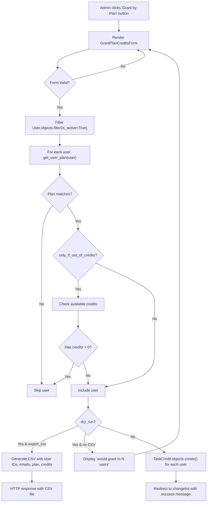
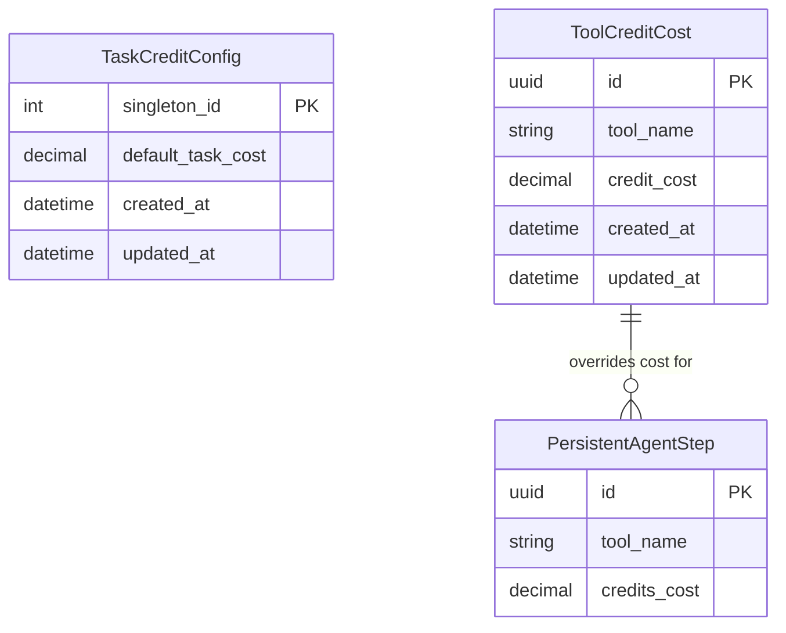
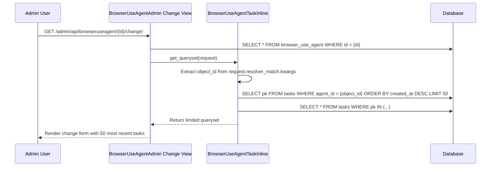
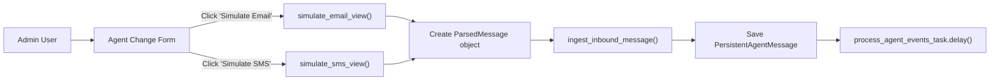
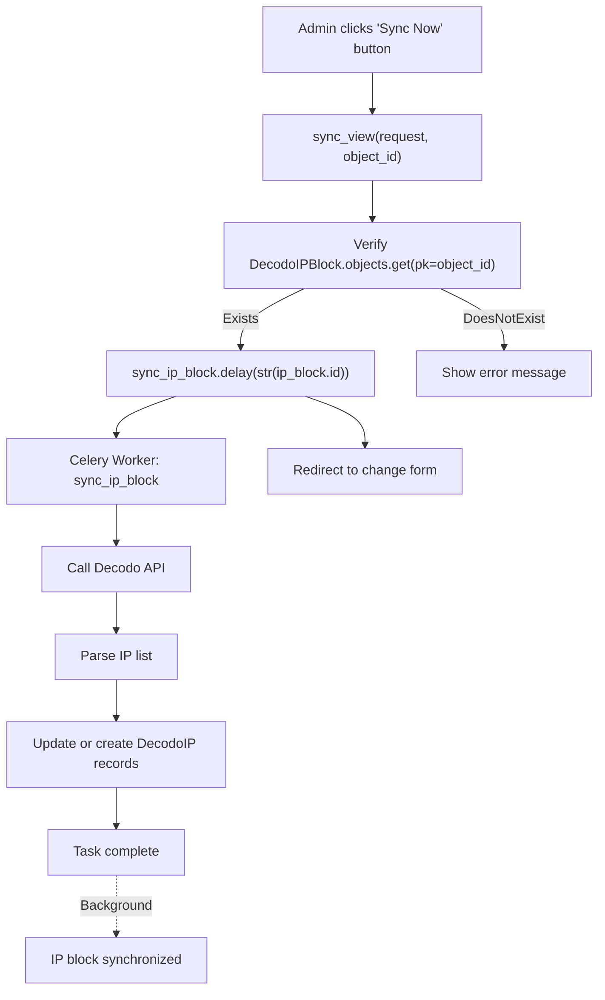
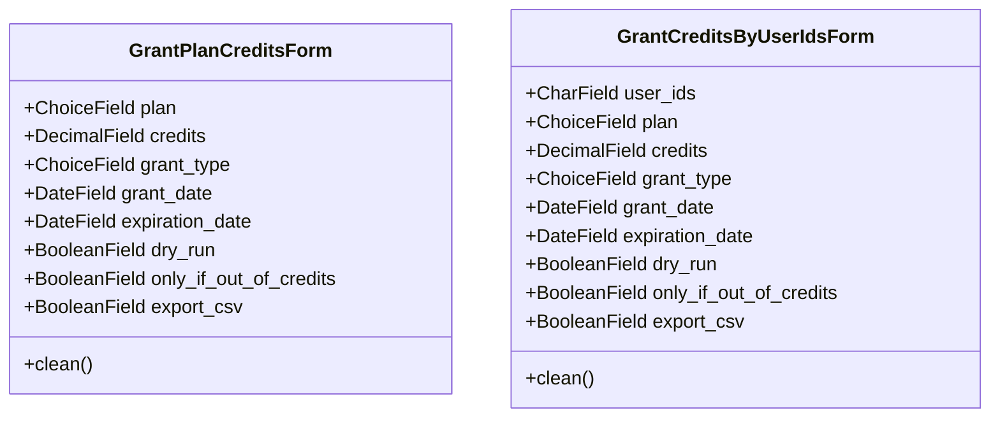
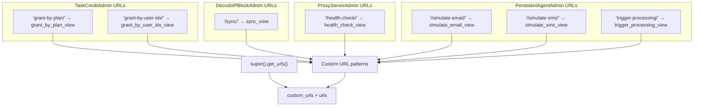
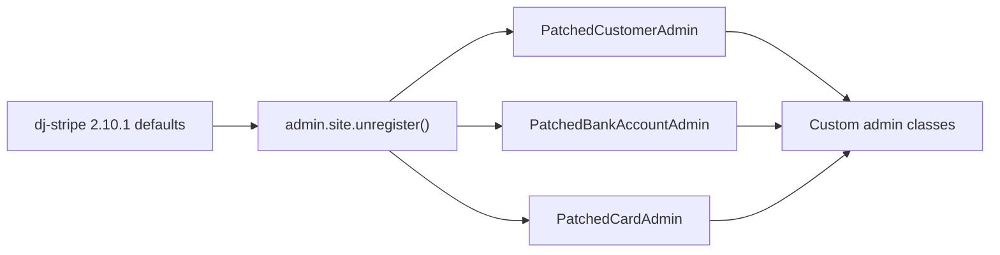

<!-- source: DeepWiki mcp.deepwiki.com · repo gobii-ai/gobii-platform · page 10.1 Django Admin Interface · fetched 2026-10-27 -->

# Django Admin Interface

<details>
<summary>Relevant source files</summary>

The following files were used as context for generating this wiki page:

- [api/admin.py](api/admin.py)
- [config/settings.py](config/settings.py)
- [util/subscription_helper.py](util/subscription_helper.py)

</details>


## Purpose and Scope

This page documents the custom Django admin interface implementation in gobii-platform. The admin interface provides operational tools for managing agents, credits, billing, proxies, and user data. For information about REST API endpoints, see [9.1](#9.1). For automated testing of admin functionality, see [10.2](#10.2).

The admin interface extends Django's default admin with:
- **Bulk credit granting** workflows for subscription provisioning
- **Agent simulation tools** for testing email and SMS integrations
- **Proxy health monitoring** and synchronization controls
- **Custom performance optimizations** to handle large datasets efficiently

---

## Admin Architecture Overview

The admin interface is registered in Django's standard admin site and consists of custom `ModelAdmin` subclasses that provide enhanced functionality beyond basic CRUD operations.

```mermaid
graph TB
    AdminSite["django.contrib.admin.site"]
    
    subgraph "Credit & Billing Admins"
        TaskCreditAdmin["TaskCreditAdmin"]
        TaskCreditConfigAdmin["TaskCreditConfigAdmin"]
        ToolCreditCostAdmin["ToolCreditCostAdmin"]
        MeteringBatchAdmin["MeteringBatchAdmin"]
        StripeConfigAdmin["StripeConfigAdmin"]
    end
    
    subgraph "Agent Admins"
        BrowserUseAgentAdmin["BrowserUseAgentAdmin"]
        BrowserUseAgentTaskAdmin["BrowserUseAgentTaskAdmin"]
        PersistentAgentAdmin["PersistentAgentAdmin"]
    end
    
    subgraph "Communication Admins"
        PersistentAgentCommsEndpointAdmin["PersistentAgentCommsEndpointAdmin"]
        AgentEmailAccountAdmin["AgentEmailAccountAdmin"]
        SmsNumberAdmin["SmsNumberAdmin"]
    end
    
    subgraph "Proxy Admins"
        DecodoCredentialAdmin["DecodoCredentialAdmin"]
        DecodoIPBlockAdmin["DecodoIPBlockAdmin"]
        ProxyServerAdmin["ProxyServerAdmin"]
        ProxyHealthCheckResultAdmin["ProxyHealthCheckResultAdmin"]
    end
    
    subgraph "User Admins"
        CustomUserAdmin["CustomUserAdmin"]
        OrganizationAdmin["OrganizationAdmin"]
        UserBillingAdmin["UserBillingAdmin"]
    end
    
    AdminSite --> TaskCreditAdmin
    AdminSite --> BrowserUseAgentAdmin
    AdminSite --> PersistentAgentAdmin
    AdminSite --> DecodoIPBlockAdmin
    AdminSite --> ProxyServerAdmin
    AdminSite --> CustomUserAdmin
```



**Sources:** [api/admin.py:1-2456]()

---

## Credit and Billing Admins

### TaskCreditAdmin

`TaskCreditAdmin` manages `TaskCredit` records and provides bulk credit granting workflows. This is one of the most heavily customized admins in the platform.

**Key Features:**
- **Custom list filters:** `OwnershipTypeFilter` (user vs org), plan type, expiration date
- **Performance optimization:** Uses `list_select_related` to prefetch `user` and `organization` in a single query
- **Annotated search:** Supports searching by numeric user IDs via custom `get_search_results()`
- **Custom change list template:** `admin/taskcredit_change_list.html` adds navigation buttons

**Custom URLs and Views:**

| URL Pattern | View Method | Purpose |
|------------|-------------|---------|
| `grant-by-plan/` | `grant_by_plan_view()` | Grant credits to all users on a specific plan |
| `grant-by-user-ids/` | `grant_by_user_ids_view()` | Grant credits to a comma/newline-separated list of user IDs |



The grant-by-plan workflow iterates over active users and calls `get_user_plan()` from `util.subscription_helper` to match the target plan. When `only_if_out_of_credits` is enabled, it annotates users with `available_credits_sum` via a database aggregation to filter out users who still have unused credits.

**Sources:** [api/admin.py:188-513](), [api/admin_forms.py:1-100](), [util/subscription_helper.py:196-198]()

---

### TaskCreditConfigAdmin and ToolCreditCostAdmin

These admins manage the database-backed credit configuration introduced to replace hardcoded constants.

**TaskCreditConfigAdmin:**
- Enforces singleton pattern (only one config record allowed)
- Manages `default_task_cost` (the baseline credit cost per task)
- Prevents deletion via `has_delete_permission() -> False`

**ToolCreditCostAdmin:**
- Manages per-tool credit overrides (e.g., `sqlite_batch` costs 0.8 credits)
- Searchable by tool name
- Lists credit cost and last update timestamp



When an agent executes a tool, the system queries `ToolCreditCost` by tool name (case-insensitive) and falls back to `TaskCreditConfig.default_task_cost` if no override exists.

**Sources:** [api/admin.py:515-543](), [api/models.py:1-50]()

---

### MeteringBatchAdmin

`MeteringBatchAdmin` provides read-only inspection of Stripe metering batches, which aggregate additional-task credits reported to Stripe for billing.

**Key Display Fields:**
- `batch_key`: Unique identifier (user/org ID + period start/end)
- `rounded_quantity`: Number of overage tasks reported
- `total_credits`: Sum of credits consumed in the batch
- `stripe_event_id`: Stripe meter event ID for tracking

**Custom Links:**
The `usage_links()` display method generates clickable links to related `BrowserUseAgentTask` and `PersistentAgentStep` records filtered by `meter_batch_key`, allowing operators to drill down into which tasks contributed to a metering event.

**Sources:** [api/admin.py:545-589]()

---

## Agent Management Admins

### BrowserUseAgentAdmin

`BrowserUseAgentAdmin` manages `BrowserUseAgent` records, which represent the browser automation layer backing persistent agents.

**Performance Optimization:**
- Uses `get_queryset()` with `.select_related('user')` and `.annotate(num_tasks=Count('tasks'))` to avoid N+1 queries when displaying the agent list
- The annotated `num_tasks` is accessed via `getattr(obj, 'num_tasks', None)` in display methods

**Inline Display:**
The `BrowserUseAgentTaskInline` inline limits displayed tasks to the 50 most recent to prevent browser lockups when agents have thousands of tasks. This is implemented via a custom `get_queryset()` that extracts `object_id` from the URL resolver and filters/slices the queryset.



**Sources:** [api/admin.py:672-737](), [api/admin.py:599-657]()

---

### BrowserUseAgentTaskAdmin

`BrowserUseAgentTaskAdmin` manages `BrowserUseAgentTask` records with custom garbage collection and step inspection.

**Custom Action: Run Garbage Collection**

The admin changelist template includes a button that queues the `garbage_collect_timed_out_tasks` Celery task. This task identifies tasks stuck in `PROCESSING` status for more than the configured timeout and transitions them to `TIMEOUT` status.

| Component | Implementation |
|-----------|---------------|
| Template | `admin/browseruseagenttask_change_list.html` |
| URL | `run-gc/` → `run_gc_view()` |
| Task | `garbage_collect_timed_out_tasks.delay()` |
| Logic | Defined in `api/tasks.py` |

**Inline Steps:**
`BrowserUseAgentTaskStepInline` displays up to 50 most recent steps per task, using the same limiting pattern as the agent-task inline.

**Sources:** [api/admin.py:803-887](), [api/admin.py:738-802](), [api/tasks.py:1-100]()

---

### PersistentAgentAdmin

`PersistentAgentAdmin` is the most feature-rich admin, providing agent simulation, message inspection, and event processing triggers.

**Custom Inlines:**

| Inline Class | Model | Purpose |
|-------------|-------|---------|
| `PersistentAgentCommsEndpointInline` | `PersistentAgentCommsEndpoint` | Email/SMS addresses |
| `CommsAllowlistEntryInline` | `CommsAllowlistEntry` | Manual allowlist entries |
| `AgentMessageInline` | `PersistentAgentMessage` | Conversation history (50 most recent) |

**Agent Simulation Tools:**



The simulation views create `ParsedMessage` objects and pass them through the same `ingest_inbound_message()` pipeline used by webhooks, ensuring agents react identically to simulated and real messages. This allows testing email/SMS flows without external dependencies.

**Event Processing Trigger:**

The changelist includes a "Trigger Event Processing" button that renders a form accepting newline-separated agent UUIDs. When submitted, it validates each ID and queues `process_agent_events_task.delay(agent_id)` for existing agents.

**Sources:** [api/admin.py:1545-1935](), [api/agent/comms/message_service.py:1-200](), [api/agent/tasks.py:1-100]()

---

## Proxy and Infrastructure Admins

### DecodoIPBlockAdmin

`DecodoIPBlockAdmin` manages `DecodoIPBlock` records, which represent blocks of residential proxy IPs from Decodo.

**Custom Action: Sync IP Block**

Each IP block has a "Sync Now" button that queues the `sync_ip_block.delay(block_id)` Celery task. This task:
1. Calls the Decodo API to fetch updated IP metadata
2. Creates or updates `DecodoIP` records
3. Populates geolocation and ISP information



**Sources:** [api/admin.py:1086-1155](), [api/tasks.py:1-200]()

---

### ProxyServerAdmin

`ProxyServerAdmin` manages `ProxyServer` records and includes health check functionality.

**Health Check Workflow:**

| Component | Implementation |
|-----------|---------------|
| Button | `test_now()` display method |
| URL | `<object_id>/health-check/` |
| View | `health_check_view()` |
| Task | `proxy_health_check_single.delay(proxy_id)` |

The health check task:
1. Loads a `ProxyHealthCheckSpec` (which contains a test prompt)
2. Creates a temporary `BrowserUseAgentTask` using the proxy
3. Records the result in `ProxyHealthCheckResult`

**Bulk Actions:**

- **Backfill Missing Proxies:** Queues `backfill_missing_proxy_records.delay()` to auto-create `ProxyServer` records for all `DecodoIP` entries
- **Test Selected Proxies:** Queues health checks for all selected active proxies

**Sources:** [api/admin.py:1183-1347](), [api/tasks.py:200-400]()

---

## User and Organization Admins

### CustomUserAdmin

`CustomUserAdmin` extends Django's default `UserAdmin` with credit summary and metering rollup actions.

**Performance Optimization:**

The `get_queryset()` method annotates each user with:
```python
.annotate(
    total_credits=Sum("task_credits__credits"),
    used_credits=Sum("task_credits__credits_used"),
)
```

This allows the `taskcredit_summary_link()` display method to compute remaining credits without additional queries:
```python
remaining = total - used
```

**Rollup Action:**

The `queue_rollup_for_selected_users` action queues `rollup_usage_for_user.delay(user_id)` for each selected user. This task aggregates raw usage into metering batches for Stripe reporting.

**Sources:** [api/admin.py:973-1042](), [api/tasks/billing_rollup.py:1-200]()

---

## Admin Forms

Custom forms provide validation and UI enhancements for admin workflows.

### GrantPlanCreditsForm



Both forms validate:
- `expiration_date` must be after `grant_date`
- `credits` must be positive
- `plan` must be a valid `PlanNamesChoices` enum value

**Sources:** [api/admin_forms.py:1-150]()

---

## Performance Patterns

### Query Optimization Techniques

**1. select_related() for Foreign Keys**

```python
# api/admin.py:814-817
def get_queryset(self, request):
    qs = super().get_queryset(request)
    return qs.select_related("agent", "user")
```

This reduces the task changelist from O(n) queries to O(1) by performing a JOIN instead of per-row lookups.

**2. Annotated Counts**

```python
# api/admin.py:684-686
def get_queryset(self, request):
    qs = super().get_queryset(request)
    return qs.select_related('user').annotate(num_tasks=Count('tasks'))
```

The annotated `num_tasks` is then accessed without additional queries:
```python
count = getattr(obj, 'num_tasks', None)
if count is None:
    count = obj.tasks.count()  # Fallback for detail view
```

**3. Limited Inline Queries**

Inlines use a two-query approach to limit results:
1. Get PKs of the most recent N records
2. Fetch full records filtered by those PKs

```python
# api/admin.py:628-635
recent_pks = list(qs.values_list('pk', flat=True)[:self.MAX_DISPLAY])
return self.model.objects.filter(pk__in=recent_pks).order_by('-created_at')
```

This prevents Django from raising `SuspiciousOperation` errors when slicing querysets in inlines.

**4. Raw ID Fields**

```python
# api/admin.py:678
raw_id_fields = ('user',)
```

For models with millions of users, raw ID fields replace dropdown selects with autocomplete inputs, avoiding expensive full-table scans.

**Sources:** [api/admin.py:609-636](), [api/admin.py:814-817](), [api/admin.py:684-686]()

---

## Template Customizations

### Custom Change List Templates

Several admins override `change_list_template` to add custom buttons:

| Admin | Template | Added Buttons |
|-------|----------|---------------|
| `TaskCreditAdmin` | `admin/taskcredit_change_list.html` | "Grant by Plan", "Grant by User IDs" |
| `BrowserUseAgentTaskAdmin` | `admin/browseruseagenttask_change_list.html` | "Run Garbage Collection" |
| `PersistentAgentAdmin` | `admin/persistentagent_change_list.html` | "Trigger Event Processing" |

These templates extend Django's default `admin/change_list.html` and inject buttons into the object tools section:

```django

  {{ block.super }}
  <li>
    <a href="" class="button">
      Grant by Plan
    </a>
  </li>

```

**Sources:** [api/admin.py:222](), [api/admin.py:805](), [api/admin.py:1547]()

---

## Custom URL Patterns

Admins extend the default URL configuration via `get_urls()`:



**Pattern:**
```python
def get_urls(self):
    urls = super().get_urls()
    custom_urls = [
        path('custom-action/', self.admin_site.admin_view(self.custom_view), name='...'),
    ]
    return custom_urls + urls
```

The `admin_site.admin_view()` wrapper ensures custom views enforce authentication and permissions.

**Sources:** [api/admin.py:246-261](), [api/admin.py:1095-1105](), [api/admin.py:1594-1614]()

---

## Stripe Integration Patching

The platform patches dj-stripe's default admin classes to fix compatibility issues with version 2.10.1:



The patches remove references to `customer__default_source`, which was removed in dj-stripe 2.10 but still referenced in the library's admin classes:

```python
# api/admin.py:50-69
admin.site.unregister(Customer)

@admin.register(Customer)
class PatchedCustomerAdmin(StripeModelAdmin):
    list_select_related = ("subscriber", "djstripe_owner_account", "default_payment_method")
```

**Sources:** [api/admin.py:45-70]()

---

## Summary

The Django admin interface in gobii-platform serves as the operational control plane, providing:

1. **Bulk Operations:** Credit granting by plan or user ID with dry-run and CSV export
2. **Agent Testing:** Email/SMS simulation tools that use production ingestion pipelines
3. **Infrastructure Monitoring:** Proxy health checks and IP synchronization
4. **Performance Optimization:** Annotated queries, select_related, and limited inlines to handle large datasets
5. **Custom Workflows:** Event processing triggers, garbage collection, and metering rollup actions

All admin classes follow Django's standard patterns while extending them with custom URLs, actions, and display methods. The interface is optimized for admin users managing thousands of agents, millions of tasks, and complex billing scenarios.

**Sources:** [api/admin.py:1-2456](), [config/settings.py:187-229]()

---

