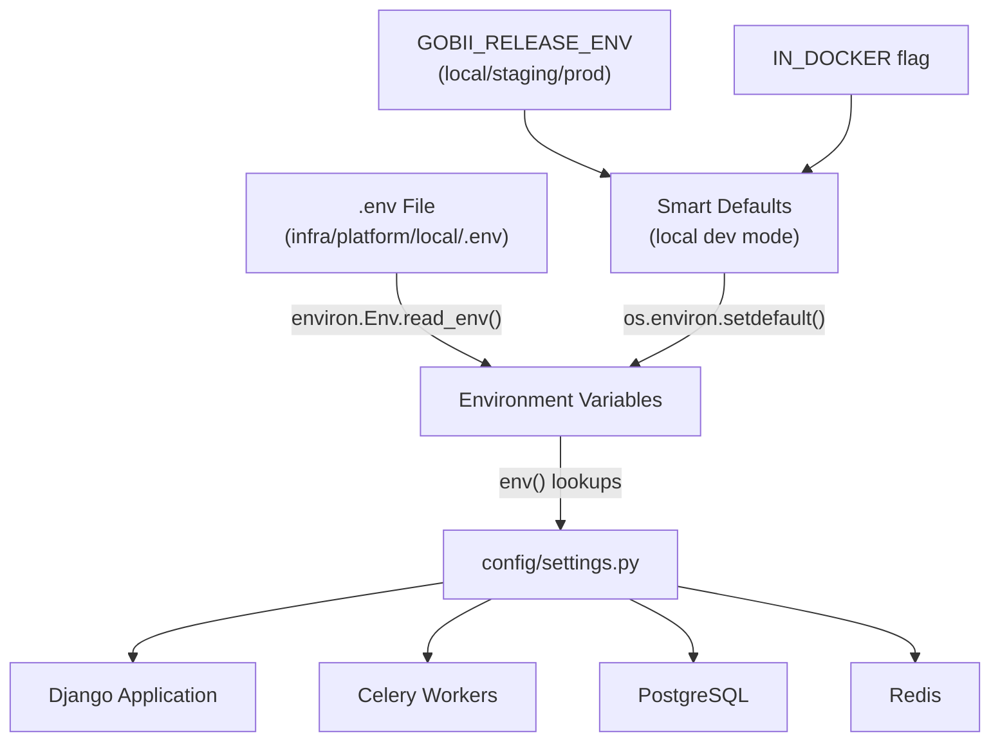
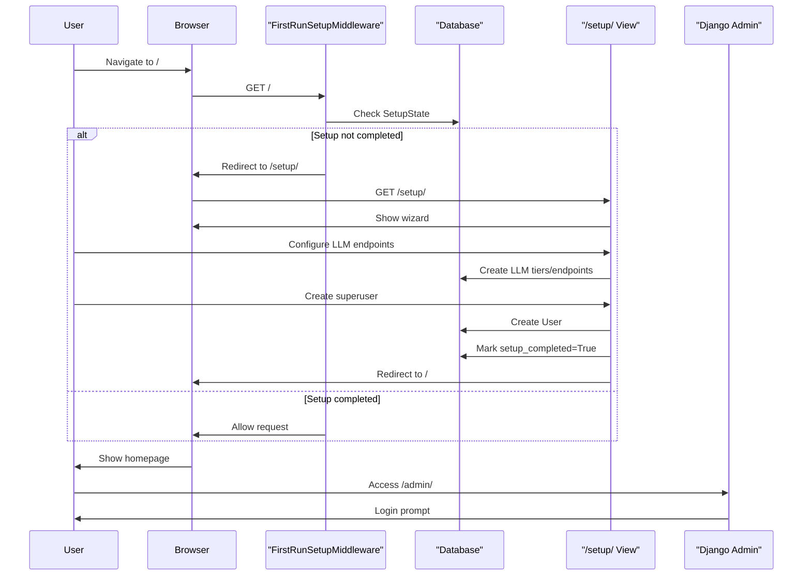
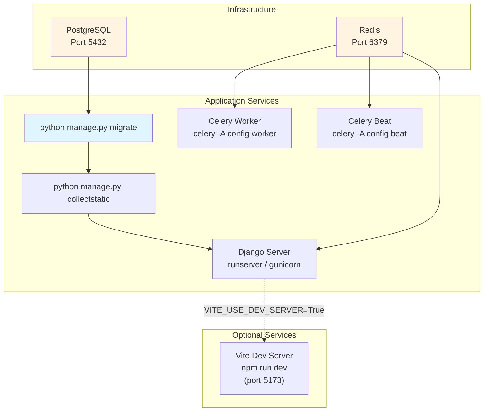

<!-- source: DeepWiki mcp.deepwiki.com · repo gobii-ai/gobii-platform · page 2 Getting Started · fetched 2026-10-27 -->

# Getting Started

<details>
<summary>Relevant source files</summary>

The following files were used as context for generating this wiki page:

- [api/admin.py](api/admin.py)
- [config/settings.py](config/settings.py)
- [util/subscription_helper.py](util/subscription_helper.py)

</details>


This document provides installation, configuration, and initial setup instructions for the gobii-platform. It covers environment preparation, database initialization, and first-run configuration to get a working instance running in both development and production modes.

For detailed configuration options and deployment strategies, see [Configuration & Deployment](#2.1). For user authentication and signup flows, see [User Lifecycle & Authentication](#2.2).

---

## Overview

The gobii-platform is a Django-based multi-agent orchestration system with asynchronous task processing via Celery. A minimal working installation requires:

- **Application server**: Django (WSGI/ASGI)
- **Database**: PostgreSQL
- **Cache/broker**: Redis
- **Background workers**: Celery workers and beat scheduler
- **Frontend**: Vite-built React SPA (bundled during build)

The platform supports two operational modes:
- **Community Edition**: Open-source build with optional unlimited agent/task quotas, minimal external dependencies
- **Proprietary Mode**: Licensed build with Stripe billing, Cloudflare Turnstile, email verification, and analytics integrations

---

## Prerequisites

### Required

| Component | Minimum Version | Purpose |
|-----------|----------------|---------|
| Python | 3.11+ | Application runtime |
| PostgreSQL | 14+ | Primary data store |
| Redis | 6.0+ | Cache, Celery broker, channel layer |
| Node.js | 18+ | Frontend build (development only) |

### Optional

| Component | Use Case |
|-----------|----------|
| Docker & Docker Compose | Simplified local development |
| Stripe account | Subscription billing (Proprietary Mode) |
| LLM provider API keys | OpenAI, Anthropic, Google, GLM |
| Email provider | Mailgun or Postmark (transactional emails) |
| Twilio account | SMS communication channel |

**Sources:** [config/settings.py:1-937]()

---

## Installation Methods

### Docker Compose (Recommended for Development)

The repository includes a Docker Compose configuration for local development:

```bash
# Clone repository
git clone https://github.com/gobii-ai/gobii-platform.git
cd gobii-platform

# Start services (from infra/platform/local/)
docker-compose up -d

# Run migrations
docker-compose exec web python manage.py migrate

# Create superuser
docker-compose exec web python manage.py createsuperuser

# Access application
open http://localhost:8000
```

The Compose stack includes:
- `web`: Django application server
- `db`: PostgreSQL database
- `redis`: Redis cache/broker
- `celery`: Background task workers
- `celery-beat`: Scheduled task dispatcher

**Sources:** [config/settings.py:35-54]()

---

### Manual Installation

For production or non-Docker environments:

```bash
# 1. Install Python dependencies
pip install -r requirements.txt

# 2. Configure environment (see Configuration section below)
cp infra/platform/local/.env.example .env
# Edit .env with your settings

# 3. Initialize database
python manage.py migrate

# 4. Collect static files
python manage.py collectstatic --noinput

# 5. Create superuser
python manage.py createsuperuser

# 6. Start services (in separate terminals/processes)
# Application server
python manage.py runserver  # Development
# OR
gunicorn config.wsgi:application  # Production

# Celery worker
celery -A config worker -l info

# Celery beat scheduler
celery -A config beat -l info --scheduler redbeat.RedBeatScheduler
```

**Sources:** [config/settings.py:287-316](), [config/settings.py:561-601]()

---

## Environment Configuration

### Configuration Hierarchy



**Sources:** [config/settings.py:18-54]()

---

### Core Environment Variables

The platform uses `django-environ` for configuration management. When `GOBII_RELEASE_ENV=local` and not running in Docker, the system applies smart defaults to enable immediate development without manual configuration.

#### Essential Settings

| Variable | Default (Local) | Description |
|----------|----------------|-------------|
| `DEBUG` | `True` | Enable debug mode (disable in production) |
| `DJANGO_SECRET_KEY` | `dev-insecure` | Django cryptographic signing key |
| `GOBII_ENCRYPTION_KEY` | `dev-insecure` | Application-level encryption key |
| `POSTGRES_HOST` | `localhost` | PostgreSQL server hostname |
| `POSTGRES_PORT` | `5432` | PostgreSQL server port |
| `POSTGRES_DB` | `gobii` | Database name |
| `POSTGRES_USER` | `postgres` | Database username |
| `POSTGRES_PASSWORD` | `postgres` | Database password |
| `REDIS_URL` | `redis://localhost:6379/0` | Redis connection string |

#### Mode Selection

| Variable | Default | Description |
|----------|---------|-------------|
| `GOBII_PROPRIETARY_MODE` | `False` | Enable proprietary features (requires license) |
| `GOBII_ENABLE_COMMUNITY_UNLIMITED` | `True` | Disable agent/task limits in Community Edition |
| `FIRST_RUN_SETUP_ENABLED` | `True` | Enforce first-run setup wizard |
| `LLM_BOOTSTRAP_OPTIONAL` | `False` | Allow skipping LLM configuration on first run |

**Sources:** [config/settings.py:56-73](), [config/settings.py:111-144]()

---

### Community vs Proprietary Mode

The platform's operational mode is controlled by `GOBII_PROPRIETARY_MODE`:

```python
# config/settings.py:56-66
GOBII_PROPRIETARY_MODE = env.bool("GOBII_PROPRIETARY_MODE", default=False)
```

| Feature | Community Edition | Proprietary Mode |
|---------|------------------|------------------|
| Signup Turnstile | Disabled | Enabled (if configured) |
| Email Verification | `none` | `mandatory` (if Mailgun configured) |
| Stripe Billing | Disabled | Enabled (if keys configured) |
| Agent Limits | Unlimited (configurable) | Plan-based |
| Task Limits | Unlimited (configurable) | Plan-based |
| Brand Links | GitHub, Discord, X (OSS) | Proprietary URLs |
| Default Email Backend | Console | Mailgun/Postmark |

**Community defaults** are loaded from `_COMMUNITY_DEFAULTS` dictionary:

```python
# config/settings.py:81-87
_COMMUNITY_DEFAULTS = {
    "brand": {
        "PUBLIC_DISCORD_URL": "https://discord.gg/yyDB8GwxtE",
        "PUBLIC_X_URL": "https://x.com/gobii_ai",
        "PUBLIC_GITHUB_URL": "https://github.com/gobii-ai",
    }
}
```

**Proprietary defaults** are loaded from the `proprietary` package if installed:

```python
# config/settings.py:75-78
try:
    from proprietary import defaults as _proprietary_defaults_module
except ImportError:
    _proprietary_defaults_module = None
```

**Sources:** [config/settings.py:56-109](), [config/settings.py:232-234]()

---

### External Service Configuration

#### Stripe (Billing & Subscriptions)

Required for paid plans in Proprietary Mode:

| Variable | Description |
|----------|-------------|
| `STRIPE_LIVE_SECRET_KEY` | Live mode secret key |
| `STRIPE_TEST_SECRET_KEY` | Test mode secret key |
| `STRIPE_LIVE_MODE` | Use live mode (`True` in production) |
| `STRIPE_WEBHOOK_SECRET` | Webhook endpoint verification secret |

Stripe integration is automatically enabled when `GOBII_PROPRIETARY_MODE=True` and keys are present.

**Sources:** [config/settings.py:725-743]()

---

#### Email Providers

The platform supports multiple email backends:

| Variable | Provider | Use Case |
|----------|----------|----------|
| `MAILGUN_API_KEY` | Mailgun | Transactional emails (signup, verification) |
| `MAILGUN_SENDER_DOMAIN` | Mailgun | Sending domain |
| `POSTMARK_SERVER_TOKEN` | Postmark | Transactional emails (alternative) |

Default behavior:
- **Community**: Console backend (prints to stdout)
- **Proprietary with keys**: Mailgun/Postmark
- **Proprietary without keys**: Console backend (for local development)

**Sources:** [config/settings.py:451-456](), [config/settings.py:680-717]()

---

#### SMS Provider (Twilio)

Optional for SMS communication channel:

| Variable | Description |
|----------|-------------|
| `TWILIO_ACCOUNT_SID` | Twilio account identifier |
| `TWILIO_AUTH_TOKEN` | Twilio authentication token |
| `TWILIO_MESSAGING_SERVICE_SID` | Messaging service for outbound SMS |
| `TWILIO_VERIFY_SERVICE_SID` | Verify service for phone validation |

Twilio is enabled when `TWILIO_ENABLED=True` and credentials are present.

**Sources:** [config/settings.py:838-856]()

---

#### Storage Backends

Media files (browser profiles, attachments) support multiple backends:

| Variable | Description |
|----------|-------------|
| `STORAGE_BACKEND_TYPE` | `LOCAL`, `GCS`, or `S3` |
| `GS_BUCKET_NAME` | Google Cloud Storage bucket |
| `AWS_STORAGE_BUCKET_NAME` | S3-compatible bucket name |
| `AWS_S3_ENDPOINT_URL` | S3 endpoint (for MinIO/DigitalOcean) |

Default: Local filesystem storage at `MEDIA_ROOT`.

**Sources:** [config/settings.py:352-428]()

---

## Database Setup

### Initialization

Run migrations to create schema:

```bash
python manage.py migrate
```

This creates tables for:
- Core Django models (auth, sessions, contenttypes)
- djstripe models (Stripe webhooks, subscriptions)
- Application models (agents, tasks, credits, messages)

**Sources:** [config/settings.py:288-316]()

---

### Database Connection Tuning

The platform uses persistent connections with health checks for stability:

```python
# config/settings.py:296-315
"CONN_MAX_AGE": env.int("DJANGO_DB_CONN_MAX_AGE", default=600),
"CONN_HEALTH_CHECKS": True,
"OPTIONS": {
    "keepalives": env.int("PGTCP_KEEPALIVES", default=1),
    "keepalives_idle": env.int("PGTCP_KEEPALIVES_IDLE", default=60),
    "keepalives_interval": env.int("PGTCP_KEEPALIVES_INTERVAL", default=30),
    "keepalives_count": env.int("PGTCP_KEEPALIVES_COUNT", default=5),
}
```

These settings:
- Keep connections alive for 10 minutes to reduce reconnect overhead
- Validate connections on reuse
- Use TCP keepalives to survive NAT/LB timeouts during long Celery tasks

**Sources:** [config/settings.py:296-315]()

---

## First-Run Setup

### Setup Middleware

On initial access, `FirstRunSetupMiddleware` redirects unauthenticated users to a configuration wizard:

```python
# setup/middleware.py (referenced in settings)
# config/settings.py:241
"setup.middleware.FirstRunSetupMiddleware",
```

The middleware checks:
1. `FIRST_RUN_SETUP_ENABLED` setting
2. Existence of `SetupState` singleton
3. User authentication status

Bypass conditions:
- `/setup/` URLs (setup wizard itself)
- Static/media files
- Admin panel
- API endpoints
- Already authenticated users
- `SetupState.setup_completed=True`

**Sources:** [config/settings.py:71](), [config/settings.py:241]()

---

### LLM Bootstrap Requirement

The platform requires at least one configured LLM tier/endpoint for agent operation. The `llm_bootstrap` context processor checks for usable LLM configuration:

```python
# pages/context_processors.py (referenced in settings)
# config/settings.py:269
"pages.context_processors.llm_bootstrap",
```

LLM configuration can be:
- **Bypassed in tests**: `LLM_BOOTSTRAP_OPTIONAL=True`
- **Configured via admin**: Django admin → LLM Tiers/Endpoints
- **Configured in database**: Seed data during migrations

If no LLM configuration exists and bootstrap is enforced, the UI will prompt for configuration before allowing agent creation.

**Sources:** [config/settings.py:73](), [config/settings.py:269]()

---

### Setup Sequence Diagram



**Sources:** [config/settings.py:71](), [config/settings.py:241](), [config/settings.py:269]()

---

## Running the Platform

### Development Mode

Start all services in development:

```bash
# Terminal 1: Django development server
python manage.py runserver 0.0.0.0:8000

# Terminal 2: Celery worker
celery -A config worker -l info

# Terminal 3: Celery beat scheduler
celery -A config beat -l info --scheduler redbeat.RedBeatScheduler

# Terminal 4 (optional): Frontend dev server with hot reload
cd frontend
npm run dev
```

Frontend Vite integration:
- `VITE_USE_DEV_SERVER=True`: Use live dev server (http://127.0.0.1:5173)
- `VITE_USE_DEV_SERVER=False`: Use built assets from `static/frontend/`

**Sources:** [config/settings.py:324-328]()

---

### Component Startup Order



**Sources:** [config/settings.py:287-316](), [config/settings.py:551-559](), [config/settings.py:561-601]()

---

### Production Deployment

Key differences from development:

1. **WSGI Server**: Use `gunicorn` or `uwsgi` instead of `runserver`
2. **Static Files**: Serve via WhiteNoise (bundled) or CDN
3. **Environment**: Set `DEBUG=False`, `GOBII_RELEASE_ENV=prod`
4. **Secrets**: Use strong random values for `DJANGO_SECRET_KEY` and `GOBII_ENCRYPTION_KEY`
5. **Database**: Enable SSL with `POSTGRES_SSLMODE=require`
6. **Process Management**: Use systemd, supervisor, or Kubernetes for service orchestration

Example systemd service for Celery worker:

```ini
[Unit]
Description=Gobii Celery Worker
After=network.target redis.service postgresql.service

[Service]
Type=forking
User=gobii
Group=gobii
WorkingDirectory=/opt/gobii-platform
Environment="CELERY_BROKER_URL=redis://localhost:6379/0"
ExecStart=/opt/gobii-platform/venv/bin/celery -A config worker \
    --detach \
    --pidfile=/var/run/celery/worker.pid \
    --logfile=/var/log/celery/worker.log \
    --loglevel=info

[Install]
WantedBy=multi-user.target
```

**Sources:** [config/settings.py:111-144](), [config/settings.py:561-601]()

---

## Verification

### Service Health Checks

After starting services, verify each component:

| Service | Check Command | Expected Output |
|---------|--------------|-----------------|
| PostgreSQL | `psql -U postgres -d gobii -c 'SELECT 1;'` | `1` |
| Redis | `redis-cli ping` | `PONG` |
| Django | `curl http://localhost:8000/` | HTTP 200 or redirect to /setup/ |
| Celery Worker | `celery -A config inspect ping` | `{'celery@hostname': {'ok': 'pong'}}` |
| Celery Beat | Check logs for `Scheduler: Sending due task...` | Scheduled tasks firing |

**Sources:** [config/settings.py:551-601]()

---

### Admin Access

1. Navigate to `http://localhost:8000/admin/`
2. Log in with superuser credentials
3. Verify models are accessible:
   - **Users** (django.contrib.auth)
   - **PersistentAgent** (api)
   - **TaskCredit** (api)
   - **BrowserUseAgent** (api)

**Sources:** [api/admin.py:1-50]()

---

### Create First Agent

1. Navigate to homepage: `http://localhost:8000/`
2. If first run setup is incomplete, complete wizard
3. Click "Create Agent" or use a template
4. Fill charter (purpose/instructions)
5. Configure schedule (optional)
6. Save and observe:
   - Agent appears in dashboard
   - Celery worker logs show `process_agent_events_task` queued
   - Agent executes and creates `PersistentAgentStep` records

**Sources:** [config/settings.py:71](), [config/settings.py:241]()

---

## Common Configuration Patterns

### Local Development (Community Edition)

```bash
# .env
DEBUG=True
GOBII_PROPRIETARY_MODE=False
GOBII_ENABLE_COMMUNITY_UNLIMITED=True
FIRST_RUN_SETUP_ENABLED=True
LLM_BOOTSTRAP_OPTIONAL=False

# Database & Redis use smart defaults
# No external API keys required
```

**Sources:** [config/settings.py:38-54](), [config/settings.py:66-73]()

---

### Staging Environment (Proprietary Mode)

```bash
# .env
DEBUG=False
GOBII_PROPRIETARY_MODE=True
GOBII_RELEASE_ENV=staging

# PostgreSQL (Cloud SQL, RDS, etc.)
POSTGRES_HOST=staging-db.example.com
POSTGRES_PORT=5432
POSTGRES_DB=gobii_staging
POSTGRES_USER=gobii_app
POSTGRES_PASSWORD=<strong-password>
POSTGRES_SSLMODE=require

# Redis (ElastiCache, Cloud Memorystore, etc.)
REDIS_URL=rediss://staging-redis.example.com:6380/0

# Stripe (test mode)
STRIPE_TEST_SECRET_KEY=sk_test_...
STRIPE_LIVE_MODE=False

# Email (Mailgun sandbox)
MAILGUN_API_KEY=key-...
MAILGUN_SENDER_DOMAIN=sandbox.mailgun.org
```

**Sources:** [config/settings.py:111-144](), [config/settings.py:288-316](), [config/settings.py:725-743]()

---

### Production Environment (Proprietary Mode)

```bash
# .env
DEBUG=False
GOBII_PROPRIETARY_MODE=True
GOBII_RELEASE_ENV=prod

# Security
DJANGO_SECRET_KEY=<cryptographically-random-64-chars>
GOBII_ENCRYPTION_KEY=<cryptographically-random-64-chars>

# Database (replicated, high-availability)
POSTGRES_HOST=prod-db.example.com
POSTGRES_PORT=5432
POSTGRES_DB=gobii_prod
POSTGRES_USER=gobii_app
POSTGRES_PASSWORD=<strong-password>
POSTGRES_SSLMODE=verify-full
DJANGO_DB_CONN_MAX_AGE=600

# Redis (clustered)
REDIS_URL=rediss://prod-redis.example.com:6380/0

# Stripe (live mode)
STRIPE_LIVE_SECRET_KEY=sk_live_...
STRIPE_LIVE_MODE=True
STRIPE_WEBHOOK_SECRET=whsec_...

# Email (Mailgun production)
MAILGUN_API_KEY=key-...
MAILGUN_SENDER_DOMAIN=mail.gobii.ai

# Observability
OTEL_EXPORTER_OTLP_ENDPOINT=https://otel-collector.example.com:4317
OTEL_EXPORTER_OTLP_INSECURE=False
```

**Sources:** [config/settings.py:111-144](), [config/settings.py:799-804]()

---

## Next Steps

After completing initial setup:

1. **Configure LLM Providers**: Add API keys for OpenAI, Anthropic, Google, or GLM in Django admin → LLM Endpoints
2. **Set Up Billing** (Proprietary): Configure Stripe webhook endpoint, test subscription flows
3. **Configure Communication Channels**: Add email accounts, SMS numbers, or enable peer messaging
4. **Create Agent Templates**: Define reusable agent configurations for common use cases
5. **Review Security Settings**: Audit `ALLOWED_HOSTS`, `CSRF_TRUSTED_ORIGINS`, and SSL configuration

For detailed configuration options, see [Configuration & Deployment](#2.1).

**Sources:** [config/settings.py:1-937](), [util/subscription_helper.py:1-1029]()

---

