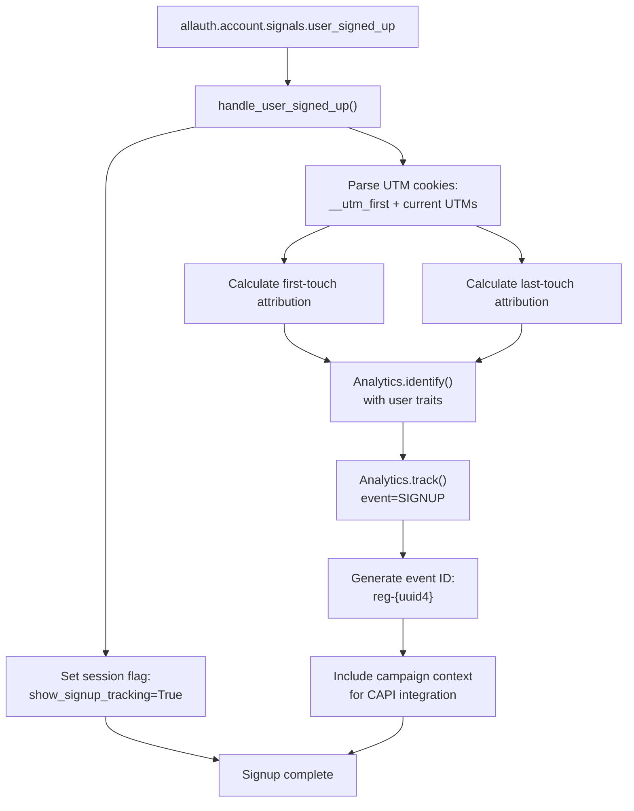
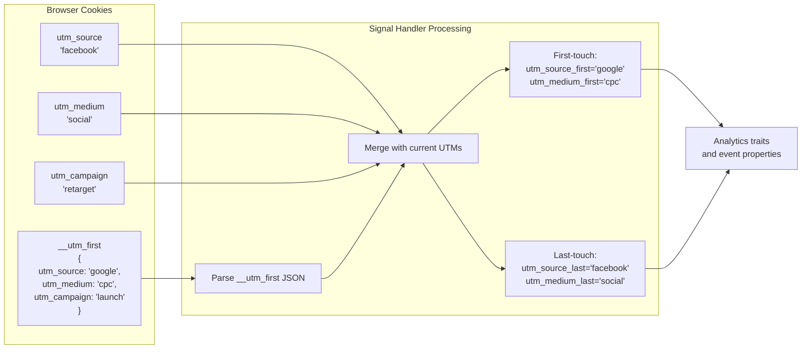
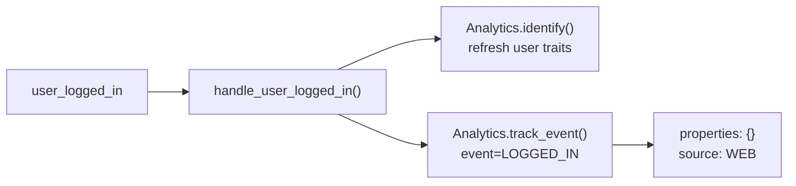
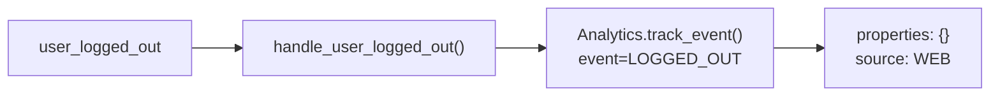
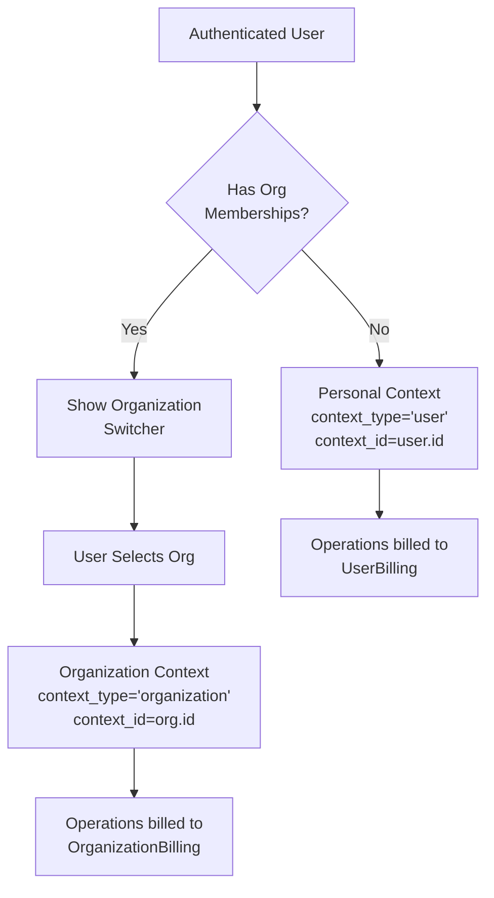
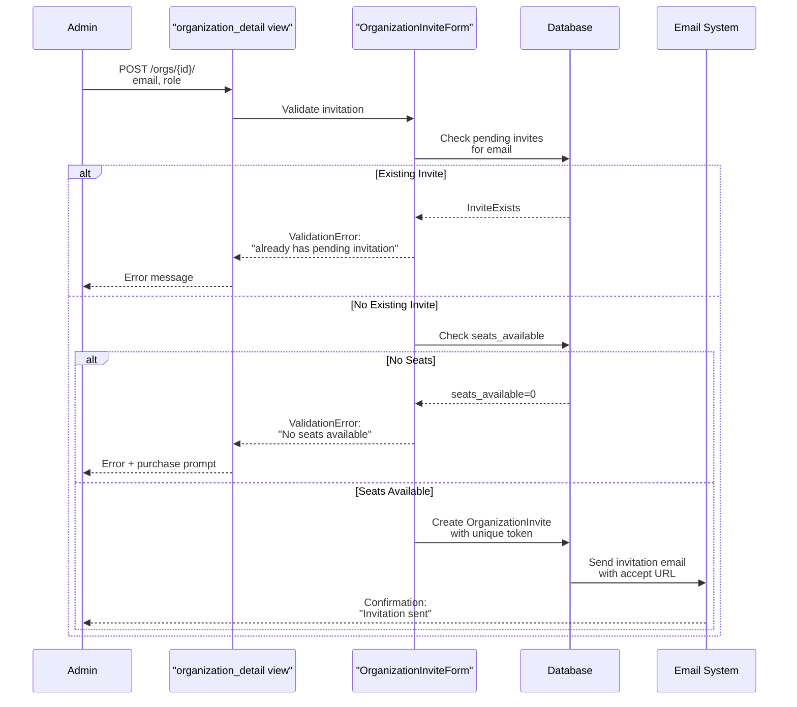
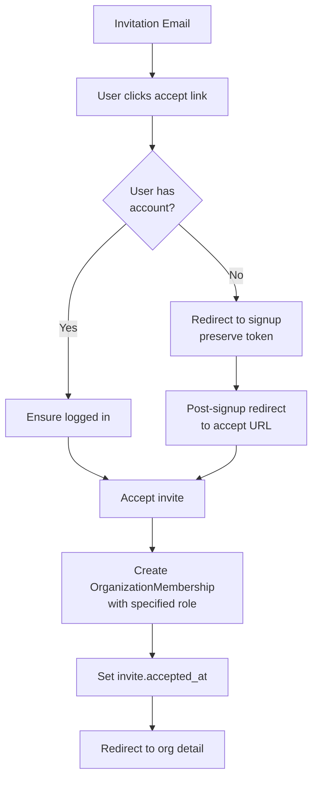

<!-- source: DeepWiki mcp.deepwiki.com · repo gobii-ai/gobii-platform · page 2.2 User Lifecycle & Authentication · fetched 2026-10-27 -->

# User Lifecycle & Authentication

<details>
<summary>Relevant source files</summary>

The following files were used as context for generating this wiki page:

- [console/forms.py](console/forms.py)
- [console/templates/console/organization_detail.html](console/templates/console/organization_detail.html)
- [console/templates/partials/_org_invite_modal.html](console/templates/partials/_org_invite_modal.html)
- [constants/stripe.py](constants/stripe.py)
- [pages/signals.py](pages/signals.py)
- [tests/unit/test_organizations.py](tests/unit/test_organizations.py)
- [tests/unit/test_pages_signals.py](tests/unit/test_pages_signals.py)

</details>


This page documents the user registration, authentication, and session management systems. It covers signup flows, login/logout events, UTM attribution tracking, analytics integration, and organization membership management.

For API key authentication and authorization mechanics, see [Authentication & Authorization](#9.2). For subscription provisioning during signup, see [Subscription Management](#5.2).

---

## User Signup Flow

User registration is handled through **django-allauth**, an integrated authentication framework. The platform tracks signup events for analytics and attribution purposes using Django signals.

### Signup Signal Handler

When a new user completes registration, the `user_signed_up` signal fires, triggering analytics tracking and UTM attribution capture:



**Sources:** [pages/signals.py:113-195]()

The signup handler performs three key operations:

1. **Session Marking**: Sets `show_signup_tracking=True` in the session to enable downstream tracking
2. **User Identification**: Calls `Analytics.identify()` with user profile data and UTM parameters
3. **Event Tracking**: Fires a `SIGNUP` event with attribution data and a unique event ID for cross-platform tracking

### UTM Attribution System

The platform implements **dual-touch attribution** tracking both first-touch (initial discovery) and last-touch (conversion source) campaign parameters.

#### UTM Cookie Structure



**Sources:** [pages/signals.py:129-178]()

The UTM mapping system uses a standardized key structure:

| UTM Parameter | Cookie Key | Analytics Key (First) | Analytics Key (Last) |
|---------------|------------|----------------------|---------------------|
| Source | `utm_source` | `utm_source_first` | `utm_source_last` |
| Medium | `utm_medium` | `utm_medium_first` | `utm_medium_last` |
| Campaign | `utm_campaign` | `utm_campaign_first` | `utm_campaign_last` |
| Content | `utm_content` | `utm_content_first` | `utm_content_last` |
| Term | `utm_term` | `utm_term_first` | `utm_term_last` |

**Sources:** [pages/signals.py:42-48]()

#### Attribution Logic

The handler implements a fallback chain for attribution:

1. **First-touch preservation**: Values in `__utm_first` cookie take precedence for first-touch
2. **Current-to-first fallback**: If `__utm_first` is missing a parameter but current request has it, use current
3. **Last-touch capture**: Current UTM cookies become last-touch attribution

This ensures accurate attribution even if users clear cookies between visits or arrive through multiple campaigns.

**Sources:** [pages/signals.py:138-156]()

### Analytics Event Payload

The signup event includes comprehensive tracking data:

```python
# Event properties
{
    'plan': 'free',
    'date_joined': '2025-01-15T08:30:00Z',
    'utm_source_first': 'google',
    'utm_source_last': 'facebook',
    # ... additional UTM fields
}

# Context for CAPI integration
{
    'campaign': {
        'source': 'facebook',
        'medium': 'social',
        'name': 'retarget',
        # ... other last-touch UTMs
    },
    'userAgent': 'Mozilla/5.0 ...'
}
```

The event includes a deterministic `message_id` in format `reg-{uuid}` for deduplication across analytics platforms like Facebook CAPI and Reddit Pixel.

**Sources:** [pages/signals.py:164-190]()

---

## Login & Logout Events

The platform tracks user authentication state changes through django-allauth signals.

### Login Handler



**Sources:** [pages/signals.py:196-217]()

The login handler:
1. **Refreshes user identity** with current profile data (name, email, join date)
2. **Tracks login event** with minimal properties (login source is always `WEB` for browser-based sessions)

### Logout Handler



**Sources:** [pages/signals.py:218-231]()

The logout handler fires a simple tracking event. Session cleanup is handled by Django's authentication system.

### Error Handling

All analytics operations are wrapped in try-except blocks to prevent tracking failures from disrupting authentication flows. Exceptions are logged but do not propagate to users.

**Sources:** [pages/signals.py:193-216](), [pages/signals.py:229-231]()

---

## Session Management

The platform uses Django's session framework for maintaining user state across requests.

### Session Data Structure

User sessions store:

| Session Key | Type | Purpose |
|-------------|------|---------|
| `show_signup_tracking` | `bool` | Flags newly signed-up users for tracking |
| `context_type` | `str` | Current context: `'user'` or `'organization'` |
| `context_id` | `str` | UUID of active user or organization |
| `context_name` | `str` | Display name for UI context switcher |
| `org_seat_portal_target` | `dict` | Pending seat changes during Stripe checkout |
| `org_overage_detach` | `dict` | Temporary state for overage SKU management |

**Sources:** [tests/unit/test_organizations.py:505-519](), [tests/unit/test_organizations.py:537-552]()

### Context Switching

Users can operate in either **personal** or **organization** context. The active context determines:
- Which API keys are accessible
- Which agents are visible
- Which billing entity is charged for operations



**Sources:** [tests/unit/test_organizations.py:505-519]()

Context switching persists across requests until the user explicitly changes it or logs out.

---

## Organization Membership

Organizations enable team collaboration with role-based access control. Users can belong to multiple organizations with different roles.

### Membership Roles

The platform defines three organization roles in `OrganizationMembership.OrgRole`:

| Role | Permissions |
|------|-------------|
| `OWNER` | Full control: manage members, roles, billing, seats, delete org |
| `ADMIN` | Manage members (except owners), invite/remove, change roles (except owner) |
| `MEMBER` | View organization, use organization agents, consume org credits |
| `VIEWER` | Read-only access to organization resources |

**Sources:** [console/templates/console/organization_detail.html:82-112]()

### Invitation Flow

Organization admins and owners can invite new members via email. The invitation system enforces seat limits and prevents duplicate invites.



**Sources:** [tests/unit/test_organizations.py:53-109](), [console/templates/partials/_org_invite_modal.html:53-78]()

### Invite Model Structure

Each `OrganizationInvite` contains:

```python
{
    'org': Organization,           # Target organization
    'email': str,                  # Invitee email (case-insensitive)
    'role': str,                   # Assigned role on acceptance
    'token': UUID,                 # Unique acceptance token
    'invited_by': User,            # Admin who sent invite
    'sent_at': datetime,           # Initial send timestamp
    'expires_at': datetime,        # Expiration (default 7 days)
    'accepted_at': datetime | None,# Acceptance timestamp
    'revoked_at': datetime | None  # Revocation timestamp
}
```

**Sources:** [console/templates/console/organization_detail.html:164-192]()

### Acceptance Flow

Invited users receive an email with a unique acceptance URL: `/invite/{token}/accept/`



**Sources:** [tests/unit/test_organizations.py:83-94]()

Invites can also be **rejected** via `/invite/{token}/reject/`, which sets `revoked_at` without creating membership.

**Sources:** [tests/unit/test_organizations.py:745-763]()

### Seat Reservation Logic

The system reserves seats for pending invites to prevent over-subscription:

```python
seats_reserved = active_memberships_count + pending_invites_count
seats_available = purchased_seats - seats_reserved
```

An invite can only be sent if `seats_available > 0`. This prevents situations where accepted invites exceed purchased capacity.

**Sources:** [tests/unit/test_organizations.py:96-150]()

### Member Management

Owners and admins can:
- **Change roles** via dropdown (admins cannot promote to owner or demote owners)
- **Remove members** (admins cannot remove owners; no self-removal)
- **Leave organization** (any member can leave; owners must transfer ownership first)

**Sources:** [console/templates/console/organization_detail.html:96-131]()

---

## Authentication Mechanisms

The platform supports two authentication methods:

### Web Authentication (django-allauth)

Primary authentication for browser-based access using:
- Email/password credentials
- Session-based authentication
- CSRF protection via Django middleware

Allauth handles:
- User registration
- Email verification (optional)
- Password reset flows
- Account management

**Sources:** [pages/signals.py:10]()

### API Key Authentication

For programmatic access, users and organizations can create API keys. This system is documented in detail in [Authentication & Authorization](#9.2).

API keys are managed through the console interface and scoped to either:
- **Personal API keys**: Owned by a user, operate in user context
- **Organization API keys**: Owned by an organization, operate in org context

**Sources:** [console/forms.py:22-64]()

---

## Related Systems

- **Billing Integration**: When subscriptions are created via Stripe, the `handle_subscription_event` signal updates user/org billing records. See [Subscription Management](#5.2)
- **Credit Provisioning**: Subscription events trigger credit grants. See [TaskCreditService](#5.1)
- **Organization Billing**: Seat purchases and overage handling. See [Organization Billing](#5.3)

**Sources:** [pages/signals.py:233-651]()

---

