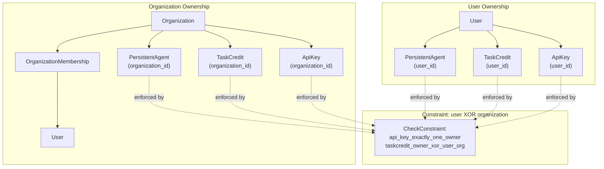
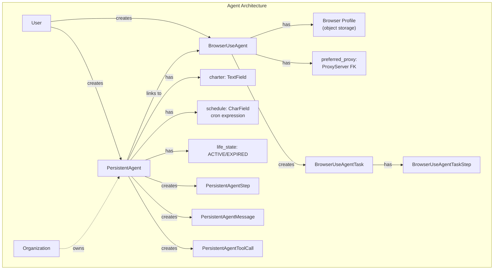
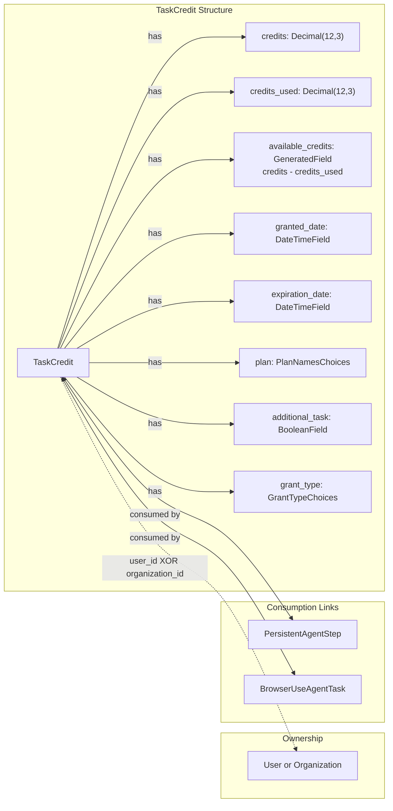
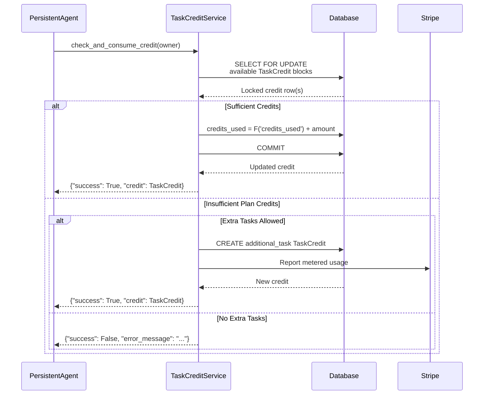
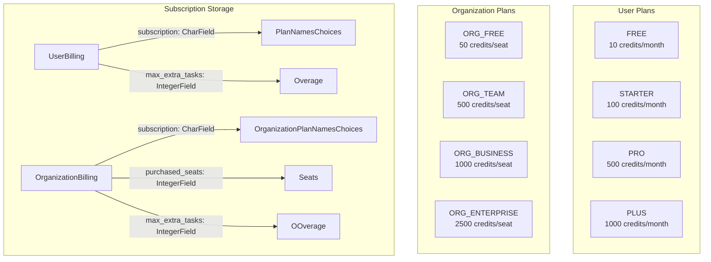
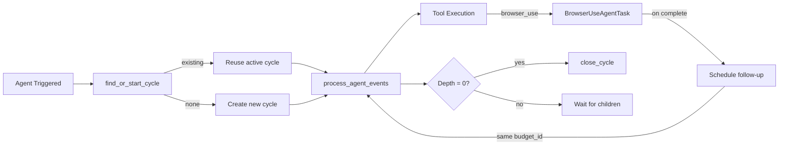
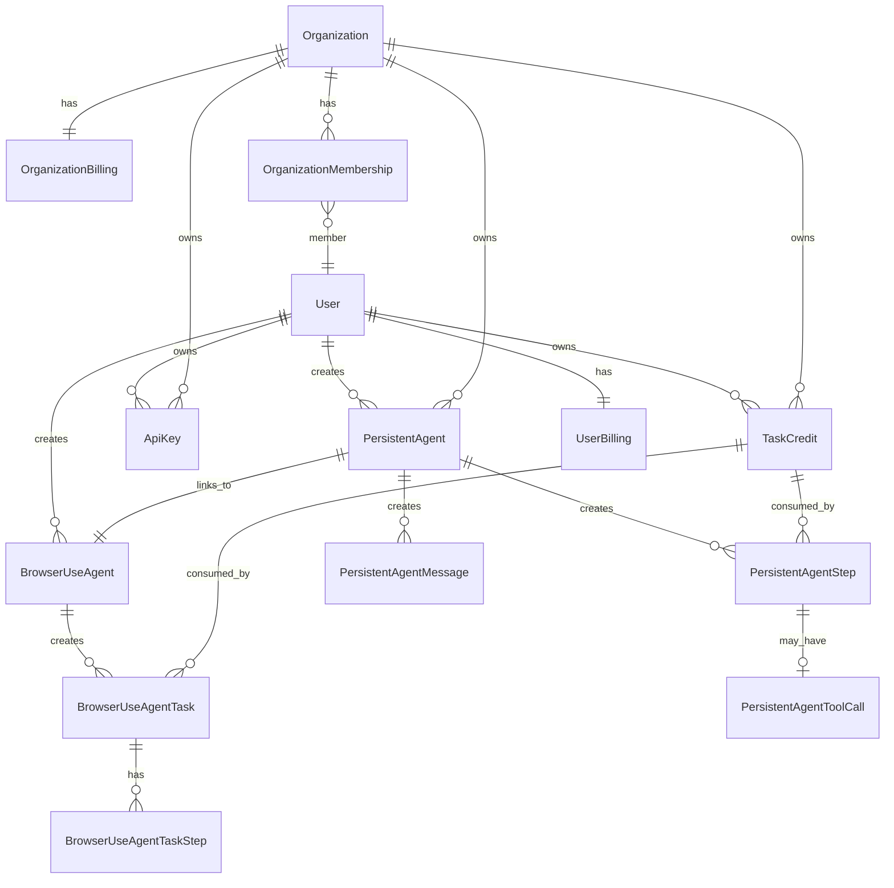

<!-- source: DeepWiki mcp.deepwiki.com · repo gobii-ai/gobii-platform · page 3 Core Concepts · fetched 2026-10-27 -->

# Core Concepts

<details>
<summary>Relevant source files</summary>

The following files were used as context for generating this wiki page:

- [api/agent/core/event_processing.py](api/agent/core/event_processing.py)
- [api/migrations/0115_persistentagentstep_credits_fields.py](api/migrations/0115_persistentagentstep_credits_fields.py)
- [api/models.py](api/models.py)
- [console/views.py](console/views.py)
- [tasks/services.py](tasks/services.py)
- [tests/unit/test_persistent_agent_step_credits.py](tests/unit/test_persistent_agent_step_credits.py)
- [tests/unit/test_task_credit_service.py](tests/unit/test_task_credit_service.py)
- [tests/unit/test_tool_costs.py](tests/unit/test_tool_costs.py)
- [util/tool_costs.py](util/tool_costs.py)

</details>


This document introduces the fundamental data models, ownership patterns, and resource control mechanisms in the gobii-platform. It covers the dual ownership model (User vs Organization), core entity types (Agents, Credits, API Keys), and how they interrelate.

For detailed information about specific subsystems, see:
- Agent lifecycle and configuration: [Agents](#3.1)
- Credit consumption and quotas: [Task Credits](#3.2)
- Multi-user organizations: [Organizations](#3.3)
- Agent creation workflows: [Creating Agents](#4.1)
- Billing infrastructure: [Credit & Billing System](#5)

---

## Dual Ownership Model

The platform supports two ownership contexts: **personal (User)** and **organizational (Organization)**. Most entities can be owned by either type, enforced via database constraints.

### Ownership Enforcement Patterns



**Sources:** [api/models.py:122-176](), [api/models.py:290-385]()

### Key Ownership Rules

| Entity | User Ownership | Organization Ownership | Enforcement |
|--------|---------------|------------------------|-------------|
| `ApiKey` | `user_id NOT NULL` | `organization_id NOT NULL` | [api/models.py:168-174]() |
| `TaskCredit` | `user_id NOT NULL` | `organization_id NOT NULL` | [api/models.py:375-384]() |
| `PersistentAgent` | `user_id NOT NULL` | `organization_id` (optional) | Agents always have a user, optionally have an org |
| `BrowserUseAgent` | `user_id NOT NULL` | N/A | Always user-owned |

The constraint pattern `(user__isnull=False, organization__isnull=True) | (user__isnull=True, organization__isnull=False)` ensures exactly one owner exists.

**Sources:** [api/models.py:156-175](), [api/models.py:350-385]()

---

## Core Entity Types

### Agent Hierarchy



**Sources:** [api/models.py:472-611](), [api/models.py:1131-1376]()

### Agent Relationships

**BrowserUseAgent** (`api.models.BrowserUseAgent`)
- Represents browser automation capability
- One-to-one relationship with `PersistentAgent`
- Manages Chrome profile persistence in object storage
- Auto-assigns `preferred_proxy` on creation via `select_random_proxy()`
- Enforces user agent limits via `AgentService.get_agents_available()`

**PersistentAgent** (`api.models.PersistentAgent`)
- Orchestrates long-running autonomous behavior
- References a `BrowserUseAgent` for web automation tasks
- Contains `charter` (mission/instructions) and `schedule` (cron expression)
- Tracks `life_state` (ACTIVE/EXPIRED) for activation management
- Can be owned by User or Organization (dual ownership)

**Sources:** [api/models.py:472-502](), [api/models.py:1131-1198]()

---

## Task Credit System

Credits are the platform's resource control mechanism. They gate agent execution, tool usage, and API operations.

### Credit Data Model



**Sources:** [api/models.py:290-390]()

### Credit Configuration

The credit cost system uses a two-tier configuration:

1. **Default Cost** - Stored in `TaskCreditConfig` singleton ([api/models.py:393-427]())
2. **Per-Tool Overrides** - Stored in `ToolCreditCost` ([api/models.py:429-471]())

```python
# Cache-backed retrieval (5-minute TTL)
default_cost = get_default_task_credit_cost()  # util/tool_costs.py:101
tool_cost = get_tool_credit_cost("send_email")  # util/tool_costs.py:106
```

The `TaskCreditService` handles atomic consumption using `SELECT FOR UPDATE` locking to prevent race conditions.

**Sources:** [util/tool_costs.py:55-88](), [tasks/services.py:418-534]()

### Credit Granting Patterns

| Grant Type | Trigger | Owner | Characteristics |
|------------|---------|-------|-----------------|
| PLAN | Subscription cycle start | User or Org | Monthly recurring, expires at period end |
| ADDITIONAL_TASK | Overage usage | User or Org | Created on-demand, metered to Stripe |
| COMPENSATION | Admin action | User or Org | Manual grants for support/errors |
| PROMO | Marketing campaign | User or Org | Promotional credits |

**Sources:** [constants/grant_types.py](), [tasks/services.py:202-306](), [tasks/services.py:308-416]()

---

## The TASKS_UNLIMITED Constant

A special sentinel value `-1` represents unlimited credits:

```python
# util/constants/task_constants.py
TASKS_UNLIMITED = -1
```

When a user or organization has `TASKS_UNLIMITED` credits:
- Pre-processing credit gates return immediately ([api/agent/core/event_processing.py:836-854]())
- Usage tracking is bypassed
- No credit consumption occurs

This is used for:
- Internal/admin accounts
- Community Edition unlimited mode (`GOBII_ENABLE_COMMUNITY_UNLIMITED=True`)
- Special promotional plans

**Sources:** [util/constants/task_constants.py](), [tasks/services.py:109-125](), [api/agent/core/event_processing.py:836-854]()

---

## Credit Consumption Flow

### Atomic Consumption Pattern



**Sources:** [tasks/services.py:536-643](), [api/agent/core/event_processing.py:510-710]()

### Pre-Processing Credit Gate

Before agent event processing begins, `process_agent_events` checks credit availability:

```python
# api/agent/core/event_processing.py:836-854
available = TaskCreditService.get_user_task_credits_available(owner_user)

if available is not None and available != TASKS_UNLIMITED:
    most_expensive_cost = get_most_expensive_tool_cost()
    if Decimal(available) < most_expensive_cost:
        # Log system step: credit_insufficient
        # Exit early without processing
```

This prevents wasting compute on LLM calls when the agent cannot execute any tools.

**Sources:** [api/agent/core/event_processing.py:836-854]()

### Mid-Loop Tool Gating

During the agent reasoning loop, each tool invocation is gated:

```python
# api/agent/core/event_processing.py:510-710
def _ensure_credit_for_tool(agent, tool_name, span=None):
    cost = get_tool_credit_cost(tool_name)
    
    # Check daily limit
    daily_state = _get_agent_daily_credit_state(agent)
    if not _has_sufficient_daily_credit(daily_state, cost):
        # Create system step: daily_credit_limit_mid_loop
        return False
    
    # Check owner credits
    consumed = TaskCreditService.check_and_consume_credit(owner_user, amount=cost)
    if not consumed or not consumed.get('success'):
        # Create system step: credit_insufficient_mid_loop
        return False
    
    return cost
```

**Sources:** [api/agent/core/event_processing.py:510-710]()

---

## API Keys & Authentication

API keys provide programmatic access and implement the dual ownership model.

### ApiKey Structure

```mermaid
graph TB
    subgraph "ApiKey Model"
        AK[ApiKey]
        AK --> ID["id: UUIDField"]
        AK --> User["user: FK<br/>(nullable)"]
        AK --> Org["organization: FK<br/>(nullable)"]
        AK --> CreatedBy["created_by: FK<br/>(User)"]
        AK --> Name["name: CharField"]
        AK --> Prefix["prefix: CharField(8)<br/>(first 8 chars)"]
        AK --> Hash["hashed_key: CharField(64)<br/>(SHA256 hash)"]
        AK --> RawKey["raw_key: CharField(128)<br/>(stored once, display only)"]
        AK --> RevokedAt["revoked_at: DateTimeField<br/>(nullable)"]
    end
    
    subgraph "Constraints"
        UniqueUserName["UniqueConstraint:<br/>user + name"]
        UniqueOrgName["UniqueConstraint:<br/>organization + name"]
        ExactlyOne["CheckConstraint:<br/>user XOR organization"]
    end
    
    AK -.-> UniqueUserName
    AK -.-> UniqueOrgName
    AK -.-> ExactlyOne
```



**Sources:** [api/models.py:122-176]()

### Key Generation & Validation

```python
# api/models.py:178-180
@staticmethod
def generate() -> tuple[str, str]:
    raw = secrets.token_urlsafe(32)
    return raw, _hash(raw)  # SHA256 hash

# api/models.py:265-266
def matches(self, raw: str) -> bool:
    return self.hashed_key == _hash(raw) and self.revoked_at is None
```

**Key Limits:**
- User API keys: `MAX_API_KEYS_PER_USER = 50` ([api/models.py:123]())
- Organization API keys: `MAX_API_KEYS_PER_ORG = 50` ([api/models.py:124]())

Enforced via `clean()` validation before creation ([api/models.py:213-257]()).

**Sources:** [api/models.py:177-180](), [api/models.py:213-257](), [api/models.py:265-266]()

### Console Context Resolution

The console interface uses `build_console_context()` to determine active ownership:

```python
# console/views.py:153-175
@cached_property
def api_key_context(self):
    resolved = build_console_context(self.request)
    if resolved.current_context.type == "organization":
        membership = resolved.current_membership
        return {
            "type": "organization",
            "organization": membership.org,
            "membership": membership,
            "can_manage": membership.role in API_KEY_MANAGE_ROLES,
        }
    return {
        "type": "user",
        "user": self.request.user,
        "can_manage": True,
    }
```

**Sources:** [console/views.py:149-181]()

---

## Plans & Subscriptions

Plans define credit entitlements and feature access.

### Plan Types



**Sources:** [constants/plans.py](), [api/models.py:2034-2082](), [api/models.py:2211-2287]()

### Credit Provisioning

When a subscription is created or renewed:

```python
# tasks/services.py:202-306
def grant_subscription_credits(user, plan=None, invoice_id="", ...):
    # For users: grant plan.monthly_task_credits
    # Expiration aligns with subscription.current_period_end
    TaskCredit.objects.create(
        user=user,
        credits=credits_to_grant,
        granted_date=grant_date,
        expiration_date=expiration_date,
        plan=plan["id"],
        grant_type=GrantTypeChoices.PLAN,
        additional_task=False,
    )

# tasks/services.py:308-416
def grant_subscription_credits_for_organization(org, seats, ...):
    # For orgs: grant (plan.credits_per_seat * seats)
    credits_to_grant = Decimal(credits_per_seat) * Decimal(seats)
    TaskCredit.objects.create(
        organization=org,
        credits=credits_to_grant,
        ...
    )
```

**Sources:** [tasks/services.py:202-306](), [tasks/services.py:308-416]()

---

## Communication Channels

Agents can communicate via multiple channels, defined by the `CommsChannel` enum:

```python
# api/models.py:103-110
class CommsChannel(models.TextChoices):
    EMAIL = "email", "Email"
    SMS = "sms", "SMS"
    SLACK = "slack", "Slack"
    DISCORD = "discord", "Discord"
    WEB = "web", "Web Chat"
    OTHER = "other", "Other"
```

Each channel has an associated tool:
- `EMAIL` → `send_email` tool
- `SMS` → `send_sms` tool
- `WEB` → `send_chat_message` tool

Channel-specific credit costs are retrieved via:

```python
# util/tool_costs.py:141-152
def get_tool_credit_cost_for_channel(channel: str) -> Decimal:
    tool_name = _CHANNEL_TOOL_NAMES.get(normalized_channel)
    return get_tool_credit_cost(tool_name)
```

**Sources:** [api/models.py:103-110](), [util/tool_costs.py:141-152]()

---

## Budget Cycles

Agent execution is tracked within **budget cycles** to prevent runaway resource consumption.

### Budget Context Structure

```python
# api/agent/core/budget.py
@dataclass
class BudgetContext:
    agent_id: str          # UUID of PersistentAgent
    budget_id: str         # Cycle identifier
    branch_id: str         # Execution branch (for follow-ups)
    depth: int             # Recursion depth
    max_steps: int         # Step limit per cycle
    max_depth: int         # Max recursion depth
```

Budget cycles are stored in Redis with TTL:
- `agent:{agent_id}:budget:status` → "active" | "closed"
- `agent:{agent_id}:budget:cycle_id` → current cycle ID
- `agent:{agent_id}:budget:branch:{branch_id}:depth` → outstanding children counter

**Sources:** [api/agent/core/budget.py](), [api/agent/core/event_processing.py:715-801]()

### Cycle Lifecycle



**Sources:** [api/agent/core/event_processing.py:715-801](), [api/agent/core/budget.py]()

---

## Entity Relationship Overview



**Sources:** [api/models.py:122-2500]()

---

