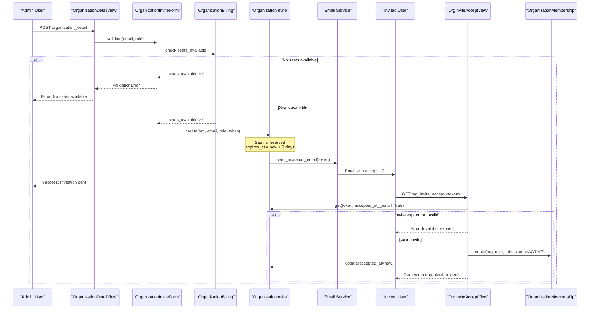
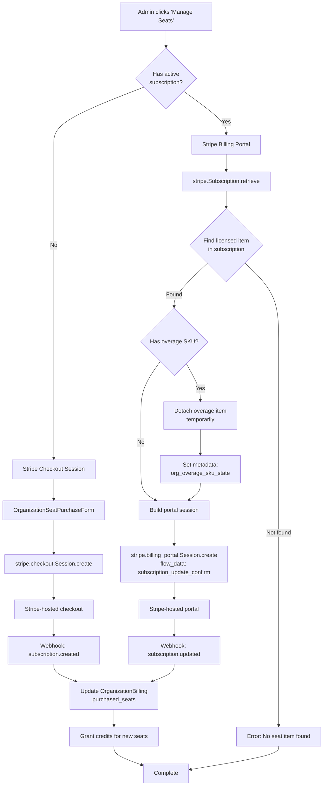
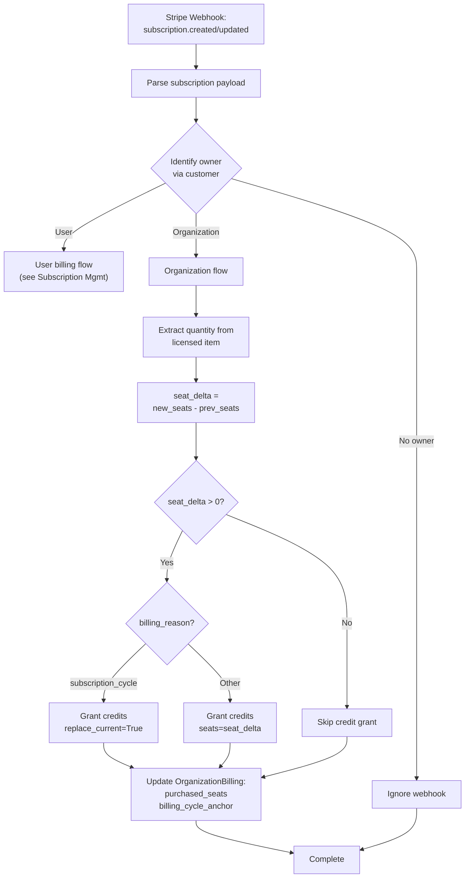

<!-- source: DeepWiki mcp.deepwiki.com · repo gobii-ai/gobii-platform · page 3.3 Organizations · fetched 2026-10-27 -->

# Organizations

<details>
<summary>Relevant source files</summary>

The following files were used as context for generating this wiki page:

- [api/agent/core/event_processing.py](api/agent/core/event_processing.py)
- [api/models.py](api/models.py)
- [console/forms.py](console/forms.py)
- [console/templates/console/organization_detail.html](console/templates/console/organization_detail.html)
- [console/templates/partials/_org_invite_modal.html](console/templates/partials/_org_invite_modal.html)
- [console/views.py](console/views.py)
- [constants/stripe.py](constants/stripe.py)
- [pages/signals.py](pages/signals.py)
- [tests/unit/test_organizations.py](tests/unit/test_organizations.py)
- [tests/unit/test_pages_signals.py](tests/unit/test_pages_signals.py)

</details>


Organizations provide multi-user workspaces where teams can collaborate on agents, share API keys, and pool task credits under a unified billing account. Organizations operate on a seat-based subscription model where each seat grants access to one team member.

For information about individual user billing, see [Subscription Management](#5.2). For organization-specific billing operations, see [Organization Billing](#5.3).

---

## Purpose and Scope

This document covers:
- Organization creation and lifecycle
- Membership management with role-based permissions
- Invitation and seat reservation system
- Seat-based billing and subscription handling
- Organization-owned resources (agents, API keys, credits)
- Console context switching between personal and organization workspaces

**Key Models**: `Organization`, `OrganizationMembership`, `OrganizationInvite`, `OrganizationBilling`

---

## Data Model Overview

### Core Models and Relationships

```mermaid
erDiagram
    User ||--o{ OrganizationMembership : "has"
    Organization ||--o{ OrganizationMembership : "has"
    Organization ||--|| OrganizationBilling : "has"
    Organization ||--o{ OrganizationInvite : "has"
    Organization ||--o{ PersistentAgent : "owns"
    Organization ||--o{ ApiKey : "owns"
    Organization ||--o{ TaskCredit : "owns"
    OrganizationBilling ||--o| Subscription : "stripe_subscription_id"
    
    Organization {
        uuid id PK
        string name
        string slug UK
        string description
        user created_by FK
        datetime created_at
        datetime updated_at
    }
    
    OrganizationMembership {
        uuid id PK
        org organization FK
        user user FK
        string role
        string status
        datetime joined_at
    }
    
    OrganizationInvite {
        uuid id PK
        org organization FK
        string email
        string role
        string token UK
        datetime expires_at
        datetime accepted_at
        user invited_by FK
    }
    
    OrganizationBilling {
        uuid id PK
        org organization OneToOne
        string stripe_customer_id
        string stripe_subscription_id
        int purchased_seats
        int pending_seat_quantity
        datetime pending_seat_effective_at
        string subscription
        int billing_cycle_anchor
    }
```

**Sources**: [api/models.py:1925-2190]()

---

### Organization Model

The `Organization` model represents a multi-user workspace with shared resources.

| Field | Type | Description |
|-------|------|-------------|
| `id` | UUID | Primary key |
| `name` | CharField(128) | Display name |
| `slug` | SlugField(128) | URL-safe unique identifier |
| `description` | TextField | Optional description |
| `created_by` | ForeignKey(User) | Founding user |
| `created_at` | DateTimeField | Creation timestamp |
| `updated_at` | DateTimeField | Last modification timestamp |

**Key Properties**:
- `billing`: OneToOne relationship to `OrganizationBilling` (auto-created on save via signal)
- Reverse relations: `memberships`, `invites`, `persistent_agents`, `api_keys`, `task_credits`

**Sources**: [api/models.py:1925-1969]()

---

### OrganizationMembership Model

The `OrganizationMembership` model tracks user participation in organizations with role-based permissions.

#### Role Definitions

```python
class OrgRole(models.TextChoices):
    OWNER = "owner", "Owner"
    ADMIN = "admin", "Admin"
    MEMBER = "member", "Member"
    BILLING = "billing", "Billing"
```

#### Status Definitions

```python
class OrgStatus(models.TextChoices):
    ACTIVE = "active", "Active"
    SUSPENDED = "suspended", "Suspended"
```

| Field | Type | Description |
|-------|------|-------------|
| `org` | ForeignKey(Organization) | Organization reference |
| `user` | ForeignKey(User) | User reference |
| `role` | CharField | One of: OWNER, ADMIN, MEMBER, BILLING |
| `status` | CharField | ACTIVE or SUSPENDED |
| `joined_at` | DateTimeField | Membership start timestamp |

**Constraints**:
- Unique together: `(org, user)`
- At least one OWNER required per organization (enforced in views)

**Sources**: [api/models.py:1972-2026]()

---

### Role Permission Matrix

The following table shows which actions each role can perform:

| Action | OWNER | ADMIN | BILLING | MEMBER |
|--------|-------|-------|---------|--------|
| View organization details | ✓ | ✓ | ✓ | ✓ |
| Create agents | ✓ | ✓ | - | ✓ |
| Manage own agents | ✓ | ✓ | - | ✓ |
| View all org agents | ✓ | ✓ | - | ✓ |
| Invite members | ✓ | ✓ | - | - |
| Remove members | ✓ | ✓ | - | - |
| Change member roles (except OWNER) | ✓ | ✓ | - | - |
| Promote to OWNER | ✓ | - | - | - |
| Purchase seats | ✓ | ✓ | ✓ | - |
| View billing | ✓ | ✓ | ✓ | - |
| Manage subscription | ✓ | ✓ | ✓ | - |
| View API keys | ✓ | ✓ | ✓ | - |
| Create API keys | ✓ | ✓ | - | - |
| Revoke/delete API keys | ✓ | ✓ | - | - |

**Constants**:
```python
BILLING_MANAGE_ROLES = {OrgRole.OWNER, OrgRole.ADMIN, OrgRole.BILLING}
MEMBER_MANAGE_ROLES = {OrgRole.OWNER, OrgRole.ADMIN}
API_KEY_MANAGE_ROLES = {OrgRole.OWNER, OrgRole.ADMIN}
API_KEY_VIEW_ROLES = {OrgRole.OWNER, OrgRole.ADMIN, OrgRole.BILLING}
```

**Sources**: [console/views.py:128-147]()

---

## Invitation System

### OrganizationInvite Model

The `OrganizationInvite` model manages pending invitations with seat reservation.

| Field | Type | Description |
|-------|------|-------------|
| `org` | ForeignKey(Organization) | Target organization |
| `email` | EmailField(255) | Invitee email (case-insensitive) |
| `role` | CharField | Role to grant upon acceptance |
| `token` | CharField(64) | Unique secure token for acceptance URL |
| `invited_by` | ForeignKey(User) | Inviter reference |
| `created_at` | DateTimeField | Invitation creation timestamp |
| `expires_at` | DateTimeField | Expiration (default: 7 days) |
| `accepted_at` | DateTimeField | Acceptance timestamp (null if pending) |

**Constraints**:
- Unique: `token`
- Unique together: `(org, email)` for non-accepted invites

**Sources**: [api/models.py:2029-2082]()

---

### Invitation Flow Sequence



**Sources**: [console/views.py:1555-1664](), [console/forms.py:443-522](), [tests/unit/test_organizations.py:53-94]()

---

### Seat Reservation Logic

Pending invitations reserve seats from the organization's purchased capacity:

```python
# OrganizationBilling.seats_reserved (generated field)
seats_reserved = (
    active_memberships_count + pending_invites_count
)

# OrganizationBilling.seats_available (generated field)
seats_available = purchased_seats - seats_reserved
```

**Validation**: When creating an invite, `OrganizationInviteForm.clean()` checks:
1. `seats_available > 0`
2. No existing pending invite for the same email
3. User is not already a member

**Sources**: [api/models.py:2162-2190](), [console/forms.py:486-513]()

---

## Seat-Based Billing

### OrganizationBilling Model

Organizations use seat-based subscriptions where each seat grants one user access.

| Field | Type | Description |
|-------|------|-------------|
| `organization` | OneToOneField | Parent organization |
| `stripe_customer_id` | CharField(128) | Stripe Customer ID |
| `stripe_subscription_id` | CharField(128) | Stripe Subscription ID |
| `purchased_seats` | PositiveIntegerField | Number of seats purchased |
| `subscription` | CharField(32) | Plan name (e.g., "org_team") |
| `billing_cycle_anchor` | PositiveIntegerField | Day of month for billing |
| `pending_seat_quantity` | PositiveIntegerField | Scheduled seat change |
| `pending_seat_effective_at` | DateTimeField | When pending change takes effect |

**Generated Fields**:
- `seats_reserved`: Count of active members + pending invites
- `seats_available`: `purchased_seats - seats_reserved`

**Sources**: [api/models.py:2085-2190]()

---

### Seat Purchase Flow

Organizations purchase seats through Stripe Checkout or Billing Portal:



**Sources**: [console/views.py:1810-2061](), [pages/signals.py:233-597]()

---

### Overage SKU Management

Organizations using the overage SKU (metered additional tasks) require special handling during seat updates:

**Problem**: Stripe Billing Portal cannot modify subscriptions with multiple line items when using `subscription_update_confirm` flow.

**Solution**: Temporarily detach the overage SKU, allow seat update, then reattach.

#### Detach Flow

```python
# console/views.py:_detach_org_overage_item
def _detach_org_overage_item(subscription, overage_price_id, org_id, request):
    # 1. Find overage item in subscription
    overage_item = find_item_by_price_id(subscription, overage_price_id)
    
    # 2. Delete the subscription item
    stripe.SubscriptionItem.delete(overage_item["id"])
    
    # 3. Mark subscription metadata
    stripe.Subscription.modify(
        subscription["id"],
        metadata={ORG_OVERAGE_STATE_META_KEY: ORG_OVERAGE_STATE_DETACHED_PENDING}
    )
    
    # 4. Store in session for reattachment
    _set_overage_detach_session(request, org_id, subscription["id"], overage_price_id)
```

#### Reattach Flow

When the subscription webhook arrives with updated seats:

```python
# pages/signals.py:handle_subscription_event (org branch)
if has_overage_item == False:
    overage_state = metadata.get(ORG_OVERAGE_STATE_META_KEY)
    seat_delta = new_seats - prev_seats
    
    # Reattach if not in detached_pending state OR seats changed
    if overage_state != DETACHED_PENDING or seat_delta != 0:
        stripe.SubscriptionItem.create(
            subscription=subscription_id,
            price=overage_price_id
        )
        stripe.Subscription.modify(
            subscription_id,
            metadata={ORG_OVERAGE_STATE_META_KEY: ""}
        )
```

**Constants**: [constants/stripe.py:1-5]()

**Sources**: [console/views.py:252-350](), [pages/signals.py:472-549]()

---

## Credit Provisioning for Organizations

Organizations receive credits based on seat count and plan configuration.

### Subscription Webhook Handler



**Key Logic**:
- `billing_reason == "subscription_cycle"`: Full renewal, replace all credits
- `billing_reason == "subscription_update"` or `"subscription_create"`: Grant credits for seat delta only
- Seat decreases: No credit grant (no clawback)

**Sources**: [pages/signals.py:233-597]()

---

### TaskCreditService for Organizations

```python
# tasks/services.py:TaskCreditService
@classmethod
def grant_subscription_credits_for_organization(
    cls,
    organization: Organization,
    plan: dict,
    seats: int,
    invoice_id: str = "",
    replace_current: bool = False,
    subscription=None,
):
    # Calculate credits: seats * credits_per_seat
    credits_per_seat = plan.get("credits_per_seat", 0)
    total_credits = Decimal(seats) * Decimal(credits_per_seat)
    
    # Determine expiration from subscription
    expiration_date = subscription.current_period_end
    
    if replace_current:
        # Void existing non-additional credits
        TaskCredit.objects.filter(
            organization=organization,
            additional_task=False,
            voided=False,
        ).update(voided=True)
    
    # Create new TaskCredit block
    TaskCredit.objects.create(
        organization=organization,
        credits=total_credits,
        granted_date=timezone.now(),
        expiration_date=expiration_date,
        plan=plan["id"],
        grant_type=GrantTypeChoices.PLAN,
    )
```

**Note**: Organization credits use `organization` FK instead of `user` FK in `TaskCredit` model.

**Sources**: [api/models.py:290-309](), Referenced in webhook handler

---

## Organization-Owned Resources

### Persistent Agents

Agents can be owned by an organization instead of a user:

```python
# api/models.py:PersistentAgent
class PersistentAgent(models.Model):
    user = models.ForeignKey(User, null=True, blank=True)
    organization = models.ForeignKey(Organization, null=True, blank=True)
    
    class Meta:
        constraints = [
            models.CheckConstraint(
                check=(
                    Q(user__isnull=False, organization__isnull=True)
                    | Q(user__isnull=True, organization__isnull=False)
                ),
                name="persistent_agent_owner_xor",
            )
        ]
```

**Ownership Rules**:
- Exactly one of `user` or `organization` must be set (enforced by CHECK constraint)
- Organization-owned agents consume credits from organization's `TaskCredit` pool
- All organization members can view/interact with organization agents

**Sources**: [api/models.py:1156-1262]()

---

### API Keys

API keys can be owned by organizations:

```python
# api/models.py:ApiKey
class ApiKey(models.Model):
    MAX_API_KEYS_PER_ORG = 50
    
    user = models.ForeignKey(User, null=True, blank=True)
    organization = models.ForeignKey(Organization, null=True, blank=True)
    created_by = models.ForeignKey(User, related_name="created_api_keys")
    
    @classmethod
    def create_for_org(cls, organization, *, created_by, name="default"):
        raw, hashed = cls.generate()
        return cls.objects.create(
            organization=organization,
            created_by=created_by,
            name=name,
            prefix=raw[:8],
            hashed_key=hashed,
            raw_key=raw,
        )
```

**Permission Enforcement**:
- API keys inherit organization permissions when authenticating
- Agents created via org API key are automatically org-owned
- API key management requires `API_KEY_MANAGE_ROLES` (OWNER or ADMIN)
- Viewing API keys requires `API_KEY_VIEW_ROLES` (OWNER, ADMIN, or BILLING)

**Sources**: [api/models.py:122-277](), [console/views.py:149-182]()

---

## Console Context Switching

Users can switch between personal workspace and organization workspaces.

### Context Resolution

```python
# console/context_helpers.py:build_console_context
def build_console_context(request):
    # 1. Check for org_id in session
    active_org_id = request.session.get("active_org_id")
    
    if active_org_id:
        # 2. Verify active membership exists
        membership = OrganizationMembership.objects.filter(
            org_id=active_org_id,
            user=request.user,
            status=OrganizationMembership.OrgStatus.ACTIVE,
        ).select_related("org").first()
        
        if membership:
            return ConsoleContext(
                type="organization",
                id=membership.org.id,
                name=membership.org.name,
                membership=membership,
            )
    
    # 3. Fall back to personal context
    return ConsoleContext(
        type="user",
        id=request.user.id,
        email=request.user.email,
    )
```

**Context Storage**: 
- Stored in session: `request.session["active_org_id"]`
- Cleared when user explicitly switches to personal workspace
- Automatically cleared if membership becomes invalid

**Sources**: [console/context_helpers.py:1-89]() (referenced in views)

---

### Context-Aware Views

Views use `ConsoleViewMixin` to inject context into templates:

```python
# console/mixins.py:ConsoleViewMixin
class ConsoleViewMixin(LoginRequiredMixin):
    def get_context_data(self, **kwargs):
        context = super().get_context_data(**kwargs)
        
        # Build and inject console context
        resolved = build_console_context(self.request)
        context['current_context'] = {
            'type': resolved.type,
            'id': resolved.id,
            'name': resolved.name,
        }
        context['current_membership'] = resolved.membership
        
        # List all user's organizations
        context['organizations'] = Organization.objects.filter(
            memberships__user=self.request.user,
            memberships__status=OrganizationMembership.OrgStatus.ACTIVE,
        ).distinct()
        
        return context
```

**Context-Dependent Behavior**:
- Agent listings filter by `organization_id` when in org context
- Credit availability calculated from org `TaskCredit` records
- Dashboard metrics aggregate org-owned resources
- Billing views show org subscription when in org context

**Sources**: [console/views.py:351-577](), [console/mixins.py:1-85]() (referenced)

---

## Database Schema Summary

### Key Constraints and Indexes

```sql
-- Organization uniqueness
ALTER TABLE api_organization ADD CONSTRAINT unique_slug UNIQUE (slug);

-- Membership uniqueness
ALTER TABLE api_organizationmembership 
    ADD CONSTRAINT unique_org_user UNIQUE (org_id, user_id);

-- Invite uniqueness
ALTER TABLE api_organizationinvite 
    ADD CONSTRAINT unique_pending_invite 
    UNIQUE (org_id, email) 
    WHERE accepted_at IS NULL;

-- Billing one-to-one
ALTER TABLE api_organizationbilling 
    ADD CONSTRAINT unique_organization UNIQUE (organization_id);

-- Owner XOR constraints
ALTER TABLE api_apikey 
    ADD CONSTRAINT api_key_exactly_one_owner 
    CHECK (
        (user_id IS NOT NULL AND organization_id IS NULL) OR
        (user_id IS NULL AND organization_id IS NOT NULL)
    );

ALTER TABLE api_persistentagent 
    ADD CONSTRAINT persistent_agent_owner_xor 
    CHECK (
        (user_id IS NOT NULL AND organization_id IS NULL) OR
        (user_id IS NULL AND organization_id IS NOT NULL)
    );

ALTER TABLE api_taskcredit 
    ADD CONSTRAINT taskcredit_owner_xor_user_org 
    CHECK (
        (user_id IS NOT NULL AND organization_id IS NULL) OR
        (user_id IS NULL AND organization_id IS NOT NULL)
    );
```

**Sources**: [api/models.py:156-175](), [api/models.py:373-385](), [api/models.py:1972-2026]()

---

## Usage Example: Organization Lifecycle

### 1. Create Organization

```python
org = Organization.objects.create(
    name="Acme Corp",
    slug="acme",
    created_by=founder_user,
)
# OrganizationBilling auto-created via post_save signal
```

### 2. Add Founder as Owner

```python
OrganizationMembership.objects.create(
    org=org,
    user=founder_user,
    role=OrganizationMembership.OrgRole.OWNER,
    status=OrganizationMembership.OrgStatus.ACTIVE,
)
```

### 3. Purchase Seats via Stripe

```python
# User completes Stripe Checkout
# Webhook receives subscription.created event
# Signal handler in pages/signals.py:
#   - Updates org.billing.purchased_seats
#   - Grants credits via TaskCreditService
```

### 4. Invite Team Member

```python
invite = OrganizationInvite.objects.create(
    org=org,
    email="engineer@example.com",
    role=OrganizationMembership.OrgRole.MEMBER,
    invited_by=founder_user,
    expires_at=timezone.now() + timedelta(days=7),
)
# Email sent with acceptance link
```

### 5. Accept Invitation

```python
# User clicks link: /orgs/invite/<token>/accept/
# View creates membership:
membership = OrganizationMembership.objects.create(
    org=invite.org,
    user=invitee_user,
    role=invite.role,
    status=OrganizationMembership.OrgStatus.ACTIVE,
)
invite.accepted_at = timezone.now()
invite.save()
```

### 6. Create Organization-Owned Agent

```python
agent = PersistentAgent.objects.create(
    organization=org,
    charter="Monitor social media daily",
)
# Agent consumes credits from org.task_credits
```

**Sources**: [api/models.py:1925-2190](), [console/views.py:1555-1664](), [tests/unit/test_organizations.py:31-151]()

---

