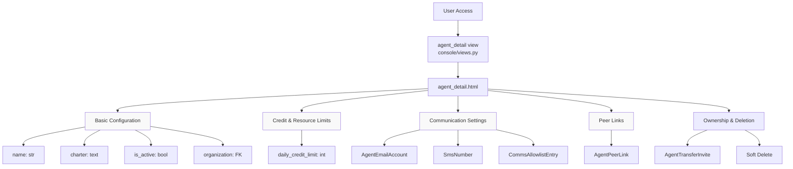
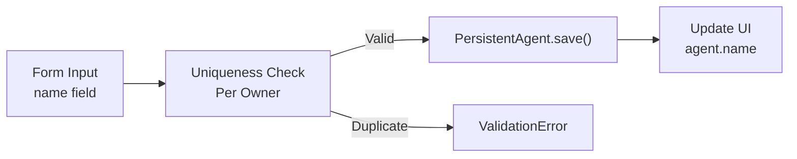
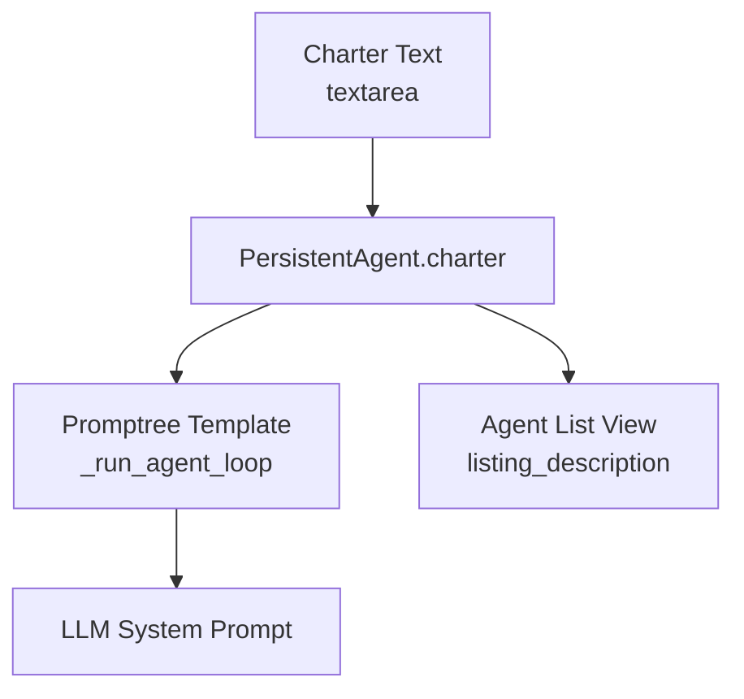
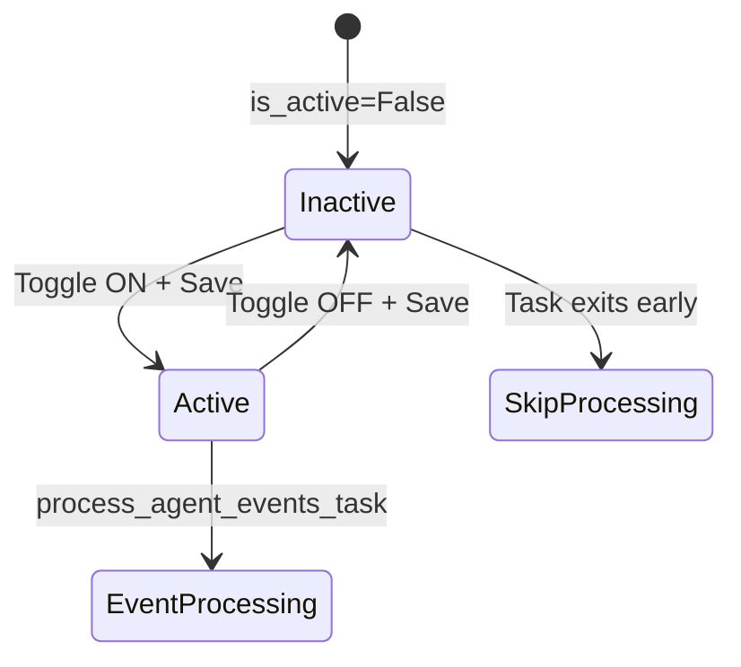
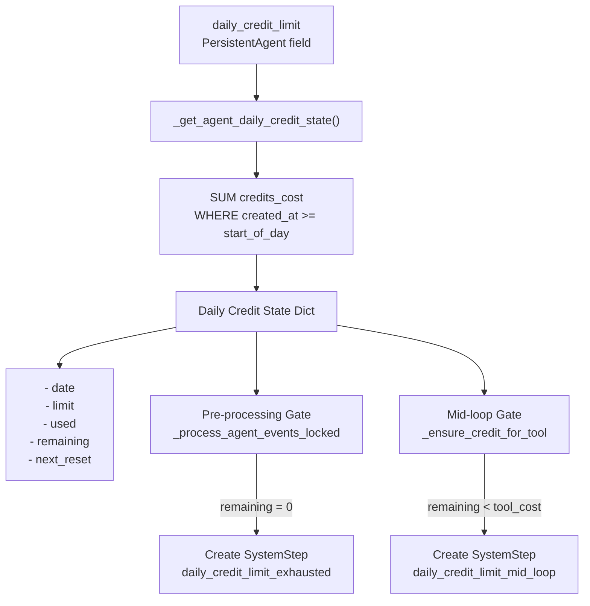
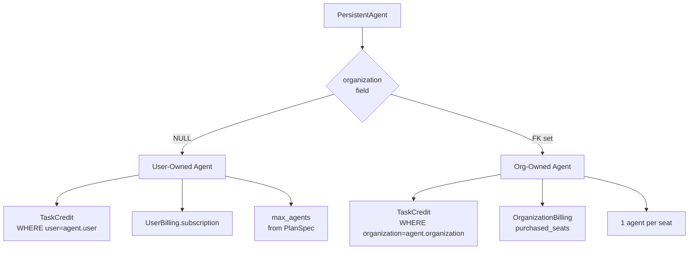
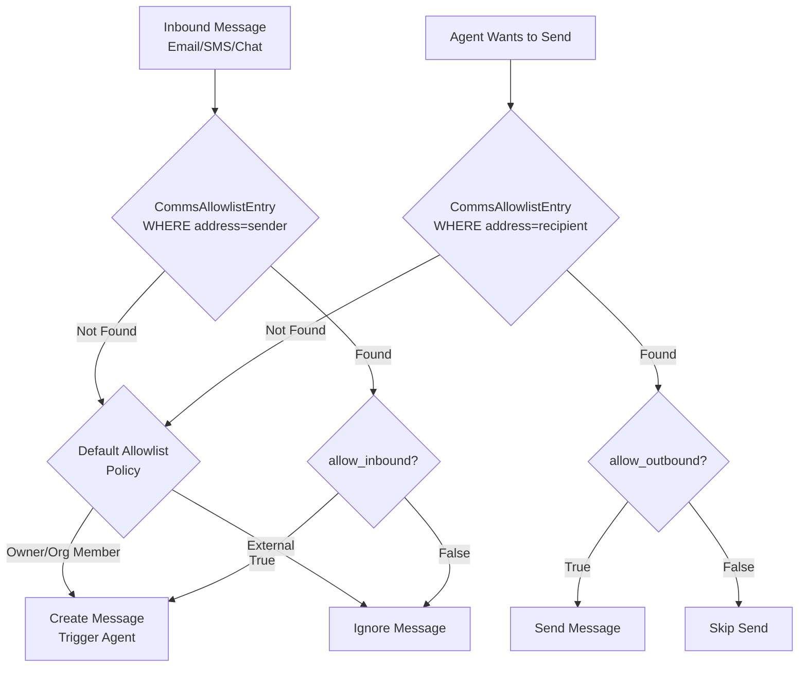
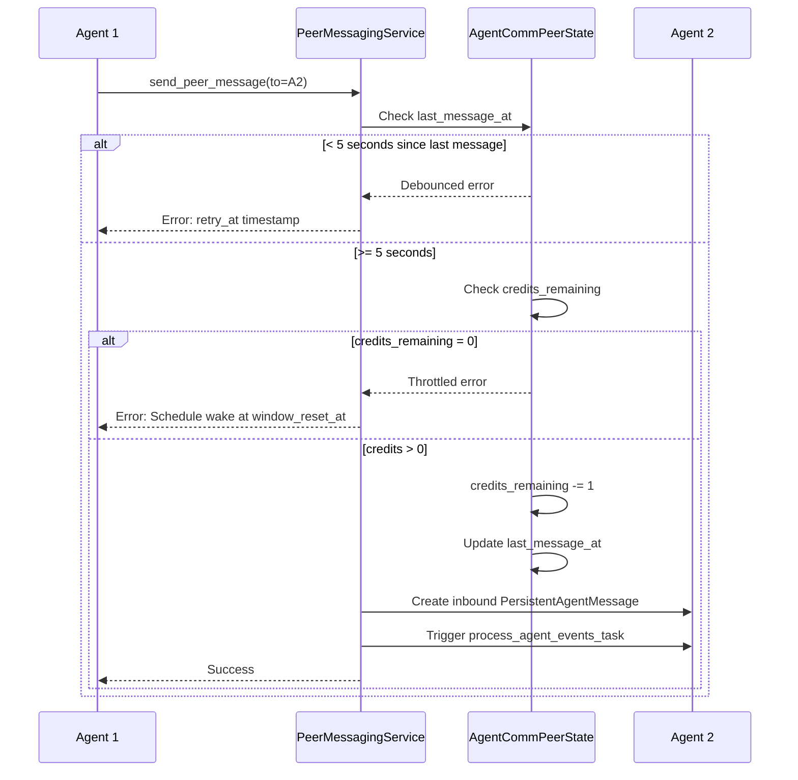
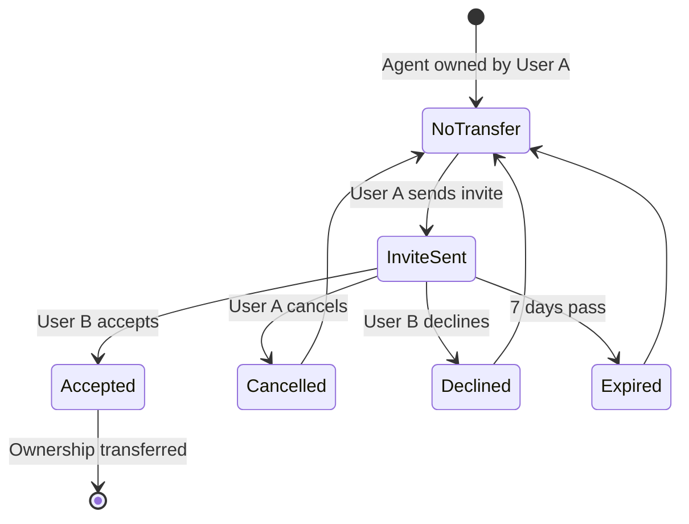
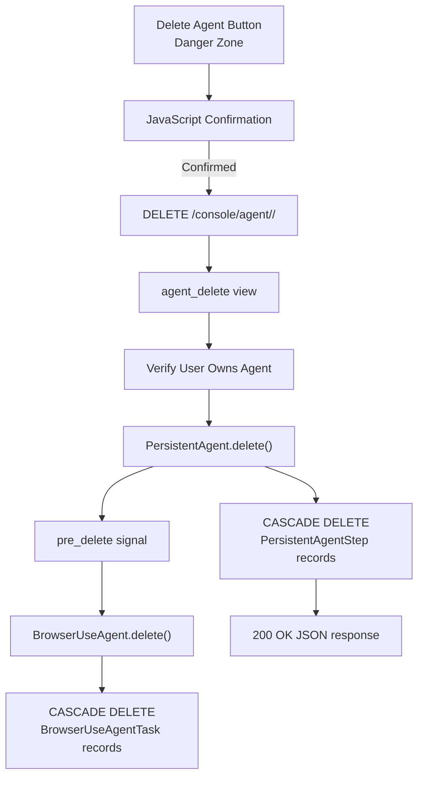

<!-- source: DeepWiki mcp.deepwiki.com · repo gobii-ai/gobii-platform · page 4.2 Configuring Agents · fetched 2026-10-27 -->

# Configuring Agents

<details>
<summary>Relevant source files</summary>

The following files were used as context for generating this wiki page:

- [api/migrations/0155_persistentagent_daily_credit_limit_and_more.py](api/migrations/0155_persistentagent_daily_credit_limit_and_more.py)
- [console/templates/console/agent_detail.html](console/templates/console/agent_detail.html)
- [console/templates/partials/_agent_list.html](console/templates/partials/_agent_list.html)
- [tests/unit/test_agent_event_processing_credits.py](tests/unit/test_agent_event_processing_credits.py)
- [tests/unit/test_console.py](tests/unit/test_console.py)

</details>


## Purpose and Scope

This page documents the configuration options available for `PersistentAgent` instances after creation. It covers all user-facing settings that control agent behavior, resource limits, communication channels, and inter-agent connections. 

For information about the agent creation process, see [Creating Agents](#4.1). For details about how agents process events and execute tasks, see [Agent Event Processing](#4.3). For agent lifecycle states and activation/deactivation, see [Agent Lifecycle](#4.4).

---

## Configuration Interface Overview

Agent configuration is accessed via the agent detail page at `/console/agent/<id>/`, rendered by the `agent_detail` view. The interface is organized into several configuration sections, each controlling different aspects of agent behavior.



**Sources:**
- [console/templates/console/agent_detail.html:1-640]()
- [console/views.py]() (agent_detail view)

---

## Basic Settings

### Agent Name

The `name` field provides a human-readable identifier for the agent. Names must be unique within their ownership scope (per-user for personal agents, per-organization for org-owned agents).

**Validation:**
- Maximum length: 255 characters
- Must be unique within the agent's ownership context
- Updated via POST to `agent_detail` view



**Sources:**
- [console/templates/console/agent_detail.html:46-66]()

### Charter (Assignment)

The `charter` field is a text description of the agent's purpose and responsibilities. This field is incorporated into the agent's system prompt during event processing and guides LLM reasoning.

**Key Characteristics:**
- Free-form text field (TextField in Django)
- Directly injected into prompt via `Promptree` template system
- Can be modified at any time without affecting running tasks
- Appears in agent listing views as truncated description



**Sources:**
- [console/templates/console/agent_detail.html:256-276]()
- [api/agent/core/event_processing.py]() (_run_agent_loop function)

### Active Status

The `is_active` boolean controls whether the agent can process events. Deactivated agents skip all event processing but retain their configuration.

**Toggle Behavior:**
- UI: Toggle switch in status section
- Database: `PersistentAgent.is_active` boolean field
- Effect: Inactive agents bypass event processing in celery tasks



**Sources:**
- [console/templates/console/agent_detail.html:161-199]()
- [api/models.py]() (PersistentAgent.is_active field)

---

## Credit & Resource Limits

### Daily Credit Limit

The `daily_credit_limit` field (added in migration 0155) caps the number of task credits an agent may consume within a 24-hour window. This is an agent-level quota that operates independently of user/organization credit pools.

**Field Specifications:**
- Type: `PositiveIntegerField` (nullable)
- `NULL` value means unlimited
- Defaults to 10 for Free tier agents (set via migration)
- Pro/Enterprise agents default to `NULL` (unlimited)



**Daily Credit State Calculation:**

The system computes daily credit state by:
1. Determining the start of the current day in the agent owner's timezone
2. Summing `credits_cost` from all `PersistentAgentStep` records created today
3. Comparing usage against `daily_credit_limit` (or treating as unlimited if NULL)
4. Calculating the next reset time (start of next day)

**Gating Behavior:**

Daily limits are enforced at two checkpoints:
- **Pre-processing gate**: Before `_run_agent_loop` executes, prevents entire event processing cycle
- **Mid-loop gate**: Before each tool execution in `_ensure_credit_for_tool`, skips individual tools

**Sources:**
- [api/migrations/0155_persistentagent_daily_credit_limit_and_more.py:1-51]()
- [api/agent/core/event_processing.py]() (_get_agent_daily_credit_state function)
- [tests/unit/test_agent_event_processing_credits.py:148-182]() (test_process_agent_events_respects_daily_limit)
- [console/templates/console/agent_detail.html:201-253]()

### Daily Credit UI Components

The agent detail page displays daily credit status with visual indicators:

| Component | Display Condition | Purpose |
|-----------|------------------|---------|
| Usage Progress Bar | `daily_credit_limit` is not NULL | Visual representation of credit consumption |
| Low Credit Warning | `daily_credit_remaining < 1.0` | Alert banner at top of form |
| Remaining Credits | Always (when limit set) | Precise decimal count of credits left |
| Next Reset Time | Always (when limit set) | Timestamp for quota refresh |

**Warning Threshold:**

The UI sets `daily_credit_low = True` when:
- Daily limit is configured (not NULL)
- Remaining credits < 1.0

This triggers amber alert boxes in both the detail view and agent list view.

**Sources:**
- [console/templates/console/agent_detail.html:219-242]()
- [console/templates/partials/_agent_list.html:104-108]()
- [tests/unit/test_console.py:236-291]() (test_agent_detail_updates_daily_credit_limit)

---

## Ownership & Context

### User vs Organization Ownership

Agents can be owned by individual users or by organizations. Ownership determines:
- Credit pool (user credits vs org credits)
- Quota enforcement (user limits vs seat-based limits)
- Access control (who can configure/delete the agent)



**Organization Assignment:**

When the `organizations` waffle flag is active, the detail page allows reassigning agents between personal and organizational ownership. This requires:
- User must have OWNER or ADMIN role in target organization
- Agent name must be unique within target organization
- Organization must have available seats (for org-assignment)

**Reassignment Flow:**

1. User selects target organization from dropdown
2. Client-side JS POSTs to ownership reassignment endpoint
3. Backend validates role and seat availability
4. Updates `PersistentAgent.organization` and `PersistentAgent.user`
5. Reloads page to reflect new context

**Sources:**
- [console/templates/console/agent_detail.html:68-104]()
- [api/models.py]() (PersistentAgent.organization field)

---

## Communication Settings

### Email Configuration

Each agent can have a dedicated email account for sending and receiving messages. The primary email account is linked via the `AgentEmailAccount` model.

**Email Account Properties:**
- `address`: The email address (e.g., `agent-abc123@agents.gobii.ai`)
- `imap_enabled`: Whether to poll for incoming messages
- `smtp_enabled`: Whether agent can send outbound email
- IMAP/SMTP credentials stored in `email_credentials` JSON field

**Management Flow:**

The detail page links to a separate email settings interface:
```
[Manage Email] button → /console/agent/<id>/email-settings/
```

This dedicated view handles:
- IMAP/SMTP connection testing
- Credential updates
- Inbox polling configuration
- Send/receive toggles

**Sources:**
- [console/templates/console/agent_detail.html:106-142]()
- [api/models.py]() (AgentEmailAccount model)

### SMS Configuration

SMS capabilities are provisioned via `SmsNumber` records. Unlike email (which is created by default), SMS must be explicitly enabled.

**Enablement Process:**
1. User clicks "Enable SMS" link on detail page
2. System provisions a Twilio number
3. Creates `SmsNumber` record with webhook configuration
4. Associates number with agent via `agent` FK

**SMS Number Characteristics:**
- `address`: E.164 formatted phone number
- `is_primary`: Boolean flag (one primary per agent)
- `twilio_sid`: Twilio phone number identifier
- Incoming messages trigger webhook → creates `PersistentAgentMessage` → queues event processing

**Sources:**
- [console/templates/console/agent_detail.html:123-128]()
- [console/templates/console/agent_detail.html:144-158]()
- [api/models.py]() (SmsNumber model)

### Communication Allowlist

The allowlist controls which external contacts can communicate with the agent. As of the current implementation, all agents use **manual allowlist policy** exclusively.

**Allowlist Entry Structure:**

Each `CommsAllowlistEntry` record specifies:
- `channel`: Email or SMS
- `address`: Contact identifier (email or phone)
- `allow_inbound`: Can this contact message the agent?
- `allow_outbound`: Can the agent message this contact?

**Directional Permissions:**

The system supports asymmetric communication:
- Agent can notify user, but user cannot command agent: `allow_inbound=False, allow_outbound=True`
- User can command agent, but agent cannot initiate: `allow_inbound=True, allow_outbound=False`
- Bidirectional: Both flags set to `True`



**Management Interface:**

The detail page includes inline allowlist management (when `show_allowlist` context variable is True):
- Add entry form with channel selection
- Inbound/outbound checkbox toggles
- List of current entries with remove buttons
- Contact count display: `N / MAX contacts`

**Quota Enforcement:**

The system enforces `max_contacts_per_agent` from the account's plan specification. The UI displays this limit and prevents adding entries beyond the quota.

**Sources:**
- [console/templates/console/agent_detail.html:278-384]()
- [api/models.py]() (CommsAllowlistEntry model)
- [api/services/comms_service.py]() (allowlist validation logic)

---

## Secrets Management

Agents can store encrypted secrets (API keys, passwords, etc.) via the `AgentSecret` model. The detail page provides a link to a dedicated secrets management interface.

**Navigation:**
```
[Manage Secrets] button → /console/agent/<id>/secrets/
```

**Secret Storage:**
- Key-value pairs stored per-agent
- Values encrypted at rest
- Available to agent during tool execution via `get_agent_secrets()` helper
- Used for MCP server authentication, third-party API access, etc.

**Sources:**
- [console/templates/console/agent_detail.html:416-422]()
- [api/models.py]() (AgentSecret model)

---

## Peer Links (Agent-to-Agent Communication)

Peer links enable direct messaging between agents owned by the same user. Each link is represented by an `AgentPeerLink` record with quota and debounce controls.

### Link Configuration

| Field | Type | Purpose |
|-------|------|---------|
| `from_agent` | FK | Initiating agent |
| `to_agent` | FK | Receiving agent |
| `messages_per_window` | Int | Quota (e.g., 10 messages) |
| `window_hours` | Int | Time window for quota (e.g., 24 hours) |
| `is_enabled` | Bool | Active/inactive toggle |
| `feature_flag` | Str | Optional flag name for conditional enablement |

### Quota Enforcement

The system tracks quota usage via `AgentCommPeerState` records:
- `credits_remaining`: Messages left in current window
- `window_reset_at`: Timestamp when quota refreshes
- `last_message_at`: Last message sent (for debouncing)

**Debouncing:**
The system enforces a 5-second cooldown between consecutive messages to prevent runaway message loops.



### UI Management

The detail page displays all peer links with inline editing:
- Table view showing linked agents, quotas, and remaining credits
- Per-link forms to update `messages_per_window`, `window_hours`, `feature_flag`, and `is_enabled`
- Remove link button (soft delete via `AgentPeerLink.delete()`)

**Sources:**
- [console/templates/console/agent_detail.html:487-597]()
- [api/models.py]() (AgentPeerLink, AgentCommPeerState models)
- [api/services/peer_messaging_service.py]() (quota enforcement logic)

---

## Ownership Transfer

Agents can be transferred to other users via the `AgentTransferInvite` system. This is a two-step process requiring acceptance by the recipient.

### Transfer Flow



### Invitation Creation

Users initiate transfer via form on detail page:
- Input: Recipient email address
- Optional: Transfer message
- POST to `agent_detail` view with `action=transfer_agent`

**Backend Processing:**
1. Validate no pending invite exists
2. Create `AgentTransferInvite` record with `status=PENDING`
3. Send email notification to recipient
4. Display invite details on detail page

### Pending Transfer State

While an invite is pending:
- Detail page shows amber alert with recipient email and sent timestamp
- Original owner retains full configuration access
- `[Cancel Invitation]` button available
- Recipient sees invite in their dashboard with Accept/Decline buttons

**Sources:**
- [console/templates/console/agent_detail.html:22-35]()
- [console/templates/console/agent_detail.html:444-485]()
- [api/models.py]() (AgentTransferInvite model)

---

## Deletion

Agent deletion is a soft-delete operation that removes the agent from active listings but retains historical data.

### Delete Flow



**Cascading Deletes:**

When a `PersistentAgent` is deleted:
1. Associated `BrowserUseAgent` is deleted (via signal handler)
2. All `BrowserUseAgentTask` records are cascade-deleted (FK constraint)
3. All `PersistentAgentStep` records are cascade-deleted (FK constraint)
4. All `PersistentAgentMessage` records are cascade-deleted
5. All `AgentSecret` records are cascade-deleted
6. Email accounts and SMS numbers are disassociated (FK set to NULL)

**Error Handling:**

The delete view includes defensive handling for edge cases:
- Missing `BrowserUseAgent` record (catches `DoesNotExist` exception)
- Foreign key constraint violations (attempts manual cleanup)
- Continues with deletion even if browser agent cleanup fails

**Sources:**
- [console/templates/console/agent_detail.html:599-640]()
- [console/views.py]() (agent_delete view)
- [tests/unit/test_console.py:23-174]()

---

## Configuration Persistence

All configuration changes are persisted via standard Django ORM operations:

| Configuration Area | Model | Update Method |
|-------------------|-------|---------------|
| Name, Charter, Status | `PersistentAgent` | Direct field update via form POST |
| Daily Credit Limit | `PersistentAgent` | `daily_credit_limit` field |
| Ownership | `PersistentAgent` | `organization` and `user` FK updates |
| Email Settings | `AgentEmailAccount` | Separate view/form |
| SMS Settings | `SmsNumber` | Separate view/form |
| Allowlist Entries | `CommsAllowlistEntry` | AJAX create/delete |
| Peer Links | `AgentPeerLink` | Inline form updates |
| Secrets | `AgentSecret` | Separate view/form |

**Transaction Safety:**

Configuration updates use database transactions to ensure atomicity. Failed validations roll back changes and display error messages to the user.

**Sources:**
- [console/views.py]() (agent_detail POST handler)
- [api/models.py]() (model definitions)

---

