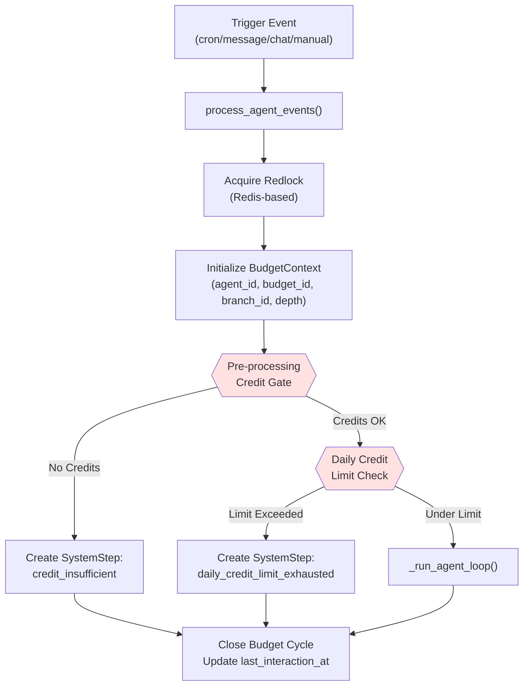
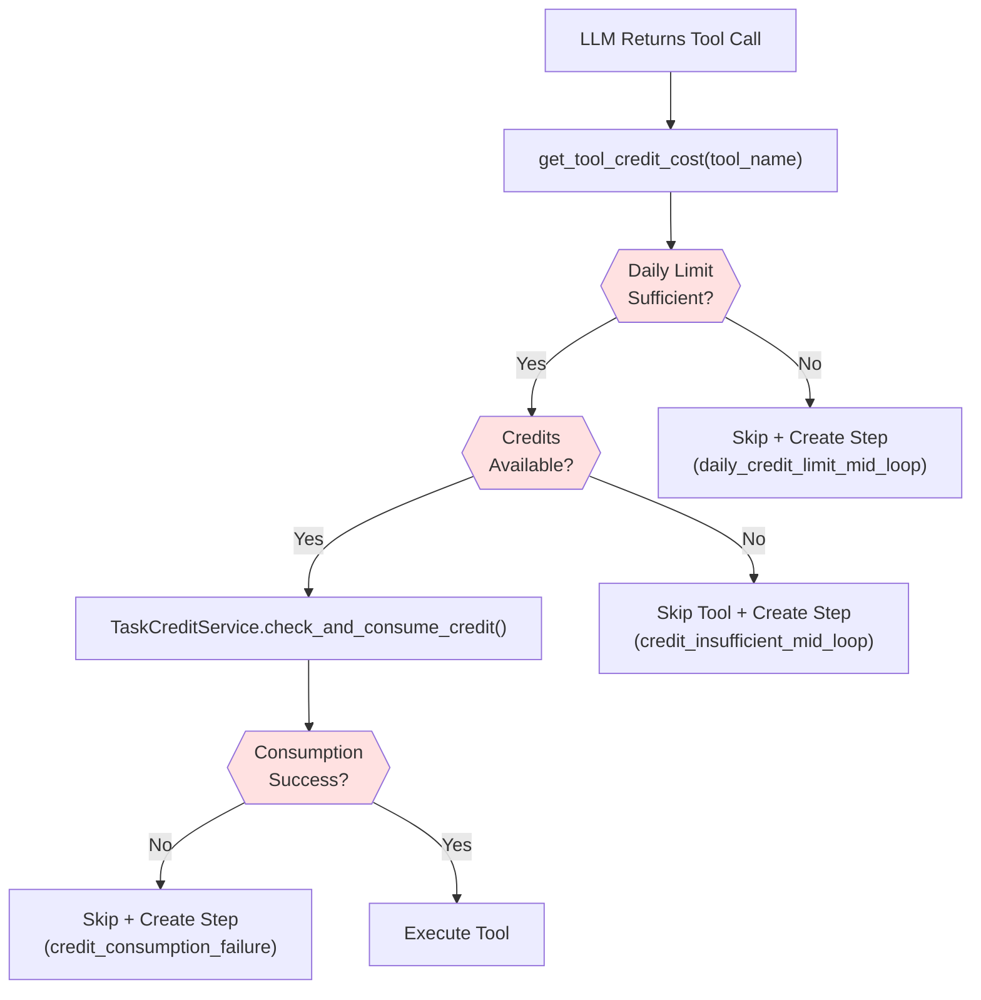
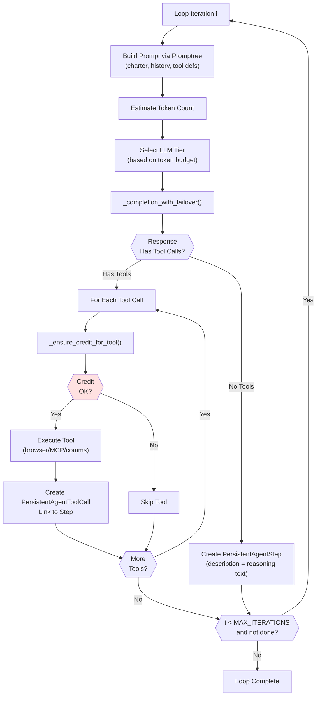
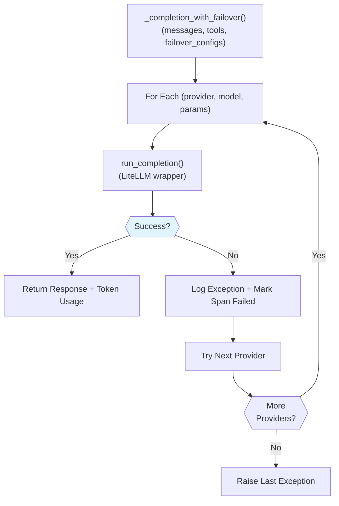
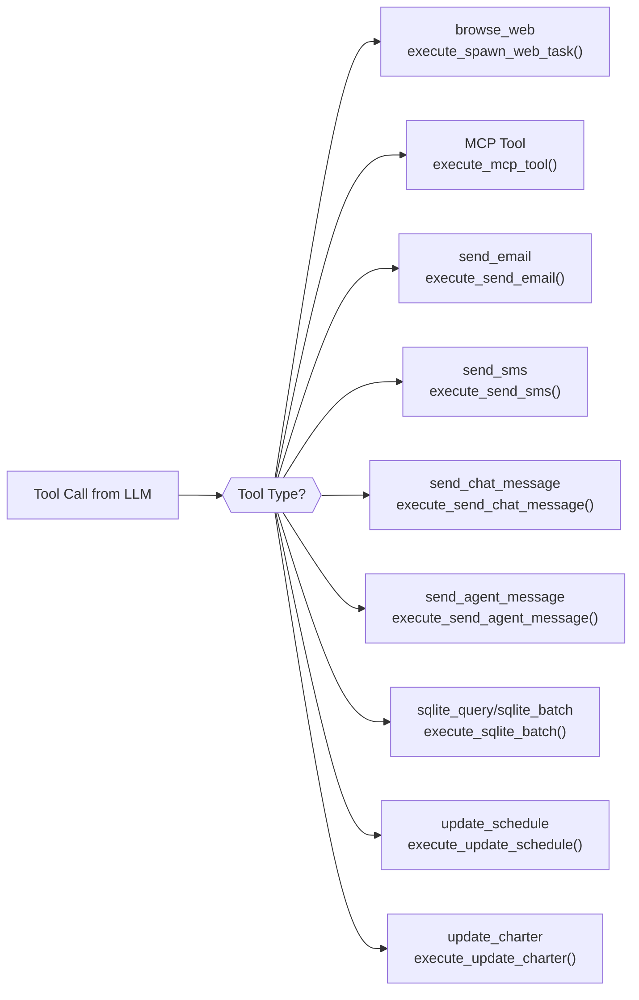

<!-- source: DeepWiki mcp.deepwiki.com · repo gobii-ai/gobii-platform · page 4.3 Agent Event Processing · fetched 2026-10-27 -->

# Agent Event Processing

<details>
<summary>Relevant source files</summary>

The following files were used as context for generating this wiki page:

- [api/agent/core/event_processing.py](api/agent/core/event_processing.py)
- [api/migrations/0155_persistentagent_daily_credit_limit_and_more.py](api/migrations/0155_persistentagent_daily_credit_limit_and_more.py)
- [api/models.py](api/models.py)
- [console/templates/console/agent_detail.html](console/templates/console/agent_detail.html)
- [console/templates/partials/_agent_list.html](console/templates/partials/_agent_list.html)
- [console/views.py](console/views.py)
- [tests/unit/test_agent_event_processing_credits.py](tests/unit/test_agent_event_processing_credits.py)
- [tests/unit/test_console.py](tests/unit/test_console.py)

</details>


## Purpose and Scope

This page documents the event processing pipeline for persistent agents, covering the core execution flow from event triggers through LLM reasoning to tool execution. This includes credit gating, distributed locking, budget cycle management, and the LLM-tool loop that powers agent behavior.

For agent creation and provisioning, see [Creating Agents](#4.1). For agent lifecycle states and activation/deactivation, see [Agent Lifecycle](#4.4). For credit system architecture, see [TaskCreditService](#5.1).

---

## System Overview

Agent event processing is the central execution engine for `PersistentAgent` instances. When triggered by a cron schedule, incoming message, web chat interaction, or manual invocation, the system:

1. Acquires a distributed lock to prevent concurrent execution
2. Checks user/organization credit balance and daily agent limits
3. Executes an LLM-powered reasoning loop with tool calls
4. Manages budget cycles for follow-up processing after async tasks
5. Records execution steps and system events



**Sources:** [api/agent/core/event_processing.py:716-950]()

---

## Entry Point: `process_agent_events()`

The `process_agent_events()` function is the public API for triggering agent execution. It is called by:

- **Celery task** `process_agent_events_task` for async execution
- **Manual triggers** from console views
- **Follow-up scheduling** after browser tasks complete
- **Peer messaging** wake-up calls

### Distributed Locking

The function uses a Redis-based `Redlock` to ensure only one process handles events for a given agent at a time. If the lock cannot be acquired, a pending flag is set in Redis so that exactly one follow-up task runs after the current holder releases the lock.

| Lock Behavior | Action |
|--------------|--------|
| Lock acquired | Proceed with event processing |
| Lock busy | Set pending flag (`agent-event-processing:pending:{agent_id}`) and exit |
| Lock released | If pending flag exists, schedule follow-up task |

**Sources:** [api/agent/core/event_processing.py:804-834]()

### Budget Context Management

Event processing operates within a **budget cycle**, which tracks:

- `budget_id`: Unique identifier for the execution cycle
- `branch_id`: Identifier for this execution branch (for parallel child tasks)
- `depth`: Current recursion depth (0 for top-level)
- `max_steps`: Maximum steps allowed per cycle
- `max_depth`: Maximum recursion depth allowed

If no `budget_id` is provided (top-level trigger), the system calls `AgentBudgetManager.find_or_start_cycle()` to create or reuse an active cycle. If a `budget_id` is provided (follow-up from browser task), it validates the cycle is still active before proceeding.

**Sources:** [api/agent/core/event_processing.py:729-801]()

---

## Credit Gating Architecture

Event processing enforces credit limits at two levels: **pre-processing** (before the agent loop runs) and **per-tool** (during loop execution).

### Pre-Processing Credit Gate

Before entering the agent loop, the system checks:

1. **User/Organization Credit Balance**: Via `TaskCreditService.get_user_task_credits_available()`
2. **Daily Agent Limit**: Via `_get_agent_daily_credit_state()`

If either check fails, processing exits early and creates a `PersistentAgentSystemStep` with the appropriate code:

| Failure Reason | System Step Code | Notes Field |
|----------------|------------------|-------------|
| No user credits available | `PROCESS_EVENTS` | `credit_insufficient` |
| Daily agent limit exhausted | `PROCESS_EVENTS` | `daily_credit_limit_exhausted` |

**Sources:** [api/agent/core/event_processing.py:860-916]()

### Daily Credit Limit Calculation

Each agent can have a `daily_credit_limit` field (integer or null). The system calculates:

```python
daily_state = {
    "date": timezone.localdate(),
    "limit": agent.daily_credit_limit,  # None = unlimited
    "used": sum(step.credits_cost for today),
    "remaining": limit - used,
    "next_reset": midnight_tomorrow
}
```

The limit is checked using `_has_sufficient_daily_credit()`, which returns `False` if `remaining < cost`.

**Sources:** [api/agent/core/event_processing.py:451-508]()

### Per-Tool Credit Gate

During the agent loop, before each tool executes, `_ensure_credit_for_tool()` performs:

1. **Tool cost lookup**: Via `get_tool_credit_cost(tool_name)` (defaults to 1.0)
2. **Daily limit check**: Recomputed to include credits consumed in this loop
3. **Credit consumption**: `TaskCreditService.check_and_consume_credit(owner_user, amount=cost)`

If any check fails, the tool is skipped and a `PersistentAgentStep` is created with description indicating the reason.



**Sources:** [api/agent/core/event_processing.py:510-711]()

---

## The Agent Loop: `_run_agent_loop()`

The core reasoning engine is `_run_agent_loop()`, which implements a ReAct-style (Reasoning + Acting) pattern. The loop alternates between:

1. **LLM reasoning** with context from conversation history, tool results, and system prompts
2. **Tool execution** based on LLM-generated tool calls
3. **Iteration** until completion criteria are met or limits are hit

### Loop Structure



**Sources:** [api/agent/core/event_processing.py:1164-1605]()

### Prompt Building with Promptree

The system uses the `Promptree` library to build prompts within a token budget. Key components:

- **System Prompt**: Includes charter, current date/time, filesystem context (if SQLite DB exists), enabled tool definitions
- **Conversation History**: Recent `PersistentAgentMessage` records (compacted if needed)
- **Tool Execution History**: Recent `PersistentAgentStep` + `PersistentAgentToolCall` records (compacted if needed)
- **Token Budget**: `PROMPT_TOKEN_BUDGET = 120000` tokens

The `Promptree.build()` method estimates token counts and prunes history to fit within the budget, prioritizing recent interactions.

**Sources:** [api/agent/core/event_processing.py:1164-1350]()

### LLM Tier Selection

Before calling the LLM, the system estimates total tokens (prompt + expected completion) and selects a tier using `get_llm_config_with_failover()`. Tiers are defined in `llm_config.py` and typically look like:

| Tier | Token Range | Providers |
|------|-------------|-----------|
| Tier 1 | < 10K tokens | Fast, cheap models (e.g., GPT-4o mini) |
| Tier 2 | 10K-50K tokens | Mid-tier models (e.g., Claude 3.5 Sonnet) |
| Tier 3 | 50K-120K tokens | Large context models (e.g., Claude 3 Opus) |

Each tier has a failover list with weighted endpoint distribution.

**Sources:** [api/agent/core/event_processing.py:1353-1363](), [api/agent/core/llm_config.py:150-280]()

---

## LLM Completion with Failover

The `_completion_with_failover()` function implements tiered failover across multiple LLM providers. It iterates through pre-selected provider configurations and retries with exponential backoff for transient errors.

### Failover Flow



### Token Usage Tracking

On successful completion, the function extracts token usage from `response.model_extra.get("usage")` and builds a dictionary:

```python
token_usage = {
    "prompt_tokens": usage.prompt_tokens,
    "completion_tokens": usage.completion_tokens,
    "total_tokens": usage.total_tokens,
    "model": model,
    "provider": provider,
    "cached_tokens": usage.prompt_tokens_details.cached_tokens  # if available
}
```

This data is recorded in `PersistentAgentStep` for audit purposes.

**Sources:** [api/agent/core/event_processing.py:289-419]()

### Exponential Backoff Wrapper

The `_completion_with_backoff()` function (legacy, now mostly unused) wraps LiteLLM calls with retry logic using the `tenacity` library:

- **Wait strategy**: Exponential backoff (1s to 60s)
- **Stop condition**: 3 attempts max
- **Retry on**: `RateLimitError`, `ServiceUnavailableError`, `APIConnectionError`, `Timeout`

**Sources:** [api/agent/core/event_processing.py:421-445]()

---

## Tool Execution

When the LLM response includes tool calls, each tool is executed sequentially within the loop. Tool execution varies by type:

### Tool Type Dispatch



### Browser Tasks

Browser automation tools (`browse_web`, `spawn_web_task`) create a `BrowserUseAgentTask` record and schedule it for async execution via `process_browser_use_task.delay()`. The browser worker:

1. Sets up Chrome profile and proxy
2. Executes browser automation using the `browser-use` library
3. Saves result and creates `BrowserUseAgentTaskStep` records
4. Calls `_schedule_agent_follow_up()` to continue the agent loop

The follow-up passes the same `budget_id` to continue the budget cycle, allowing the agent to see the browser task result in its next iteration.

**Sources:** [api/agent/core/event_processing.py:1417-1440](), [api/agent/tasks.py:150-500]()

### MCP Tool Execution

MCP (Model Context Protocol) tools are executed via `execute_mcp_tool()`, which:

1. Resolves the server (Bright Data stdio or Pipedream HTTP)
2. Calls `client.call_tool()` with tool name and arguments
3. Handles OAuth Connect Link flows for tools requiring user authorization
4. Returns result or action-required response

If a Connect Link is required, the agent creates a `PipedreamConnectSession`, generates a first-party OAuth URL, and includes it in the tool result. The agent loop pauses until the user authorizes, then resumes via webhook.

**Sources:** [api/agent/tools/mcp_tools.py:200-350]()

### Communication Tools

Communication tools (email, SMS, chat, peer messaging) execute synchronously and return success/failure status:

- `send_email`: Creates `PersistentAgentMessage` with `direction=OUTBOUND`, sends via SMTP
- `send_sms`: Creates message, sends via Twilio
- `send_chat_message`: Broadcasts via WebSocket to web chat clients
- `send_agent_message`: Uses `PeerMessagingService` to send to another agent (with quota/debouncing checks)

All communication tools respect the agent's allowlist configuration.

**Sources:** [api/agent/core/event_processing.py:1441-1520]()

---

## State Management

### Step Recording

Each tool execution creates a `PersistentAgentStep` record with:

- `agent`: Foreign key to `PersistentAgent`
- `description`: Human-readable summary of the action
- `created_at`: Timestamp
- `credits_cost`: Cost consumed for this step (if applicable)

If the tool generated a tool call, a `PersistentAgentToolCall` record is also created:

- `step`: Foreign key to the step
- `name`: Tool function name
- `arguments`: JSON of arguments passed
- `result`: JSON of result returned

**Sources:** [api/agent/core/event_processing.py:1380-1520]()

### System Steps for Errors

When processing encounters errors or skips actions, it creates a `PersistentAgentSystemStep` linked to a step:

| Code | Notes | Meaning |
|------|-------|---------|
| `PROCESS_EVENTS` | `credit_insufficient` | Pre-processing credit gate blocked execution |
| `PROCESS_EVENTS` | `daily_credit_limit_exhausted` | Daily limit reached before loop |
| `PROCESS_EVENTS` | `credit_insufficient_mid_loop` | Tool skipped due to insufficient credits |
| `PROCESS_EVENTS` | `daily_credit_limit_mid_loop` | Tool skipped due to daily limit |
| `PROCESS_EVENTS` | `credit_consumption_failure_mid_loop` | Credit consumption transaction failed |

**Sources:** [api/agent/core/event_processing.py:860-916](), [api/agent/core/event_processing.py:582-688]()

### Budget Cycle Closing

When the agent loop completes (or exits early), the system attempts to close the budget cycle via `AgentBudgetManager.close_cycle()`. This only succeeds if:

- The current branch depth is 0 (no outstanding child tasks)
- The cycle hasn't already been closed

If child tasks are outstanding (e.g., browser tasks still running), the cycle remains active so follow-ups can continue it.

**Sources:** [api/agent/core/event_processing.py:178-208](), [api/agent/core/event_processing.py:1880-1900]()

---

## Code Entity Reference

### Key Functions

| Function | Location | Purpose |
|----------|----------|---------|
| `process_agent_events()` | [api/agent/core/event_processing.py:716-950]() | Entry point for event processing |
| `_process_agent_events_locked()` | [api/agent/core/event_processing.py:952-1162]() | Internal handler after lock acquisition |
| `_run_agent_loop()` | [api/agent/core/event_processing.py:1164-1605]() | Main LLM-tool reasoning loop |
| `_completion_with_failover()` | [api/agent/core/event_processing.py:289-419]() | LLM completion with tiered failover |
| `_ensure_credit_for_tool()` | [api/agent/core/event_processing.py:510-711]() | Per-tool credit gate |
| `_get_agent_daily_credit_state()` | [api/agent/core/event_processing.py:451-489]() | Daily limit calculation |

### Key Models

| Model | Purpose |
|-------|---------|
| `PersistentAgent` | Main agent configuration (charter, schedule, etc.) |
| `PersistentAgentStep` | Individual execution step record |
| `PersistentAgentToolCall` | Tool invocation details |
| `PersistentAgentSystemStep` | Error/event annotations |
| `PersistentAgentMessage` | Communication history |
| `BrowserUseAgentTask` | Browser automation task record |
| `TaskCredit` | Credit allocation and consumption tracking |

### Key Constants

| Constant | Value | Location |
|----------|-------|----------|
| `MAX_AGENT_LOOP_ITERATIONS` | 100 | [api/agent/core/event_processing.py:107]() |
| `PROMPT_TOKEN_BUDGET` | 120000 | [api/agent/core/event_processing.py:211]() |
| `MESSAGE_HISTORY_LIMIT` | 20 | [api/agent/core/event_processing.py:108]() |
| `TOOL_CALL_HISTORY_LIMIT` | 20 | [api/agent/core/event_processing.py:109]() |

**Sources:** [api/agent/core/event_processing.py:1-112](), [api/models.py:1-5000]()

---

## Testing

The event processing system has comprehensive test coverage:

- **Credit gating tests**: [tests/unit/test_agent_event_processing_credits.py]() validates pre-processing gates, daily limits, and per-tool credit checks
- **Console integration tests**: [tests/unit/test_console.py]() verifies daily limit UI and agent updates
- **Agent lifecycle tests**: Validate state transitions and budget cycle management

Tests use mocking extensively to isolate event processing from external dependencies (LLM APIs, browser execution, etc.).

**Sources:** [tests/unit/test_agent_event_processing_credits.py:1-346](), [tests/unit/test_console.py:236-316]()

---

