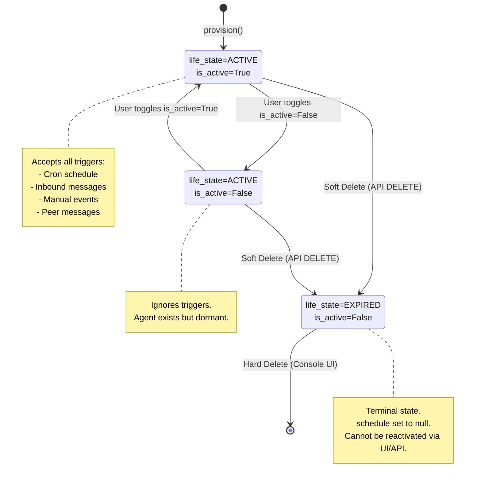
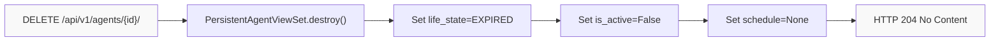
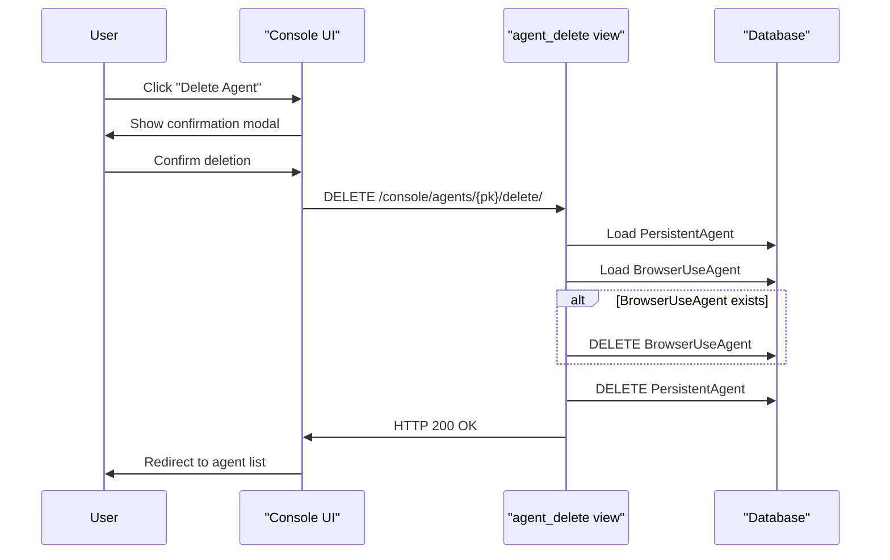
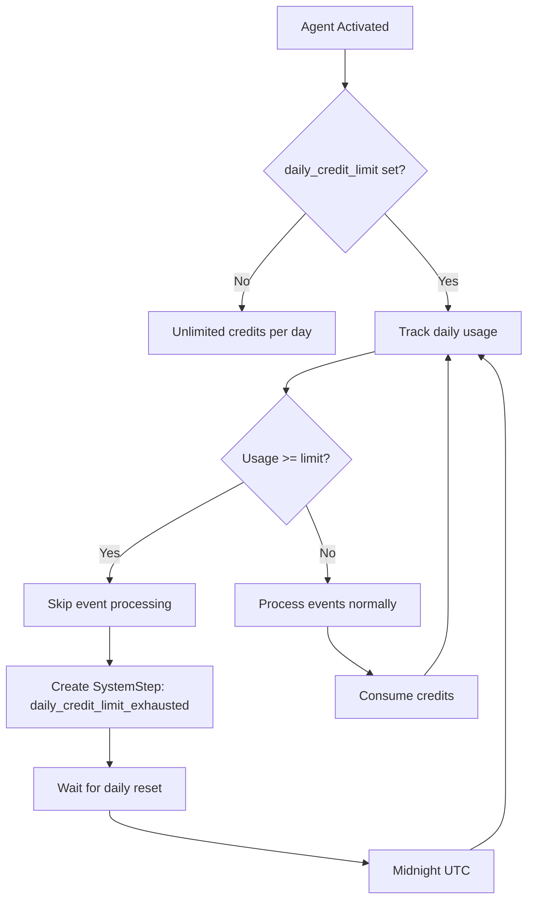
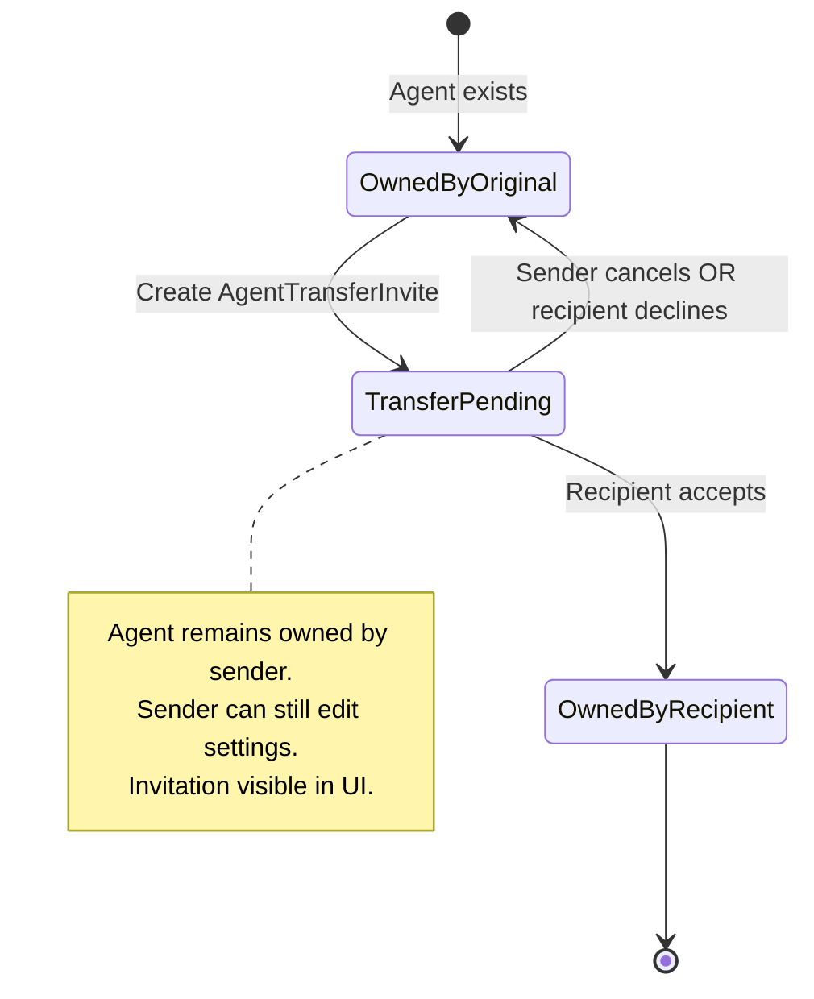

<!-- source: DeepWiki mcp.deepwiki.com · repo gobii-ai/gobii-platform · page 4.4 Agent Lifecycle · fetched 2026-10-27 -->

# Agent Lifecycle

Relevant source files

The following files were used as context for generating this wiki page:

- [AGENTS.md](AGENTS.md)
- [api/exceptions.py](api/exceptions.py)
- [api/migrations/0145_browseruseagenttask_organization_and_more.py](api/migrations/0145_browseruseagenttask_organization_and_more.py)
- [api/migrations/0155_persistentagent_daily_credit_limit_and_more.py](api/migrations/0155_persistentagent_daily_credit_limit_and_more.py)
- [api/serializers.py](api/serializers.py)
- [api/services/persistent_agents.py](api/services/persistent_agents.py)
- [api/urls.py](api/urls.py)
- [api/views.py](api/views.py)
- [console/templates/console/agent_detail.html](console/templates/console/agent_detail.html)
- [console/templates/partials/_agent_list.html](console/templates/partials/_agent_list.html)
- [tests/unit/test_agent_event_processing_credits.py](tests/unit/test_agent_event_processing_credits.py)
- [tests/unit/test_api.py](tests/unit/test_api.py)
- [tests/unit/test_api_persistent_agents.py](tests/unit/test_api_persistent_agents.py)
- [tests/unit/test_console.py](tests/unit/test_console.py)

This page documents the lifecycle states and transitions of `PersistentAgent` instances, including activation/deactivation, soft deletion, hard deletion, and lifecycle hooks. For information about creating agents, see [Creating Agents](#4.1). For event processing behavior, see [Agent Event Processing](#4.3).

---

## Agent Lifecycle States

Agents exist in one of two **life states** and have an independent **activation flag**. These two dimensions control whether an agent is operational and how it interacts with the platform.

### Life State Enumeration

The `life_state` field on `PersistentAgent` uses the `LifeState` enumeration with two values:

| State | Value | Description |
|-------|-------|-------------|
| `ACTIVE` | `"active"` | Default state. Agent is operational and can be scheduled or triggered. |
| `EXPIRED` | `"expired"` | Terminal state. Agent has been soft-deleted and cannot be reactivated without manual intervention. |

**Sources:** [api/models.py:PersistentAgent.LifeState]()

### Activation Flag

The `is_active` boolean field independently controls whether the agent accepts new work:

- **`is_active=True`**: Agent responds to triggers (schedule, messages, manual events)
- **`is_active=False`**: Agent is paused; triggers are ignored but agent remains in the system

This flag can be toggled by users via the console UI or API without affecting `life_state`.

**Sources:** [console/templates/console/agent_detail.html:160-199](), [api/serializers.py:435-465]()

---

## State Transition Diagram

**Sources:** [tests/unit/test_api_persistent_agents.py:376-387](), [api/views.py:596-657]()

---

## Activation and Deactivation

### User-Initiated Activation Toggle

Users can toggle `is_active` via:

1. **Console UI**: Agent detail page toggle switch [console/templates/console/agent_detail.html:192-197]()
2. **REST API**: `PATCH /api/v1/agents/{id}/` with `{"is_active": true/false}`

When toggled, the agent's behavior changes immediately:

- **Activated** (`is_active=True`): The agent begins accepting triggers and will process events on the next scheduled run or incoming message.
- **Deactivated** (`is_active=False`): The agent stops processing new events. Scheduled tasks are not executed, and inbound messages are ignored (though message records may still be created for audit purposes).

**Implementation Detail**: The `is_active` flag is checked at the start of event processing in `process_agent_events_locked`. If `False`, the function exits early without consuming credits or executing the agent loop.

**Sources:** [api/serializers.py:435-465](), [console/templates/console/agent_detail.html:160-199]()

---

## Soft Deletion (API DELETE)

When a user issues a `DELETE` request to the API endpoint for an agent, the system performs a **soft delete** rather than removing the database record.

### Soft Delete Behavior

The `PersistentAgentViewSet.destroy()` method [api/views.py:596-657]() executes the following state transitions:

1. Set `life_state = PersistentAgent.LifeState.EXPIRED`
2. Set `is_active = False`
3. Set `schedule = None` (cancels all scheduled triggers)

**Sources:** [api/views.py:596-657](), [tests/unit/test_api_persistent_agents.py:376-387]()

### Why Soft Delete?

Soft deletion preserves:
- Historical data (agent steps, messages, tasks)
- Audit trails for billing and usage analytics
- The ability to restore agents manually if needed (though no automated UI flow exists)

The agent becomes invisible in normal UI listings (filtered by `life_state=ACTIVE`) but remains queryable for administrative purposes.

**Sources:** [api/views.py:596-657]()

---

## Hard Deletion (Console UI)

The console provides a **hard delete** operation that fully removes the agent and its associated `BrowserUseAgent` record from the database.

### Hard Delete Flow

**Sources:** [tests/unit/test_console.py:23-84]()

### Deletion Safeguards

The console view handles several edge cases:

1. **Missing BrowserUseAgent**: If the `BrowserUseAgent` record is missing (e.g., manually deleted), deletion proceeds without error [tests/unit/test_console.py:61-83]()
2. **Orphaned Tasks**: Associated `BrowserUseAgentTask` records are cascade-deleted [tests/unit/test_console.py:151-173]()
3. **Exception Handling**: If `PersistentAgent.delete()` raises `BrowserUseAgent.DoesNotExist`, the view catches it and performs manual cleanup [tests/unit/test_console.py:126-148]()

**Sources:** [tests/unit/test_console.py:23-174]()

---

## Lifecycle Hooks and Side Effects

### On Agent Creation

When a `PersistentAgent` is created via the provisioning service:

1. **BrowserUseAgent Creation**: A backing `BrowserUseAgent` is created first [api/services/persistent_agents.py:78-91]()
2. **Template Application**: If `template_code` is provided, charter and schedule are populated from the template [api/services/persistent_agents.py:133-162]()
3. **Daily Credit Limit**: For free-tier users, `daily_credit_limit` is set to the default value [api/services/persistent_agents.py:120-131]()
4. **Event Processing Trigger**: After transaction commit, `process_agent_events_task.delay()` is enqueued [api/serializers.py:428-431]()

**Sources:** [api/services/persistent_agents.py:50-169](), [api/serializers.py:370-433]()

### On Activation

When `is_active` transitions from `False` to `True`:

- **No immediate side effects** beyond the database update
- The agent becomes eligible for processing on the next trigger (schedule, message, etc.)
- If a schedule exists, Celery Beat will begin invoking the agent on the next scheduled interval

**Sources:** [api/serializers.py:435-465]()

### On Deactivation

When `is_active` transitions from `True` to `False`:

- **In-flight tasks continue**: If event processing is already running, it completes
- **Future triggers ignored**: Scheduled tasks are skipped; the Celery Beat task checks `is_active` before enqueueing work
- **Messages still recorded**: Inbound messages may still create `PersistentAgentMessage` records depending on allowlist configuration, but processing is deferred

**Sources:** [console/templates/console/agent_detail.html:160-199]()

### On Soft Deletion

When `life_state` transitions to `EXPIRED`:

1. **Schedule Cleared**: `schedule = None` prevents any future Celery Beat triggers [api/views.py:596-657]()
2. **Deactivation**: `is_active = False` ensures immediate cessation of processing
3. **UI Filtering**: Agent is hidden from console listings (filtered by `life_state=ACTIVE`)
4. **Data Retention**: All related records (steps, messages, tasks) are preserved

**Sources:** [api/views.py:596-657](), [tests/unit/test_api_persistent_agents.py:376-387]()

### On Hard Deletion

When a `PersistentAgent` is hard-deleted:

1. **BrowserUseAgent Deletion**: The backing browser agent is deleted (cascade) [tests/unit/test_console.py:23-58]()
2. **Task Cleanup**: All `BrowserUseAgentTask` records are cascade-deleted [tests/unit/test_console.py:151-173]()
3. **Step Cleanup**: All `PersistentAgentStep` records are cascade-deleted
4. **Message Cleanup**: `PersistentAgentMessage` records may be cascade-deleted depending on foreign key configuration

**Sources:** [tests/unit/test_console.py:23-174]()

---

## Daily Credit Limits and Lifecycle

The `daily_credit_limit` field affects agent lifecycle by imposing a per-day spending cap.

### Daily Limit Lifecycle

**Sources:** [tests/unit/test_agent_event_processing_credits.py:148-182](), [api/migrations/0155_persistentagent_daily_credit_limit_and_more.py:1-51]()

### Daily Limit Enforcement

Daily limits are enforced at two levels:

1. **Pre-processing gate** [tests/unit/test_agent_event_processing_credits.py:148-182](): Before the agent loop begins, `_process_agent_events_locked` checks if the agent has exceeded its daily limit. If so, it creates a `PersistentAgentSystemStep` with `notes="daily_credit_limit_exhausted"` and exits early.

2. **Mid-loop gate** [tests/unit/test_agent_event_processing_credits.py:316-346](): During tool execution, `_ensure_credit_for_tool` checks daily limits before executing each tool. If the limit is hit mid-loop, the tool is skipped with a system note.

### Daily Limit Configuration

- **Free-tier default**: Set to `DEFAULT_AGENT_DAILY_CREDIT_LIMIT` (typically 10 credits) during provisioning [api/services/persistent_agents.py:120-131]()
- **Pro plans**: Typically `null` (unlimited)
- **User-configurable**: Can be updated via console UI or API [console/templates/console/agent_detail.html:202-253]()

**Sources:** [api/migrations/0155_persistentagent_daily_credit_limit_and_more.py:1-51](), [tests/unit/test_console.py:237-291]()

---

## Agent Ownership Transfer Lifecycle

Agents can be transferred between users via an invitation flow. During the transfer, the agent remains operational but ownership is in a pending state.

### Transfer States

**Sources:** [console/templates/console/agent_detail.html:22-35](), [console/templates/console/agent_detail.html:444-485]()

### Transfer Lifecycle Details

1. **Invitation Creation**: Sender enters recipient email and optional message. An `AgentTransferInvite` record is created with `status=PENDING` [console/templates/console/agent_detail.html:466-482]()

2. **Pending State**: 
   - Agent remains fully owned by sender
   - Sender can continue editing configuration
   - Warning banner shows in agent detail view [console/templates/console/agent_detail.html:22-35]()
   - Sender can cancel the invitation at any time [console/templates/console/agent_detail.html:457-463]()

3. **Acceptance**: Recipient logs in, sees invitation in their console, and accepts. Ownership transfers atomically.

4. **Cancellation**: If sender cancels or recipient declines, invitation is deleted and agent remains with sender.

**Sources:** [console/templates/console/agent_detail.html:22-35](), [console/templates/console/agent_detail.html:444-485]()

---

## Lifecycle Code Entities Reference

### Key Models

| Model | Field/Method | Purpose |
|-------|-------------|---------|
| `PersistentAgent` | `life_state` | Tracks ACTIVE/EXPIRED state |
| `PersistentAgent` | `is_active` | Boolean activation flag |
| `PersistentAgent` | `schedule` | Cron expression; cleared on soft delete |
| `PersistentAgent` | `daily_credit_limit` | Per-day spending cap (nullable) |
| `BrowserUseAgent` | (record) | Backing agent for browser automation; deleted on hard delete |

**Sources:** [api/models.py:PersistentAgent]()

### Key Service Methods

| Class | Method | Lifecycle Role |
|-------|--------|----------------|
| `PersistentAgentProvisioningService` | `provision()` | Creates agent with initial ACTIVE state |
| `PersistentAgentViewSet` | `destroy()` | Implements soft delete (sets EXPIRED) |
| Console view | `agent_delete` | Implements hard delete (removes from DB) |

**Sources:** [api/services/persistent_agents.py:50-169](), [api/views.py:596-657]()

### Key Tests

| Test | File | Coverage |
|------|------|----------|
| `test_soft_delete_agent_marks_expired` | test_api_persistent_agents.py:376-387 | Verifies soft delete state transitions |
| `test_delete_persistent_agent_also_deletes_browser_agent` | test_console.py:23-58 | Verifies hard delete cascade behavior |
| `test_process_agent_events_respects_daily_limit` | test_agent_event_processing_credits.py:148-182 | Verifies daily limit enforcement |

**Sources:** [tests/unit/test_api_persistent_agents.py:376-387](), [tests/unit/test_console.py:23-174](), [tests/unit/test_agent_event_processing_credits.py:148-182]()

---

## Summary

The agent lifecycle is managed through two primary state dimensions:

1. **`life_state`**: Binary ACTIVE/EXPIRED distinction, where EXPIRED is a terminal state reached via soft deletion
2. **`is_active`**: User-controllable activation flag that determines whether the agent processes events

Deletion occurs at two levels: **soft delete** (via API, sets EXPIRED) and **hard delete** (via console, removes from database). Daily credit limits add an operational constraint that can pause agents without changing their lifecycle state.

For information on how lifecycle states interact with event processing, see [Agent Event Processing](#4.3). For initial provisioning details, see [Creating Agents](#4.1).

---

