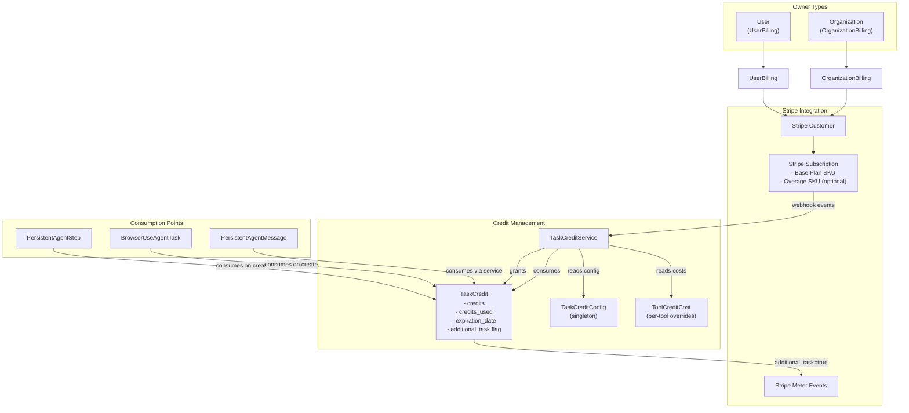
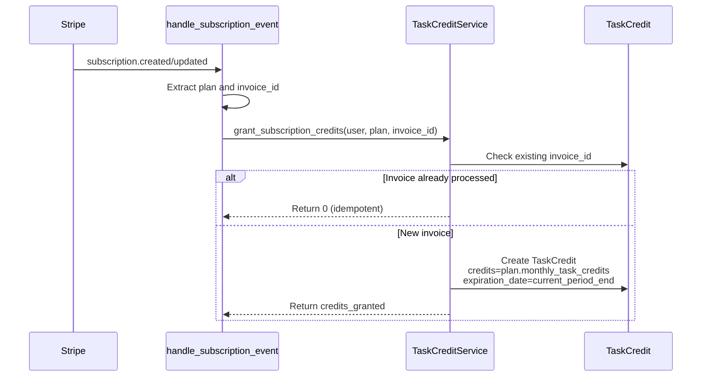
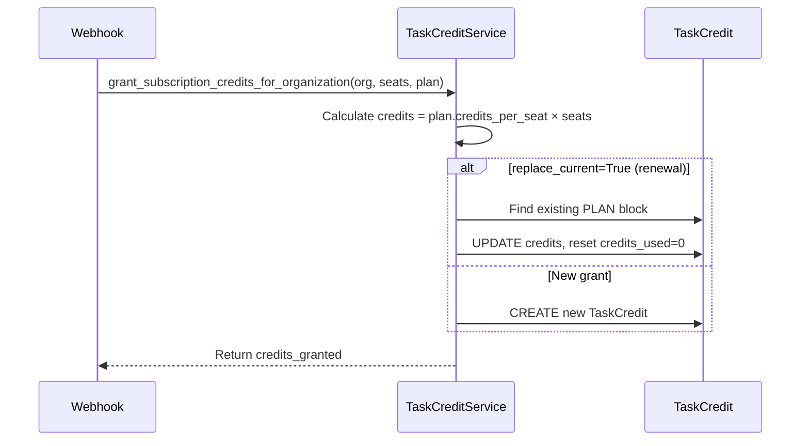
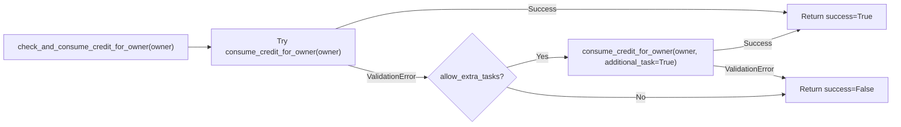
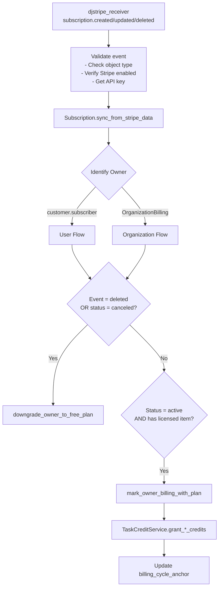
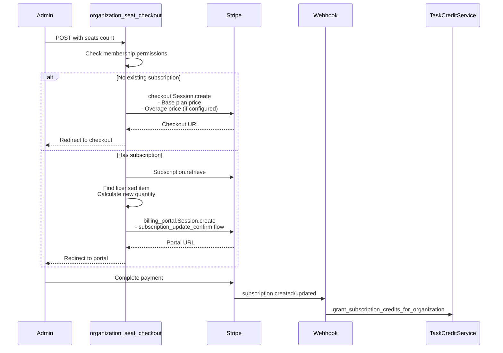
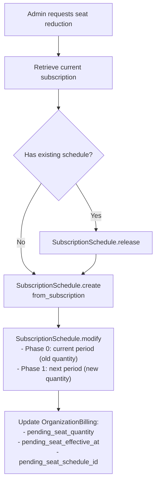
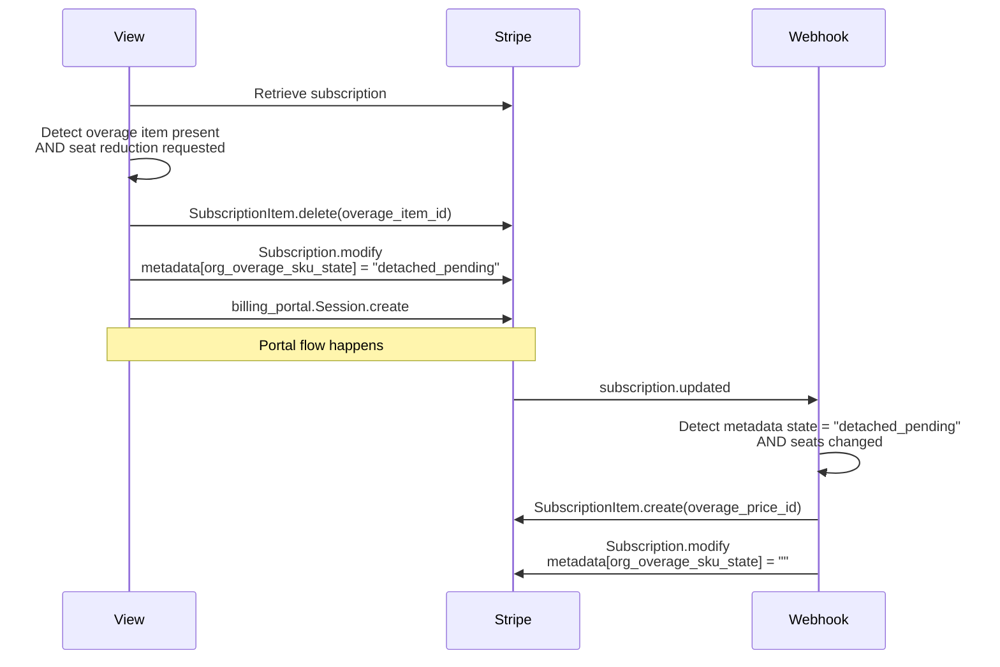
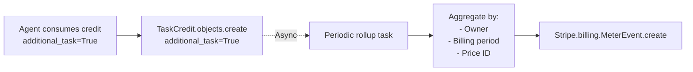

<!-- source: DeepWiki mcp.deepwiki.com · repo gobii-ai/gobii-platform · page 5 Credit & Billing System · fetched 2026-10-27 -->

# Credit & Billing System

<details>
<summary>Relevant source files</summary>

The following files were used as context for generating this wiki page:

- [api/migrations/0115_persistentagentstep_credits_fields.py](api/migrations/0115_persistentagentstep_credits_fields.py)
- [console/forms.py](console/forms.py)
- [console/templates/console/organization_detail.html](console/templates/console/organization_detail.html)
- [console/templates/partials/_org_invite_modal.html](console/templates/partials/_org_invite_modal.html)
- [constants/stripe.py](constants/stripe.py)
- [pages/signals.py](pages/signals.py)
- [tasks/services.py](tasks/services.py)
- [tests/unit/test_organizations.py](tests/unit/test_organizations.py)
- [tests/unit/test_pages_signals.py](tests/unit/test_pages_signals.py)
- [tests/unit/test_persistent_agent_step_credits.py](tests/unit/test_persistent_agent_step_credits.py)
- [tests/unit/test_task_credit_service.py](tests/unit/test_task_credit_service.py)
- [tests/unit/test_tool_costs.py](tests/unit/test_tool_costs.py)
- [util/tool_costs.py](util/tool_costs.py)

</details>


## Purpose and Scope

This document describes the platform's financial management infrastructure, covering credit allocation, consumption tracking, subscription management, and usage metering. The credit system controls resource access by gating agent operations based on available task credits, while the billing system manages subscription lifecycle, seat-based organizational billing, and integration with Stripe for payments and metering.

For information about agent execution and event processing (which consumes credits), see [Agent Event Processing](#4.3). For details on specific plan configurations and limits, see [Platform Overview](#1).

---

## Architecture Overview

The billing system operates on a dual-ownership model where both individual users and organizations can own agents and consume credits. Credits are granted based on subscription plans, consumed during agent operations, and metered to Stripe for overage billing.



**Sources:** [tasks/services.py:1-1433](), [pages/signals.py:233-651](), [util/tool_costs.py:1-153]()

---

## Core Data Models

### TaskCredit

The `TaskCredit` model represents a block of credits granted to a user or organization. Each block has a fixed quantity, tracks usage, and expires at a specific date aligned with the billing cycle.

| Field | Type | Description |
|-------|------|-------------|
| `user` | ForeignKey | User owner (null for org-owned credits) |
| `organization` | ForeignKey | Organization owner (null for user-owned credits) |
| `credits` | Decimal | Total credits in this block |
| `credits_used` | Decimal | Credits consumed from this block |
| `granted_date` | DateTime | When credits became available |
| `expiration_date` | DateTime | When credits expire (typically subscription period end) |
| `stripe_invoice_id` | String | Associated Stripe invoice for idempotency |
| `plan` | Enum | Plan that granted these credits |
| `grant_type` | Enum | Source of grant (PLAN, MANUAL, etc.) |
| `additional_task` | Boolean | True if overage credit (triggers metering) |
| `voided` | Boolean | Invalidates credit without deletion |

**Sources:** [tasks/services.py:244-306](), [tests/unit/test_task_credit_service.py:290-359]()

### Billing Models

**UserBilling:**
- `subscription`: Current plan name
- `max_extra_tasks`: Overage limit (-1 for unlimited)
- `billing_cycle_anchor`: Day of month for billing (1-28)
- `stripe_customer_id`: Associated Stripe customer

**OrganizationBilling:**
- `subscription`: Current plan name
- `purchased_seats`: Number of paid seats
- `max_extra_tasks`: Overage limit per seat
- `billing_cycle_anchor`: Day of month for billing
- `stripe_subscription_id`: Active subscription ID
- `pending_seat_quantity`: Scheduled seat change (if any)
- `pending_seat_effective_at`: When seat change takes effect
- `pending_seat_schedule_id`: Stripe schedule ID
- `cancel_at`: Scheduled cancellation timestamp
- `cancel_at_period_end`: Whether to cancel at period end

**Sources:** [pages/signals.py:293-356](), [tests/unit/test_organizations.py:569-629]()

---

## TaskCreditService

The `TaskCreditService` ([tasks/services.py:107-1433]()) is the authoritative service for all credit operations. It provides owner-aware methods that handle both user and organization contexts transparently.

### Credit Granting

#### User Subscription Credits

When a user subscribes, credits are granted based on their plan's `monthly_task_credits` value:



**Key Implementation Details:**
- Idempotency via `stripe_invoice_id` check ([tasks/services.py:247-255]())
- Expiration defaults to subscription `current_period_end` ([tasks/services.py:278-287]())
- Coerces timestamps from Stripe's various formats ([tasks/services.py:81-104]())

**Sources:** [tasks/services.py:201-306](), [pages/signals.py:428-434](), [tests/unit/test_task_credit_service.py:52-89]()

#### Organization Subscription Credits

Organizations receive credits based on `credits_per_seat × purchased_seats`:



The `replace_current` flag ([tasks/services.py:364-402]()) handles monthly renewals by updating the existing credit block instead of stacking duplicates. This ensures organizations don't accumulate multiple overlapping credit blocks during normal billing cycles.

**Sources:** [tasks/services.py:308-416](), [pages/signals.py:643-650](), [tests/unit/test_task_credit_service.py:328-359]()

### Credit Consumption

#### Atomic Consumption with SELECT FOR UPDATE

Credits are consumed atomically using database row-level locking to prevent race conditions:

```python
# Simplified from tasks/services.py:476-510
with transaction.atomic():
    remaining = Decimal(plan_amount)
    while remaining > 0:
        credit = (
            TaskCredit.objects.select_for_update()
            .filter(
                user_id=user.id,
                expiration_date__gt=now,
                credits_used__lt=F("credits"),
                voided=False,
            )
            .order_by("expiration_date")
            .first()
        )
        
        if credit is None:
            raise ValidationError({"credits": "Insufficient task credits"})
        
        available_here = (credit.credits - credit.credits_used)
        consume_now = min(available_here, remaining)
        
        credit.credits_used = F("credits_used") + consume_now
        credit.save(update_fields=["credits_used"])
        credit.refresh_from_db()
        
        remaining -= consume_now
```

This implementation:
1. Locks credit blocks in expiration order (oldest first)
2. Consumes fractional amounts across multiple blocks if needed
3. Uses `F()` expressions for database-level atomic updates
4. Returns the last touched credit block for linking

**Sources:** [tasks/services.py:418-534](), [tests/unit/test_task_credit_service.py:96-117]()

#### Additional Tasks (Overage)

When standard credits are exhausted, the system can create "additional task" credits if the owner's plan allows:



Additional task credits:
- Have `additional_task=True` flag set
- Are immediately consumed (`credits_used = credits`)
- Are reported to Stripe Metering API (handled by periodic rollup task)
- Expire at the end of the current billing period

**Sources:** [tasks/services.py:753-786](), [tests/unit/test_task_credit_service.py:153-173]()

#### Per-Tool Credit Costs

The default credit cost per task is configurable via `TaskCreditConfig.default_task_cost` (singleton). Individual tools can override this via `ToolCreditCost` entries:

```python
# Simplified from util/tool_costs.py:101-121
def get_tool_credit_cost(tool_name: str | None) -> Decimal:
    default_cost, overrides = _get_tool_cost_config()
    
    key = _normalize_tool_name(tool_name)
    if key in overrides:
        return overrides[key]
    
    return default_cost
```

Configuration is cached for 5 minutes ([util/tool_costs.py:13]()). Tools like `send_email`, `send_sms`, and browser automation can have different costs than the default reasoning step.

**Sources:** [util/tool_costs.py:55-153](), [tests/unit/test_tool_costs.py:14-100]()

### Entitlement Calculation

The system distinguishes between:
- **Granted**: Credits explicitly created in `TaskCredit` records
- **Entitled**: Total credits available (granted + allowed overage)
- **Available**: Entitled - used
- **Used**: Sum of `credits_used` across all valid `TaskCredit` blocks

```python
# Simplified from tasks/services.py:537-607
def get_tasks_entitled_for_owner(owner) -> int:
    if is_organization_owner(owner):
        plan = get_organization_plan(owner)
        addl_limit = get_organization_extra_task_limit(owner)
        
        if addl_limit == TASKS_UNLIMITED:
            return TASKS_UNLIMITED
        
        tasks_granted = TaskCredit.objects.filter(
            organization=owner,
            granted_date__lte=now,
            expiration_date__gte=now,
            additional_task=False,
            voided=False,
        ).aggregate(Sum('credits'))['total_granted'] or 0
        
        return tasks_granted + addl_limit
    else:
        # Similar logic for users
        pass
```

**Sources:** [tasks/services.py:537-607](), [tests/unit/test_task_credit_service.py:206-260]()

---

## Subscription Lifecycle Management

### Stripe Webhook Processing

The `handle_subscription_event` signal ([pages/signals.py:233-651]()) processes Stripe webhooks for subscription lifecycle events:



**Key Processing Steps:**

1. **Idempotency**: Invoice ID checked before granting credits ([tasks/services.py:247-255]())
2. **Owner Detection**: Checks `customer.subscriber` (user) vs `OrganizationBilling.stripe_customer_id` (org) ([pages/signals.py:295-311]())
3. **Plan Identification**: Locates licensed subscription item and matches product ID to plan config ([pages/signals.py:402-418]())
4. **Billing Anchor Sync**: Updates `billing_cycle_anchor` from Stripe's `current_period_start.day` ([pages/signals.py:438-446]())

**Sources:** [pages/signals.py:233-651](), [tests/unit/test_pages_signals.py:110-191]()

### Subscription Cancellation

When a subscription is deleted or cancelled:

1. `downgrade_owner_to_free_plan` is called ([pages/signals.py:323-356]())
2. For organizations:
   - `purchased_seats` set to 0
   - `stripe_subscription_id` cleared
   - `cancel_at` and `cancel_at_period_end` cleared
3. Existing `TaskCredit` blocks remain valid until their `expiration_date`
4. Analytics event fired for tracking

**Sources:** [pages/signals.py:316-356](), [util/subscription_helper.py]() (referenced)

---

## Organization Billing

Organizations use a seat-based model where each purchased seat grants a fixed number of credits per billing period.

### Seat Purchase Flow



**Implementation Details:**

The checkout view ([console/views.py](), referenced in tests) handles two scenarios:

1. **New Subscription**: Creates Stripe Checkout session with base plan SKU
2. **Existing Subscription**: Uses Billing Portal with `subscription_update_confirm` flow to add seats ([tests/unit/test_organizations.py:189-240]())

**Sources:** [tests/unit/test_organizations.py:152-240](), [console/templates/console/organization_detail.html:13-18]()

### Seat Reduction and Scheduling

Reducing seats uses Stripe Subscription Schedules to defer the change until the next billing period:



When the billing period ends and Stripe transitions to the new phase:
1. Webhook receives `subscription.updated` event
2. Detects `purchased_seats != prev_seats`
3. Clears pending seat fields ([pages/signals.py:595-606]())
4. No new credits granted (seats decreased, no prorated credit)

**Sources:** [tests/unit/test_organizations.py:569-629](), [console/views.py]() (referenced)

### Overage SKU Management

Organizations can have an optional overage SKU (metered price) for additional tasks. When seats are reduced via the Billing Portal, the platform must temporarily detach the overage SKU to avoid Stripe validation errors (portal doesn't support subscriptions with both licensed and metered items).



This ensures the overage SKU is present during normal operations but temporarily removed for portal-based seat updates.

**Sources:** [tests/unit/test_organizations.py:325-393](), [pages/signals.py:471-575](), [constants/stripe.py:1-5]()

---

## Usage Tracking and Metering

### Credit Consumption Tracking

Every credit-consuming operation links to a `TaskCredit` record:

- `PersistentAgentStep.task_credit` ([api/migrations/0115_persistentagentstep_credits_fields.py:13-21]())
- `BrowserUseAgentTask.task_credit` (similar field)
- `PersistentAgentMessage` (consumes via service, links in step)

This enables:
1. **Usage queries**: Aggregate `credits_used` by period, tool, or agent
2. **Audit trails**: Link every operation back to its credit source
3. **Fractional costs**: Different tools can consume different credit amounts

**Sources:** [tests/unit/test_persistent_agent_step_credits.py:42-89](), [api/migrations/0115_persistentagentstep_credits_fields.py:1-34]()

### Threshold Notifications

The service tracks credit usage percentage and fires analytics events at thresholds (75%, 90%, 100%):

```python
# Simplified from tasks/services.py:1093-1177
def handle_task_threshold(user):
    entitled = get_tasks_entitled(user)
    used = get_user_total_tasks_used(user)
    
    for threshold in THRESHOLDS:  # [75, 90, 100]
        pct = (used / entitled) * 100
        
        if pct >= threshold:
            Usage = apps.get_model("api", "TaskCreditUsage")
            _, created = Usage.objects.get_or_create(
                user=user,
                threshold=threshold,
                billing_cycle_start=get_current_billing_start(user)
            )
            
            if created:
                Analytics.publish_threshold_event(user, threshold, pct, entitled, used)
```

This uses `TaskCreditUsage` as a deduplication mechanism (one notification per threshold per billing period).

**Sources:** [tasks/services.py:1093-1177](), [tests/unit/test_task_credit_service.py:361-407]()

### Stripe Metering (Overage Billing)

Additional task credits (`additional_task=True`) are metered to Stripe for overage billing. A periodic Celery task aggregates these and reports usage:



The rollup task:
1. Groups additional task credits by owner and billing period
2. Rounds quantities to whole tasks for Stripe metering
3. Reports via Stripe Meter Event API
4. Tracks reported events in `MeteringBatch` for idempotency

**Note**: This replaces the previous per-task metering approach to reduce API calls and improve reliability.

**Sources:** [tasks/services.py:456-473]() (additional task creation), comments indicate rollup task handles metering

---

## Configuration and Customization

### TaskCreditConfig (Singleton)

Global credit configuration is stored in a singleton `TaskCreditConfig` record:

```python
# Database model
class TaskCreditConfig(models.Model):
    singleton_id = models.IntegerField(default=1, unique=True)
    default_task_cost = models.DecimalField(
        max_digits=12,
        decimal_places=3,
        default=Decimal("0.40")
    )
```

This is cached and used as the fallback when no tool-specific cost exists.

**Sources:** [util/tool_costs.py:55-88](), [tests/unit/test_tool_costs.py:39-47]()

### ToolCreditCost (Per-Tool Overrides)

Individual tools can override the default cost:

```python
# Database model
class ToolCreditCost(models.Model):
    tool_name = models.CharField(max_length=128, unique=True)
    credit_cost = models.DecimalField(max_digits=12, decimal_places=3)
```

Tool name matching is case-insensitive. Communication channels (email/sms/web) map to specific tool names:

```python
_CHANNEL_TOOL_NAMES = {
    "email": "send_email",
    "sms": "send_sms",
    "web": "send_chat_message",
}
```

**Sources:** [util/tool_costs.py:12-153](), [tests/unit/test_tool_costs.py:24-79]()

### Community Edition Unlimited Mode

When `GOBII_PROPRIETARY_MODE=False` and `GOBII_ENABLE_COMMUNITY_UNLIMITED=True`, the system bypasses all credit checks and returns `TASKS_UNLIMITED` (-1) for all entitlement calculations:

```python
# From tasks/services.py:109-125
@staticmethod
def _is_community_unlimited() -> bool:
    try:
        if 'test_settings' in os.environ.get('DJANGO_SETTINGS_MODULE', ''):
            return False
        return (not getattr(settings, "GOBII_PROPRIETARY_MODE", False)) and bool(
            getattr(settings, "GOBII_ENABLE_COMMUNITY_UNLIMITED", False)
        )
    except Exception:
        return False
```

This mode:
- Disabled during tests
- Allows unlimited agent operations
- Prevents low-credit warnings

**Sources:** [tasks/services.py:109-155](), [util/constants/task_constants.py]() (referenced for `TASKS_UNLIMITED`)

---

## Error Handling and Edge Cases

### Negative Available Credits

If a user downgrades or their entitlement decreases, `calculate_available_tasks` clamps to zero rather than returning negative values:

```python
available = entitled - used
if available < 0:
    logger.warning(f"User {user.id} has more used ({used}) than entitled ({entitled})")
    available = 0
```

**Sources:** [tasks/services.py:151-153]()

### Concurrent Consumption Race Conditions

The `SELECT FOR UPDATE` pattern prevents double-spending:

```python
with transaction.atomic():
    credit = (
        TaskCredit.objects.select_for_update()
        .filter(...)
        .first()
    )
    # Lock held until transaction commits
```

Tests verify this works correctly under concurrent access scenarios.

**Sources:** [tasks/services.py:476-510]()

### Expired Credits

Credits are filtered by `expiration_date__gte=now` in all queries. Expired credits remain in the database but are excluded from:
- Available credit calculations
- Consumption attempts
- Entitlement totals

**Sources:** [tasks/services.py:640-663]()

### Voided Credits

The `voided` flag soft-deletes credits without removing audit history. Voided credits are excluded via `.filter(voided=False)` in all active queries.

**Sources:** [tasks/services.py:247-255]() (invoice idempotency check includes voided filter)

---

## Key Methods Reference

| Method | Parameters | Returns | Purpose |
|--------|-----------|---------|---------|
| `grant_subscription_credits` | user, credit_override, plan, invoice_id, grant_date, expiration_date | int | Grant credits to user based on subscription |
| `grant_subscription_credits_for_organization` | organization, seats, plan, invoice_id, grant_date, expiration_date, subscription, replace_current | int | Grant credits to organization based on seats |
| `consume_credit` | user, additional_task, amount | TaskCredit | Atomically consume credits for user |
| `consume_credit_for_owner` | owner, additional_task, amount | TaskCredit | Consume credits for user or org |
| `check_and_consume_credit_for_owner` | owner, amount | dict | Try consumption with overage fallback |
| `get_tasks_entitled_for_owner` | owner | int | Calculate total entitled credits |
| `calculate_available_tasks_for_owner` | owner, task_credits | Decimal | Calculate remaining credits |
| `get_owner_task_credits_used` | owner, task_credits | Decimal | Sum credits consumed |
| `get_tool_credit_cost` | tool_name | Decimal | Get per-tool credit cost |
| `get_default_task_credit_cost` | - | Decimal | Get default credit cost |

**Sources:** [tasks/services.py:107-1433](), [util/tool_costs.py:101-153]()

---

