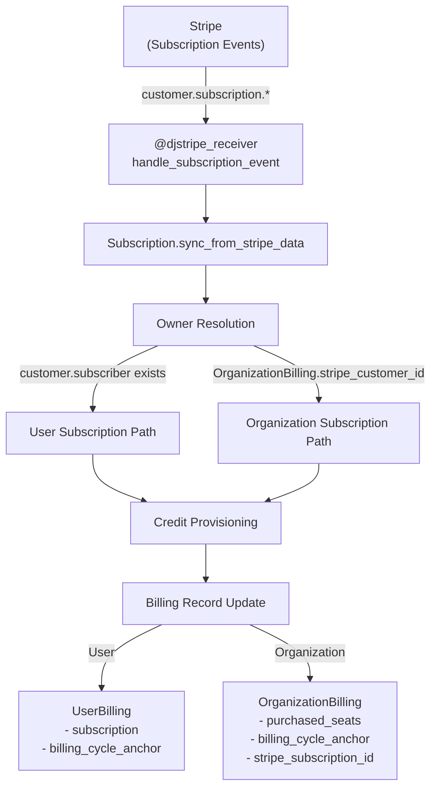
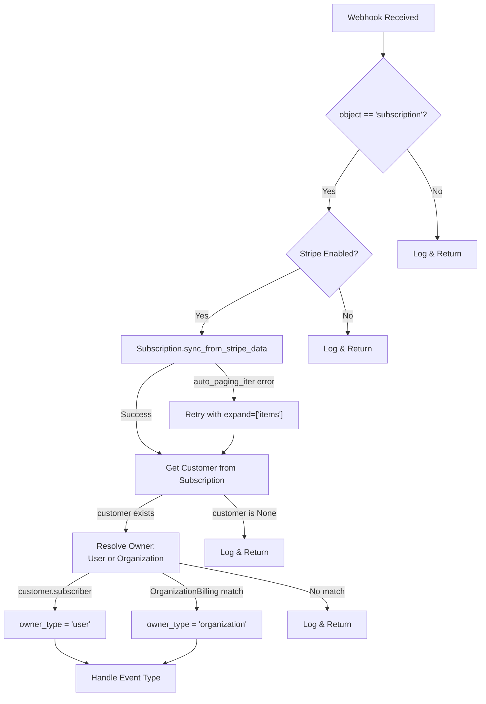
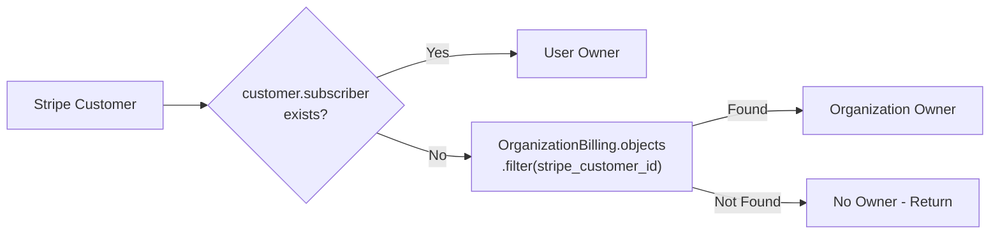
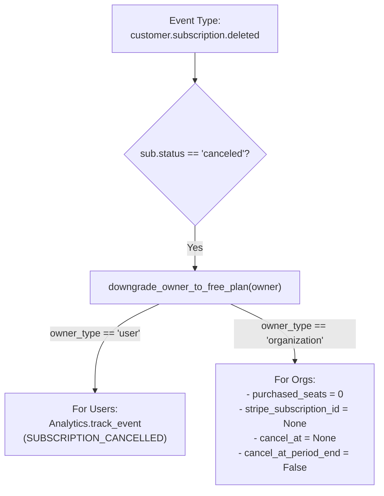
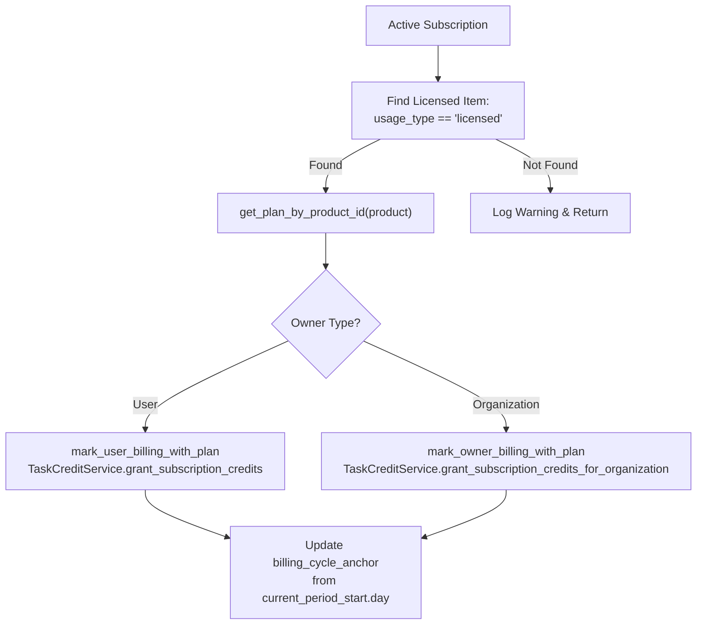
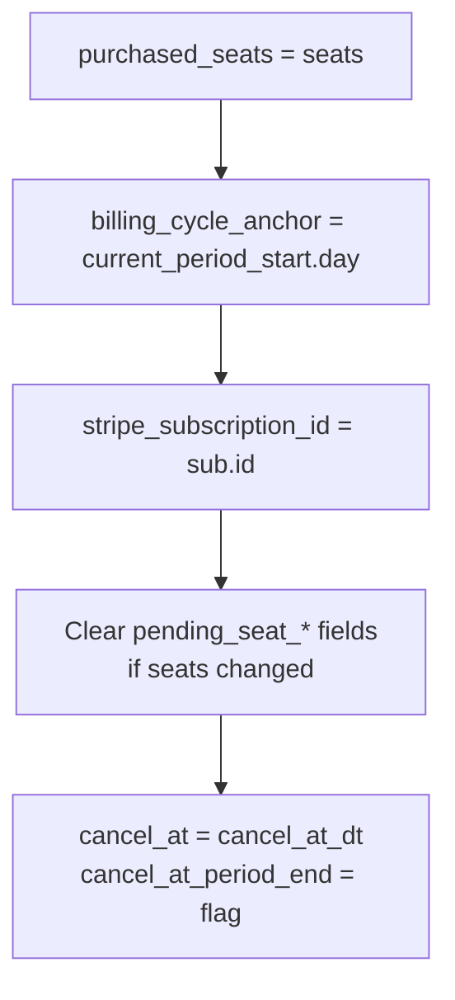
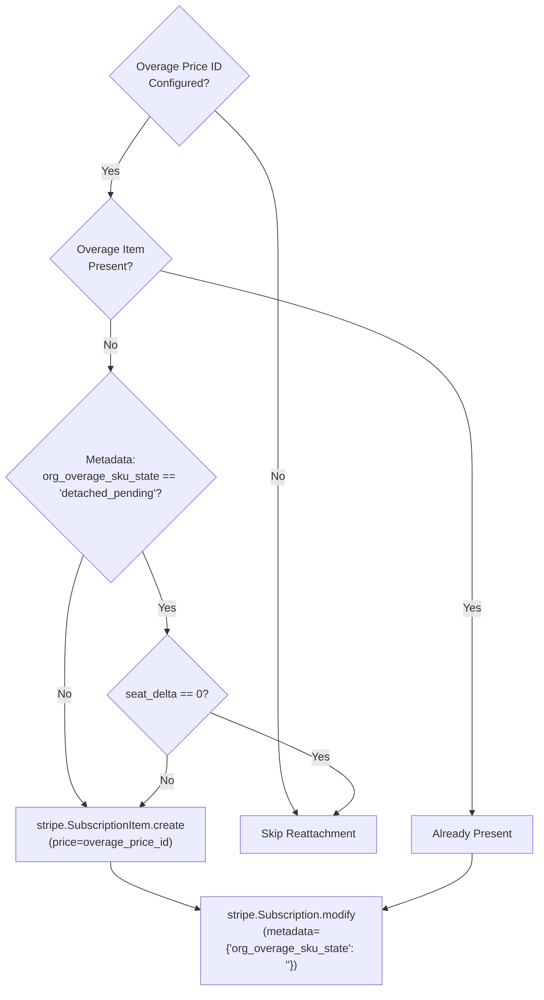
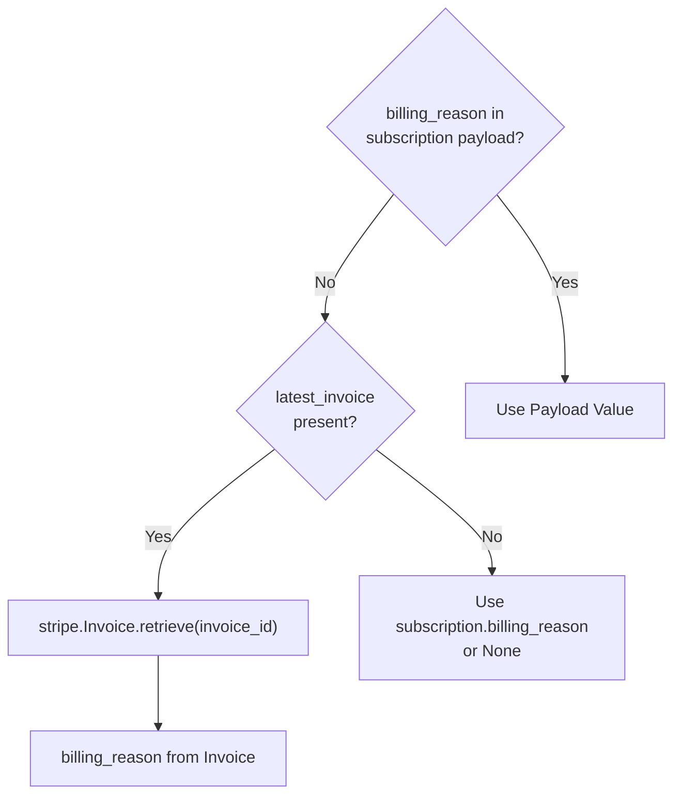

<!-- source: DeepWiki mcp.deepwiki.com · repo gobii-ai/gobii-platform · page 5.2 Subscription Management · fetched 2026-10-27 -->

# Subscription Management

<details>
<summary>Relevant source files</summary>

The following files were used as context for generating this wiki page:

- [console/forms.py](console/forms.py)
- [console/templates/console/organization_detail.html](console/templates/console/organization_detail.html)
- [console/templates/partials/_org_invite_modal.html](console/templates/partials/_org_invite_modal.html)
- [constants/stripe.py](constants/stripe.py)
- [pages/signals.py](pages/signals.py)
- [tests/unit/test_organizations.py](tests/unit/test_organizations.py)
- [tests/unit/test_pages_signals.py](tests/unit/test_pages_signals.py)

</details>


## Purpose and Scope

This page documents the subscription lifecycle management system that processes Stripe webhook events to provision credits, manage billing cycles, and handle seat-based organization subscriptions. The system bridges Stripe's subscription state with the platform's credit allocation and billing models.

For credit consumption mechanics, see [TaskCreditService](#5.1). For organization-specific seat purchasing and reduction flows, see [Organization Billing](#5.3). For usage tracking and reporting, see [Usage Analytics](#5.4).

**Sources:** [pages/signals.py:1-651]()

---

## System Overview

The subscription management system is webhook-driven, responding to Stripe events (`customer.subscription.created`, `customer.subscription.updated`, `customer.subscription.deleted`) to synchronize subscription state and provision credits. It handles both individual user subscriptions and organization seat-based subscriptions with different provisioning logic.

### High-Level Flow



**Sources:** [pages/signals.py:233-651]()

---

## Webhook Event Handler

The `handle_subscription_event` function is the central webhook handler decorated with `@djstripe_receiver` for subscription events. It performs defensive validation, owner resolution, and delegates to appropriate processing paths.

### Event Processing Pipeline



**Sources:** [pages/signals.py:233-311]()

### Subscription Sync with Fallback

The handler attempts to sync subscription data using `Subscription.sync_from_stripe_data()`. If an `auto_paging_iter` error occurs (common with certain Stripe SDK versions), it falls back to retrieving the subscription with expanded items:

```python
try:
    sub = Subscription.sync_from_stripe_data(payload)
except Exception as exc:
    if "auto_paging_iter" in str(exc):
        stripe_sub = stripe.Subscription.retrieve(
            payload["id"],
            expand=["items"],
        )
        sub = Subscription.sync_from_stripe_data(stripe_sub)
    else:
        raise
```

**Sources:** [pages/signals.py:264-280]()

---

## Owner Resolution

Subscriptions can be owned by either individual users or organizations. The system determines ownership through two mechanisms:

| Owner Type | Resolution Method | Identifier Field |
|------------|-------------------|------------------|
| **User** | `customer.subscriber` (dj-stripe model) | Direct foreign key |
| **Organization** | `OrganizationBilling.stripe_customer_id` | Stripe customer ID match |



**Sources:** [pages/signals.py:291-311]()

---

## Subscription Lifecycle Events

The handler processes three event types with different behaviors:

### Deletion Events (`customer.subscription.deleted`)

When a subscription is deleted or canceled, the owner is immediately downgraded to the free plan:



**Sources:** [pages/signals.py:316-356]()

### Active Subscriptions (`status == 'active'`)

For active subscriptions, the handler extracts the licensed subscription item, retrieves the plan configuration, and provisions credits:



**Sources:** [pages/signals.py:410-446](), [pages/signals.py:577-650]()

---

## User Subscription Handling

For individual users, subscription processing is straightforward:

1. **Plan Assignment**: `mark_user_billing_with_plan(owner, plan_value, update_anchor=False)`
2. **Credit Grant**: `TaskCreditService.grant_subscription_credits(owner, plan, invoice_id)`
3. **Anchor Alignment**: Extract `current_period_start.day` and update `UserBilling.billing_cycle_anchor`
4. **Analytics**: `Analytics.identify()` with plan, `Analytics.track_event()` with subscription created event

### Billing Cycle Anchor Alignment

The billing cycle anchor is extracted from Stripe's `current_period_start` and stored as the day of month:

```python
current_period_start_dt = _coerce_datetime(_get_stripe_data_value(source_data, "current_period_start"))
if current_period_start_dt:
    new_day = current_period_start_dt.day
    if ub.billing_cycle_anchor != new_day:
        ub.billing_cycle_anchor = new_day
        ub.save(update_fields=["billing_cycle_anchor"])
```

This ensures credit grants align with Stripe's billing periods.

**Sources:** [pages/signals.py:428-446]()

---

## Organization Subscription Handling

Organization subscriptions are more complex due to seat-based billing and overage SKU management. The handler processes seat quantity changes and provisions credits proportionally.

### Seat Quantity Extraction

The licensed item's `quantity` field represents purchased seats:

```python
seats = 0
try:
    seats = int(licensed_item.get("quantity") or 0)
except (TypeError, ValueError):
    seats = 0

prev_seats = getattr(organization_billing, "purchased_seats", 0)
```

**Sources:** [pages/signals.py:462-470]()

### Credit Granting Logic by Billing Reason

The system uses `billing_reason` to determine whether and how many credits to grant:

| Billing Reason | Condition | Seats to Grant | Invoice ID | Replace Current |
|----------------|-----------|----------------|------------|-----------------|
| `subscription_create` | `prev_seats == 0` | `seats` (full) | `invoice_id` | `True` |
| `subscription_create` | `prev_seats > 0` | `max(seats - prev_seats, 0)` | Empty | `False` |
| `subscription_cycle` | Always | `seats` (full) | `invoice_id` | `True` |
| `subscription_update` | `seats > prev_seats` | `seats - prev_seats` | Empty | `False` |
| `subscription_update` | `seats <= prev_seats` | 0 (no grant) | Empty | `False` |

The `replace_current` flag indicates whether to reset the current credit block (for cycle renewals) or add incremental credits (for mid-cycle upgrades).

**Sources:** [pages/signals.py:621-650](), [tests/unit/test_pages_signals.py:236-403]()

### Billing Record Updates

The handler updates multiple fields on `OrganizationBilling`:



Pending seat changes (from Subscription Schedules) are cleared when the seat quantity changes, as the schedule has been applied or replaced.

**Sources:** [pages/signals.py:577-619]()

---

## Overage SKU Management

Organizations use a metered overage SKU (`org_team_additional_task_price_id`) for additional task charges beyond seat-based credits. The webhook handler ensures this item is attached to subscriptions and manages its lifecycle during seat changes.

### Overage Item Attachment

When processing an active subscription without the overage item, the handler attaches it:



The `org_overage_sku_state: detached_pending` metadata flag is set during seat reduction flows (via Billing Portal) to temporarily suppress overage item reattachment until the user confirms the change.

**Sources:** [pages/signals.py:472-575]()

### Detached Pending State

The `ORG_OVERAGE_STATE_DETACHED_PENDING` constant marks subscriptions where the overage item has been temporarily removed during a seat update via Stripe Billing Portal:

```python
overage_state = metadata.get(ORG_OVERAGE_STATE_META_KEY, "")
seat_delta = seats - prev_seats

should_reattach = not has_overage_item and (
    overage_state != ORG_OVERAGE_STATE_DETACHED_PENDING or seat_delta != 0
)
```

If the subscription has this flag AND the seat count hasn't changed (delta == 0), reattachment is skipped. Otherwise, the item is reattached and the flag cleared.

**Sources:** [pages/signals.py:488-563](), [constants/stripe.py:1-5]()

---

## Billing Reason Extraction

The `billing_reason` field is critical for determining credit grant logic but isn't always present in the subscription payload. The handler uses a multi-level extraction strategy:



The handler retrieves the invoice to extract `billing_reason` when it's missing from the subscription object:

```python
invoice_id = _get_stripe_data_value(source_data, "latest_invoice")
if invoice_id and not billing_reason:
    try:
        invoice_data = stripe.Invoice.retrieve(invoice_id)
        invoice = Invoice.sync_from_stripe_data(invoice_data)
        billing_reason = getattr(invoice, "billing_reason", None)
    except Exception as exc:
        logger.warning("Failed to fetch invoice %s: %s", invoice_id, exc)
```

**Sources:** [pages/signals.py:377-398]()

---

## Helper Functions for Data Extraction

The webhook handler uses helper functions to safely extract and coerce data from Stripe payloads:

### `_get_stripe_data_value(container, key)`

Fetches a key from either dict-like or object-like containers:

```python
if isinstance(container, Mapping):
    return container.get(key)
try:
    return getattr(container, key)
except AttributeError:
    return None
```

**Sources:** [pages/signals.py:51-60]()

### `_coerce_datetime(value)`

Normalizes timestamps (integers, strings, or datetime objects) to timezone-aware datetime objects:

```python
if isinstance(value, Number):
    candidate = datetime.fromtimestamp(float(value), tz=dt_timezone.utc)
elif isinstance(value, str):
    parsed = parse_datetime(value.strip())
    # ... fallback to timestamp parsing
```

Ensures all datetimes are timezone-aware using Django's timezone utilities.

**Sources:** [pages/signals.py:63-93]()

### `_coerce_bool(value)`

Converts Stripe boolean-ish values (strings, numbers) to strict booleans:

```python
if isinstance(value, str):
    lowered = value.strip().lower()
    if lowered in {"true", "1", "yes"}:
        return True
    if lowered in {"false", "0", "no"}:
        return False
```

**Sources:** [pages/signals.py:96-111]()

---

## Integration with Credit System

The subscription handler delegates credit provisioning to `TaskCreditService`:

### User Credit Grant

```python
TaskCreditService.grant_subscription_credits(
    owner,
    plan=plan,
    invoice_id=invoice_id or ""
)
```

Creates a `TaskCredit` record with:
- `credits` = `plan["monthly_task_credits"]`
- `expiration_date` = subscription current period end
- `invoice_id` for Stripe reconciliation

**Sources:** [pages/signals.py:430-434]()

### Organization Credit Grant

```python
TaskCreditService.grant_subscription_credits_for_organization(
    owner,
    seats=seats_to_grant,
    plan=plan,
    invoice_id=grant_invoice_id,
    subscription=sub,
    replace_current=replace_current,
)
```

Creates credits based on `seats × plan["credits_per_seat"]`. The `replace_current` flag controls whether to reset the active credit block (for cycle renewals) or add incremental credits.

**Sources:** [pages/signals.py:643-650]()

---

## Observability and Tracing

The handler is instrumented with OpenTelemetry spans for monitoring:

```python
with tracer.start_as_current_span("handle_subscription_event") as span:
    span.set_attribute('subscription.customer.id', customer.id)
    span.set_attribute('subscription.owner.type', owner_type)
    span.set_attribute('subscription.event_type', event_type)
    span.add_event('org_subscription_overage_item_added', {...})
```

Key events logged:
- `Ignoring non-subscription event`
- `Stripe disabled; ignoring webhook`
- `Ignoring subscription with no customer`
- `org_subscription_overage_item_added`
- `org_subscription_overage_item_exists`

**Sources:** [pages/signals.py:236-575]()

---

## Error Handling

The system employs defensive error handling at multiple levels:

| Failure Scenario | Handling Strategy |
|------------------|-------------------|
| Non-subscription object | Log warning, return early |
| Stripe disabled | Log info, return early |
| Missing customer | Log info, return early |
| No billing owner | Log info, return early |
| Invoice retrieval failure | Log warning, continue with fallback billing_reason |
| SubscriptionItem.create failure | Log exception, attempt continues |
| UserBilling.DoesNotExist | Log exception, anchor update skipped |

**Sources:** [pages/signals.py:240-446](), [pages/signals.py:508-563]()

---

## Test Coverage

The subscription webhook handler has comprehensive test coverage:

### User Subscription Tests

- **Anchor updates from Stripe**: Verifies `billing_cycle_anchor` syncs with `current_period_start.day`
- **Missing UserBilling handling**: Logs exception when billing record doesn't exist
- **Analytics tracking**: Confirms identify/track events fire with correct properties

**Sources:** [tests/unit/test_pages_signals.py:111-191]()

### Organization Subscription Tests

- **Subscription create with seats**: Grants full seat credits with invoice ID
- **Subscription create with existing seats**: Grants only delta (new - previous)
- **Subscription update increase**: Grants incremental credits without invoice
- **Subscription update decrease**: No credits granted
- **Subscription cycle renewal**: Grants full credits with `replace_current=True`
- **Overage item missing**: Attaches overage SKU
- **Overage item present**: Skips attachment
- **Detached pending state**: Skips overage attachment when flag set and seats unchanged
- **Detached pending clear**: Clears flag when overage item exists

**Sources:** [tests/unit/test_pages_signals.py:193-519]()

---

## Configuration Dependencies

The subscription handler relies on several configuration sources:

### Stripe Settings

Retrieved via `get_stripe_settings()`:

```python
stripe_settings = get_stripe_settings()
overage_price_id = stripe_settings.org_team_additional_task_price_id
```

Configuration includes:
- `org_team_price_id` - Base seat price
- `org_team_additional_task_price_id` - Overage/metered price

**Sources:** [pages/signals.py:472-474]()

### Plan Configuration

Retrieved via `get_plan_by_product_id(product_id)`:

```python
plan = get_plan_by_product_id(plan_id)
plan_choice = PlanNamesChoices(plan["id"])
```

Plan dictionaries contain:
- `id` - Plan identifier (matches `PlanNamesChoices`)
- `monthly_task_credits` - Credits for user plans
- `credits_per_seat` - Credits per seat for organization plans

**Sources:** [pages/signals.py:17-18](), [pages/signals.py:418-426]()

---

## Analytics Integration

User subscription events trigger analytics tracking:

```python
Analytics.identify(owner.id, {
    'plan': plan_value,
})

Analytics.track_event(
    user_id=owner.id,
    event=AnalyticsEvent.SUBSCRIPTION_CREATED,
    source=AnalyticsSource.WEB,
    properties={
        'plan': plan_value,
        'stripe.invoice_id': invoice_id,
    }
)
```

Cancellations also trigger `SUBSCRIPTION_CANCELLED` events.

**Sources:** [pages/signals.py:448-460](), [pages/signals.py:327-337]()

---

## Summary

The subscription management system serves as the authoritative sync point between Stripe's subscription state and the platform's credit/billing models. Key design principles:

1. **Webhook-Driven**: All state changes originate from Stripe webhooks
2. **Dual Ownership**: Handles both user and organization subscriptions with different provisioning logic
3. **Defensive Validation**: Multiple early-return paths for invalid/incomplete data
4. **Atomic Updates**: Database fields updated together with selective `update_fields`
5. **Credit Integration**: Delegates to `TaskCreditService` with context-aware parameters
6. **Observability**: Comprehensive logging and tracing for debugging

The system's robustness comes from its careful handling of Stripe's evolving data structures, fallback mechanisms for missing data, and clear separation between user and organization billing flows.

**Sources:** [pages/signals.py:233-651]()

---

