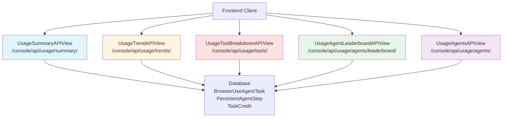
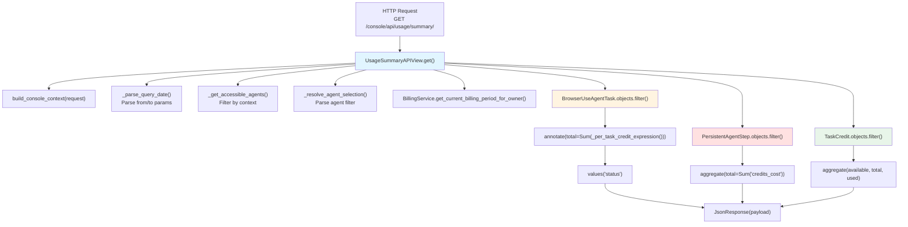
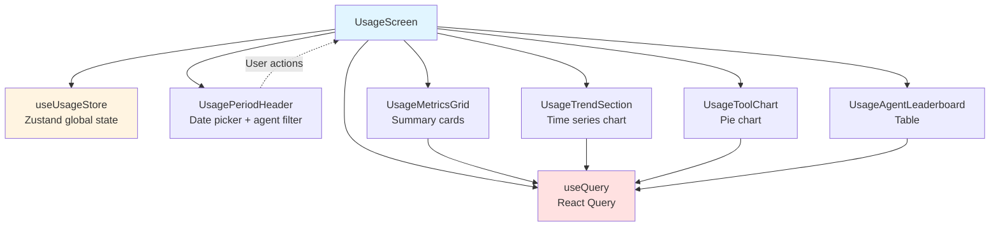

<!-- source: DeepWiki mcp.deepwiki.com · repo gobii-ai/gobii-platform · page 5.4 Usage Analytics · fetched 2026-10-27 -->

# Usage Analytics

<details>
<summary>Relevant source files</summary>

The following files were used as context for generating this wiki page:

- [config/urls.py](config/urls.py)
- [console/usage_views.py](console/usage_views.py)
- [frontend/src/components/usage/types.ts](frontend/src/components/usage/types.ts)
- [frontend/src/screens/UsageScreen.tsx](frontend/src/screens/UsageScreen.tsx)
- [tests/unit/test_usage_trends_api.py](tests/unit/test_usage_trends_api.py)

</details>


The Usage Analytics system provides real-time visibility into agent and API activity, credit consumption, and resource utilization. It aggregates data from both agent-driven tasks and direct API calls to generate comprehensive usage reports, trend analysis, and performance metrics.

For information about credit provisioning and consumption mechanics, see [TaskCreditService](#5.1). For subscription billing and metering, see [Subscription Management](#5.2).

---

## Purpose and Scope

This system exposes a suite of JSON API endpoints that power the usage dashboard in the Console interface. It enables users and organizations to:

- Monitor credit consumption across billing periods
- Track agent performance and activity levels
- Identify which tools consume the most resources
- Analyze usage trends over time (hourly, daily, monthly)
- Filter metrics by specific agents or date ranges

The system is context-aware, automatically scoping queries to personal or organization resources based on the authenticated user's active context.

**Sources**: [console/usage_views.py:1-943](), [frontend/src/screens/UsageScreen.tsx:1-338]()

---

## Core Concepts

### API Agent

The system introduces a special pseudo-agent identifier `API_AGENT_ID = "api"` to represent tasks created directly via the REST API without an associated `PersistentAgent`. This allows direct API usage to appear alongside agent-driven activity in all analytics views.

API tasks are identified by `agent_id__isnull=True` in the `BrowserUseAgentTask` model. They are assigned a default credit cost of `1.0` if no explicit `credits_cost` is provided.

**Sources**: [console/usage_views.py:27-29](), [console/usage_views.py:116-123]()

### Data Sources

Usage metrics are aggregated from two primary models:

| Model | Purpose | Credit Field |
|-------|---------|--------------|
| `BrowserUseAgentTask` | Browser automation tasks (agent-driven or API-initiated) | `credits_cost` |
| `PersistentAgentStep` | Agent reasoning steps, tool calls, and runtime overhead | `credits_cost` |

Both data sources are queried in parallel and their credits are summed to produce total consumption figures.

**Sources**: [console/usage_views.py:226-263](), [console/usage_views.py:454-486]()

### Context Awareness

All endpoints respect the user's active context (personal or organization). The context is determined via `build_console_context(request)`, which reads session state set by the context switcher.

- **Personal context**: Filters by `user=request.user` and `organization__isnull=True`
- **Organization context**: Filters by `organization=<org>` where the user is a member

This ensures users only see data they are authorized to access.

**Sources**: [console/usage_views.py:180-189](), [console/usage_views.py:410-421]()

---

## API Endpoints

### Endpoint Overview



**Sources**: [config/urls.py:122-126](), [console/usage_views.py:176-943]()

---

### Summary Endpoint

**Route**: `GET /console/api/usage/summary/`

**View**: `UsageSummaryAPIView`

Returns high-level metrics for a billing period, including task counts by status, total credit consumption, and quota information.

#### Query Parameters

| Parameter | Type | Description |
|-----------|------|-------------|
| `from` | ISO date | Start date (defaults to billing period start) |
| `to` | ISO date | End date (defaults to billing period end) |
| `agent` | string[] | Filter by agent IDs (supports "api" for API tasks) |

#### Response Structure

```json
{
  "period": {
    "start": "2024-01-01",
    "end": "2024-01-31",
    "label": "Jan 1 – Jan 31, 2024",
    "timezone": "America/New_York"
  },
  "context": {
    "type": "personal",
    "id": "...",
    "name": "user@example.com"
  },
  "metrics": {
    "tasks": {
      "count": 150.0,
      "completed": 140.0,
      "in_progress": 5.0,
      "pending": 3.0,
      "failed": 2.0,
      "cancelled": 0.0
    },
    "credits": {
      "total": 150.0,
      "unit": "credits"
    },
    "quota": {
      "available": 850.0,
      "total": 1000.0,
      "used": 150.0,
      "used_pct": 15.0
    }
  }
}
```

#### Implementation Details

The view performs three major aggregations:

1. **Task status breakdown**: Groups `BrowserUseAgentTask` by `status` and sums credits using `_per_task_credit_expression()`. This expression handles the API agent special case by defaulting to `1.0` credit when `agent_id` is null.

2. **Persistent step credits**: Sums `PersistentAgentStep.credits_cost` for all steps in the period. These are counted as "completed" since steps represent finished work.

3. **Current quota**: Queries `TaskCredit` for non-voided credits where `granted_date <= now` and `expiration_date >= now`, computing available, total, and used amounts.

**Sources**: [console/usage_views.py:176-334](), [console/usage_views.py:143-152]()

---

### Trend Endpoint

**Route**: `GET /console/api/usage/trends/`

**View**: `UsageTrendAPIView`

Returns time-bucketed usage data for visualizing trends. Supports three modes with automatic lookback periods.

#### Query Parameters

| Parameter | Type | Description |
|-----------|------|-------------|
| `mode` | string | Required: `day`, `week`, or `month` |
| `from` | ISO date | Custom range start (optional) |
| `to` | ISO date | Custom range end (optional) |
| `agent` | string[] | Filter by agent IDs |

#### Mode Behavior

| Mode | Resolution | Default Range | Comparison Period |
|------|-----------|---------------|-------------------|
| `day` | Hourly | Today | Previous 24 hours |
| `week` | Daily | Last 7 days | Prior 7 days |
| `month` | Daily | Last 30 days | Prior 30 days |

#### Response Structure

```json
{
  "mode": "week",
  "resolution": "day",
  "timezone": "America/New_York",
  "current_period": {
    "start": "2024-01-08T00:00:00-05:00",
    "end": "2024-01-15T00:00:00-05:00"
  },
  "previous_period": {
    "start": "2024-01-01T00:00:00-05:00",
    "end": "2024-01-08T00:00:00-05:00"
  },
  "agents": [
    {"id": "...", "name": "Agent Alpha"},
    {"id": "api", "name": "API"}
  ],
  "buckets": [
    {
      "timestamp": "2024-01-08T00:00:00-05:00",
      "current": 15.0,
      "previous": 12.0,
      "agents": {
        "...": 10.0,
        "api": 5.0
      }
    }
  ]
}
```

#### Implementation Details

The view uses `TruncHour` or `TruncDay` from Django ORM to bucket timestamps. It executes two separate queries for current and previous periods, then aligns buckets using `timedelta` arithmetic.

The `agents` field in each bucket breaks down credits by agent ID, enabling stacked area charts or multi-series line graphs.

**Sources**: [console/usage_views.py:337-590](), [console/usage_views.py:433-567]()

---

### Tool Breakdown Endpoint

**Route**: `GET /console/api/usage/tools/`

**View**: `UsageToolBreakdownAPIView`

Aggregates credit consumption by tool name, showing which integrations (MCP tools, browser automation, etc.) consume the most resources.

#### Query Parameters

Same as summary endpoint: `from`, `to`, `agent`

#### Response Structure

```json
{
  "range": {
    "start": "2024-01-01T00:00:00-05:00",
    "end": "2024-01-31T23:59:59-05:00"
  },
  "timezone": "America/New_York",
  "total_count": 145.5,
  "total_credits": 145.5,
  "total_invocations": 127,
  "tools": [
    {
      "name": "search_tools",
      "invocations": 45,
      "credits": 52.5
    },
    {
      "name": "send_email",
      "invocations": 30,
      "credits": 30.0
    },
    {
      "name": "api_task",
      "invocations": 12,
      "credits": 15.0
    },
    {
      "name": "agent_runtime",
      "invocations": 0,
      "credits": 48.0
    }
  ]
}
```

#### Special Tool Categories

- **Named tools**: Populated from `PersistentAgentToolCall.tool_name`, representing explicit MCP or built-in tool invocations
- **`api_task`**: Browser tasks created via API without a PersistentAgent (`agent_id__isnull=True`)
- **`agent_runtime`**: Residual credits from `PersistentAgentStep` that are not attributed to specific tool calls (LLM reasoning overhead, system messages, etc.)

The residual calculation ensures all consumed credits are accounted for:

```python
residual_credits = persistent_step_credits - total_tool_credits
```

**Sources**: [console/usage_views.py:593-758](), [console/usage_views.py:728-737]()

---

### Leaderboard Endpoint

**Route**: `GET /console/api/usage/agents/leaderboard/`

**View**: `UsageAgentLeaderboardAPIView`

Ranks agents by total credit consumption, computing average credits per day and success/error breakdowns.

#### Response Structure

```json
{
  "period": {
    "start": "2024-01-01",
    "end": "2024-01-31",
    "label": "Jan 1 – Jan 31, 2024",
    "timezone": "America/New_York"
  },
  "agents": [
    {
      "id": "...",
      "name": "Agent Alpha",
      "tasks_total": 125.5,
      "tasks_per_day": 4.05,
      "success_count": 120.0,
      "error_count": 5.5,
      "persistent_id": "..."
    },
    {
      "id": "api",
      "name": "API",
      "tasks_total": 45.0,
      "tasks_per_day": 1.45,
      "success_count": 45.0,
      "error_count": 0.0,
      "persistent_id": null
    }
  ]
}
```

#### Calculation Logic

- **tasks_total**: Sum of all credits (browser tasks + persistent steps)
- **success_count**: Credits from `COMPLETED` browser tasks + all persistent steps (steps are assumed successful)
- **error_count**: Credits from `FAILED` browser tasks
- **tasks_per_day**: `tasks_total / period_length_days`

The leaderboard is sorted descending by `tasks_total`.

**Sources**: [console/usage_views.py:761-918](), [console/usage_views.py:884-906]()

---

### Agents List Endpoint

**Route**: `GET /console/api/usage/agents/`

**View**: `UsageAgentsAPIView`

Returns all agents accessible in the current context, used to populate filter dropdowns.

#### Response Structure

```json
{
  "agents": [
    {"id": "api", "name": "API"},
    {"id": "...", "name": "Agent Alpha"},
    {"id": "...", "name": "Agent Beta"}
  ]
}
```

The list always includes the special `API_AGENT_ID` entry and is sorted alphabetically by name.

**Sources**: [console/usage_views.py:921-943](), [console/usage_views.py:67-101]()

---

## Data Flow Architecture



**Sources**: [console/usage_views.py:176-334](), [console/usage_views.py:42-173]()

---

## Query Construction Patterns

### Agent Filtering

All views use a common helper chain to resolve agent filters:

```mermaid
graph LR
    Raw["Raw agent IDs<br/>from query params"]
    GetAccessible["_get_accessible_agents()<br/>context-scoped list"]
    
    Filter["_filter_agent_ids()<br/>validate against accessible"]
    Split["_split_agent_filter_values()<br/>separate 'api' from UUIDs"]
    Build["_build_agent_filter()<br/>construct Q object"]
    
    Apply["Apply to queryset.filter()"]
    
    Raw --> GetAccessible
    GetAccessible --> Filter
    Filter --> Split
    Split --> Build
    Build --> Apply
    
    style GetAccessible fill:#e1f5ff
    style Split fill:#fff4e1
    style Build fill:#ffe1e1
```



The `_build_agent_filter()` function returns a Django `Q` object combining:
- `Q(agent_id__in=actual_agent_ids)` for concrete agents
- `Q(agent_id__isnull=True)` if the "api" pseudo-agent is selected

**Sources**: [console/usage_views.py:104-141](), [console/usage_views.py:155-173]()

### Credit Expression

The `_per_task_credit_expression()` function is a Django `Case/When` construct that normalizes credit costs across API and agent-driven tasks:

```python
Case(
    When(agent_id__isnull=True, then=Coalesce(F("credits_cost"), Value(Decimal("1")))),
    default=Coalesce(F("credits_cost"), Value(Decimal("0"))),
    output_field=DecimalField(max_digits=20, decimal_places=6)
)
```

This ensures:
- API tasks without explicit `credits_cost` default to `1.0`
- Agent tasks without explicit cost default to `0.0` (should not happen in practice but prevents null issues)

**Sources**: [console/usage_views.py:143-152]()

---

## Frontend Integration

### UsageScreen Component

The main dashboard component manages state for:
- Date range selection (billing period vs custom range)
- Agent filtering
- Tab navigation across metrics, trends, tools, and leaderboard



**Sources**: [frontend/src/screens/UsageScreen.tsx:1-338]()

### Date Range Handling

The component supports two selection modes:

- **Billing mode**: Navigates forward/backward by full billing cycles using `shiftBillingRange()`. Automatically aligns to the billing cycle anchor day.
- **Custom mode**: Navigates by the length of the user-selected range using `shiftCustomRangeByDays()`.

The effective range is tracked in three state variables:
- `appliedRange`: Currently active filter
- `calendarRange`: Temporary selection while picker is open
- `summaryRange`: Server's billing period (fallback)

**Sources**: [frontend/src/screens/UsageScreen.tsx:38-216]()

### State Synchronization

React Query handles API fetching, while Zustand (`useUsageStore`) provides synchronous access to the latest data for immediate UI updates. This prevents loading flashes when switching tabs or agents.

**Sources**: [frontend/src/screens/UsageScreen.tsx:47-100]()

---

## Testing Strategy

The test suite validates all endpoints under both personal and organization contexts, agent filtering, and edge cases.

### Key Test Cases

| Test Class | Coverage |
|------------|----------|
| `UsageTrendAPITests` | Week/day/month modes, previous period calculation, persistent steps, API agent |
| `UsageAgentLeaderboardAPITests` | Zero-state, totals, per-day averages, persistent step inclusion, API tasks |
| `UsageToolBreakdownAPITests` | Tool aggregation, agent filtering, org context, API task surfacing, residual calculation |
| `UsageAgentsAPITests` | Personal vs org context, agent list sorting |
| `UsageSummaryAPITests` | Agent filtering, context isolation, persistent steps, API tasks |

All tests use `@tag("batch_usage_api")` for targeted test execution and `@override_settings(FIRST_RUN_SETUP_ENABLED=False, LLM_BOOTSTRAP_OPTIONAL=True)` to bypass setup requirements.

**Sources**: [tests/unit/test_usage_trends_api.py:1-821]()

---

## Common Query Patterns

### Filtering by Agent

```
GET /console/api/usage/summary/?agent=<agent_id>&agent=api
```

Multiple `agent` parameters are OR'd together. The special `api` value includes agentless browser tasks.

### Custom Date Range

```
GET /console/api/usage/trends/?mode=week&from=2024-01-01&to=2024-01-07
```

Dates must be ISO 8601 format (`YYYY-MM-DD`). If omitted, defaults to the current billing period.

### Organization Context

The backend automatically scopes queries based on the user's active session context. No query parameter is needed—context is read from `request.session`.

**Sources**: [console/usage_views.py:191-200](), [console/usage_views.py:348-364]()

---

## Performance Considerations

- All aggregations use database-level `Sum()` and `Count()` to minimize data transfer
- `select_related("persistent_agent")` is used when loading agents to avoid N+1 queries
- Date range filters use indexed `created_at` fields
- Decimal arithmetic is performed in Python after aggregation to maintain precision

The trend endpoint can be expensive for hourly resolution over long periods. The default 7-day and 30-day lookbacks are chosen to balance granularity with query cost.

**Sources**: [console/usage_views.py:87](), [console/usage_views.py:235-241]()

---

