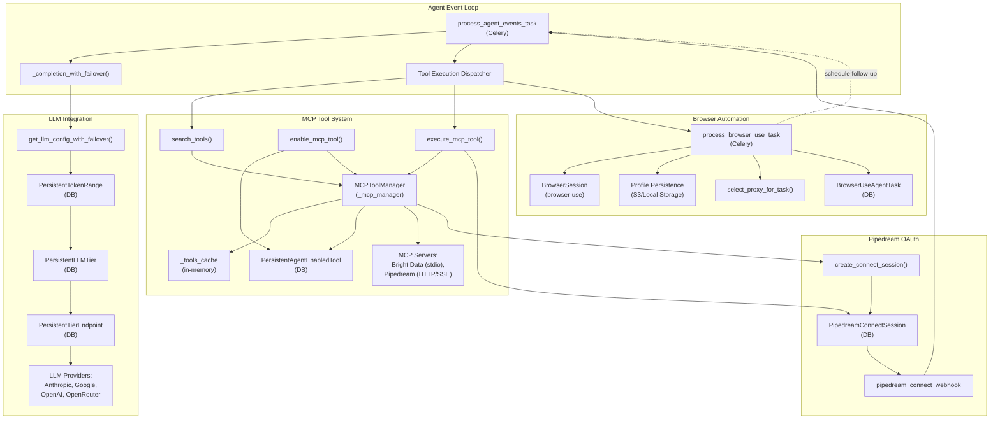
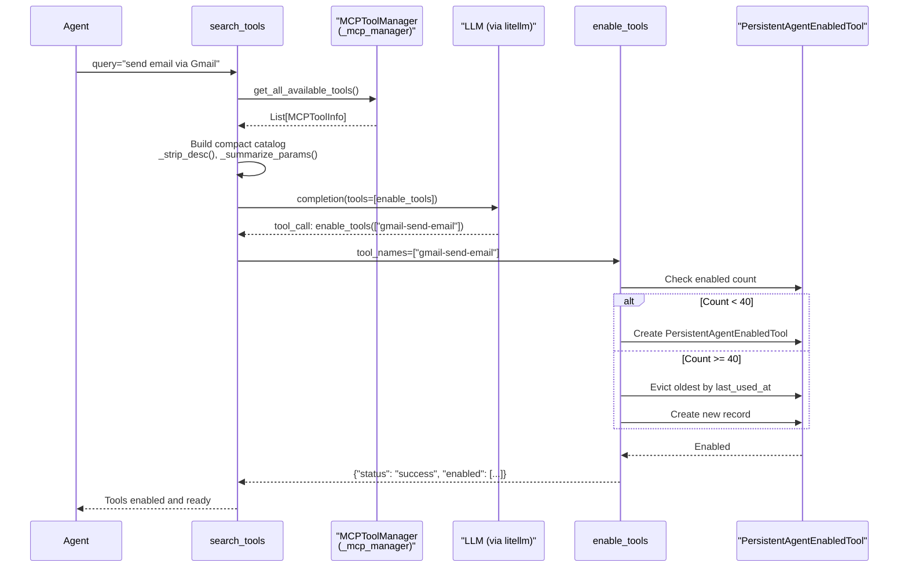
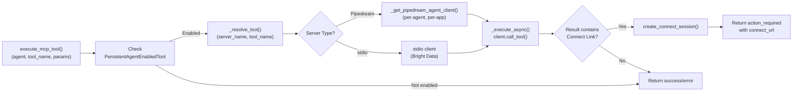
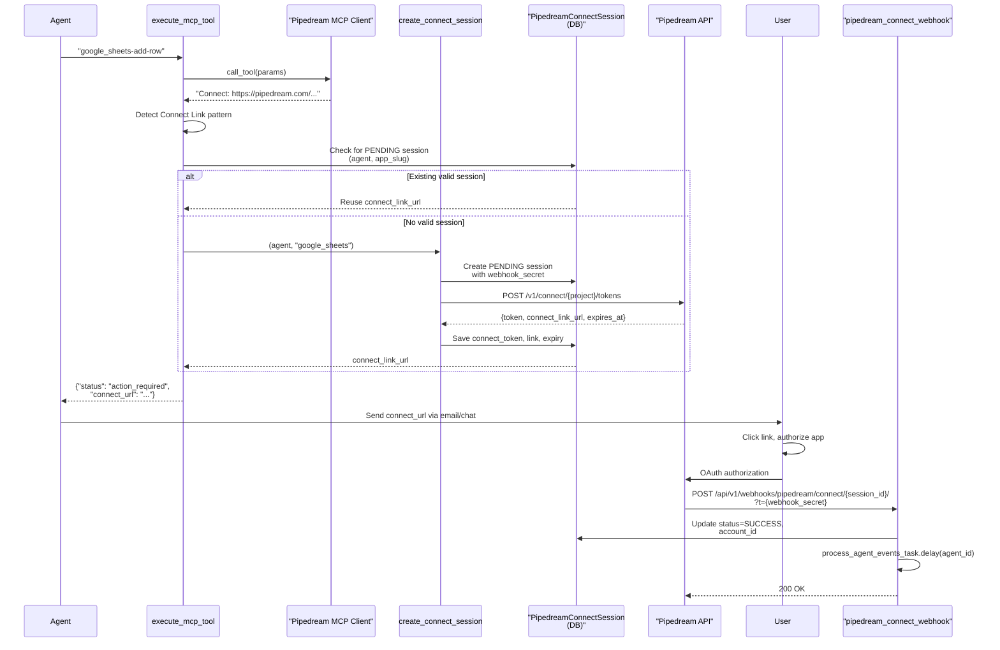
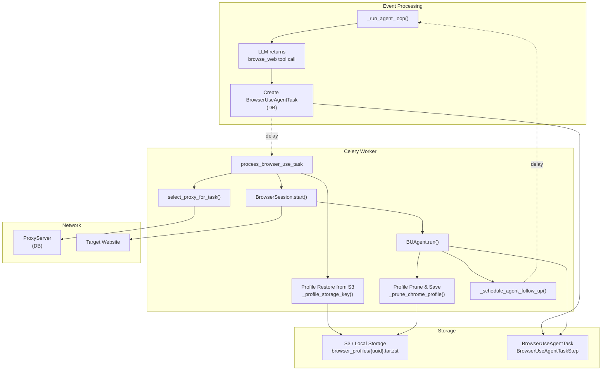
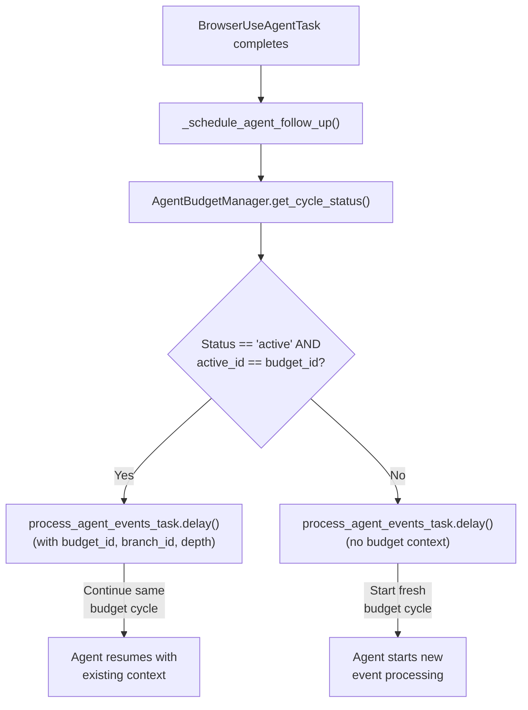
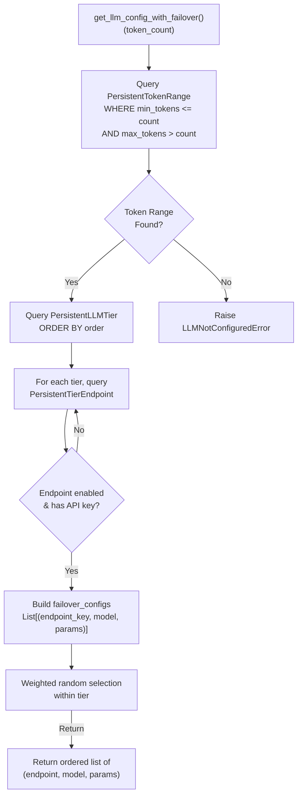
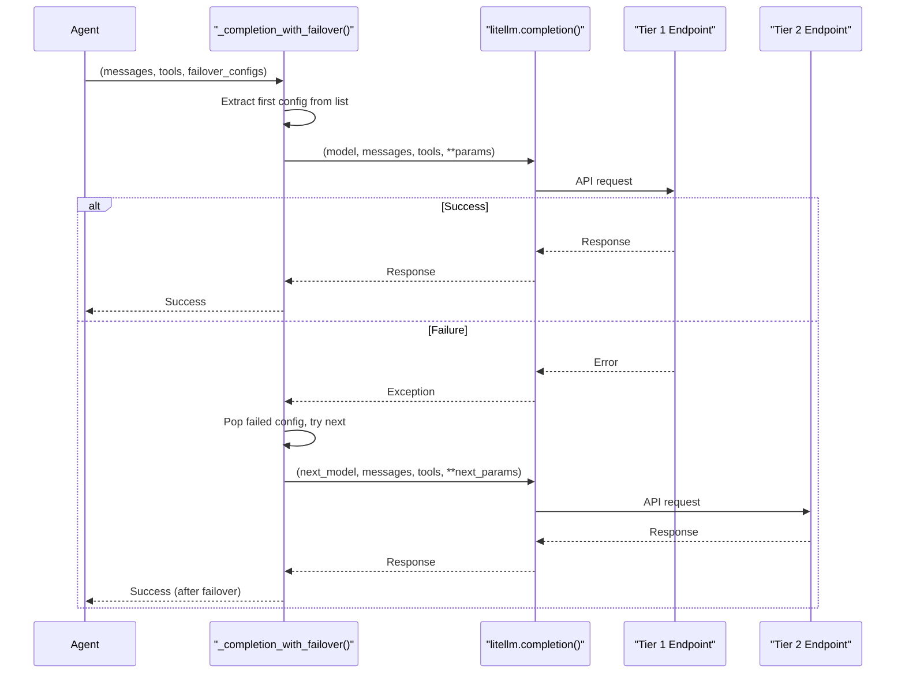

<!-- source: DeepWiki mcp.deepwiki.com · repo gobii-ai/gobii-platform · page 6 Tool Integration · fetched 2026-10-27 -->

# Tool Integration

<details>
<summary>Relevant source files</summary>

The following files were used as context for generating this wiki page:

- [api/agent/core/llm_config.py](api/agent/core/llm_config.py)
- [api/agent/tools/mcp_manager.py](api/agent/tools/mcp_manager.py)
- [api/agent/tools/mcp_tools.py](api/agent/tools/mcp_tools.py)
- [api/integrations/pipedream_connect.py](api/integrations/pipedream_connect.py)
- [api/migrations/0127_pipedream_connect_session.py](api/migrations/0127_pipedream_connect_session.py)
- [api/migrations/0137_add_trello_tool_friendly_names.py](api/migrations/0137_add_trello_tool_friendly_names.py)
- [api/tasks/browser_agent_tasks.py](api/tasks/browser_agent_tasks.py)
- [tests/unit/test_browser_task_follow_up.py](tests/unit/test_browser_task_follow_up.py)
- [tests/unit/test_event_processing_llm_selection.py](tests/unit/test_event_processing_llm_selection.py)
- [tests/unit/test_llm_failover.py](tests/unit/test_llm_failover.py)
- [tests/unit/test_mcp_tools.py](tests/unit/test_mcp_tools.py)
- [tests/unit/test_pipedream_connect.py](tests/unit/test_pipedream_connect.py)
- [tests/unit/test_pipedream_greenhouse.py](tests/unit/test_pipedream_greenhouse.py)
- [tests/unit/test_pipedream_trello.py](tests/unit/test_pipedream_trello.py)
- [tests/utils/llm_seed.py](tests/utils/llm_seed.py)

</details>


The gobii platform provides three primary integration systems that enable agents to interact with external services, automate browser tasks, and leverage multiple LLM providers. This document provides an architectural overview of these integration layers. For detailed implementation specifics, see:
- [MCP Tools](#6.1) - Model Context Protocol tool discovery and execution
- [Browser Automation](#6.2) - Web automation via browser-use library  
- [LLM Integration](#6.3) - Multi-provider LLM configuration and failover

---

## Overview

The platform's tool integration architecture consists of three independent but complementary systems:

| System | Purpose | Primary Code Entity |
|--------|---------|-------------------|
| **MCP Tools** | Dynamic discovery and execution of 2,800+ external API integrations via Model Context Protocol | `MCPToolManager` |
| **Browser Automation** | Headless Chrome automation for web scraping and interaction | `process_browser_use_task` |
| **LLM Integration** | Multi-provider LLM configuration with token-based tier selection and automatic failover | `get_llm_config_with_failover()` |

These systems operate independently—agents can use MCP tools without browser automation, or browser tasks without MCP tools—but are often composed together during agent event processing.

**Sources:** [api/agent/tools/mcp_manager.py:1-735](), [api/tasks/browser_agent_tasks.py:1-1130](), [api/agent/core/llm_config.py:1-478]()

---

## System Architecture

### High-Level Component Interaction



**Sources:** [api/agent/tools/mcp_manager.py:78-735](), [api/tasks/browser_agent_tasks.py:542-1130](), [api/agent/core/llm_config.py:235-401]()

---

## MCP Tool Integration

The MCP (Model Context Protocol) system enables agents to discover and execute tools from multiple servers without hardcoded integrations. The platform supports both **stdio-based** servers (like Bright Data) and **HTTP/SSE** servers (like Pipedream).

### Tool Discovery and Enablement Flow



**Key Components:**

| Entity | Purpose | Location |
|--------|---------|----------|
| `MCPToolManager` | Singleton managing MCP server connections and tool catalog | [api/agent/tools/mcp_manager.py:78-735]() |
| `_mcp_manager` | Global instance of MCPToolManager | [api/agent/tools/mcp_manager.py:735]() |
| `search_tools()` | LLM-driven tool discovery that auto-enables relevant tools | [api/agent/tools/mcp_manager.py:738-901]() |
| `enable_mcp_tool()` | Enable a single tool with LRU eviction (40-tool limit) | [api/agent/tools/mcp_manager.py:904-985]() |
| `MCPToolInfo` | Dataclass representing discovered tool metadata | [api/agent/tools/mcp_manager.py:58-75]() |
| `PersistentAgentEnabledTool` | DB model tracking enabled tools per agent | [api/models.py]() |

**Tool Discovery Process:**

1. **Initialization:** `MCPToolManager.initialize()` connects to configured servers and caches tools in `_tools_cache`
2. **Server Registration:** `_register_server()` creates stdio or HTTP transport and fetches available tools
3. **Tool Filtering:** `_is_tool_blacklisted()` applies glob patterns from `TOOL_BLACKLIST` 
4. **LLM Analysis:** `search_tools()` builds a compact catalog and lets an LLM select relevant tools
5. **Auto-Enable:** Selected tools are enabled via internal `enable_tools()` function call

**Sources:** [api/agent/tools/mcp_manager.py:158-343](), [api/agent/tools/mcp_manager.py:738-901]()

### Tool Execution

When an agent needs to execute an enabled MCP tool:



**Key Functions:**

| Function | Purpose | File Location |
|----------|---------|--------------|
| `execute_mcp_tool()` | Main execution entry point with blacklist/permission checks | [api/agent/tools/mcp_manager.py:397-608]() |
| `_resolve_tool()` | Map full_name to (server_name, actual_tool_name) | [api/agent/tools/mcp_manager.py:630-647]() |
| `_execute_async()` | Async wrapper for client.call_tool() | [api/agent/tools/mcp_manager.py:610-613]() |
| `_get_pipedream_agent_client()` | Get or create per-agent, per-app Pipedream client | [api/agent/tools/mcp_manager.py:706-729]() |

**Execution Flow:**

1. Check if tool is blacklisted via `_is_tool_blacklisted()` 
2. Verify tool is enabled in `PersistentAgentEnabledTool`
3. Update `last_used_at` and `usage_count` for LRU tracking
4. Resolve server and actual tool name
5. For Pipedream: create per-agent client with OAuth headers
6. Execute via async `client.call_tool()`
7. If result contains Pipedream Connect Link, trigger OAuth flow

**Sources:** [api/agent/tools/mcp_manager.py:397-608](), [api/agent/tools/mcp_manager.py:706-729]()

---

## Pipedream OAuth Integration

Pipedream tools requiring user credentials pause agent execution and generate a Connect Link for user authorization.

### Connect Link Flow



**Key Components:**

| Entity | Purpose | Location |
|--------|---------|----------|
| `create_connect_session()` | Generate Pipedream Connect token and session | [api/integrations/pipedream_connect.py:29-140]() |
| `PipedreamConnectSession` | DB model tracking OAuth sessions | [api/models.py]() |
| `pipedream_connect_webhook` | Webhook handler for authorization callbacks | [api/webhooks.py]() |
| `_pd_build_headers()` | Build per-agent, per-app Pipedream headers | [api/agent/tools/mcp_manager.py:683-696]() |

**Session Lifecycle:**

1. **Detection:** `execute_mcp_tool()` detects Pipedream connect link in tool result [api/agent/tools/mcp_manager.py:468-599]()
2. **Reuse Check:** Query for existing `PENDING` session with `expires_at` > now + 30s buffer
3. **Token Creation:** If no valid session, call `create_connect_session()` which posts to Pipedream API
4. **Session Persistence:** Store `connect_token`, `connect_link_url`, `webhook_secret`, and `expires_at`
5. **User Authorization:** Agent sends link to user via email/chat/web
6. **Webhook Callback:** Pipedream POSTs to `/api/v1/webhooks/pipedream/connect/{session_id}/?t={secret}`
7. **Agent Wake:** Webhook handler triggers `process_agent_events_task.delay()` to resume agent

**Session Statuses:**

| Status | Meaning |
|--------|---------|
| `PENDING` | Session created, awaiting user authorization |
| `SUCCESS` | User authorized, credentials available |
| `ERROR` | Link expired before delivery or authorization failed |

**Sources:** [api/integrations/pipedream_connect.py:29-140](), [api/agent/tools/mcp_manager.py:468-599](), [tests/unit/test_pipedream_connect.py:22-141]()

---

## Browser Automation

Browser automation tasks execute in separate Celery workers with persistent Chrome profiles and proxy support.

### Browser Task Execution Architecture



**Key Functions:**

| Function | Purpose | Location |
|----------|---------|----------|
| `process_browser_use_task` | Main Celery task executing browser automation | [api/tasks/browser_agent_tasks.py:972-1130]() |
| `_run_agent()` | Async wrapper setting up browser session and executing BUAgent | [api/tasks/browser_agent_tasks.py:542-965]() |
| `select_proxy_for_task()` | Select proxy based on agent preferences and health checks | [api/tasks/browser_agent_tasks.py:408-447]() |
| `_profile_storage_key()` | Generate sharded S3 key for browser profile | [api/tasks/browser_agent_tasks.py:502-512]() |
| `_prune_chrome_profile()` | Remove cache/temp files from profile before persistence | [api/tasks/browser_agent_tasks.py:199-273]() |
| `_schedule_agent_follow_up()` | Trigger agent event processing after task completion | [api/tasks/browser_agent_tasks.py:72-153]() |

**Profile Persistence Flow:**

1. **Restore:** On task start, check if `browser_profiles/{shard1}/{shard2}/{uuid}.tar.zst` exists in storage
2. **Extract:** If found, decompress with zstandard and extract tar to temp directory
3. **Execute:** Run browser automation with profile directory
4. **Prune:** Remove cache directories and temp files to reduce size [api/tasks/browser_agent_tasks.py:199-273]()
5. **Compress:** Create tar.zst archive with compression level 3
6. **Upload:** Save to storage with hierarchical key sharding

**Profile Sharding:** Uses first 4 hex chars of UUID for two-level directory sharding to avoid millions of objects in a single prefix. Example: `123e4567-e89b-12d3-...` → `browser_profiles/12/3e/123e4567-e89b-12d3-....tar.zst`

**Sources:** [api/tasks/browser_agent_tasks.py:542-965](), [api/tasks/browser_agent_tasks.py:199-273](), [api/tasks/browser_agent_tasks.py:502-512]()

### Browser Task Follow-Up

After browser task completion, agents can either continue the same budget cycle or start fresh:



**Budget Cycle Logic:**

- If the original budget cycle is still `active` and matches the task's `budget_id`, the follow-up continues the same cycle
- Otherwise, a fresh event processing is triggered without budget context
- This prevents agents from resuming expired or closed budget cycles

**Sources:** [api/tasks/browser_agent_tasks.py:72-153](), [tests/unit/test_browser_task_follow_up.py:1-89]()

---

## LLM Provider Integration

The platform uses a database-backed multi-tier failover system for LLM provider selection based on token count.

### Token-Based Tier Selection



**Database Schema:**

| Model | Purpose | Key Fields |
|-------|---------|-----------|
| `PersistentTokenRange` | Define token ranges (e.g., 0-7500, 7500-20000) | `min_tokens`, `max_tokens` |
| `PersistentLLMTier` | Define failover tiers within a token range | `token_range`, `order` |
| `PersistentTierEndpoint` | Link endpoints to tiers with weights | `tier`, `endpoint`, `weight` |
| `PersistentModelEndpoint` | Specific model configurations | `provider`, `litellm_model`, `api_base`, `supports_vision` |
| `LLMProvider` | Provider credentials and settings | `key`, `api_key_encrypted`, `env_var_name`, `browser_backend` |

**Configuration Flow:**

1. **Token Estimation:** Before LLM call, estimate tokens via `_estimate_agent_context_tokens()` 
2. **Range Selection:** Query `PersistentTokenRange` to find matching range
3. **Tier Iteration:** Load tiers for range ordered by `order` field
4. **Endpoint Filtering:** For each tier, load enabled endpoints with valid API keys
5. **Weighted Selection:** Use `random.choices()` with endpoint weights for load balancing
6. **Failover List:** Return all usable endpoints across tiers in priority order

**API Key Resolution:** Endpoints prefer encrypted admin keys from `LLMProvider.api_key_encrypted`, falling back to environment variables specified in `env_var_name`.

**Sources:** [api/agent/core/llm_config.py:235-401](), [tests/utils/llm_seed.py:18-87]()

### LLM Failover Execution



**Failover Logic:**

- `_completion_with_failover()` receives pre-computed `failover_configs` list
- Tries each config in order until success or exhaustion
- Removes internal hints (`supports_tool_choice`, `use_parallel_tool_calls`, `supports_vision`) before passing to litellm
- Logs failures and advances to next tier
- For providers like OpenAI, adds `parallel_tool_calls` and `drop_params` flags

**Sources:** [api/agent/core/event_processing.py](), [tests/unit/test_event_processing_llm_selection.py:22-84]()

---

## Configuration

### MCP Server Configuration

MCP servers are configured in `MCPToolManager.AVAILABLE_SERVERS`:

```python
AVAILABLE_SERVERS = [
    MCPServer(
        name="brightdata",
        display_name="Bright Data",
        command="npx",
        args=["-y", "@brightdata/mcp@2.5.0"],
        env={"API_TOKEN": os.getenv("BRIGHT_DATA_TOKEN", "")},
        enabled=True
    ),
    MCPServer(
        name="pipedream",
        display_name="Pipedream",
        url="https://remote.mcp.pipedream.net",
        env={},
        headers={},
        enabled=True
    ),
]
```

**Environment Variables:**

| Variable | Purpose | Used By |
|----------|---------|---------|
| `BRIGHT_DATA_TOKEN` | API token for Bright Data MCP server | stdio transport |
| `BRIGHT_DATA_WEB_UNLOCKER_ZONE` | Optional zone configuration for web unlocker | Bright Data server |
| `PIPEDREAM_CLIENT_ID` | OAuth client ID | Pipedream authentication |
| `PIPEDREAM_CLIENT_SECRET` | OAuth client secret | Pipedream authentication |
| `PIPEDREAM_PROJECT_ID` | Pipedream project identifier | Connect API calls |
| `PIPEDREAM_ENVIRONMENT` | Environment (development/production) | Connect headers |
| `PIPEDREAM_PREFETCH_APPS` | Comma-separated app slugs to prefetch | Tool discovery |

**Sources:** [api/agent/tools/mcp_manager.py:82-113]()

### Tool Blacklist

Tools matching glob patterns in `TOOL_BLACKLIST` are excluded from discovery:

```python
TOOL_BLACKLIST = [
    "mcp_brightdata_scraping_browser_*",  # Blacklist all scraping browser tools
    "select_apps"
]
```

**Sources:** [api/agent/tools/mcp_manager.py:121-127]()

### Browser Configuration

Browser automation settings:

| Setting | Default | Purpose |
|---------|---------|---------|
| `BROWSER_HEADLESS` | `True` | Run Chrome in headless mode |
| `ALLOW_FILE_UPLOAD` | `False` | Enable file uploads from agent filespace |
| `ALLOW_FILE_DOWNLOAD` | `False` | Enable file downloads to agent filespace |
| `CHROME_PROFILE_MAX_SIZE_BYTES` | 500 MB | Reset profile if exceeds after pruning |

**Sources:** [api/tasks/browser_agent_tasks.py:196-273](), [api/tasks/browser_agent_tasks.py:704-723]()

---

## Integration Patterns

### Tool Discovery Pattern

Agents discover tools via natural language queries:

```python
# Agent calls search_tools via LLM tool call
result = search_tools(agent, "send emails via Gmail")

# Returns:
{
    "status": "success",
    "message": "Enabled: gmail-send-email, gmail-get-thread",
    "enabled_tools": ["gmail-send-email", "gmail-get-thread"],
    "already_enabled": [],
    "evicted": [],
    "invalid": []
}
```

The LLM analyzes a compact catalog and calls the internal `enable_tools()` function to enable all relevant tools in one step, avoiding multiple round-trips.

**Sources:** [api/agent/tools/mcp_manager.py:738-901]()

### Tool Execution Pattern

After enablement, tools are executed directly:

```python
result = _mcp_manager.execute_mcp_tool(
    agent=agent,
    tool_name="gmail-send-email",
    params={"to": "user@example.com", "subject": "Hello", "body": "..."}
)

# Returns:
{
    "status": "success",
    "result": "Email sent successfully with ID: <msg_id>"
}

# Or if OAuth required:
{
    "status": "action_required",
    "result": "Authorization required. Please connect your account via: https://...",
    "connect_url": "https://example.com/connect?token=..."
}
```

**Sources:** [api/agent/tools/mcp_manager.py:397-608]()

### Browser Automation Pattern

Browser tasks are created and execute asynchronously:

```python
# In event processing loop
task = BrowserUseAgentTask.objects.create(
    agent=browser_use_agent,
    user=user,
    prompt="Navigate to example.com and extract the title",
    budget_id=budget_id,
    branch_id=branch_id,
    depth=depth
)

# Trigger async execution
process_browser_use_task.delay(str(task.id))

# Worker executes, then triggers follow-up
_schedule_agent_follow_up(task, budget_id=budget_id, branch_id=branch_id, depth=depth)
```

**Sources:** [api/tasks/browser_agent_tasks.py:972-1130](), [api/tasks/browser_agent_tasks.py:72-153]()

---

## Limitations and Constraints

### MCP Tool Limits

- **40-Tool Cap:** Each agent can enable maximum 40 MCP tools (enforced via LRU eviction)
- **No Nested Clients:** Pipedream clients are cached per (agent_id, app_slug, mode) to avoid connection leaks
- **Blacklist Enforcement:** Blacklisted tools cannot be enabled or executed

**Sources:** [api/agent/tools/mcp_manager.py:40](), [api/agent/tools/mcp_manager.py:904-985]()

### Browser Automation Limits

- **Profile Size:** Chrome profiles exceeding 500 MB after pruning are reset to avoid storage bloat
- **Single Session:** Only one browser session per task (no parallel sessions)
- **Proxy Dependency:** Tasks may fail if no healthy proxy available and debug mode disabled

**Sources:** [api/tasks/browser_agent_tasks.py:196-273](), [api/tasks/browser_agent_tasks.py:408-447]()

### LLM Integration Limits

- **Bootstrap Required:** Platform requires at least one configured endpoint before agents can run
- **No Dynamic Key Rotation:** API keys are loaded at config time, not per-request
- **Tier Exhaustion:** If all endpoints in all tiers fail, the completion fails (no infinite retry)

**Sources:** [api/agent/core/llm_config.py:394-401](), [api/agent/core/llm_config.py:450-466]()

---

## Testing

The codebase includes comprehensive tests for each integration system:

| Test Suite | Coverage | File |
|------------|----------|------|
| MCP Tool Management | Discovery, enablement, LRU eviction, blacklist | [tests/unit/test_mcp_tools.py]() |
| Pipedream Connect | OAuth flow, session reuse, webhook callbacks | [tests/unit/test_pipedream_connect.py]() |
| Pipedream Greenhouse | App-specific OAuth, discovery headers | [tests/unit/test_pipedream_greenhouse.py]() |
| Pipedream Trello | Trello-specific OAuth and tool discovery | [tests/unit/test_pipedream_trello.py]() |
| LLM Failover | Token-based selection, weighted distribution | [tests/unit/test_llm_failover.py]() |
| Browser Task Follow-Up | Budget cycle continuation logic | [tests/unit/test_browser_task_follow_up.py]() |

**Test Utilities:**

- `seed_persistent_basic()` - Seeds minimal LLM configuration for DB-only tests
- `clear_llm_db()` - Cleans up LLM configuration tables

**Sources:** [tests/unit/test_mcp_tools.py:1-711](), [tests/utils/llm_seed.py:4-87](), [tests/unit/test_browser_task_follow_up.py:1-89]()

---

