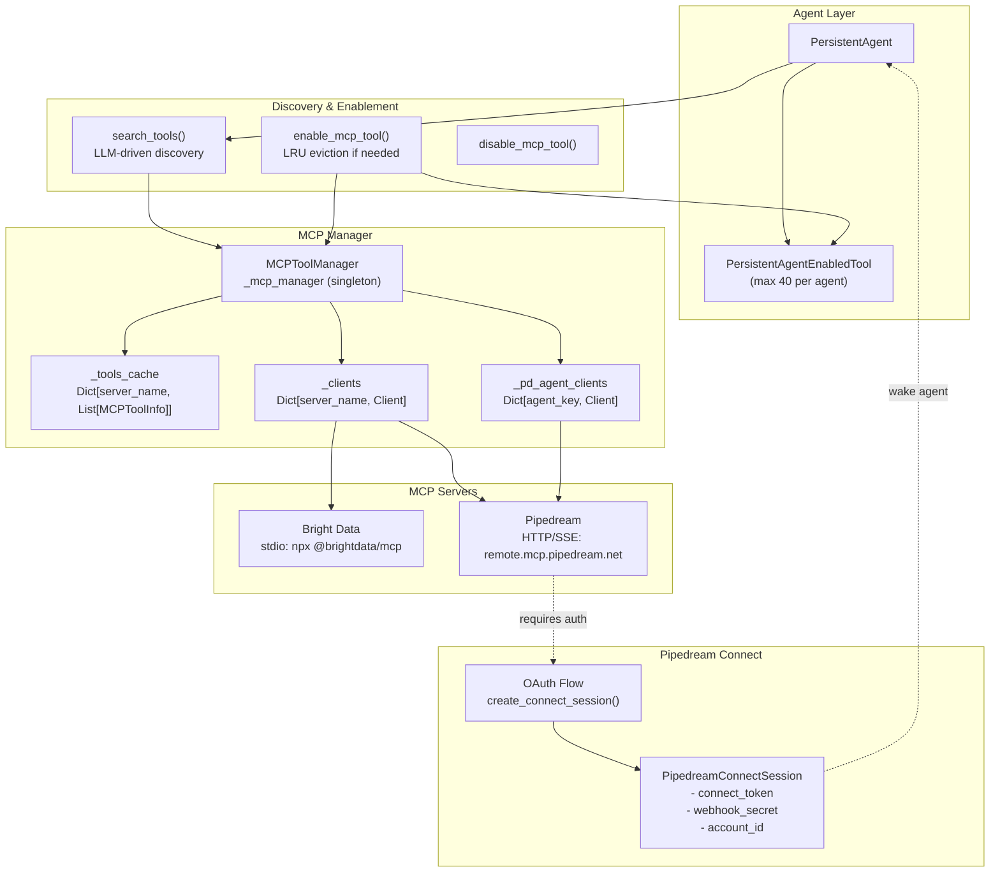
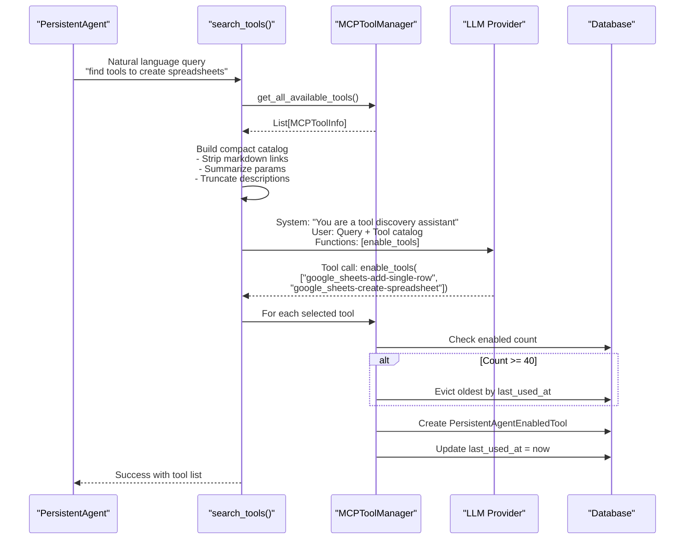
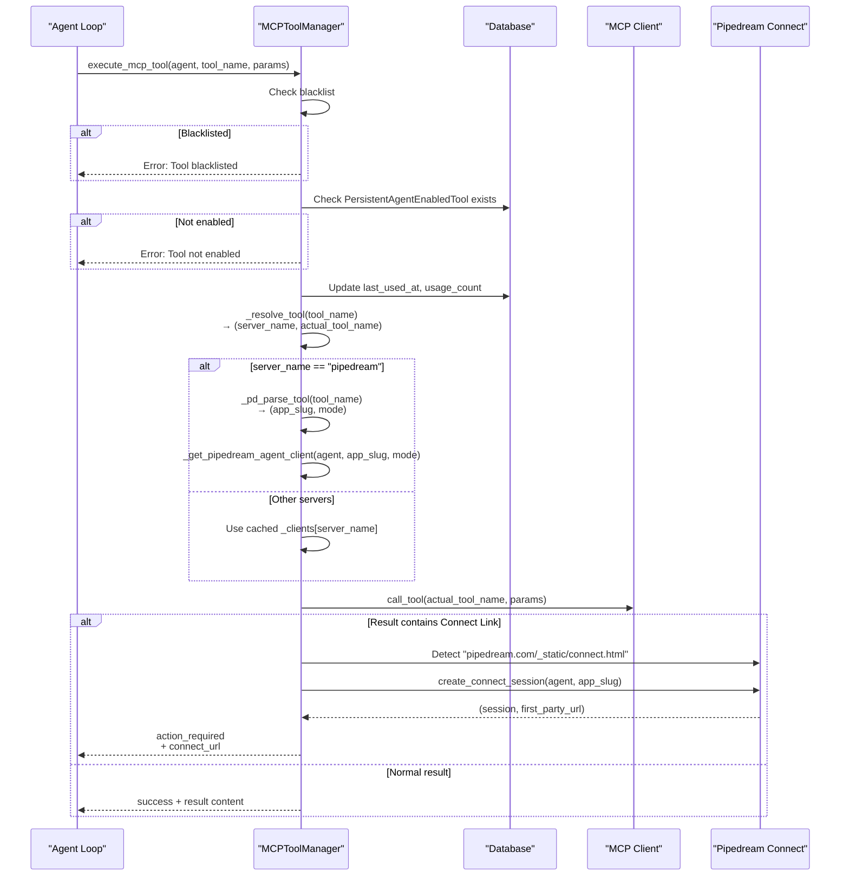
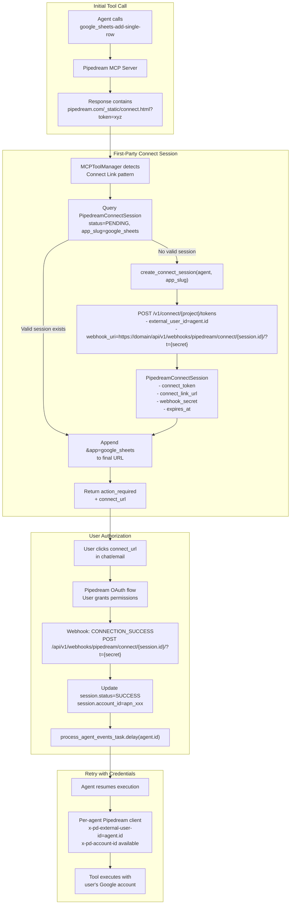

<!-- source: DeepWiki mcp.deepwiki.com · repo gobii-ai/gobii-platform · page 6.1 MCP Tools · fetched 2026-10-27 -->

# MCP Tools

<details>
<summary>Relevant source files</summary>

The following files were used as context for generating this wiki page:

- [api/agent/tools/mcp_manager.py](api/agent/tools/mcp_manager.py)
- [api/integrations/pipedream_connect.py](api/integrations/pipedream_connect.py)
- [api/migrations/0127_pipedream_connect_session.py](api/migrations/0127_pipedream_connect_session.py)
- [api/migrations/0137_add_trello_tool_friendly_names.py](api/migrations/0137_add_trello_tool_friendly_names.py)
- [tests/unit/test_pipedream_connect.py](tests/unit/test_pipedream_connect.py)
- [tests/unit/test_pipedream_greenhouse.py](tests/unit/test_pipedream_greenhouse.py)
- [tests/unit/test_pipedream_trello.py](tests/unit/test_pipedream_trello.py)

</details>


## Purpose and Scope

This document describes the **Model Context Protocol (MCP) tool integration system**, which enables persistent agents to dynamically discover, enable, and execute external tools from multiple MCP servers. The system provides access to web scraping (Bright Data) and 2,800+ API integrations (Pipedream Connect) through a unified interface.

For information about browser automation tasks, see [Browser Automation](#6.2). For LLM provider configuration, see [LLM Integration](#6.3).

---

## Overview

The MCP tool system allows agents to:

1. **Discover tools dynamically** via natural language queries analyzed by an LLM
2. **Enable/disable tools** with automatic LRU eviction when the 40-tool per-agent limit is reached
3. **Execute tools** with automatic credential management for OAuth-enabled Pipedream apps
4. **Manage multiple server types**: stdio-based (Bright Data) and HTTP/SSE-based (Pipedream)

The core implementation is in `MCPToolManager`, which maintains client connections, caches discovered tools, and routes execution requests to the appropriate server.

**Sources:** [api/agent/tools/mcp_manager.py:1-40]()

---

## System Architecture

### Core Components



**Sources:** [api/agent/tools/mcp_manager.py:78-735](), [api/integrations/pipedream_connect.py:1-141](), [api/models.py]()

---

## MCP Server Configuration

### Available Servers

The platform supports two types of MCP servers:

| Server Name | Type | Transport | URL/Command | Description |
|-------------|------|-----------|-------------|-------------|
| `brightdata` | stdio | StdioTransport | `npx -y @brightdata/mcp@2.5.0` | Web scraping with CAPTCHA bypass, search engine |
| `pipedream` | HTTP/SSE | StreamableHttpTransport | `https://remote.mcp.pipedream.net` | 2,800+ API integrations (Google Sheets, Greenhouse, Trello, etc.) |

**Sources:** [api/agent/tools/mcp_manager.py:82-113]()

### Server Dataclass Structure

```python
@dataclass
class MCPServer:
    name: str
    display_name: str
    description: str
    command: Optional[str] = None      # For stdio servers
    args: Optional[List[str]] = None
    url: Optional[str] = None          # For HTTP/SSE servers
    env: Optional[Dict[str, str]] = None
    headers: Optional[Dict[str, str]] = None
    prefetch_apps: Optional[List[str]] = None  # Pipedream only
    enabled: bool = True
```

**Sources:** [api/agent/tools/mcp_manager.py:43-56]()

### Bright Data Configuration

Bright Data is configured as a stdio server with environment variables:

- `API_TOKEN`: Required authentication token from `BRIGHT_DATA_TOKEN` setting
- `NPM_CONFIG_CACHE`: Cache directory (default: `/tmp/.npm`)
- `PRO_MODE`: Set to `"true"` to enable full tool catalog
- `WEB_UNLOCKER_ZONE`: Optional zone configuration from `BRIGHT_DATA_WEB_UNLOCKER_ZONE`

**Sources:** [api/agent/tools/mcp_manager.py:83-101]()

### Pipedream Configuration

Pipedream is configured as an HTTP/SSE server requiring:

- `PIPEDREAM_CLIENT_ID`: OAuth client ID
- `PIPEDREAM_CLIENT_SECRET`: OAuth client secret
- `PIPEDREAM_PROJECT_ID`: Project identifier
- `PIPEDREAM_ENVIRONMENT`: Deployment environment (e.g., `"development"`)
- `PIPEDREAM_PREFETCH_APPS`: Comma-separated app slugs to discover at initialization (default: `"google_sheets,greenhouse"`)

**Sources:** [api/agent/tools/mcp_manager.py:102-112](), [api/agent/tools/mcp_manager.py:176-188]()

---

## Tool Discovery and Enablement

### Discovery Flow



**Sources:** [api/agent/tools/mcp_manager.py:738-897]()

### Tool Catalog Format

The discovery system prepares a compact, plain-text catalog to minimize LLM token usage:

```
- google_sheets-add-single-row: Add a row to a Google Sheet | params: spreadsheetId*:string, sheetName:string, values*:array +2 more
- greenhouse-create-candidate: Create a new candidate in Greenhouse | params: first_name*:string, last_name*:string, email:string
- trello-create-card: Create a card on a Trello board | params: name*:string, idList*:string, desc:string
```

**Implementation details:**
- Markdown links `[text](url)` are stripped: [api/agent/tools/mcp_manager.py:773-774]()
- URLs are removed: [api/agent/tools/mcp_manager.py:775-776]()
- Descriptions truncated to 180 chars: [api/agent/tools/mcp_manager.py:770-778]()
- Parameters summarized to first 6, with required params marked with `*`: [api/agent/tools/mcp_manager.py:780-799]()

**Sources:** [api/agent/tools/mcp_manager.py:769-821]()

### LRU Eviction Policy

When an agent reaches the 40-tool limit (`MAX_MCP_TOOLS`), the system evicts the **least recently used** tool:

```python
MAX_MCP_TOOLS = 40
```

**Eviction logic:**
1. Query current enabled tool count for agent
2. If count >= 40, find tool with oldest `last_used_at` timestamp
3. Delete that `PersistentAgentEnabledTool` record
4. Proceed with new tool enablement

**Sources:** [api/agent/tools/mcp_manager.py:40](), [api/agent/tools/mcp_manager.py:925-940]()

---

## Tool Blacklisting

The system maintains a blacklist of tool patterns that should not be discovered or executed:

```python
TOOL_BLACKLIST = [
    "mcp_brightdata_scraping_browser_*",  # Glob pattern
    "select_apps"
]
```

Blacklist matching uses `fnmatch` glob-style patterns. Tools matching any pattern are:
- Excluded during server tool discovery: [api/agent/tools/mcp_manager.py:328-330]()
- Rejected during execution with error response: [api/agent/tools/mcp_manager.py:401-406]()

**Sources:** [api/agent/tools/mcp_manager.py:121-127](), [api/agent/tools/mcp_manager.py:150-156]()

---

## Tool Naming Conventions

### Prefixed vs Unprefixed

| Server Type | Naming Convention | Example |
|-------------|-------------------|---------|
| Bright Data | `mcp_{server}_{tool}` | `mcp_brightdata_scrape_as_markdown` |
| Pipedream | Unprefixed | `google_sheets-add-single-row` |

**Rationale:** Pipedream tools are not prefixed to avoid excessively long names like `mcp_pipedream_google_sheets-add-single-row`.

**Sources:** [api/agent/tools/mcp_manager.py:315-342]()

---

## Tool Execution

### Execution Flow



**Sources:** [api/agent/tools/mcp_manager.py:397-608]()

### Usage Tracking

On each tool execution, the system updates:

```python
row.last_used_at = datetime.now(UTC)
row.usage_count = (row.usage_count or 0) + 1
row.save(update_fields=["last_used_at", "usage_count"])
```

This enables LRU eviction and usage analytics.

**Sources:** [api/agent/tools/mcp_manager.py:416-424]()

---

## Pipedream Connect OAuth Flow

### Architecture

Pipedream tools requiring user-specific credentials (e.g., Google Sheets, Greenhouse, Trello) use **Pipedream Connect**, which implements a delegated OAuth flow.



**Sources:** [api/agent/tools/mcp_manager.py:468-599](), [api/integrations/pipedream_connect.py:29-141]()

### Connect Link Detection

The system detects Pipedream Connect Links using pattern matching:

```python
if isinstance(content, dict):
    for v in content.values():
        if isinstance(v, str) and "pipedream.com/_static/connect.html" in v:
            connect_url = v
            break
elif isinstance(content, str) and "pipedream.com/_static/connect.html" in content:
    connect_url = content
```

**Sources:** [api/agent/tools/mcp_manager.py:470-477]()

### Session Reuse Logic

To avoid creating redundant Connect Links:

1. Query for existing `PipedreamConnectSession` with:
   - Same `agent`
   - Same `app_slug`
   - `status=PENDING`
   - Non-empty `connect_link_url`
2. Check if `expires_at > now + EFFECTIVE_EXPIRATION_BUFFER_SECONDS` (30 seconds)
3. If valid, reuse the existing `connect_link_url`
4. Otherwise, mark session as `ERROR` and create a new one

**Sources:** [api/agent/tools/mcp_manager.py:511-551](), [api/integrations/pipedream_connect.py:20-21]()

### Expired Link Handling

If a Connect Link has expired before it can be delivered to the user:

```python
if expires_at and expires_at <= now + timedelta(seconds=EFFECTIVE_EXPIRATION_BUFFER_SECONDS):
    logger.warning("PD Connect: token expired before delivery")
    session.status = PipedreamConnectSession.Status.ERROR
    session.save(update_fields=["status", "updated_at"])
    return session, None
```

The system returns `action_required` with a message explaining the link expired, prompting the agent to request a new one.

**Sources:** [api/integrations/pipedream_connect.py:119-128](), [api/agent/tools/mcp_manager.py:569-580]()

---

## Per-Agent Pipedream Clients

Pipedream maintains separate client connections **per agent per app slug** to ensure credential isolation:

### Client Cache Key

```python
cache_key = f"{agent.id}:{app_slug or ''}:{mode}"
```

**Example:** Agent `123` accessing Google Sheets in sub-agent mode has cache key `"123:google_sheets:sub-agent"`

**Sources:** [api/agent/tools/mcp_manager.py:706-729]()

### Headers for Per-Agent Clients

```python
headers = {
    "Authorization": f"Bearer {token}",
    "x-pd-project-id": PIPEDREAM_PROJECT_ID,
    "x-pd-environment": PIPEDREAM_ENVIRONMENT,
    "x-pd-external-user-id": str(agent.id),
    "x-pd-conversation-id": str(agent.id),
    "x-pd-app-discovery": "true",
    "x-pd-tool-mode": "sub-agent",
    "x-pd-app-slug": app_slug,
}
```

This allows Pipedream to route tool executions to the correct user account after OAuth completion.

**Sources:** [api/agent/tools/mcp_manager.py:683-696]()

---

## Tool Information Dataclass

```python
@dataclass 
class MCPToolInfo:
    full_name: str       # e.g., "google_sheets-add-single-row"
    server_name: str     # e.g., "pipedream"
    tool_name: str       # e.g., "google_sheets-add-single-row"
    description: str
    parameters: Dict[str, Any]  # JSON Schema
    
    def to_search_dict(self) -> Dict[str, str]:
        """Convert to dictionary for LLM search context."""
        return {
            "name": self.full_name,
            "server": self.server_name,
            "tool": self.tool_name,
            "description": self.description,
            "parameters": json.dumps(self.parameters) if self.parameters else "{}",
        }
```

**Sources:** [api/agent/tools/mcp_manager.py:58-75]()

---

## Default Enabled Tools

Certain tools are automatically enabled for all new agents:

```python
DEFAULT_ENABLED_TOOLS = [
    "mcp_brightdata_scrape_as_markdown",
]
```

This provides immediate web scraping capabilities without requiring explicit enablement.

**Sources:** [api/agent/tools/mcp_manager.py:115-119]()

---

## Token Management for Pipedream

### OAuth Client Credentials Flow

The system caches Pipedream access tokens with automatic refresh:

```python
def _get_pipedream_access_token(self) -> Optional[str]:
    # Reuse cached token if valid for at least 2 minutes
    if self._pd_access_token and self._pd_token_expiry and datetime.now(UTC) < (self._pd_token_expiry - timedelta(minutes=2)):
        return self._pd_access_token
    
    resp = requests.post(
        "https://api.pipedream.com/v1/oauth/token",
        json={
            "grant_type": "client_credentials",
            "client_id": client_id,
            "client_secret": client_secret,
        },
        timeout=15,
    )
    data = resp.json()
    self._pd_access_token = data.get("access_token")
    self._pd_token_expiry = datetime.now(UTC) + timedelta(seconds=expires_in)
```

**Sources:** [api/agent/tools/mcp_manager.py:649-681]()

---

## Initialization and Cleanup

### Initialization

```python
def initialize(self) -> bool:
    """Initialize all configured MCP servers and cache their tools."""
    if self._initialized:
        return True
    
    success_count = 0
    for server in self.AVAILABLE_SERVERS:
        if not server.enabled:
            continue
        
        # Validate required environment variables
        # ...
        
        try:
            self._register_server(server)
            success_count += 1
        except Exception as e:
            logger.error(f"Failed to register MCP server '{server.name}': {e}")
    
    self._initialized = success_count > 0
    return self._initialized
```

**Sources:** [api/agent/tools/mcp_manager.py:158-197]()

### Cleanup

```python
def cleanup(self):
    """Clean up resources."""
    for c in self._pd_agent_clients.values():
        try:
            c.close()
        except Exception:
            pass
    self._pd_agent_clients.clear()
    self._clients.clear()
    self._tools_cache.clear()
    if self._loop and not self._loop.is_closed():
        self._loop.close()
    self._initialized = False
```

**Sources:** [api/agent/tools/mcp_manager.py:615-628]()

---

## Database Models

### PersistentAgentEnabledTool

Tracks which tools are enabled for each agent:

| Field | Type | Description |
|-------|------|-------------|
| `agent` | ForeignKey | Reference to `PersistentAgent` |
| `tool_full_name` | CharField | Full tool name (e.g., `"google_sheets-add-single-row"`) |
| `last_used_at` | DateTimeField | Timestamp of most recent execution |
| `usage_count` | IntegerField | Total number of executions |
| `created_at` | DateTimeField | When tool was enabled |

**Unique constraint:** `(agent, tool_full_name)`

**Sources:** [api/models.py]()

### PipedreamConnectSession

Manages Pipedream Connect OAuth sessions:

| Field | Type | Description |
|-------|------|-------------|
| `id` | UUIDField | Primary key |
| `agent` | ForeignKey | Reference to `PersistentAgent` |
| `app_slug` | CharField | App identifier (e.g., `"google_sheets"`) |
| `external_user_id` | CharField | Agent ID for Pipedream |
| `conversation_id` | CharField | Agent ID for Pipedream |
| `connect_token` | CharField | Pipedream Connect token |
| `connect_link_url` | TextField | OAuth authorization URL |
| `webhook_secret` | CharField | Secret for webhook validation |
| `expires_at` | DateTimeField | Token expiration |
| `status` | CharField | `PENDING` / `SUCCESS` / `ERROR` |
| `account_id` | CharField | Pipedream account ID after auth |

**Sources:** [api/migrations/0127_pipedream_connect_session.py:1-52]()

---

## API Functions

### Core Functions

| Function | Parameters | Returns | Description |
|----------|-----------|---------|-------------|
| `search_tools()` | `agent: PersistentAgent`<br/>`query: str` | `Dict[str, Any]` | LLM-driven tool discovery |
| `enable_mcp_tool()` | `agent: PersistentAgent`<br/>`tool_name: str` | `Dict[str, Any]` | Enable tool with LRU eviction |
| `disable_mcp_tool()` | `agent: PersistentAgent`<br/>`tool_name: str` | `Dict[str, Any]` | Disable tool |
| `get_mcp_manager()` | None | `MCPToolManager` | Get singleton instance |

**Sources:** [api/agent/tools/mcp_manager.py:738-1001]()

### Manager Methods

| Method | Purpose |
|--------|---------|
| `initialize()` | Register all enabled MCP servers |
| `get_all_available_tools()` | Return all discovered tools across servers |
| `find_tool_by_name()` | Lookup tool by exact full name |
| `has_tool()` | Check if tool exists in catalog |
| `get_enabled_tools_definitions()` | Get OpenAI-format tool definitions for agent |
| `execute_mcp_tool()` | Execute enabled tool with params |
| `cleanup()` | Close connections and clear caches |

**Sources:** [api/agent/tools/mcp_manager.py:158-628]()

---

## Example: Tool Discovery and Execution

### Step 1: Agent Searches for Tools

Agent wants to create spreadsheets:

```
Agent calls: search_tools(agent, "find tools to create and update Google Sheets")
```

**LLM receives:**
```
Query: find tools to create and update Google Sheets

Available tools:
- google_sheets-add-single-row: Add a row to a Google Sheet | params: spreadsheetId*:string, sheetName:string, values*:array
- google_sheets-create-spreadsheet: Create a new Google Sheet | params: title*:string, sheetNames:array
- google_sheets-update-cell: Update a cell in Google Sheet | params: spreadsheetId*:string, range*:string, value*:string
...

Select the relevant tools and call enable_tools once with their exact full names.
```

**LLM response:**
```
Tool call: enable_tools(
  tool_names=[
    "google_sheets-add-single-row",
    "google_sheets-create-spreadsheet",
    "google_sheets-update-cell"
  ]
)
```

**Sources:** [api/agent/tools/mcp_manager.py:823-836]()

### Step 2: Tools Are Enabled

System creates `PersistentAgentEnabledTool` records:
- If agent has 38 enabled tools → all 3 new tools enabled
- If agent has 40 enabled tools → 3 oldest tools evicted, 3 new tools enabled

**Sources:** [api/agent/tools/mcp_manager.py:925-940]()

### Step 3: Agent Executes Tool

Agent attempts to create a spreadsheet:

```python
result = execute_mcp_tool(
    agent,
    "google_sheets-create-spreadsheet",
    {"title": "Q1 Revenue Report", "sheetNames": ["January", "February", "March"]}
)
```

**First execution (no OAuth):**
```json
{
  "status": "action_required",
  "result": "Authorization required. Please connect your account via: https://gobii.ai/connect?token=abc&app=google_sheets",
  "connect_url": "https://gobii.ai/connect?token=abc&app=google_sheets"
}
```

**After user authorizes, second execution:**
```json
{
  "status": "success",
  "result": {
    "spreadsheetId": "1BxiMVs0XRA5nFMdKvBdBZjgmUUqptlbs74OgvE2upms",
    "spreadsheetUrl": "https://docs.google.com/spreadsheets/d/1BxiMVs0XRA5nFMdKvBdBZjgmUUqptlbs74OgvE2upms/edit"
  }
}
```

**Sources:** [api/agent/tools/mcp_manager.py:397-608]()

---

## Testing

### Test Coverage

The system includes comprehensive tests for:

1. **Basic discovery and enablement**: [tests/unit/test_mcp_manager.py]()
2. **Pipedream Connect session creation**: [tests/unit/test_pipedream_connect.py:22-92]()
3. **Webhook handling for OAuth completion**: [tests/unit/test_pipedream_connect.py:94-139]()
4. **Connect link rewriting**: [tests/unit/test_pipedream_connect.py:142-241]()
5. **Session reuse logic**: [tests/unit/test_pipedream_connect.py:243-296]()
6. **App-specific flows (Google Sheets, Greenhouse, Trello)**: [tests/unit/test_pipedream_greenhouse.py](), [tests/unit/test_pipedream_trello.py]()

**Sources:** [tests/unit/test_pipedream_connect.py:1-296](), [tests/unit/test_pipedream_greenhouse.py:1-163](), [tests/unit/test_pipedream_trello.py:1-152]()

---

## Configuration Reference

### Environment Variables

| Variable | Required | Purpose |
|----------|----------|---------|
| `BRIGHT_DATA_TOKEN` | Yes (for Bright Data) | API authentication token |
| `BRIGHT_DATA_WEB_UNLOCKER_ZONE` | No | Optional zone override |
| `PIPEDREAM_CLIENT_ID` | Yes (for Pipedream) | OAuth client ID |
| `PIPEDREAM_CLIENT_SECRET` | Yes (for Pipedream) | OAuth client secret |
| `PIPEDREAM_PROJECT_ID` | Yes (for Pipedream) | Project identifier |
| `PIPEDREAM_ENVIRONMENT` | Yes (for Pipedream) | Environment name |
| `PIPEDREAM_PREFETCH_APPS` | No | Comma-separated app slugs (default: `"google_sheets,greenhouse"`) |

**Sources:** [api/agent/tools/mcp_manager.py:91-98](), [api/agent/tools/mcp_manager.py:176-188]()

---

## Logging and Observability

The system uses OpenTelemetry tracing for key operations:

```python
@tracer.start_as_current_span("AGENT TOOL Search Tools")
def search_tools(agent: PersistentAgent, query: str) -> Dict[str, Any]:
    span = trace.get_current_span()
    span.set_attribute("persistent_agent.id", str(agent.id))
    span.set_attribute("search.query", query)
```

**Key log points:**
- Server registration: [api/agent/tools/mcp_manager.py:241]()
- Tool catalog details: [api/agent/tools/mcp_manager.py:243-255]()
- Discovery query and results: [api/agent/tools/mcp_manager.py:754-820]()
- Connect Link detection: [api/agent/tools/mcp_manager.py:482-504]()
- Session creation: [api/integrations/pipedream_connect.py:46-136]()

**Sources:** [api/agent/tools/mcp_manager.py:29-37](), [api/agent/tools/mcp_manager.py:738-746]()

---

