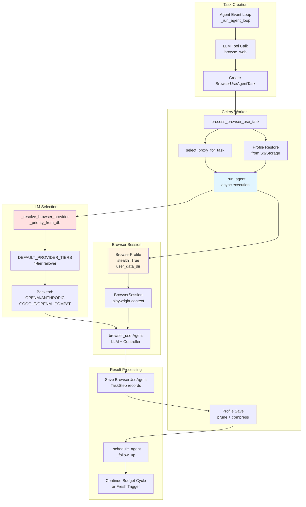
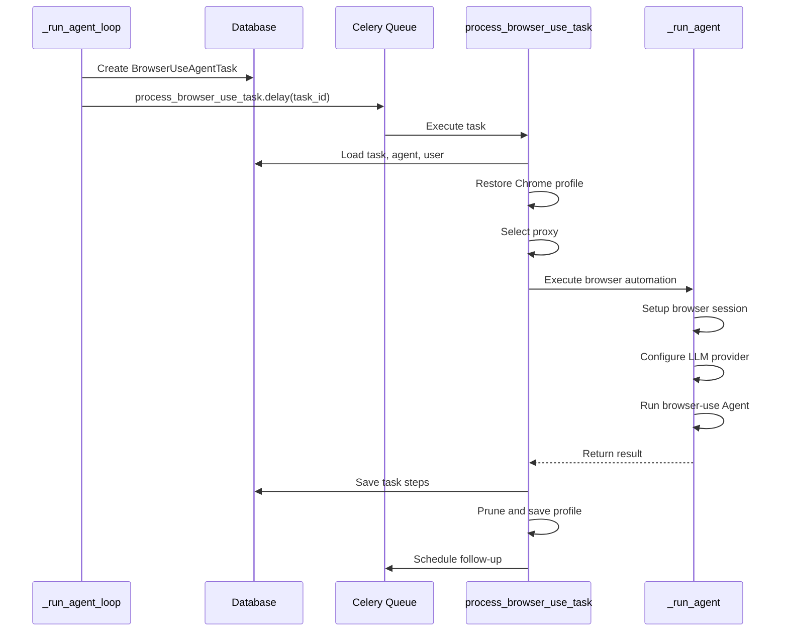
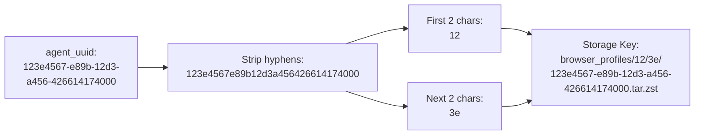
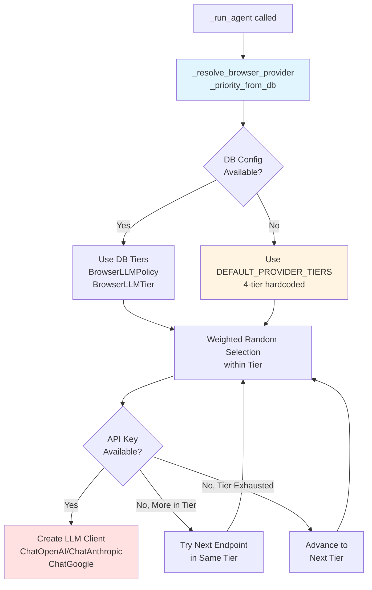
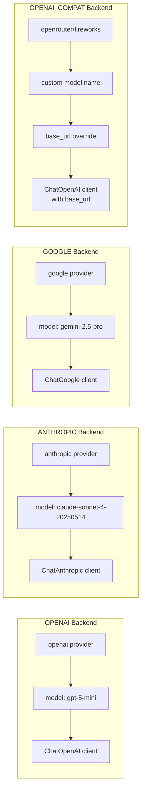
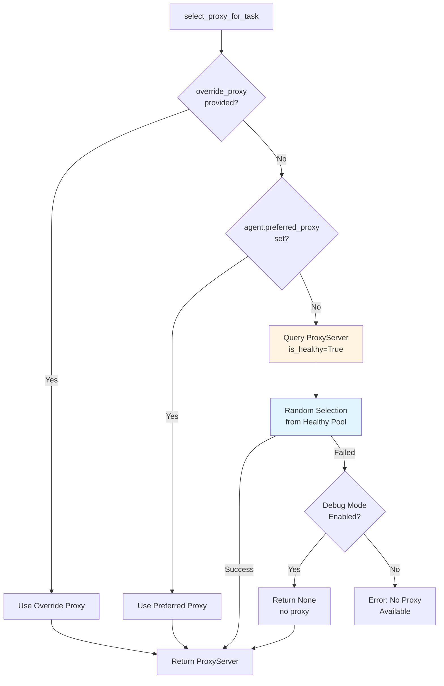
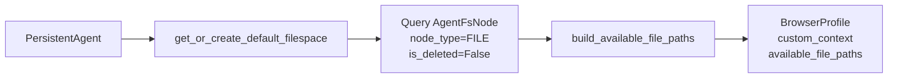
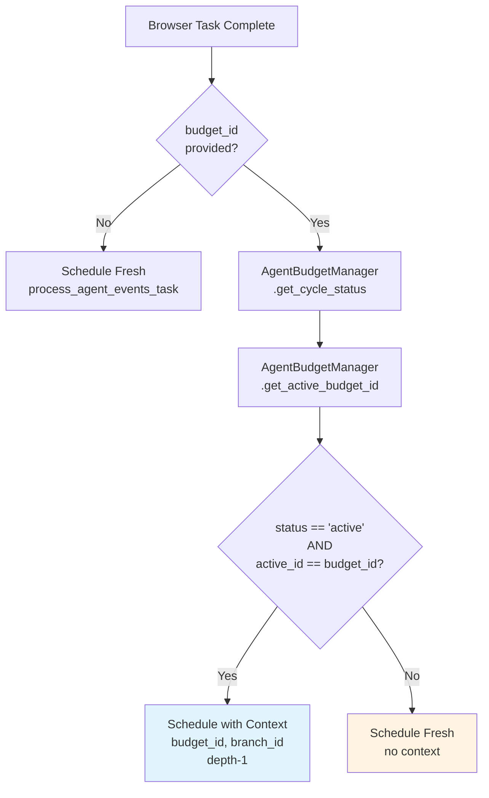

<!-- source: DeepWiki mcp.deepwiki.com · repo gobii-ai/gobii-platform · page 6.2 Browser Automation · fetched 2026-10-27 -->

# Browser Automation

<details>
<summary>Relevant source files</summary>

The following files were used as context for generating this wiki page:

- [api/agent/core/llm_config.py](api/agent/core/llm_config.py)
- [api/agent/tools/mcp_tools.py](api/agent/tools/mcp_tools.py)
- [api/tasks/browser_agent_tasks.py](api/tasks/browser_agent_tasks.py)
- [tests/unit/test_browser_task_follow_up.py](tests/unit/test_browser_task_follow_up.py)
- [tests/unit/test_event_processing_llm_selection.py](tests/unit/test_event_processing_llm_selection.py)
- [tests/unit/test_llm_failover.py](tests/unit/test_llm_failover.py)
- [tests/unit/test_mcp_tools.py](tests/unit/test_mcp_tools.py)
- [tests/utils/llm_seed.py](tests/utils/llm_seed.py)

</details>


## Purpose and Scope

This document describes the browser automation system that executes web-based tasks for agents using the browser-use library. It covers task execution, Chrome profile persistence, LLM provider configuration, proxy selection, and follow-up scheduling. For information about agent event processing that triggers these tasks, see [Agent Event Processing](#4.3). For MCP tool integration that provides additional capabilities, see [MCP Tools](#6.1).

---

## Architecture Overview

The browser automation system executes `BrowserUseAgentTask` instances in isolated Celery workers with persistent Chrome profiles, configurable proxies, and multi-tier LLM failover.

**Diagram: Browser Automation Architecture**



**Sources:** [api/tasks/browser_agent_tasks.py:72-154](), [api/tasks/browser_agent_tasks.py:542-894]()

---

## Task Execution Pipeline

### Task Creation and Queuing

Browser tasks are created by the agent event loop when the LLM calls the `browse_web` tool. The task is persisted as a `BrowserUseAgentTask` record and queued to Celery.



**Sources:** [api/tasks/browser_agent_tasks.py:542-558]()

### Execution Context

The `_run_agent()` function establishes the execution context with several key components:

| Component | Purpose | Configuration |
|-----------|---------|---------------|
| **Xvfb Manager** | Virtual display for headless environments | Enabled when `should_use_ephemeral_xvfb()` returns True |
| **Browser Profile** | Persistent Chrome user data directory | Restored from storage, pruned after use |
| **Proxy Settings** | Network routing via proxy servers | Selected from ProxyServer pool |
| **LLM Client** | Language model for agent decisions | Multi-tier failover configuration |
| **File Paths** | Available files for upload | Loaded from agent's default filespace |
| **Download Listener** | Handle file downloads | Registered if `ALLOW_FILE_DOWNLOAD=True` |

**Sources:** [api/tasks/browser_agent_tasks.py:575-738]()

---

## Chrome Profile Management

### Profile Storage Architecture

Chrome profiles are persisted to object storage (S3 or local) using a sharded directory structure to avoid overwhelming single directories with millions of files.

**Diagram: Profile Storage Sharding**



**Sources:** [api/tasks/browser_agent_tasks.py:495-512]()

### Profile Restore Process

When a task begins, the worker attempts to restore the agent's Chrome profile from storage:

1. **Storage Key Calculation**: Compute sharded key via `_profile_storage_key(agent_uuid)`
2. **Existence Check**: Test if `default_storage.exists(storage_key)`
3. **Download and Decompress**: Stream from storage through zstandard decompressor
4. **Tar Extraction**: Extract each member safely using `_safe_extract_tar_member()` to prevent path traversal attacks
5. **Size Logging**: Track compressed size, extraction time, and extracted file count

**Sources:** [api/tasks/browser_agent_tasks.py:586-678]()

### Profile Pruning and Persistence

After task completion, profiles are pruned to remove temporary data before compression:

**Pruned Directories:**
- `Cache`, `Code Cache`, `ShaderCache`, `GPUCache`
- `Service Worker/CacheStorage`
- `Crashpad/completed`, `Crashpad/pending`
- `Safe Browsing`

**Pruned Files:**
- `BrowserMetrics-spare.pma`, `SingletonCookie`, `SingletonLock`, `SingletonSocket`
- Any file ending with `.tmp` or `.old`

**Size Enforcement:**
- Maximum post-prune size: 500 MB (`CHROME_PROFILE_MAX_SIZE_BYTES`)
- If exceeded: Profile directory is deleted and recreated empty
- Purpose: Prevent unbounded growth from cache accumulation

**Sources:** [api/tasks/browser_agent_tasks.py:199-274]()

### Secure Tar Extraction

The `_safe_extract_tar_member()` function prevents path traversal attacks by validating each tar member before extraction:

```python
# Validates that extracted path stays within dest_dir
abs_target = os.path.realpath(target_path)
abs_dest = os.path.realpath(dest_dir)

if not (abs_target == abs_dest or abs_target.startswith(abs_dest + os.sep)):
    raise Exception(f"Unsafe path detected: {member.name}")
```

**Sources:** [api/tasks/browser_agent_tasks.py:518-537]()

---

## LLM Provider Selection

### Multi-Tier Failover Architecture

Browser automation uses a sophisticated LLM selection system with two configuration sources:

1. **Database-Backed Configuration** (Primary): `_resolve_browser_provider_priority_from_db()` reads from `BrowserLLMPolicy`, `BrowserLLMTier`, and `BrowserTierEndpoint` tables
2. **Default Tier Configuration** (Fallback): `DEFAULT_PROVIDER_TIERS` provides hardcoded 4-tier failover

**Diagram: LLM Provider Selection Flow**



**Sources:** [api/tasks/browser_agent_tasks.py:303-365]()

### Default Provider Tiers

When DB configuration is unavailable, the system uses these hardcoded tiers:

| Tier | Providers | Weights | Purpose |
|------|-----------|---------|---------|
| **Tier 1** | OpenAI GPT-4.1 (80%)<br/>Anthropic Sonnet 4 (20%) | Load-balanced primary | High-quality, low-latency responses |
| **Tier 2** | Google Gemini 2.5 Pro (100%) | Secondary fallback | Vision support, long context |
| **Tier 3** | Fireworks Qwen3-235B (50%)<br/>OpenRouter GLM-4.5 (50%) | Cost-effective tier | Open-source alternatives |
| **Tier 4** | Anthropic Sonnet 4 (100%) | Last resort | Guaranteed completion |

**Sources:** [api/tasks/browser_agent_tasks.py:286-293]()

### Backend Configuration

Each provider uses a specific backend implementation:

**Provider Backends:**



**Sources:** [api/tasks/browser_agent_tasks.py:742-781]()

### Vision Support

Vision support (screenshot analysis) is determined by:

1. **Database Metadata**: `endpoint.supports_vision` field if DB config is used
2. **Default Mapping**: `DEFAULT_PROVIDER_VISION_SUPPORT` dictionary for fallback

```python
DEFAULT_PROVIDER_VISION_SUPPORT = {
    "openai": True,
    "anthropic": True,
    "google": True,
    "openrouter": False,
    "fireworks": False,
}
```

The `use_vision` flag is passed to `browser_use.Agent` constructor to enable/disable screenshot capabilities.

**Sources:** [api/tasks/browser_agent_tasks.py:40-46](), [api/tasks/browser_agent_tasks.py:837]()

---

## Proxy Configuration

### Proxy Selection Logic

The `select_proxy_for_task()` function delegates to `select_proxy_for_browser_task()` from the proxy_selection module with the following priority:

1. **Override Proxy**: If provided explicitly, use it
2. **Agent Preferred Proxy**: If `task.agent.preferred_proxy` is set, use it
3. **Random Healthy Proxy**: Select from pool of healthy proxies
4. **Debug Mode Fallback**: Allow no proxy if `allow_no_proxy_in_debug=True`

**Diagram: Proxy Selection Flow**



**Sources:** [api/tasks/browser_agent_tasks.py:409-447]()

### Proxy Settings Configuration

When a proxy is selected, it's configured as a `ProxySettings` object for browser-use:

```python
proxy_settings = ProxySettings(
    server=f"{proxy_server.proxy_type.lower()}://{proxy_server.host}:{proxy_server.port}"
)
if proxy_server.username:
    proxy_settings.username = proxy_server.username
if proxy_server.password:
    proxy_settings.password = proxy_server.password
```

**Sources:** [api/tasks/browser_agent_tasks.py:688-695]()

### Observability

Proxy selection is instrumented with OpenTelemetry tracing:

```python
@tracer.start_as_current_span("SELECT Proxy")
def select_proxy_for_task(task_obj, override_proxy=None):
    # Sets attributes:
    # - proxy.id, proxy.host, proxy.port
    # - proxy.proxy_type, proxy.name
    # - agent.has_preferred_proxy
    # - no_proxy_available (if none selected)
```

**Sources:** [api/tasks/browser_agent_tasks.py:408-446]()

---

## File Upload and Download

### File Upload Configuration

Agents can upload files from their filespace to web forms when `settings.ALLOW_FILE_UPLOAD=True`:

**File Path Discovery:**



The `available_file_paths` list is passed to browser-use via `BrowserProfile.custom_context` to enable file selection in forms.

**Sources:** [api/tasks/browser_agent_tasks.py:370-403](), [api/tasks/browser_agent_tasks.py:704-723]()

### File Download Handling

When `settings.ALLOW_FILE_DOWNLOAD=True`, downloads are captured and persisted to the agent's filespace:

1. **Listener Registration**: `register_download_listener(browser_session, persistent_agent_id)` attaches a handler to the browser session
2. **Download Events**: Browser-use emits `FileDownloadedEvent` when files are saved
3. **Persistence**: Downloaded files are moved to the agent's filespace and tracked in `AgentFsNode`

**Sources:** [api/tasks/browser_agent_tasks.py:730-736]()

---

## Follow-up Scheduling

### Budget Cycle Continuity

After a browser task completes, `_schedule_agent_follow_up()` determines whether to continue the current budget cycle or start fresh:

**Diagram: Follow-up Decision Logic**



**Sources:** [api/tasks/browser_agent_tasks.py:72-154]()

### Follow-up Parameters

When continuing a budget cycle, the following parameters are preserved:

| Parameter | Purpose | Transformation |
|-----------|---------|----------------|
| `budget_id` | Maintains credit cycle context | Passed through unchanged |
| `branch_id` | Tracks execution branch | Passed through unchanged |
| `depth` | Prevents infinite recursion | Decremented: `max((depth or 1) - 1, 0)` |

When starting fresh, only the `agent_id` is passed, creating a new budget cycle.

**Sources:** [api/tasks/browser_agent_tasks.py:120-147]()

---

## Configuration Reference

### Environment Variables

| Variable | Purpose | Default |
|----------|---------|---------|
| `BROWSER_HEADLESS` | Run Chrome in headless mode | `True` |
| `ALLOW_FILE_UPLOAD` | Enable file uploads from filespace | `False` |
| `ALLOW_FILE_DOWNLOAD` | Enable file downloads to filespace | `False` |
| `ANONYMIZED_TELEMETRY` | Disable browser-use telemetry | `false` |
| `STORAGE_BACKEND_TYPE` | Profile storage backend (LOCAL/S3/GCS) | `LOCAL` |

**Sources:** [api/tasks/browser_agent_tasks.py:54](), [api/tasks/browser_agent_tasks.py:704](), [api/tasks/browser_agent_tasks.py:712]()

### LLM Provider Environment Variables

| Provider | Environment Variable | Model |
|----------|---------------------|-------|
| OpenAI | `OPENAI_API_KEY` | `gpt-5-mini` |
| Anthropic | `ANTHROPIC_API_KEY` | `claude-sonnet-4-20250514` |
| Google | `GOOGLE_API_KEY` | `gemini-2.5-pro` |
| OpenRouter | `OPENROUTER_API_KEY` | `z-ai/glm-4.5` |
| Fireworks | `FIREWORKS_AI_API_KEY` | `qwen3-235b-a22b-instruct-2507` |

**Sources:** [api/tasks/browser_agent_tasks.py:278-284]()

### Google Vertex AI Configuration

For Google provider, additional environment variables configure Vertex AI:

```python
params.update({
    "vertex_project": os.getenv("GOOGLE_CLOUD_PROJECT", "browser-use-458714"),
    "vertex_location": os.getenv("GOOGLE_CLOUD_LOCATION", "us-east4"),
})
```

**Sources:** [api/tasks/browser_agent_tasks.py:199-201]() in api/agent/core/llm_config.py

### Profile Pruning Constants

```python
CHROME_PROFILE_MAX_SIZE_BYTES = 500 * 1024 * 1024  # 500 MB

CHROME_PROFILE_PRUNE_DIRS = [
    "Cache", "Code Cache", "ShaderCache", "GPUCache",
    "Service Worker/CacheStorage",
    "Crashpad/completed", "Crashpad/pending",
    "Safe Browsing"
]

CHROME_PROFILE_PRUNE_FILES = [
    "BrowserMetrics-spare.pma", 
    "SingletonCookie", 
    "SingletonLock", 
    "SingletonSocket"
]
```

**Sources:** [api/tasks/browser_agent_tasks.py:182-193]()

---

