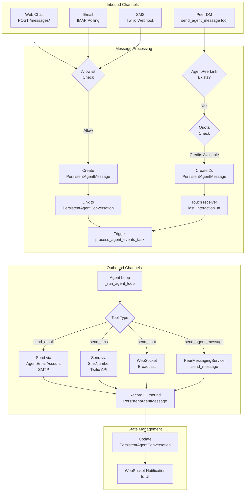
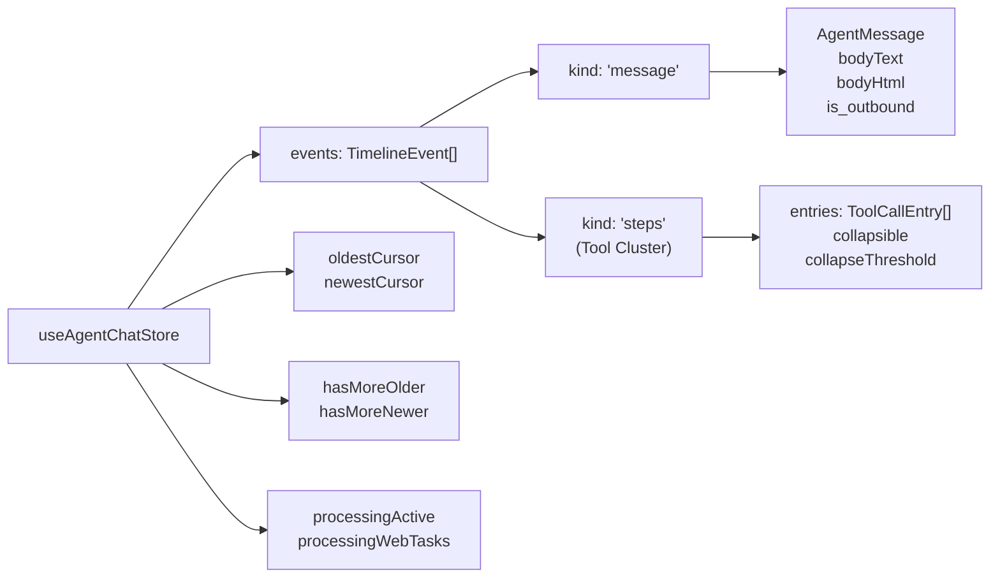
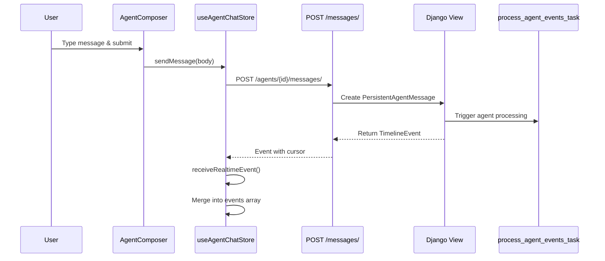
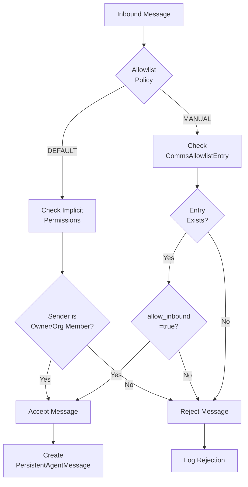
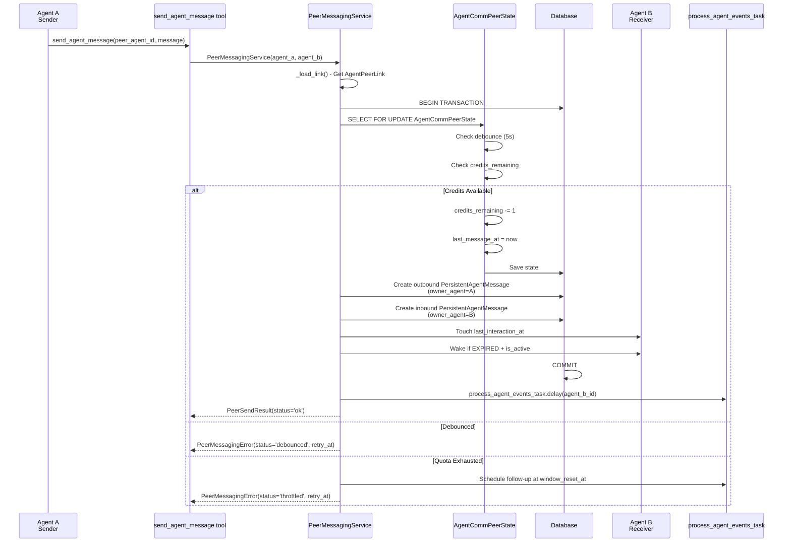
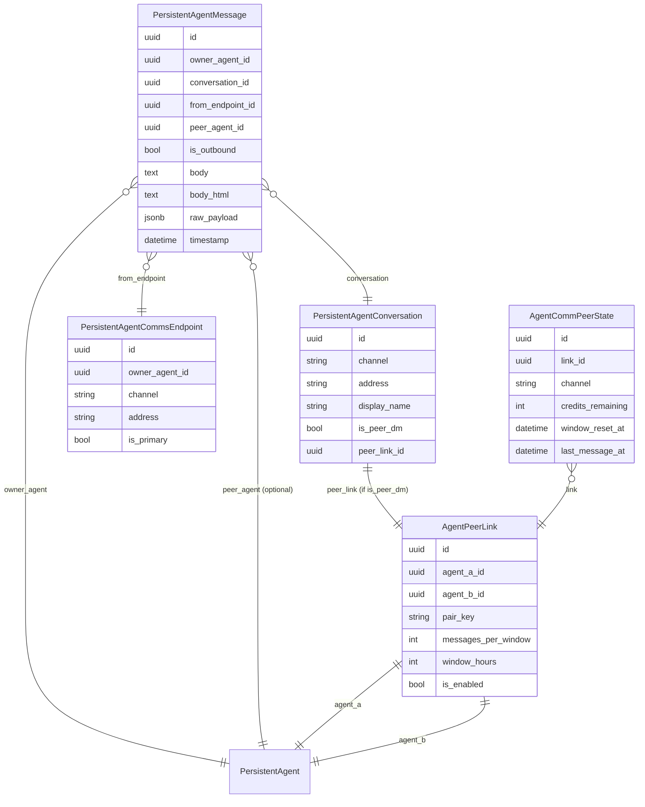

<!-- source: DeepWiki mcp.deepwiki.com · repo gobii-ai/gobii-platform · page 7 Communication Systems · fetched 2026-10-27 -->

# Communication Systems

<details>
<summary>Relevant source files</summary>

The following files were used as context for generating this wiki page:

- [.github/workflows/ci.yml](.github/workflows/ci.yml)
- [api/agent/peer_comm.py](api/agent/peer_comm.py)
- [api/agent/peer_link_signals.py](api/agent/peer_link_signals.py)
- [api/agent/tools/peer_dm.py](api/agent/tools/peer_dm.py)
- [api/apps.py](api/apps.py)
- [api/migrations/0151_agentcommpeerstate_agentpeerlink_and_more.py](api/migrations/0151_agentcommpeerstate_agentpeerlink_and_more.py)
- [frontend/src/components/agentChat/AgentChatLayout.tsx](frontend/src/components/agentChat/AgentChatLayout.tsx)
- [frontend/src/screens/AgentChatPage.tsx](frontend/src/screens/AgentChatPage.tsx)
- [frontend/src/stores/agentChatStore.ts](frontend/src/stores/agentChatStore.ts)
- [frontend/src/styles/agentChatLegacy.css](frontend/src/styles/agentChatLegacy.css)
- [tests/unit/test_agent_short_description.py](tests/unit/test_agent_short_description.py)
- [tests/unit/test_peer_agent_messaging.py](tests/unit/test_peer_agent_messaging.py)

</details>


This document describes the communication infrastructure that enables agents to interact with users and other agents. The gobii-platform supports four primary communication channels: **Web Chat** (real-time browser-based messaging), **Email** (via IMAP/SMTP), **SMS** (via Twilio), and **Peer Messaging** (direct agent-to-agent communication). Each channel implements allowlist-based access control, message threading, and lifecycle integration with agent processing.

For information about agent event processing triggered by messages, see [Agent Event Processing](#4.3). For API endpoints that expose message data, see [REST API](#9.1).

---

## Communication Architecture Overview

The communication system serves three primary functions:

1. **Inbound Message Processing**: Messages from external sources (email, SMS, web) trigger agent event processing via `process_agent_events_task`
2. **Outbound Message Delivery**: Agents send messages through tools during their execution loops
3. **Agent Coordination**: Peer messaging enables multi-agent workflows with rate limiting and lifecycle awareness

All messages are stored in the `PersistentAgentMessage` model and linked to `PersistentAgentConversation` objects for threading.

### Channel Overview

| Channel | Direction | Triggering | Allowlist Support | Primary Use Case |
|---------|-----------|------------|-------------------|------------------|
| Web Chat | Bidirectional | User-initiated | Implicit (session-based) | Real-time user interaction |
| Email | Bidirectional | IMAP polling/IDLE | Yes (directional) | Asynchronous communication |
| SMS | Bidirectional | Twilio webhook | Yes (directional) | Mobile notifications |
| Peer DM | Bidirectional | Tool invocation | Yes (via `AgentPeerLink`) | Agent collaboration |

**Sources:**
- [Diagram 5 from system architecture]()
- [api/models.py]()

---

## Communication Flow Diagram



**Sources:**
- [Diagram 5 from system architecture]()
- [api/agent/tasks.py]()
- [api/agent/peer_comm.py:103-213]()

---

## Web Chat System

The web chat interface provides real-time messaging between users and agents through a React-based UI with WebSocket updates. The system implements bidirectional scrolling, auto-scroll pinning, and processing indicators.

### Frontend Architecture

The chat UI consists of three primary components:

1. **`AgentChatLayout`** [frontend/src/components/agentChat/AgentChatLayout.tsx:27-147](): Layout component that renders timeline events, composer, and controls
2. **`AgentChatPage`** [frontend/src/screens/AgentChatPage.tsx:19-203](): Page controller managing state, scroll behavior, and WebSocket integration
3. **`useAgentChatStore`** [frontend/src/stores/agentChatStore.ts:199-472](): Zustand store managing timeline state, pagination, and processing updates

### Timeline Event Structure



**Sources:**
- [frontend/src/stores/agentChatStore.ts:170-197]()
- [frontend/src/types/agentChat.ts]()

### Auto-Scroll System

The auto-scroll system maintains user position in the timeline while dynamically loading new events:

1. **Bottom Sentinel Observer** [frontend/src/screens/AgentChatPage.tsx:133-154](): `IntersectionObserver` detects when user is near bottom
2. **Scroll Pin State** [frontend/src/stores/agentChatStore.ts:438-461](): Tracks whether auto-scroll is active
3. **Suppression Mechanism** [frontend/src/stores/agentChatStore.ts:462-471](): Temporarily disables auto-scroll after user interactions

When unpinned, new events accumulate in `pendingEvents` array and a "Jump to Latest" button appears.

### Message Send Flow



**Sources:**
- [frontend/src/stores/agentChatStore.ts:376-394]()
- [frontend/src/components/agentChat/AgentComposer.tsx]()
- [api/views/agent_chat.py]()

### Processing Indicator

The `ProcessingIndicator` component [frontend/src/components/agentChat/ProcessingIndicator.tsx]() displays when agents are actively processing:

- **Active State**: Shown when `processingActive=true` and `hasMoreNewer=false`
- **Browser Tasks**: Displays `processingWebTasks` array with status, prompt preview, and elapsed time
- **Expandable View**: Tasks can be expanded to show full prompt and task ID

Styling is handled by [frontend/src/styles/agentChatLegacy.css:37-307]().

**Sources:**
- [frontend/src/components/agentChat/AgentChatLayout.tsx:93-99]()
- [frontend/src/styles/agentChatLegacy.css:51-89]()

---

## Email & SMS Communication

Email and SMS channels enable agents to communicate asynchronously through external services. Each agent can have dedicated email accounts and SMS numbers for isolated communication.

### Email Infrastructure

Email communication uses agent-specific `AgentEmailAccount` objects with IMAP (inbound) and SMTP (outbound) configuration:

- **Inbound**: IMAP polling or IDLE monitoring detects new messages
- **Outbound**: SMTP sends messages through configured mail servers
- **Allowlists**: `CommsAllowlistEntry` controls which addresses can message the agent

### SMS Infrastructure

SMS communication uses `SmsNumber` objects provisioned through Twilio:

- **Inbound**: Twilio webhooks POST to `/sms/webhook/` endpoint
- **Outbound**: Twilio REST API sends messages
- **Allowlists**: Phone number validation against `CommsAllowlistEntry` records

### Allowlist System



**Allowlist Fields:**
- `address`: Email address or phone number
- `allow_inbound`: Whether sender can message agent
- `allow_outbound`: Whether agent can message this address
- `policy`: `MANUAL` (explicit entries) or `DEFAULT` (implicit permissions)

Directional allowlists enable asymmetric communication (e.g., agent can notify user but user cannot command agent).

**Sources:**
- [api/models.py:AgentEmailAccount]()
- [api/models.py:SmsNumber]()
- [api/models.py:CommsAllowlistEntry]()
- [Diagram 5 from system architecture]()

---

## Peer Messaging System

Peer messaging enables direct agent-to-agent communication with quota enforcement, debouncing, and lifecycle integration. This system supports multi-agent workflows where agents coordinate tasks.

### Peer Link Model

The `AgentPeerLink` model [api/migrations/0151_agentcommpeerstate_agentpeerlink_and_more.py:34-85]() establishes bidirectional communication permissions between two agents:

```python
# Key Fields
pair_key: str              # Deterministic key from sorted agent IDs
agent_a: PersistentAgent   # First agent in sorted order
agent_b: PersistentAgent   # Second agent in sorted order
messages_per_window: int   # Quota (default: 30)
window_hours: int          # Rolling window duration (default: 6)
is_enabled: bool           # Feature toggle
feature_flag: str          # Optional rollout flag
conversation: PersistentAgentConversation  # Shared conversation thread
```

The `pair_key` ensures uniqueness: [api/models.py]()

```python
@staticmethod
def build_pair_key(agent_a_id: UUID, agent_b_id: UUID) -> str:
    """Generate deterministic pair key from sorted UUIDs."""
    ids = sorted([str(agent_a_id), str(agent_b_id)])
    return f"{ids[0]}:{ids[1]}"
```

### Peer Messaging Flow



**Sources:**
- [api/agent/peer_comm.py:50-329]()
- [tests/unit/test_peer_agent_messaging.py:67-93]()

### Rate Limiting & Quota Management

The `AgentCommPeerState` model [api/migrations/0151_agentcommpeerstate_agentpeerlink_and_more.py:19-31]() tracks quota consumption per peer link:

```python
# Key Fields
link: AgentPeerLink
channel: CommsChannel          # Always CommsChannel.OTHER for peer DM
messages_per_window: int       # Inherited from link
window_hours: int              # Inherited from link
credits_remaining: int         # Current available credits
window_reset_at: datetime      # When quota resets
last_message_at: datetime      # Last send timestamp
debounce_seconds: int          # Anti-loop protection (default: 5)
```

**Quota Logic** [api/agent/peer_comm.py:214-251]():

1. Lock state with `SELECT FOR UPDATE`
2. If `window_reset_at <= now`, reset `credits_remaining` and advance window
3. Check debounce: reject if `(now - last_message_at) < debounce_seconds`
4. Check quota: reject if `credits_remaining <= 0`
5. Deduct credit and update `last_message_at`
6. If credits hit zero, schedule follow-up at `window_reset_at`

### Debouncing & Anti-Loop Protection

To prevent rapid message loops between agents, the system enforces a 5-second debounce:

```python
# api/agent/peer_comm.py:116-129
if state.last_message_at is not None:
    elapsed = (now - state.last_message_at).total_seconds()
    if elapsed < state.debounce_seconds:
        retry_at = state.last_message_at + timedelta(seconds=state.debounce_seconds)
        raise PeerMessagingError(
            "Peer messaging suppressed to avoid a rapid loop.",
            status="debounced",
            retry_at=retry_at,
        )
```

**Sources:**
- [api/agent/peer_comm.py:116-129]()
- [tests/unit/test_peer_agent_messaging.py:95-114]()

### Lifecycle Integration

Peer messages can wake expired agents [api/agent/peer_comm.py:285-306]():

```python
def _touch_peer_agent(self, now) -> None:
    """Update receiver agent's last_interaction_at and restore schedule if expired."""
    locked = PersistentAgent.objects.select_for_update().get(id=self.peer_agent.id)
    
    updates = ["last_interaction_at"]
    locked.last_interaction_at = now
    
    if locked.life_state == PersistentAgent.LifeState.EXPIRED and locked.is_active:
        if locked.schedule_snapshot:
            locked.schedule = locked.schedule_snapshot
            updates.append("schedule")
        locked.life_state = PersistentAgent.LifeState.ACTIVE
        updates.append("life_state")
    
    locked.save(update_fields=updates)
```

This allows agents to "summon" expired peers back to active state when collaboration is needed.

**Sources:**
- [api/agent/peer_comm.py:285-306]()
- [api/models.py:PersistentAgent.LifeState]()

### Tool Interface

The `send_agent_message` tool [api/agent/tools/peer_dm.py:14-39]() exposes peer messaging to agents:

**Tool Schema:**
```json
{
  "type": "function",
  "function": {
    "name": "send_agent_message",
    "description": "Send a concise direct message to another agent that shares a peer link with you.",
    "parameters": {
      "type": "object",
      "properties": {
        "peer_agent_id": {
          "type": "string",
          "description": "UUID of the linked agent you want to contact."
        },
        "message": {
          "type": "string",
          "description": "The body of the message to send. Keep it brief and actionable."
        }
      },
      "required": ["peer_agent_id", "message"]
    }
  }
}
```

**Execution** [api/agent/tools/peer_dm.py:42-110]():

1. Validate `peer_agent_id` is a valid UUID
2. Prevent self-messaging
3. Verify target agent exists
4. Call `PeerMessagingService.send_message()`
5. Return result with status, remaining credits, and optional retry timestamp
6. If successful (`status="ok"`), set `auto_sleep_ok=True` to signal agent can sleep after handoff

**Sources:**
- [api/agent/tools/peer_dm.py:14-110]()
- [tests/unit/test_peer_agent_messaging.py:159-177]()

### Peer Link Creation Signal

The `handle_peer_link_created` signal [api/agent/peer_link_signals.py:14-34]() is registered but intentionally disabled for automation:

```python
@receiver(post_save, sender=AgentPeerLink)
def handle_peer_link_created(sender, instance: AgentPeerLink, created: bool, raw: bool, **kwargs):
    """Signal handler for new peer links (intro automation disabled)."""
    if raw or not created:
        return
    
    logger.info(
        "Peer link %s connects agent %s with agent %s; intro automation disabled.",
        instance.id,
        agent_a.id,
        agent_b.id,
    )
```

The signal exists for future extensibility (e.g., sending automated introduction messages) but currently takes no action.

**Sources:**
- [api/agent/peer_link_signals.py:14-34]()
- [api/apps.py:25-30]()
- [tests/unit/test_peer_agent_messaging.py:212-234]()

---

## Message Storage Schema

All communication channels store messages in a unified schema:



**Key Relationships:**
- `PersistentAgentMessage.owner_agent`: The agent whose timeline owns this message
- `PersistentAgentMessage.peer_agent`: For peer DMs, the other participating agent
- `PersistentAgentMessage.conversation`: Groups messages into threads
- `PersistentAgentConversation.peer_link`: Links conversation to `AgentPeerLink` for peer DMs
- `AgentCommPeerState.link`: Tracks quota state per peer link

**Sources:**
- [api/models.py:PersistentAgentMessage]()
- [api/models.py:PersistentAgentConversation]()
- [api/models.py:AgentPeerLink]()
- [api/migrations/0151_agentcommpeerstate_agentpeerlink_and_more.py]()

---

## Testing Strategy

Communication systems are tested in dedicated batches:

| Test Batch | Tag | Focus |
|------------|-----|-------|
| `batch_agent_chat` | `batch_agent_chat` | Web chat API endpoints, WebSocket events |
| `batch_peer_dm` | `batch_peer_dm` | Peer messaging service, quota enforcement, debouncing |
| `batch_peer_intro` | `batch_peer_intro` | Peer link creation signals (currently no-op) |
| `batch_email` | `batch_email` | Email inbound/outbound processing |
| `batch_sms` | `batch_sms` | SMS webhook processing |
| `batch_allowlist_direction` | `batch_allowlist_direction` | Directional allowlist permissions |

**Key Test Files:**
- [tests/unit/test_peer_agent_messaging.py](): Comprehensive peer messaging tests
- [tests/unit/test_agent_short_description.py](): Includes peer link signal tests

**Sources:**
- [.github/workflows/ci.yml:145-152]()
- [tests/unit/test_peer_agent_messaging.py:20-234]()

---

