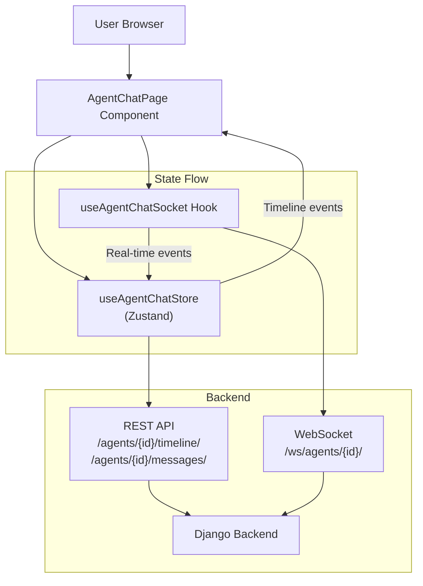
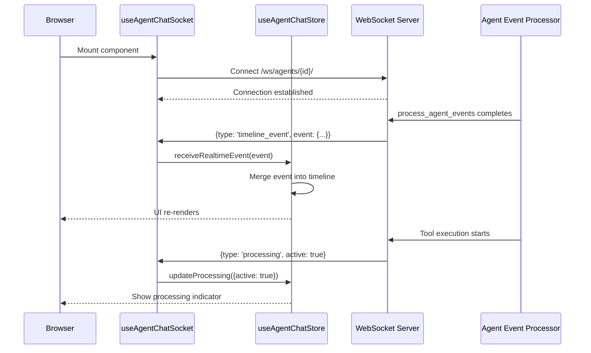
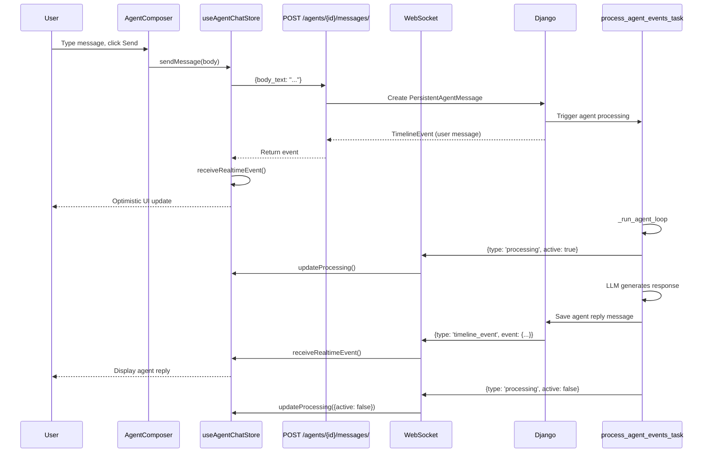
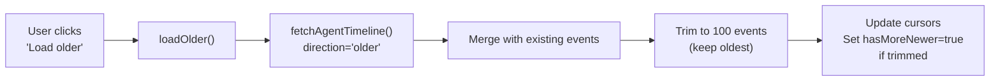
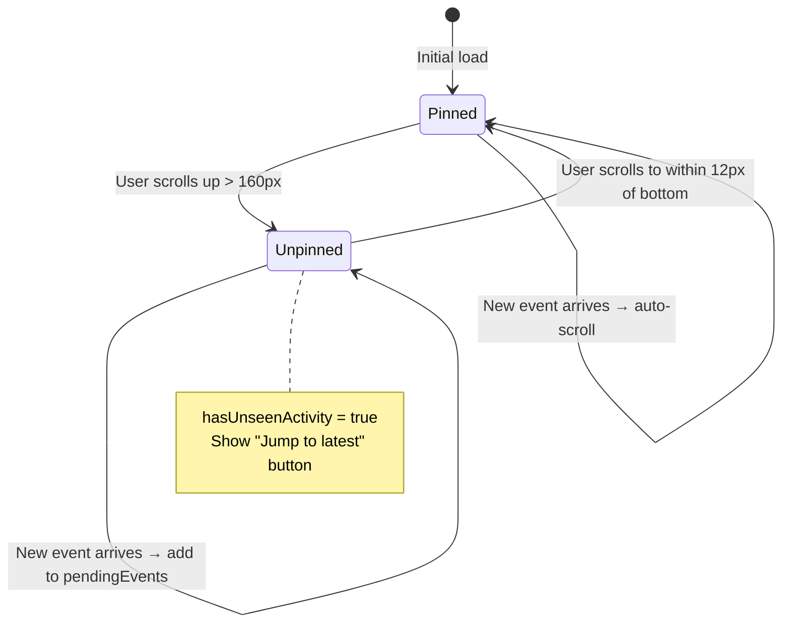
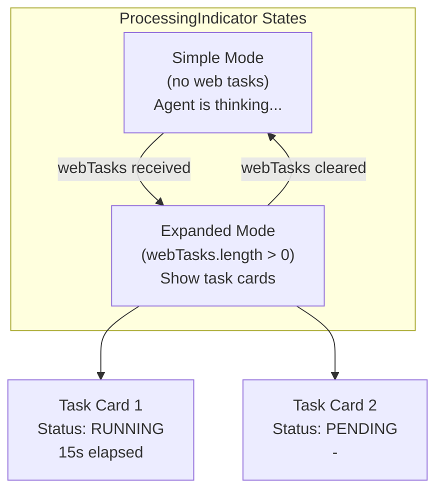
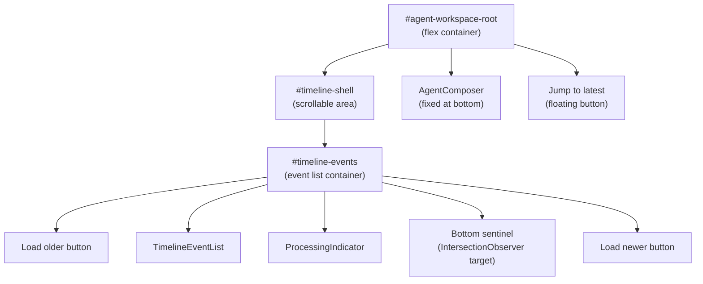

<!-- source: DeepWiki mcp.deepwiki.com · repo gobii-ai/gobii-platform · page 7.1 Agent Web Chat · fetched 2026-10-27 -->

# Agent Web Chat

<details>
<summary>Relevant source files</summary>

The following files were used as context for generating this wiki page:

- [frontend/src/components/agentChat/AgentChatLayout.tsx](frontend/src/components/agentChat/AgentChatLayout.tsx)
- [frontend/src/screens/AgentChatPage.tsx](frontend/src/screens/AgentChatPage.tsx)
- [frontend/src/stores/agentChatStore.ts](frontend/src/stores/agentChatStore.ts)
- [frontend/src/styles/agentChatLegacy.css](frontend/src/styles/agentChatLegacy.css)

</details>


## Purpose and Scope

Agent Web Chat provides a real-time, browser-based communication interface between users and their persistent agents. This page covers the chat timeline architecture, WebSocket-based event delivery, message structure, and the state management systems that enable interactive conversations.

For information about the React UI components and visual styling, see [Agent Chat Interface](#8.3). For agent-to-agent communication, see [Peer Messaging](#7.3). For email and SMS communication channels, see [Email & SMS](#7.2).

---

## Architecture Overview

The web chat system operates as a real-time communication channel built on three core layers: a timeline event model that structures conversation history, a WebSocket connection for live updates, and a React-based state management system that synchronizes UI state with backend events.



**Sources:** [frontend/src/screens/AgentChatPage.tsx:1-204](), [frontend/src/stores/agentChatStore.ts:1-473]()

---

## Timeline Event Model

The chat timeline consists of heterogeneous event types serialized as `TimelineEvent` objects. Each event has a `cursor` field (format: `{timestamp}:{discriminator}`) used for pagination and ordering.

### Event Types

| Event Kind | Description | Key Fields |
|------------|-------------|------------|
| `message` | User or agent message | `message.bodyText`, `message.bodyHtml`, `message.direction` |
| `steps` | Tool call cluster | `entries[]`, `collapsible`, `collapseThreshold` |
| `schedule` | Schedule display | `schedule.cronExpression`, `schedule.humanReadable` |

**Message Events**

Message events represent text communication in either direction (`INBOUND` from user, `OUTBOUND` from agent). The frontend normalizes HTML content via `sanitizeHtml()` before rendering.

[frontend/src/stores/agentChatStore.ts:34-69]()

**Tool Cluster Events**

Tool execution (e.g., `browse_web`, `send_email`, MCP tool calls) appears as a `steps` event containing multiple `ToolCallEntry` objects. Clusters with ≥ `collapseThreshold` entries become collapsible UI elements.

[frontend/src/stores/agentChatStore.ts:81-111]()

### Event Normalization and Merging

The store implements merge logic to handle:
1. **HTML sanitization**: Raw text that looks like HTML is sanitized and stored in `bodyHtml`
2. **Cluster merging**: Incoming `steps` events merge with existing ones at the same cursor
3. **Deduplication**: Events with identical cursors replace previous versions

[frontend/src/stores/agentChatStore.ts:113-129]()

**Sources:** [frontend/src/stores/agentChatStore.ts:1-473](), [frontend/src/types/agentChat.ts]()

---

## Real-time Communication

### WebSocket Connection

The `useAgentChatSocket` hook establishes a WebSocket connection to `/ws/agents/{agentId}/` and routes incoming messages to the store.



**Sources:** [frontend/src/hooks/useAgentChatSocket.ts]()

### Processing Status Updates

WebSocket messages with `type: 'processing'` or `type: 'processing_snapshot'` control the visibility of the processing indicator. The `ProcessingSnapshot` object includes:
- `active`: Boolean indicating if agent is processing
- `webTasks`: Array of `ProcessingWebTask` objects for browser automation tasks

[frontend/src/stores/agentChatStore.ts:133-168]()

**Sources:** [frontend/src/stores/agentChatStore.ts:133-168](), [frontend/src/types/agentChat.ts]()

---

## Message Flow: User to Agent

When a user sends a message through the chat interface, the following sequence occurs:



**Key Implementation Details:**

1. **Optimistic Updates**: `sendMessage()` immediately adds the user's message to the timeline via `receiveRealtimeEvent()`, avoiding perceived latency [frontend/src/stores/agentChatStore.ts:376-394]()

2. **Credit Gating**: The backend may reject message processing if credits are exhausted (see [TaskCreditService](#5.1))

3. **Conversation Threading**: Messages link to a `PersistentAgentConversation` record for context preservation

**Sources:** [frontend/src/stores/agentChatStore.ts:376-394](), [frontend/src/api/agentChat.ts]()

---

## State Management Architecture

### useAgentChatStore

The Zustand-based store manages all chat state, including timeline events, pagination cursors, loading states, and auto-scroll behavior.

**Core State Fields:**

| Field | Type | Purpose |
|-------|------|---------|
| `agentId` | `string \| null` | Current agent identifier |
| `events` | `TimelineEvent[]` | Visible timeline window (max 100 events) |
| `oldestCursor` / `newestCursor` | `string \| null` | Pagination boundaries |
| `hasMoreOlder` / `hasMoreNewer` | `boolean` | Infinite scroll flags |
| `processingActive` | `boolean` | Agent processing indicator |
| `processingWebTasks` | `ProcessingWebTask[]` | Active browser automation tasks |
| `autoScrollPinned` | `boolean` | Whether to auto-scroll to bottom |
| `pendingEvents` | `TimelineEvent[]` | Events received while scrolled up |

[frontend/src/stores/agentChatStore.ts:170-197]()

### Pagination System

The store maintains a sliding window of up to 100 events (`TIMELINE_WINDOW_SIZE`). When loading older or newer events, the window shifts and excess events are trimmed.

**Load Older Flow:**



[frontend/src/stores/agentChatStore.ts:265-299]()

**Load Newer Flow:**

When loading newer events, the window shifts forward, trimming older events if necessary. If the newest events are loaded, `hasMoreNewer` becomes `false` and the processing indicator becomes visible.

[frontend/src/stores/agentChatStore.ts:301-340]()

**Sources:** [frontend/src/stores/agentChatStore.ts:131-340]()

---

## Auto-scroll System

The auto-scroll system ensures new messages appear automatically while allowing users to browse history without disruption.

### Scroll Pinning Mechanism

A scroll is "pinned" when the user is viewing the bottom of the timeline. The system tracks this via two mechanisms:

1. **IntersectionObserver**: Watches a sentinel element at timeline bottom [frontend/src/screens/AgentChatPage.tsx:133-154]()
2. **Scroll Event Listener**: Detects manual scrolling and unpins if distance > 160px from bottom [frontend/src/screens/AgentChatPage.tsx:69-117]()



### Pending Events Queue

When unpinned, incoming real-time events accumulate in `pendingEvents[]` rather than appearing immediately. This prevents the timeline from shifting unexpectedly while the user reads old messages.

[frontend/src/stores/agentChatStore.ts:396-427]()

When the user re-pins (scrolls to bottom or clicks "Jump to latest"), pending events merge into the main timeline.

[frontend/src/stores/agentChatStore.ts:438-461]()

### Auto-scroll Suppression

The `suppressAutoScrollPin()` method temporarily prevents auto-scroll re-activation for a duration (default 1000ms). This is used when programmatic scrolling occurs to avoid race conditions.

[frontend/src/stores/agentChatStore.ts:462-471]()

**Sources:** [frontend/src/screens/AgentChatPage.tsx:69-172](), [frontend/src/stores/agentChatStore.ts:396-471]()

---

## Processing Indicators

### Active Processing State

The `ProcessingIndicator` component renders when `processingActive` is true and no newer events exist to load. It displays the agent's first name with a pulsing visual indicator.

[frontend/src/components/agentChat/ProcessingIndicator.tsx](), [frontend/src/styles/agentChatLegacy.css:37-110]()

### Browser Task Cards

When browser automation tasks (`BrowserUseAgentTask`) are running, the processing indicator expands to show individual task cards with:
- **Status badge**: Color-coded status (pending, running, succeeded, failed)
- **Elapsed time**: Duration since task start
- **Prompt preview**: Truncated task prompt
- **Expandable details**: Full prompt in Markdown format



The frontend polls `/agents/{id}/processing-status/` to refresh task details if they become stale.

[frontend/src/stores/agentChatStore.ts:251-263]()

**Sources:** [frontend/src/components/agentChat/ProcessingIndicator.tsx](), [frontend/src/stores/agentChatStore.ts:251-263](), [frontend/src/styles/agentChatLegacy.css:37-293]()

---

## Timeline Rendering

### AgentChatLayout Component

The `AgentChatLayout` component is the primary layout shell that composes:
- **Timeline event list**: Scrollable history with load controls
- **Processing indicator**: Agent activity status
- **Composer**: Message input field
- **Jump button**: Floating action button to return to latest

[frontend/src/components/agentChat/AgentChatLayout.tsx:27-147]()

**Layout Structure:**



### Conditional Rendering Logic

| Element | Visible When |
|---------|-------------|
| Load Older Button | `hasMoreOlder || loadingOlder` |
| Load Newer Button | `hasMoreNewer || loadingNewer` |
| Processing Indicator | `processingActive && !hasMoreNewer` |
| Bottom Sentinel | `!initialLoading && !hasMoreNewer` |
| Jump to Latest Button | `hasMoreNewer \|\| hasUnseenActivity \|\| !autoScrollPinned` |

[frontend/src/components/agentChat/AgentChatLayout.tsx:47-52]()

**Sources:** [frontend/src/components/agentChat/AgentChatLayout.tsx:1-148](), [frontend/src/styles/agentChatLegacy.css:1-1317]()

---

## Event Styling and Animation

### Message Bubbles

Chat bubbles use distinct styling based on direction and type:

| Class | Applied To | Styling |
|-------|-----------|---------|
| `.chat-bubble--user` | User messages | Gradient purple background, white text |
| `.chat-bubble--agent` | Agent messages | Light background, dark text, subtle border |
| `.chat-bubble--peer-out` | Outbound peer messages | Light purple gradient, border |
| `.chat-bubble--peer-in` | Inbound peer messages | Light background, dashed border |

[frontend/src/styles/agentChatLegacy.css:1180-1203]()

### Incoming Animation

New events that arrive via WebSocket receive the `.timeline-event--incoming` class, triggering a slide-up animation with highlight effect:

[frontend/src/styles/agentChatLegacy.css:539-579]()

```css
@keyframes timelineEventIncoming {
  0% { opacity: 0; transform: translateY(12px); }
  100% { opacity: 1; transform: translateY(0); }
}
```

**Sources:** [frontend/src/styles/agentChatLegacy.css:528-579](), [frontend/src/components/agentChat/TimelineEventList.tsx]()

---

## Web Session Management

The `useAgentWebSession` hook initializes a session via `POST /agents/{id}/web-session/` to track user presence for analytics. This is separate from WebSocket connectivity and does not affect chat functionality.

[frontend/src/hooks/useAgentWebSession.ts](), [frontend/src/screens/AgentChatPage.tsx:49]()

**Sources:** [frontend/src/hooks/useAgentWebSession.ts](), [frontend/src/screens/AgentChatPage.tsx:1-204]()

---

