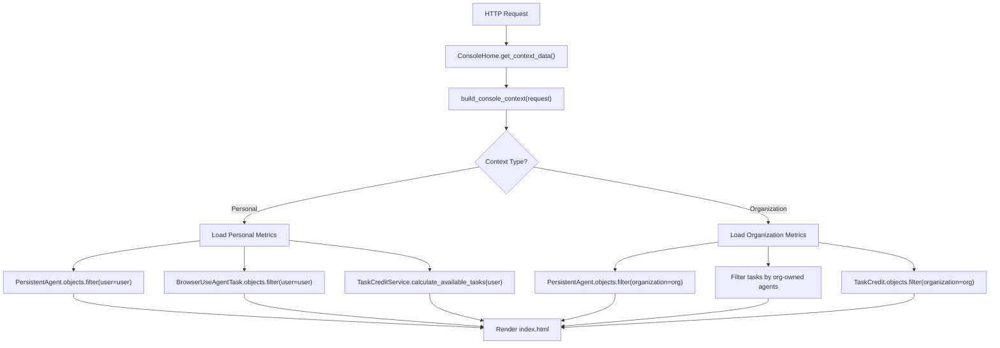
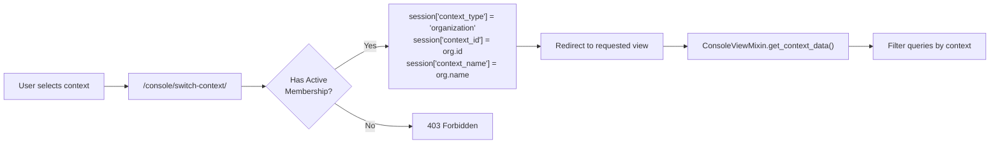
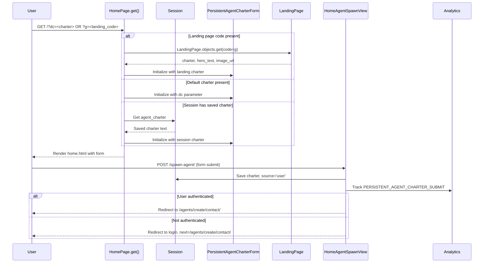
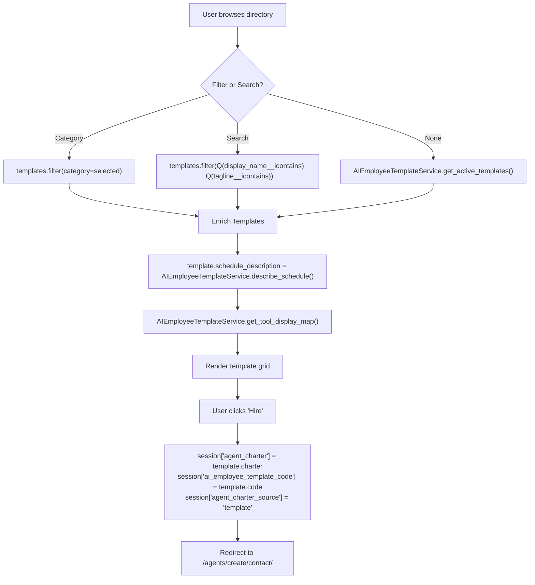
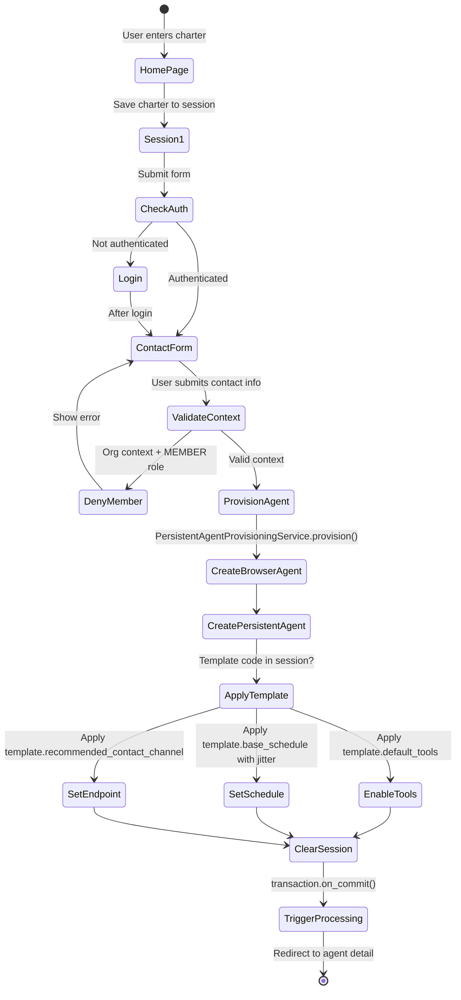
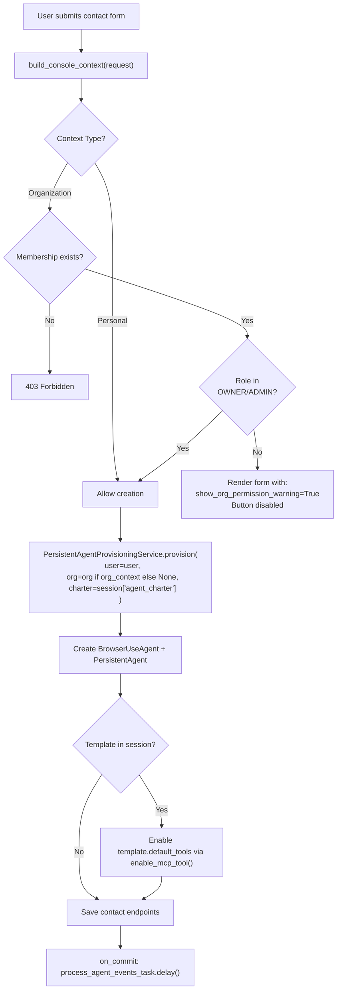

<!-- source: DeepWiki mcp.deepwiki.com · repo gobii-ai/gobii-platform · page 8 User Interfaces · fetched 2026-10-27 -->

# User Interfaces

<details>
<summary>Relevant source files</summary>

The following files were used as context for generating this wiki page:

- [agents/services.py](agents/services.py)
- [api/agent/core/event_processing.py](api/agent/core/event_processing.py)
- [api/models.py](api/models.py)
- [console/templates/partials/_agent_contact_form.html](console/templates/partials/_agent_contact_form.html)
- [console/views.py](console/views.py)
- [pages/templates/ai_directory/detail.html](pages/templates/ai_directory/detail.html)
- [pages/templates/ai_directory/index.html](pages/templates/ai_directory/index.html)
- [pages/templates/home.html](pages/templates/home.html)
- [pages/views.py](pages/views.py)
- [tests/unit/test_agent_limits.py](tests/unit/test_agent_limits.py)
- [tests/unit/test_ai_employee_directory.py](tests/unit/test_ai_employee_directory.py)
- [tests/unit/test_console_context.py](tests/unit/test_console_context.py)

</details>


**Purpose**: This document covers the web-based user interfaces in the gobii-platform, including the console dashboard, homepage with agent spawning, and the AI employee directory. These interfaces provide the primary user experience for creating and managing persistent agents, viewing usage metrics, and configuring billing.

**Scope**: This page focuses on the view layer, templates, and UI interaction patterns. For backend API endpoints, see [REST API](#9.1). For agent creation logic, see [Creating Agents](#4.1). For billing system internals, see [Credit & Billing System](#5).

---

## UI Layer Architecture

The platform uses a traditional Django view/template architecture with progressive enhancement via HTMX for dynamic interactions. The UI layer is organized into three main areas:

1. **Console** (`/console/*`) - Authenticated management dashboard
2. **Homepage** (`/`) - Public landing page with agent spawn form
3. **AI Employee Directory** (`/ai-employees/*`) - Curated template gallery

All views inherit from mixins that provide common context data including authentication state, current console context (personal vs organization), and usage metrics.

**Sources**: [console/views.py:1-2570](), [pages/views.py:1-477]()

---

## Console Interface

### ConsoleHome Dashboard

The `ConsoleHome` view ([console/views.py:351-577]()) serves as the primary management interface. It displays:

- Agent count and task statistics
- Credit balance and usage percentage  
- API key management shortcuts
- Task status breakdown (completed, in progress, failed, cancelled)
- Pending agent transfer invitations

The dashboard context varies based on whether the user is in **personal** or **organization** mode:



**Key Code Symbols**:
- `ConsoleViewMixin` - Base mixin providing console context to all views
- `build_console_context(request)` - Resolves current context from session
- `current_context` dict with keys: `type`, `id`, `name`

**Sources**: [console/views.py:351-577](), [console/context_helpers.py]() (referenced)

---

### Context Switching System

Users can switch between **personal** and **organization** contexts via a session-based system. The active context determines which agents, tasks, and billing information are displayed.



Context is stored in three session keys:
- `context_type` - Either `"personal"` or `"organization"`
- `context_id` - User ID or Organization UUID
- `context_name` - Display name for UI

**Sources**: [console/views.py:184-195](), [tests/unit/test_console_context.py:93-106]()

---

### API Key Management

The API key management interface demonstrates the HTMX-driven interaction pattern used throughout the console. The `ApiKeyListView` ([console/views.py:583-745]()) handles both listing and creation.

**Request Flow**:

1. **GET** `/console/api-keys/` - Renders full page with table
2. **POST** `/console/api-keys/` (HTMX) - Creates key, returns partial
3. **PATCH** `/console/api-keys/<id>/` (HTMX) - Revokes key
4. **DELETE** `/console/api-keys/<id>/` (HTMX) - Deletes key

The view uses `ApiKeyOwnerMixin` ([console/views.py:149-181]()) to resolve whether keys belong to the current user or the active organization context. This mixin provides:

- `api_key_context` - Dict with `type`, `organization`/`user`, `can_manage`
- `_ensure_can_manage_api_keys()` - Permission guard

**HTMX Response Pattern**:
```python
if request.htmx:
    response = render(request, "partials/_api_key_created.html", {
        "raw_key": raw_key,
        "key_id": api_key.id
    })
    response["HX-Trigger"] = json.dumps({
        "refreshApiKeysTable": None,
        "close-modal": {"id": "create-api-key-modal"},
    })
    return response
```

**Sources**: [console/views.py:583-917](), [console/views.py:149-181]()

---

### Billing Views

The `BillingView` ([console/views.py:918-1125]()) adapts its display based on context:

**Personal Context**:
- User's active subscription (from djstripe)
- Task credit balance via `TaskCreditService.calculate_available_tasks()`
- Additional tasks usage (overage tracking)
- Stripe checkout links for plan upgrades

**Organization Context**:
- Organization billing details (`OrganizationBilling` model)
- Seat management (purchased seats, pending changes)
- Organization-level credit pool
- Stripe billing portal links

The view enforces role-based access via `BILLING_MANAGE_ROLES` ([console/views.py:128-132]()):
```python
BILLING_MANAGE_ROLES = {
    OrganizationMembership.OrgRole.OWNER,
    OrganizationMembership.OrgRole.ADMIN,
    OrganizationMembership.OrgRole.BILLING,
}
```

**Sources**: [console/views.py:918-1125](), [console/org_billing_helpers.py]() (referenced)

---

## Homepage & AI Employee Directory

### Homepage Agent Spawn

The `HomePage` view ([pages/views.py:50-195]()) serves dual purposes:
1. Public landing page for unauthenticated users
2. Agent creation entry point for authenticated users

**Charter Input Flow**:



**Key Template Features** ([pages/templates/home.html:1-615]()):
- Game-of-life animated background (canvas-based)
- Charter textarea with inline submit button
- Featured AI employee cards (3 shown, see below)
- Recent agents widget for authenticated users

**Sources**: [pages/views.py:50-245](), [pages/templates/home.html:100-161]()

---

### AI Employee Directory

The `AIEmployeeTemplateService` ([agents/services.py:119-265]()) provides utilities for working with curated agent templates stored in the `PersistentAgentTemplate` model.

**Directory Views**:

| View | Route | Purpose |
|------|-------|---------|
| `AIEmployeeDirectoryView` | `/ai-employees/` | Grid of all active templates with category filter |
| `AIEmployeeDetailView` | `/ai-employees/<slug>/` | Full template details, charter preview |
| `AIEmployeeHireView` | `/ai-employees/<slug>/hire/` | POST handler to initiate creation |

**Template Selection Flow**:



**Schedule Description** ([agents/services.py:183-202]()):
The service converts cron expressions to human-readable text using `cron-descriptor`:
- `"0 9 * * MON-FRI"` → `"At 09:00 AM, Monday through Friday"`
- `"@daily"` → Expanded via `_CRON_MACRO_MAP` → `"At 12:00 AM"`

**Jitter Computation** ([agents/services.py:149-180]()):
Templates include `schedule_jitter_minutes` to randomize execution times:
```python
# If base_schedule = "0 10 * * *" and jitter = 15
# Random offset between -15 and +15 minutes
# Result could be "7 10 * * *" (10:07 AM)
```

**Sources**: [pages/views.py:247-374](), [agents/services.py:119-265](), [pages/templates/ai_directory/index.html:1-120]()

---

## Agent Creation Flow

The agent creation process spans multiple views and uses session state to preserve user input across steps.

### Multi-Step Process



**Sources**: [pages/views.py:198-244](), [console/views.py:2064-2570]()

---

### Contact Form View

The `AgentContactFormView` ([console/views.py:2064-2570]() approximately) handles the second step of agent creation. This view demonstrates several important patterns:

**Organization Context Handling** ([console/templates/partials/_agent_contact_form.html:23-48]()):
- Dropdown to select personal vs organization ownership
- Permission check: Only `OWNER`/`ADMIN` roles can create org agents
- If current user is `MEMBER`, submit button is disabled with `aria-disabled="true"`

**Contact Method Configuration**:
The form collects:
- Email endpoint with toggle
- SMS endpoint with phone verification (inline form)
- Preferred contact method (radio buttons)

**Template Integration**:
If `session['ai_employee_template_code']` exists:
```python
template = AIEmployeeTemplateService.get_template_by_code(code)
# Pre-fill charter, schedule, tools
# Display template info card in UI
```

**Sources**: [console/templates/partials/_agent_contact_form.html:1-336](), [tests/unit/test_console_context.py:215-268]()

---

### Organization Permission Enforcement

When creating agents in organization context, the view enforces role-based permissions:



**Role Constants** ([console/views.py:128-146]()):
```python
BILLING_MANAGE_ROLES = {OWNER, ADMIN, BILLING}
MEMBER_MANAGE_ROLES = {OWNER, ADMIN}
API_KEY_MANAGE_ROLES = {OWNER, ADMIN}
API_KEY_VIEW_ROLES = {OWNER, ADMIN, BILLING}
```

**Sources**: [console/views.py:2064-2570](), [tests/unit/test_console_context.py:228-268]()

---

## UI-Backend Integration Patterns

### Session Management

The platform uses Django sessions extensively for multi-step flows:

**Agent Creation Session Keys**:
- `agent_charter` - User's charter text
- `agent_charter_source` - Either `"user"` or `"template"`
- `ai_employee_template_code` - Template code if using a template
- `org_seat_portal_target` - Stripe portal redirect info (billing)
- `org_overage_detach` - Temporary overage SKU state (org billing)

**Console Context Session Keys**:
- `context_type` - `"personal"` or `"organization"`
- `context_id` - UUID string of user/org
- `context_name` - Display name

**Sources**: [pages/views.py:62-109](), [console/views.py:223-250]()

---

### Analytics Tracking

All major user actions trigger analytics events via the `Analytics` utility:

```python
# Example from homepage agent spawn
Analytics.track_event(
    user_id=request.user.id,
    event=AnalyticsEvent.PERSISTENT_AGENT_CHARTER_SUBMIT,
    source=AnalyticsSource.WEB,
    properties={
        'charter': form.cleaned_data['charter'],
        'source_page': 'home',
    }
)
```

**Organization Events** use a helper to attach org metadata ([console/views.py:197-220]()):
```python
props = _org_event_properties(request, {
    'key_id': str(api_key.id),
    'key_name': name,
})
# props now includes: organization_id, organization_name, organization_plan
```

Events are tracked via `transaction.on_commit()` to ensure the event fires only after successful DB commits.

**Sources**: [pages/views.py:213-224](), [console/views.py:197-220](), [console/views.py:707-724]()

---

### HTMX Interaction Pattern

HTMX enables partial page updates without full reloads. The pattern used throughout:

1. **Initial GET**: Render full page with `<div hx-get="...">` or `<form hx-post="...">`
2. **HTMX Request**: Detected via `request.htmx` property
3. **Partial Response**: Return only the updated fragment
4. **Client Events**: Trigger additional updates via `HX-Trigger` header

**Example**: API Key Revocation ([console/views.py:792-822]()):
```python
def patch(self, request, *args, **kwargs):
    api_key = self.get_object()
    api_key.revoke()
    
    if request.htmx:
        response = render(request, "partials/_api_key_success.html", {
            "message": f"API key '{api_key.name}' has been revoked.",
            "id": api_key.id
        })
        # Trigger client-side refresh of the specific table row
        response["HX-Trigger"] = f"refresh-row-{api_key.id}"
        return response
    else:
        # Traditional full-page redirect
        messages.success(request, f"API key '{api_key.name}' has been revoked.")
        return redirect(reverse('api_keys'))
```

**Sources**: [console/views.py:726-862]()

---

## Template Organization

The UI templates follow a consistent structure:

**Base Templates**:
- `base.html` - Global layout with nav, includes `_console_context_switch.html`
- `console_base.html` - Console-specific layout with sidebar

**Page Templates**:
- `index.html` - Console home dashboard
- `home.html` - Public homepage
- `billing.html` - Billing management
- `api_keys.html` - API key management
- `ai_directory/index.html` - Template directory
- `ai_directory/detail.html` - Template detail

**Partials** (under `partials/` or `console/templates/partials/`):
- `_agent_contact_form.html` - Agent creation step 2
- `_api_key_form.html` - API key creation form
- `_api_key_row.html` - Single API key table row
- `_api_key_created.html` - Success message with new key
- `_task_usage.html` - Credit usage widget
- `_sms_form.html` - Phone verification inline form

**Sources**: [console/templates/](), [pages/templates/]()

---

## Key UI Components

### Agent Listings

Agent lists appear on both the console home and the dedicated agents page. Each agent card displays:

- Agent name and status badge (Active/Expired)
- Schedule description (via `AIEmployeeTemplateService.describe_schedule()`)
- Listing description (generated or placeholder)
- Last interaction timestamp

**Listing Description** ([api/agent/short_description.py]() referenced):
- Initially shows placeholder text while description generates
- Async background task creates summary from charter
- Stored in `PersistentAgent.listing_description`

**Sources**: [pages/views.py:160-193](), [pages/templates/home.html:162-210]()

---

### Credit Usage Widget

The `_task_usage.html` partial ([referenced]) displays current credit balance with visual indicators:

**Personal Context**:
- `available_tasks` from `TaskCreditService.calculate_available_tasks()`
- Additional tasks enabled/used/remaining
- Percentage bar for additional tasks quota

**Organization Context**:
- `org_tasks_available` from org-owned `TaskCredit` aggregation
- `org_tasks_used_pct` percentage of org credit pool consumed

**Sources**: [console/views.py:356-509](), [pages/templates/home.html:94-98]()

---

## Summary

The UI layer provides three primary interfaces:

1. **Console**: Role-aware management dashboard with context switching between personal and organization modes
2. **Homepage**: Public landing with agent spawn form and featured templates  
3. **AI Employee Directory**: Curated template gallery with hire flow

All views use consistent patterns:
- Session-based state for multi-step flows
- `ConsoleViewMixin` for authentication and context
- HTMX for progressive enhancement
- Analytics tracking on `transaction.on_commit()`
- Role-based permission enforcement for organization features

The agent creation flow demonstrates the integration of these patterns: charter input → authentication → contact configuration → provisioning → template application → async event processing.

**Sources**: [console/views.py:1-2570](), [pages/views.py:1-477](), [agents/services.py:1-265](), [console/templates/](), [pages/templates/]()

---

